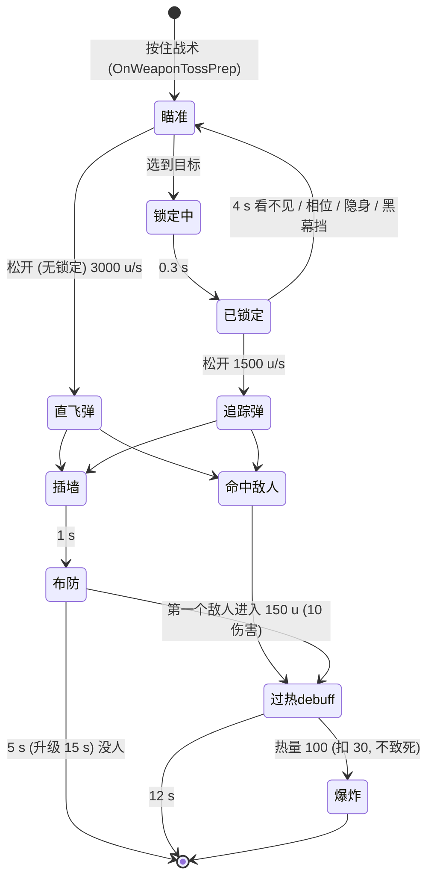

# Ballistic 战术 Whistler 呼啸弹：系统记录

批次 C（combat-c），2026-10-31，静态研究（只读脚本，没进游戏）。

出处从 `research-src/s21-platform/scripts/` 开始。`nut` = `vscripts/weapons/mp_ability_debuff_zone.nut`，`txt` = `weapons/mp_ability_debuff_zone.txt`，`loc` = `research-src/s21-platform/localization/localization_english.txt`。

## 0. 概要

- **技能**：Ballistic / 战术 / Whistler / `mp_ability_debuff_zone`。
- **一句话**：按住战术进入锁定（3000 u 内、准星 5° 锥里的敌人，0.3 s 锁上）；松开射出一发子弹：有锁定就 1500 u/s 追踪目标，没锁定就 3000 u/s 直飞。**直接打中敌人**：给他 12 s 的"过热"debuff——这期间他开枪会积热，积满 100 就枪炸手，扣 30 血（不致死）并结束 debuff。**打到墙 / 地面**：插在那里，1 s 后变成半径 150 u 的感应区，5 s 内第一个进去的敌人受 10 伤害并吃同样的 debuff，然后区域消失。
- **分类**：**好技能**（对玩家是"压制"；对 AI 要改效果，见第 6 节）＋ **系统**（锁定选目标 + 追踪弹；"打中人 / 打中墙"两种结果；一次性感应区）＋ **可视化**（锁定标记、射程脉冲、敌人头顶的过热进度图标、屏幕边缘逐级变红）。
- **可拆出的部件**：
  - 锁定选目标（锥内打分 + 多点可见检测 + 锁定延迟 + 离开视线超时）→ 3.2.1，公共部件 `_shared/C-LOCKON-HOMING.md`
  - 追踪弹（按距离延迟开始追踪，相位 / 隐身断追踪）→ 3.2.2，同上
  - 粘附投射物分支（打中单位 / 打中世界）→ 3.2.3
  - 一次性感应区（布防延迟 → 每帧 RadiusDamage → 第一个命中就结束）→ 3.2.4
  - 过热 debuff（状态效果 + 引擎积热条 + 满了的回调）→ 3.2.5
  - 头顶进度图标 / 屏幕分级调色 → 3.3

## 1. 它用什么实现各种效果

| 效果 | 实现手段 | 说明 |
|---|---|---|
| 锁定目标 | 服务端每帧线程 `GetBestHomingTargetThread`，结果写进玩家网络变量 `hasBallisticLockonTarget` | `nut:539-590`、`nut:221` |
| 锁定标记 | 粒子 `P_clbr_tac_wpn_Lockon_init`（0.3 s）→ `P_clbr_tac_wpn_Lockon`，挂目标 `CHESTFOCUS`，只给 Ballistic 看 | `nut:761-859` |
| 被锁定的人收到提示 | 网络变量 `ballisticIsBeingTargeted` + 音效 + 威胁指示器（挂在 Ballistic 身上） | `nut:813-828`、`nut:878-900`；`cl_smart_ammo.gnut:767` 读它 |
| 子弹 | `FireWeaponMissile`（追踪 1500 / 直飞 3000 u/s），touch 伤害 `DF_GIB`，`.txt` 伤害 15 | `nut:349-378`、`txt` `damage_near_value 15` |
| 追踪 | 引擎 `SetMissileTarget` + `SetHomingSpeeds(1500,1500)`，延迟 0 / 0.15 / 0.4 s 开始 | `nut:925-970` |
| 插墙 | `PlantStickyEntity` 成功 → `CreateDebuffZone` 生成 `prop_script`（子弹模型） | `nut:398`、`nut:1048-1069` |
| 感应区伤害 | 每帧 `RadiusDamage`（10，内外 150，只被笔刷挡，只伤活物，不伤自己），damageSourceId `mp_ability_debuff_zone_aoe`，伤害回调过滤 | `nut:1170-1206`、`nut:983-1046` |
| 过热 debuff | 状态效果 `has_overheat_debuff`（1.0，12 s，淡出 0.5）+ 引擎 `SetPlayerOverheatState(true)` | `nut:1293`、`nut:1243` |
| 积热 | **引擎**：开枪时按武器 `.txt` 的 `player_overheat_per_bullet` 加热（`GetPlayerOverheatValue` 0–100） | 例：`mp_weapon_dmr.txt:122` = 35 |
| 过热爆炸 | 引擎满热时调 `CodeCallback_OnPlayerOverheat` → `DebuffZone_OnPlayerOverheat`：扣 `min(hp−1, 30)`、结束 debuff | `sh_codecallbacks.gnut:1102`、`nut:507-536` |
| 身上特效 | `P_clbr_tac_body_debuff_3p`（别人看）；隐身 / 相位时隐藏 | `nut:1306-1344` |
| 武器发光 | 主武器播 `P_clbr_tac_wpn_overheat_idle`，换枪跟着换 | `nut:1616-1665` |
| 屏幕效果 | 驾驶舱粒子 `P_clbr_tac_screen_debuff`，按热量档位改颜色 / 透明度；全屏 RUI `debuff_progress` 进度 | `nut:1578-1614` |
| 队友看到的图标 | 敌人头顶 RUI `overheat_on_player`（进度），在 110° 视野内可见才显示 | `nut:1667-1722` |
| 瞄准时射程脉冲 | 粒子 `P_clbr_tac_distance_sensor`（控制点 1 = 3000）+ 驾驶舱 `P_clbr_tac_screen_idle` | `nut:1502-1527` |
| 感应区表现 | 布防前 `P_clbr_tac_imp` + 电流声；布防后 `P_clbr_tac_imp_aoe`（友方蓝 / 敌方红两份）；最后 5 s 叠 `P_LU_Ballistic_tac_timer`；触发时 `P_clbr_tac_imp_aoe_end` 0.5 s；结束时子弹溶解 | `nut:1086-1206` |

**客户端 / 服务端**：选目标、追踪、感应区、debuff 是服务端；锁定 HUD（RUI `targeting_rui`，只在有 Sling 时建，`nut:1478-1488`）、屏幕和进度 UI 是客户端。

**怀疑点**：`nut` 里有大量被剥掉 `#if` 的空行（如 `nut:122`、`nut:228`、`nut:1287-1289`），像 Respawn 原码经反编译 / 剥离，不像 SDK 重写。积热和过热爆炸在引擎里，脚本只开关状态，**积热速度和冷却速度看不到**（第 5 节）。

## 2. 流程



- **触发**：投掷类副手（`is_toss_weapon 1`，`txt`），按住 = `OnWeaponTossPrep`，松开 = `OnWeaponTossReleaseAnimEvent`（`nut:285-325`）。`max_cook_time -1`（不限按住时长）。相位中也能发射到现实（`fire_in_real_world_while_phased 1`）。
- **取消**：`OnWeaponTossCancel` 结束锁定（`nut:484-505`）；近战取消（`offhand_cancelled_by_melee 1`）。
- **锁定结束条件**（`nut:763`、`nut:794`、`nut:861-876`）：Ballistic 死 / 倒地 / 相位 / 上炮台 / 被沉默 / 被 Seer 战术打中（`HitBySeerTact`）/ 抓空投 / Valk 大招上天；目标死亡 / 传送；目标 4 s 没在 3000 u 内被看见（60° 视野）；目标相位 / 隐身；Catalyst 黑幕挡住。
- **命中敌人**（`nut:381-469`）：是玩家或训练假人 → 加 debuff（目标已在过热中则不重开特效线程）；是 Gibraltar 枪盾 → debuff 给枪盾的主人；是分身 → 子弹继续飞（只停追踪）；其他实体 → 子弹销毁。
- **冷却**：弹匣 25、每发 25、回充 1/s → **25 s**（`txt` `ammo_clip_size 25`、`regen_ammo_refill_rate 1`）。
- **升级**（S21 天赋，`loc:5067`、`loc:7133`、`loc:12272`）：
  - 多一发（`upgrade_tac_one` 模组：弹匣 +25 → 2 发，`txt` Mods）；
  - 感应区存在时间 ×3（5 → 15 s，playlist `ballistic_tact_upgraded_aoe_timeout`，`nut:229-252`，检查 `PAS_TAC_UPGRADE_ONE`）；
  - 命中加速（`PAS_TAC_UPGRADE_THREE`：Ballistic 自己 `speed_boost` 0.15，2 s，淡出 0.25；在加速中再命中只续时间，`nut:1434-1473`）。
  - 不一致：升级音效检查 `PAS_TAC_UPGRADE_TWO`（`nut:1131`），时间检查 `PAS_TAC_UPGRADE_ONE`（`nut:240`），注释都写 `upgrade_ballistic_lasting_bullet`。推断枚举编号和天赋对应关系有偏差，第 5 节。

## 3. 代码

### 3.1 入口

- `MpWeaponDebuffZone_Init`（`nut:162-226`）：读 11 个 playlist 变量（第 4 节）；注册感应区伤害回调、过热回调 `AddCallback_OnPlayerOverheat`、两个玩家专属网络变量、客户端状态效果开关回调和锁定 RUI。
- 武器回调（`txt`）：TossPrep / TossReleaseAnimEvent / Toss / TossCancel / ProjectileCollision / Deactivate / ClientAnimEvent。

### 3.2 核心逻辑

#### 3.2.1 选目标 `SelectBestTargetFromArray`（`nut:592-759`）

```
候选 = 敌方玩家；没有可选的再试 NPC、空投飞行物、分身
过滤：同 realm、活着（分身掉落物例外）、非相位、非隐身、非倒地、非友方分身、非 loot tick
d = 目标中心 - 眼睛
d² > 3000² → 跳过
d ≤ 120 u：沿视线打 120 u 射线，打中它 → 直接选它
dot(normalize d, 视线) < cos45° → 跳过（粗筛）
依次用 中心 / 脚底 / 眼睛 判断是否在 5° 锥内（cos5°），记分 = 那个 dot
按分数排序，从高到低：Catalyst 黑幕同时挡眼睛和中心 → 跳过；
   依次对 中心 / 脚底 / 眼睛 打可见射线（TRACE_MASK_VISIBLE；目标在炮台上用 SHOT），第一个看得见的就是结果
```

`GetBestHomingTargetThread`（`nut:539-590`）每帧跑一次；目标变了就 `EndLockon` 旧的，开 `AcquireLockon_Thread`（0.3 s 后进入 `TrackingTargetLogic_Thread`）和对目标的威胁指示。

`TrackingTargetLogic_Thread`（`nut:792-859`）：设 `hasBallisticLockonTarget = true`；每帧如果目标在 3000 u 内且 `PlayerCanSee(…, 60°)`，就把超时推到 now + 4；超时 / 相位 / 隐身 / 黑幕挡就结束。注意锁上之后**不再要求在 5° 锥里**，只要 60° 视野内看得见。

#### 3.2.2 发射和追踪（`nut:349-378`、`nut:925-981`）

```
isHoming = 网络变量 hasBallisticLockonTarget
speed = isHoming ? 1500 : 3000
missile = FireWeaponMissile(pos, dir, speed, touch=DF_GIB, explosion=explosive|DF_NO_SELF_DAMAGE)
if isHoming 且目标有效: HomingMissileThread
   delay = 距离 ≥ 800 ? 0.4 : 距离 < 200 ? 0 : 0.15
   给目标挂一个跟着导弹的威胁指示
   wait delay；SetMissileTarget(target)；SetHomingSpeeds(1500, 1500)
   每帧：目标相位 / 隐身 → 停追踪（SetMissileTarget(null)）
```

`MISSILE_LIFETIME = 5` 只算了 `endTime` 没用（`nut:934`）；实际寿命是 `.txt` `projectile_lifetime 5`。`projectile_launch_speed 1` 被脚本速度覆盖。

#### 3.2.3 碰撞分支（`nut:381-469`）

```
PlantStickyEntity(projectile, …) 成功（打在能粘的世界 / 允许的实体上）→ CreateDebuffZone
否则：
  玩家 / 训练假人，敌方 → 活着就 ApplyEnemyDebuffToTarget + OverheatDebuffTargetFX；销毁子弹
  Gibraltar 枪盾，敌方 → debuff 给盾的 parent（玩家）
  分身 → 不销毁（只结束追踪）
  其他 → 销毁
```

`txt` `stick_pilot/npc/drone 0`：不粘人；允许粘的实体只有移动重生点和制造机（`DebuffZone_GetAllowableStickyEnts`，`nut:471-482`）。

#### 3.2.4 一次性感应区 `CreateDebuffZone`（`nut:1048-1207`）

```
生成 prop_script（子弹模型，无碰撞，敌方橙 255 130 0 / 友方青 45 237 237），朝向反转后退 1.5 u
敌方威胁指示（200 u 半径）；布防前特效 + 电流声；TrackingVision POI
wait 1.0
换成区域特效（友方 / 敌方各一份，颜色在控制点 1），播启动声
endTime = now + (升级 ? 15 : 5)
每帧：RadiusDamage(中心=prop 后退 5 u, 10, 10, 150, 150, 只被笔刷挡 | 只伤活物 | 不伤自己, 力 0, DF_ELECTRICAL)
       剩 < 5 s 时叠倒计时特效
OnDamaged_DebuffZone 过滤后：区域命中特效 0.5 s，ApplyEnemyDebuffToTarget，然后 Signal("EndAOEThreads") → 区域结束、子弹溶解
```

伤害过滤（`nut:983-1046`）：自己、友方、**非训练假人的 NPC**、非玩家、倒地、死亡 → 伤害设 0、不触发；分身 → 触发结束（不给 debuff）；站在 Wattson 拦截塔范围内 → 伤害 0，塔把它电掉。

**所以感应区对普通 NPC 没有任何作用**（伤害 0、不结束区域），直接命中 NPC 也不给 debuff（3.2.3 只认玩家 / 训练假人）。PvE 必须改，见第 6 节。

#### 3.2.5 过热 debuff

- `ApplyEnemyDebuffToTarget`（`nut:1275-1304`）：升级三 → 自己加速；倒地 → 不加；加状态效果 `has_overheat_debuff`（1.0，`ballistic_tact_debuff_duration` = 12 s，淡出 0.5）；记录"这个人是谁打的"（`file.projectileOwner`）；给 Ballistic 的队友建头顶图标。
- `OverheatDebuffTargetFX`（`nut:1238-1273`）：`SetPlayerOverheatState(true)`；音效；身体特效线程；每帧等到状态效果没了 → `SetPlayerOverheatState(false)`。
- **积热（引擎）**：debuff 期间玩家每开一枪，主武器加 `player_overheat_per_bullet`（`.txt`），推断不开枪时会降温。脚本端只能读 `GetPlayerOverheatValue()`（0–100，`nut:1362`、`nut:1602`）。
- **爆炸**：`DebuffZone_OnPlayerOverheat`（`nut:507-536`）——必须有 debuff；先停 debuff；`TakeDamage(min(hp−1, 30), attacker, damageSourceId = overheat_explosion)`；声音；左手 / 右手爆炸特效 0.5 s。**不会杀人**（留 1 血）。

### 3.3 客户端表现

- 瞄准：射程脉冲 + 驾驶舱 idle 特效（`nut:1502-1527`）；锁定 RUI `isVisible / hasTarget`（`nut:1529-1535`）。
- 被 debuff 的本人（`DebuffZone_OverheatDebuffEnabled`，`nut:1546-1557`）：武器发光线程、全屏进度 RUI + 驾驶舱屏幕特效；热量每 20 一档（5 档），颜色 R 255 / G 100→20 / B 100，透明度 0.3→1.0（`nut:97-109`、`nut:1605-1610`）；热量 > 80 时播警告音（`OverheatSFX_Thread`，`nut:1346-1379`）。
- 队友看敌人：头顶进度图标，110° 视野内可见才显示，有 Seer 标记时换样式（`nut:1700-1722`）。
- 开火震屏：动画事件 `ballistic_tact_screen_shake`，2 / 10 / 0.2 s，向上（`nut:71-75`、`nut:1537-1544`）。

### 3.4 依赖的公共代码

- `PlantStickyEntity`（粘附，通用）、`CreateThreatIndicator`、`RadiusDamage`、`StatusEffect_AddTimed`、`PlayerCanSee`、`FerroWall_BlockScan`（Catalyst 黑幕挡扫描）、`Trophy_EntInTrophyTrigger`。
- 引擎：`SetMissileTarget`、`SetHomingSpeeds`、`SetPlayerOverheatState`、`GetPlayerOverheatValue`、`IsPlayerOverheating`、`DoesWeaponPlayerOverheat`、`CodeCallback_OnPlayerOverheat`（`sh_codecallbacks.gnut:1102`）。
- `SpeedBoostOnDamagePerk` 的 `speed_boost` + `adrenaline_visuals` 状态效果（同 Octane 被动的写法，`nut:1460` 注释）。

## 4. 参数

| 参数 | 值 | 单位 | 来源 | 作用 | 改大 / 改小会怎样 |
|---|---|---|---|---|---|
| homing speed（`ballistic_tact_homing_speed`） | 1500 | u/s | `nut:26`、`nut:193` | 追踪弹速度和转向速度 | 快了更难躲 |
| no-target speed（`ballistic_tact_no_target_speed`） | 3000 | u/s | `nut:27`、`nut:194` | 直飞速度 | — |
| best target range（`ballistic_tact_best_target_range`） | 3000 | u | `nut:30`、`nut:195` | 锁定距离、维持距离、射程脉冲 | — |
| BEST_TARGET_MAX_FOV | 5 | 度 | `nut:31` | 锁定锥半角 | 大了好锁 |
| 粗筛角 | 45 | 度 | `nut:651` | — | — |
| BEST_TARGET_SHORT_DISTANCE | 120 | u | `nut:32` | 近距离直接用准星射线选 | — |
| lock-on delay（`ballistic_tact_lock_on_delay`） | 0.3 | s | `nut:34`、`nut:196` | 锁上前的等待 | — |
| lockout timeout（`ballistic_tact_lockout_timeout_duration`） | 4 | s | `nut:47`、`nut:203` | 看不见多久丢锁 | — |
| 维持锁定视野 | 60 | 度 | `nut:852` | `PlayerCanSee` 的 FOV | — |
| HOMING_SHORT / LONG_DELAY | 0.15 / 0.4 | s | `nut:116-117` | 开始追踪前的直飞时间 | 长了远处容易躲 |
| 追踪延迟分界 | < 200 → 0；≥ 800 → 0.4 | u | `nut:113-114`、`nut:938-941` | — | — |
| MISSILE_LIFETIME | 5（未用）；`projectile_lifetime` 5 | s | `nut:28`、`txt` | 子弹寿命 | — |
| 直接命中伤害 | 15 | HP | `txt` `damage_near/far_value 15` | 推断：touch 伤害（`DF_GIB`） | 第 5 节要测 |
| zone radius（`ballistic_tact_zone_radius`） | 150 | u | `nut:36`、`nut:197` | 感应区半径（内外同） | — |
| aoe spawn delay（`ballistic_tact_aoe_spawn_delay`） | 1.0 | s | `nut:39`、`nut:199` | 布防时间 | — |
| aoe timeout（`ballistic_tact_aoe_timeout`） | 5（升级 15） | s | `nut:37`、`nut:198`、`nut:231` | 感应区存在时间 | — |
| aoe damage（`ballistic_tact_aoe_damage`） | 10 | HP | `nut:40`、`nut:200` | 感应区触发伤害 | — |
| AOE_HIT_EFFECT_TIMER | 0.5 | s | `nut:38` | 触发特效时长 | — |
| debuff duration（`ballistic_tact_debuff_duration`） | 12 | s | `nut:41`、`nut:201` | 过热 debuff 时长（淡出 0.5） | — |
| MAX_DEBUFF_OVERHEAT | 100 | 热量 | `nut:43` | 满热阈值（UI 用；推断引擎同值） | — |
| overheat damage（`ballistic_tact_overheat_damages`） | 30（最多 hp−1） | HP | `nut:44`、`nut:202`、`nut:525` | 爆炸伤害 | — |
| 档位 | 每 20 一档，5 档 | 热量 | `nut:45-46` | 屏幕颜色 | — |
| 警告音阈值 | > 80 | 热量 | `nut:1351` | — | — |
| OVERHEAT_ICON_VISIBILITY_FOV | 110 | 度 | `nut:111` | 头顶图标可见 | — |
| player_overheat_per_bullet | 3030 / Double Take / Mozambique 系列 28；DMR / Peacekeeper(energy_shotgun) 35；Devotion(esaw) 5；其他武器未写（引擎默认） | 热量/发 | 如 `mp_weapon_dmr.txt:122`、`mp_weapon_esaw.txt:306` | 每发积热 | 第 5 节 |
| does_player_overheat | 0：固定炮台武器、飞刀、副手旋涡盾 | — | `mp_weapon_mounted_turret_weapon.txt:22` 等 | 这些不积热 | — |
| 升级加速 | `speed_boost` 0.15，2 s，淡出 0.25 | — | `nut:123`、`nut:1470` | — | — |
| 冷却 | 弹匣 25 / 每发 25 / 回充 1/s → 25 s；升级 +1 发 | — | `txt` | — | — |
| deploy_time / toss_time | 0.1 / 1.0 | s | `txt` | — | — |
| 开火震屏 | 2 / 10 / 0.2 | 幅度 / 频率 / s | `nut:72-74` | — | — |
| 敌方威胁指示半径 | 200 | u | `nut:1086` | 感应区附近的敌人看到 | — |

## 5. 未解决和要实测的

1. **积热速度和降温速度**：引擎实现。只有部分武器写了 `player_overheat_per_bullet`，R-301 / Flatline 等没写的是多少不知道。**测**：AgentLink 给自己加 `has_overheat_debuff` + `SetPlayerOverheatState(true)`，用 R-301、DMR、Devotion 各打 1 发 / 连射，每帧记录 `GetPlayerOverheatValue()`，算每发加多少、停火后每秒降多少。
2. **直接命中伤害**：`.txt` 15 是否生效（touch `DF_GIB`）。**测**：打训练假人看数字。
3. **NPC 不受影响**：3.2.3 / 3.2.4 静态结论是普通 NPC 不吃 debuff、不吃区域伤害。**测**：训练场刷一个 Prowler / 蜘蛛，直接打和让它走进区域各一次。
4. **升级枚举对应**：`PAS_TAC_UPGRADE_ONE` vs `TWO`（见第 2 节）。**测**：分别给两个被动，看感应区时长。
5. **感应区每帧 RadiusDamage 的成本**：只被笔刷挡（`MASK_BRUSHONLY`），推断道具不挡。PvE 只做参考。
6. 服务端代码看起来是官方原样，SDK 重写嫌疑低。

## 6. HSD 实现

**未实现**。现有零件：`SpecialWeapons.cs` 的智能手枪有锥内选目标 + 锁定进度（`SmartPistol.Step`），可以作为"锁定选目标"的起点；`CombatSim` 有子弹射线和爆炸；没有追踪投射物、没有粘附、没有感应区、没有"敌人开火时积热"的概念（AI 目前只有近战假人）。

**对 AI 的效果建议（过热是针对玩家的）**：R5 的过热惩罚的是"开枪"，HSD 的 AI 可以对应成以下三选一，做成开关 `whistler.aiEffect`：

| 选项 | 做法 | 理由 |
|---|---|---|
| **A 压制（推荐默认）** | 12 s 内 AI 的攻击"积热"：每次攻击 +X 热量（近战 34、远程每发按武器），满 100 就**硬直 1 s + 受 30 伤害**，debuff 结束。AI 不知道要停手（或给聪明 AI 一个"热量 > 80 停火 1–2 s"的行为） | 最贴 R5 的规则：仍然是"越打越危险"；对远程 AI 自然变成压制火力 |
| B 攻速减慢 | 12 s 内 AI 攻击间隔 ×1.5、移动不变 | 简单，但丢掉"满了炸"的高潮 |
| C 易伤 | 12 s 内受到伤害 ×1.15 | 最简单，但和 Vantage 标记重复 |

- **感应区**：PvE 里让它对 AI 生效（R5 对 NPC 无效），第一个走进 150 u 的 AI 受 10 伤害 + 吃 debuff。和 R5 的差别写进 `R5-DIFF-ARCHIVE.md`："R5 感应区只认玩家 / 训练假人；HSD 对所有敌人生效"。开关 `whistler.zoneAffectsAi`，默认开。
- **锁定和追踪**：建议放进公共部件 `_shared/C-LOCKON-HOMING.md` 描述的 `LockOnSelector` + `HomingProjectile`（新文件 `Combat/Homing.cs`），Whistler、Vantage 子弹（如需）、Valk 都能用。参数照第 4 节。
- **可视化**：敌人头顶热量条（5 档变红）是 HSD 最该借的部分——AI 头上显示"快炸了"，玩家能看懂规则。
- 冷却 25 s、1 发（升级 2 发），可用 `Charges`。

开关建议：PlayerPrefs `hsd.combat.ballistic.whistler.*`（`aiEffect`、`zoneAffectsAi`、`charges`、`zoneTime`）。
