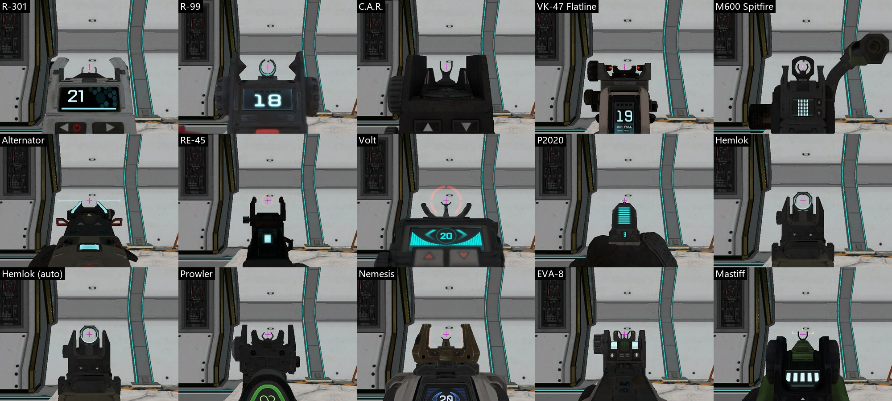
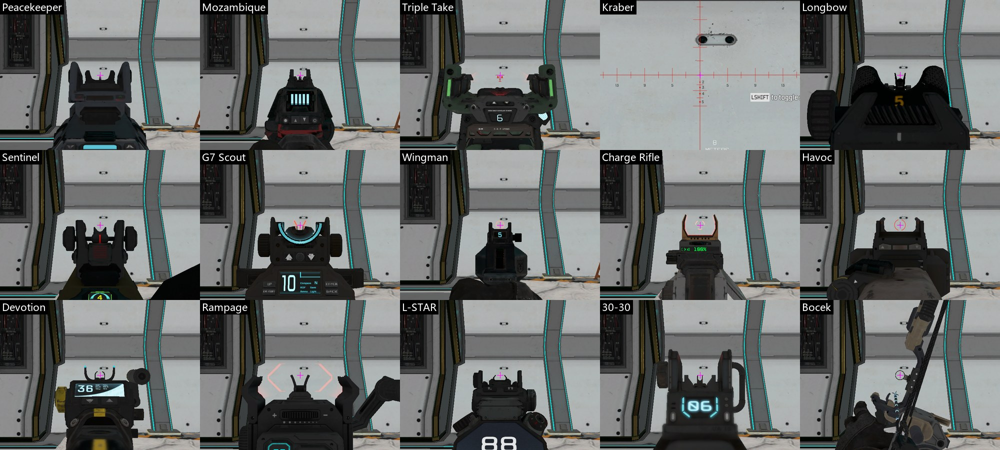

# R5 的基瞄（机械瞄具）规格

会话 `iron-sights`，2026-11-04。起因是用户看了试点枪的叠图后说："你把原本模型上用于瞄准的基瞄给用实心模型盖住了……有点像悬浮瞄准镜了。"这份报告查清 R5 每把枪的基瞄，回答试点枪错在哪，并给出建模规则。**这是研究，没有改模型和 Unity。**

## 结论

1. **用户的判断对，而且不止是模型的问题。** 原因有四个，前两个是主要的：
   - **建模**：试点三把的后瞄位置和结构都不对。R-301 后面的实心块比视线高 0.45 u，把视线整个挡住。把我们的模型放到 R5 的开镜位置，屏幕中心是一堵墙（第 6 节的图）。
   - **开镜位置的旧差异**：Unity 的开镜位置是按枪类共用的常数算的，不是每把枪的 R5 实测。27 把枪比 R5 低 0.4–4 u，瞄具整个在准星下方；3 把（Charge Rifle、L-STAR、Prowler）反而高 0.4–1.3 u。换成正确的模型也对不上。
   - **枪模 FOV**：R5 枪模腰射按 70°、开镜按 `zoom_fov` 渲染，**不是之前粗估的 65.5° 垂直**。之前按错的 FOV 对腰射截图拟合，模型只能做胖才对得上屏幕。
   - **`r5_dims.json` 的瞄线高度**：来自 `D-VIEWMODEL`，有 14 把枪开镜动画还没停，差 0.4–1.1 u。
2. **R5 的基瞄都是"镂空"的**：后瞄是两片耳朵夹一条缺口，视线穿过缺口，前瞄顶在缺口中间。27 把有后瞄的枪里，后瞄顶只比视线高 -0.15 到 +0.42 u，缺口半宽大多是 0.2–0.46 u。
3. **不悬浮靠的是连续的导轨**：瞄具底座直接站在枪身顶线上，枪身顶线一路贴着视线下方走，开镜时看到的是一条从眼前延伸到前瞄的脊。
4. **本来可以量到真实形状**：枪的视图模型文件能当道具摆在天上任意角度拍，瞄具 bodygroup 能开关，两张图一减就是瞄具的精确轮廓。`data/IS-SILHOUETTE.tsv` 还给了每把枪全长的外形，建模不用再靠腰射截图猜。
5. **有两件事要用户定**（第 8 节）：开镜位置要不要改成每把枪的 R5 实测；枪模 FOV 要不要改成 R5 的值。我建议都改。不改第一件，任何模型的瞄具都对不上准星。

## 怎么量的

| 方法 | 给出什么 | 标记 |
|---|---|---|
| `ptpov_*.rmdl` 当客户端道具，放到地图上空，背景是天空，隐藏握枪模型，亮度全开。侧、俯、后、斜四个方向，瞄具开、关、道具隐藏各拍一张，相减 | 瞄具的位置、高度、宽度、轮廓 | **[图]** ±0.05 u，比例误差 1–2 %（已知位移校准：616–625 对公式 611） |
| 握在手上开镜，等 `GetZoomFrac` = 1 后再等 0.5 s，读全部挂点 | 开镜枪口、俯仰、`ADS_CENTER` | **[手]** |
| 武器脚本 | bodygroup、`zoom_fov`、光学镜的改动 | **[字段]** |
| 我看图判断 | 类型、零件、哪些是界面贴图 | **[眼]** |

**没有解包网格**：图差法已经够用，rpak 解析要另写工具。零件尺寸是轮廓尺寸，不是网格顶点。

**单位和坐标**：R5 单位。F 向前（枪口是 0，枪身是负数），R 向右，U 向上（从 `muzzle_flash` 挂点量）。"离眼"是开镜时零件在镜头前多远。

**视线**：开镜时 `U(F) = (−枪口U + F·sinθ) / cosθ`，θ 是枪的俯仰。θ 在 0–1° 之间随待机动画慢慢变（R-301 读到过 0.06° 和 0.32°），后瞄处差约 0.1 u。

**世界近裁剪面约 7 u**：道具离镜头比这个近就被切开，所以开镜画面没法用道具重建，只能用握枪的实拍。

## 1–2. 每把枪的类型、位置和尺寸

每把枪有一页图（前瞄、后瞄的侧视、后视、斜视）：私有仓库 `apex/research/combat/gun-measure/iron-sights/pages/`。完整数字：[data/IS-GUNS.tsv](data/IS-GUNS.tsv)，零件轮廓：[data/IS-PROFILES.json](data/IS-PROFILES.json)（`outline_side` 是 (F, U) 多边形，`back_profile` 是从后面看的顶边 (R, U)）。

下表 F、顶、宽是 **[图]**，开镜枪口是 **[手]**，类型是 **[眼]**。"高出视线"负数表示比视线低。"宽"是后瞄最上面 0.8 u 从后面看的范围，旁边的把手、旋钮也算进去了（Spitfire 的 2.2 是提手，Wingman 的 0.88 是旋钮）。

| 枪 | 类型和零件 | 开镜枪口 F / U | 前瞄 F | 顶 U（高出视线） | 后瞄 F | 顶 U（高出视线） | 底座 U | 宽 R | 缺口 R |
|---|---|---:|---:|---:|---:|---:|---:|---:|---:|
| R-301 | 两件式，翻折。前：两片弯耳（开口朝上）夹一个矮凸点。后：楔形底座上两面高耳，中间是通的 U 形槽，耳下侧面有圆孔 | 31.5 / -2.12 | -8.26..-5.12 | 2.13（0.05） | -25.95..-24.39 | 2.18（0.2） | 1.6 | -0.72..0.7 | -0.47..0.45 |
| R-99 | 两件式，翻折。前：立柱上的开口圆环（顶部缺口，发蓝光）。后：方块上两只外撇的角 | 21.7 / -2.71 | -3.62..-1.91 | 3.18（0.47） | -17.39..-15.53 | 3.0（0.29） | 1.73 | -0.81..0.81 | -0.36..0.36 |
| C.A.R. | 两件式，翻折。前：立柱上的 U 形叉。后：方块上两面厚墙，中间通 | 20.6 / -2.71 | -4.2..-3.11 | 3.05（0.33） | -17.96..-15.95 | 2.87（0.16） | 1.62 | -0.58..0.49 | -0.25..0.23 |
| VK-47 Flatline | 单件式后瞄，翻折：宽护罩中间一个缺口，两侧各一个红点。没有立起来的前瞄：视线前方只有导轨（F -6..-2 顶 2.39，低于视线 0.96） | 25.8 / -3.35 | — | — | -17.09..-14.88 | 3.57（0.22） | 2.6 | -1.01..0.72 | -0.2..0.18 |
| M600 Spitfire | 两件式，翻折。前：细颈 U 形叉。后：立柱上的闭合圆环 | 38.6 / -3.48 | -13.05..-11.37 | 3.75（0.28） | -30.98..-28.96 | 3.73（0.25） | 2.2 | -0.5..2.2 | -0.2..0.18 |
| Alternator | 固定一体，无 bodygroup。后：枪身顶部两条发光斜片（开镜时有一道细亮横线）。前：低矮块，低于视线 0.37，开镜看不到。枪口偏右 0.31 | 18.6 / -1.73 | -3.69..-2.54 | 1.35（-0.37） | -10.1..-7.94 | 1.74（0.03） | 1.05 | -1.24..0.81 | — |
| RE-45 | 后瞄翻折，前瞄固定。后：方块上两只竖耳，开镜中心有淡色圆环（界面贴图）。前：枪管顶部矮块，低于视线 0.70 | 20.6 / -1.35 | -1.86..-0.18 | 0.65（-0.7） | -9.53..-7.41 | 1.53（0.19） | 0.44 | -0.94..0.68 | -0.43..0.41 |
| Volt | 两件式，翻折。前：立柱上的 Y 形叉。后：宽矮的块，两侧小耳。开镜时红色圆环是界面贴图 | 25.5 / -2.83 | -4.24..-3.03 | 2.77（-0.05） | -21.58..-19.18 | 2.82（-0.01） | 1.26 | -1.06..0.86 | — |
| P2020 | 固定一体，滑套顶面就是瞄线，几乎不立起：前后都只比视线低 0.02–0.15。滑套后面有发光计数条 | 20.3 / -0.67 | -2.94..0.12 | 0.64（-0.02） | -7.62..-5.78 | 0.5（-0.15） | 0.41 | -0.59..0.59 | — |
| Hemlok | 两件式，翻折。前：两齿高叉。后：A 形架上的闭合圆环 | 29.7 / -3.48 | -12.66..-10.95 | 3.61（0.13） | -20.75..-19.04 | 3.72（0.23） | 2.04 | -0.72..0.58 | -0.22..0.2 |
| Hemlok (auto) | 同 Hemlok（同一个模型文件） | 29.7 / -3.48 | -12.66..-10.95 | 3.61（0.13） | -20.75..-19.04 | 3.72（0.23） | 2.04 | -0.72..0.58 | -0.22..0.2 |
| Prowler | 两件式，翻折。前：矮叉。后：带两耳的块，两边有挡板 | 14.3 / -4.37 | -1.84..-0.85 | 4.46（0.09） | -7.24..-5.57 | 4.64（0.28） | 3.73 | -0.9..0.77 | -0.27..0.25 |
| Nemesis | 两件式，翻折。前：窄细立片。后：宽口大叉（两片内弯的爪），中间通 | 30.9 / -2.80 | -5.41..-3.57 | 2.63（-0.17） | -23.93..-21.67 | 3.06（0.26） | 2.04 | -0.77..0.76 | -0.4..0.38 |
| EVA-8 | 两件式，翻折（bodygroup 叫 sight）。前：两片弧形护耳夹细柱。后：方块上两耳，两侧发绿光 | 29.9 / -2.04 | -5.39..-3.86 | 2.38（0.34） | -22.0..-19.53 | 2.2（0.16） | 1.33 | -0.86..0.59 | -0.2..0.18 |
| Mastiff | 前瞄翻折，后瞄固定。前：枪口上方的宽 U 叉，开镜时有白色方括号（界面贴图）。后：方块上两耳 | 31.0 / -2.37 | -1.11..0.84 | 2.67（0.31） | -25.79..-23.32 | 2.37（-0.0） | 1.53 | -0.72..0.72 | — |
| Peacekeeper | 两件式，翻折（bodygroup 叫 sight_rear，管前后两件）。前：导轨上一个矮立柱。后：宽楔形座上两面高耳，中间通 | 29.2 / -2.83 | -3.42..-1.84 | 2.75（-0.09） | -20.7..-16.3 | 3.25（0.42） | 1.65 | -0.95..0.95 | -0.29..0.27 |
| Mozambique | 固定一体。后：枪身后部两只小耳。前：枪管上两个极小的点，低于视线 | 23.6 / -1.85 | -1.57..-0.05 | 1.78（-0.06） | -12.47..-10.55 | 2.08（0.24） | 1.07 | -0.7..0.68 | -0.23..0.22 |
| Triple Take | 两件式，翻折。前：导轨上的小座，开镜时红色菱形是界面贴图。后：很宽的 U，两臂有绿色发光条 | 37.9 / -2.42 | -25.75..-24.46 | 2.52（0.1） | -30.0..-25.75 | 2.72（0.3） | 0.87 | -1.48..1.35 | -0.85..0.83 |
| Kraber | 没有机瞄。默认带固定瞄准镜（bodygroup scope_dcom），开镜全屏瞄准镜画面，看不到枪 | 52.3 / -4.07 | — | — | — | — | — | — | — |
| Longbow | 两件式，翻折。前：窄细高叉，带小侧旋钮。后：宽护罩中间缺口 | 37.6 / -3.23 | -13.92..-12.57 | 3.39（0.16） | -34.07..-31.92 | 3.37（0.14） | 2.0 | -0.97..0.72 | -0.27..0.25 |
| Sentinel | 两件式，翻折。前：窄立片。后：两耳加两侧旋钮 | 47.4 / -3.10 | -26.6..-25.23 | 3.01（-0.08） | -37.58..-35.34 | 3.28（0.19） | 2.0 | -1.01..1.03 | -0.4..0.4 |
| G7 Scout | 后瞄翻折，前瞄固定。前：两片短耳，开镜时青色弧线是界面贴图。后：方块上两耳，两侧旋钮 | 31.7 / -1.83 | -8.62..-5.47 | 1.78（-0.05） | -25.04..-22.97 | 2.01（0.18） | 1.14 | -0.79..0.79 | -0.32..0.31 |
| Wingman | 固定一体，无 bodygroup。后：后方块顶部的方形缺口（两只方耳），计数屏在缺口正下方。前：枪管顶部的平顶小罩，低于视线 0.27 | 21.1 / -1.73 | -2.49..-0.13 | 1.43（-0.27） | -8.38..-5.16 | 1.71（0.12） | 1.31 | -0.52..0.88 | -0.32..0.32 |
| Charge Rifle | 单件式，翻折：高 U 形叉（铜色），开镜时红色弧线是界面贴图。这一件前面没有前瞄 | 24.9 / -5.86 | -14.53..-12.42 | 6.21（0.36） | — | — | — | — | — |
| Havoc | 单件式后瞄，翻折（宽口两耳）。前方枪口附近没有模型瞄具：开镜时的小红圈是界面贴图，挂在枪口处的 ADS_CENTER 上 | 29.4 / -2.80 | — | — | -20.51..-16.54 | 3.04（0.24） | 2.03 | -0.74..0.74 | -0.45..0.43 |
| Devotion | 两件式，翻折。前：开口圆环叉。后：两耳，耳尖有青光，下方是计数屏 | 40.9 / -2.70 | -11.82..-10.74 | 3.0（0.29） | -32.39..-29.42 | 2.98（0.28） | 1.39 | -1.12..1.3 | -0.34..0.32 |
| Rampage | 两件式，翻折（bodygroup 叫 sight_rear_on）。前：高 V 叉。后：两只外撇的大爪，开镜时粉色括号是界面贴图 | 33.8 / -2.93 | -10.08..-8.43 | 2.87（0.08） | -27.57..-25.65 | 2.58（0.06） | 1.41 | -1.01..2.61 | -0.77..0.74 |
| L-STAR | 两件式，翻折（bodygroup 叫 sight_on）。前：枪口上方矮叉。后：方块上两耳 | 22.1 / -5.11 | -1.22..0.15 | 5.16（0.05） | -12.95..-10.97 | 5.27（0.16） | 4.48 | -0.7..0.9 | -0.45..0.43 |
| 30-30 | 两件式，翻折。前：枪管上的细叉。后：U 形缺口，右侧有环。枪口偏右 0.31 | 34.7 / -1.17 | -4.97..-4.02 | 1.22（0.04） | -29.69..-25.67 | 1.57（0.4） | 0.41 | -1.03..0.34 | — |
| Bocek | 弓：弓身侧面的小环（Bocek 自己的瞄准环），开镜时是界面贴图圆环；视线偏离弓身中线 0.62 | 28.0 / -1.61 | -3.07..-0.16 | 2.85（1.22） | — | — | — | — | — |
| Sheila (mobile) | 架设枪，脚本不能给到手上，没有开镜实测。前：很高的矩形线框（F -22.5，U 7.3–10.3）。后：枪身后上方的方盒。视线高度只能看 ADS_CENTER 挂点（U 8.96） | — | -24.25..-20.95 | 10.34 | -29.47..-28.97 | 5.24 | 5.21 | -0.56..0.56 | — |
| Sheila (mounted) | 和 Sheila 相同的外形（不同文件）；同样没有开镜实测 | — | -24.25..-20.95 | 10.34 | -29.47..-28.97 | 5.24 | 5.21 | -0.56..0.56 | — |
| Vantage sniper | 没有机瞄。固定瞄准镜（F -32.3..-24.0，U 2.65–4.56），技能武器，没有试着拿到手上，没有开镜实测 | — | — | — | — | — | — | — | — |

**Sheila、Vantage 狙击**：没有开镜实测。Sheila 试过，脚本报 `Can't give offhand weapons`，给不到手上，只有模型尺寸和 `ADS_CENTER`；架设版没试（IP2：开火会关掉客户端）。Vantage 的枪是技能武器，没有试；它和 Kraber 一样只有瞄准镜，没有机瞄。

**开镜时的发光圆环、括号、菱形不是模型**：Volt 的红圈、Havoc 的小红圈、Rampage 的粉括号、Mastiff 的白方括号、Triple Take 的红菱形、Charge Rifle 的红弧、G7 的青弧。它们只在握枪开镜时出现，道具上没有（实测）。推断是挂在 `RUI_BL_CROSSHAIR_*` 和 `ADS_CENTER` 上的界面贴图，模型不用做。贴图本身没有查。

## 3. 瞄具怎么连到枪身上

- **多数枪是翻折件**：一个 bodygroup 管立起和折下两个形状。R-301 的 `sight_front` 一个开关同时管前后两件（脚本里写的 `sight_rear` 模型里没有）。Flatline、Rampage 叫 `sight_rear_on`，L-STAR 叫 `sight_on`，EVA-8 叫 `sight`，Mastiff 叫 `mastiff_sight`。**[图]**
- **固定一体**：Alternator、Wingman、Mozambique 模型里没有瞄具 bodygroup；P2020 的滑套顶面就是瞄线。**[图]**
- **不悬浮的结构 [图]**：
  - 底座直接落在枪身顶线上，`base_U` 就是那条线的高度。R-301 后瞄底座 1.60，旁边导轨顶 1.59–1.76。
  - 瞄具多数只比底座高 0.5–2 u，宽度和导轨差不多。R-301 前瞄半宽 0.67，这一段枪身半宽 0.76–1.05。
  - 前后瞄之间的枪身顶线一直贴着视线下方：R-301 导轨顶只比视线低 0.28 u。开镜时看到一条连到前瞄的脊。

## 4. 开镜时的画面

（紫十字是屏幕中心。）

- **视线穿过 `ADS_CENTER` 挂点**：有这个挂点的 25 把枪里，开镜时它都在屏幕中心，R 和 U 都在 0.03 u 内，只有 30-30 差 0.11、Rampage 差 0.15。**[手]** 但**它的 F 不等于前瞄位置**：Rampage 在 -26、Mozambique 在枪口前 7.7，只是视线上的一个点。
- **对齐方式 [图]**：前瞄顶基本就在视线上（高出 -0.17 到 +0.47；只有低矮、看不到的前瞄更低，Bocek 另算）。后瞄顶比视线略高，视线从缺口中间穿过去。
- **距离 [图]**：后瞄离眼 2.6–16 u，前瞄 12–32 u。后瞄离眼很近，所以屏幕上很大，占据画面下半部分的两侧。
- **必须镂空的地方**：从眼到枪口，视线周围一条通道，宽度至少是后瞄缺口半宽（表里最后一列），高度从前瞄顶到后瞄顶以上。
- **露出多少枪身**：看图。大多数枪能看到后瞄和它下面的方块、计数屏，占屏幕下方约 1/3；前瞄很小，在中心。
- **景深**：脚本里有 `dof_zoom_near*`，开镜时近处应该模糊，这次截图没有看出明显模糊，**没有验证**。

## 5. 装瞄准镜时

**[字段]** 光学镜 mod 几乎都把机瞄 bodygroup 设成 0，换成折叠形状；少数枪只折一部分（R-99、Prowler、Charge Rifle 的部分镜子只折前瞄）。**[图]** 折叠后是贴着导轨的矮件，不是消失（R-301 对比图绿色部分）。例外：G7 的字段不改 `sight_rear`；Alternator、Wingman、Mozambique、Sheila 模型里没有 bodygroup，字段写了也不起作用。逐把见 `IS-STATIC.tsv`、`IS-GUNS.tsv` 的 `optics` 列。

## 6. 试点三把错在哪里

三张对照图：相机完全相同，R5 / 叠图 / 我们。第二行是开镜：R5 实拍 / 我们的模型放到 R5 开镜位置 / Unity 现状。

- [R-301](pics/compare-r301.jpg)、[Wingman](pics/compare-wingman.jpg)、[Peacekeeper](pics/compare-peacekeeper.jpg)

| | R5 | 我们的模型 | 错在哪 |
|---|---:|---:|---|
| **R-301 后瞄** | F -25.95..-24.39，顶 2.18，缺口半宽 0.46，通的 | 两片薄板 F -24.5..-23.6，紧贴后面的实心块 F -28.2..-25.4，块顶 2.43 | **实心块比视线（1.98）高 0.45**，把缺口和视线都堵死 |
| **R-301 前瞄** | F -8.26..-5.12，顶 2.13，半宽 0.67 | F -10.5..-9.0，顶 2.11，半宽 0.38 | 高度对，位置靠后 1–4 u，窄一半 |
| **Wingman 后瞄** | F -8.38..-5.16，顶 1.71，缺口半宽 0.32，下面是计数屏 | 块 F -11.1..-8.4，块顶 1.90，耳朵顶 2.30 | **块顶比视线（1.59）高 0.3，耳朵高 0.7**，靠后约 3 u；屏幕中心被块背面盖住 |
| **Wingman 前瞄** | F -2.49..-0.13，平顶 1.43 | 细片 F -1.4..-0.5，顶 1.30 | 用了旧瞄线 1.295（新值 1.70） |
| **Peacekeeper 后瞄** | F -20.7..-16.3，顶 3.25，半宽 0.95，缺口半宽 0.28，底座 1.65 | 两片薄板 F -26.5..-25.2，顶 2.84，半宽 0.54 | **离眼近了 5–10 u**（离眼 3 u，R5 是 8.5–13 u），所以屏幕上大得多 |
| **Peacekeeper 前瞄** | F -3.42..-1.84，顶 2.75，底座 1.91 | 细柱 F -5.1..-3.9，顶 2.80，下面的肋只有 1.15–1.40 | **柱顶比下面的肋高约 1.6 u，这就是"悬浮"**；R5 底座只比瞄具顶低 0.84 |

**用户说的"悬浮瞄准镜"有两层**：一层是上面的模型结构（薄片立在块上或半空，没有连续导轨）；另一层是开镜位置，枪比准星低，瞄具在准星下面，看起来是枪架着一个东西，不是视线穿过瞄具。

**这是建模问题还是开镜差异？两者都有**，要分开修：

| 问题 | 属于 | 不修会怎样 |
|---|---|---|
| 实心块、位置、缺结构 | 建模 | 开镜位置改对后，中心被块堵死（R-301、Wingman） |
| 开镜位置 | 旧差异，`HeldModels.cs:488` | 模型做对了，瞄具仍在准星下方 |
| 枪模 FOV 65.5° | 旧差异，`HoldPose.cs:30` | 开镜时瞄具只有 R5 的 0.61–0.67 倍大；腰射枪小 18 % 或者得把模型做胖 |
| 旧瞄线高度 | 数据 | 14 把枪的前瞄高度错 0.4–1.1 u |

**开镜位置的差 [计算，看代码算的，没有跑 Unity]**：Unity 开镜枪口 U 按枪类是常数（步枪 -3.90、冲锋枪 -3.93、霰弹 -3.96、狙击 -5.21、轻机枪 -3.84、手枪 -3.52）。开镜 F 直接用腰射的 F，和 R5 也不一样（Kraber 差 15 u，30-30 差 5.2，Prowler 差 5.0，C.A.R. 差 4.8）。逐把见 [data/IS-UNITY-GAP.tsv](data/IS-UNITY-GAP.tsv)。

| 任务里的数字 | 改正 |
|---|---|
| R-301 Unity -3.9 / R5 -2.1 | 对 |
| Wingman -3.5 / -1.3 | R5 应为 **-1.73**（`D-VIEWMODEL` 没到位） |
| Peacekeeper -4.0 / -2.8 | 对（-2.83） |

**其余的枪会不会同样有问题？会。** `guns.py` 还没做其他枪，但方法一样：`S = dims["sight"]` 用旧瞄线（14 把错）；后瞄位置靠腰射截图估；对图用的 65.5° 不对；`sights()` 只写 meta，没有检查视线是否通。而且各枪瞄具形状差很多（圆环、高叉、宽爪），不能共用一种"两片薄板"。

## 枪模 FOV 的实测

[同一帧同一位姿的对比图](pics/vm-fov-proof.jpg)：把同一个模型文件当世界道具，放到挂点读数给的位姿上，把 `cl_fovScale` 设成 1，这时世界 FOV 就是腰射 70、开镜 `zoom_fov`。R-301、Wingman、Peacekeeper、R-99 四把枪，道具和握枪大小重合，只差 2–9 像素（枪模比道具略高，原因没查）。**[图]** 所以：

| 状态 | 1600×900 下每单位正切的像素 | 相当于 Unity 垂直 FOV |
|---|---:|---:|
| 腰射（70） | 857 | 55.4° |
| 开镜 `zoom_fov` 60 | 1039 | 46.8° |
| 开镜 `zoom_fov` 55 | 1152 | 42.7° |
| Unity 现在，固定 | 700 | 65.5° |

这解释了 `SCREEN-TRACER.md` 的"枪的大小不随 `cl_fovScale` 变"，并改正它粗估的"约 700（640–750）"。旧的 ADS-CURVES 反编译结论"只有写了 `zoom_fov_viewmodel` 才变"，和这次实测（没写也随 `zoom_fov` 变）对不上，反编译那条要重新看。

## 7. 给建模的规则

**不动的（硬要求）**：枪口点、屏幕大小的 R5 目标、换弹路径、持枪姿势、kick 都不碰。这些都在 `HeldModel` 和 `HoldData` 里，模型只是挂在 `anchor + turn * Scale(muzzle, size)` 上的皮，改皮不影响它们（gun-models 已验证枪口差 0）。下面只改皮的形状。

1. **瞄线数据换新**：`extract_r5_dims.py` 的 `sight` 改用 `data/IS-GUNS.tsv` 的 `aim_U`、`aim_pitch`（或 `IS-PROFILES.json` 的 `los`）。按视线公式算每个 F 处的高度。
2. **位置和尺寸照表做**：前后瞄的 F、顶、底座、宽、缺口都来自表，不再估。形状用 `IS-PROFILES.json` 的 `outline_side` 和 `back_profile`，再对照该枪那一页图。
3. **每把枪要做的零件**：
   - 后瞄：底座 + 两片耳朵（或表里写的圆环、宽爪），中间通。
   - 前瞄：底座 + 表里写的形状（叉、环、立片）。
   - 连接：前后瞄之间连续的导轨或枪身顶线，高度对照 `IS-SILHOUETTE.tsv`。
   - 不做：发光圆环、括号、菱形（界面贴图）。
   - Kraber、Vantage：瞄准镜，开镜是全屏画面，不做机瞄。
4. **必须镂空**：从后瞄到枪口，以视线为中心、半宽至少是后瞄缺口的通道里，**不能有任何实体高过前瞄顶**。后瞄后面到眼睛之间，实体要低于视线。计数屏、电池之类放在后瞄缺口下面（R5 都是这样），不能放在视线上。
5. **后面不要超高**：`IS-SILHOUETTE.tsv` 的 `top_U` 是枪身上限。R-301 的后块在 R5 里只到 2.2，不是 2.43。
6. **整枪外形也用实测**：`IS-SILHOUETTE.tsv` 每 1 u 给顶、底、左、右（左右是俯视轮廓，近处略大），每页有侧视图。枪尾超出屏幕的部分照旧可以截短。
7. **加一个构建检查**（建议）：`build_guns.py` 里从眼点沿视线打一束射线（中心加上下左右各偏缺口半宽的 0.8），打到实体就报错。这条能防住这次的问题。
8. **验收**：`overlay.py` 对 `vm_ads_wall` 叠图，相机用这把枪的 R5 位姿和 R5 FOV（第 8 节的决定 B 之前，也用这个相机验模型本身）。

## 8. 要用户定的

**A. 开镜位置改成每把枪的 R5 实测吗？** 现在是枪类常数。
- 建议改。Unity 的开镜锚点改用 `IS-UNITY-GAP.tsv` 的 F、R、U。不改的话视线穿不过瞄具，瞄具永远在准星下方（R-301 差 1.79 u，后瞄处约低 200 像素）。
- 这条改的是开镜位置，不动腰射枪口。开镜时子弹判定仍走眼睛，不受影响。

**B. 枪模 FOV 改成 R5 的值吗？** 腰射 55.4° 垂直，开镜按 `zoom_fov` 变到 42.7–46.8°（过渡曲线和世界 FOV 相同是推断，只量了两端）。
- 建议改。这样模型用真实尺寸，画面就和 R5 一样，不用把模型做胖。
- 不改的代价：想让腰射屏幕大小对上 R5，模型 R、U 要放大到 1.22 倍，和实测尺寸脱钩；开镜瞄具仍只有 R5 的 0.61–0.67 倍大。
- 这条会改变现在看到的枪的大小，用户之前评价过"枪比 R5 大"，要试玩确认。

这两条都不影响模型的 F、R、U 数字，gun-models 可以先照第 7 节做。

## 改正的旧数据

| 旧 | 新 | 怎么知道 |
|---|---|---|
| `D-VIEWMODEL` 开镜枪口 U（14 把差 0.4–1.1 u） | `IS-GUNS.tsv` 的 `aim_U` | 旧表是开火前 0.3 s 的平均，那时动画没停。这次逐 0.1 s 记录，5 把代表枪 1.3 s 后都稳定（[IS-ADS-SETTLE.tsv](data/IS-ADS-SETTLE.tsv)）；稳定值让 `ADS_CENTER` 落在屏幕中心。**"动画没停"是推断**，旧表的运行没有重跑 |
| 枪模"约 700 像素每单位正切" | 腰射 857，开镜随 `zoom_fov` | 上面的实测 |

14 把是：Wingman、G7、Kraber、Longbow、Mastiff、Devotion、Sentinel、Triple Take、Charge Rifle、Havoc、Rampage、L-STAR、30-30、Bocek。

## 没做或不确定

- 没解包网格；零件尺寸是轮廓，内部细节看图。
- Sheila、Vantage 没有开镜实测。
- 固定瞄具（`source` = outline）的范围是我按视线位置框的，比 bodygroup 的差分粗。
- 从后面量的缺口，有的被更近的零件挡住，表里留空，看图。
- 道具是静止的参考姿势。和握枪比，枪口到 `ADS_CENTER` 差 0.03 u，可以忽略，但各活动件（枪栓、弹匣）的位置没有比。
- 开镜画面亮度全开，颜色不是游戏里的样子，只看形状。
- 拍摄中途有一次道具突然全部不显示，重启游戏后恢复，原因没查。`capture.py` 遇到这种情况会直接报错停下。

## 文件

| 文件 | 内容 |
|---|---|
| `data/IS-GUNS.tsv` | 每把枪一行：类型、开镜位姿、前后瞄、光学镜、来源 |
| `data/IS-PROFILES.json` | 零件轮廓和全部测量 |
| `data/IS-SILHOUETTE.tsv` | 每把枪全长外形，每 1 u |
| `data/IS-MEASURED.tsv` | 每个测量点一行（含后来判定为导轨的点） |
| `data/IS-STATIC.tsv` | 武器脚本字段 |
| `data/IS-UNITY-GAP.tsv` | R5 开镜位姿对 Unity，R5 枪模 FOV |
| `data/IS-ADS-SETTLE.tsv` | 开镜到位时间 |
| `tools/` | `capture.py`、`measure.py`、`pages.py`、`vmcal*.py`、`adswall.py`、`render_ours.py`、`compare_ours.py`、`make_table.py` |
| 私有仓库 | 每把枪一页图、全部截图（`HSD-RawData` 的 `apex/research/combat/gun-measure/iron-sights/`） |
