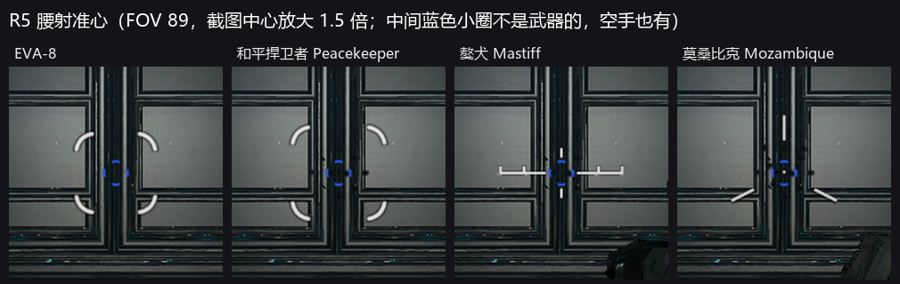
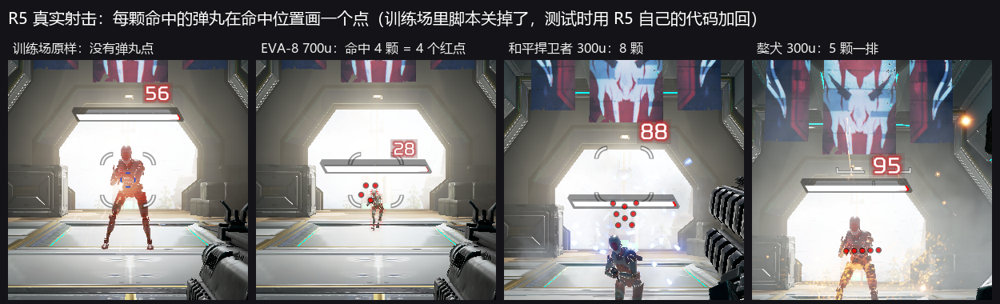
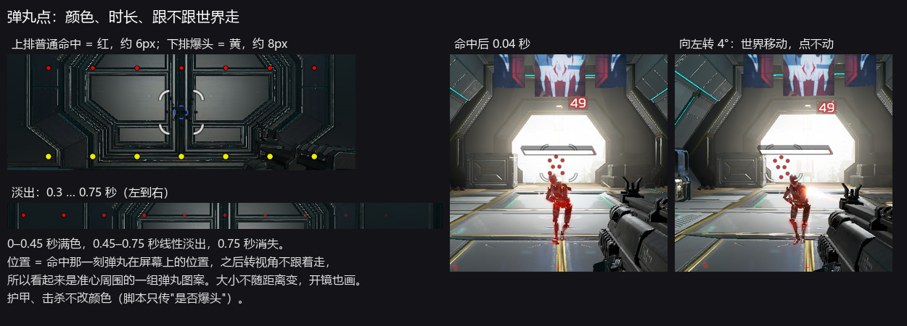
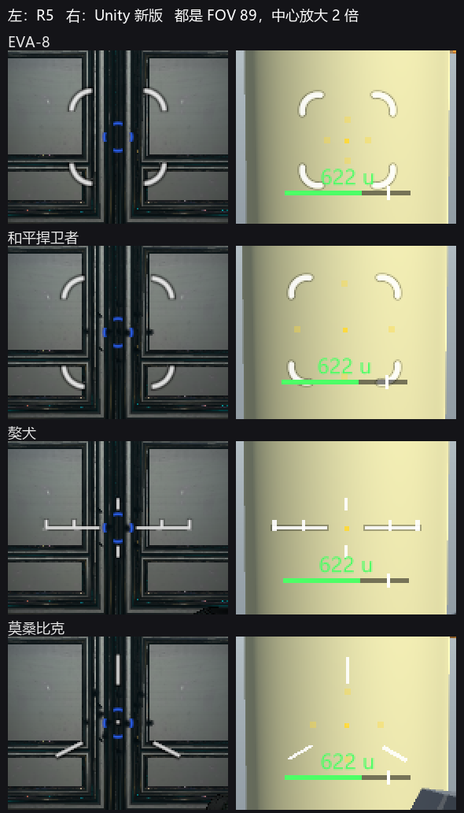
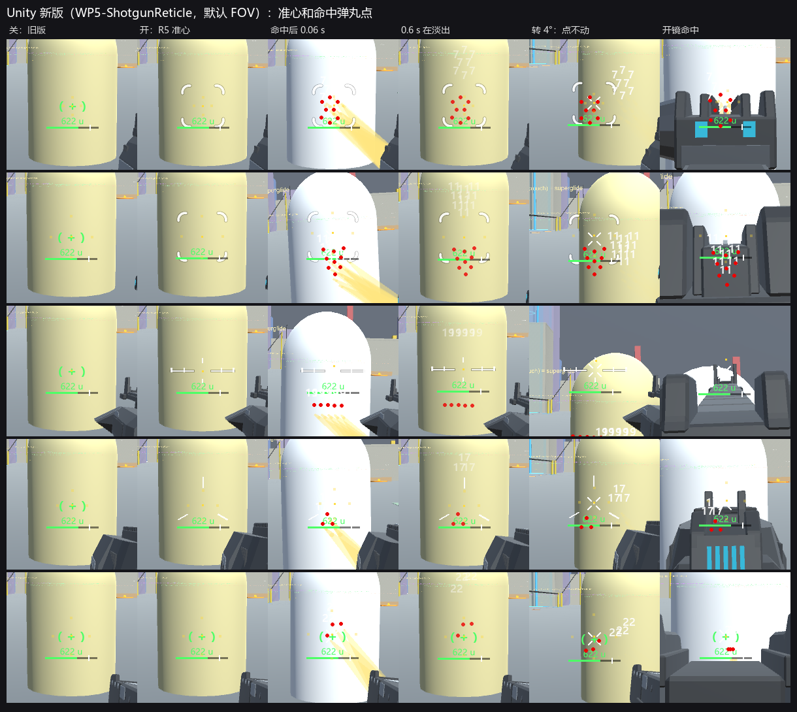
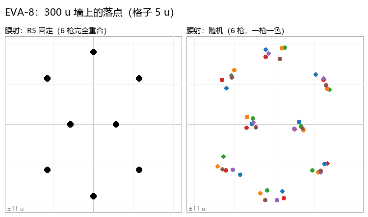
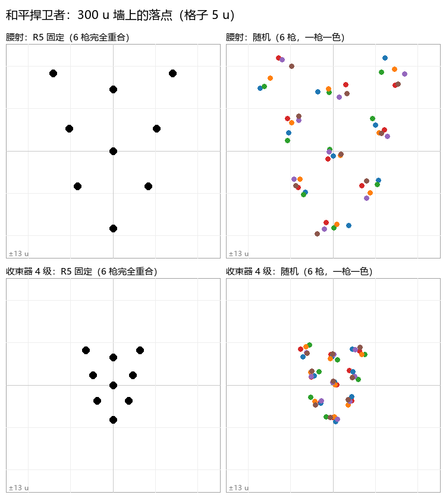
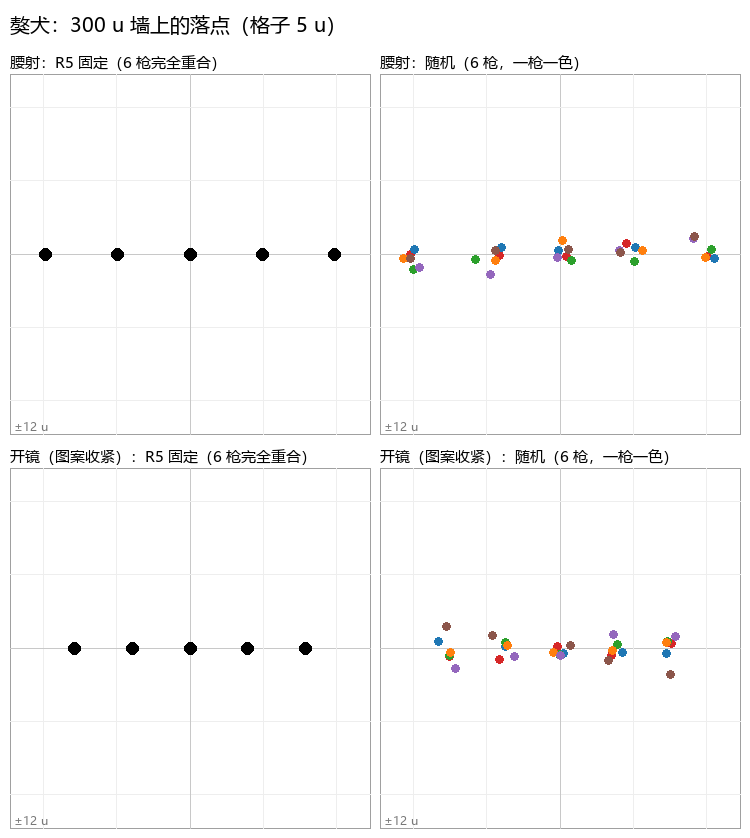
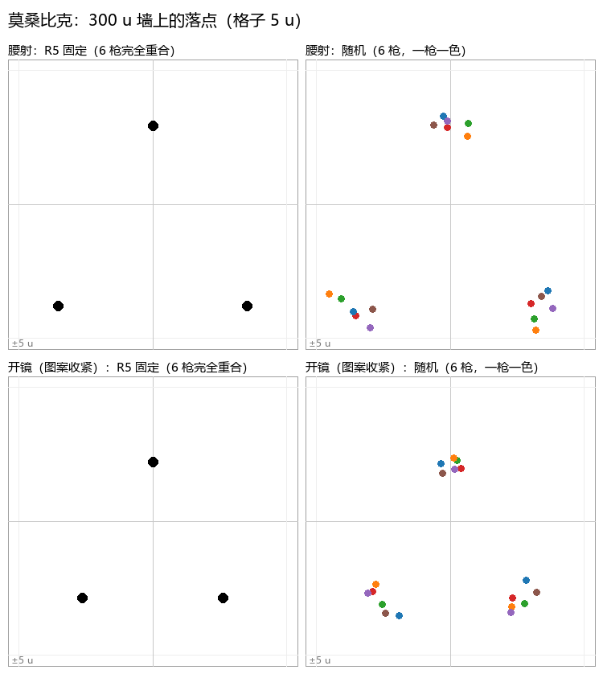

# 霰弹枪准心和命中弹丸点（R5）

会话 `shotgun-reticle`，2026-11-07。回答用户 11-07 试玩后的问题："R5 的喷子准心不是十字；打出一发后，命中的那几颗弹丸会以红色显示在准心位置，能直观看到上一发有几颗打中。"

## 先说结论

用户记得的基本都对，只差一个细节：

- **准心**：四把霰弹枪各有自己的准心，没有一把是十字。EVA-8 和和平捍卫者是**四段小弧**，獒犬是**一根带刻度的横杠**，莫桑比克是**三根短线**（上、左下、右下）。
- **命中弹丸点**：每颗打中的弹丸画一个点。**普通命中是红色，爆头是黄色**。点在弹丸打中的位置出现，看起来就是准心周围的一组弹丸图案；**转视角时点不跟着世界走，留在屏幕上原来的位置**。点保持 0.45 秒，再用 0.3 秒淡出，0.75 秒消失。
- 这套点**不只是霰弹枪**：R5 的规则是"一发打出不止一颗弹丸的武器"，所以三重狙（3 颗）也有；波塞克、30-30 装上碎裂弹头时也会有。
- R5 自己的**训练场里没有这些点**：脚本在训练场把它关了（训练场有另一套"训练命中点"）。本地测试都在训练场，所以这次是用 R5 自己的那几行代码把点加回来测的。

## 1. 是什么在驱动它

| 部分 | 资源 / 代码 | 来源 |
|---|---|---|
| 准心 | 武器文件 `RUI_CrosshairData` → `Crosshair_1`：EVA-8 `ui/crosshair_shotgun`（`base_spread` 1.0），和平捍卫者 `ui/crosshair_shotgun`（0.0），獒犬 `ui/crosshair_mastiff`（0.0），莫桑比克 `ui/crosshair_tri_adjusted_alpha`（−3.0）。参数 `adjustedSpread`=weapon_spread、`adsFrac`=player_zoomFrac、`isSprinting`、`isReloading`、`isFiring`、`playerFov` 等 | 脚本 |
| 和平捍卫者 + 精准收束器 | `choke` mod 设 `rui_crosshair_index 1` → `Crosshair_Hopup`（`ui/crosshair_shotgun_hopup`，多一个 `charge` 参数） | 脚本 |
| 命中弹丸点 | `cl_hud.gnut` `DamageFlyout` → `ShouldShowProjectileHitDot(damageType, weapon)`：武器有效、**不是训练场**、`weapon.GetProjectilesPerShot() > 1`。成立就 `RuiCreate( $"ui/projectile_hit_dot.rpak" )`，设 `startTime`、`pos`（伤害位置，世界坐标）、`isCrit`（爆头或暴击） | 脚本 |
| 普通命中标记 | 同一函数里另有 `ui/player_hit_indicator.rpak`（`hitType` 分普通、护盾、爆头、无效等），和弹丸点无关；训练场里对假人也关着 | 脚本 |

RUI 资源本身（`ui/crosshair_shotgun` 等）是编译好的，没有读到它的代码。下面的形状、大小、颜色、时长都是截图量的。

## 2. 命中弹丸点

方法：训练场（`survival_firingrange`）里脚本把点关了，测试时在客户端加一个 `AddLocalPlayerDidDamageCallback`，按 `DamageFlyout` 原样创建 `ui/projectile_hit_dot`（`tools/sr.py` 的 `HOOK`）。另外直接创建点、把 `startTime` 每帧设成"现在减去固定年龄"，把点定格在某个年龄拍照（`tools/held_dots.py`）。

| 项 | 结果 | 来源 |
|---|---|---|
| 不加回调（训练场原样） | EVA-8 8 颗全中，**一个点也没有** | 实测 |
| 加回调 | 每颗打中的弹丸一个点，数目 = 回调次数（EVA 700 u 中 4 颗 → 4 个点；PK 300 u 8 颗；獒犬 300 u 5 颗） | 实测 |
| 颜色 | 普通 (237, 1, 1) 红；爆头 (237, 237, 1) 黄。不透明，铺在亮、暗背景上峰值一样 | 实测（合成点） |
| 大小 | 实心圆，普通约 6 px，爆头约 8 px（1600×900）。150 u、300 u、1200 u 一样大 | 实测 |
| 时长 | 0–0.45 s 满色；0.45–0.75 s 淡出；`RuiIsAlive` 0.766–0.771 s 变假 | 实测 |
| 淡出曲线 | 换算成线性光强度后是一条直线：0.55 s 0.67，0.6 s 0.51，0.65 s 0.35，0.7 s 0.17，0.725 s 0.09（理论 0.667 / 0.5 / 0.333 / 0.167 / 0.083）。所以是"线性光里线性淡出" | 实测 + 换算 |
| 出现 | 年龄 0 的那一帧看不见，5 ms 起就是满色满大小，没有放大动画 | 实测 |
| 跟不跟世界 | **不跟**。命中后 0.04 s 把视角向左转 4°：墙和假人向右移了约 43 px（= tan4° × 610），点原地不动。合成点转 6° 同样不动 | 实测 |
| 开镜 | 照样画（准心已经没了，点还在） | 实测 |
| 护盾、护甲、击杀 | 点只有 `isCrit` 一个参数，所以**不改颜色** | 脚本 |
| 爆头 | 假人（`npc_dummie_combat`）身上没打出爆头标记：EVA-8 本来 `allow_headshots 0`，抬高瞄头也都是 crit=0。黄色是用合成点 `isCrit=true` 拍的，和脚本传的值一样 | 实测 + 脚本 |
| 谁会有点 | `GetProjectilesPerShot()` 读数：EVA 8、PK 9、獒犬 5、莫桑比克 3、三重狙 3；波塞克、30-30、转换者都是 1（不装碎裂弹头时没有点） | 实测 |

数据：`data/SR-DOTS.tsv`（每个年龄的颜色、峰值、像素数）、`data/SR-FIRE-HITS.txt`（每次射击的命中、点的寿命）。

## 3. 准心

方法：站在训练场出生点，转向 180°（准心背后是一扇暗色的门），给枪、等掏枪完，站、蹲、走、跳、开镜、开火后各拍一张（`tools/sr.py reticle`）。大小用 `cl_fovScale` 1.0、1.1、1.2、1.27217（本地默认，FOV 89）、1.4、1.5、1.6 各拍一遍（`sr.py still`，`tools/an_size.py`）。0.9 被夹到 1.0。

| 枪 | 形状（FOV 89，1600×900） | 来源 |
|---|---|---|
| EVA-8 | 四段小弧，各在一条对角线上，开口朝里。每段是半径约 9.8 px、约 100° 的圆弧，线宽约 3 px，白色（峰值 225–232）带一圈淡暗边。弧中点离中心 35.4 px | 实测 |
| 和平捍卫者 | 同一个资源，弧中点 42.3 px | 实测 |
| 獒犬 | 一根水平横杠，每边从 12 px 到 47 px，线宽 2 px；两端各一个 3×7 px 的竖刻度，中间（±27 px）各一个 2×7 px 的刻度；中心上下各一根 8 px 的短竖线（−19…−12、+11…+18） | 实测 |
| 莫桑比克 | 三根约 17.5 px 的短线：正上方、左下和右下（水平以下 30°），离中心 26 px 起；中心一个 2×2 px 的小点 | 实测 |
| 中心的蓝色小圈 | **不是武器准心**：空手也在。来源没查 | 实测 |

**状态**：这四把的散布在所有姿态都是常数（EVA 1.2、PK 2.8、莫桑比克 2.0、獒犬 0；读数 `GetAttackSpreadAngle`），所以站、蹲、走、跳、开火后准心大小都不变。

| 状态 | 结果 | 来源 |
|---|---|---|
| 开镜到底 | 准心消失 | 实测 |
| 开镜过程中 | 没拍到：截图比开镜慢；服务器 `host_timescale` 不影响客户端的开镜。资源有 `adsFrac` 参数，推断随开镜淡掉 | 推断 |
| 冲刺 | 变淡，透明度约 0.35–0.45 | 截图估计 |
| 换弹 | 没测到：备弹为 0，没进换弹 | 未测 |

### 3.1 大小和散布、FOV 的关系

EVA/PK 的四段弧**不是一个变大的圆**，是四段**固定大小**的小弧被推远（FOV 70 时弧离得远，但每段的曲率、长度和 FOV 112 时一样，见 `pics/arc_zoom_fov70_fov112.png`）。拟合每段弧：曲率半径 9.5–10.5 px，弧心离中心的距离 = 弧中点 − 8.6 px。

弧中点 = G(FOV) × (散布 + base_spread + 0.94)：

- FOV 89：EVA 空投版（1.0 + 1）33.1、EVA（1.2 + 1）35.4、PK（2.8 + 0）42.3 px，三点在一条线上，斜率 11.3 px/°，截距对应 0.94°。
- 其他 FOV：PK / EVA 的比值在 70–112 一直是 1.190–1.193，所以 G 只和 FOV 有关。

| FOV | 70 | 77 | 84 | 89 | 98 | 105 | 112 |
|---|---|---|---|---|---|---|---|
| G（px/°，900 高） | 20.38 | 16.23 | 13.09 | 11.27 | 10.05 | 9.35 | 8.77 |
| 真实世界的 px/°（由命中点标定） | 14.96 | 13.17 | 11.63 | 10.65 | 9.10 | 8.04 | 7.06 |
| 獒犬横杠外端 px | 58 | 53 | 48 | 45 | 41 | 38 | 36 |
| 莫桑比克线的起点 px | 32 | 29 | 27 | 26 | 25 | 25 | 24 |

**G 不是按角度走的**：按角度算，弧在 FOV 89–98 最小，FOV 70 时比 89 大 0.9°。世界的投影是标准的（在每个 FOV 下把命中点放在已知角度上，`tools/fovcal.py`，px/tan 857 / 754 / 666 / 610 / 522 / 460 / 405，和 4:3 水平 FOV 的公式一致）。RUI 怎么用 `playerFov` 没读到，所以 **Unity 直接用这张表插值**。HSD 默认 FOV 也是 89，这一列是主要的。

数据：`data/SR-SIZE-FOV.tsv`、`data/SR-STATES.tsv`。

### 3.2 和平捍卫者的精准收束器

装 `hopup_energy_choke` 时只有模块，开镜不充能（准心和普通的一样）；再加 `choke` mod 后开镜充能（0.9 s 到 4 级）。退出开镜那一刻（charge 0.8）：**四段弧变成青色 (152, 255, 255)，弧心距离 × 0.44**（33.8 → 15.0 px），字段 `projectile_spread_choke_frac_4` 是 0.45。开镜中准心位置是瞄具上的一个青色小图案，属于瞄具界面，不做。

推断：弧心距离 × 当前充能等级的收束系数，2 级起变青。只拍了一个充能值。图：`pics/peacekeeper_choke.png`。

## 4. 给 Unity 的规则（D-128）

1. EVA-8、和平捍卫者、獒犬、莫桑比克腰射时画 R5 的准心（形状见第 3 节，大小按第 3.1 节的表，随屏幕高度缩放）；其他枪照旧。
2. 开镜按缩放比例淡掉（推断），冲刺透明度 0.4（截图估计）。
3. 精准收束器充到 2 级以上：弧变青，弧心距离 × 收束系数（推断，测了一个点）。
4. 任何一发不止一颗弹丸的枪：玩家打中目标的每颗弹丸一个点；红 / 黄、6 / 8 px、0.45 s 满色、到 0.75 s 线性光淡出；点在命中那一帧放到屏幕上，之后不动。
5. 全是画面：伤害、散布、弹丸数一律不动。旧的"+"和没有点的样子留开关。

### Unity 做出来的样子（HSD-Unity #71，构建 `WP5-ShotgunReticle`）

构建里自己拍：`HSD-Practice.exe -reticleShots <目录> [-reticleFov 89]`。默认镜头是 70° 垂直，等于 R5 FOV 86，所以默认下准心比 R5 默认（89）略大，按表就是这样。弧的曲率、线宽、暗边是截图估计，四段弧比 R5 略显"拐角"一些。

## 5. 没做到的

- 开镜过程中的淡出曲线、换弹时的样子：没拍到（第 3 节）。
- 真实的爆头点：本地假人打不出爆头（第 2 节）。
- 中心蓝色小圈的来源。
- RUI 资源的代码：没解开，所以 FOV 规律只能查表。

## 6. 弹丸随机散布（D-129，HSD 有意偏离 R5）

用户 11-07 问散布是不是固定的。**是固定的**：R5 四把霰弹枪的脚本都忽略散布字段，只按固定图案打，IP2 §2.11 实测三发 EVA 落点相同。用户说要随机，不用照搬 R5。

做法：每发先把整个图案绕瞄准方向随机转一个角度（均匀 ±10°），再把每颗弹丸移到以图案点为圆心、半径 0.10 × 最外弹丸偏移的圆盘里的均匀随机点。腰射时抖动 EVA 0.17°、和平捍卫者 0.22°、獒犬 0.19°。两者都按图案缩放，所以开镜收紧和精准收束器照样生效。开关 `arsenal.shotgunPatternRandom`，关掉就是 R5 的固定图案。

300 u 墙上连打 6 枪（左 R5 固定，右随机）：

命中会不会变少（32 × 72 u 的身体，瞄中间，400 发平均，固定 → 随机）：

| 距离 u | EVA-8 | 和平捍卫者 | 獒犬 | 莫桑比克 |
|---|---|---|---|---|
| 300 | 8 → 8.00 | 9 → 9.00 | 5 → 5.00 | 3 → 3.00 |
| 600 | 8 → 8.00 | 9 → 8.51 | 3 → 3.00 | 3 → 3.00 |
| 800 | 8 → 6.52 | 7 → 7.19 | 3 → 3.00 | 3 → 3.00 |
| 1000 | 4 → 4.43 | 5 → 5.30 | 1 → 1.92 | 3 → 3.00 |
| 1200 | 2 → 2.98 | 2 → 3.28 | 1 → 1.02 | 3 → 2.73 |
| 1500 | 2 → 1.44 | 1 → 1.68 | 1 → 1.00 | 1 → 1.54 |
| 合计 | 32 → 31.4 | 33 → 35.0 | 14 → 14.9 | 16 → 16.3 |

固定图案的命中数是台阶：某一圈弹丸刚好在身体边缘以内或以外。随机后台阶变成平滑曲线，单个距离有升有降（EVA 800 u 的四个角刚好在边缘内 0.5 u，随机后一半出去了；900–1200 u 反而多了）。合计 −2 % 到 +6 %，600 u 内基本不变。

没选的：用武器自己的散布字段加随机锥（EVA 1.2°、和平捍卫者 2.8°，比图案间距还大，图案认不出）；只转不抖（EVA 对称，看不出）；只抖不转（獒犬那一排永远水平）；抖动 0.15（边缘距离丢得更多）。数据：`scatter/SCATTER-300U.tsv`（HSD-Unity `HSD.ShotgunScatterDump`），图：`tools/plot_scatter.py`。
