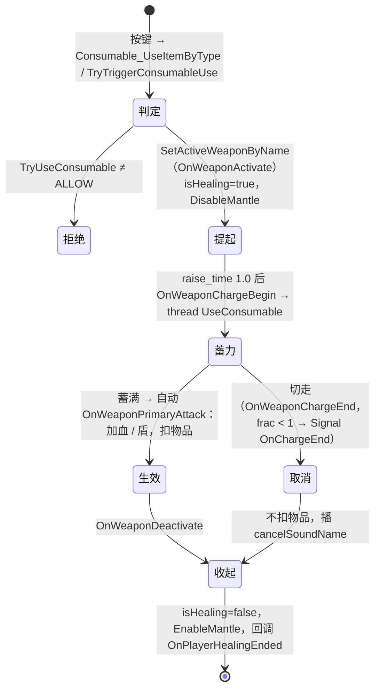

# 治疗 / 护盾消耗品 系统记录

会话 `i1-records`，2026-11-01。静态记录。

来源根目录：`research-src/s21-platform/scripts/`。`nut` = `vscripts/weapons/mp_ability_consumable.nut`（2940 行），`txt` = `weapons/mp_ability_consumable.txt`。

## 0. 概要

- **道具**：注射器 `health_pickup_health_small`、医疗包 `_health_large`、小电池 `_combo_small`、大电池 `_combo_large`、凤凰 `_combo_full`、大招加速 `_ultimate`（`survival_loot.csv:240-245`）。全部共用一把武器 `mp_ability_consumable`，靠 mod 区分。
- **一句话**：把"读条"做成一把**蓄力武器**：切过去 → 蓄力（charge）→ 蓄满自动开火 → 开火时才加血、才扣物品。中途切走就算取消，什么都不扣。
- **更正 filter**：filter 写"读条使用 + 移动减速 + 被打断"。
  - 〔11-04 回填：下一句已被 IP2 推翻。读条有减速：`move_slow` 0.4（`mp_ability_consumable.nut:749`），实测走 195 → 101.7 u/s，×0.6 之外多约 ×0.85，来源没查。〕
  - **没有移动减速**。`.txt` 没有 `move_speed` 字段。只是**不能冲刺**（`offhand_blocks_sprint 1`，`txt:48`）和**不能攀爬**（`DisableMantle`，`nut:660`）。效果上是走路速度。
  - **被打不打断**（脚本里）。打断只来自玩家自己的按键和切武器（3.2.3）。
- **分类**：系统（通用"读条使用"部件）。
- **可拆出的部件**：
  - 蓄力武器当读条（改一个字段换时长）→ 3.2.1
  - 取消不扣费 → 3.2.3
  - 使用中限制（不冲刺、不攀爬）→ 3.2.2
  - 预览 HUD（status effect 传目标值）→ 3.3
  - 可不可用的判定链 → 3.2.4
  - 开始 / 结束回调 → `nut:2352`、`nut:2358`

## 1. 它用什么实现各种效果

| 效果 | 实现手段 | 说明 |
|---|---|---|
| 物品类型 | 一把武器 + mod（`health_small` 等） | `txt:101-…`；`nut:384-394` |
| 读条 | 武器蓄力 `charge_time`，`charge_end_forces_fire 1`，`charge_require_input 0` | `txt:33-38` |
| 提起动画 | `raise_time 1.0` | `txt:54`；进度条 = raise + charge（`nut:1064`） |
| 加血 / 加盾 | `SetHealth` / `SetShieldHealth`，**开火那一刻一次性** | `nut:2013`、`nut:2057` |
| 扣物品 | `SURVIVAL_RemoveFromPlayerInventory`，也在开火那一刻 | `nut:1312` |
| 不能冲刺 | `offhand_blocks_sprint 1` | `txt:48`（原生） |
| 不能攀爬 | `DisableMantle` / `EnableMantle` | `nut:660`、`nut:889` |
| 状态 | 网络变量 `isHealing`、`healingKitTypeCurrentlyBeingUsed` | `nut:657`、`nut:882-883` |
| 预览 | 状态效果 `target_health`、`target_shields`（`AddEndless`） | `nut:2039`、`nut:2075`；HUD 上"会回到哪" |
| 进度条 | RUI `Consumable_DisplayProgressBar` | `nut:1031-1096` |
| 手上特效 / 声音 | `charge_effect_*`、`charge_sound_*` | `txt` 各 mod |
| 屏幕特效 | `P_heal_loop_screen` | `nut:224`、`nut:1660` |
| 留痕 | `TrackingVision_CreatePOI( PLAYER_HEAL )`（Bloodhound 看得到） | `nut:663` |

旧路径：`weapon_driven_consumables` 默认 1（`nut:2928-2931`）。关掉走 `gamemodes/_gamemode_survival.nut:5460` 的老治疗线程（信号 `CancelHeal`）。本地默认走武器版。

## 2. 流程



## 3. 代码

### 3.1 入口

- `Consumable_Init`（`nut:233-428`）：填物品表。`nut:269-314` 有三段被抹掉的物品（只剩空白）。
- `TryTriggerConsumableUse`（`nut:584-597`）：判定后 `SetActiveWeaponByName( mainHand, 消耗品武器 )`。
- `OnWeaponAttemptOffhandSwitch_Consumable`（`nut:555-580`）。

### 3.2 核心

#### 3.2.1 读条：`OnWeaponChargeBegin_Consumable`（`nut:1143-1209`）、`UseConsumable`（`nut:1891-1973`）

```
SetWeaponChargeFractionForced( 0 )
服务端 thread UseConsumable：
  delayScale = PAS_FAST_HEAL ? 0.5 : 1
  endTime = now + chargeTime × delayScale − 0.01
  每帧 UpdateConsumableUse（更新预览；healTime > 0 才边读边加）
```

本地所有物品 `healTime = 0`（只有大招电池显式写了，其他走默认）：**都是读完一次性加**。边读边加的代码在（`nut:2018-2032`、`nut:2060-2066`），是备用路线。

#### 3.2.2 生效：`OnWeaponPrimaryAttack_Consumable`（`nut:1263-1352`）

`GetWeaponChargeFraction() < 1` 就返回 0（防止提前）。服务端：`useFinished = true`；`UpdateConsumableUse( allowApply = true )`；大招电池走 `UltimatePackUse`；扣物品（`PAS_INFINITE_HEAL` 不扣）。

#### 3.2.3 打断

全部入口（`vscripts/cl_survival_loot.nut:114-121`）都是**玩家自己按键**：

| 按键 | 说明 |
|---|---|
| `+attack`、`+melee` | 开枪、近战 |
| `+offhand2` | 战术 |
| `+speed` | 冲刺 |
| `+weaponcycle` | 只有非武器版才注册 |

→ `AttemptCancelHeal` → `Consumable_CancelHeal` → `ClientCommand( "invnext" )`（`nut:1741-1747`）切武器。

切走 → `OnWeaponChargeEnd`，`frac < 1`：`Signal( "OnChargeEnd" )`（`nut:1230-1233`），`UseConsumable` 退出；`OnWeaponDeactivate` 清状态效果（`nut:891-895`）。**没扣东西**：扣物品只在开火里。

**脚本里没有任何"受伤打断"**。搜 `OnChargeEnd`、`CancelHeal` 没有和伤害相连的调用。其他会打断的是引擎层面的：死亡、强制切武器（`GetWeaponDisableFlags`）。

#### 3.2.4 判定：`TryUseConsumable`（`nut:2615-…`）

拒绝条件：在救队友、1v1 休息状态（SDK 加的 `FS_HasCap`，`nut:2619`、`nut:2638`）、Context Action（滑索之类，rodeo 除外）、流血倒地、死亡、相位、放传送门、**`healing_denied` 状态**（只拒绝护盾类，`nut:2666-2672`）、武器全禁用、泰坦、可被死亡图腾召回（`nut:2681`）。再按物品判满血、满盾、没物品。

### 3.3 客户端表现

`Consumable_DisplayProgressBar`：进度条读 `raise + charge`，每帧检查 `charge_time` 变化（mod 可变，`nut:1080-1089`）。`target_health` 的严重度是目标值比例，HUD 用它画虚影。

### 3.4 依赖

状态效果 [E-STATUS-EFFECT](../../_shared/E-STATUS-EFFECT.md)。`healing_denied` 就是 Vantage 那条（C 批说本地是死代码，见 [vantage-snipers-mark](../../vantage-snipers-mark/SYSTEM.md)）。

## 4. 参数

| 物品 | 回血 | 回盾 | `charge_time`（s） | 占格 / 每捡 | 来源 |
|---|---|---|---|---|---|
| 注射器 | 25 | 0 | 3 | 6 / 2 | `nut:347`、`txt:106`、`csv:243` |
| 医疗包 | 100 | 0 | 7 | 2 / 1 | `nut:334`、`txt:133`、`csv:242` |
| 小电池 | 0 | 25 | 1.5 | 6 / 2 | `nut:320-321`、`txt:160`、`csv:245` |
| 大电池 | 0 | 999（到满） | 4 | 2 / 1 | `nut:261-262`、`txt:186`、`csv:244` |
| 凤凰 | 100 | 999（到满） | 9 | 1 / 1 | `nut:248-249`、`txt:212`、`csv:241` |
| 大招加速 | 0 | 0，大招 +35 | 6（快版 3） | 1 / 1 | `nut:374`、`txt:238`、`txt:254`、`csv:240` |

| 参数 | 值 | 来源 | 作用 | 改大 / 改小 |
|---|---|---|---|---|
| `raise_time` | 1.0 s | `txt:54` | 读条前的提起 | 总时长 = 这个 + 蓄力 |
| `charge_time` 基础 | 3 s | `txt:33` | 被 mod 覆盖 | |
| `charge_cooldown_time` | 1 s | `txt:34` | | |
| `offhand_blocks_sprint` | 1 | `txt:48` | 不能冲刺 | |
| `quick_heal` mod | × 0.85（蓄力、提起、收起） | `txt:276-278` | | |
| `fast_heal` mod | × 0.5（同上） | `txt:284-286` | | |
| `PAS_FAST_HEAL` | 脚本计时 × 0.5 | `nut:1900-1903` | | |
| `healCap` 默认 | 100；电池 0 | `nut:105`、`nut:263`、`nut:322` | | |
| 使用顺序 | 大电池 → 小电池 → 凤凰 → 医疗包 → 注射器 | `nut:402-411` | 自动选 | |

**小电池 1.5 s、注射器 3 s 这些是脚本值**。`Consumable_DisplayProgressBar` 上 raise 1.0 s 是否真计入（总 2.5 / 4 s）要实测。

## 5. 未解决和要实测的

**实测候选（本阶段第 3 项）**：

1. **读条总时长**：R5 触发 `TryTriggerConsumableUse`，记录 `isHealing` 变 true 到血量变化的时间。每种物品一次。
2. **走路速度**：读条时读 `GetVelocity`。W2 已知走路 199.5。确认不是 `move_slow`，并看蹲、跳、滑能不能用（脚本没禁）。
3. **被打断不断**：读条中脚本 `TakeDamage`。预期：不断。
4. **按键取消**：`+attack` 等是否不扣物品（这个需要按键，见公共未解项）。
5. **切武器以外的引擎打断**：跳、滑铲、爬绳。

## 6. HSD 实现

未实现（`Runtime/Combat/` 里搜不到消耗品类）。建议：

- 一个通用组件 `ChannelUse { raise, duration, onComplete, onCancel, blocksSprint, blocksMantle }`。消耗品、开箱、复活都能用。
- 生效和扣费都放在 `onComplete`，保持"取消不扣费"。
- 打断只由输入触发，**被打不断**（照 R5）；PvE 想要"被打断"可以作为开关，属于有意差别。
- 预览虚影先不做。
