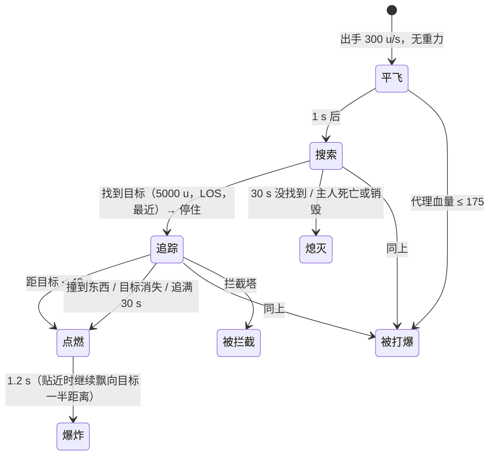

# Revenant 手雷（Rev Shell）系统记录

会话 `i1-records`，2026-11-01。静态记录。

来源根目录：`research-src/s21-platform/scripts/`。`nut` = `vscripts/weapons/mp_weapon_grenade_rev_shell.nut`（923 行），`txt` = `weapons/mp_weapon_grenade_rev_shell.txt`。

## 0. 概要

- **道具**：军械（活动道具）/ 骷髅手雷 / `mp_weapon_grenade_rev_shell`。
- **状态**：loot 表 `survival_loot.csv:436` 前缀 `// removed in S30, kept so nothing dangles:`，`isDisabled = true`。还要 playlist `rev_shell_enabled`，默认 false（`nut:904-907`）。脚本完整，`_sh_init.gnut:553` 会初始化。
- **一句话**：扔出去慢慢平飞（300 u/s，无重力）；1 s 后开始找 5000 u 内看得见的最近敌人，找到就停下，然后追着飞：沿目标走过的路径的面包屑，远处 660 u/s，800 u 内 240 u/s；贴到 40 u 或撞到东西就点燃，1.2 s 后爆 75；能被打爆（约 25 血）；30 s 找不到就熄灭。
- **更正 filter 的前提**：**本地脚本只锁玩家，不锁 NPC**（3.3）。原样放进 PvE 扔出去什么也不做。值钱的是追踪部件，要改目标来源。
- **分类**：效果（追踪手雷）、系统（面包屑追踪）、可视化（被锁定的提示）。
- **可拆出的部件**：
  - 面包屑追踪（采样目标路径 + 有视线直线追 + 跳过可见点）→ 3.2.1 `FlyToTarget_Thread`
  - 距离两档速度 → 3.2.1
  - 隐藏代理实体让投掷物能被打 → 3.2.3
  - 被锁定者的状态效果 / 威胁指示 / 语音 → 3.2.4
  - 找目标（距离 + LOS + 过滤）→ 3.3

## 1. 它用什么实现各种效果

| 效果 | 实现手段 | 说明 |
|---|---|---|
| 飞行 | `FireWeaponGrenade`，`projectile_gravity_scale 0`、无继承 | `nut:173-186`、`txt:115-123` |
| 搜索期朝向 | 每帧按速度设角度 | `nut:589`、`nut:598-600` |
| 追踪 | `CreateScriptMover` + `projectile.SetParent( mover )` + `NonPhysicsMoveTo` 每帧重新设目标 | `nut:272-282`、`nut:519-526` |
| 路径 | 每帧把目标当前位置压入 `waypoints`（距上一个 > √0.1 u 才压） | `nut:297-310`、`nut:357-372` |
| 碰撞 | 每帧 `TraceLine( 上一位置, 当前 )` | `nut:462-470`；mover 不走物理 |
| 爆炸 | `GrenadeIgnite` + `grenade_ignition_time 1.2` | `nut:555-573`、`txt:92` |
| 可被打 | 隐藏 `prop_script`（`CreatePropScript`，`CONTENTS_BULLETCLIP`）挂在手雷上，200 血 | `nut:196-216` |
| 被拦截 | Wattson 拦截塔 `Trophy_RemoteTryZapEntity` | `nut:444-459` |
| 被锁定 | 状态效果 `rev_shell_targeted`（`status_effect_types.txt:300`） | `nut:714`；HUD `client/rui/cl_weapon_status.gnut:2414`、`weapons/cl_smart_ammo.gnut:831` |
| 威胁指示 | `CreateThreatIndicator( ..., GRENADE_INDICATOR_SKULL_MODEL, 3000, ... )`，只给目标看 | `nut:887` |
| 锁定光点 | 只发给扔的人：`ClientRevShellTargetFX`，粒子贴目标 `CHESTFOCUS` | `nut:629`、`nut:744-773` |
| 眼睛发光 | 粒子贴 `L_EYE_VFX` / `R_EYE_VFX` | `nut:775-856` |
| 语音 | 手持嘲讽 3–5 s + 7–10 s 循环；追逐中每 3–5 s 一句；按传奇换语音 | `nut:118-152`、`nut:858-877` |

## 2. 流程



注意两点：
- 主人死亡只打断**搜索**（`nut:580-581`）。追踪中主人死了照追（`FlyToTarget_Thread` 只监听手雷，`nut:398-399`）。
- 出手不走 `Grenade_OnWeaponToss`，自己写了一份（`nut:154-222`），`fuseTime = 0`，`PROJECTILE_NOT_LAG_COMPENSATED`。

## 3. 代码

### 3.1 入口：`Grenade_OnWeaponTossReleaseAnimEvent_RevShell`（`nut:154-222`）

`vel = Normalize( dir )`（`nut:175`）：单位方向，引擎乘 `projectile_launch_speed`（推断，和公共投掷一样）。服务端建代理、起 `RevShell_SearchForEnemies`。

### 3.2 核心逻辑

#### 3.2.1 `FlyToTarget_Thread`（`nut:386-530`）

```
waypoints = [ 目标初始位置 ]；开始每帧采样
targetPos = 下一个路点 + (0,0,50)
每帧（最多 30 s）：
  目标或 mover 无效 → 退出（退出时点燃）
  拦截塔范围内 → 尝试拦截
  trace 上帧 → 本帧：碰到 → 退回碰撞点，退出
  enemyPos = 目标位置 + (0,0,50)；d = 距离
  d < 40 → 点燃；继续向目标飘 d/2，用 ignition 时间；退出
  速度 = d < 800 ? 240 : 660
  能直接看到敌人（TRACE_MASK_OPAQUE）→ 清空路点，直接飞向敌人
  否则 → 到了当前路点就取下一个（GetNextWaypoint 跳过可直视的，每次最多 10 个）
  NonPhysicsMoveTo( targetPos, 距离 / 速度 )
```

退出时：没被拦截就 `RevShell_Explode`；1.2 s 后 `RevShell_Cleanup` 解绑、删 mover（`nut:532-549`）。

**远处快、近处慢**（`nut:494-497`）：给人反应和开枪的时间。这是设计，不是笔误（`nut:38` 注释"约 20 米"）。

`PathFindToTargetPosition`（navmesh）写了但调用被注释（`nut:405`），用面包屑。

`KeepSampling` 有 60 s 保险（`nut:299`）。

#### 3.2.2 `RevShell_Explode`（`nut:555-573`）

已点燃就返回；响警告音；`GrenadeIgnite`。注释里有"粘到敌人身上"的旧方案（`nut:562-570`）；**当前不粘**，尽管 `.txt` 写了 `stick_* 1`。

#### 3.2.3 被打爆（`nut:196-216`、`nut:225-252`）

```
代理：200 血，隐藏，SOLID_OBB，BULLETCLIP，不挡范围伤害
受伤（同队忽略）：血量 − 伤害 ≤ 175 → 特效 + 销毁手雷和代理
```

等于**实际 25 血**。`OnRevShellPostDamaged` 给攻击者发命中反馈。这个"给飞行物挂隐藏受击体"的写法可以复用（打掉敌人的导弹）。

#### 3.2.4 被锁定的表现（`nut:709-735`、`nut:879-901`）

状态效果 30 s（`REV_SHELL_GIVE_UP_TIME`），手雷没了就停；只有玩家目标才有威胁指示。

### 3.3 找目标：`RevShell_GetNearbyVisibleEnemies`（`nut:663-705`）

```
results = GetPlayerArrayEx( "any", TEAM_ANY, 手雷队伍, 位置, 5000 )
results += GetPlayerDecoyArray()
排除：!IsPlayer() | 不同 realm | 相位 | 隐身 | 同队 | 死亡 | 流血倒地 | 没视线（fraction < 0.99）
```

**`!ent.IsPlayer()` 也把分身删了**（`nut:672`），`results.extend` 那行白写。所以只有活玩家：**不锁 NPC，也不锁分身**。

`nut:614-622`、`nut:884` 有"目标不是玩家"的分支，说明代码考虑过，但这份搜索函数送不来非玩家。

### 3.4 依赖

状态效果 [E-STATUS-EFFECT](../../_shared/E-STATUS-EFFECT.md)。追踪对照 [C-LOCKON-HOMING](../../_shared/C-LOCKON-HOMING.md)（那边是投掷物转向，这边是 mover 走路径）。

## 4. 参数

| 参数 | 值 | 单位 | 来源 | 作用 | 改大 / 改小会怎样 |
|---|---|---|---|---|---|
| `projectile_launch_speed` | 300 | u/s | `txt:115` | 平飞速度 | |
| `projectile_gravity_scale` | 0 | | `txt:118` | | |
| `projectile_inherit_owner_velocity_scale` | 0 | | `txt:122` | | |
| `grenade_fuse_time` | 0 | s | `txt:90` | | |
| `grenade_ignition_time` | 1.2 | s | `txt:92` | 点燃到爆 | |
| 搜索延迟 | 1.0 | s | `nut:583` | | |
| 搜索半径 | 5000 | u | `nut:658` | | |
| 放弃时间 | 30 | s | `nut:39`（`REV_SHELL_GIVE_UP_TIME`） | 搜索和追踪各 30 s | |
| `FAR_CHASE_SPEED` | 660 | u/s | `nut:41`；playlist `rev_shell_far_chase_speed` | | |
| `CLOSE_CHASE_SPEED` | 240 | u/s | `nut:40`；playlist `rev_shell_close_chase_speed` | 走路 ~200、冲刺 ~300，近处跑得掉 | |
| 速度切换距离 | 800 | u | `nut:38` | | |
| 引爆距离 | 40 | u | `nut:478` | | |
| 追踪高度偏移 | 50 | u | `nut:43` | | |
| 每帧跳路点上限 | 10 | 个 | `nut:312` | | |
| 采样保险 | 60 | s | `nut:299` | | |
| 代理血量 / 销毁线 | 200 / 175 | HP | `nut:201-202`、`nut:241` | 实际 25 | |
| `explosion_damage` / `_heavy_armor` | 75 / 75 | HP | `txt:76-77` | | |
| `explosion_inner_radius` / `explosionradius` | 40 / 150 | u | `txt:78-79` | | |
| `damage_flags` | `DF_RAGDOLL \| DF_EXPLOSION \| DF_GIB` | | `txt:75` | | |
| `npc_explosion_damage` / `_heavy`（MP） | 50 / 350 | | `txt:237-238` | | |
| `npc_explosion_damage` / `_heavy`（SP） | 25 / 350 | | `txt:248-249` | | |
| 弹药（MP） | 槽 200，回充 16/s（12.5 s） | | `txt:230-235` | | |
| `show_grenade_indicator` | 0 | | `txt:15` | 没有普通手雷图标，用追踪指示 | |
| `toss_pullout_time` / `toss_time` / `toss_overhead_time` | 0.2 / 0.4 / 0.7 | s | `txt:112-114` | | |
| `deploy_time` | 0.5 | s | `txt:94` | | |
| 威胁指示半径 | 3000 | u | `nut:887` | | |

## 5. 未解决和要实测的

- **对玩家的追踪**：要第二个玩家当目标，或把搜索函数改了。R5 本地只有一个玩家，手雷是同队不会锁自己。低优先级：参数已全，实现时自己调手感。
- 改成锁 NPC 能不能跑（`NavMesh` 没用，追踪不依赖 NPC）：HSD 里自己做，不用在 R5 验证。
- `rev_shell_targeted` 的 HUD 样子：要截图，RUI 资源不在脚本里。

## 6. HSD 实现

未实现。建议：`ThrownItem` 派生 `SeekerShell`：

1. 目标来源换成"最近的看得见的敌方 `CombatUnit`"（**和 R5 的有意差别**，进 `R5-DIFF-ARCHIVE.md`）。
2. 面包屑放独立小类，敌人的追踪导弹也能用。
3. HSD 的玩家速度高，近处 240 u/s 基本追不上，正好是"能跑掉"的设计；敌人的版本可能要调。
