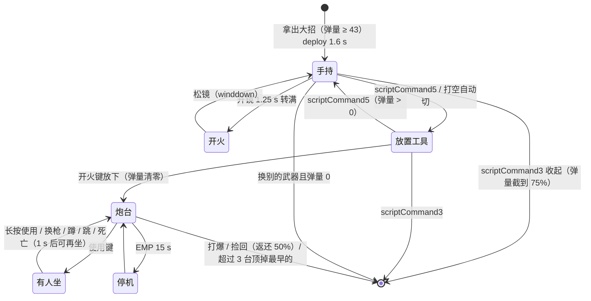

# Rampart 大招 Sheila 移动机枪：系统记录

批次 C（combat-c），2026-10-31，静态研究（只读脚本，没进游戏）。

出处从 `research-src/s21-platform/scripts/` 开始。`hmg` = `vscripts/weapons/mp_weapon_mobile_hmg.nut`，`hmgt` = `weapons/mp_weapon_mobile_hmg.txt`，`pl` = `vscripts/weapons/mp_weapon_mounted_turret_placeable.nut`，`mt` = `vscripts/weapons/mp_weapon_mounted_turret_weapon.nut`，`mtt` = `weapons/mp_weapon_mounted_turret_weapon.txt`。

## 0. 概要

- **技能**：Rampart / 大招 / Sheila / `mp_weapon_mobile_hmg`（手持）+ `mp_weapon_mounted_turret_placeable`（放置）+ `mp_weapon_mounted_turret_weapon`（坐上去打的枪）。
- **一句话**：大招槽里是一把重机枪。**手持**：必须开镜，开镜 1.25 s 转满才开火，每秒 20 发、每发 14（爆头 ×2），开镜移动 ×0.4；扩散从 3° 开始，持续开火时**越打越准**（每发 −0.18°）。**放置**：按切换键把它变成放置工具，放在面前 32–92 u 的地上，变成 350 血的固定炮台，任何人（推断）都能坐上去打；最多 3 台；EMP 让它停 15 s；近战两下打爆；捡回来返还 50% 弹量。
- **分类**：**好技能**（重火力，偏武器，C0 2.1 注）＋ **系统**（一个技能两种形态的切换、放置物 + 可上的固定武器、"转速 = 开镜进度"的门槛）＋ **可视化**（转动音效按开镜进度 seek、激光、炮台屏幕 RUI）。
- **可拆出的部件**：
  - "开镜进度当转速"开火门槛 → 3.2.1 `OnWeaponPrimaryAttack_weapon_mobile_hmg`
  - 持续开火收紧扩散（负 spread kick）→ 第 4 节扩散参数
  - 同一槽两种形态切换 + 弹量互转 / 返还 → 3.2.2 `ClientCallback_ToggleMobileHMGPlacementMode`、`MobileHMG_DoRefund`
  - 放置物炮台（生成、上下、受伤规则、EMP 停机、捡回）→ 3.2.3，公共部件 `_shared/C-PLACEABLE-DEPLOYABLE.md`

## 1. 它用什么实现各种效果

| 效果 | 实现手段 | 说明 |
|---|---|---|
| 手持机枪 | 大招槽武器，`fire_mode offhandHybrid`，`offhand_active_slot mainHand`；`RegisterAdditionalMainWeapon` | `hmgt:12-19`、`hmg:86` |
| 转速 | **没有射速爬升字段**；开火条件 `IsWeaponInAds() && GetZoomFrac() >= 1.0`，开镜 `zoom_time_in 1.25 s`；转动音效按 `zoomFrac × zoomTimeIn` seek | `hmg:260`、`hmgt:171`、`hmg:198-222` |
| 子弹 | `OnWeaponPrimaryAttack_weapon_basic_bolt` → `FireBallisticRoundWithDrop`，25000 u/s，每发扣 1 | `hmg:294`、`vscripts/weapons/mp_weapon_basic_bolt.nut:46-76`、`hmgt:65` |
| 扩散收紧 | ADS 每发 `spread_kick_on_fire_stand_ads −0.18`，`spread_min_kick −2.5`，基础 3°，`spread_decay_rate 12` | `hmgt:216-237`、`hmgt:396` |
| 弹量 = 大招充能 | 弹匣 173、回充 1.44/s（→ 120 s）；开着时 mod `mobile_hmg_active` 把 `min_to_fire` 改 1、回充 0 | `hmgt:112-130`、`hmgt` Mods `mobile_hmg_active` |
| 切换到放置 | `+scriptCommand5` → 服务端切到 `mp_weapon_mounted_turret_placeable`，加 `mobile_hmg_fast_switch`（`instant_swap_to 1`） | `hmg:524-561`、`hmg:668-683` |
| 提前收起返还 | `+scriptCommand3` → `ClientCallback_ForceCooldown`：弹量截到最多 75% | `hmg:432-453`、`hmg:487-501` |
| 打空自动切放置 | 最后一发后 `MobileHMG_SwitchOnEmpty` | `hmg:272-277`、`hmg:455-468` |
| 炮台实体 | `CreateScriptMoverModel(rampart_turret.rmdl)`，350 血，可攀爬，相位中可见，有胶囊碰撞和载具碰撞 | `pl:385-548` |
| 上炮台 | `SetUsable` + `OnPlayerUse` → `MountedTurretPlaceable_UseGun`：`SetDriver`，长按使用 / 换枪 / 蹲 / 跳下来 | `pl:617-745` |
| EMP 停机 | `PlayerObjects_CommonInit(..., MountedTurretPlaceable_Disable)` → 15 s 不能用 + 电流特效 + "已禁用"路标 | `pl:478`、`pl:754-800` |
| 受伤规则 | 爆炸和近战加暴击标记；近战每下直接 175（半血）；伤到半血以下冒烟 | `pl:900-1005` |
| 激光 | 1P 视图模型 `P_wpn_rampart_laser_aim_FP`（动画事件 `rampart_turret_mobile_laser_on` 打开）；3P `P_wpn_rampart_laser_aim_3P` | `hmg:605-631`、`hmgt:93-94` |
| 提示 | RUI `mobile_hmg_hint`："切换到放置 / 切换到开火" | `hmg:633-666` |
| 炮台屏幕 | 武器上的 RUI：`rampart_turret_screen` / `_reticle` / `_ammo_counter` / `_crosshair` | `hmgt:759-824` |
| 语音 | 半弹匣、每 20 发 15% 概率"持续开火"，7 s 防抖，只有 Rampart 的嗓音 | `hmg:54-55`、`hmg:263-269`、`hmg:503-522` |

**怀疑点（SDK 改动，明确）**：
- `hmg:11`、`hmg:386`："// S21: RegisterNetworkFunctions is shared …"——本地补丁注释。
- `hmgt:50`："// Disabled on dedi: … OnWeaponZoomFOVToggle"——倍镜切换音效回调在 dedi 上关掉。
- `pl:662`："// Check if player has a valid weapon cuz GetTurretWeaponX doesn't exist in s3"——**放置炮台的上炮逻辑被社区改过**（S3 dedi 没有原接口）。改后的判断是"炮台主人手上有武器"才让人上。
- `mt:114`：把剩余弹量带进炮台的那行 `SetWeaponPrimaryClipCount_MaintainReloadProgress` 被注释掉，炮台弹量可能和手持不连通。
- `hmg:139-149` 一段空行（剥离）。

## 2. 流程



- **激活**：弹量 ≥ `ammo_min_to_fire 43`（推断 = 满充能的 25%，173 × 0.25 ≈ 43）。激活后加 `mobile_hmg_active`（`min_to_fire 1`、停止回充），服务端线程等到"手里换成别的、不是近战、弹量 0"才去掉这个 mod（`hmg:394-430`）。
- **转速**：`OnWeaponStartZoomIn` 播 windup，按当前开镜进度 seek；松镜播 winddown（`hmg:198-250`）。升级 `upgrade_core_modify_spinup_time`：开镜 1.0 / 退镜 0.8 / 移动 ×0.6 / 抬枪 1.2（`hmgt:520-526`）。
- **不能切放置**：在攀爬、跑墙、挂墙时（`hmg:529`）。
- **放置**（`pl:315-336`、`pl:385-548`）：放置点有效才放；生成炮台；记录"炮台弹量 = 大招弹匣上限"，大招弹量清零，禁用切换；建 256 u 禁止重生区；超过 `rampart_max_turrets_deployed`（3）台，最早那台受 360 伤害并删除。
- **上炮台**（`pl:617-675`）：泰坦、炮台被禁用、玩家在其他动作中、相位中都不能上；下来后 1 s 才能再上。
- **捡回**（`pl:1036-1100`）：大招弹量 + 上限 × 50%（不超过上限）。

## 3. 代码

### 3.1 入口

- `MpWeaponMobileHMG_Init`（`hmg:84-101`）：注册为附加主武器；预载放置武器；客户端注册 `+scriptCommand5`（切换）和 `+scriptCommand3`（强制冷却）。
- `MpWeaponMountedTurretPlaceable_Init`（`pl:131` 起）：读 playlist `rampart_max_turrets_deployed`（`pl:135`）。

### 3.2 核心逻辑

#### 3.2.1 手持开火门槛（`hmg:252-300`）

```
if ADS 且 zoomFrac ≥ 1:
    语音（半弹匣 / 持续开火）
    最后一发：播 last shot，下一帧检查弹量 0 → 自动切放置
    满弹匣时的第一发 → PlayerUsedOffhand（算作用了大招）
    return basic_bolt 开火（子弹，扣 1）
else return 0（不开火）
```

扩散：开镜基础 3°，每发 −0.18°，最多累计 −2.5°（→ 约 0.5°，推断是 `base + kick` 的下限），停火后以 12°/s 回到 3°（推断 decay 单位）。腰射不会开火，腰射扩散字段无意义。

#### 3.2.2 形态切换和返还

```
Toggle（hmg:524-561）：
  拿着机枪 → 记 placementMode = true；放置武器加 fast_switch；切到放置武器
  拿着放置武器且大招弹量 > 0 → 机枪加 fast_switch；切回机枪
ForceCooldown（hmg:432-453）：
  禁止切换；DoRefund：if 弹量 < 上限: 弹量 = clamp(弹量, 0, 上限 × 0.75)；切回主武器；结束 active 线程
```

注意 `DoRefund` 只是**截断**：剩 90% 的弹量收起来只剩 75%，剩 50% 的不变。

#### 3.2.3 放置炮台（`pl`）

```
Deploy:
  mover = CreateScriptMoverModel(rampart_turret, origin, angles)（可挂在移动物体上）
  350 血；可攀爬；可被近战；AI 优先级"无威胁"；同 realm
  记弹量 = 大招上限；大招弹量 0
  胶囊碰撞（40x15）+ 载具碰撞
  WaitForUse 线程；伤害回调；几何穿插检查
  超过 3 台 → 删最早的
OnDamaged: 爆炸 → 暴击标记；近战 → 伤害 = 175（两下打爆）
OnPostDamaged: 半血以下冒烟、坐着的人看到 1P 受损特效；归零 → 爆炸特效、下人
Disable(EMP): 15 s 不能用；下人；"设备已禁用"路标
```

坐上去用的枪 `mp_weapon_mounted_turret_weapon`：同样"开镜满才开火"（`mt:248`），锁定换枪、禁用副手（`mt:99-100`）；`PAS_GUNNER` 时加 `upgrade_ult_one`（`mt:119-122`）。弹匣 150、备弹 300、能换弹 8.667 s（`mtt:109-186`）。

### 3.3 客户端表现

- 开镜 / 退镜声音按进度 seek，听起来就是"转起来 / 停下来"。
- 激光只在动画事件打开、退镜关闭（`hmg:245`、`hmg:605-606`）。
- 炮台放置预览：`OnCreateClientOnlyModel` + 范围特效 `P_Rampart_Turret_Range_AR`（`pl:223-260`）。
- 炮台被毁：客户端回调 `ServerCallback_PlayTurretDestroyFX`（底座 / 枪身两份特效，`pl:262`）。

### 3.4 依赖的公共代码

- `OnWeaponActivate_weapon_basic_bolt` / `OnWeaponPrimaryAttack_weapon_basic_bolt`（`mp_weapon_basic_bolt.nut`）。
- `PlayerObjects_CommonInit`（放置物通用：EMP 回调等）、`CreateNoSpawnArea`、`TrapDestroyOnRoundEnd`、`VerifyBombardmentWeapon`。
- 武器 mod `amped_damage`（从 Amped Cover 后面打出去 ×1.2，`hmgt` Mods），见 `../rampart-amped-cover/SYSTEM.md`。

## 4. 参数

| 参数 | 值 | 单位 | 来源 | 作用 | 改大 / 改小会怎样 |
|---|---|---|---|---|---|
| fire_rate | 20 | 发/s | `hmgt:170` | 射速（不爬升） | — |
| zoom_time_in / out | 1.25 / 1.0（升级 1.0 / 0.8） | s | `hmgt:171-172`、`hmgt:522-523` | **转速时间**：开镜满才开火 | 小了反应快 |
| zoom_fov / toggle | 70 / 42（0.4 s） | 度 | `hmgt:173-175` | 两档 | — |
| ads_move_speed_scale | 0.4（升级 0.6） | × | `hmgt:204`、`hmgt:524` | 开火时移动 | — |
| damage near/far/very far | 14 / 14 / 14（1500 / 2500 / 4000 u） | HP | `hmgt:133-142` | 不衰减 | — |
| damage titanarmor | 20 | HP | `hmgt:136-138` | — | — |
| damage_headshot_scale / headshot_distance | 2.0 / 2500 | × / u | `hmgt:143`、`hmgt:203` | — | — |
| projectile_launch_speed | 25000 | u/s | `hmgt:65` | 子弹 | — |
| spread（ADS 站 / 蹲 / 空中） | 3 / 3 / 5.5 | 度 | `hmgt:221-223` | 基础扩散 | — |
| spread_kick_on_fire_*_ads | −0.18（空中 −0.08） | 度/发 | `hmgt:227-229` | **越打越准** | 负得多收紧快 |
| spread_min_kick | −2.5 | 度 | `hmgt:236` | 收紧下限 | — |
| spread_decay_rate / delay | 12 / 0.1 | — / s | `hmgt:396`、`hmgt:237` | 停火回弹 | — |
| ammo_clip_size | 173 | 发 | `hmgt:112` | 满充能弹量 | — |
| ammo_min_to_fire / per_shot | 43 / 43（激活后 min 1） | — | `hmgt:114-115` | 推断 25% 充能可开 | — |
| regen_ammo_refill_rate | 1.44（升级冷却 ×1.3333） | /s | `hmgt:116`、`hmgt` Mods | 120 s 充满 | — |
| deploy / raise / holster / lower / deployfirst | 1.6 / 1.6 / 0.4 / 0.4 / 1.45 | s | `hmgt:178-181`、`hmgt:395` | — | — |
| MAX_REFUND_PERCENTAGE（`mobile_hmg_max_refund_percentage`） | 0.75 | × | `hmg:70`、`hmg:703-706` | 提前收起截断 | — |
| GLOBAL_TURRET_CHATTER_DEBOUNCE / SUSTAINED_FIRE_QUIP_CHANCE | 7 / 0.15 | s / 概率 | `hmg:54-55` | 语音 | — |
| 炮台血量 | 350 | HP | `pl:63` | — | — |
| 炮台最多 | 3（`rampart_max_turrets_deployed`） | 台 | `pl:61`、`pl:135` | — | — |
| 禁止重生半径 | 256 | u | `pl:62` | — | — |
| 捡回返还 | 0.5 | × 上限 | `pl:65`、`pl:1086` | — | — |
| EMP 停机 | 15 | s | `pl:67` | — | — |
| 放置距离 | 32–92 | u | `pl:69-70` | — | — |
| 放置坡度 / 高度差 | 0.55 / 32 | 法线 z / u | `pl:74-75` | — | — |
| 近战伤害 | 350 / 2 = 175 | HP | `pl:933` 附近 | 两下打爆 | — |
| 炮台枪弹匣 / 备弹 / 换弹 | 150 / 300 / 8.667 s | — | `mtt:109-186` | — | — |
| 炮台枪射速 / 伤害 / 开镜 | 20 / 14（爆头 ×2）/ 1.25 s | — | `mtt:123-161` | 同手持 | — |
| 炮台枪扩散回弹 | 3 | — | `mtt:226` | 比手持慢 | — |
| AI 用（ap_*） | 交战 30 m、最佳 15 m、连发 1.5–2 s、间隔 0.5–0.8 s | — | `hmgt` `ap_*` | NPC 拿着用的参数 | HSD 敌人可参考 |
| amped_damage mod | 伤害 ×1.2 | × | `hmgt:459-470` | 加强掩体后 | — |

## 5. 未解决和要实测的

1. **扩散收紧的实际曲线**：负 kick 的语义（推断 `spread = base + Σkick`，夹在 `base + min_kick`）。**测**：火力训练场开镜对墙连射 3 s，截图弹孔；或 AgentLink 读 `weapon.GetAttackSpreadAngle()`（如有）每帧。
2. **激活门槛 43**：是不是 25% 充能就能拿出来用。**测**：大招充到 30% 时尝试拿出。
3. **炮台弹量**：`mt:114` 被注释后，坐上炮台时是满 150 还是手持剩余。**测**：放一台，坐上去看弹匣。
4. **谁能上炮台**：SDK 改写（`pl:662`）后要求"炮台主人手上有武器"，主人死了 / 空手时别人能不能上。PvE 单人只关心自己。
5. 第一发判定"满弹匣才算用了大招"（`hmg:289`）：如果开火前充能不满，是否就不记"使用"。

## 6. HSD 实现

**未实现**。现有零件：`Weapons.cs` 测试步枪、`Boosts.cs` 的两种哨戒炮（高射速 / 重炮，W3 §3–4，自动瞄准的），`SpecialWeapons.cs` 的地狱塔光束（伤害随时间爬升）。

建议做法（武器阶段一起做，C0 已注"偏武器"）：

1. **手持形态**（`Combat/Weapons.cs` 加 `Minigun`）：按住开镜 1.25 s 转满才开火（HUD 显示转速环 = 开镜进度），20 发/s × 14；扩散 3° 起，每发 −0.18°，最低 0.5°，停火 0.1 s 后以 12°/s 回弹；开火时移动 ×0.4。这三个手感参数是 Sheila 的核心，照搬。
2. **放置形态**：和现有哨戒炮区别在于**玩家坐上去手动打**。HSD 单人可以简化为"放下后自动开火的炮台"（直接复用 `Boosts.cs` 的哨戒炮，数值用 Sheila 的 20 发/s × 14、350 血），或者保留"坐上去"。建议开关 `sheila.placedMode = auto | manned`，默认 `auto`（HSD 新增，记 R5-DIFF："R5 放置后要玩家坐上去，HSD 默认自动"）。
3. **弹量 = 大招充能**：173 发 / 120 s 充满 / 25% 可用 / 提前收起最多留 75% / 捡回 +50%。HSD 可照搬。
4. **AI 交互**：炮台对 AI 的仇恨（R5 `AI_PRIORITY_NO_THREAT`），HSD 应让 AI 打炮台（否则炮台无敌）。近战两下打爆 → HSD 近战型 AI 的天然克制。

开关建议：PlayerPrefs `hsd.combat.rampart.sheila.*`（`spinup`、`spreadKick`、`placedMode`、`maxTurrets`）。
