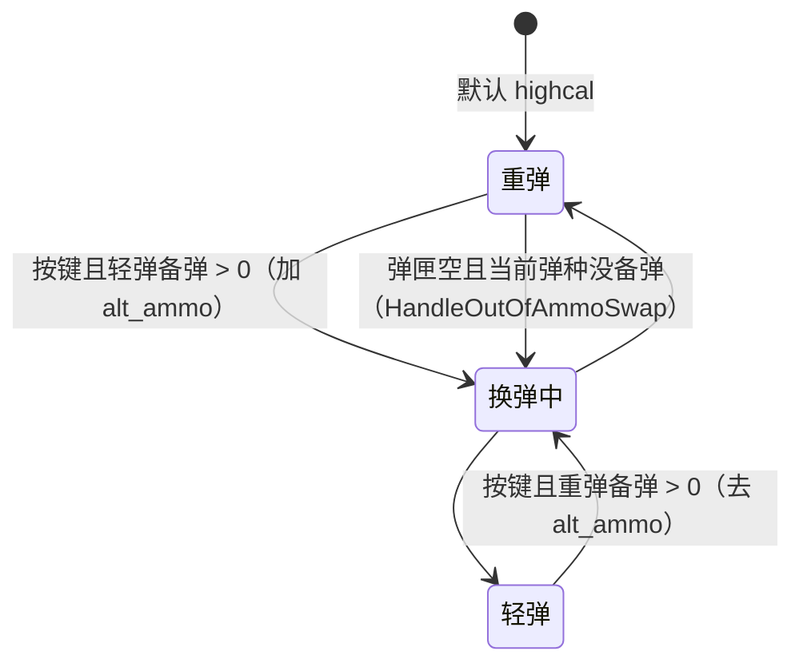

# 全自动 / 半自动弹道枪：系统记录

会话 wp1，2026-11-01，静态研究（只读脚本和数据，没进游戏）。出处从 `research-src/s21-platform/scripts/` 开始。`.nut` 在 `vscripts/weapons/`，`.txt` 在 `weapons/`。参数全表：[PARAMS.md](PARAMS.md)。

## 0. 概要

- **武器**：R-301 `mp_weapon_rspn101`、R-99 `mp_weapon_r97`、C.A.R. `mp_weapon_car`、Flatline `mp_weapon_vinson`、Spitfire `mp_weapon_lmg`、Alternator `mp_weapon_alternator_smg`、RE-45 `mp_weapon_autopistol`（Fusion 活动版）、Volt `mp_weapon_volt_smg`、P2020 `mp_weapon_semipistol`。
- **一句话**：这族枪**没有自己的机制**，脚本基本只有一句 `FireWeapon_Default`。手感差别全在数据：射速、伤害、弹速、扩散、后坐图案。HSD 只要把数据驱动的基础枪做好，这族就全有了。
- **分类**：效果（基础火力）＋ 系统（数据驱动枪械）。
- **可拆出的部件**：
  - 数据驱动开火 → 3.1，公共部件 [W-BALLISTICS](../_shared/W-BALLISTICS.md)、[W-SPREAD-RECOIL](../_shared/W-SPREAD-RECOIL.md)、[W-DAMAGE](../_shared/W-DAMAGE.md)、[W-FIRE-RELOAD](../_shared/W-FIRE-RELOAD.md)
  - 切换开火模式（R-301、Flatline 的 `altfire`）→ 3.2
  - 一把枪两种弹药（C.A.R.）→ 3.3
  - 能量枪备弹回充（Volt）→ [W-FIRE-RELOAD](../_shared/W-FIRE-RELOAD.md) 3.4

## 1. 它用什么实现各种效果

| 效果 | 实现手段 | 来源 |
|---|---|---|
| 开火 | `FireWeapon_Default(pos, dir, 1.0, 1.0, false)`，返回 `ammo_per_shot` | `mp_weapon_r97.nut:27`、`mp_weapon_rspn101.nut:27`、`mp_weapon_vinson.nut:21` |
| 没绑回调的枪 | `.txt` 没写 `OnWeaponPrimaryAttack`，走引擎默认（推断） | Spitfire、Alternator：grep `mp_weapon_lmg.txt`、`mp_weapon_alternator_smg.txt` 无此行 |
| 单发 / 连发切换 | mod `altfire`、`altfire_highcal`（`is_semi_auto 1`，换后坐图案） | `mp_weapon_rspn101.txt:406`、`:437` |
| 双弹种 | mod `alt_ammo`（`ammo_pool_type bullet`）+ 基础 `highcal` + `secondary_ammo_pool_type bullet` | `mp_weapon_car.txt:8-9`、`:410-412` |
| 换弹种的动作 | mod `ammo_type_swap` + 强制换弹 | `mp_weapon_car.txt:401-403`、`mp_weapon_car.nut:45-53` |
| 备弹回充 | `EnergyAmmoRegen_Start` | `mp_weapon_volt_smg.nut` |
| 金马钩子 | `GoldenHorseGreen_OnWeaponActivate`（Volt）、`GoldenHorsePurple_*`（Spitfire `.nut`，但 `.txt` 未绑） | `mp_weapon_volt_smg.nut`；见 [hopups](../hopups/SYSTEM.md) |

**客户端 / 服务端**：开火由引擎预测；脚本只有弹壳、颜色方案（`mp_weapon_rspn101.nut`）这类表现。C.A.R. 换弹种是客户端发 `ClientCallback_CarHandleAmmoSwap`，服务端改 mod（`mp_weapon_car.nut:35`、`:152` 起）。

**怀疑点**：`mp_weapon_car.txt:28` 注释 `OnWeaponReloadFailed` 回调 "Disabled on dedi: this script callback is not bound there"。所以**备弹空时换弹失败自动换弹种**那条路（`mp_weapon_car.nut:126-136`）在 dedi 上没人调。但开火时弹匣空的分支（`mp_weapon_car.nut:109-117`）还能触发。

## 2. 流程

普通枪就是 [W-FIRE-RELOAD](../_shared/W-FIRE-RELOAD.md) 第 2 节。C.A.R. 换弹种：



正在换弹或已带 `ammo_type_swap` 时，客户端不发请求（`mp_weapon_car.nut:144`）。

## 3. 代码

### 3.1 通用开火

```
OnWeaponPrimaryAttack(weapon, params):
    weapon.FireWeapon_Default(params.pos, params.dir, 1.0, 1.0, false)
    return ammo_per_shot
```

### 3.2 开火模式

R-301 替代开火 mod 把 `is_semi_auto` 改 1，并换 `viewkick_pattern rspn101_highcal`。Prowler 也是同一手法（[burst-fire](../burst-fire/SYSTEM.md)）。**HSD 可借**：开火模式 = 一个 mod。

### 3.3 C.A.R. 双弹种（`mp_weapon_car.nut`）

```
HandleAmmoSwap（:184 起）:
  inLight = HasMod(alt_ammo)
  inLight 且 重弹备弹 > 0 → RemoveMod(alt_ammo)
  !inLight 且 轻弹备弹 > 0 → AddMod(alt_ammo)
  → OnWeaponModChange_Car → 处理弹匣退回备弹、强制换弹
```

弹药池由 mod 的 `ammo_pool_type` 决定，所以这个机制**不需要引擎改动**。

### 3.4 被注释掉的东西

- P2020 空爆（`altfire_shatter_rounds`、`airburst_*`）：`mp_weapon_semipistol.nut:65` 起整段在 `/* */` 内。
- Volt 开镜 mod `in_ads`（`VoltADSThink`）：`mp_weapon_volt_smg.nut` 里同样注释掉。
- Alternator 左右枪管交替：`mp_weapon_alternator_smg.nut` 注释掉 + 函数未绑。

## 4. 参数

**全部参数看 [PARAMS.md](PARAMS.md)。** 下面只列决定差别的字段（`.txt` 同名字段，S21 数据）。

| 枪 | `fire_rate` | `damage_near_value` | 名义 DPS | `ammo_clip_size` | `ammo_pool_type` | `reload_time` / `reloadempty_time` | `projectile_launch_speed` | `projectile_gravity_scale` | 爆头 / 腿 | `viewkick_pattern` |
|---|---|---|---|---|---|---|---|---|---|---|
| R-301 | 13.5 | 15 | 203 | 21 | bullet | 2.4 / 3.2 | 29000 | 1.3 | 1.3 / 0.75 | `rspn101_2` |
| R-99 | 18 | 12 | 216 | 18 | bullet | 1.8 / 2.45 | 19000 | 1.2 | 1.25 / 0.8 | `r97_2` |
| C.A.R. | 15.5 | 14 | 217 | 20 | highcal / bullet | 1.7 / 2.13 | 18000 | 1.15 | 1.25 / 0.8 | `car_smg` |
| Flatline | 10 | 20 | 200 | 19 | highcal | 2.4 / 3.1 | 24000 | 1.3 | 1.3 / 0.75 | `flatline_2` |
| Spitfire | 9 | 21 | 189 | 35 | bullet | 3.4 / 4.2 | 27500 | 1.4 | 1.25 / 0.85 | `lmg_2` |
| Alternator | 10 | 18 | 180 | 18 | bullet | 1.9 / 2.23 | 19000 | 1.2 | 1.25 / 0.8 | `alternator_2` |
| RE-45 | 13 | 14 | 182 | 20 | bullet | 1.5 / 1.95 | 19500 | 1 | 1.25 / 0.9 | `autopistol_2` |
| RE-45 Fusion | 25 | 16 | （点射 3） | 15 | special | 1.9 / 2.3 | 22000 | 1.05 | 1.25 / 0.9 | `autopistol_fusion` |
| Volt | 12 | 16 | 192 | 20 | special | 2 / 2.5 | 20000 | 1.05 | 1.25 / 0.8 | `volt_2` |
| P2020 | 7 | 24 | 168 | 9 | bullet | 1.25 / 1.25 | 18500 | 1 | 1.25 / 0.9 | 无 |

**规律**：SMG 和手枪弹速 18000–20000、步枪 24000–29000，弹速决定提前量。DPS 都挤在 170–220，配平靠弹匣和换弹。**补给箱版**见 PARAMS 的"补给箱版差异"（如 R-99 15 / 14 / 13、备弹独立 240）。

## 5. 未解决和要实测的

- **C.A.R. 换弹种**：dedi 上 `OnWeaponReloadFailed` 没绑。装备后把当前弹种备弹清零、开火到空，看会不会自动换。训练场。
- **弹速、后坐**：见 W-BALLISTICS、W-SPREAD-RECOIL 第 5 节，用 R-301 代表。
- **备弹回充**：Volt，见 W-FIRE-RELOAD 第 5 节。

## 6. HSD 实现

**未实现**（只有占位 `TestRifle`：10 发/s、20 伤害、命中扫描）。

建议：`WeaponDef` 数据表 + `FiringCycle` + `BallisticRound` + `SpreadState` + `RecoilPattern`。这族枪只是数据行，一次全有。C.A.R. 留到 mod 系统之后。R-301 做第一把校准（字段最常规，实测也最容易）。差异进 `R5-DIFF-ARCHIVE.md`。开关：`hsd.tf2.x.*` 现有装备选择（`CombatLoadout.cs`）加武器项。
