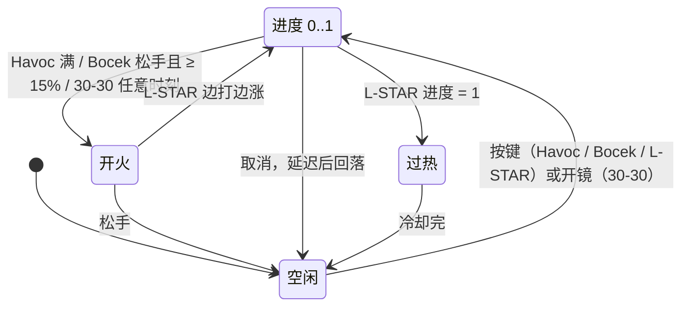

# 充能门槛 / 转速爬升 / 过热（charge-spinup）：系统记录

武器第一波，2026-11-01，静态研究（只读脚本、数据和 SDK 源码，没进游戏）。

脚本出处从 `research-src/s21-platform/scripts/` 开始。`wu` = `vscripts/weapons/_weapon_utility.nut`，`ar` / `art` = `vscripts/weapons/mp_weapon_energy_ar.nut` / `weapons/mp_weapon_energy_ar.txt`，`es` / `est` = `mp_weapon_esaw`，`dr` / `drt` = `mp_weapon_dragon_lmg`，`ls` / `lst` = `mp_weapon_lstar`，`r3` / `r3t` = `mp_weapon_3030`，`bow` / `bowt` = `mp_weapon_bow`，`bp` = `weapons/blast_patterns.txt`。

SDK 出处从 `research-src/s21-r5sdk/src/game/` 开始。`eng` = `server/energize.cpp`，`heat` = `shared/weapon_heat.cpp`，`svars` = `shared/weapon_script_vars.cpp`，`pov` = `server/player_overheat.cpp`，`kvx` = `server/weapon_kv_s21_ext.cpp`。

全部字段看 [PARAMS.md](PARAMS.md)。字段在两个引擎认不认看 [W-S3-FIELD-CHECK](../_shared/W-S3-FIELD-CHECK.md)。

**证据等级**：下面分三类写。**脚本** = 能在 `.nut` 里读到。**SDK** = `server.dll` 的补丁源码，描述本地 dedi 的做法，不一定等于 S21 原版。**推断** = 引擎内部，脚本和 SDK 都看不到。

## 0. 概要

- **武器族**：Havoc `mp_weapon_energy_ar`、Devotion `mp_weapon_esaw`、Rampage `mp_weapon_dragon_lmg`、L-STAR `mp_weapon_lstar`、30-30 `mp_weapon_3030`、Bocek `mp_weapon_bow`。
- **一句话**：六把枪的核心都在开火之前或之间的一条进度：Havoc 蓄满才开火；Devotion 越打越快；Rampage 喂一颗铝热后加射速，开枪耗时间；L-STAR 打到满就过热，没有弹匣；30-30 开镜蓄力，下一枪多伤害；Bocek 拉弓决定伤害和弹速，满弓后卡点放箭能加速。
- **分类**：
  - 效果：是。手感差异全在这（`../../W0-WEAPON-FILTER.md`）。
  - 可视化：是。转动音按进度 seek、枪身随进度变色（L-STAR）、Bocek 瞄具灯和中心点。
  - 可复用系统：是。进度条、档位、消耗品 buff 计时器、过热锁定、节奏判定都和具体武器无关。
- **可拆出的部件**：
  - 充能门槛（满才开火）→ 3.2.1
  - 射速爬升 → 3.2.2
  - 消耗品 buff 计时器（喂物品 + 开枪耗时）→ 3.2.3
  - 过热锁定（无弹匣）→ 3.2.4
  - 蓄力档位 → mod → 3.2.5、3.2.6
  - 节奏判定（Marksman's Tempo）→ 3.2.7
  - 开镜 / 腰射切换散射 → 3.2.8
  - 备弹自动回充 → 3.2.9 `EnergyAmmoRegen_Start`
  - 分段换弹加速 → 3.2.10

## 1. 它用什么实现各种效果

| 效果 | 实现手段 | 证据 |
|---|---|---|
| Havoc 门槛 | `charge_attack_min_charge_required 1.0`（引擎 / SDK），**脚本门槛没绑定** | `art:129`；`heat:1146-1162`；3.2.1 |
| Havoc 涡轮 | hop-up mod 把 `charge_time` 改 0.01 | `art:441-445` |
| Devotion 爬升 | `fire_rate` 5 → `fire_rate_max` 15，**没有脚本** | `est:135-138`，引擎，**推断** |
| Rampage 充能 | 状态机 NONE / ENERGIZING / ENERGIZED。S21 客户端原生；dedi 上是 **SDK 重写** | `eng:56-61`，`dr:158-194` |
| Rampage 加速 | `energized` mod：`fire_rate 6.5`，换音效和弹迹 | `drt:462-494` |
| L-STAR 过热 | `charge_overheats_when_full` + `charge_weapon_fires_while_charging` | `lst:17-29`，SDK 补冷却 |
| L-STAR 警告 | 脚本：`GetWeaponChargeFraction >= 0.8` 放声音 | `ls:25,65-73` |
| 30-30 蓄力 | ADS 触发 2 档；满档加 `charged` mod 改命中体积 | `r3:208-217`，`r3t:458-468` |
| 30-30 加伤 | `charge_additional_damage_multiplier 0.4`，**脚本没读**，SDK 只有别名 | `r3t:35`，`svars:3246`；**推断** |
| Bocek 伤害 | 每档换 `std_charge_dmg_lvN` mod | `bow:781-809` |
| Bocek 弹速 | `GetWeaponChargeFractionCurved` 插值 → `FireWeapon_Default` 的 `speedScale` | `bow:318-339` |
| Bocek 曲线 | `charge_curve_coefficients`。SDK 写出了公式 | `bowt:80`，`heat:999-1003` |
| 节奏判定 | 脚本线程 + `ScriptTime1` / `ScriptInt1` | `wu:5995-6155` |
| Bocek 散射 | `shatter_rounds_hipfire` mod：7 发 `shatter_arrows` | `bowt:446-460`，`bp:130-136` |
| 备弹回充 | 脚本线程（只在服务端） | `wu:4742-4878` |
| 转动音 | `charge_sound_*`、`charge_sound_seek_to_charge_fraction` | `art:130-135`，引擎 |
| 枪身变色 | `entity_color_from_charge 1` | `lst:30`，引擎 |

## 1.1 引擎做的事（脚本看不到）

这些在 `.nut` 里**完全没有逻辑**，下面的描述全是**推断**（字段名 + SDK 旁证），要实测：

- 进度怎么涨和怎么掉：`charge_time`、`charge_cooldown_time`、`charge_cooldown_delay`。
- 档位怎么算：`charge_levels`、`charge_level_base`。
- 射速爬升和回落：`fire_rate_max*`。
- ADS 触发蓄力：`charge_is_triggered_by_ADS`。
- `charge_additional_damage_multiplier` 怎么乘进伤害。
- 过热判定本身：`charge_overheats_when_full`。
- 回调什么时候调：`OnWeaponChargeBegin`、`OnWeaponChargeLevelIncreased`、`OnWeaponChargeEnd`、`OnWeaponCooldown`。

## 1.2 S3 / S21 差异（重要）

- **`r5apex_ds.exe` 没有，不等于 dedi 没有。** [W-S3-FIELD-CHECK](../_shared/W-S3-FIELD-CHECK.md) 只搜了两个 exe，所以它列出 `has_energized`、`energized_*`、`charge_overheat_cooldown_time*`、`charge_curve_coefficients` 和方法 `ForceEnergizeState`、`GetEnergizeState` 等"只有 S21 客户端认"。这个结果本身对。但本地 dedi 还加载 `server.dll`（SDK）。本次搜索：这些字符串都在本地 `server.dll` 里，SDK 源码也有实现：
  - 充能状态机和方法注册：`eng:38-41,630-712,780-808`。
  - 过热冷却、满弓保持、最小蓄力、充能曲线：`heat:51-64,993-1003,1085-1116,1146-1162,1223-1240`。
  - 脚本变量 `SetScriptTime1` / `GetScriptTime1`（节奏判定要用）：`shared/weapon_script_vars.cpp:150,394-400`。exe 里同样搜不到。
  - 分段重力、`spread_min_kick`：`kvx`（`bridge_weapon_kv_s21ext`）。
  - 所以 W-S3-FIELD-CHECK 关键结论"S3 dedi 上充能状态推断跑不起来"**只对 exe 成立**。正确说法是：dedi 上充能是 SDK 重写的状态机，能不能跑、和 S21 客户端是否一致，都要实测（第 5 节第 1 条）。
- **这些仍然只是字符串和源码证据，不是行为证据。** `research-src` 的 SDK 源码是否正好等于本地 `server.dll` 的版本，没有核对提交号。开关 `sdk_energize_bridge`、`bridge_charge_*` 的默认值在源码里是 1。
- **SDK 没补上的字段**（只有 `eWeaponVar` 别名，`svars:3243-3246`，全 SDK 没有别的引用）：`charge_additional_damage_multiplier`、`charge_delay_when_triggered_by_ADS`、`charge_cooldown_time_post_fire`。exe 也没有。所以 **30-30 的蓄力加伤和 0.3 s 开镜延迟在 dedi 上推断不生效**，但 S21 客户端认，预测和服务端可能不一致（第 5 节第 3 条）。这是本族最可能的真差异。
- **S3 和 S21 的计时差**：`heat:66-76` 注释，S21 结束一次开火蓄力用当前时间，S3 提前一个射击间隔，会让 L-STAR 热得更快。SDK 默认按 S21（`bridge_charge_fire_lead 0`）。
- **S3 的过热字段名不同**：dedi 叫 `charge_cooldown_time_late1/2/3`，S21 改名 `charge_overheat_*`（`heat:117`）。SDK 读新名字灌进去（`heat:1223-1240,1306`）。
- **满弓**：S3 引擎满弓会自动放箭，SDK 用钩子保持住（`heat:51-54,1085-1116`；失败时日志 `heat:1453`）。
- **Hack 痕迹**：`dr:1-2` 作者注释"很多 hack，小心改"。`bow:44` "remove hacky charge level mod thing when we get code features"。Bocek 把节奏宽限塞进不相干的字段传给 UI：`explosion_shake_amplitude 0.3`、`explosion_shake_frequency 0.45`（`bowt:341-342,972-973`）。
- **Flowstate 残留**：`ls:196-234` 的碰撞回调给投射物随机角度，下面是注释掉的试验代码（含 `CreateFlowStateDeathBoxForPlayer`）。
- **空回调**：`mp_weapon_dragon_lmg_crate.txt:62-64` 点名的开镜和换主人回调都是空函数（`vscripts/weapons/_missing_callback_stubs.gnut:884,1118,1138`）。普通版没绑。
- **`player_overheat_per_bullet`**（Devotion 5、30-30 28）：W-S3-FIELD-CHECK 说"脚本不读、推断无效"。但 `pov:177-180` 读它，属于玩家过热（`debuff zone`，`pov:35`），和枪的过热是两回事，本记录不展开。

## 2. 流程



- **Havoc**：按住开火 → 0.42 s 蓄满 → 连发 11.2 发/s。松手后 0.1 s 开始回落，0.5 s 掉完（`art:123-129`）。`charge_remain_full_when_fired 1`：开枪不清进度。
- **Devotion**：按住，5 → 15 发/s，1.5 s 到顶（`est:135-137`）。`fire_rate_max_time_cooldown 0`：一松手立刻回 5（**推断**）。
- **Rampage**：按配置键（客户端把标志位塞进 `impulse` 发给 dedi，`eng:1517-1521`）→ `OnWeaponTryEnergize` 检查 → 播 3.7 s 动画（`drt:66`）→ 进 ENERGIZED。详见 3.2.3。
- **L-STAR**：按住就打，边打边涨。2.2 s（约 22 发，**推断**）满 → 过热 → 锁 3.63 s。松手从当前进度延迟 0.08 s，1.19 s 回到 0。
- **30-30**：开镜 → 延迟 0.3 s（`r3t:39`，dedi 推断无）→ 0.4 s 到 2 档 → 下一枪 ×1.4（**推断**）。半自动，拉栓 0.685 s。
- **Bocek**：按住 → 0.45 s 满 5 档 → 松手放箭。松手时不足 15%：不放（`bowt:75`）。切换键或换弹键取消（`bow:844-874`）。

**打断**：Bocek `weapon.ForceChargeEndNoAttack`（`bow:873`）。Rampage 动画：SDK 按键输入和收枪都会取消，疾跑不取消（`eng:952-972`），取消时**不扣**消耗品（`dr:167-170` 只在完成时走 `OnWeaponEnergizedStart`）。换武器：Bocek 清 mod（`bow:273`），30-30 清 `in_ads`（`r3:83`）。

## 3. 代码

### 3.1 入口

| 武器 | `.txt` 回调 | 主函数 |
|---|---|---|
| Havoc | `art:25-26`（**只有激活和停用**） | `OnWeaponActivate_Energy_AR`（`ar:74-78`） |
| Devotion | `est:29-31`（只有激活和停用） | `OnWeaponActivate_weapon_esaw`（`es:10-22`） |
| Rampage | `drt:38-45` | `dr:61-194` |
| L-STAR | `lst:36-40` | `LSTARPrimaryAttack`（`ls:55-88`） |
| 30-30 | `r3t:25-31` | `r3:208-238` |
| Bocek | `bowt:29-37` | `OnWeaponPrimaryAttack_weapon_bow`（`bow:299-387`） |

### 3.2 核心逻辑

#### 3.2.1 Havoc 充能门槛

**脚本门槛是死代码**：`CanFire_EnergyAR` 要求 `GetWeaponChargeFraction >= 1`（`ar:84-90`），`OnWeaponPrimaryAttack_Energy_AR` 调它（`ar:92-98`）。但 `art` **没有绑定 `OnWeaponPrimaryAttack`**（本次 grep，`est` 同样），也没有 `altfire` mod，所以 `ar:115-120` 的 `FireWeaponBullet` 分支也跑不到。

真正的门槛是字段：

```
charge_attack_min_charge_required 1.0（art:129）
S21 客户端：引擎读（推断）
dedi：SDK 钩子（heat:1146-1162）
  若 蓄力将结束 且 linearFrac < min → ChargeEndNoAttack
  fires_while_charging 的武器不走这条
```

开火走引擎默认路径（**推断**）。Havoc 不开火时不走任何脚本。

涡轮（`art:441-445`）：`charge_time 0.01`，`cooldown 0`，`delay 0`。机制不变，门槛缩到近乎 0。补给箱版直接写这三个值（`mp_weapon_energy_ar_crate.txt:10-12`）。这说明"门槛"和"有没有门槛"是同一组字段，不用改代码。

激活时 `EnergyAmmoRegen_Start`（`ar:77`）。

#### 3.2.2 Devotion 射速爬升

```
fire_rate 5（est:135）
fire_rate_max 15（est:136）
fire_rate_max_time_speedup 1.5（est:137）
fire_rate_max_time_cooldown 0（est:138）
涡轮：fire_rate 6.8，speedup 0.85（est:406-409）
```

全部在引擎，脚本只负责回充（`es:21`）。爬升曲线（线性？按时间？按发数？）**推断**是线性按时间。两个 exe 都认这组字段。`svars:3158-3161` 只是给 `eWeaponVar` 加别名。

音效：`looping_sounds 1`（`est:75`），涡轮换循环音（`est:410-419`）。

#### 3.2.3 Rampage 充能（消耗品 buff 计时器）

状态：NONE → ENERGIZING（播动画）→ ENERGIZED（`eng:56-61`）。

```
按键（eng:1278-1298）：
  有 has_energized，不在 ENERGIZING，（不在 ENERGIZED 或 can_energize_when_energized）
  Energize_CanStart（就绪时间、武器状态、没在收枪）
  脚本 OnWeaponTryEnergize（wu:5873-5919）：
    剩余比例 > energized_max_reenergize_frac 0.98 → "已满"，拒绝
    物品不够 → 提示并发语音，拒绝
  进 ENERGIZING，放动画，调 OnWeaponStartEnergizing（dr:158-165：开舱特效和声音）
动画走完（eng:398-404 用动画事件 AE_WPN_ENERGIZED 定时）：
  AddMod("energized")（eng:911）
  调 OnWeaponEnergizedStart → SURVIVAL_RemoveFromPlayerInventory 扣 1 个铝热（wu:5921-5937）
  endTime 设好
开枪：endTime −= energized_time_consumed_per_shot 0.74（eng:1482-1486）
now >= endTime：回 NONE，RemoveMod，调 OnWeaponEnergizedEnd（eng:1400-1408,940-943）
```

算下来：只放着 120 s（`drt:134`）。持续开火时每秒掉 `1 + 6.5 × 0.74 = 5.81 s`，约 20.7 s（约 134 发）打完（计算，**推断**按 `eng` 的 SDK 做法）。

`energized` mod 只改射速和表现，**不加伤害**（`drt:463-491`，`energize.h` 注释写 damage/fire-rate buff，但数据没有）。

**铝热灼烧没有接上**：`OnProjectileCollision_ThermiteRounds`（`wu:4270-4289`）读 `burn_damage` 等字段再调 `TryApplyingOrRefreshingBurnDamage`。但全项目没有调用者，`drt` 没绑 `OnProjectileCollision`，也没有 `burn_*` 字段（在 `mp_weapon_thermite_grenade.txt:76-80`）。Rampage 充能时**打不出灼烧**。`wu:4286` 还读了没赋值的 `burnDuration`。要做灼烧弹就抄 `TryApplyingBurnDamage`（`wu:4302-4319`）和叠层（`wu:4379-4389`：`tickInterval = burnTickRate / burnTime`，`damagePerTick = burnDamage / 次数`）。

其他脚本：`dr:66-74` 的 `start_energized` 字段，全部 `.txt` 都没写，这段不跑。`dr:214-232` 每帧把 `GetEnergizeFrac` 写进 `ScriptFloat0` 给 UI。

#### 3.2.4 L-STAR 过热（无弹匣）

字段（`lst:17-29`）：`cooldown_type chargeFrac`、`charge_weapon_fires_while_charging 1`、`charge_overheats_when_full 1`、`charge_remain_full_when_fired 1`。`ammo_clip_size 0`（`lst:277`），只有备弹 88（`lst:281`）。

```
按住：进度按 1/charge_time 涨（推断，2.2 s 满）
进度 = 1：过热，锁定
正常冷却：延迟 charge_cooldown_delay 0.08 后，1.19 s 从 1 到 0（lst:20-21）
过热冷却（SDK，heat:878-896）：frac = last − max(0, now − end − delay) / duration
  duration = charge_overheat_cooldown_time 3.63，delay 0.06（lst:22,26）
  装了别的修正时优先用 modvar（heat:870-876）
_late1..3 = 2.55 / 2.07 / 1.16（lst:23-25）：用途推断是冷却动画里程碑
```

回调 `OnWeaponCooldown_weapon_lstar`（`ls:119-152`，`ls:118` 注释说"blowoff"和"burnout"都走这里）：
- 服务端：`GetWeaponChargeFraction == 1` → 烧坏特效和声音。`ls:125` 注释"只在 `charge_cooldown_delay > 0` 时有效"。否则放通气烟。
- 客户端：`IsOverheated()` → 烧坏，且调 `GoldenHorseGreen_OnWeaponReload`。

**开火路径不对称**：客户端 `FireWeapon_Default`（`ls:78`），服务端 `FireGenericBoltWithDrop`（`ls:85`，`wu:1448-1482`）。服务端版把 `bolt.kv.gravity` 写成 1。`projectile_gravity_scale 0.5`（`lst:33`）是否还生效要测。泰坦路径 `ls:91-115` 是原型，HSD 不管。

能量弹匣改的是**热量上限**（`lst:539-574`）：`charge_time` 2.4 / 2.6 / 2.8 / 2.8，冷却 ×0.967 / 0.933 / 0.9 / 0.7。`ammo_clip_size *1.25` 乘 0 还是 0。

没有换弹（**推断**：`reload_time 3.26`、`reload_enabled 1` 仍然写着，`lst:333,338`，但弹匣 0）。备弹回充见 3.2.9。

#### 3.2.5 30-30 蓄力

```
r3t:32-42：charge_time 0.4，levels 2，base 1，ADS 触发，延迟 0.3
OnWeaponChargeLevelIncreased：level == 2 → AddMod("charged")（r3:208-217）
OnWeaponChargeEnd：RemoveMod("charged")（r3:219-225）
charged mod（r3t:458-468）：只改 bolt_hitsize，缩小（0.25 / 0.5）
开火（r3:227-238）：FireWeapon_Default(pos, dir, 1, 1, ignoreSpread)
```

**加伤全在引擎**：`charge_additional_damage_multiplier 0.4`（`r3t:35`），43 → 60.2（**推断** `base × (1 + 0.4)`）。dedi 推断没有（1.2 节）。

`ignoreSpread = true//weapon.HasMod( SHATTER_ROUNDS_HIPFIRE_MOD )`（`r3:229`）：原来的条件被注释，写死 true。**腰射散布 3°（`r3t:253`）对弹道不起作用**。这很可能是补丁改动，要测。

**30-30 散射死了**：`r3:66-71` 的 ADS 线程和更新线程都注释掉，`r3t` 有 `hopup_shatter_rounds` 和 `shatter_rounds_hipfire`（`r3t:423,434-456`：7 发、每发 8、`charge_additional_damage_multiplier 0.5`），但没有 `altfire_shatter`，`cl_gamemode_survival.nut:2047` 的切换找不到 mod。脚本层面加不上（`wu:6313` 也要 altfire）。

`ADSThinkThread`（`r3:102-137`，服务端）：`zoomFrac >= 0.5` 加 `in_ads`（只切准星，`r3t:470-474`）；每帧把进度喂给声音控制器。`r3:45` 注释掉"CAUTION: Unfinished Weapon Equipped"提示。

`EnergyChargeWeaponData`（`r3:29`）是空的，只用于音效回调。没有 `OnWeaponNpcPrimaryAttack`。

#### 3.2.6 Bocek 拉弓

```
bowt:71-80：charge_time 0.45，require_input 1，hold_when_full 1，remain_full 1，
            min_required 0.15，cooldown 0.3，delay 0.1，levels 6，base 1，curve
ApplyModsForChargeLevel(level)（bow:781-809）：
  先清全部 mod
  level − 1 > 0 → AddMod("charge_lv" + (level−1))
  散射箭 → arrows_shatter_dmg_lv{0,3,5}；普通箭 → std_charge_dmg_lv{1..5}（0 档用基础值）
每次升档调一次（bow:485），开火再调一次（bow:313）
开火后 ClearChargeAfterFrame：下一帧才清（bow:423-439），注释说要保留 mod 算后坐
```

**弹速**（`bow:318-333`）：

```
adj = clamp(GetWeaponChargeFractionCurved, 0, 1)
目标 = lerp(10000, 27000, adj)（散射箭 lerp 到 16000）
speedScale = 目标 / 10000
```

**曲线**（SDK 的实现，`heat:999-1003`）：`y = clamp01(((a x + b) x + c) x)`，`a=1.4205`、`b=-1.1607`、`c=0.7338`。

| 线性进度 x | 0.15 | 0.25 | 0.5 | 0.75 | 1 |
|---|---|---|---|---|---|
| 曲线值 y（计算） | 0.089 | 0.133 | 0.254 | 0.497 | 0.994 |
| 普通箭 u/s（计算） | 11509 | 12263 | 14323 | 18444 | 26891 |

注意：三系数加起来是 0.9936，**满弓速度 26891，不到 27000**（差 0.4%）。这是 SDK 的系数解读。S21 客户端用的是原生函数（`heat:1-3`），要是系数顺序不同，预测和服务端弹速就不一样。第 5 节第 4 条。

**档位是否按线性算**：`heat:999` 只给曲线用线性。档位由引擎 `GetWeaponChargeLevel` 给，**推断**按线性。

**伤害**：35 / 35 / 42 / 47 / 54 / 60（第 4 节）。满档爆头 ×1.75、腿 ×0.9（`std_charge_dmg_lv5`，PARAMS）。

**满档变化**：`charge_lv5` 还换重力和阻力（`bowt:588-595`）、扩散变小（`bowt:610-613`）、开镜移动 0.5（`bowt:614`）。**这些分段字段 exe 不认，靠 `kvx` 读**，要测实际弹道（`../_shared/W-BALLISTICS.md`）。

**箭插在身上**（`bow:502` 起）：普通箭命中后建 mover，每人最多 4 支（`bow:62`）、世界 750 支（`bow:63`），寿命 90 s（`bow:67-68`），默认不能捡（`bow:69`）。表现用，PvE 可以不要。

#### 3.2.7 节奏判定（Marksman's Tempo）

要装 `hopup_marksmans_tempo`（`bowt:417`，`wu:225`）。没装时 `MarksmansTempo_Validate` 返回假（`wu:6002-6006`）。

```
ScriptTime1 = 完美时刻；ScriptInt1 = 连续次数（wu:5992）
满弓那一刻（bow:466-482）：
  SetPerfectTempoMoment(now)（wu:6057-6080）
  起 fadeoff：宽限过后不开火就清零
    宽限：未激活 0.3 s，已激活 0.45 s（match_grace_time 1，bowt:336-338）
开火（wu:6093-6127）：
  if now <= ScriptTime1 + 宽限:
    次数 = min(次数 + 1, 2)；到 2 → AddMod("marksmans_tempo_active")
    未激活 → AddMod("marksmans_tempo_buildup")
    起 fadeoff 2.0 s（bowt:340）：2 s 内不再拉弓就清零
  else 清零
开始拉弓：abort fadeoff（bow:453）
激活效果：charge_time 0.45 → 0.38（bowt:422-427）
```

所以：连续两次在满弓后 0.3 s 内放箭 → 进入加速。之后每次窗口放宽到 0.45 s。错过一次回到 0。纯脚本，和引擎版本无关，但 dedi 要靠 SDK 的 `SetScriptTime1`。

`wu:5992` 警告：占用 `ScriptInt1` 和 `ScriptTime1`，别的逻辑不能用。

`DisplayCenterDotRui`（`bow:369-382`、`wu:5940-5983`）：放箭后闪中心点，`center_dot_helper_min_charge_level 3`（`bowt:343`）。铁瞄和全息放宽到 2 档（`bowt:344`、`bow:90-94`）。

#### 3.2.8 Bocek 散射箭

`hopup_shatter_rounds` 解锁，切换键 `WeaponModCommand_Toggle("altfire_shatter")`（`vscripts/gamemodes/cl_gamemode_survival.nut:2045-2047`）。

```
ShatterRounds_ADSThink（wu:6253-6296，服务端每帧）：
  开镜 → 去掉 shatter_rounds_hipfire（打单箭）
  否则 → 加上（打 7 发）
shatter_rounds_hipfire（bowt:446-460）：blast_pattern shatter_arrows，7 发
开火时 ignoreSpread = true（bow:327），弹速上限 16000
图案：bowt:333-334 zero 512，scale 1.4；bp:130-136，最大偏移 10 × 1.4 = 14 u @512 u，1.57°
伤害：每发 6 / 9 / 12（lv0 / 3 / 5），档位用 GetBestAvailableModLevel 向下取整（bow:829-841）
全中：42 / 63 / 84
```

和 `../shotgun-blast/SYSTEM.md` 3.2.1 同一套公式。

#### 3.2.9 备弹自动回充（`EnergyAmmoRegen_*`，`wu:4742-4878`）

只在服务端。条件（`wu:4754-4763`）：`ammo_pool_type special`、`uses_ammo_pool 0`、`ammo_stockpile_max > 0`。

```
每帧：
  备弹减少 或 按着开火（且手持）→ readyTime = now + 0.1；清零进位
  已满 / 未到 readyTime → 清零进位
  否则 进位 += 速率 × dt；取整写回备弹
速率（wu:4786-4810）：
  有弹匣：弹匣 / 18 s（crate 22 s），能量弹匣 ×1.5 / 2.0 / 2.5
  无弹匣（L-STAR）：1.22 发/s（crate 1.27；弹匣 1.34 / 1.44 / 1.56）
```

算下来：Havoc 1 发/s（18 / 18），Devotion 2 发/s（36 / 18）。线程没有按"是否手持"退出（`wu:4824-4825` 只等武器销毁），所以收起来也回（`wu:4855` 只在手持且按键时暂停）。Bocek 不是（`bowt:94-97` 无 special）。Rampage 用 `highcal`。

**这段是不是 S21 原版不确定**：代码没有被剥的痕迹，配套在 `vscripts/survival_loot.gnut:3817-3822`。常量名和写法像手工补丁（**推断**）。第 5 节第 6 条。

#### 3.2.10 分段换弹加速（30-30）

`OnWeaponReload_weapon_3030`：每装一发 `ScriptInt0 + 1`，≥ 3（`r3:25`）加 `segmented_speed_load`（`reloadsegment_time_loop ×0.8`，`r3t:428-432`）。`OnWeaponReadyToFire` 退出换弹后清除（`r3:263-276`）。

### 3.3 客户端表现

- 转动音：`charge_sound_seek_to_charge_fraction 1`（`art:133`），按进度 seek，和 Sheila（`../../rampart-sheila/SYSTEM.md`）一样的听感。
- Rampage：`UpdateWeaponEnergizeRui`（`vscripts/client/rui/cl_weapon_status.gnut:2920` 起），准星上进度条；枪身发光 `SetEnableEmission`（`dr:171,192,261-267`）。
- L-STAR：0.8 警告音，`lastFireTime` 被借来记上次播放（`ls:67`）。
- Bocek：3 盏瞄具灯（`bow:78-88`，每种瞄具不同附着点），满弓震动（`bow:477`），声音控制器 = 曲线进度 × 100（`bow:315`）。
- 30-30：击锤 pose（`r3:152-206`），开火关、动画事件开。

### 3.4 依赖的公共代码

- `EnergyChargeWeapon_*`（`wu:835-970`，详见 `../shotgun-blast/SYSTEM.md` 3.3）。Havoc、L-STAR、Bocek 不用。
- `../_shared/W-BALLISTICS.md`（弹道、分段重力）、`../_shared/W-DAMAGE.md`、`../_shared/W-FIRE-RELOAD.md`（`rechamber_time`、分段换弹）、`../_shared/W-MOD-SYSTEM.md`（mod 是这些武器切状态的主要手段）、`../hopups/SYSTEM.md`（涡轮）、`../../_shared/E-STATUS-EFFECT.md`（本族基本不用状态效果）。

## 4. 参数

机制字段对比。其余看 [PARAMS.md](PARAMS.md)。"dedi 来源"一列：**exe** = `r5apex_ds.exe` 认，**SDK** = 只有 `server.dll` 补了，**无** = 只有别名（`svars`），**推断**不生效。

| 字段 | Havoc | L-STAR | 30-30 | Bocek | dedi 来源 |
|---|---|---|---|---|---|
| `charge_time`（s） | 0.42（`art:123`） | 2.2（`lst:19`） | 0.4（`r3t:32`） | 0.45（`bowt:71`） | exe |
| `charge_levels` / `_base` | — | — | 2 / 1（`r3t:33-34`） | 6 / 1（`bowt:78-79`） | exe |
| `charge_cooldown_time` | 0.5（`art:126`） | 1.19（`lst:20`） | 0.01（`r3t:36`） | 0.3（`bowt:76`） | exe |
| `charge_cooldown_delay` | 0.1（`art:127`） | 0.08（`lst:21`） | 0（`r3t:37`） | 0.1（`bowt:77`） | exe |
| `charge_require_input` | 1（`art:125`） | — | — | 1（`bowt:72`） | exe |
| `charge_remain_full_when_fired` | 1（`art:124`） | 1（`lst:29`） | 0（`r3t:42`） | 1（`bowt:74`） | exe |
| `charge_is_triggered_by_ADS` | — | — | 1（`r3t:38`） | — | exe |
| `charge_weapon_fires_while_charging` | — | 1（`lst:28`） | — | — | exe |
| `charge_overheats_when_full` | — | 1（`lst:27`） | — | — | exe |
| `charge_attack_min_charge_required` | 1.0（`art:129`） | — | — | 0.15（`bowt:75`） | SDK（`heat:56-59`） |
| `charge_allow_hold_when_full` | — | — | — | 1（`bowt:73`） | SDK（`heat:51-54`） |
| `charge_curve_coefficients` | — | — | — | 1.4205 −1.1607 .7338（`bowt:80`） | SDK（`heat:999-1003`） |
| `charge_overheat_cooldown_time` / `_delay` | — | 3.63 / 0.06（`lst:22,26`） | — | — | SDK（`heat:61-64`） |
| `charge_additional_damage_multiplier` | — | — | 0.4（`r3t:35`） | — | **无** |
| `charge_delay_when_triggered_by_ADS` | — | — | 0.3（`r3t:39`） | — | **无** |
| `fire_rate` | 11.2（`art:111`） | 10（`lst:329`） | 3.85（`r3t:57`） | 2.5（`bowt:38`） | exe |
| 每发伤害 | 20（`art:74`） | 19（`lst:285`） | 43（`r3t:67`） | 35–60（`bowt:98`、PARAMS） | — |

Devotion 和 Rampage：

| 字段 | 值 | 来源 | dedi 来源 | 作用 |
|---|---|---|---|---|
| `fire_rate` / `fire_rate_max` | 5 / 15 | `est:135-136` | exe | 起步 / 封顶 |
| `fire_rate_max_time_speedup` / `_cooldown` | 1.5 / 0 s | `est:137-138` | exe | 爬升 / 回落 |
| 涡轮 `fire_rate` / `speedup` | 6.8 / 0.85 | `est:408-409` | exe | |
| 每发伤害（Devotion） | 16 | `est:97` | — | |
| Rampage `fire_rate`（充能后） | 5 → 6.5 | `drt:167,464` | exe | |
| `energized_duration` | 120 s | `drt:134` | SDK（`eng:480`） | 总时间 |
| `energized_time_consumed_per_shot` | 0.74 s | `drt:135` | SDK（`eng:484`） | 每发扣时 |
| `energize_activity_time` | 3.7 s | `drt:66` | SDK（`eng:482`） | 喂铝热动画 |
| `energized_consumable` / 数量 | 铝热 / 1 | `drt:47-48` | 脚本 | |
| `energized_max_reenergize_frac` / `_prompt_frac` | 0.98 / 0.25 | `drt:60,59` | 脚本 | 能再喂的上限 / 提示 |
| `can_energize_when_energized` | 1 | `drt:58` | SDK（`eng:486`） | |
| 每发伤害（Rampage） | 29（充能不变） | `drt:128` | — | |

Bocek 档位：

| 档（`GetWeaponChargeLevel`） | 1 | 2 | 3 | 4 | 5 | 6 |
|---|---|---|---|---|---|---|
| 线性时间（`0.45 × (档−1)/5`，**推断**） | 0 | 0.09 | 0.18 | 0.27 | 0.36 | 0.45 |
| 普通箭伤害（基础 / `std_charge_dmg_lvN`） | 35（`bowt:98`） | 35 | 42 | 47 | 54 | 60 |
| 散射每发 | 6 | 6 | 6 | 9 | 9 | 12 |

其他：`projectile_launch_speed` 10000、`_full_charge` 27000、`_shatter_arrows` 16000（`bowt:40-42`）；节奏 `required_shots 2`、宽限 0.3 / 0.45、fadeoff 2（`bowt:335-340`）；箭上限和寿命（`bow:61-69`，playlist 可覆盖 `bow:181-189`）。

回充常量：`wu:4766-4784`。L-STAR 警告 0.8（`ls:25`）。30-30 开镜判定 0.5（`r3:18`）、分段换弹 3（`r3:25`）。

## 5. 未解决和要实测的

1. **Rampage 充能在 dedi 能不能跑**。证据：exe 没有，`server.dll` 有状态机。测：背包放铝热，按键喂，看 3.7 s 动画、`energized` mod、射速 5 → 6.5、铝热减 1。开枪看进度条，每发掉 0.74 s。日志开 `sdk_energize_drain_trace 1`。对比 `sdk_energize_bridge 0`。为什么不确定：源码不一定是这个二进制，动画和状态网络同步是最容易出错的地方。
2. **L-STAR 过热锁定时长**。exe 不认 `charge_overheat_*`，SDK 补。测：按住到过热，秒表 + 控制台读进度，预期约 2.2 s 过热、约 3.69 s 后可开火。再测 `bridge_charge_overheat_cooldown 0`（回退到 1.19 s）。再测发数（S3 计时差 `bridge_charge_fire_lead`）。
3. **30-30 蓄力加伤**（最可能的真差异）。测：`npc_dummie`，开镜满档开火和腰射各打 10 枪，读伤害。预期（S21）60.2 vs 43；如果 dedi 上全是 43，就坐实。同时测开镜后 0.3 s 延迟。
4. **Bocek 曲线和弹速**。测：拉 0.25 / 0.5 / 0.75 / 1 倍时长放箭，打远墙算飞行时间，对比第 3.2.6 节的表。满弓看 26891 还是 27000。对比客户端预测弹着和服务端弹着。
5. **Bocek 档位和伤害**。测：`npc_dummie`，按第 4 节时间放箭，读伤害 35 / 35 / 42 / 47 / 54 / 60。确认档位按线性而不是曲线。再测拉不到 15% 是否不放。满弓能不能一直举着（`heat:1085-1116`）。
6. **备弹回充**。测：Havoc 打一半，记备弹随时间变化（预期 1 发/s），收枪后是否继续。确认是不是补丁：看 S21 文档或别的构建。
7. **Havoc 门槛**。脚本门槛没绑。测：按住开火到第一发的时间，预期 0.42 s，涡轮 0.01 s。松手 0.1 s 内再按是否立刻开火（回落语义）。回落到 50% 再按需要多久。
8. **Devotion 曲线**。测：高速录屏或服务端打印开火时间戳，画射速 - 时间。线性还是按发数。松手后立刻再按是否回到 5。两个 exe 都认，主要测形状。
9. **30-30 腰射散布**。`r3:229` 写死 `ignoreSpread = true`。测：腰射对墙 10 枪，看是否全在中心。
10. **L-STAR 重力**。服务端 `bolt.kv.gravity = 1`（`wu:1471`），字段 0.5。测：远距离下坠，对比 Spitfire。
11. **节奏判定**。测：装 `hopup_marksmans_tempo`，满弓后 0.2 s 放两次，观察拉弓时间是否变 0.38 s。再测 0.5 s 放是否清零。
12. **Rampage 灼烧**。静态结论：没接。测：充能后打 `npc_dummie`，确认没有持续伤害。
13. **Bocek 散射切换**。测：装 hop-up 按切换键，腰射 7 发、开镜 1 发。
14. **SDK 版本**。核对本地 `server.dll` 和 `research-src/s21-r5sdk` 的提交，否则上面所有 SDK 引用都只是"很可能"。

靶子：`npc_dummie` 和 `npc_prowler` 能生成和追人，不开火，适合当靶。不要用 `npc_spectre`（会挂 dedi）。

## 6. HSD 实现

**未实现**。现状：`Combat/Weapons.cs` 只有抽象 `Weapon` 和 `TestRifle`（即时命中占位），`SpecialWeapons.cs` 的 `InfernoBeam` 有"伤害随时间爬升"可以参考。没有扩散、后坐、投射物、蓄力、配件。`origin/claude/w2-framework-b44e35` 加了状态效果、减速、伤害修饰链、放置物、目标选择。

建议做法，**把部件做成组合，不要每把枪写一个类**：

1. **`Combat/WeaponCharge.cs`（新）**：`WeaponCharge` 结构：`frac`、`level`、`state`。字段：`chargeTime`、`cooldownTime`、`cooldownDelay`、`levels`、`levelBase`、`requireInput`、`triggeredByAds`、`remainFullWhenFired`、`firesWhileCharging`、`overheatsWhenFull`、`overheatCooldownTime`、`overheatCooldownDelay`、`minToFire`、`curve[3]`。一个 `Step(dt, input)`。这一个部件覆盖 Havoc、L-STAR、30-30、Bocek、`../shotgun-blast/SYSTEM.md` 的收拢。
2. **`Combat/WeaponFireRate.cs`（新）**：`CurrentRate(heldTime)` = `lerp(rate, rateMax, heldTime / speedup)`，松手归零。Devotion。线性是**推断**，第 5 节第 8 条测完再定。
3. **`Combat/WeaponBuffTimer.cs`（新）**：Rampage。`endTime`、`consumePerShot`、`windup`。喂物品走 `CombatLoadout.cs`。不要照抄 SDK 的 FSM，HSD 里没有预测问题，三个状态够了。灼烧用框架分支的状态效果（`../../_shared/E-STATUS-EFFECT.md`），R5 现在没接，HSD 想加就是设计选择，写进 `R5-DIFF-ARCHIVE.md`。
4. **`Combat/WeaponTempo.cs`（新）**：节奏判定，照 3.2.7。单元测试很容易写。
5. **Bocek**：`Combat/Weapons.cs` 加 `Bow : Weapon`：档位 → 伤害和弹速表，松手开火。弹速需要投射物（`Throw.cs` 的抛物线可以先用，分段重力以后再说）。满弓速度取 27000 还是 26891，差 0.4%，按 CLAUDE.md 第 2 节可以不追，但写清楚。
6. **备弹回充**：放进 `CombatLoadout.cs`，开关 `hsd.combat.ammo.energyRegen`，默认**关**。实测确认是不是原版之前别当正式设计。
7. **HUD**：`CombatHud.cs` 加一条进度环，读 `WeaponCharge.frac`。转动音按 `frac` seek（`CombatVisuals.cs`）。
8. **优先级**：PvE 手感差异最大的是 Devotion（爬升）和 Havoc（门槛），两个都很便宜，先做。L-STAR 第二。Bocek 最贵（要投射物）。30-30 等第 5 节第 3 条结果，**目标值按 S21 的 ×1.4 还是 dedi 的实测**，要用户定。

开关：`hsd.combat.weapons.<name>.charge`、`.spinup`、`.overheat`、`.buffTimer`、`.tempo`。

和 R5 的差别进 `R5-DIFF-ARCHIVE.md`：没有预测和服务端两份逻辑；转速曲线是推断值；Rampage 灼烧是否加。
