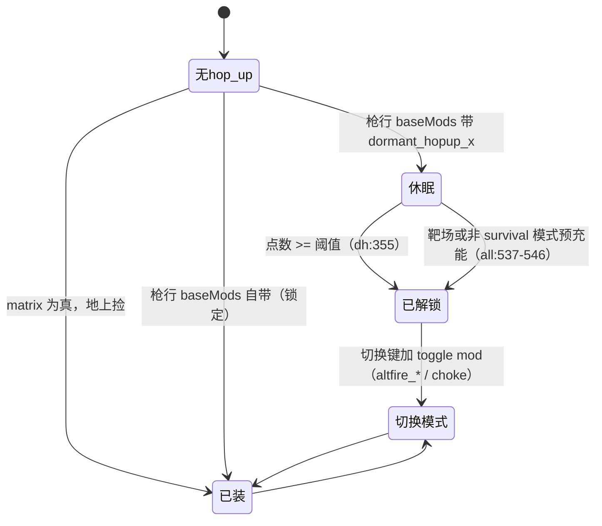

# 武器 hop-up：系统记录

会话 wp1，2026-11-01，静态研究（只读脚本和数据，没进游戏）。

出处从 `research-src/s21-platform/` 开始。缩写：
- `loot` = `datatable/survival_loot.csv`，`wmods` = `datatable/survival_weapon_mods.csv`，`matrix` = `datatable/weapon_attachment_matrix.csv`，`groups` = `datatable/survival_loot_groups_new.csv`。
- `all` = `scripts/vscripts/sh_survival_loot_all.gnut`，`sh` = `scripts/vscripts/sh_survival_loot.gnut`，`sv` = `scripts/vscripts/survival_loot.gnut`。
- `wu` = `scripts/vscripts/weapons/_weapon_utility.nut`，`gh` = `scripts/vscripts/weapons/hopup_golden_horse.nut`，`dh` = `scripts/vscripts/weapons/sh_dormant_hopups.nut`。
- `<武器>.txt` = `scripts/weapons/mp_weapon_<武器>.txt`，`<武器>.nut` = `scripts/vscripts/weapons/mp_weapon_<武器>.nut`。`.txt` 行号是 mod 名字所在行。

`sdk` = `research-src/s21-r5sdk/src/game/`（SDK 的 `server.dll` 源码）。

公共记录：mod 语法见 [W-MOD-SYSTEM](../_shared/W-MOD-SYSTEM.md)，子弹伤害见 [W-DAMAGE](../_shared/W-DAMAGE.md)，字段在两个引擎里认不认见 [W-S3-FIELD-CHECK](../_shared/W-S3-FIELD-CHECK.md)，伤害倍率链见 [C-DAMAGE-MODIFIERS](../../_shared/C-DAMAGE-MODIFIERS.md)，状态效果见 [E-STATUS-EFFECT](../../_shared/E-STATUS-EFFECT.md)，挡弹盾见 [C-BULLET-BLOCKING-SHIELD](../../_shared/C-BULLET-BLOCKING-SHIELD.md) 和 [Gibraltar Gun Shield](../../gibraltar-gun-shield/SYSTEM.md)。

## 0. 概要

- **对象**：武器 hop-up 槽（`hopup`、`hopupMulti_a`、`hopupMulti_b`）里的全部配件。
- **一句话**：hop-up 就是一个武器 mod。三种实现：**只改字段**（穿盾倍率、射速）、**空标记 + 脚本 `HasMod`**（Boosted Loader、Kinetic Loader）、**空标记 + 切换 mod**（Double Tap、Selectfire）。
- **最要紧的结论**：表里约三分之一的 hop-up 在本地**没有效果**。它们的 mod 块是空的，脚本里也没有 `HasMod`（加速器、Gun Shield、Executioner、Redline、Galvanic Gavel、Road Rage）。金马五种连 mod 块和数值都没有。
- **分类**：
  - 效果：Boosted Loader（空弹匣边缘换弹奖励）、Kinetic Loader（滑铲上弹）、Double Tap、Shatter（一键切霰弹）、精英爆头（固定伤害）、休眠解锁（用出来的武器解锁）、金马紫（递增暴击）值得做。
  - 可视化：穿盾 / 打肉不同弹道和命中特效（`impact_effect_table`、`projectile_trail_effect`）、Boosted Loader 的准星进度条 RUI。
  - 可复用系统：mod 开关 + 切换 mod、"表驱动的 loot → 武器 + mod"（见 [weapon-tiers](../weapon-tiers/SYSTEM.md)）、按伤害累积点数的解锁。
- **可拆出的部件**：
  - 休眠解锁（累积点数 → 加 mod）→ 3.2.2
  - Boosted Loader（弹量窗口 + 两个临时 mod）→ 3.2.3
  - Kinetic Loader（滑铲定时上弹）→ 3.2.4
  - Shatter（腰射自动切霰弹）→ 3.2.5
  - Double Tap 和切换 mod 配对 → 3.2.6
  - 伪随机暴击（金马紫）→ 3.2.1
  - 换弹空仓爆炸（金马绿）→ 3.2.1
  - 跟随宠物（金马红）→ 3.2.1

## 1. 它用什么实现各种效果

"本地状态"判定规则：
- **生效**：有存活的 `loot` 行或被某把能拿到的枪 `baseMods` 带着，并且字段或脚本真的产生效果。
- **部分**：只有部分武器能拿到，或有依赖存疑。
- **数据**：mod 块或 loot 行在，但拿不到或没有任何效果。
- `loot` 行首写 `//` 是本地补丁**注释掉**的行，游戏读不到。`isDisabled=true` 的行有数据但在 `file.disabledRefs` 里（`all:717-718`）。
- 只有 `matrix` 为真，玩家才能把这件配件从地上装到枪上（`sh:1071-1120`、`_utility_shared.nut:6128`），见 [attachments](../attachments/SYSTEM.md) 第 3.2 节。`baseMods` 自带的不受这个限制。

| hop-up | 定义武器（数量，例子） | 改什么（字段 = 值） | 脚本钩子 | 本地状态和原因 | PvE 复用价值 |
|---|---|---|---|---|---|
| `hopup_turbocharger` | 10：`energy_ar.txt:441`、`esaw.txt:406`、`nemesis.txt:815`、`defender.txt:389`、`autopistol_fusion_crate.txt:448` | Havoc `charge_time 0.01`、冷却 0；Devotion `fire_rate 6.8`、`fire_rate_max_time_speedup 0.85`；Nemesis `heat_per_bullet 0.125`；Defender 伤害 `*0.65`、`fire_rate 1.85` | 无 `HasMod`，全靠字段 | **部分**：Havoc、Devotion 生效（`loot:325`、`matrix:47`，休眠见 3.2.2）。Nemesis 的热量由 SDK 重写（`sdk/shared/weapon_heat.cpp`），基础热量待实测；但 SDK 只读基础块，**涡轮的 `heat_per_bullet` 在服务端推断不生效**（3.2.8）。Defender 有块但 `matrix` 为假 | 高：去掉前摇、提高爬升 |
| `hopup_selectfire` | 7：`pdw.txt:874`、`defender.txt:892`、`energy_ar_crate.txt:450` | 自身是空标记；切换 mod `altfire_selectfire`（`wmods:49`）：Prowler 全自动 `fire_rate 13.25`、伤害 17（`pdw.txt:877`）；Defender 连发 伤害 `*0.6`、`charge_time 0.3`（`defender.txt:895`） | `sh:6263 VerifyToggleMods`、`sv:10176`、`dh:373-379` | **生效**：Prowler、Defender（`matrix:49`）。**例外**：`energy_ar_crate` 带标记但文件里没有 `altfire_selectfire`，推断切不了（`loot:21`） | 高：开火模式解锁 |
| `hopup_dual_loader` | 5：`mastiff.txt:376`、`3030.txt:891` | `ammo_size_segmented_reload 2` | 无 | **数据**：`loot:327` 存活，但 `matrix:70` 全假，也没有枪 `baseMods` 带它。休眠行 `loot:351` 存活但没人用 | 中：分段换弹一次 2 发 |
| `hopup_headshot_dmg` | 11：`wingman.txt:390`、`dmr.txt:380`、`3030.txt:412` | `damage_headshot_scale`：Wingman 1.92、3030 1.7、Longbow 2.15；换弹道和音效 | 无 | **部分**：只有 `dmr_crate` 自带（`loot:83`）。`matrix:52` 全假 | 中：纯倍率 |
| `hopup_headshot_dmg_elite` | 1：`wingman_crate.txt:393` | 只换特效；真值 `skullpiercer_elite_damage 95`（`wingman_crate.txt:21`） | `gamemodes/_gamemode_survival.nut:6122`、`ai/_ai_dummie.gnut:955`：爆头**设**伤害为 95，无视头盔 | **生效**：`wingman_crate`（`loot:134`） | 高：固定爆头伤害，不和倍率叠 |
| `hopup_headshot_dmg_elite_ghorse` | 1：`wingman_crate.txt:403` | 只换音效 | 同上 | **数据**：只有金马替换才用（`gh:334-337`） | 低 |
| `hopup_shield_breaker` | 11：`alternator_smg.txt:413`、`autopistol.txt:398`、`energy_shotgun.txt:411` | `damage_shield_scale`：1.2 / 1.15 / 1.1；专用命中特效 | `mp/sh_jump_pads.gnut:183`：对跳板 ×2 | **部分**：只有 `alternator_smg_crate`、`autopistol_crate` 自带（`loot:59`、`loot:151`）。`matrix:56` 全假，地上捡到也装不上（`groups:798`） | 高：PvE 的破盾敌人 |
| `hopup_unshielded_dmg` | 16：`semipistol.txt:380`、`autopistol.txt:416`、`shotgun_pistol.txt:410` | `damage_unshielded_scale`：P2020 1.1、RE-45 1.35、Mozambique 1.15、`shotgun_crate` 1.2 | 无 | **生效**：P2020（`matrix:58`，休眠 + 金）、`shotgun_crate`（`loot:107`）、补给舱 `mp/sh_airdrops.gnut:1641` | 高：打无盾敌人 |
| `hopup_double_tap` | 7：`g2.txt:370`、`shotgun.txt:404`、`alternator_smg.txt:943` | 空标记；切换 mod 见 3.2.6 | `shotgun.nut:39`（霰弹闩配对）、`sh:773-774` 自动打开 | **生效**：`matrix:61` 真的是 `g2_crate`、Alternator、EVA | 高 |
| `hopup_paintball` | 0 | 无 mod 块 | `client/rui/cl_weapon_status.gnut:1234`（只 HUD） | **数据**：`loot:334` 禁用 | 低 |
| `paintball`（loot 行） | 57：`3030.txt:839` 等 | `reload_time*` `*0.75`、涂鸦弹道 | 无 | **数据**：`loot:335` 禁用，所有 paintball 套装行禁用或注释（`loot:208-239`） | 中：换弹 ×0.75 |
| `hopup_paintball_elite` | 8：`dmr.txt:926`、`wingman.txt:715`、`vinson.txt:866` | 弹匣 `++2`、开镜 `*0.7`、切枪 `*0.7`、腰射散布 `*0.75`、换弹 `*0.8`；各枪略不同 | 无 | **数据**：`loot:343`、`loot:356` 注释（"no server script for hopups"），`matrix:77` 全假。字段块完好，强行 `AddMod` 应该有效（推断） | 中：一个"全面手感提升"的模板 |
| `hopup_quickdraw_holster` | 10：`autopistol.txt:490`、`wingman.txt:432` | 切枪 `*0.65`–`*0.7`、开镜 `*0.7`–`*0.8`、腰射 `*0.75` | 无 | **数据**：`loot:336` 禁用，`matrix:66` 全假 | 中 |
| `hopup_shatter_rounds` | 3：`bow.txt:441`、`3030.txt:423`、`3030_crate.txt:904` | 空标记；切换 `altfire_shatter`；实效在 `shatter_rounds_hipfire` | 见 3.2.5 | **部分**：只有 `3030_crate` 自带（`loot:177`），它**没有** `shatter_rounds_hipfire` 块，要实测。Bocek 只在靶场挑战里（`mp/sh_firing_range_bow_challenge.nut:54`） | 高：一键霰弹 |
| `hopup_gunshield` | 7：`lmg_crate.txt`、`hemlok_crate.txt`、`esaw_crate.txt` 等 | 空 | **无** | **数据**：见 3.2.7。`loot:340` 禁用，7 把空投枪仍带着这个空 mod | 高（要自己写）：见 3.2.7 |
| `hopup_ultimate_accelerator` | 38：几乎所有武器 | 空 | **无**：全部脚本里只有 `dh:93` | **数据**：金武器的这个槽等于空。`loot:341`、`matrix:75`（31 把）能装但没效果。本地化说"伤害充大招和 EVO"（`localization/localization_english.txt:29743`），脚本没实现 | 中：伤害充能概念 |
| `hopup_brand_weapon_takeover` | 1：`auto_hemlok.txt:441` | 空 | 无 | **数据**：只是占槽的标记（`loot:46-51`、`matrix:87`），标 `LockedHopup`（`loot:342`）。Hemlok Elite 的破墙弹在 `altfire`（`auto_hemlok.txt:446`），和它无关 | 低 |
| `hopup_executioner` | 1：`mastiff.txt:765` | 空 | **无** | **数据**：`loot:344`、`loot:357` 注释（"no server script for hopups"）。`mastiff_gold` 还带着（`loot:8`） | 中：见下 |
| `hopup_energy_choke` | 6：`energy_shotgun.txt:439`、`doubletake.txt:461` | 空标记；切换 `choke`：`charge_time 0.9`（PK）/ `0.85`（TT）、`charge_levels 4`（`energy_shotgun.txt:444`、`doubletake.txt:466`） | `wu:5471`、`sh:775-776`、`client/rui/cl_weapon_status.gnut:1311`；两引擎不认的 `projectile_spread_choke_frac_*` 由脚本读 | **生效**：所有 PK、TT 行自带（`loot:28`、`loot:112`）。**`loot` 没有这一行**，但 `wmods:50`、`matrix:51` 有 | 高：蓄力收束弹道 |
| `hopup_kinetic_loader` | 7：`energy_shotgun.txt:423`、`lmg_crate.txt:419` | 空；每把枪 `kinetic_*` 字段 | 见 3.2.4 | **部分**：`matrix:72` 全假。只有 `lmg_crate` 自带，它不走激活钩子 | 高 |
| `hopup_smart_reload` | 13：`hemlok.txt:413`、`wingman.txt:373`、`doubletake.txt:444` | 空；`fast_reload_mod`、`overloaded_ammo` | 见 3.2.3 | **部分**：`matrix:69` 全假。只有 `hemlok_crate`（`loot:41`）、`instagib_gold`（`loot:433`）自带 | 高 |
| `hopup_highcal_rounds` | 4：`rspn101.txt:432`、`vinson.txt:422` | 空标记；`altfire_highcal` | `wu:6324`、`sv:10180` | **数据**：`loot` 和 `wmods` 都没有这一行，`loot:347` 休眠行禁用 | 中：半自动专用 |
| `hopup_magic_pixel` | 0 | 无 | 无 | **数据**：`loot:434` 注释（"removed in S30, kept so nothing dangles"） | 无 |
| `hopup_car_crate` | 1：`car_crate.txt:431` | 空 | **无** | **数据**：`loot:424` 禁用，`loot:203` 还带着。说明文字是"换穿盾 / 打肉弹"（`localization_english.txt:29701`），脚本没实现 | 中：一键切两种弹 |
| `hopup_lstar_crate` | 1：`lstar_crate.txt:859` | 空 | **无** | **数据**：`loot:425`、`loot:11` 带着。"Redline"（快过热时增伤）没有脚本（`localization_english.txt:29733`） | 高（要自己写）：热量换伤害 |
| `hopup_mythicset_vinson` | 1：`vinson.txt:850` | 只改名字和描述 | **无** | **数据**：`loot:422` 禁用，`loot:421` 带着。"Road Rage"（爆炸弹、倒地挂炸弹）没有代码；`explosive_round` 只在 `wmods:89` | 中 |
| `corrupted_*` | 见 [attachments](../attachments/SYSTEM.md) 3.3 | 只改字段 | `sh:7740-7792`（一把枪只能装一件） | **生效**：`loot:427-431`，走 `corrupted_attachments` 掉落组 | 高：有代价的强配件 |
| `hopup_golden_horse_*` | **0** | 无 mod 块，无数值字段 | 见 3.2.1 | **数据**：`loot:387-391` 注释 | 见 3.2.1 |

Executioner 的说明文字是"击倒敌人回盾"（`localization_english.txt:29728`）。脚本没实现。PvE 可以做成"击杀回盾"，要自己写。

表外相关（loot 里没有行，备查）：`hopup_marksmans_tempo`（`bow`、`sentinel`，`wu:5999`），`hopup_april_fools_*`（`loot:129-132`，活动武器）。

**客户端和服务端**：字段 mod 由引擎应用。`HasMod` 逻辑大多放在服务端线程（Boosted Loader `wu:6644`、Kinetic `wu:6836`、Shatter `wu:6253`、休眠 `dh:294-383`）。客户端只负责 HUD（`wu:6517`、`wu:7051`）。

**本地补丁（明确）**：
- `loot` 注释行共 41 行，hop-up 相关的是 343、344、356、357、387-391、434。
- `all:484-565` `SURVIVAL_Loot_ResolveDormantHopups`：本地加的（打印 `[LOOT]`）。
- `dh` 整个文件打印 `[LOOT]`，服务端点数只存在 `file.weaponPoints`，推断是社区重写。
- `gh:1104` 注释 `GetLastWeaponFireTime not in S3`，`gh:1136` 注释 `not in S3`：金马紫为 S3 改过。
- `doubletake.nut:128` 注释说 `OnWeaponDeactivate_Smart_Reload` "does not exist in either script tree"，但 `wu:6491` 定义了它。注释已过时，TT 退枪时不发结束信号（TT 也拿不到这个 hop-up）。
- `wu:6499` 注释：录像 NPC 也持枪，所以跳过非玩家。
- SDK 补了大量 S3 没有的武器机制：`sdk/shared/weapon_heat.cpp`（热量、部分充能字段）、`sdk/server/energize.cpp`（Energize）、`sdk/server/akimbo.cpp`（双持）、`sdk/shared/weapon_script_vars.cpp:3069-3078`（把 S21 字段映射到空闲槽）。写在里面只说明有人实现过，和 S21 一样不一样要实测。

## 2. 流程

配件的通用流程在 [attachments](../attachments/SYSTEM.md) 第 2 节。hop-up 特有的是下面这张图：



切换：`wmods` 的 `toggleMod` 列把 hop-up 和切换 mod 绑定（`sh:1013-1026`）：`hopup_selectfire → altfire_selectfire`、`hopup_energy_choke → choke`、`hopup_double_tap → altfire_double_tap`、`hopup_shatter_rounds → altfire_shatter`（`wmods:49-61`）。没装 hop-up 时，`VerifyToggleMods` 把切换 mod 从列表里去掉（`sh:6263`）。G7、EVA、PK、TT 装上就自动打开切换（`sh:772-777`、`sh:6295`）。

## 3. 代码

### 3.1 入口

- `_utility_shared.nut:229-230`：`HopupGoldenHorse_Init`、`DormantHopups_Init`。
- `wu:609-613`：注册配件变化回调（金弹匣、Boosted Loader、Shatter、Anvil、Kinetic）。
- 武器 `.txt` 的 `OnWeaponActivate` 回调再去检查 `HasMod`（`hemlok.nut:9`、`wingman.nut:11`、`doubletake.nut:110-124`）。

### 3.2 核心逻辑

#### 3.2.1 金马（`gh`）五种

**总闸（都关着）**：
1. `gh:269`：`GameModeVariant_IsActive( SURVIVAL_GOLDEN_HORSE )` 否则全部禁用（`gh:303`）。这个变体要 playlist 标记 `is_golden_horse`（`gamemodes/sh_gamemodes.gnut:251`），`playlists_r5_patch.txt` 里搜不到。
2. `loot:387-391` 注释："no mod block defined by any weapon in either build, cannot attach"。查 `scripts/weapons/*.txt`：**没有 `hopup_golden_horse_*` mod 块，也没有 `golden_horse_*` 字段**。
3. 所以绿、紫读的 `golden_horse_green_dmg_min`、`golden_horse_purple_chance` 等都没有值。**下表的数值只有脚本常量，其余缺失**。

| 颜色 | 效果 | 代码 | 公式 / 值 | PvE 复用 |
|---|---|---|---|---|
| 蓝 | 吸血 | `gh:550-558`（`Init` 是空的，注释说"built into _lifesteal"）；`weapons/_lifesteal.nut:134` | `heal = int( lifesteal_heal_percent × (血伤 + 盾伤 + 吸收) )`。读武器字段 `lifesteal_heal_percent`（SDK 映射到 `custom_float_2`，`sdk/shared/weapon_script_vars.cpp:3071`）；`GoldenHorseBlue_HasMod` 没有调用者。只跳过倒地和友军。**本地唯一有值的是 Cupid 弓**：`cupid` mod 0.5（`bow.txt:413`、`loot:172`），所以吸血代码本身可测 | 高：吸血字段，和 mod 正交 |
| 绿 | 打空换弹时胸口爆炸 | `gh:765`（入口）、`gh:803`（蓄力）、`gh:906`（爆炸）、`gh:947`（命中） | 弹匣 0 时触发；等 `delay` 后 `RadiusDamage`，伤害 `GraphCapped( 1.0, dmg_min..max )`；不伤自己；命中给 2.5 s 电击和减速（`gh:950-951`），减速按 `dmg / dmg_max` 插值；`gh:970` | 高：换弹爆炸。只有 L-STAR 调用 `gh:765`（`lstar.nut:148`），别的枪只开特效（`pdw.nut:8`、`shotgun.nut:26`、`volt_smg.nut:13`、`doubletake.nut:115`） |
| 黄 | 命中后看敌人血量 | `gh:1011` | 伤害回调里 `ServerToClient_ShowHealthRUI`，持续 3 s（`gh:1026`），复用 `mp_ability_sonic_blast.nut:881` | 中：HUD 借用 |
| 紫 | 递增暴击 | `gh:1072`（开火前判定）、`gh:1141`（开火后摘 mod）、`gh:1161`（命中） | 3.2.1.1 | 高 |
| 红 | 召唤 Nessie 宠物 | `gh:1353`（召唤）、`gh:1381`（距离传送）、`gh:1556`（生成）、`gh:1604`（摸摸回满血） | 3.2.1.2 | 高：跟随宠物 |

##### 3.2.1.1 紫（伪随机暴击）

```
开火前（gh:1072-1130）：
  若距上次可开火时间 > reset：chance = base          // 不能存暴击
  rand < chance：加 active mod，chance = base，whiffs = 0
  否则：chance += growth；whiffs += 1；whiffs >= whiffMax → chance = 1
开火后（gh:1141）：摘 active mod
命中（gh:1161）：弹头带 active mod 且不是真爆头 →
  加 DF_CRITICAL、DF_HEADSHOT；伤害 × GetHeadshotDamageMultiplierFromDamageInfo；走爆头流程
```

调用者：`bow.nut:337`、`dmr.nut:84`、`g2.nut:25`、`lmg.nut:42`。

注意 `gh:1104`：原版用上次开火时间，S3 没有这个接口，改成 `GetNextAttackAllowedTime`。语义变了：开火后这个时间在未来，所以差值小，推断 reset 更不容易触发。

##### 3.2.1.2 红（宠物）

- 槽位驱动：心跳每帧数主武器上红 mod 的数量 = `maxSummons`（`gh:1292-1333`），多了就杀，少了就走冷却。冷却 15 s（`gh:92`），状态效果 `golden_horse_red` 显示（`gh:1350`）。
- 跟随：`PetStartFollowingOwner`（`gh:1799`），移动容差 256、战斗容差 1024、目标容差 500（`gh:98-100`），索敌距离 150 m（`gh:101`）。
- 超距传送：每 5 s 查一次（`gh:93`）；无敌人 > 75 m、有敌人 > 200 m（`gh:94-95`）就传回，清仇恨（`SummonLifetime_Thread` `gh:1381`）。
- 玩家不能生成宠物的状态：滑索、跳伞、空中、相位、飞机等（`gh:1735`）。
- 摸一摸回满（`gh:1604`），带防抖（`gh:1646`）。
- 公共部件参考：[D-FOLLOW-MOTION](../../_shared/D-FOLLOW-MOTION.md)、`ai/_ai_nessie.gnut:513`。

##### 3.2.1.3 替换规则

`gh:313 HopupGoldenHorse_Switcheroo`（`sh:1049`）给 `VALID_WEAPONS`（`gh:143`）全部开 hop-up 槽，并给 5 把特殊枪写死颜色：Bocek 紫、Wingman 空投蓝、L-STAR 空投绿、Prowler 空投绿、Kraber 红。`gh:372 _LockedSets`（`sh:1265`）把金武器的 hop-up 换成本枪第一件金马。Loba 被动（`abilities/loba_passive_eye_for_quality.nut:245`）、HUD（`client/rui/cl_weapon_status.gnut:1442`）也认金马。全部过不了 3.2.1 的总闸。

#### 3.2.2 休眠 hop-up（`dh`）

**本地是能跑的**。`loot` 带 `dormant_hopup_x` 的 9 把基础枪：Mastiff（`loot:4`）、Havoc、Devotion、Nemesis（`loot:16`、`22`、`183`）、Alternator、EVA（`loot:58`、`106`）、Prowler、Defender（`loot:70`、`88`）、P2020（`loot:139`）。

```
开关：playlist disable_dormant_hopups（dh:66），默认开
加点（dh:343）：
  枪能加分（baseMods 有休眠 hop-up 且没解锁）才加
  Rampart（PAS_GUNNER）× 1.5（dh:45、dh:348）
  points >= 阈值 → Unlock
点数来源：
  伤害：int(伤害) 点（dh:295-312，回调 AddDamageByCallback "player"）
  捡起武器：+100（dh:326）
  hopup_points_pickup：+100，给当前能加分的枪（dh:275-292、dh:251）
解锁（dh:359）：
  RemoveMod( dormant )；AddMod( 去掉 dormant_ 前缀 )；有 toggle 再加 toggle
阈值（可由 playlist <ref>_dormant_hopup_point_override 改，dh:76-83）：
  300 dual_loader、ultimate_accelerator
  375 double_tap、selectfire、gunshield、executioner
  425 unshielded_dmg、quickdraw、highcal、paintball_elite（默认）
  500 shield_breaker
  600 turbocharger、headshot_dmg
丢枪：点数写到地上物品（dh:329-341），捡起恢复（dh:319-324）
```

**预充能**（`all:484-565`）：playlist `dormant_hopups_precharged`、`survival_firingrange`、`survival_training`，或**模式不是 `survival`**，开局就把休眠换成真 hop-up（双击和 Selectfire 带切换 mod）。如果真 hop-up 无效（Executioner），就把枪的 `hopup` 槽删掉（`all:551`）。

**坑**：
- 点数只在服务端（`file.weaponPoints`），`dh:197-207`。客户端调用 `DormantHopups_GetPoints` 恒为 0，HUD 进度推断不显示。
- Mastiff：`dormant_hopup_executioner` 行被注释，`SURVIVAL_Loot_IsRefValid` 假，`dh:126` 跳过，所以 **survival 模式下永远不加分，mod 空挂**。
- `dh:295` 每次伤害都调用，伤害对象不限玩家（"damage by player"），打 NPC 也算（推断）。

#### 3.2.3 Boosted Loader（`hopup_smart_reload`，`wu`）

```
激活（hemlok.nut:9、wingman.nut:11、auto_hemlok.nut:40、doubletake.nut:118）→ wu:6364
服务端线程（wu:6644，每帧）：
  low = int( clipMax × low_ammo_fraction )
  overloadClip = clipMax - smart_reload_overload_ammo_required
  0 < clip <= low → AddMod fast_reload_mod、AddMod overloaded_ammo
  else 带 overloaded 且 clip <= overloadClip → RemoveMod overloaded_ammo
  else → RemoveMod fast_reload_mod
换弹（wu:6394，由 OnWeaponReload 调）：
  有 fast_reload_mod → 只放音效（快换 + 超载弹匣生效）
  否则：clip 超出原上限的部分退回弹药池（空投枪退回自带备弹），RemoveMod overloaded_ammo
```

- `MIN_AMMO_REQUIRED = 0`（`wu:288`），即 0 发不算；打空走普通换弹。
- `OnWeaponDeactivate_Smart_Reload`（`wu:6491`）结束线程。
- 客户端 HUD：`wu:6517`，RUI `ui/crosshair_reload_hopup_bar.rpak`，三色（`wu:274-276`）。
- 字段值见第 4 节。Hemlok：弹匣 21，low 0.4 → 窗口 1–8 发，超载 +9。

#### 3.2.4 Kinetic Loader（`wu`）

```
服务端（wu:6836）：每把枪的 kinetic_load_delay / additive / max / ammo_to_load
循环：
  player.IsSliding()：
    wait waitValue
    还在滑、没换弹、有备弹：
      上 min( ammo_to_load, 差额, 备弹 ) 发
      音效；通知 HUD（累计最多 31）
      loops++；wait = clamp( delay + loops × additive, 0, max )
  否则：重置 loops、wait
```

- PK 空仓第 1 发时补 `ForceRechamberMilestone(0)`（`wu:6891-6894`）。
- 收束连动（`wu:6775`）：滑铲中带 `hopup_kinetic_choke` → 加 `kinetic_choke`（`charge_time *0.36`，`energy_shotgun.txt:433`）；落地后 1 s 宽限（`wu:6920-6926`）。
- 空中保持计时不变（`wu:6819`）。

**入口缺口**：激活钩子只有 PK（`energy_shotgun.nut:18-24`）和 TT（`doubletake.nut:110-112`）。`lmg_crate` 唯一能在本地拿到 Kinetic，但 `lmg.nut:22` 的激活回调里没有调用（中间是被剥离的空行）。只有 `OnWeaponAttachmentChanged_CheckForKineticLoader`（`wu:6989`）在配件变化时才启动。`lmg_crate` 只有 `sight` 能换（`loot:95`），所以**推断要换一次瞄具 Kinetic 才开始工作**。TT 的文件没有 `kinetic_*` 字段（`doubletake.txt`），靠 `GetWeaponInfoFileKeyField_GlobalFloat` 读值，要实测（`matrix:72` 全假，TT 也拿不到）。

Shotgun 金弹匣：`wu:5161-5216`，等级 ≥ LEGENDARY 的霰弹闩会走 Kinetic，见 [attachments](../attachments/SYSTEM.md) 3.2。

#### 3.2.5 Shatter Rounds（`wu`）

```
配件变化（wu:6300）：有 altfire_shatter → thread ADSThink
ADSThink（wu:6253，每帧）：
  开镜且有 altfire_shatter → RemoveMod shatter_rounds_hipfire（精确）
  否则没 hipfire → AddMod shatter_rounds_hipfire（腰射 = 霰弹）
  altfire_shatter 被摘 → 去掉并结束
脚本整数（wu:6228）：ScriptInt0 = SHATTER_TRI，弓用它换箭色
```

- 实效 mod：`shatter_rounds_hipfire`：7 发弹丸，图案 `shatter_arrows`；3030 伤害 8 / 爆头 1.25 / 腿 1.0（`3030.txt:434`）；Bocek 的同名块（`bow.txt:446`）。
- Bocek：`bow.nut:324` 忽略散布，飞行速度用 `fullChargeSpeedSplit`；`bow.nut:795` 选伤害 mod；`bow.nut:253-256` 激活时开线程。
- 30-30：`3030.nut:66-71` 激活时开线程的那段**被注释**，只剩配件变化入口；`3030.nut:229` `ignoreSpread = true` 写死。`3030.txt:428` `segmented_speed_load`：连续 3 次分段后 `reloadsegment_time_loop *0.8`（`3030.nut:251-260`）。这个函数也用 ScriptInt0，和 Shatter 的注释"不能混用"冲突（`wu:6165`）。
- `3030_crate` 带 hop-up 和切换，但**没有** `shatter_rounds_hipfire` 块（`3030_crate.txt:904`、`914`），`weaponBaseClass mp_weapon_3030` 是否继承 mod 要实测。不继承的话，ADSThink 加了不存在的 mod。

#### 3.2.6 Double Tap

| 枪 | `altfire_double_tap` | 来源 |
|---|---|---|
| G7 | `fire_rate 15`、`burst_fire_count 2`、`burst_fire_delay 0.4`；`g2_crate` 0.38 | `g2.txt:375`、`g2_crate.txt:405` |
| EVA | `fire_rate 7`、`burst_fire_count 2`、`burst_fire_delay 0.65`（OG 0.8） | `shotgun.txt:409` |
| Alternator | **不是点射**：`fire_rate 7.75`、一次 2 发（`projectiles_per_shot 2`、`ammo_per_shot 2`、`ammo_min_to_fire 1`）、伤害 14、图案 `alternator_double_tap` | `alternator_smg.txt:946` |

EVA 专用脚本（`shotgun.nut:39`）：开了 Double Tap，霰弹闩要改的是点射间隔而不是射速。引擎的 mod 不能改别的 mod，所以加配对 mod：`shotgun_bolt_l1_double_tap`：`fire_rate *0.925926`（抵消 ×1.08）、`burst_fire_delay *0.95`；L2 `*0.869565 / *0.9`；L3、L4 `*0.833333 / *0.85`（`shotgun.txt:437-458`）。这是"mod 不能互相覆盖"的标准绕法。

`_utility_shared.nut:200` 把 `altfire_double_tap` 记为"未安装但跟踪"的 mod。

#### 3.2.7 Gun Shield

**本地 hop-up 不产生盾**：
- 全部脚本 grep `hopup_gunshield`：只有 `dh:98` 一个阈值。没有 `HasMod`。
- 7 把空投枪（`loot:23`、`29`、`41`、`47`、`95`、`101`、`197`）的 mod 块是空的。`loot:340`、`loot:345` 禁用。
- 真正的 Gun Shield 是 Gibraltar 被动：`PAS_ADS_SHIELD` 给副手武器 `mp_ability_gibraltar_shield`，见 [Gibraltar Gun Shield](../../gibraltar-gun-shield/SYSTEM.md)。
- 说明文字是"开镜生成枪盾，Gibraltar 使用时强化"（`localization_english.txt:29730`），代码缺失。

PvE 想要这个效果，用 `C-BULLET-BLOCKING-SHIELD` 的挂点盾，把 `hopup_gunshield` 接到"开镜时开盾"即可。

#### 3.2.8 依赖 SDK 的 hop-up

更正：先前一度记成"Nemesis 热量在 dedi 上推断不工作"，依据只搜了 `r5apex_ds.exe`，是错的（`W-S3-FIELD-CHECK` 已更正）。下面是读 SDK 源码的结果，都**待实测**。

| 依赖 | SDK 怎么做 | 对 hop-up 的影响 |
|---|---|---|
| Nemesis 热量 | `sdk/shared/weapon_heat.cpp:386` 读 `heat_per_bullet`；`:652` 每发 `heat += config.heatPerBullet`；`:1531`、`:1534` 注册 `HasHeatDecay`、`GetHeatValue` | 基础热量和 `heat_mod_var0`（`burst_fire_delay` 0.31→0.19，`nemesis.txt:29-31`）有实现 |
| 涡轮的 `heat_per_bullet` | `weapon_heat.cpp:362-377`：**只读 WeaponData 第一层**，注释说 Mods 里是 `*0.75` 写法，读了会变 0。配置按武器类名缓存（`:488`），不看当前 mod。`weapon_script_vars.cpp:3074` 虽把这个 key 映射到 `custom_float_5`，`WeaponHeat_OnFired` 不读它 | **推断服务端热量仍是 0.04167/发（`nemesis.txt:24`），不是涡轮的 0.125（`nemesis.txt:817`）**。S21 客户端原生逻辑可能按 mod 算，两边可能不一致 |
| Defender 涡轮的 `charge_attack_min_charge_required` | 同样只读第一层（`weapon_heat.cpp:404`，比较在 `:1160`） | 推断 mod 里的 1.0 服务端不读。`matrix` 拿不到，优先级低 |
| `spread_min_kick` | `sdk/server/weapon_kv_s21_ext.cpp:175` 只读入；`sdk/server/bridge_zoom_gate.cpp:756` 只用来发警告 | 见 [attachments](../attachments/SYSTEM.md) 第 5 节 |
| `realtime_mod_can_ads` | SDK `.cpp` 里搜不到这个 key | 开镜中切换模式待实测 |

`kinetic_*`、`smart_reload_*`、`marksmans_tempo_*`、`projectile_spread_choke_frac_*`、`blast_pattern_ads_scale` 由脚本读，不依赖引擎版本（`W-S3-FIELD-CHECK`）。

### 3.3 客户端表现

- HUD 切换图标：`client/rui/cl_weapon_status.gnut:1210`（Shatter）、`1561-1684`（Selectfire、Highcal、Double Tap、Paintball、Shatter）。
- Boosted Loader 准星条：`wu:6542`；颜色常量 `wu:274-276`。
- Kinetic 提示：`wu:7128-7145`，文字 `#WPN_HOPUP_KINETIC_LOADER_RELOAD_HINT`。
- 穿盾 / 打肉弹道和命中：字段 `projectile_trail_effect_0_*`、`impact_effect_table`。

### 3.4 依赖的公共代码

- `Loot_AddCallback_OnWeaponAttachmentChanged`（`sv`）：所有 hop-up 线程的重启入口。
- `GetWeaponInfoFileKeyField_Global*`：脚本读不进引擎的自定义字段。这也是 `W-S3-FIELD-CHECK` 说 `kinetic_*`、`smart_reload_*`、`marksmans_tempo_*`、`projectile_spread_choke_frac_*`、`blast_pattern_ads_scale` 不依赖引擎版本的原因。
- `GetAttachmentsWithToggleModsList`（`sh:6230`）。

## 4. 参数

伤害倍率类（基础值见 `../_shared/W-PARAM-COMPARE.md`）：

| 参数 | 值 | 单位 | 来源 | 作用 | 改大 / 改小 |
|---|---|---|---|---|---|
| `damage_shield_scale` | Alternator 1.2；`_crate` 1.1；RE-45 1.15；`_crate` 1.2；PK 1.1 | × | `alternator_smg.txt:413` 等 | 打盾倍率 | 破盾更快 |
| `damage_unshielded_scale` | P2020 1.1；`_crate` 1.2；RE-45 1.35；Moz 1.15；EVA 空投 1.2 | × | `semipistol.txt:380` 等 | 打肉倍率 | — |
| `damage_headshot_scale`（Skullpiercer） | Wingman 1.92；3030 1.7；Longbow 2.15 | × | `wingman.txt:390` 等 | 爆头 | — |
| `skullpiercer_elite_damage` | 95 | HP | `wingman_crate.txt:21` | 爆头固定值 | 高了秒杀 |
| 对跳板 | ×2 | × | `mp/sh_jump_pads.gnut:183` | 破盾打跳板 | PvE 无意义 |

Turbocharger：

| 枪 | 字段 | 值 | 来源 |
|---|---|---|---|
| Havoc | `charge_time` / `charge_cooldown_time` / `charge_cooldown_delay` | 0.01 / 0 / 0 | `energy_ar.txt:441` |
| Devotion | `fire_rate` / `fire_rate_max_time_speedup` | 6.8 / 0.85 s | `esaw.txt:406` |
| Nemesis | `heat_per_bullet` | 0.125 | `nemesis.txt:815`（服务端推断不读，3.2.8） |
| Defender | `fire_rate`、伤害 | 1.85、`*0.65` | `defender.txt:389` |

Boosted Loader：

| 枪 | 弹匣 | `low_ammo_fraction` | 超载 | `fast_reload_mod reload_time` | 字段行 |
|---|---|---|---|---|---|
| Hemlok | 21 | 0.4 | 9 | 1.75 s | `hemlok.txt:185` |
| Hemlok Elite | 18 | 0.4 | 9 | 1.75 s | `auto_hemlok.txt:131` |
| Wingman | 5 | 0.4 | 2 | 1.4 s | `wingman.txt:172` |
| Triple Take | 6 | 0.35 | 2 | 1.4 s | `doubletake.txt:217` |
| Ray Gun | 20 | 0.4 | 2 | 1.4 s | `raygun.txt:173` |
| Instagib | 69 | 0.4 | 2 | 1.4 s（超载写死 69） | `instagib.txt:175` |

Kinetic Loader：

| 枪 | delay | additive | max | 每次发数 | 来源 |
|---|---|---|---|---|---|
| PK、`_crate` | 0.14 | 0.9 | 0.9 | 1 | `energy_shotgun.txt:402-405`、`energy_shotgun_crate.txt:411-414` |
| `lmg_crate` | 0.14 | 0.9 | 0.9 | 5 | `lmg_crate.txt:11-14` |
| 宽限 | 1.0 s | | | | `wu:6926` |

休眠：阈值和来源见 3.2.2。Double Tap 见 3.2.6。金马常量：红最多 2（`gh:90`，心跳里没有用它）、生成 1 s（`gh:91`）、冷却 15 s（`gh:92`）；绿 2.5 s 电击 / 1 s 淡出（`gh:950-951`）；黄 3 s（`gh:1026`）。

## 5. 未解决和要实测的

R5 运行时已知：本地 `npc_dummie`、`npc_prowler` 能生成和追人但不开火；`npc_spectre` 会让 dedi 卡死。下面用 dummie 当靶子。

1. **休眠解锁**：`dh` 只存服务端点数。**测**：survival 模式拿基础 P2020 打 dummie，累计 425 伤害后看 `HasMod( hopup_unshielded_dmg )`；打 NPC 算不算；HUD 有没有进度。
2. **预充能**：非 survival 模式开局基础 Havoc 是否已有涡轮。**测**：火力训练场和 FR 各一次，读 mods。
3. **Nemesis 涡轮 / 热量**（SDK 重写，3.2.8）：**测**：Nemesis 连射，读 `GetHeatValue()` 每发增量，基础是否 0.04167、装涡轮是否变 0.125；点射间隔是否从 0.31 降到 0.19；服务端和客户端 HUD 是否一致。
4. **Mastiff 休眠空挂**：`mastiff_gold` 带无效 `hopup_executioner`。**测**：拿到有没有报错，hop-up 槽显示什么。
5. **Boosted Loader**：**测**：`hemlok_crate` 打到 8 发以下换弹，`GetWeaponPrimaryClipCount`、`reload_time` 是否 1.75 s，弹匣是否 21 + 9。S3 dedi 是否支持 `Weapon_FillClipAmmoFromStock`。
6. **Kinetic 在 `lmg_crate` 的入口**（3.2.4）：**测**：刚捡起滑铲上不上弹；换一次瞄具后再滑。
7. **Shatter 在 `3030_crate`**：**测**：腰射是不是 7 发；`weaponBaseClass` 是否继承 `shatter_rounds_hipfire`。ScriptInt0 冲突会不会让速换错乱。
8. **`realtime_mod_can_ads`**：SDK 源码里没有这个 key（3.2.8）。**测**：Selectfire、Double Tap、Choke 开镜切换 dedi 上是否生效。
9. **穿盾倍率字段**：`damage_shield_scale`、`damage_unshielded_scale` 不在 `W-S3-FIELD-CHECK` 的差异表里（推断两边都认）。**测**：对有盾 / 无盾 dummie 比伤害；dummie 能不能带盾。
10. **Defender 涡轮**：见 3.2.8。`matrix` 拿不到，优先级低。
11. **`energy_ar_crate` Selectfire**：**测**：按切换键有没有反应。
12. **Choke**：`hopup_energy_choke` 没有 loot 行，**测**：PK 的切换和收束是否正常、HUD 显示什么。

## 6. HSD 实现

**未实现**。现状：`HSD-Unity/Assets/HSD/Game/Runtime/Combat/` 只有抽象 `Weapon`、`TestRifle` 占位、`SmartPistol`、`InfernoBeam` 和 `CombatLoadout.cs`，没有配件、mod、弹药池。框架分支 `origin/claude/w2-framework-b44e35` 加了状态效果、减速、伤害倍率链、放置物和索敌，可以挂。

建议做法（先做 mod 系统，见 `W-MOD-SYSTEM` 第 6 节）：

1. **Hop-up = `WeaponMod` 资产 + 可选 `IWeaponModBehaviour`**。字段类（穿盾、爆头、涡轮）只写字段覆盖。行为类（Boosted Loader、Kinetic、Shatter）实现一个接口，订阅 `OnActivate / OnFire / OnReload / OnSlide`。
2. **第一批**：Skullpiercer 精英（固定爆头 95）、穿盾 / 打肉（接伤害倍率链）、涡轮（去前摇）、Boosted Loader、Kinetic（HSD 有滑铲，手感好）。
3. **切换 mod**：照搬 `toggleMod` 表，切换键加减一个 mod。
4. **休眠**：PvE 很合适。按伤害累积点数，解锁时 `AddMod`。阈值先用 `dh` 的 300–600。HSD 要**把点数放到 HUD**（R5 本地没有）。
5. **自己写才有的**：Gun Shield（挂点盾）、Redline（热量换伤害）、Executioner（击杀回盾）、宠物（金马红）、递增暴击（金马紫，公式见 3.2.1.1）。这些在 R5 本地跑不起来，所以没有实测目标，记入 `R5-DIFF-ARCHIVE.md`。
6. **不做**：加速器（空）、Paintball（外观）。

开关建议：`CombatLoadout` 加 `hopup` 字段；PlayerPrefs `hsd.combat.weapon.hopup.<id>`；`hsd.combat.weapon.dormant.enabled`。

和 R5 的差别：还没有实现，暂无。
