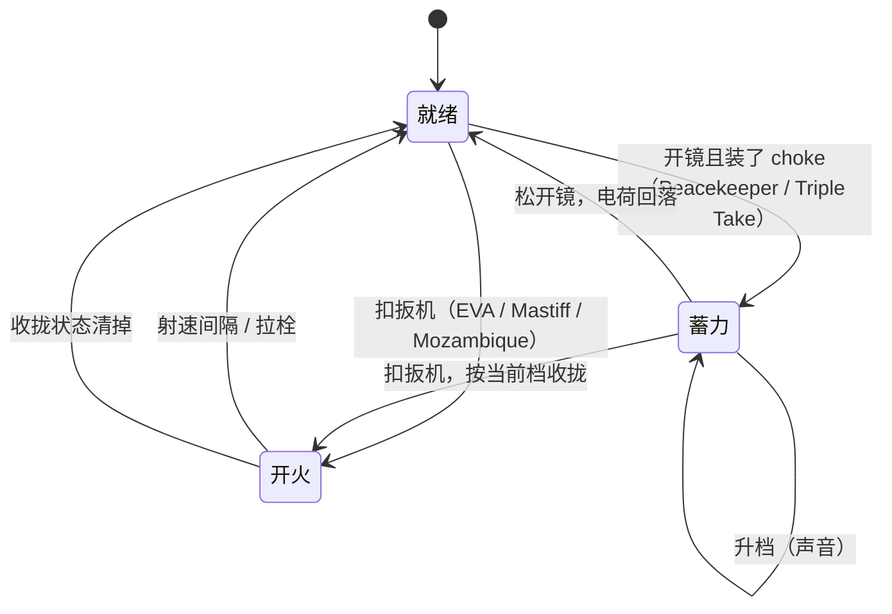

# 霰弹 / 固定图案弹丸（shotgun-blast）：系统记录

武器第一波，2026-11-01，静态研究（只读脚本、数据和 SDK 源码，没进游戏）。

脚本出处从 `research-src/s21-platform/scripts/` 开始。`wu` = `vscripts/weapons/_weapon_utility.nut`，`bp` = `weapons/blast_patterns.txt`，`eva` / `evat` = `vscripts/weapons/mp_weapon_shotgun.nut` / `weapons/mp_weapon_shotgun.txt`，`mas` / `mast` = `mp_weapon_mastiff`，`pk` / `pkt` = `mp_weapon_energy_shotgun`，`moz` / `mozt` = `mp_weapon_shotgun_pistol`，`tt` / `ttt` = `mp_weapon_doubletake`。

SDK 出处从 `research-src/s21-r5sdk/src/game/` 开始。`bpc` / `bph` = `server/r1/blast_pattern.cpp` / `.h`。

全部字段看 [PARAMS.md](PARAMS.md)。这里只列和机制有关的。

## 0. 概要

- **武器族**：EVA-8 `mp_weapon_shotgun`、Mastiff `mp_weapon_mastiff`、Peacekeeper `mp_weapon_energy_shotgun`、Mozambique `mp_weapon_shotgun_pistol`（加愚人节版 `_light` / `_heavy` / `_sniper` / `_energy`）、Triple Take `mp_weapon_doubletake`。
- **一句话**：一次扣 1 发，同时打出一组投射物。方向来自 `blast_patterns.txt` 的固定图案，默认**没有随机**。图案大小由"默认缩放 × 脚本传入缩放"决定。开镜可以缩，Peacekeeper 和 Triple Take 装 hop-up 后可以蓄力收拢。
- **最重要的一点**：这五把枪都走引擎 `weapon.FireWeapon_Default( pos, dir, speedScale, patternScale, ignoreSpread )`。`wu` 里的 `FireProjectileBlastPattern`、`GetProjectileBlastPatternVectors`、`FireProjectileShotgunBlast` 全项目**没有调用者**，只能当公式参考（3.4）。
- **分类**：
  - 效果：是。固定图案弹丸打 PvE 怪群价值高（`../../W0-WEAPON-FILTER.md`）。
  - 可视化：是。横排（Mastiff、Triple Take）和准星形状能直接读出图案。
  - 可复用系统：是。图案数据表、缩放链、收拢档位都和武器无关。
- **可拆出的部件**：
  - 图案方向计算 → 3.2.1 `GetProjectileBlastPatternVectors`
  - 缩放链（默认缩放、开镜、NPC、收拢）→ 3.2.2
  - 蓄力收拢（charge level → 缩放）→ 3.2.3 `Fire_EnergyChargeWeapon`
  - 动态散布驱动图案（Triple Take）→ 3.2.4 `Fire_DoubleTake`
  - 随机放射形散射 → 3.4 `FireProjectileShotgunBlast`（现在没人用）
  - 锥形即时命中霰弹 → 3.4 `FireHitscanShotgunBlast`（只有 Vortex 回射用）

## 1. 它用什么实现各种效果

| 效果 | 实现手段 | 说明 |
|---|---|---|
| 一次多发 | `projectiles_per_shot` + `blast_pattern` | 引擎读（`FireWeapon_Default`，**推断**）。`evat:68-69`、`mast:36,42`、`pkt:42-43`、`mozt:37-38`、`ttt:59-60` |
| 不随机 | 传 `ignoreSpread = true` | `eva:121`、`mas:69`、`moz:81`、`wu:769` 默认值（Peacekeeper 用默认）。EVA 另有 `primary_attack_ignores_spread 1`（`evat:70`） |
| 开镜收拢 | 脚本按 `GetZoomFrac` 算 `patternScale` | Mastiff 和 Mozambique（`mas:60-61`、`moz:72-73`）。**EVA 和 Peacekeeper 没有** |
| 蓄力收拢 | charge level → `projectile_spread_choke_frac_N` | `wu:779-800` |
| 弹丸 | 投射物，带重力和命中体积增长 | 见 `../_shared/W-BALLISTICS.md` |
| 伤害 | 每发单独算，`DF_SHOTGUN` 只影响声音、统计和个别 AI | 3.2.5。规则见 `../_shared/W-DAMAGE.md` |
| 收拢声音 / 枪口光 | `EnergyChargeWeapon_*` 回调 | `wu:835-970` |
| 收拢准星 | mod `choke` 切 `rui_crosshair_index` 和 `ui2x_enable` | `pkt:453-459`、`ttt:474-481` |
| 收拢开关 HUD | `SetWeaponToggleHUD` | `vscripts/client/rui/cl_weapon_status.gnut:1311-1317` |

客户端和服务端：`FireWeapon_Default` 两边都调（预测）。图案是确定的，所以预测和服务端不用同步随机种子（**推断**）。Triple Take 例外，它 `ignoreSpread = false`，还会用种子（`tt:74`）。

**S3 / S21 差异（重要）**：

- 引擎字符串：`blast_pattern`、`blast_pattern_zero_distance`、`blast_pattern_default_scale`、`blast_pattern_npc_scale` 在 `r5apex_ds.exe` 和 `r5apex.exe` 里都有（本次搜索 `\0字段名\0`）。`blast_pattern_ads_scale`、`projectile_spread_choke_frac_*` 两边都没有，靠脚本读（`../_shared/W-S3-FIELD-CHECK.md`）。这是字符串证据，不是行为证据。
- 图案数量：S3 引擎只放 8 个图案、每个 16 发，每枪最多 12 发；SDK 打补丁扩到 128 个图案、每个 64 发、每枪 64 发（`bph:15-31`、`bpc:1-5`）。`bp` 里有 14 个图案，**Mozambique（第 10 个）、Triple Take（第 11 个）、Bocek 散射（第 12 个）都排在第 8 个之后**。补丁一旦失效，这些图案就是缺的（**推断**，`bpc` 失败时只打警告）。见第 5 节第 1 条。
- `tt:128` 注释：`OnWeaponDeactivate_Smart_Reload does not exist in either script tree`。Smart Reload 的停用钩子是手工绕开的。
- `vscripts/weapons/_missing_callback_stubs.gnut:1-5`：`.txt` 点名了但本版本没有的回调，全部补成空函数，否则武器预载失败。本族相关：`OnWeaponActivate_weapon_shotgun_pistol`、`OnWeaponDeactivate_weapon_shotgun_pistol`（`mp_weapon_shotgun_pistol_crate.txt` 点名）、`OnWeaponStartZoomIn_doubletake`、`OnWeaponStartZoomOut_doubletake`（`mp_weapon_doubletake_crate.txt:42-43`）。普通版不受影响，普通 Mozambique 用 `OnWeaponActivate_weapon_basic_bolt`（`mozt:219`）。
- `moz:83-100`、`moz:123-293`、`mas:39-42,78-80,86-87` 都是整段空行（条件编译剥掉了）。Mozambique 的 `OnWeaponPrimaryAttack` 里有被剥的分支。剥掉的内容看不到。
- `tt:88-107` 的 `OnProjectileCollision` 被改成 CLIENT 和 SERVER 两份签名，是混合构建的适配写法（**推断**）。

## 2. 流程



1. 按下开火。`fire_mode automatic` + `is_semi_auto`（Peacekeeper、Mastiff、Triple Take 半自动，`pkt:11-12`、`mast:11-12`、`ttt:37`；EVA 全自动 `evat:12-13`）。Mozambique 的半自动字段没写在基础文件里（看 PARAMS）。
2. 引擎调 `OnWeaponPrimaryAttack_*`，脚本算 `patternScale`，调 `FireWeapon_Default`。
3. 返回 `ammo_per_shot`（1），一次扣 1 发（`eva:124`、`mas:72`、`moz:104`、`wu:808`）。
4. 蓄力枪：`EnergyChargeWeapon_GetChargeLevel` 返回 0 时不开火，也不扣弹（`wu:773-774`）。没准备好（`!IsReadyToFire`）就是 0（`wu:824-825`）。
5. 开火后蓄力枪调 `EnergyChargeWeapon_StopCharge`（`wu:805-806`），停循环声、放结束声。
6. 拉栓：Peacekeeper `rechamber_time 1.1`（`pkt:132`），`fire_rate 4` 只是动画间隔以外的上限（**推断**）。EVA 的双击 hop-up 见 `../hopups/SYSTEM.md`。

**打断和取消**：换 choke mod 时 `EnergyChoke_OnWeaponModCommandCheckMods` 调 `ForceChargeEndNoAttack`（`wu:5471-5473`）。`weapon.ForceChargeEndNoAttack` 在两个二进制里都有（本次搜索）。

## 3. 代码

### 3.1 入口

| 武器 | 回调 | 主函数 |
|---|---|---|
| EVA-8 | `evat:14-18` | `Fire_EVA_Shotgun`（`eva:112-125`） |
| Mastiff | `mast:13-17` | `FireMastiff`（`mas:53-73`） |
| Peacekeeper | `pkt:23-29` | `Fire_EnergyShotgun`（`pk:65-72`）→ `Fire_EnergyChargeWeapon` |
| Mozambique | `mozt:17-19` | `Fire_ShotgunPistol`（`moz:65-105`） |
| Triple Take | `ttt:18-26` | `Fire_DoubleTake`（`tt:59-76`）→ `Fire_EnergyChargeWeapon` |

### 3.2 核心逻辑

#### 3.2.1 图案方向

数据格式：`bp` 每行 `"bullet_N" "x y a b"`。本族所有图案后两列都是 0。只有 `defender_2` 后两列非 0（`bp:142-156`，含义脚本里没有，**推断**是时序或连射用）。

公式（**来自 `wu:1351-1375` 这份死代码**；引擎内部实现看不到，**推断**相同，第 5 节第 2 条验证）：

```
center = muzzle + forward × zero_distance
offset = center + right × x × scale + up × y × scale
dir[i] = normalize(offset − muzzle)
```

三个含义：

- `blast_pattern_zero_distance` 不是"汇聚距离"。它只是把"单位（u）偏移"换算成角度：`角度 = atan(偏移 × scale / zero)`。弹丸走直线，半径随距离线性变大，没有焦点。
- 在 `zero_distance` 处，图案半径正好等于"偏移 × scale"个单位，方便设计师量。
- 它和 `bolt_zero_distance`（重力归零）无关。弹丸方向之后还要加一点向上补偿（`wu:1387-1398`，见 `../_shared/W-BALLISTICS.md`）。

`x` 对应 right，`y` 对应 up（`wu:1363-1364`）。

#### 3.2.2 缩放链

```
最终缩放 = blast_pattern_default_scale × patternScale
patternScale（各枪脚本）：
  EVA-8：      玩家 1.0；NPC blast_pattern_npc_scale（eva:116-118）
  Mastiff：    玩家 Graph(zoomFrac, 0→1, 1.0→blast_pattern_ads_scale)；NPC npc_scale（mas:55-66）
  Mozambique： 同 Mastiff，用 GraphCapped（moz:67-78）
  Peacekeeper：1.0 × choke_frac；npc_shotgunner mod 才用 npc_scale（pk:67-71，wu:800）
  Triple Take：玩家 (1 + GetAttackSpreadAngle) × choke_frac；NPC 见下（tt:61-75，wu:800）
```

"默认缩放在引擎里乘"是**推断**：脚本传进 `FireWeapon_Default` 的只有 `patternScale`（`eva:122`），没有读 `blast_pattern_default_scale`。旁证是死代码 `wu:1320-1321` 同样相乘。

**字段名不一致（脚本 bug）**：`tt:71` 读 `projectile_blast_pattern_npc_scale`，`ttt:63` 写的是 `blast_pattern_npc_scale`。NPC 打 Triple Take 时 `GetWeaponInfoFileKeyField` 会拿到空值，`expect float` 会报错（**推断**）。`wu:1320,1336` 也用旧名 `projectile_blast_pattern_*`，所以那个死函数就算有人调也读不到数据（**推断**）。

#### 3.2.3 蓄力收拢（`Fire_EnergyChargeWeapon`，`wu:769-809`）

```
level = EnergyChargeWeapon_GetChargeLevel(weapon)   // wu:812-832
  无效武器或主人 → 0；NPC → 1；未就绪 → 0；不是蓄力武器 → 1；否则 GetWeaponChargeLevel()
if level == 0: return 0
patternScale *= projectile_spread_choke_frac_<level>   // 只支持 1..4，其余 Assert
FireWeapon_Default(pos, dir, 1.0, patternScale, ignoreSpread)
if IsChargeWeapon: StopCharge
return ammo_per_shot
```

**基础状态不蓄力**：`charge_time 0`、`charge_levels 0`（`pkt:30-32`、`ttt:27-29`）。这时 `IsChargeWeapon()` 应为假，档位固定 1，`frac_1 = 1.0`（**推断**，`IsChargeWeapon` 是引擎函数）。

**装 hop-up 才蓄力**：`hopup_energy_choke` 自身是空 mod（`pkt:439-442`、`ttt:461-464`）。真正改字段的是自动切换的 `choke` mod：

```
weaponAutoToggledAttachments: 这两把枪 → hopup_energy_choke（vscripts/sh_survival_loot.gnut:771-777）
mod "choke"（pkt:444-452，ttt:466-473）：charge_levels 4，charge_level_base 1，charge_time 0.9 / 0.85
```

`pk:35` 里 `//weapon.AddMod( "choke" )` 被注释掉，说明"自带收拢"被关掉了。

**蓄力触发**：`charge_is_triggered_by_ADS 1`（`pkt:35`、`ttt:32`）。引擎读，脚本看不到（**推断**：开镜开始蓄力，松镜回落）。

**档位时间**：4 档、基础 1 档，升 3 次。脚本在 `wu:903-908` 自己算过每档时间 `charge_time / (levels − base)`，Peacekeeper 0.3 s，Triple Take 约 0.283 s。"引擎按这个节奏升档"是**推断**。

`EnergyChargeWeaponData`（`wu:412-418`）四个字段：`blastPattern` **没人读**（`tt:39` 赋值，`Fire_EnergyChargeWeapon` 不用，方向来自 `.txt`）；`fx_barrel_glow_*` 第 2 档放枪口光（`wu:868-869`），但 `tt:40-42` 注释掉，Peacekeeper 没赋值，所以现在两把枪都没有这个光。枪口蓄力光改走 `charge_effect_1p/3p`（`pkt:39-41`，引擎）。

**Kinetic Loader 收拢**：滑铲时加 `kinetic_choke`，`charge_time × 0.36`（`pkt:433-437`，线程 `wu:6775-6835`，宽限 `wu:6920` 起）。见 `../hopups/SYSTEM.md`。

#### 3.2.4 Triple Take 的动态图案（`tt:59-76`）

```
玩家：patternScale = 1 + GetAttackSpreadAngle()
ignoreSpread = false
Fire_EnergyChargeWeapon(..., patternScale, ignoreSpread)
```

- 横排 3 发 `±1, 0`（`bp:120-126`，`tt:21-26` 脚本里有同样一份但不用）。`default_scale 16`、`zero 3940`（`ttt:61-62`）。
- 开镜 `spread_stand_ads 0`（`ttt:127`）时半径 16 u @3940 u，约 0.233°。腰射 `spread_stand_hip 2.5`（`ttt:122`）时缩放 ×3.5，约 0.814°。连发 `spread_kick_on_fire_stand_hip 0.75`（`ttt:271`）继续撑大。这个图案大小**跟着散布走**。
- 注释 `tt:19` 明说"Set up the pattern and default scale to match desired spread_stand_hip"。
- `ignoreSpread false`：图案之外，每发还叠一次普通随机散布（**推断**，`wu:1409` 的 `dontApplySpread` 语义）。开镜时散布 0，所以开镜纯确定。
- `damage_flags` 没有 `DF_SHOTGUN`（`ttt:53`）。

#### 3.2.5 每发伤害和爆头

每发投射物单独结算，距离衰减按 `damage_near/far` 走（`../_shared/W-DAMAGE.md`）。**本族基础版 near = far，没有衰减**（第 4 节表）。EVA、Mastiff、Peacekeeper 甚至没写 `damage_very_far_*`，超过 `damage_far_distance` 后的值**推断**保持远值（`damage_very_far_value` 两个二进制都认，缺字段时的默认行为要测）。

爆头：

- EVA、Mastiff、Peacekeeper：`allow_headshots 0` 且 `damage_headshot_scale 1.0`（`evat:213,81`、`mast:201,79`、`pkt:242,141`）。头身同伤。OG 和 crate 版才有 1.25–2.0（PARAMS）。
- Mozambique：`allow_headshots 1`，×1.25，距离 1500 u（`mozt:243,59,244`）。
- Triple Take：`allow_headshots 1`，×1.5，距离 17716 u，腿 ×0.9（`ttt:242,51,243,52`）。`critical_hit_damage_scale 2.0`（`ttt:50`）只对有弱点的怪起作用（**推断**）。

`DF_SHOTGUN`（`evat:221`、`mast:209`、`pkt:250`、`mozt:57`）在脚本里只用于：

- 爆头音效 `vscripts/mp/_base_gametype_mp.gnut:1005`，击杀音效 `vscripts/client/cl_player_common.gnut:122`；
- 死亡包 `vscripts/sh_death_package.gnut:105`；
- 统计：开火数 × 弹丸数（`vscripts/sh_mastery_stats.gnut:2839`）；
- Freelance 模式野生怪弱点（`vscripts/freelance/freelance_npcs.gnut:1202,1787,1811,1835`）。

它**不改伤害数值**（脚本层面；引擎内部**推断**也不改）。

#### 3.2.6 图案武器之外的散布字段

`spread_*` 在 `ignoreSpread = true` 的枪上不影响弹道：EVA 1.2°（`evat:88-97`）、Peacekeeper 2.8°（`pkt:175-184`）、Mozambique 2°（`mozt:126-133`）。Mastiff 干脆写 0（`mast:113-120`）。**推断**这些值只给准星 RUI 用。见 `../_shared/W-SPREAD-RECOIL.md`。

### 3.3 客户端表现

- `EnergyChargeWeapon_OnWeaponChargeLevelIncreased`（`wu:835-887`）：按档放 tick 音，满档 `sound_energy_charge_leveltick_final`。
- `EnergyChargeWeapon_StopCharge`（`wu:890-922`）：至少蓄过一档才放结束音（`wu:911`），注释解释"没蓄多久就 wind down 听着怪"（`wu:899`）。
- 准星：`rui_crosshair_index 1` + `ui2x_enable`（`pkt:453-459`）。
- 枪身蓄力：`charge_fraction_scales_anim_rate 1`（`pkt:36`，引擎）。
- 视角：`mp_weapon_shotgun.txt:415-416` 双击模式用 `eva_double_tap`（`weapons/viewkick_patterns.txt:385`）。

### 3.4 依赖的公共代码和死代码

- 投射物：`FireBallisticRoundWithDrop`（`wu:1378-1419`）只被死函数和 basic_bolt 调。本族走引擎路径。
- `FireProjectileBlastPattern`（`wu:1311-1348`）：**无调用者**。
- `GetProjectileBlastPatternVectors`（`wu:1351-1375`）：只被上面调。
- `FireProjectileShotgunBlast` + `GetProjectileShotgunBlastVectors`（`wu:1206-1222,1225-1288`）：**无调用者**。随机放射形：N−1 发在 `[inner, outer]` 环里，每发落在自己的扇区里（`wu:1233-1244`），中心一发走直线（`wu:1266`）。内环默认 `outer × 0.4`（`wu:375,1303`）。想要"随机但均匀"的霰弹可以照这个做。
- `FireHitscanShotgunBlast`（`wu:973-1020`）：只有 `vscripts/weapons/_vortex.nut:1052` 用。锥形搜实体（角度 ×1.1，`wu:1012`），每个实体吃一发（`wu:1019`，`HitscanShotgunBlastDamageEntity` `wu:1117-1203`）。非实心命中距离 +130（`wu:1156-1157`）。角度衰减被注释掉（`wu:1170-1172`）。这是"命中即算"的便宜霰弹。
- 公共：`../_shared/W-FIRE-RELOAD.md`、`../_shared/W-MOD-SYSTEM.md`、`../hopups/SYSTEM.md`。

## 4. 参数

机制字段对比（基础版）。其余字段、crate 和 OG 版看 [PARAMS.md](PARAMS.md)。偏移半径 = 图案最大半径 × scale。

| 字段 | EVA-8 | Mastiff | Peacekeeper | Mozambique | Triple Take |
|---|---|---|---|---|---|
| `blast_pattern` | `eva8`（`evat:69`） | `mastiff_4`（`mast:42`） | `energy_shotgun_2`（`pkt:43`） | `shotgun_pistol_3`（`mozt:38`） | `doubletake`（`ttt:60`） |
| `projectiles_per_shot` | 8（`evat:68`） | 5（`mast:36`） | 9（`pkt:42`） | 3（`mozt:37`） | 3（`ttt:59`） |
| `blast_pattern_zero_distance`（u） | 512（`evat:71`） | 512（`mast:45`） | 512（`pkt:44`） | 512（`mozt:39`） | 3940（`ttt:61`） |
| `blast_pattern_default_scale` | 1.4（`evat:72`） | 1.4（`mast:43`） | 1.65（`pkt:45`） | 1.0（`mozt:40`） | 16（`ttt:62`） |
| `blast_pattern_ads_scale` | — | 0.8（`mast:44`） | — | 0.75（`mozt:41`） | — |
| `blast_pattern_npc_scale` | 1.0（`evat:73`） | 0.75（`mast:46`） | 1.8（`pkt:46`） | 0.75（`mozt:42`） | 1.0（`ttt:63`） |
| 腰射最大偏移（计算） | 15.4 u，1.72° | 16.8 u，1.88° | 19.8 u，2.22° | 8.85 u，0.99° | 56 u @3940，0.81° |
| 开镜最大偏移（计算） | 同腰射 | 13.4 u，1.50° | 同腰射（无 choke） | 6.63 u，0.74° | 16 u @3940，0.23° |
| `ignoreSpread`（脚本） | true（`eva:121`） | true（`mas:69`） | true（`wu:769`） | true（`moz:81`） | **false**（`tt:74`） |
| 每发伤害 `damage_near_value` | 7（`evat:74`） | 19（`mast:75`） | 11（`pkt:101`） | 17（`mozt:74`） | 22（`ttt:43`） |
| `damage_far_value` | 7（`evat:75`） | 19（`mast:76`） | 11（`pkt:102`） | 17（`mozt:75`） | 22（`ttt:44`） |
| 全中（计算） | 56 | 95 | 99 | 51 | 66 |
| `allow_headshots` | 0（`evat:213`） | 0（`mast:201`） | 0（`pkt:242`） | 1（`mozt:243`） | 1（`ttt:242`） |
| `damage_headshot_scale` | 1.0（`evat:81`） | 1.0（`mast:79`） | 1.0（`pkt:141`） | 1.25（`mozt:59`） | 1.5（`ttt:51`） |
| `fire_rate` | 2.8（`evat:125`） | 1.1（`mast:103`） | 4 + `rechamber_time` 1.1（`pkt:131-132`） | 2.8（`mozt:121`） | 1.3（`ttt:36`） |
| `projectile_launch_speed` | 16000（`evat:232`） | 16000（`mast:220`） | 20000（`pkt:261`） | 10000（`mozt:33`） | 31000（`ttt:58`） |
| `ammo_clip_size` | 8（`evat:67`） | 5（`mast:63`） | 5（`pkt:92`） | 5（`mozt:64`） | 6（`ttt:70`） |

**实际图案偏移**（`x y`，单位 u，乘 scale 之前）：

| 图案 | 用在 | 偏移 | 行 |
|---|---|---|---|
| `eva8` | EVA-8 | `-7,7` `0,11` `7,7` `-3.5,0` `3.5,0` `-7,-7` `0,-11` `7,-7` | `bp:55-62` |
| `mastiff_4` | Mastiff 基础 | `12,0` `6,0` `0,0` `-6,0` `-12,0` | `bp:45-49` |
| `mastiff_2` | Mastiff crate / OG（8 发） | `±22` `±15` `±8` `±3.75`，y 全 0 | `bp:21-28` |
| `mastiff`、`mastiff_3` | 没用到基础版 | `±30 ±15 ±7.5 ±3.75`；`±15 ±8 ±3.75` | `bp:8-15`、`bp:34-39` |
| `energy_shotgun_2` | Peacekeeper 基础 | `0,0` `7.35,9.5` `-7.35,9.5` `0,-9.5` `0,7.5` `-5.35,2.75` `5.35,2.75` `-4.35,-4.3` `4.35,-4.3` | `bp:84-92` |
| `energy_shotgun` | Peacekeeper OG（11 发） | `0,0` `0,13.75` `∓9.4,5.4` `∓8.75,-9.4` `0,7.5` `∓4.35,3.75` `-4.35,-4.3` `4.35,-4.35` | `bp:68-78` |
| `shotgun_pistol_3` | Mozambique | `0,5` `-6,-6.5` `6,-6.5` | `bp:114-116` |
| `shotgun_pistol_2` | Mozambique OG | `0,8` `-4,-6` `4,-6` | `bp:106-108` |
| `shotgun_pistol` | 没用到基础版 | `0,8` `-6,-6` `6,-6` | `bp:98-100` |
| `doubletake` | Triple Take | `0,0` `-1,0` `1,0` | `bp:122-124` |

**收拢档位**（要装 `hopup_energy_choke`）：

| 字段 | Peacekeeper | Triple Take |
|---|---|---|
| `choke` mod：`charge_time` / `charge_levels` / `charge_level_base` | 0.9 s / 4 / 1（`pkt:447-449`） | 0.85 s / 4 / 1（`ttt:469,472-473`） |
| `charge_cooldown_time` / `_delay` | 0.75 / 0.35（`pkt:450-451`） | 0.1 / 0.1（`ttt:470-471`） |
| `projectile_spread_choke_frac_1..4` | 1.0 / 0.85 / 0.65 / 0.45（`pkt:171-174`） | 1.0 / 0.6 / 0.25 / 0.01（`ttt:66-69`） |
| 最大偏移（计算，无开镜额外缩放） | 19.8 / 16.9 / 12.9 / 8.9 u | 16 / 9.6 / 4 / 0.16 u @3940（开镜时） |
| `kinetic_choke`：`charge_time` | ×0.36（`pkt:435`） | ×0.36（`ttt:440`） |

`choke` 还把 Peacekeeper 的 `headshot_distance` 改到 11828（`pkt:452`），但基础 `allow_headshots 0`，这个字段**推断**只影响别的距离判断或者无效。

**愚人节版 Mozambique**（只记差异，都复用 `OnWeaponPrimaryAttack_weapon_shotgun_pistol`）：

| 版本 | 弹种 | 图案 / 发数 | 每发伤害 | 射速 | 弹匣 | 来源 |
|---|---|---|---|---|---|---|
| `_light` | bullet | 无图案 / 1 | 13 | 18 | 36 | `mp_weapon_shotgun_pistol_light.txt:4,8-11,63` |
| `_heavy` | highcal | `shotgun_pistol_3` / 3 | 10 | 15.5 | 15 | `mp_weapon_shotgun_pistol_heavy.txt:5,9,12,20,66-67` |
| `_sniper` | sniper | 无图案 / 1 | 130 | 0.9 | 1 | `mp_weapon_shotgun_pistol_sniper.txt:4,8-14,33` |
| `_energy` | special | `shotgun_pistol_3` / 3 | 30 | 2.85 | 18 | `mp_weapon_shotgun_pistol_energy.txt:4,12,16,21,93-94` |

`_energy` 的 `damage_flags` 只有 `DF_GIB`（`:29`），其余三个还带 `DF_SHOTGUN`。

调参影响：`default_scale` 和 `zero_distance` 等价（只看比值）。`choke_frac` 决定收拢上限。`ads_scale` 决定开镜奖励。弹丸数不能超过图案点数（`wu:1318` 的 Assert 是同样的规则）。

## 5. 未解决和要实测的

1. **SDK 图案补丁是否生效**。S3 上限 8 个图案（`bph:15`），`bp` 有 14 个。怎么测：dedi 日志搜 `VBlastPattern`；训练场对平墙（512 u）分别打 Mozambique 和 Triple Take，看弹孔数和形状。如果只有 1 个弹孔或全在中心，说明后面的图案没加载。
2. **引擎公式和死代码是否一致**。测：平墙 512 u，EVA 8 个弹孔，量半径。预期最外点 15.4 u，形状 `eva8` × 1.4。Peacekeeper 预期 19.8 u。同时量 256 u 处，半径应减半（确认没有焦点）。
3. **`blast_pattern_ads_scale` 的中间值**。测：Mastiff 在开镜进度 0、0.5、1 时开火，预期 16.8 / 15.1 / 13.44 u。为什么不确定：`zoomFrac` 在客户端和服务端可能差一帧，弹孔可能不一致。
4. **收拢档位时间**。测：Peacekeeper 装 `hopup_energy_choke`，开镜 0 / 0.3 / 0.6 / 0.9 s 后开火，记 `GetWeaponChargeLevel` 和弹孔半径。预期 19.8 / 16.9 / 12.9 / 8.9 u。不确定点：引擎按线性还是别的节奏升档；`charge_level_base 1` 是否让第 0 秒就是 1 档。
5. **没装 hop-up 时的档位**。`IsChargeWeapon` 是引擎函数。测：基础 Peacekeeper 打一枪，确认能开火且半径 19.8 u（`wu:827-828`）。
6. **Triple Take 叠加随机**。测：腰射站立连打 10 枪，看 3 个弹孔的相对间距（应固定）和整体偏移（随散布）。验证 `ignoreSpread false` 的语义。
7. **距离衰减和爆头**。测：`npc_dummie` 在 500、1000、2000 u，打 EVA / Mastiff / Peacekeeper，单发命中记伤害（预期 7 / 19 / 11，不衰减，超过 `damage_far_distance` 也不变）；打头确认和身体相同。不确定点：缺 `damage_very_far_*` 字段时超距行为。NPC 不还手，正好当靶。
8. **`DF_SHOTGUN` 不改伤害**。测：同距离比较 Mozambique（带）和 `_energy`（不带）的伤害，扣掉基础差。
9. **Triple Take 的 NPC 路径**。`tt:71` 读错字段。本地 NPC 不开火（已知），无法运行时验证。只记静态结论，以后如果 HSD 要让 NPC 用这把枪，别抄这行。
10. **crate 版的空回调**。测：控制台搜 `[WEAPON-STUB]`（`_missing_callback_stubs.gnut:255`），看拿 crate Mozambique / Triple Take 时打了哪些。不确定点：缺的逻辑是否影响手感。

## 6. HSD 实现

**未实现**。现状：`Combat/Weapons.cs` 只有抽象 `Weapon` 和 `TestRifle`（即时命中占位），`SpecialWeapons.cs` 有 `SmartPistol`、`InfernoBeam`，`CombatSim.TraceBullet`（`CombatSim.cs`）是单条射线。没有扩散、后坐、投射物、蓄力和配件。

建议做法：

1. **数据**：新建 `Combat/BlastPatterns.cs`。一张静态表（名字 → `Vector2[]`），只抄本记录第 4 节的偏移。再一个 `BlastConfig`：`pattern`、`zeroDistance`、`defaultScale`、`adsScale`、`chokeFracs[4]`、`ignoreSpread`。
2. **方向计算**：写成纯函数（`Combat/BlastPatterns.cs` 的 `ComputeDirections(forward, cfg, scale)`），按 3.2.1 公式。可以直接单测（512 u 处半径对比第 4 节）。
3. **武器类**：`Combat/Weapons.cs` 加 `BlastWeapon : Weapon`，在 `Step` 里算缩放链（3.2.2），每个方向调一次开火。
4. **弹丸**：先用 `CombatSim.TraceBullet` 做即时命中版（16000 u/s 在霰弹距离上差很小），开关 `hsd.combat.weapons.blast.projectile = false`。投射物阶段再换（`../_shared/W-BALLISTICS.md`，现有 `Throw.cs` 只有抛物线）。这个差别写进 `R5-DIFF-ARCHIVE.md`：R5 是投射物且命中体积增长，HSD 第一版是射线，差在远距离命中时间和 `bolt_hitsize`。
5. **收拢**：和 `../charge-spinup/SYSTEM.md` 3.2.5 共用同一个"蓄力档位"部件，这里只多一步 `scale *= chokeFrac[level]`。
6. **伤害**：每发单独过 `origin/claude/w2-framework-b44e35` 的伤害修饰链（`../../_shared/C-DAMAGE-MODIFIERS.md`）。`allowHeadshots` 放进配置；本族不用距离衰减曲线，但配置要留字段（crate 和 OG 版有差）。
7. **PvE 取舍**：Mastiff 横排对成排的怪最好读，建议先做 Mastiff 和 EVA-8，Peacekeeper 第二批（带收拢），Mozambique 变体不做。Triple Take 依赖扩散系统（3.2.4），等 `W-SPREAD-RECOIL` 落地后再做。

开关：`hsd.combat.weapons.<name>.enabled`、`.scale`、`.adsScale`、`.choke`。
