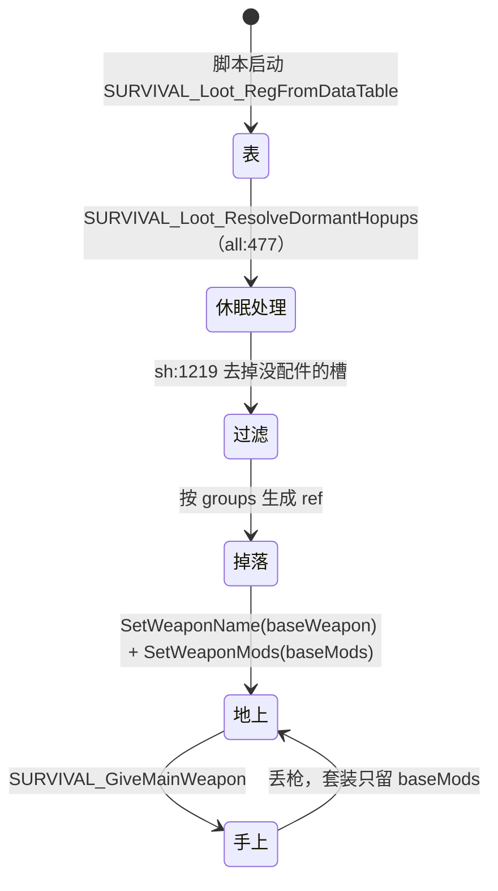

# 武器等级和套装：系统记录

会话 wp1，2026-11-01，静态研究（只读脚本和数据，没进游戏）。

出处从 `research-src/s21-platform/` 开始。缩写：`loot` = `datatable/survival_loot.csv`，`matrix` = `datatable/weapon_attachment_matrix.csv`，`all` = `scripts/vscripts/sh_survival_loot_all.gnut`，`sh` = `scripts/vscripts/sh_survival_loot.gnut`，`sv` = `scripts/vscripts/survival_loot.gnut`，`wu` = `scripts/vscripts/weapons/_weapon_utility.nut`。`<武器>.txt` = `scripts/weapons/mp_weapon_<武器>.txt`。`sdk` = `research-src/s21-r5sdk/src/game/`（SDK 的 `server.dll` 源码）。

相关记录：[hopups](../hopups/SYSTEM.md)、[attachments](../attachments/SYSTEM.md)、[ammo](../ammo/SYSTEM.md)、[W-MOD-SYSTEM](../_shared/W-MOD-SYSTEM.md)、[W-PARAM-COMPARE](../_shared/W-PARAM-COMPARE.md)、[W-S3-FIELD-CHECK](../_shared/W-S3-FIELD-CHECK.md)。

## 0. 概要

- **对象**：`loot` 里 `main_weapon` 的所有行：基础枪、白蓝紫金套装、空投（crate）、活动枪、双持、OG。
- **一句话**：一把枪在 loot 里有最多 6 行。**套装不是新枪**：`ref` 通过 `baseWeapon` 指向同一个 `.txt`，通过 `baseMods` 自动带一组配件。**空投枪是新枪**：单独一个 `*_crate.txt`，字段改过，`uses_ammo_pool 0`。
- **分类**：
  - 效果：等级决定配件档次 + 金色自带 hop-up；空投枪更强但备弹有限。
  - 可视化：等级颜色（loot `tier`、`eLootTier`），`hud_icon`。
  - 可复用系统：**表驱动的 `ref → 武器 + mod 列表`**。一行数据做一件新物品，不写代码。
- **可拆出的部件**：
  - loot `ref` 解析 → 3.2.1
  - 套装标记（`SetWeaponLockedSet`）→ 3.2.2
  - 空投枪（独立文件）→ 3.3.1
  - OG 版本 → 3.3.2

## 1. 它用什么实现各种效果

| 效果 | 实现手段 | 说明 |
|---|---|---|
| 等级颜色 | `loot.tier` → `eLootTier`（`all:74-85`） | NONE 0、COMMON 1、RARE 2、EPIC 3、LEGENDARY 4、MYTHIC 5、ICONIC 6 |
| 套装配件 | `loot.baseMods` 在枪生成时写进 `SetWeaponMods` | `sv:3099-3115` |
| 套装不可换 | `SURVIVAL_Weapon_IsAttachmentLocked`（`sh:7717`）、`SURVIVAL_IsAttachmentPointLocked`（`sh:7837`） | 瞄具除外 |
| 套装身份 | `weapon.SetWeaponLockedSet( eWeaponLockedSet.* )` | `wu:5390` 按 lootTags |
| 空投枪 | 独立 `*_crate.txt`，`weaponBaseClass` 指基础枪，`crate` 空 mod | `3030_crate.txt:3` |
| 自带备弹 | `uses_ammo_pool 0` + `ammo_default_total` | 见 [ammo](../ammo/SYSTEM.md) 3.2.2 |
| 休眠 hop-up | `dormant_hopup_*` 空 mod + 服务端线程 | 见 [hopups](../hopups/SYSTEM.md) 3.2.2 |
| 双持 | `locked_akimbo` + `GiveMatchingAkimboWeapon`（`wu:4087`） | 3.3.3 |

**本地补丁**：`loot` 有 41 行注释掉的行，理由写在行首，比如 "no dual-wield path on the S3 dedi"（`loot:124`）、"mdl/weapons/epg is absent"（`loot:168`）。

## 2. 流程



## 3. 代码

### 3.1 入口

`all:438` `SURVIVAL_Loot_RegFromDataTable( LOOT_DATATABLE )`，再 `all:439` 模组枪，`all:477` 休眠处理。

### 3.2 核心逻辑

#### 3.2.1 `ref` 解析

```
读表（all:661-883）：
  baseWeapon = 行 baseWeapon 或 ref（all:683-688）
  baseMods = split( 行 baseMods )（all:692）
  tier、supportedAttachments、lootTags、isDisabled
  枪：RegisterWeaponForUse( baseWeapon )（all:747）
      名字：GetWeaponInfoFileKeyField_WithMods( baseWeapon, baseMods, "printName" )（all:754）
           所以 locked_akimbo、hopup_mythicset_vinson 的 printname 能改显示名
      ammoType = WeaponAmmoPool( baseWeapon, baseMods )（all:767）
```

**套装判定**：`WeaponLootRefIsLockedSet`（`sh:1916`）：`baseWeapon != ref`。注释说"所有锁定套装都有基础枪"。

**有效 ref**：`SURVIVAL_Loot_IsRefValid`（`all:1152`）= 在 `file.lootData` 里。注释掉的行不算，所以依赖它的逻辑（休眠、切换）会跳过。**但 `baseMods` 里无效的 mod 仍然写到枪上**（`sv:3099-3115` 不查），只要 `.txt` 有这个块。

**枪怎么生成**：

```
地上（sv:3094-3116）：
  ent.SetWeaponName( baseWeapon )
  mods = baseMods（可选只留锁定槽）
  ent.SetWeaponMods( mods )
手上（sv:3419 SURVIVAL_GiveMainWeapon）：
  从 pickup 取 mods；去掉 disabledAttachments 的（sv:3674-3681）
  AddValidModsFromAttachList、AddValidModsFromInventory（背包配件自动装）
  补切换 mod（sv:3724-3732）、VerifyToggleMods（sv:3733）
  SetMods（sv:3815）
  不是 crate → SetWeaponLockedSetFromLootTags（sv:3825-3829）
```

"set the mods here so extended ammo doesn't take effect until after we give ammo"（`sv:3814`）：先给弹，再加弹匣 mod。

Sling 分支（`sv:3634-3671`）：Ballistic 枪带把枪换成白或金套（按 `_whiteset`、`_gold` 后缀拼 ref）。

#### 3.2.2 套装

共 229 行存活的 `main_weapon` 行，禁用 30 行（`loot`，脚本统计）。存活且未禁用的分布：

| 类 | 数量 | 行例 | `tier` | `baseMods` 规律 | `supportedAttachments` |
|---|---|---|---|---|---|
| 基础 | 38 | `loot:100` R-301 | 1 | 空，或休眠 hop-up | 枪的全部槽 |
| 白 | 32 | `loot:102` | 1 | 1x HCOG + L1 弹匣 / 枪管 / 枪托 | 同基础 |
| 蓝 | 32 | `loot:103` | 2 | 2x + L2 | 同基础 |
| 紫 | 32 | `loot:104` | 3 | 2x 或 2-4x + L3 | 同基础 |
| 金 | 33 | `loot:105` | 4 | 同紫，加 hop-up | 加 `hopup` |
| 空投 | 32 | `loot:101` | 5 | `crate` + 瞄具 + L3 | 只有瞄具或 hop-up 组合 |

**金武器的 hop-up**：多数是 `hopup_ultimate_accelerator`，等于空槽（[hopups](../hopups/SYSTEM.md) 第 1 节）。真有效果的金枪：Havoc、Devotion、Nemesis（涡轮）；Alternator、EVA（双击）；Prowler、Charge Rifle（Selectfire）；P2020（Hammerpoint）。无 hop-up 的金枪：Flatline、Volt、RE-45、PK、Bocek（`loot:39`、`81`、`161`、`117`、`176`）。Mastiff 金带空的 `hopup_executioner`（`loot:8`）。

**瞄具不一定按等级**：比如 SMG 全程 1x（`loot:60-63`）；狙击枪蓝紫金不同（`loot:165-167`）。`mp_weapon_doubletake_*` 和 `energy_shotgun_*` 各行都带 `hopup_energy_choke choke`（`loot:30-33`、`loot:114-117`）。

**标记**：`SetWeaponLockedSetFromLootTags`（`wu:5390`）用 `whiteset` 等 lootTag（行里 `lootTags` 第二个词）。反查 `GetWeaponClassNameWithLockedSet`（`sh:1829`）：丢枪时按它拼回 ref。`crate` 不走这条（`sv:3825`）。

**不可装（`sh:7717`）**：`baseMods` 有 `crate`，或者是锁定套装 → 配件锁定。`sh:7837`：除瞄具外都锁；另外 hop-up 槽有 `LockedHopup` 标签的 mod 也锁（`sh:7821`）。

**移除**：`REMOVE_KITTED_WEAPONS_FROM_SPAWNING = true`（`sh:412`）。

#### 3.2.3 活动和杂项

| 行 | 内容 | 状态 |
|---|---|---|
| `loot:129-132` | Mozambique `light / heavy / sniper / energy`（`hopup_april_fools_*`） | 存活，tag `event_weapon` |
| `loot:168-169` | EPG | 注释：模型缺失 |
| `loot:172` | Bocek Cupid（`countPerDrop 60`） | 存活 |
| `loot:373` | Titan Sword | 存活，`event_weapon` |
| `loot:421` | Flatline `mythicset`（`hopup_mythicset_vinson`，无实际效果） | 存活，`event_staging` |
| `loot:432-433` | Instagib 和金版（`hopup_smart_reload`） | 存活 |
| `loot:435` | Buster Rifle | 注释："removed in S30" |
| `all:612-659` | 模组枪 `ModWeapon_Register` | 本地 SDK，"never added to a loot pool"。`flowstate_mods.csv` 只放了 raygun 且被注释（`all:441-448`） |

### 3.3 特殊类

#### 3.3.1 空投枪（crate）

- 文件：`*_crate.txt`，共 30 个有 `weaponBaseClass`。`loot.baseWeapon` 为空，所以 `baseWeapon = ref`（`loot:11`）。
- mod `crate` 是空块（`3030_crate.txt:426` 附近，52 把），只当标记。
- 差异（字段比对，只列主要）：

| 枪 | 变化（基础 → 空投） |
|---|---|
| R-301 | 伤害 15→16；备弹 44→248；自带 217 |
| R-99 | 伤害 12→15（近）/ 14（远）；备弹 36→210 |
| Hemlok | 伤害 20→23；爆头 1.4→1.8；备弹 36→210 |
| Wingman | 备弹 20→72；自带 81；Skullpiercer 精英 95 |
| Longbow | 射速 1.3→1.7；伤害 60→65；备弹 5→98 |
| G7 | 射速 4.1→4.5；伤害 33→37；备弹 0→108 |
| Triple Take | 射速 1.3→1.75；伤害 22→23 |
| Mastiff | 伤害 19→14（×1.25 爆头）；弹匣 5→4；备弹 28 |
| Havoc | 伤害 20→21；`charge_time 0.42→0.01` |
| L-STAR | 伤害 19→21；`charge_time 2.2→2.8` |

- 特殊：`loot:3` Kraber、`loot:168` EPG 的 `baseMods` 只有 `crate`，supported 空。`mp_weapon_sniper` 本身就是空投枪。

#### 3.3.2 OG 版本（`*_og.txt`，共 21 个）

**本地拿不到**。证据：
1. `research-src` 有 21 个 `*_og.txt`；本地安装的 `platform/scripts/weapons/` **没有**（[W-S3-FIELD-CHECK](../_shared/W-S3-FIELD-CHECK.md)，`_tools/diff-builds.mjs` 的比对结论）。本记录只复核了 `research-src` 这边的数量（21），本地安装那边引用这份比对，没有重新比。
2. `loot` 没有 `_og` 行。
3. `vscripts` 里 grep `_og` 词尾：**没有引用**。

用途：数值参考（早期版本），**不要当现行值**。

| OG | 和现行差的主要字段（OG / 现行） |
|---|---|
| Alternator | 伤害 13 / 18；弹匣 16 / 18 |
| RE-45 | 伤害 11 / 14；弹匣 15 / 20；爆头 1.5 / 1.25 |
| Longbow | 伤害 55 / 60；弹种 highcal / sniper；爆头 2.15 / 1.8 |
| Triple Take | 伤害 23 / 22；爆头 1.75 / 1.5；`uses_ammo_pool` 1 / 0 |
| Havoc | 伤害 18 / 20；弹匣 25 / 18；爆头 1.75 / 1.3；有 Selectfire 单发 90 伤；`uses_ammo_pool` 1 / 0 |
| Peacekeeper | 伤害 10 / 11；弹丸速度 16000 / 20000；爆头 1.25 / 1 |
| Devotion | 伤害 17 / 16；弹匣 44 / 36；爆头 2 / 1.25；`uses_ammo_pool` 1 / 0 |
| G7 | 伤害 30 / 33；射速 4.5 / 4.1；爆头 1.75 / 1.45；有 Skullpiercer 和 6x |
| Hemlok | 伤害 18 / 20；弹匣 18 / 21；爆头 1.75 / 1.4 |
| Spitfire | 弹种 highcal / bullet；伤害 20 / 21；爆头 2 / 1.25；换弹 2.8 / 3.4 |
| L-STAR | 伤害 21 / 19；弹匣 60 / 0；`charge_time 1.7 / 2.2` |
| Mastiff | 伤害 18 / 19；射速 1.3 / 1.1；爆头 2 / 1 |
| Prowler | 伤害 14 / 16 |
| R-99 | 弹速 21000 / 19000；有枪管 |
| R-301 | 伤害 14 / 15；弹匣 18 / 21；爆头 1.75 / 1.3 |
| P2020 | 伤害 12 / 24；射速 8.5 / 7；弹匣 10 / 9 |
| EVA | 射速 2.4 / 2.8；爆头 1.25 / 1；换弹 2.75 / 2.3 |
| Mozambique | 伤害 15 / 17；弹匣 3 / 5；射速 2.2 / 2.8；爆头 1.5 / 1.25 |
| Kraber | 伤害 125 / 150；爆头 2 / 1.4 |
| Flatline | 伤害 16 / 20；弹匣 20 / 19；爆头 1.75 / 1.3 |
| Wingman | 伤害 45 / 50；射速 3.1 / 2.8；弹匣 6 / 5；爆头 2 / 1.5；弹种 highcal / sniper |

规律：OG 爆头普遍高，普通伤害普遍低；能量枪那时走公共池。

#### 3.3.3 双持

| 行 | 内容 | 状态 |
|---|---|---|
| `loot:125-128`、`146-149` | Mozambique、P2020 `akimbo_{white,blue,purple,gold}` | **存活** |
| `loot:124`、`145` | 空投双持 | 注释 "no dual-wield path on the S3 dedi" |
| `loot:208-209` | paintball 双持 | 注释，同上 |

- `locked_akimbo` 只有 `printname`（`semipistol.txt:788`、`shotgun_pistol.txt:739`）；`is_akimbo_weapon 1`（`semipistol.txt:49`、`shotgun_pistol.txt:70`）。
- 给枪时 `sv:3895`：`HasMod( locked_akimbo )` → `GiveMatchingAkimboWeapon`（`wu:4087`）。
- 模式 mod：`akimbo_active`（P2020 射速 8、散布绝对值，`semipistol.txt:724`）、`akimbo_offhand`（射速 7，`semipistol.txt:754`）、`akimbo_disable`（`semipistol.txt:784`）。
- FR 菜单和 Arenas 有专门入口（`gamemodes/freeroam_weapons_menu/sv_freeroam_weapons_menu.nut:296`、`gamemodes/arenas/_gamemode_arenas.nut:1833`）。

SDK 有双持实现：`sdk/server/akimbo.cpp`（状态机和 mod 切换，`:747-756`）、`sdk/shared/weapon_dualwield_slot_patch.h`（S21 搭档槽是 N+7，S3 是 N+5）。所以 `loot` 注释"no dual-wield path on the S3 dedi"推断已过时，或只针对空投和 paintball 那几行。**要实测**（第 5 节）。

#### 3.3.4 `dormant_` 和 `locked_` mod

- `dormant_hopup_*`：空 mod（比如 `energy_ar.txt:798`），只用来告诉脚本"这把枪有什么休眠 hop-up"。见 [hopups](../hopups/SYSTEM.md) 3.2.2。
- `locked_akimbo`：见上。常量 `WEAPON_LOCKEDSET_MOD_AKIMBO`（`sh:340`）。
- 其他常量：`sh:325-343`（`gold`、`whiteset`、`blueset`、`purpleset`、`paintball`）。这些也是 `lootTags` 的词。

`paintball` 套装（`loot:210-239`）：**全部 `isDisabled=true`**，2 行双持注释。

### 3.4 依赖的公共代码

- `SURVIVAL_Weapon_GetBaseMods`（`sh:7859`）。
- `AddValidModsFromInventory`、`AddValidModsFromAttachList`（`sv`）。
- `Weapon_GetBaseClassNameOrEmpty`（`sh:1098`，`cl_survival_loot.nut:1689`）：读 `weaponBaseClass`。

## 4. 参数

| 参数 | 值 | 来源 | 作用 |
|---|---|---|---|
| `tier` | 白 1、蓝 2、紫 3、金 4、空投 5 | `loot` | 颜色和掉落 |
| `MIN_LOOT_TIER` 到 `MAX_LOOT_TIER` | 断言 | `all:714` | |
| 金枪主流 hop-up | 17 行 `hopup_ultimate_accelerator` | `loot` | 空效果 |
| `global_disabled_loot`、`survival_disabled_weapons` | playlist | `all:432-436` | 禁用 ref |
| `dormant_hopups_precharged` | playlist | `all:486` | 休眠预充能 |
| 每把枪每级配件 | 见 [attachments](../attachments/SYSTEM.md) 第 4 节 | | |
| 基础枪字段 | 见 [W-PARAM-COMPARE](../_shared/W-PARAM-COMPARE.md) | | |
| 空投枪差异 | 见 3.3.1 | | |

## 5. 未解决和要实测的

R5 运行时已知：本地 `npc_dummie`、`npc_prowler` 能生成和追人但不开火；`npc_spectre` 会让 dedi 卡死。

1. **双持**（注释和代码矛盾）：**测**：`give mp_weapon_semipistol_akimbo_gold`，看 `GiveMatchingAkimboWeapon` 是否给第二把枪，能否同时开火；读 `player.GetAkimboState()`（`gamemodes/cl_gamemode_survival.nut:2094`）。
2. **无效 `baseMods`**：`mastiff_gold`（`hopup_executioner`）、`mp_weapon_car_crate`（`hopup_car_crate`，行禁用）。**测**：拿到时有没有脚本错误，HUD 怎么显示 hop-up 槽。
3. **`weaponBaseClass`**：`*_crate.txt` 是否继承基类的 mod 块（`3030_crate` 无 `shatter_rounds_hipfire`）。**测**：`AddMod` 不存在的块。
4. **OG**：本地有没有其他东西提供 `_og`（比如 rpak）。**测**：`give mp_weapon_rspn101_og` 看返回。这是字符串证据，不是行为证据。
5. **Energize**（SDK 重写，`W-S3-FIELD-CHECK`）：S3 引擎没有，SDK 在 `sdk/server/energize.cpp` 实现（`:478-480` 读字段，`:796`、`:800` 注册 `ForceEnergizeState`、`ForceEnergizedEndTime`）。脚本入口 `mp_weapon_dragon_lmg.nut:71-72`。**测**：Rampage 用 Thermite 充能，看射速和持续时间；Sentinel、`bow_crate` 同样测。
6. **Nemesis 热量**（SDK 重写）：`sdk/shared/weapon_heat.cpp:386`、`:1531-1534`；脚本 `mp_weapon_nemesis.nut:205`。`nemesis.txt:44` 注释回调 `OnWeaponHeatStateChanged` 在 dedi 上没绑定。涡轮见 [hopups](../hopups/SYSTEM.md) 3.2.8。**测**：连射点射间隔变化、充能特效和 HUD。
7. **套装解析**：**测**：`give mp_weapon_rspn101_gold`，打印 `GetWeaponClassNameWithLockedSet`、`GetWeaponLockedSet`、mods，和 `loot:105` 比。
8. **空投枪备弹**：`rspn101_crate` 自带 217，**测**：打空后能否捡弹（`uses_ammo_pool 0`）。

## 6. HSD 实现

**未实现**。`CombatLoadout.cs` 只选装备，没有等级或套装。

建议做法：

1. **`WeaponLootDef` 资产**：`ref`、`baseWeapon`、`baseMods[]`、`tier`、`slots[]`、`tags[]`。和 `loot` 的列一一对应。一个 ref 就是一件物品；`Instantiate( def )` = 建基础枪 + 加 mods。
2. **不做 37 个文件复制**：R5 空投枪复制全文件，维护成本高。HSD 用 `WeaponMod("crate_r301")` 改字段，再加 `usesAmmoPool = false`。差别进 `R5-DIFF-ARCHIVE.md`。
3. **PvE 掉落**：白 → 金直接对应关卡进度。金武器要确保 hop-up 有效，不要照抄加速器。
4. **OG 数值**：作为"高爆头手感"备选配置，放到 `_shared` 数据，不进主线。
5. **双持**：PvE 可做，但等 Unity 的第二把武器的动画和输入有方案再说。

开关建议：`CombatLoadout.lootRef` 字符串；PlayerPrefs `hsd.combat.weapon.tier`。

和 R5 的差别：还没有实现，暂无。
