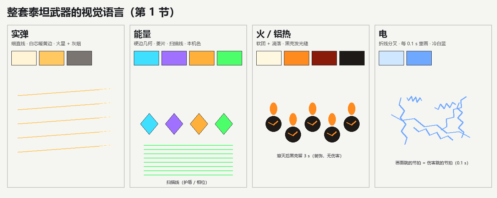
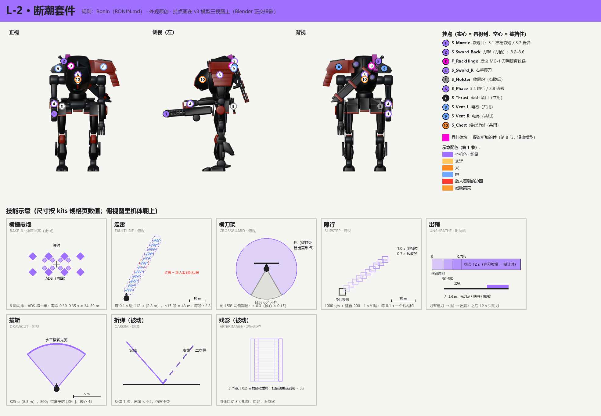
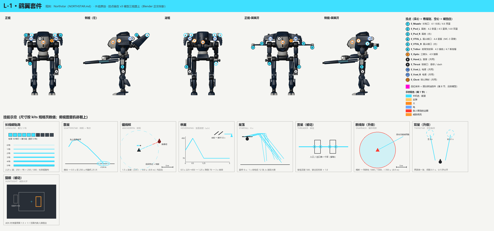
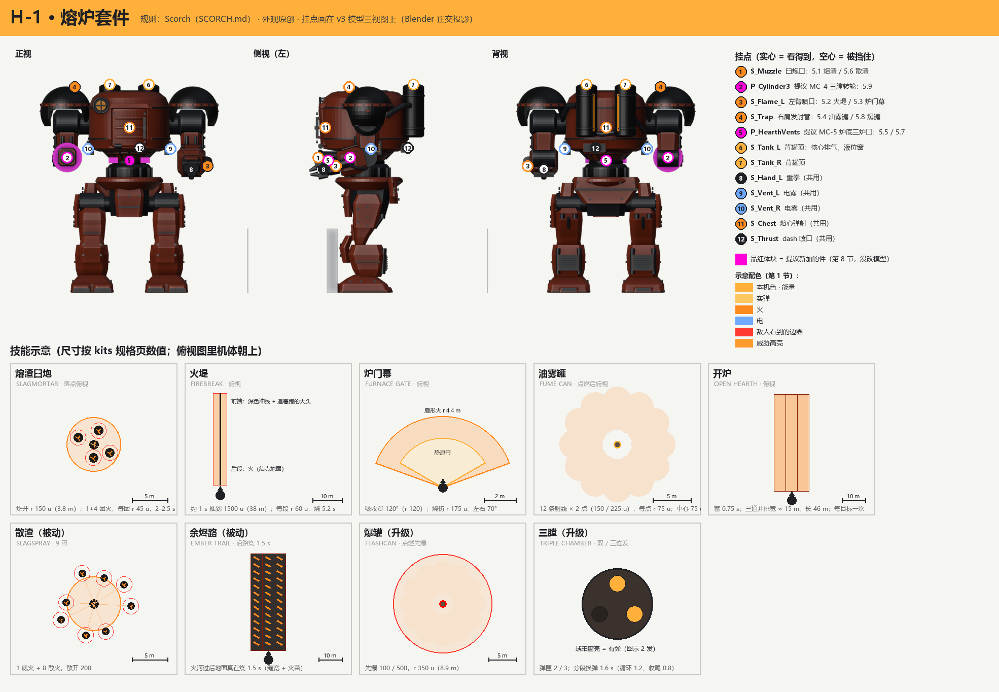
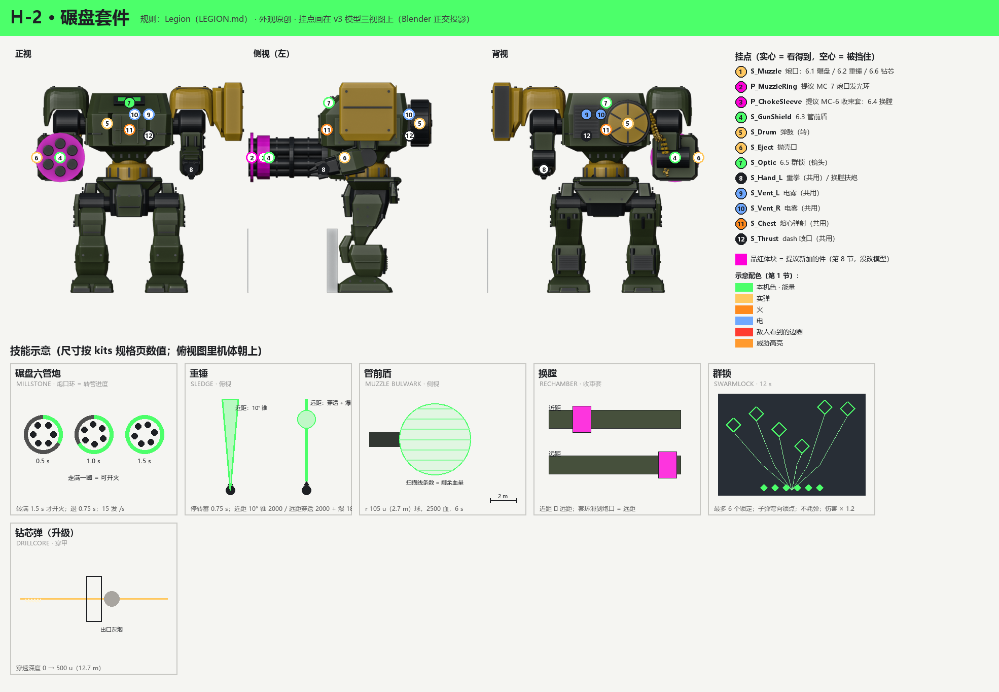
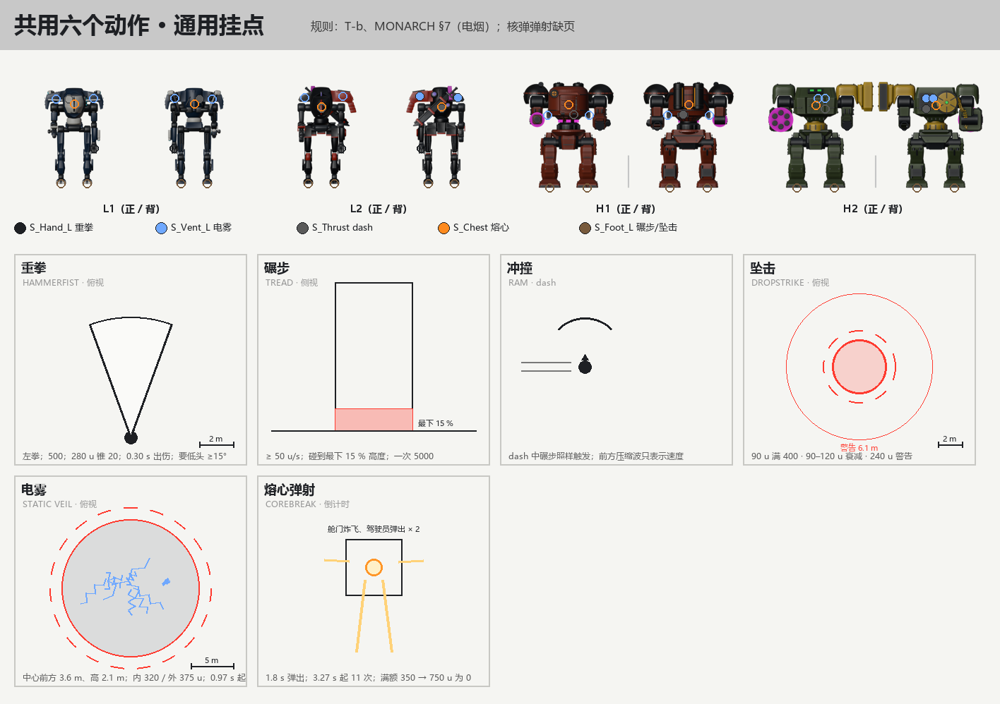

# 轻型 / 重型泰坦套件：原创外观和表现设计（L-1、L-2、H-1、H-2）

2026-11-13，会话 `titan-kits-design-lh`（lead 派）。只是设计稿：**没有改任何模型，没有写 Unity 代码**。需要改模型的地方列在第 8 节，等用户确认后才动 Blender。

## 先说结论

- **这页做什么。** 用户 11-13 决定把 TF2 的泰坦套件做进游戏。规则和数值照 TF2（规格在 `kits/` 各页，本页每件都写了出处节号），但**名字、外观、发射位置、特效、声音、动作全部是我们自己的**。本页给轻型两台、重型两台的 4 套技能、选中的 13 个被动 / 升级、所有泰坦共用的 6 个动作，各写一份"它叫什么、从哪发出来、看起来什么样、听起来什么样、和 TF2 有什么不同"。
- **四套各一句话：**
  - **L-2 · 断潮套件**（用 Ronin 的规则）：一把会"从刀架上递到手里"的长刀 + 两排横向弹幕的霰炮。冲刺时机体变成一串紫色线框残影；刀扫地放出一列站起来又倒下的电栅。
  - **L-1 · 鹞翼套件**（用 Northstar 的规则）：长枪上那排 10 格青灯就是蓄力表，满格打出一条贯穿全场的青线；背上两片翼展开、翼尖喷口转向下就是悬停；火箭从翼中段的舱口出。
  - **H-1 · 熔炉套件**（用 Scorch 的规则）：右前臂臼炮打出会"结壳"的熔渣球，地上留下发光裂纹的火；左臂喷口先铺油线后点火；核心时躯干底部"炉底"打开三道炉口。
  - **H-2 · 碾盘套件**（用 Legion 的规则）：六管炮转起来时炮口环由暗到亮，转满才打；切换模式时一圈"收束套"滑到炮管前端；蓄力一发时六根管停转、炮口环收成一个亮点。
- **整套泰坦的视觉语言**（第 1 节，中型设计会话按同一套走，lead 对齐）：**实弹 = 细线（白芯暖黄边）；能量 = 本机发光色 + 硬边几何碎片；火 = 白→橙→暗红的软团 + 黑色结壳；电 = 冷白蓝的折线分叉、每 0.1 s 闪一下**（和伤害跳的节奏一致）。所有范围伤害的画面大小 = 伤害半径，敌人看到的边圈统一是警示红。
- **要改模型的有 7 项**（第 8 节，都是加件，不改骨架比例）：L-2 刀架摆臂 + 刀鞘外壳、L-1 翼尖喷口罩瓣（可选）、H-1 三膛转轮 + 炉底三道炉口、H-2 收束套 + 炮口发光环。另有 3 项只改材质 / 加空挂点。
- **要 lead 注意的两件事：** (1) 模型的名字"北辰 / 浪人 / 军团"是 TF2 泰坦名的直译，和"名字要原创"冲突，建议改（第 9.2 节给了候选）；(2) 核弹弹射原来没有规则页；11-13 `tf2-kits-measure` 补了文件规格和实测（PR #121），第 7.1 拳、7.5 电雾、7.6 核弹弹射的规则行已按它更新（外观不变，时间对上）。

---

## 0. 规矩、来源和单位

- **规则从哪来：** 只用 `TF2-Research/expansion/titan/kits/` 的规格页（研究仓库 `tf2/expansion/titan/kits/`，PR #109）：[RONIN.md](../kits/RONIN.md)、[NORTHSTAR.md](../kits/NORTHSTAR.md)、[SCORCH.md](../kits/SCORCH.md)、[LEGION.md](../kits/LEGION.md)、[T-b-TITAN-VS-INFANTRY.md](../kits/T-b-TITAN-VS-INFANTRY.md)，电烟的数值在 [MONARCH.md](../kits/MONARCH.md) 第 7 节。本页引用写成"RONIN §2"= 那一页的第 2 节。
- **外观从哪来：** 只用我们自己的模型 v3（规范 `model/v3/SPEC.md`，研究仓库 PR #116；本地 `TF2-Research/expansion/titan/model/v3/L`、`H`）。**没读** `TF2 Refer/`、`Titian Design/`，没看 TF2 的模型、动画、截图、特效、声音。第 9 节"和 TF2 的区别"只按规则页里的名字和常识写，不照任何画面。
- **单位：** 规则页是 TF2 单位 u。1 u = 2.54 cm（泰坦碰撞高 5.97 m ≈ 235 u）。画面描述同时给米，例：112 u ≈ 2.8 m。
- **坐标：** 挂点坐标是模型零姿势的分析坐标（x 前、y 左、z 上，米），和 `rig_L*.json` / `heavy_rig.py` 一致。图里的挂点是在 bind / 瞄准姿势下用 Blender 正交相机投出来的（第 10 节）。
- **"本机色"：** 每台模型已经定了一个发光色（L-1 青、L-2 电紫、H-1 琥珀、H-2 正绿），本页所有"能量"效果都用这个颜色。

---

## 1. 整套泰坦武器的视觉语言（给轻 / 中 / 重三条线共用）

**大白话：** 玩家一眼要分出四件事：这是子弹还是能量、会不会烧、会不会电、范围多大。所以每一类效果固定一种**形状**和一种**颜色家族**，不管哪台泰坦打出来的都一样；泰坦之间的区别只靠"本机色"和发射位置。

### 1.1 四类效果

| 类别 | 形状特征（主要靠这个认） | 颜色 | 拖尾 / 残留 | 用在本页的 |
|---|---|---|---|---|
| **实弹**（子弹、穿甲弹、霰弹的实心弹） | **细直线**；曳光每 3 发 1 发；命中出火星（向外溅的短线）和灰烟 | 白芯 `#FFF4D6` + 暖黄边 `#FFC860`；烟灰 `#7A7570` | 拖尾短（≤ 0.05 s）、直 | H-2 主炮、钻芯弹 |
| **能量**（电浆、相位、护盾、蓄力） | **硬边几何**：菱形 / 棱片碎片、直边光束、等宽扫描线；没有软烟 | **本机色**（L-1 `#3FE0FF` 青、L-2 `#A070FF` 电紫、H-1 `#FFB03A` 琥珀、H-2 `#4CFF6A` 正绿；中型由中型会话定） | 光束留 0.2–0.3 s 后"碎成菱片"消失 | L-1 狙击线、L-2 霰弹和相位、H-2 蓄力和盾 |
| **火焰 / 铝热** | **软团 + 滴落**；燃料落地后表面**结黑壳、壳缝发光**（这是我们的火的签名） | 白芯 `#FFF8E0` → 橙 `#FF8A1E` → 暗红 `#8A1A0A`；壳 `#1E1A18`；黑烟 | 火团在地上滚时留一条发光细缝，熄灭后黑壳留 3 s 才淡掉（纯装饰，没有伤害） | H-1 全套 |
| **电** | **折线分叉**的弧，弧尖是小亮点；**每 0.1 s 整体重画一次**（服务器每 0.1 s 跳一次伤害，画面闪的节拍 = 伤害节拍） | 冷白蓝：主弧 `#CFE8FF`、外晕 `#6FA8FF`；发射源可以带一点本机色 | 不留残迹，熄灭时"啪"地全灭 | L-2 走雷、共用电雾 |

**爆炸**不算一类，它跟着来源走：实弹炸 = 白闪 + 灰尘环；能量炸 = 本机色球壳 + 菱片；火炸 = 橙团 + 飞溅燃料滴。**爆炸第一帧的球大小 = 伤害外半径**（误差 ±10 %），之后扩散的烟和碎片可以更大，但那一帧是给玩家量距离的。

### 1.2 读得懂的四条规则

1. **范围 = 画面。** 所有范围伤害（地面火、电雾、陷阱、子爆炸）的**地面边圈**画在真实伤害半径上。规则页里半径不衰减的（火团、电雾内圈），边圈是实线；有衰减的（降落砸人 90–120 u），实线画满额半径，虚线画最远半径。
2. **敌我两种边圈。** 自己和队友看到的边圈用本机色；**敌人看到的边圈统一是警示红 `#FF3B30`**，不管哪台泰坦放的。效果本体（火、电、光）敌我看到的一样。
3. **节拍可见。** 每 0.1 s 跳一次伤害的东西（地面火、电、热盾、电雾），画面上有同节拍的亮度跳动（亮 0.03 s、暗 0.07 s，幅度 15 %）。打不到人的装饰残留（黑壳）不跳。
4. **第一人称不挡准星。** 自己放出的效果在第一人称里，准星周围 8° 以内透明度上限 35 %；全屏类效果（悬停气流、相位）只用画面边缘的暗角和色偏，不盖住中间。

### 1.3 锁定、标记、提示

- **锁定框：** 菱形四角（不是方框、不是圆），本机色；锁满时四角向内收一下（0.1 s）。
- **威胁高亮：** 被高亮的敌人描**橙色实边** `#FF9A2E`（和警示红区分：红 = 区域、橙 = 目标）。
- **蓄力表：** 一律做在**武器本体上**的灯（第一人称看得到，敌人从第三人称也看得到你蓄到几档），HUD 只放一个小数字。

### 1.4 声音占位规则

| 类别 | 起音 | 主体 | 尾音 |
|---|---|---|---|
| 实弹 | 硬瞬态（金属击发） | 短、干 | 空间回声 |
| 能量 | 高频"充电上扬"（蓄力）/ 玻璃般的"啸" | 中高频嗡鸣 | 碎裂的高频粒子声 |
| 火 | 低频"呼"（吸气） | 宽频噼啪 + 低频轰鸣 | 慢衰减的嘶嘶 |
| 电 | 尖锐"噼"（白噪短脉冲） | 10 Hz 的嗡（和画面同拍） | 一下断开的"啪" |

大的动作（核心、降落、核弹弹射）加 **1 s 前的"预警音"**，让对手先听到。

---

## 2. 挂点总表

**大白话：** 先看现有模型身上已经有哪些"出口"，尽量用它们；不够的才加件。四台的挂点名都是模型 README 里已有的，**加粗斜体的是本页提议新加的**（第 8 节）。挂点在三视图上的位置见每套的图（`img/`）。

| 用途 | L-1 | L-2 | H-1 | H-2 |
|---|---|---|---|---|
| 主武器出口 | `S_Muzzle`（长枪口，右手 `W_Rifle`） | `S_Muzzle`（霰炮口，右手 `W_Shotgun`） | `S_Muzzle`（右前臂臼炮，`W_Cannon`） | `S_Muzzle`（六管炮，`W_Cannon`），`J_Barrel` 转 |
| 进攻 | `S_Pod_L/R`、`S_Rocket_1..6`（翼中段火箭舱） | 刀（`S_Sword_R`）贴地扫出 | `S_Flame_L`（左前臂喷口） | `S_Muzzle`（强力射击） |
| 防御 | `S_Tether`（左前臂发射器） | 刀（`S_Sword_R`） | `S_Flame_L` | `S_GunShield`（炮口后 0.6 m） |
| 战术 | `S_VTOL_L/R`（翼尖喷口）、`S_Thrust` | `S_Phase`（躯干中心） | `S_Trap`（右肩发射管，朝前上 30°） | `W_Cannon`（换膛动作）、***`S_Choke`*** |
| 核心 | `S_Pod_L/R` + `S_VTOL_L/R` | `S_Sword_Back` → `S_Sword_R`（***`J_SwordRack`***） | ***`S_Hearth_1..3`***（炉底三口） | `S_Optic`（锁定）+ `S_Muzzle` |
| 共用：拳 | `S_Hand_L` | （用刀，见 3.6） | `S_Hand_L` | `S_Hand_L` |
| 共用：电雾 | `S_Vent_L/R` | `S_Vent_L/R` | `S_Vent_L/R` | `S_Vent_L/R` |
| 共用：dash 喷射 | `S_Thrust` + `S_Vent_L/R` | 同 | 同 | 同 |
| 共用：核弹弹射 | `S_Chest`（核心）、`J_Hatch` | 同 | 同 | 同 |
| 其他 | `S_Optic`（三颗竖排镜头，猎眼用） | `S_Holster`（右髋后，收霰炮） | `S_Tank_L/R`（背罐顶，核心排气） | `S_Drum`、`S_Eject`（弹鼓、抛壳口） |

**两台轻型、两台重型能不能共用挂点？** 骨架是共用的，但外形不同，所以发射位置**各写各的**：L-1 的火箭和悬停喷口都在翼上，L-2 的翼关节是空的、没有翼；H-1 的武器在两条前臂、陷阱在右肩，H-2 的武器是整条右前臂、左肩是盾。只有第 7 节的六个共用动作用**通用挂点**（`S_Hand_L`、`S_Vent_L/R`、`S_Thrust`、`S_Chest`、`S_Foot_L/R`），四台名字一样、位置各自在模型上。

---

## 3. L-2 · 断潮套件（规则：Ronin）

**这套的感觉：** 贴脸、抗住、闪过去。外观的核心是那把 3.6 m 的单刃直刀和电紫色。L-2 平时右手端霰炮、刀在背上的刀架里；**要用刀的时候，刀架自己把刀柄递到右肩前方**，右手松开霰炮（霰炮挂到右髋后 `S_Holster`）、接过刀。这样不用伸手到背后去拔，也和"从背后拔大刀"的常见画面分开。

### 3.1 横栅霰炮 RAKE-8（主武器）

- **玩法：** 半自动，每发 8 颗有寿命的弹丸，排成上下两排、横向展开的固定图案，ADS 图案缩一半；弹丸只飞 0.30–0.35 s（射程约 1320–1540 u ≈ 34–39 m），4 发一匣、换弹 2.25 s。（RONIN §1）
- **发射：** `S_Muzzle`（霰炮口，右手 `W_Shotgun`）。
- **表现：**
  - 开火：炮口一圈**横向的扁平闪光**（宽是高的 3 倍，提示弹幕是横排的），右前臂往后顶 0.08 m、0.15 s 回位。弹壳不抛（能量弹）；炮身侧面 4 格电紫灯，每打一发灭一格。
  - 弹丸：8 颗**电紫菱形光片**，前 0.075 s 从点长到"指甲盖"大小（跟着碰撞尺寸 0.5 → 4 → 6 变大），尾巴是 0.6 m 的直线拖尾。两排各 4 颗，空中看得出"上下两排"。
  - 弹丸到寿命：在消失点"碎成三片"往外飞 0.1 s（没有伤害，但玩家能看出射程尽头在哪）。
  - 命中泰坦：每颗一个电紫的小菱形火花 + 装甲上 1 s 的发光刻痕；命中铁驭：碎尸。
  - 第一人称：看到的是横排闪光和 8 道短线，ADS 时 8 道线明显收拢；右手和霰炮占画面右下。第三人称：一团横向闪光 + 8 道紫线。
- **声音：** 能量类。"咚"的低频击发 + 8 个极短的玻璃"嘶"叠在一起；换弹是两段机械声（弹匣滑出、卡入）。
- **和 TF2 的区别：** 弹丸是菱形光片、横排闪光、到寿命会碎开显示射程；名字、颜色、换弹动作都是我们的。

### 3.2 走雷 FAULTLINE（进攻）

- **玩法：** 放出一道贴地推进的电：每 0.1 s 向前 112 u（2.8 m），最多 15 段（1680 u ≈ 43 m）；每段在地面点做半径 112 的满额范围伤害，同一道每个目标只吃一次；打中的人减速。可以上 30° 以内的坡，前面没地或撞墙就停。冷却：1 s 后开始回，10 秒回满。（RONIN §2）
- **发射：** 刀。按下时刀架递刀（0.15 s，比核心拔刀快，见 3.5），右手接刀从左下往右上**贴地一扫**，刀尖在地面上拖出第一段；扫完刀回刀架、右手接回霰炮。整套 0.5 s。
- **表现：**
  - 每一段是一面**从地面立起来的电栅**：宽 2.8 m、高 1.6 m 的竖直薄片，由 5–7 根竖直的冷白蓝折线弧组成，底部压在地上一圈电紫的焦痕。立起 0.05 s → 停 0.1 s → 倒向前方消失 0.15 s。所以一道走雷看起来是**一列依次站起、依次倒下的电栅**，向前"走"。
  - 地面：每段留一个直径 5.6 m 的淡紫焦痕圈（= 伤害半径 112 u），0.6 s 淡掉；敌人看到的这圈是警示红。
  - 打中的人：身上爬几根冷白蓝的短弧，持续减速时间；屏幕边缘（被打者第一人称）冷白蓝静电噪点。
  - 撞墙停下：最后一面电栅"拍"在墙上散开成放射状的弧。
  - 第一人称：看到刀从右下扫到左上，电栅一列往前跑；第三人称：一列电栅走过地面。
- **声音：** 电类。扫刀时一声金属"嗖"；每一面电栅一声"噼"（10 Hz 连起来像"噼噼噼"往远处走，音量随距离降）；结束一声"啪"。
- **和 TF2 的区别：** 画面是"站起来又倒下的电栅列"，不是一道波；由我们的刀架递刀动作发出；冷白蓝 + 电紫焦痕的配色。

### 3.3 横刀架 CROSSGUARD（防御）

- **玩法：** 按住举刀。攻击者在你正前方 150° 以内（也就是除了正后方左右各 30°），伤害 × 0.3；核心中 × 0.15。近战、骑乘、濒死扣血不减。不耗能量，没有时限；举着时不能开枪、不能近战。（RONIN §3；注意 TF2 实测正后方也按 × 0.3 挡，见 kits README 结论 2，HSD 跟哪个由 kits-core 定，不影响外观）
- **发射：** 刀（`S_Sword_R`）。按下：刀架递刀 0.15 s，霰炮挂到 `S_Holster`；右手握刀**横在胸前**，刀身水平、刃朝前，左手掌按在刀背中段（我们的"架刀"姿势）。
- **表现：**
  - 举着时：刃线（模型已有发光刃线）亮到最亮；刀前方出现一片**看不见、被打才显形**的电紫"剪切面"：每次挨打，在弹着点附近显出一块菱形格子（直径 1.2 m），0.2 s 碎掉。挡下的子弹在刀身上溅出电紫火星；**挡下越多，刃线越亮**（纯装饰，读"这把刀在吃伤害"）。
  - 背后 60° 挨打（不挡的那块）：不显形，正常受击效果，读得出"这一下没挡住"。
  - 第一人称：刀横在画面下三分之一，刃线是一条电紫亮线；格子只在被打的方向出现，不挡准星（规则 1.2-4）。第三人称：横刀的剪影很清楚。
- **声音：** 举刀"锵"一声；每次挡下一个"叮"（金属 + 玻璃），伤害大的"叮"更低更响。
- **和 TF2 的区别：** 姿势是"横刀 + 左手按刀背"；被打才显形的菱形格；刃线随吃伤害变亮。

### 3.4 隙行 SLIPSTEP（战术）

- **玩法：** 按下当帧，按移动方向把速度设成 1000 u/s（25 m/s）再加竖直 +200，同时进入 1 s 相位（不受伤、不挡人、不被瞄准）；之后 1.5 s 自己减速。12.5 s 回满。（RONIN §4）
- **发射：** 整机，从 `S_Phase`（躯干中心）开始；dash 推进用通用 `S_Thrust` 喷一下。
- **表现：**
  - 进入（0 s）：机体从躯干中心向外"翻成线框"——外壳在 0.08 s 内变成**电紫的等距扫描线**（水平线，间距 0.15 m），内部变暗。原地留下一个和机体一样姿势的**黑白负片残影**，0.4 s 淡掉（敌人看到"它刚才在这儿"）。
  - 相位中（0–1 s）：线框机体沿路径每 0.1 s 留一个更淡的线框印（共 ≤ 10 个），像一串脚印。线框本身透明度 40 %，敌人能看到大致方向但打不中。
  - 出来（0.7 s 起预告，1.0 s 落定）：0.7 s 时线框开始"收紧"（扫描线间距从 0.15 m 变到 0.05 m），1.0 s 时一下变回实体，周围一圈电紫的**色差撕裂**（红蓝错位一帧）。0.7 s 的预告对应规则页"提前 0.3 s 播出现特效"。
  - 减速的 1.5 s：脚下有淡紫的拖影，最后 0.5 s 淡掉（对应减速淡出）。
  - 第一人称：画面边缘紫色暗角 + 整体略去饱和，视野中央保持清楚；出相位那一帧有轻微色差。第三人称：线框 + 残影串。
- **声音：** 进入是一个"吸进去"的反向音（声音倒着放的感觉）；相位中整体声音变闷（低通）；出来是"啪"的一下恢复。
- **和 TF2 的区别：** 线框扫描线 + 黑白负片残影 + 一串线框脚印，是我们的相位语言（和 L-2 的电紫一致）；不用任何"消失 / 波纹"类效果。

### 3.5 出鞘 UNSHEATHE（核心）

- **玩法：** 按下后 0.75 s 拔刀（主武器收起），之后 12 s 只用刀：刀伤 800 → 2200，攻击键也挥刀；冲刺能量立刻回满、回能 × 6.5；格挡 × 0.15；走雷 × 1.5。（RONIN §5）
- **发射：** 刀架 → 右手。**这是刀架设计的主场：**
  - 0–0.3 s：背上刀架的摆臂（提议新件 `J_SwordRack`，第 8 节）向右上方转 110°，把刀柄送到右肩前方 0.4 m；同时霰炮挂到 `S_Holster`。
  - 0.3–0.5 s：右手握住刀柄，刀架松开卡扣（两声"咔"）。
  - 0.5–0.75 s：刀从刀鞘外壳（提议新件）里滑出——**刀鞘留在刀架上**，刀身离鞘时刃线从刀根到刀尖"走"一遍亮起来。0.75 s 刀身全亮，进入核心。
- **表现：**
  - 核心中：刀身两侧多一层**电紫的棱片光刃**（刀宽 0.35 m → 视觉 0.6 m），挥刀时刀尖留一条 0.25 s 的**直边光带**（不是弧形烟带，是一段段直的光片拼起来的折线）。
  - 机体：躯干竖缝传感器（模型已有）变成电紫常亮；左肩三层叠片的缝里透出电紫光。
  - 剩余时间：刀身的光刃从刀尖往刀根缩，12 s 走完（第一人称看刀就知道还剩多少）。
  - 结束：光刃熄灭，刀架摆臂接回刀、收鞘（0.5 s），右手接回霰炮。
  - 第一人称：拔刀时刀从画面右上方"递"下来；核心中刀占画面右侧，挥刀的光带折线在画面中扫过。第三人称：摆臂递刀的动作在背后很清楚，远处能认出"它开刀了"。
- **声音：** 0 s 起 1 s 预警音（低沉金属"嗡"上扬）；两声卡扣"咔"；出鞘一长声"锵——"；核心中刀挥动是低频"呼"+ 高频电"嘶"；结束时一声"咔"收鞘。
- **和 TF2 的区别：** 刀架摆臂递刀、刀鞘留在背上、刀身光刃作倒计时、折线光带，都是我们的；没有"从背后抽出"的动作。

### 3.6 拔斩 DRAWCUT（近战，L-2 不用共用拳）

- **玩法：** 按近战挥刀，325 u（8.3 m）内锥形里第一帧找到的目标都挨 800；泰坦被推开 400 u/s，人被推开 800 u/s。动作 0.9 s + 恢复 0.5 s。（RONIN §6）
- **发射：** 刀架递刀（0.15 s）→ 右手横斩（从右往左水平一刀）→ 刀架接回。
- **表现：** 刃线一道水平的电紫光弧（这里是唯一用弧形的地方：水平一刀，弧的半径 = 325 u 的射程）。打中泰坦：装甲上一道 2 m 长的发光切痕 1.5 s；打中人：碎尸 + 一圈紫火星。
- **第一人称 / 第三人称：** 1P 看到刀从右往左横扫全屏下半；命中定格视角 0.25 s（规则页值）。3P 看到摆臂递刀 + 横斩。
- **声音：** 实体金属"呼—锵"；命中泰坦是厚重的"咚锵"。
- **和 TF2 的区别：** 递刀 + 水平横斩的动作；视觉是刃线光弧。

### 3.7 被动 · 折弹 CAROM（跳弹）

- **玩法：** 霰炮弹丸碰到东西反弹 1 次；反弹后速度 × 0.5，伤害不减。（RONIN §7 Ricochet Rounds）
- **表现：** 反弹点一个小的电紫"折角"火花（两条短线成 V 字，开口朝反弹方向）；反弹后的弹丸**拖尾变成虚线**（读"这是二次弹"），颜色淡一档。
- **声音：** 每次反弹一个短的"叮"（比命中轻）。
- **和 TF2 的区别：** 反弹弹用虚线拖尾、V 字折角火花。

### 3.8 被动 · 残影 AFTERIMAGE（濒死相位）

- **玩法：** 玩家泰坦进入濒死时自动 3 s 相位，没有冲刺位移；濒死扣血照扣。（RONIN §7 Phase Reflex）
- **表现：** 和隙行一样的线框，但**原地**：机体翻成线框后，在原地留下 3 个错开 0.2 m 的线框重影，像在抖；3 s 时间用扫描线由疏到密倒数。濒死本身的效果（火花、冒烟）在线框下面继续。
- **声音：** 隙行的"吸进去"音，加一个 3 s 的心跳一样的低频脉冲。
- **和 TF2 的区别：** 原地抖动的线框重影 + 扫描线倒数。

---

## 4. L-1 · 鹞翼套件（规则：Northstar）

**这套的感觉：** 远、准、在空中。外观核心是 4.2 m 的长枪和背上那对能转的翼。L-1 的发光色是青。模型已经有翼面关节（收起 = 斜向后上 45°；展开 = 水平外伸，翼展 5.5 m）、翼尖喷口 `S_VTOL_L/R`、翼中段火箭舱 `S_Pod_L/R`、左前臂陷阱发射器 `S_Tether`、左前方三颗竖排镜头 `S_Optic`。这套几乎都能直接用现有挂点。

### 4.1 长线磁轨炮 LONGLINE（主武器）

- **玩法：** ADS 时自动蓄力，2.25 s 满 5 档；扣扳机射出一颗 10000 u/s（254 m/s）、几乎没有重力的电浆弹；伤害 = 250 + 档数 × 每档额外（铁驭 250 / 泰坦 300），暴击时额外部分也 × 1.5；打中泰坦有按伤害和距离算的击退。（NORTHSTAR §1）
- **发射：** `S_Muzzle`（长枪口）。
- **表现：**
  - **蓄力表就是枪身那排灯：** 模型的长枪侧面已经有一排 10 格青色发光条，每档点亮 2 格（0.45 s 一档）。满档时 10 格一起闪一下，枪口出现一个小的青色菱形"准星光"。第一人称看枪就知道几档；敌人从侧面也看得见。
  - 弹道：一条**青色直线光束**，粗细随档数：0 档 0.05 m，5 档 0.25 m；5 档外面再绕一圈细螺旋线（两圈 / 米）。光束留 0.3 s，然后从远端向近端**碎成菱片**消失（看得出是从哪打来的）。
  - 命中泰坦：命中点一个青色球壳闪（大小随档数 0.5–1.5 m）+ 装甲上青色烧蚀圈 2 s；击退时目标被打的一侧冒一股白汽。暴击（打到弱点）：球壳外多一圈尖刺状的菱片。
  - 第一人称：ADS 时画面四角出现细的青色刻度线（不挡中间），刻度线随档数从外往里收；开火瞬间画面中心一道白闪 0.03 s。第三人称：远处能看到一条青线横过战场——狙击位置会暴露，这是设计上故意的。
- **声音：** 能量类。蓄力是 5 段上扬的"嘀"（每档一声，越来越高），满档一个持续的高频嗡；开火是"嘣——"带长尾的玻璃啸声，远处的人先看到光后听到尾音。
- **和 TF2 的区别：** 枪身 10 格灯做蓄力表、5 档螺旋线、碎成菱片的光束；长枪 + 镫形握把是我们的模型。

### 4.2 散星 SCATTERSTAR（进攻）

- **玩法：** 射一发 3500 u/s 的火箭；撞到东西先炸一次（直击 300 + 爆炸 66 / 150），0.5 s 后在落点 250 u（6.4 m）内随机炸 25 次（每次 66 / 150，半径 150–220），整个序列 5 s 内结束。（NORTHSTAR §2）
- **发射：** 翼中段火箭舱 `S_Pod_L/R`，左右交替（第一发左、下一次右），管口是 `S_Rocket_1..6` 中的一个，舱口盖先弹开 0.1 s。**翼收起时也能打**（火箭舱前口在收起状态朝前上，火箭先往上飞 0.15 s 再转平指向准星）——这个"先上扬再转平"的弹道是这件武器的签名。
- **表现：**
  - 火箭：细长的白色飞镖形，尾焰是一点青色硬光 + 一条笔直的白色细烟。
  - 第一次爆炸：青色球壳，半径 150 u（3.8 m）。
  - 子爆炸区：落地瞬间在地面画一个 250 u 的青色虚线圈（敌人看到警示红），5 s 内慢慢淡掉；圈里随机冒出 25 个**小的青白菱形爆点**（每个半径 150–220 u 的球壳，0.15 s），节奏不规则（"噼啪"像爆竹）。
  - 第一人称：看到火箭从画面右上方或左上方（取决于哪边的翼）升起再转平；第三人称：翼上舱口的闪光。
- **声音：** 发射"咻"+ 舱盖"咔"；子爆炸是一串不规则的短"啪"（中频，不要低频轰鸣，免得盖过别的）。
- **和 TF2 的区别：** 从翼中段发射、先上扬再转平的弹道、子爆炸是青白菱形爆点 + 地面虚线圈。

### 4.3 锚线桩 ANCHORPIN（防御）

- **玩法：** 扔出一个陷阱（升级后两个），粘在地上，1.5 s 后武装；60 s 内敌方玩家泰坦进入 350 u（8.9 m）且看得见，就弹出绳子拴住它。拴住后的效果（拉力、怎么挣脱）在引擎里，规则页标了待实测。（NORTHSTAR §3）
- **发射：** `S_Tether`（左前臂发射器口）。左前臂往前一甩，桩子从发射器里射出（不是手扔）。
- **表现：**
  - 桩子：一个三棱锥（高 0.6 m），落地时三条腿"咔"地张开钉进地面。武装倒计时：锥顶三颗青灯依次点亮（0.5 s 一颗），1.5 s 三颗全亮，然后慢慢地呼吸闪。
  - 侦测范围：武装后地面一圈 350 u 的极淡青色圈（只有自己和队友看得到；敌人**看不到**圈，只看得到桩子本身——陷阱就该如此）。
  - 拴住：桩顶射出一根**绷直的青色缆线**，由一节节短的硬光段组成（每段 0.5 m，段与段之间有亮点），缆线被拉时段间距拉开、亮点变红（读"快断了"）。缆线另一端在目标身上一个青色的小夹具。
  - 第一人称（被拴的人）：画面边缘一根青线从拴住的方向连进来；第三人称：缆线很醒目。
- **声音：** 发射"嘭"（压缩气）；三颗灯每颗一个短"嘀"；拴住时一声钢缆绷紧的"铮"；被拉扯时低频的"吱嘎"。
- **和 TF2 的区别：** 从前臂发射器射出、三棱锥桩 + 三灯倒计时、分段硬光缆线（段间距和颜色表示拉力）。

### 4.4 悬翼 HOVERWING（战术）—— 悬停喷口的设计

- **玩法：** 按下立刻把重力设成 0；3 s 内每 0.1 s 把竖直速度设成固定曲线（0.5 s 内 225 → 450，再 0.75 s 降到 70，之后一直 70）；水平速度超过 300 就按比例压回；不能 dash；3 s 后恢复重力，自由下落。按脚本 3 s 能升约 486 u（12.3 m）。（NORTHSTAR §4）
- **发射：** 翼尖喷口 `S_VTOL_L/R` + 背部 `S_Thrust`。**展开过程（这件的重点）：**
  - **收在哪：** 平时翼收起（斜向后上 45°），翼尖喷口这时朝后上，喷口罩（提议新件，可选，第 8 节）合着，看不见喷口里面。
  - **0–0.2 s 展开：** 两翼绕各自铰链转 86.4° 到水平（模型已有的展开动作），**同时**翼尖喷口罩向两侧张开成四瓣，喷口在展开到位时正好朝下。背部 `S_Thrust` 同时点火。
  - **0.2–3 s 悬停：** 三个喷口持续喷。喷口可以随水平输入前后摆 ±20°（只是画面，提示正在往哪边飘）。
  - **3 s 结束：** 喷口先熄（0.1 s），翼在 0.4 s 内收回 45°，罩瓣合上。机体自由下落。
- **表现：**
  - 喷流：每个翼尖一根**青白的硬边光锥**（长 2.5 m，锥里有一节节的"马赫环"菱形，间距 0.4 m），外层是透明的热浪扭曲。推力曲线可以读：竖直速度最大的 0.5 s 时光锥最长（3.5 m），平飞段 70 u/s 时缩到 2 m。
  - 地面：离地 15 m 以内时，正下方一圈尘土环被吹开（半径随高度变小），给"离地多高"一个参照。
  - 第一人称：画面底部左右两角能看到青白光锥的末端 + 轻微的热浪扭曲；座舱轻微的上下颠（只在加速的 0.5 s）。第三人称：一对展开的翼 + 三根光锥，远处剪影很好认。
- **声音：** 展开时翼铰链"咔—嗡"（液压）；喷口点火一声"轰"后转成稳定的喷气嘶吼，音高跟着推力曲线（0.5 s 时最高）；结束时"噗"一下断掉。
- **和 TF2 的区别：** 喷口在翼尖、随翼展开转向下；四瓣喷口罩；光锥里的菱形马赫环；翼展开 / 收回的整套动作是我们模型的翼关节。

### 4.5 星落 STARFALL（核心）

- **玩法：** 6 s 悬停（水平 200 + 50），加武器替换：前 1 s 收枪，之后换成 12 发 /s 的追踪火箭；6 s 到后收枪 1 s，再换回主武器。按脚本 6 s 能升约 696 u（17.7 m）。（NORTHSTAR §5）
- **发射：** 翼展开（同 4.4）；火箭从两翼的 `S_Rocket_1..6` 依次轮流打出（6 管轮转，12 发 /s = 每管 2 发 /s）。长枪在前 1 s 收到右前臂下方贴住（只是动画）。
- **表现：**
  - 0 s：预警音 + 三颗镜头 `S_Optic` 由青转白；翼展开。
  - 火箭：比散星小一号的青色飞镖，尾巴是细青线，**追踪时尾线是弯的**（一眼看出在追）。命中是小的青色球壳。12 发 /s 连起来像从翼上"下青雨"。
  - 翼面：火箭舱一排管口轮流闪，像跑马灯。
  - 第一人称：画面左右上方火箭不断飞出，汇向准星方向；第三人称：空中一台展翼的机体往下倾泻青线。
- **声音：** 预警音；之后是密集的"咻咻咻"（12 Hz），底下垫着悬停喷口的嘶吼。
- **和 TF2 的区别：** 名字、翼上 6 管轮转、弯曲的追踪尾线、镜头变白的提示。

### 4.6 被动 · 贯星 THREADER（穿透狙击）

- **玩法：** 狙击弹穿透深度 500，穿过后伤害 × 1.0。（NORTHSTAR §7 Piercing Shot）
- **表现：** 光束穿过目标时，**在入口和出口各留一个青色的环**（像被线穿过的珠子），光束本身不断；穿过的每个目标都有完整的命中效果。
- **声音：** 每穿过一个目标一个短的"嗤"。
- **和 TF2 的区别：** "穿珠"式入口 / 出口环。

### 4.7 升级 · 断线爆 SNAPBACK（爆炸陷阱）

- **玩法：** 拴住的绳子断开时，在陷阱位置爆炸 1000 / 1000，半径 350（8.9 m）；陷阱没拴上就被打爆不算。（NORTHSTAR §7 FD Explosive Traps）
- **表现：** 缆线断开时，断口沿缆线**往回"跑"一道亮光**到桩子（0.2 s，提示"要炸了"），桩子三颗灯变红，然后一个 350 u 的青色球壳爆炸 + 三条腿炸飞。地面焦痕圈 = 350 u。
- **声音：** 缆线断"嘣"→ 回跑的"嗞——"→ 爆炸。
- **和 TF2 的区别：** 亮光沿缆线回跑的预告。

### 4.8 升级 · 双星 TWINSTAR（双发集束）

- **玩法：** 集束导弹一次两发（间隔 0.1 s），各偏 ±(0.25–0.35) × 0.1 个右向量，不再瞄准星点；每发扣 90；每发子爆炸 15 次、持续 3.5 s。（NORTHSTAR §7 FD Twin Cluster）
- **表现：** **左右两翼的舱同时开**，左翼先、右翼 0.1 s 后各打一发，两发火箭呈小"八"字分开；两个落点各画一个小虚线圈。
- **声音：** 两声"咻"错开 0.1 s。
- **和 TF2 的区别：** 两翼各出一发的对称发射。

### 4.9 被动 · 猎眼 HUNTSIGHT（威胁光学）

- **玩法：** 开始放大时给自己开"威胁色"，退出放大时关；准星周围 1.5 × 1.1 范围内的敌人高亮，不随距离淡出。（NORTHSTAR §7 Threat Optics）
- **发射：** `S_Optic`（左前方三颗竖排镜头）。
- **表现：** ADS 时三颗镜头**从上到下依次转成橙色**（0.1 s 一颗），第三人称能看出"它开了猎眼"。第一人称：准星周围那块区域里的敌人描**橙色实边**（第 1.3 节的威胁色），画面其他地方不变；屏幕四角的刻度线也带一点橙。
- **声音：** 开启一声"嘀—嘀—嘀"（三颗镜头），之后无声。
- **和 TF2 的区别：** 三颗镜头依次变色、橙色实边（我们的全局威胁色）。

### 4.10 近战：共用重拳（第 7.1 节，左手 `S_Hand_L`）

---

## 5. H-1 · 熔炉套件（规则：Scorch）

**这套的感觉：** 一台会走的炉子。模型已经是锅炉形躯干、炉门舱门、背上两个带液位窗的燃料罐、左前臂外侧喷火口 `S_Flame_L`、右前臂臼炮 `W_Cannon`、右肩朝前上 30° 的发射管 `S_Trap`、发光色琥珀。这套的火全部用第 1 节"白→橙→暗红 + 黑壳发光缝"的语言，**背罐的液位窗当能量表**：每用一次火类技能，液位掉下去再慢慢回升（纯装饰，读冷却）。

### 5.1 熔渣臼炮 SLAGMORTAR（主武器）

- **玩法：** 一发一装的抛物线榴弹（2200 u/s，重力 × 0.625），第一次碰到东西就炸开（爆炸 铁驭 50 / 泰坦 200，内 50 外 150），留下 1 团底火 + 4 团散火，会滚动，2–2.5 s 后熄灭；每团火每 0.1 s 烧一次（铁驭 20 / 泰坦 100），同一发的火对同一目标每 0.1 s 只算一次。（SCORCH §1、§1.6）
- **发射：** `S_Muzzle`（右前臂臼炮）。开火时右前臂整个往后坐 0.2 m，前臂上方一个排气口喷一口黑烟。
- **表现：**
  - 炮弹：一颗**外面结黑壳、壳缝透橙光**的熔渣球（直径 0.4 m），在空中翻滚，滴下一串小火滴（拖尾是一串点，不是连续烟带），弹道弧线一眼能读。
  - 炸开：橙团爆炸 + 一圈飞溅的燃料滴，第一帧火球半径 150 u（3.8 m）。
  - 火团：5 个直径 0.6 m 的熔渣块，在地上滚，滚过的地方留一条发光细缝；每团上面是 1.2 m 高的低矮火苗。每团伤害半径 45 u（1.1 m）的地面圈是实线（敌人看警示红）。火团滚动时伤害半径随移动变大（规则页），**画面上火苗跟着拉长**来表示。
  - 熄灭：火苗收掉，熔渣块变成纯黑的壳留 3 s（无伤害，装饰）。
  - 第一人称：右下方臼炮口大团橙闪 + 一口黑烟（烟往右后飘，不挡准星）；第三人称：高抛的熔渣球很好认。
- **声音：** 火类。开火是低沉的"嗵"（臼炮）+ 排气"嘶"；落地是"噗—哗"（溅开）；火团持续噼啪。
- **和 TF2 的区别：** 结壳熔渣球 + 滴落点状拖尾、滚动留发光缝、熄灭后黑壳；从前臂臼炮发射、背罐液位当冷却表。

### 5.2 火堤 FIREBREAK（进攻）

- **玩法：** 往前方水平推出一道贴地的火线，约 1 s 推到 1500 u（38 m），每段烧 5.2 s；每跳 铁驭 20 / 泰坦 100，半径 60 的球。冷却 10 s。（SCORCH §2）
- **发射：** `S_Flame_L`（左前臂喷口）。**先铺油、后点火**：左臂向下前方一挥，喷口喷出一条**深色的油线**沿地面往前"爬"（就是规则里火线推进的那 1 s），油线最前端有一个小火头追着跑，火头经过的地方立刻起火。
- **表现：**
  - 推进中：前面是深褐色发亮的油（看得出路径），后面紧跟着火；火头是白芯的小火球。
  - 燃烧中：一道宽约 3 m（半径 60 u ≈ 1.5 m 两边）、高 2.5 m 的火墙，底部是黑壳发光缝的地面，火墙每 0.1 s 亮度微跳。最后 1 s 火墙从两端往中间塌。
  - 第一人称：左下方喷口喷出的油线 + 火往前跑；第三人称：一条往前跑的火线。
- **声音：** 喷油"哗"（液体）→ 点火"轰"一路往远处走 → 持续的低频燃烧。
- **和 TF2 的区别：** "油线 + 追着跑的火头"两段式；从左前臂喷口出；结壳地面。

### 5.3 炉门幕 FURNACE GATE（防御）

- **玩法：** 按住时在身前张开一个 120° 的吸收罩（半径 120），子弹和投射物打上去就没了，不打回去；同时每 0.1 s 烧以喷口为心、半径 175（4.4 m）、视线左右 70° 以内的敌人（铁驭 25 / 泰坦 200）。最长 4 s，冷却 8 s。（SCORCH §3）
- **发射：** `S_Flame_L`（左前臂喷口），左臂举到身前、手掌朝外，像"挡"。
- **表现：**
  - 吸收罩：不是透明盾，是一面**热浪帘**：120° 的弧面，由竖直的热浪扭曲条纹组成，里面飘着橙色火星往上升。子弹打到罩上变成一个橙红的小熔点，0.2 s 冷成黑点掉下（读"被吃掉了"）。
  - 烧伤区：喷口前方一片 140°（左右 70°）、半径 175 u 的扇形贴地火焰，火焰往外扑。扇形边缘的地面实线（敌人看警示红）。
  - 4 s 用量：背罐液位快速下降；最后 1 s 热浪帘开始闪。
  - 第一人称：左臂在画面左下，前面一片波动的热浪 + 火星；准星周围保持清楚（热浪扭曲只在外圈）。第三人称：一面橙色热浪帘 + 往外扑的火。
- **声音：** 张开时"呼"（大吸气）；持续的鼓风机轰鸣；每颗子弹被吃掉一个"嗞"。
- **和 TF2 的区别：** 热浪帘（竖条纹扭曲 + 上升火星）+ 子弹变熔点掉落；从左臂喷口出。

### 5.4 油雾罐 FUME CAN（战术）

- **玩法：** 扔出一个油罐，放出一团本身无害的气体；任何火碰到就点燃，变成一圈半径约 240 u（6 m）的火，烧 5.2 s（火是 12 条射线、每条 2 个点，离中心约 150 和 225 u；每 0.2 s 一跳，铁驭 20 / 泰坦 100）；扔下后 1 s 内点不着；不分敌我。（SCORCH §4）
- **发射：** `S_Trap`（右肩发射管，朝前上 30°）。罐子从肩上"嗵"地抛出，**不用手**。
- **表现：**
  - 罐子：一个短粗的圆柱罐（直径 0.5 m），罐身两圈琥珀色环带，落地后罐顶阀门旋开。
  - 气体：**贴地的灰褐色浓雾**，厚 1.5 m，向外慢慢铺开到 240 u；雾里有细小的琥珀色闪点（读"这是可燃的"）。前 1 s 罐顶有一个琥珀小灯快闪（点不着的保护时间）。
  - 点燃：雾**从着火点开始蔓延燃烧**（0.2 s 内烧遍），然后变成 12 条放射状的火舌，每条两团火（150 u、225 u 处）——画面上是一朵"12 瓣的火花"，中心 75 u 内只有罐子在冒火、地上没火（照规则；规则页说这是待实测的空洞）。
  - 第一人称：右上方肩管口一闪；第三人称：肩上抛出罐子。
- **声音：** 发射"嗵"；罐子落地"当啷"；放气"嘶——"；点燃"呼轰"。
- **和 TF2 的区别：** 从肩管抛出、灰褐贴地雾 + 琥珀闪点、12 瓣火花造型。

### 5.5 开炉 OPEN HEARTH（核心）

- **玩法：** 蓄力 0.75 s（自己减速），然后三道并排的波推出去，宽约 600 u（15 m）、长 1800 u（46 m），每个目标整次核心只挨一次 300 / 4500，高出地面 110 u 的目标例外。（SCORCH §5）
- **发射：** 躯干底部的锥形"炉底"——提议在炉底前面开**三道炉口**（`S_Hearth_1..3`，第 8 节），正好对应三道波。
- **表现：**
  - 0–0.75 s 蓄力：机体下蹲半步、双臂张开撑住；炉底三道炉口的挡板向下翻开，炉口里由暗红到白；背罐顶 `S_Tank_L/R` 喷出两股白汽；炉门舱门的三道横肋发光。
  - 0.75 s：三道炉口同时喷出三条**贴地的熔流**，每条宽 5 m、并排，像三条火河往前冲，前缘是白热的浪头，后面留下发光的黑壳地面（装饰 3 s）。
  - 第一人称：画面下方被火光照亮，三条火河从画面底部往前冲出去；座舱震动。第三人称：一台张开手臂、底部喷三道火河的炉子。
- **声音：** 0 s 起 1 s 预警音（低频轰鸣上扬 + 金属挡板"哐"）；喷出是巨大的"轰——"；三条火河各有自己的低频，往远处走。
- **和 TF2 的区别：** 炉底三道炉口（和"三道波"规则一一对应，这是我们模型的锅炉造型才有的）；双臂张开的蓄力姿势；背罐白汽。

### 5.6 被动 · 散渣 SLAGSPRAY（野火发射器）

- **玩法：** 主武器直击对泰坦 800 → 1000；散火 4 → 8 团，散开速度 50 → 200（总共 1 底火 + 8 散火）。（SCORCH §7.1 Wildfire Launcher）
- **表现：** 炸开时熔渣块**飞得更远、更碎**（8 块小一号的熔渣，直径 0.45 m），落地铺成一个更大的不规则圆；炮弹本身壳缝多一圈白光（读"这是加强弹"）。
- **声音：** 落地"哗"更长、更散。
- **和 TF2 的区别：** 视觉跟熔渣语言走。

### 5.7 被动 · 余烬路 EMBER TRAIL（焦土）

- **玩法：** 火焰核心沿路留 1.5 s 的铝热。（SCORCH §5、§7.1 Scorched Earth）
- **表现：** 三条火河走过以后，地面**不是装饰黑壳而是真的在烧**：黑壳上的发光缝变宽、冒低矮火苗 1.5 s，边缘实线（敌人看警示红）。1.5 s 后才变回装饰黑壳。
- **和 TF2 的区别：** 用我们的"黑壳发光缝"区分"真在烧"（缝宽 + 火苗）和"只是残迹"（细缝、无火）。

### 5.8 升级 · 爆罐 FLASHCAN（爆炸油桶）

- **玩法：** 陷阱点燃时先爆一次：100 / 500，半径 350（8.9 m）。（SCORCH §7.2 Explosive Barrels）
- **表现：** 油雾罐的罐身**多一圈红色环带**（读"这是会爆的罐"）；点燃瞬间罐子先胀一下（0.05 s），然后 350 u 的橙团爆炸 + 罐体碎片飞出，再接 12 瓣火花。
- **声音：** 点燃"呼"之前插一声"砰"。
- **和 TF2 的区别：** 红环带标记、罐体先胀再爆。

### 5.9 升级 · 三膛 TRIPLE CHAMBER（双 / 三连发）

- **玩法：** 主武器弹匣 2（Double Threat）/ 3（Triple Threat）；`fire_rate 1.2`；分段换弹 1.6 s（循环 1.2、收尾 0.8）。（SCORCH §7.2）
- **发射：** 提议给右前臂臼炮加一个**三膛转轮**（`P_Cylinder3`，第 8 节）：每打一发转 120°，每个膛口一个琥珀小窗，有弹亮、空了暗。双膛版只亮两个窗。
- **表现：** 开火后转轮"咔"地转一格；换弹时转轮逐膛转过来，每装一发一个窗亮起（对应"分段换弹"——第一人称直接看窗数就知道装了几发）。
- **声音：** 每转一格"咔哒"；分段换弹每发一个"咚"（重物入膛）。
- **和 TF2 的区别：** 转轮 + 琥珀窗的弹数显示是我们的机构。

### 5.10 近战：共用重拳（第 7.1 节，左手 `S_Hand_L`）

---

## 6. H-2 · 碾盘套件（规则：Legion）

**这套的感觉：** 一座会走的炮台。模型：右臂从肘往下就是 3.4 m 的六管转轮炮（管束 `J_Barrel` 能转），背后右侧一个能转的弹鼓 `J_Drum`，弹链绕到右肩接到炮尾，左肩一块黄色厚盾板，发光色正绿。**整套都在改这一门炮的状态**，所以表现集中在炮上：转速、炮口环、收束套、弹鼓。

### 6.1 碾盘六管炮 MILLSTONE（主武器）

- **玩法：** "转管"就是 ADS，按开火也会自动转管；转满（1.5 s）才出第一发，退管 0.75 s；转管期间走速 × 0.55。射速 15 /s，近距模式散布大、满伤距离 1200；远距模式 ADS 散布 0.4°、满伤距离 3000、放大到 FOV 40、每发耗 2 发弹药。弹匣 100。（LEGION §1）
- **发射：** `S_Muzzle`；管束 `J_Barrel` 转；弹鼓 `J_Drum` 跟着转；抛壳从 `S_Eject`（炮尾外侧面）。
- **表现：**
  - **转管进度看炮口环：** 提议在炮口环上加一圈正绿发光条（`P_MuzzleRing`，第 8 节）。转管 0 → 1 时发光条**从一个点顺时针走满一圈**，同时管束转速可见地加快（转速 ∝ 进度）。走满 = 可以开火。退管时逆时针退回。这一圈第一人称在画面中下方看得到，敌人从正面也看得到"它快转满了"。
  - 开火：实弹类。炮口一团**六角形的白黄闪光**（六根管各一小团，合成一个花形），每 3 发一颗曳光（白芯暖黄边的细线），弹壳从炮尾外侧连续喷出成一条弧线。弹鼓转、弹链抖动。
  - 命中：火星 + 灰烟；打泰坦时装甲上一片弹痕。
  - 远距模式：见 6.4，收束套在炮口前，闪光变成**收拢的一束**（不再是花形）。
  - 第一人称：炮管占画面右下大半，转动和闪光很强，所以**曳光和闪光亮度在 1P 降 30 %**、闪光不到准星区；第三人称：管束转 + 一条抛壳弧。
- **声音：** 转管是电机"嗡——"由低到高（1.5 s 走完一个八度），转满时一个"咔"锁定声；射击是连续的"嗒嗒嗒"（15 Hz）+ 弹壳叮当；退管是"嗡"往下。
- **和 TF2 的区别：** 炮口环绿光作转管进度、六角花形闪光、弹鼓和弹链联动（我们模型的背鼓结构）。

### 6.2 重锤 SLEDGE（进攻 · 强力射击）

- **玩法：** 按一下：强制转管，转满后蓄力 0.75 s，自动打出一发——近距模式是 10° 锥里的霰弹（每个目标 2000，击退泰坦，恒定 500 u/s）；远距模式是穿透弹（2000 + 爆炸 1800）。（LEGION §2）
- **发射：** `S_Muzzle`。
- **表现：**
  - 蓄力 0.75 s：**管束停转**（读"它要打大的了"），炮口发光环从一整圈**收成一个点**到炮口正中，正绿越来越亮；弹鼓反向转半圈（"装填"一下）；机体脚下半蹲（重心下沉）。
  - 近距一发：一个 10° 的**正绿锥形冲击**，由很多短的硬光直线组成（能量 + 实弹混合：直线 = 我们的实弹形状，绿色 = 本机色）。命中泰坦被推开时，它身上溅出绿色菱片。
  - 远距一发：一根**粗的正绿直线**（0.4 m），穿过目标继续走，命中点一个绿色球壳爆炸（爆炸半径按规则）。
  - 后坐：H-2 整台往后滑 0.3 m（只是动画），右臂猛地往上跳。
  - 第一人称：管束停转很明显；绿点在画面中下方变亮；开火时画面一震。第三人称：停转 + 绿点 + 大冲击。
- **声音：** 停转"嗡"突然断；蓄力是上扬的高频"咿——"；开火是一声巨大的"轰"（近距）或"嘭—嗤"（远距穿透）。
- **和 TF2 的区别：** 管束停转 + 炮口环收成一点的蓄力读法；绿色硬光直线锥。

### 6.3 管前盾 MUZZLE BULWARK（防御 · 枪盾）

- **玩法：** 在枪口前挂一个半径 105（2.7 m）的球形能量盾，6 s，挡子弹和投射物，盾有 2500 血；期间强制转管、不能近战。（LEGION §3）
- **发射：** `S_GunShield`（炮口后 0.6 m）。
- **表现：**
  - 盾：一个正绿的球，**表面是水平扫描线**（第 1.1 节"能量 = 等宽扫描线"），线间距 0.2 m；被打的地方扫描线向外鼓出一个涟漪圈。
  - 血量：扫描线越来越稀（2500 → 0，线从 13 条降到 3 条），最后 1 s 闪烁；破盾时扫描线一条条"断开"往下掉。
  - 6 s 计时：左肩盾板侧缘一条正绿灯带从上往下灭（第三人称和第一人称余光都看得到）。
  - 第一人称：球盾在炮口前方，画面中下方一片绿色扫描线，**准星区透明度上限 35 %**；第三人称：炮前一颗绿球。
- **声音：** 展开"嗡—"（低频上扬）；被打每发一个"噗"（闷）；破盾"玻璃碎 + 断电"。
- **和 TF2 的区别：** 扫描线球（不是六边形格子），扫描线条数 = 剩余血量，左肩灯带作计时。

### 6.4 换膛 RECHAMBER（战术 · 切换模式）

- **玩法：** 播一段换弹动作，播完后近距 ↔ 远距切换；不换弹匣、不补弹。时长取自动画长度（规则页说文件里没有，HSD 自己定）。（LEGION §4）
- **发射：** 整门炮。提议加一个**收束套**（`P_ChokeSleeve` / `S_Choke`，第 8 节）：一圈厚的环套在管束外，平时停在炮管后段（靠近 `S_GunShield` 处），切到远距时**沿炮管滑到炮口前端**，把六根管口收拢；切回近距时滑回。
- **表现：** 左手扶住炮身（左手 `S_Hand_L` 去到炮身侧面）、右臂往外一抖，收束套"咔嚓"滑过去；炮口环的绿光颜色不变，但远距模式下炮口闪光收拢成一束、准星变窄。HUD 只显示一个模式小图标。
- **第一人称 / 第三人称：** 1P 看到收束套从画面下方滑到炮口；3P 看得出炮口变"收"了，敌人能判断它现在是远距模式。
- **声音：** 机械"咔—嚓—咔"（三段：解锁、滑动、锁定）。
- **和 TF2 的区别：** 收束套滑动的机构、远近模式外形可辨。

### 6.5 群锁 SWARMLOCK（核心 · 智能核心）

- **玩法：** 12 s 里主武器变成智能武器：腰射和 ADS 都能自动锁定最多 6 个目标，子弹打向锁点，不耗弹；这台泰坦造成的所有伤害 × 1.2。（LEGION §5）
- **发射：** 锁定从 `S_Optic`（两颗方镜头）出，子弹照样从 `S_Muzzle`。
- **表现：**
  - 0 s：预警音；两颗方镜头由绿转白，镜头周围弹出四个小的正绿菱形"耳朵"（只是贴图 / 发光，不改模型）。
  - 锁定：每个被锁的目标上一个**正绿菱形四角框**（第 1.3 节锁定框），锁上时四角一收；最多 6 个，HUD 在准星下排 6 个小菱形，锁上一个亮一个。
  - 子弹：曳光变成正绿（只在核心中），**弹道是弯的**，从炮口弯向锁点。
  - 不耗弹：弹鼓停转（弹链不动），读"现在不用弹药"。
  - 剩余时间：炮口环正绿光从满圈逆时针退，12 s 退完。
  - 第一人称：准星周围出现菱形框，弯曲的绿色曳光；第三人称：弯曲的绿色弹流。
- **声音：** 预警音；每锁上一个目标一个"嘀"（6 个音高递升）；射击声叠一层电子"嘀嘀"。
- **和 TF2 的区别：** 菱形锁定框、绿色弯曲曳光、弹鼓停转读"不耗弹"、炮口环作倒计时。

### 6.6 升级 · 钻芯弹 DRILLCORE（穿甲弹）

- **玩法：** 主武器子弹穿透深度 0 → 500。（LEGION §7.2 FD Piercing Rounds）
- **表现：** 曳光弹头多一个**螺旋的小尖**（弹头前 0.3 m 的细螺旋线）；子弹穿出目标的出口喷一小股灰烟 + 火星（入口一般火星），读"打穿了"。弹链上的弹头颜色从黄铜变成钢灰（材质变化，第 8 节"只改材质"）。
- **声音：** 命中多一个"嗤"的穿透声。
- **和 TF2 的区别：** 螺旋弹尖、出口烟、钢灰弹链。

### 6.7 近战：共用重拳（第 7.1 节，左手 `S_Hand_L`）

---

## 7. 所有泰坦共用的六个动作

**大白话：** 这六个动作每台泰坦都有，规则都一样，所以表现也统一：同一个通用挂点名、同一套效果，只是挂点在各台模型上的位置不同，颜色跟本机色走（能量部分）或跟类别走（火、电、实体）。

### 7.1 重拳 HAMMERFIST（拳）

- **玩法：** 多人 500 伤害、距离 280 u（7.1 m）、锥 20、挥拳 0.8 s + 收回 1.0 s。打到人当场碎尸，把人往拳的方向推 800 u/s；打泰坦推开 510 u/s（向上 +100）。没有前冲。锥里所有目标同一帧一起挨。（T-b §3）
- **发射：** `S_Hand_L`（左手）。四台的右手都占着武器（L-1 长枪、H-1 臼炮前臂、H-2 炮臂），所以统一左拳。L-2 不用拳，用拔斩（3.6）。
- **实测补充（11-13，T-b §6.6、SHARED-ACTIONS §1，PR #121）：** 平视打不中步兵——判定锥从眼睛（眼高约 185 u）出发，平视时锥在步兵头顶上方；**低头 15° 以上**才打中，每次 500。**按键后 0.30 s 出伤**（对泰坦 0.31 s）。320 u 处也打中（比 280 远，可能量到包围盒）。低头超过约 41° 时锥里没目标，沿视线那条 280 u 的线会先打到地面，这一拳就作废。HSD 是让锥往下偏、还是像原版一样要玩家低头，由 kits-core 定，外观两种都能用。
- **表现：** 0–0.15 s 左前臂一圈本机色的灯亮起（"蓄"）；拳头三根指合拢成锤，出拳是**直拳往前下砸**（正好和"锥要往下才打得到人"一致），**0.30 s 拳到最远 = 出伤那一帧**。命中：拳面一圈本机色的冲击环 + 实体火星；打泰坦时对方装甲凹痕贴花。命中定格视角 0.25 s。打空：拳头砸到地面就出尘土。
- **第一人称 / 第三人称：** 1P 左拳从画面左下出现、砸向中间；3P 整台机体往前倾身出拳。
- **声音：** 液压"嘶"（蓄）→ 钢铁撞击"咚"（命中泰坦更低更长）。
- **和 TF2 的区别：** 统一左拳、三指合锤、前臂灯蓄力提示。

### 7.2 碾步 TREAD（踩步兵）

- **玩法：** 泰坦移动时（≥ 50 u/s），包围盒碰到泰坦高度最下面 15 % 的小目标，一次 5000（一碰就死）；玩家泰坦每走 100 u 判一次。相位中不能踩。（T-b §1、§6.5）
- **发射：** `S_Foot_L/R`。
- **表现：** 平时脚步只有尘土和震动。踩中时**没有任何能量效果**——只有实体：脚下碎块飞溅、地面一个比平时大的凹坑贴花、一团尘土。故意朴素：泰坦踩人是重量，不是武器。
- **第一人称 / 第三人称：** 1P 几乎看不到（只有座舱一个轻微的"顿"和击杀提示）；3P 看到脚下的碎块和尘土。
- **声音：** 普通脚步声上叠一个闷的"咔嚓"。
- **和 TF2 的区别：** 没有特别的效果设计，按我们自己的脚步系统走。

### 7.3 冲撞 RAM（dash 撞人）

- **玩法：** 规则上没有单独的"撞击伤害"：dash 时移动快，碾步照样触发，所以 dash 撞到步兵就是一次 5000。（T-b §4、§6.5）
- **发射：** dash 推进：`S_Thrust`（背部）+ `S_Vent_L/R`（按 dash 方向点亮对侧那个）。
- **表现：** dash 时背后和侧面喷口一下**本机色的短光锥**（0.15 s），机体前方出现一道空气被推开的**半透明弧形压缩波**（只在 dash 前 0.2 s，表示"这是能撞人的速度"）。撞到步兵：碾步的实体效果 + 压缩波在那一点"破"开。
- **第一人称 / 第三人称：** 1P 画面边缘速度线 + 座舱后仰；3P 喷口光锥 + 压缩波。
- **声音：** dash 是"嘭"一下的推进器爆音；撞人和碾步一样。
- **和 TF2 的区别：** 压缩波提示"能撞"的速度窗口。

### 7.4 坠击 DROPSTRIKE（降落砸人）

- **玩法：** 召唤的泰坦落地那一帧在落点爆炸：90 u（2.3 m）以内对铁驭 400（必死），90–120 u 衰减；对泰坦 23000、穿护盾。落点 120 u 内的敌人收到强警告，240 u 内收到弱警告。（T-b §2、§6.5）
- **发射：** 整机，落点 = `S_Foot_L/R` 的中点。
- **表现：**
  - 预告：落点地面出现**两圈**：内圈实线 90 u + 虚线到 120 u（伤害范围），外圈 240 u 的细线（警告范围）。友方本机色，敌人看警示红。两圈从外往里收（倒计时）。天上一道本机色的竖直光柱（落下的轨迹）。
  - 落地：一个 120 u 的半球冲击壳（第一帧大小 = 伤害外半径），地面炸开放射状裂纹 + 碎块 + 一圈尘土环往外推到 512 u（规则页的物理推力范围，只推物体）。
- **第一人称 / 第三人称：** 1P（驾驶员上机前，在地面看）看到天上光柱 + 地上两圈；3P 一样。
- **声音：** 落下前 1 s 一个高空下坠的呼啸（越来越响）；落地是巨大的低频"轰"+ 碎石声。
- **和 TF2 的区别：** 两圈（伤害 / 警告）分开画、按"范围 = 画面"规则；光柱颜色跟本机色。

### 7.5 电雾 STATIC VEIL（电烟）

- **玩法：** 放出一片电烟，中心在**泰坦正前方 140 u（3.6 m）、离地 84 u（2.1 m）**；内半径 320 u（8.1 m）、外半径 375 u（9.5 m）。**按键后 0.97 s 第一跳，之后每 0.1 s 一跳，4.87 s 最后一跳，共 40 跳**；每跳对泰坦 45（450 /s，40 跳 1800）、对步兵 5（4.5 进位，40 跳 200）。自己和队友受到的伤害被脚本清零。多人里是核心槽满 20 % 时发 1 发。（SHARED-ACTIONS §2；实测 T-b §6.6，PR #121；原数值 MONARCH §7）
- **发射：** `S_Vent_L/R`（背部两侧排气口）。两个排气口各**弹出一个小罐**，从肩后往前上方抛，在**机体正前方 3.6 m、离地 2.1 m**（= 规则里的伤害中心）相撞炸开成雾。不用手、不用专门的发射舱，四台都一样。
- **表现：**
  - 0–0.97 s：冷灰色的浓雾从前方的炸点向外翻滚铺开到 375 u，雾里还没有电（这段是安全时间，画面看得出"还没通电"）。
  - 0.97–4.87 s（40 跳）：雾里出现**冷白蓝的折线电弧**，在雾团之间跳，每 0.1 s 全部重画一次（第 1.1 节"电"）；雾的底部边缘（320 u）一圈实线，320–375 u 之间虚线（内 / 外半径）。敌人看警示红。
  - 4.87 s 最后一跳后：电弧"啪"地全灭，雾 1 s 内散掉。
  - 第一人称：在雾里时画面边缘有静电噪点，冷蓝色偏；雾的遮挡视线照常（这是烟）。第三人称：一团带蓝电的灰雾。
- **声音：** 发射两声"嗵"；雾展开"噗—哗"；通电后 10 Hz 的电"嗡"，每次重画一个细"噼"；结束"啪"。
- **和 TF2 的区别：** 从背部排气口弹出两罐、1 s 未通电期可见、冷白蓝 10 Hz 重画的电弧。

### 7.6 熔心弹射 COREBREAK（核弹弹射）

- **玩法（11-13 补上，SHARED-ACTIONS §3；实测 T-b §6.6，PR #121）：** 只有**濒死时弹射**才是核弹，满血弹射是普通弹射。时间线（从按弹射起）：
  | 时刻 | 发生什么 |
  |---|---|
  | 0 – 1.8 s | 泰坦原地播弹射动作（核弹弹射时长 = 普通 0.8 × 2） |
  | 约 1.8 s | 铁驭弹出，竖直速度约 1800 u/s（脚本 1699–1878） |
  | 3.27 s | 第 1 次爆炸：半径 600，只伤铁驭（75），对泰坦 0 |
  | 3.37 – 4.47 s | 后 10 次，每 0.1 s 一次：对铁驭 75、对泰坦 2500；满额到 350 u（8.9 m），线性降到 750 u（19 m）为 0 |

  贴身的泰坦一共吃约 25000（实测 463 u 处 22190、608 u 处 13030、817 u 处 0）。队友免伤；**自己不免伤**——开阔地图上铁驭在 1800 u 以上碰不到，头顶有天花板时铁驭飞不高，会被自己炸死（实测）。核弹伤害不给攻击者涨核心槽。
- **发射：** `S_Chest`（胸口核心）、`J_Hatch`（舱门）。
- **表现：**（外观同原稿，时间对到上面的时间线）
  - 0 – 1.8 s 触发：核心 `S_Chest` 透过装甲缝发出本机色的光，越闪越快；全身装甲缝（模型的板缝）一条条亮起来，从胸口往四肢蔓延，**3.27 s 亮到四肢末端 = 开始炸**，这是倒计时的读法。
  - 约 1.8 s 弹射：舱门 `J_Hatch` 炸开飞出（不是打开），驾驶员向上弹出。
  - 3.27 s 第一次（只伤铁驭）：核心处一个白色的**薄壳闪光**，半径 600 u，不带冲击波——读"预爆"。
  - 3.37 – 4.47 s 十次：核心处**本机色 → 白**的球壳每 0.1 s 脉冲一次（共 10 下，和伤害同拍）；地面两圈：实线 350 u（满额）、虚线 750 u（伤害到这里为 0），敌人看警示红。最后一下之后一个更大的冲击环贴地往外推、一根光柱冲天。机体残骸烧黑。
  - 第一人称（驾驶员）：舱内全是本机色闪光、警报，弹出后看到下方机体亮成一颗星。**头顶 1800 u 内有遮挡时**，弹射前 HUD 多一个红色"头顶受阻"提示（因为这种情况下自己会被炸死）。第三人称：装甲缝一条条亮起来的机体。
- **声音：** 触发起一个上扬的警报（越来越快的"嘀"，和闪光同拍）；舱门炸开"嘭"；爆炸是最低最长的"轰"，接一段耳鸣（高频单音，几秒衰减）。
- **和 TF2 的区别：** 板缝从胸口往四肢亮的倒计时、舱门炸飞、颜色跟本机色。

---

## 8. 需要改模型的清单（等用户确认）

**大白话：** 大部分技能用现有挂点就能做。下面这些是为了"看得懂"或"原创"要在模型上加的件。**都没做**，等用户确认。照模型流程：确认后先出概念 → 三视图 → 细节图，用户再确认才动 Blender。图里品红色的体块就是这些件的大概位置和大小。

| # | 台 | 加什么 | 形状、位置 | 为什么要 | 不加的话 |
|---|---|---|---|---|---|
| MC-1 | L-2 | **刀架摆臂** `J_SwordRack`（新关节 + 摆臂件） | 铰链在背部右上（躯干后上方、`S_Sword_Back` 内侧约 0.55 m），摆臂长约 0.9 m，向右上方转 110° 把刀柄送到右肩前方 0.4 m | 3.2、3.3、3.5、3.6 的"递刀"动作；和"从背后拔刀"区分（原创） | 右手伸到背后拔刀（模型现有剑架就能做），但和常见画面一样 |
| MC-2 | L-2 | **刀鞘外壳** | 包住刀身的薄壳（刀身 3.6 m × 0.35 m，壳厚 0.05），挂在刀架上，拔刀时留在背上 | 3.5 出鞘的"刃线从刀根走到刀尖"、收鞘动作 | 刀身一直裸露在背上 |
| MC-3 | L-1 | **翼尖喷口罩瓣**（可选） | 每个翼尖喷口外加四片小罩瓣（每片约 0.25 × 0.15 m），收起时合拢、悬停时张开 | 4.4 悬停的"展开"更有动作感 | 喷口一直露着，只靠翼转动表现展开，也能读 |
| MC-4 | H-1 | **三膛转轮** `P_Cylinder3` | 右前臂臼炮靠肘的三分之一处，一个直径 0.84 m、长 0.55 m 的转轮，轴和炮管同向，三个膛口各一个琥珀小窗 | 5.9 双 / 三连发、分段换弹的弹数显示 | 用 HUD 数字表示弹数，臼炮上看不出 |
| MC-5 | H-1 | **炉底三道炉口** `S_Hearth_1..3` | 躯干底部 45° 锥形"炉底"的前面，三个横向的长方口（每个约 0.5 × 0.25 m，间隔 0.45 m），带向下翻开的挡板 | 5.5 开炉的"三道波"从三个炉口出 | 核心从左臂喷口出（三道波从一个点出，不好读） |
| MC-6 | H-2 | **收束套** `P_ChokeSleeve` + 挂点 `S_Choke` | 套在管束外的一圈厚环（外径约 1.25 m、长 0.35 m），平时在 `S_GunShield` 附近，可沿炮轴滑到炮口 | 6.4 换膛的机构、远近模式外形可辨 | 远近模式只靠 HUD 图标和闪光形状区分 |
| MC-7 | H-2 | **炮口发光环** `P_MuzzleRing` | 模型已有的炮口环上加一圈正绿发光条（只加发光材质槽，几何可以不变） | 6.1 转管进度、6.2 蓄力、6.5 核心倒计时都靠它 | 转管进度只能放 HUD |

**只改材质 / 只加空挂点（不用走三视图流程，但也列出来）：**

| # | 台 | 改什么 |
|---|---|---|
| MT-1 | H-2 | 弹链弹头材质加一套"钢灰"（钻芯弹用，6.6） |
| MT-2 | 四台 | 舱门板缝、装甲板缝加一个可控的发光材质槽（熔心弹射 7.6 的"板缝亮起"） |
| MT-3 | L-1 | 长枪那排 10 格发光条分成 10 个独立材质槽（4.1 蓄力每 2 格一档） |

**不需要改模型的：** L-1 的火箭舱、陷阱发射器、镜头、翼和翼尖喷口；L-2 的相位（`S_Phase`）、霰炮、刀；H-1 的喷口、肩管、背罐；H-2 的管束、弹鼓、抛壳口、盾挂点；六个共用动作全部用现有通用挂点。

---

## 9. 和 TF2 的区别、原创检查

### 9.1 原创检查表

| 项 | 做法 |
|---|---|
| 名字 | 每件都有新的中文名 + 英文代号，没有用 TF2 的名字或它的直译（第 3–7 节标题）。规则页里的英文名只出现在"玩法"的出处括号里 |
| 外观 | 只从我们 v3 模型的形状出发；新件（第 8 节）是按我们模型的结构想出来的（刀架摆臂、炉底炉口、收束套、三膛转轮） |
| 特效 | 全部按第 1 节我们自己的视觉语言：扫描线、菱片、黑壳发光缝、10 Hz 电弧、"范围 = 画面" |
| 动作 | 递刀、横刀架、油线后点火、左拳、两罐电雾、板缝倒计时，都是按我们模型的挂点设计的 |
| 声音 | 只写类别和节奏，做的时候自己做，不用 TF2 的音频 |
| 没看过的 | 没有读 `TF2 Refer/`、`Titian Design/`，没有打开 TF2 的模型、贴图、特效、截图、音频 |

### 9.2 要 lead 定：泰坦本身的名字

模型目录里四台的名字是 **L-1 北辰、L-2 浪人、H-1 熔炉、H-2 军团**。"北辰 = Northstar"、"浪人 = Ronin"、"军团 = Legion"是 TF2 泰坦名的直译，和"名字原创"冲突；"熔炉"和 Scorch 不是直译，可以留。本页的套件名先这样起，**泰坦名建议改**，候选（只是建议，不在本页范围里决定）：

| 现在 | 候选 1 | 候选 2 |
|---|---|---|
| L-1 北辰 | 鹞翼 | 长空 |
| L-2 浪人 | 断潮 | 隼刃 |
| H-2 军团 | 碾盘 | 铁壁 |

本页的套件名（断潮 / 鹞翼 / 熔炉 / 碾盘）用的是"套件"这一层，如果泰坦改名，套件名跟着泰坦名走就行。

---

## 10. 图

| 图 | 内容 |
|---|---|
| `img/kit-L2-duanchao.png` | L-2：正 / 侧 / 背三视图（bind 姿势，右臂端霰炮），挂点用编号圆点标出（实心 = 看得到，空心 = 被挡住），品红体块 = 提议新件；下面一排是每件技能的示意（俯视 / 侧视的范围和形状，按第 1 节配色） |
| `img/kit-L1-yaoyi.png` | L-1：正 / 侧 / 背 + 翼展开的正、侧视图；同上 |
| `img/kit-H1-ronglu.png` | H-1：正 / 侧 / 背（瞄准姿势：双前臂前指）；同上 |
| `img/kit-H2-nianpan.png` | H-2：正 / 侧 / 背（瞄准姿势）；同上 |
| `img/shared-actions.png` | 六个共用动作的示意 + 通用挂点在四台上的位置 |
| `img/visual-language.png` | 第 1 节的四类效果色板和形状 |

**怎么做的：** Blender 5.2 打开 v3 成品 `.blend`（L 是 bind 姿势；H 把两个肘弯到前指），加三个正交相机（正、左侧、背），Workbench 渲染；挂点的屏幕位置用相机投影算出来，被遮挡的用射线判断。品红体块是临时加的方块 / 圆柱，没有存回模型。然后 PIL 把三视图、挂点标签和技能示意拼成一张。脚本在 `img/src/`（`views.py` Blender 渲染 + 挂点投影；`compose.py` 拼图）。示意图里的尺寸按规则页数值画，比例尺标在每格里。

---

## 11. 还要定的事 / 没做的

| # | 事 | 谁定 |
|---|---|---|
| O-1 | 第 8 节七项模型改动做不做 | 用户（经 lead） |
| O-2 | 泰坦名字要不要改（9.2） | 用户 / lead |
| O-3 | 视觉语言和中型会话对齐：本机色之外的四类颜色、敌方警示红、锁定菱形框、威胁橙 | lead |
| O-4 | ~~熔心弹射的规则缺页~~ —— 11-13 已补（SHARED-ACTIONS §3 + T-b §6.6，PR #121），7.6 已更新 | 到此为止（11-13，规则已补） |
| O-5 | 电雾：11-13 实测中心在前方 140 u、离地 84 u，0.97 s 起 40 跳，泰坦 45 / 步兵 5 每跳（7.5 已更新）；是否所有泰坦都带、怎么发（多人是核心槽 20 % 发 1 发） | kits-core |
| O-10 | 拳要低头 15° 以上才打得中步兵（7.1）：HSD 让锥往下偏还是保留原版 | kits-core |
| O-6 | 剑格挡正后方挡不挡（规则页和实测不一致，kits README 结论 2） | kits-core；外观两种都能表现（3.3 写的是"背后不显形"，如果改成全挡，就全方位显形） |
| O-7 | 换膛的时长（规则页说取自动画长度、文件里没有） | kits-core；本页的"咔—嚓—咔"三段可以伸缩 |
| O-8 | 声音只有描述，没有做 | 以后 |
| O-9 | 第一人称视图没有出图（只有文字），概念图都是第三人称三视图 + 示意 | 以后做 Unity 时补 |

## 12. 来源

- 规则：`TF2-Research/expansion/titan/kits/`（RONIN、NORTHSTAR、SCORCH、LEGION、MONARCH、T-b、README），研究仓库 `tf2/expansion/titan/kits/`（PR #109，分支 `tf2/titan-kits`）。
- 模型：`TF2-Research/expansion/titan/model/v3/L/README.md`（挂点第 5 节、L-D2/D3/D10/D11）、`model/v3/H/README.md`（第 1 节大白话、H-SK6/SK7、R6 挂点）、`rig_L1.json`、`rig_L2.json`、`H/heavy_rig.py`；研究仓库 PR #116（`titan/model-v3`）。
- 共用动作补测（11-13）：`tf2/expansion/titan/kits/SHARED-ACTIONS.md`、`T-b-TITAN-VS-INFANTRY.md` §6.6（PR #121，分支 `tf2/titan-kits-measure`）。
- 其他：`tf2/expansion/TITAN-LIST.md:59`（核弹弹射条目）、`tf2/expansion/titan/anim/TITAN-ANIM-FEEL.md`（弹射时长）、`tf2/pve/FD-RULES.md` §3.4（核弹泰坦）。
