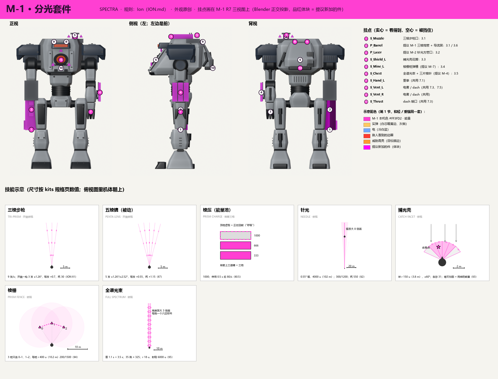
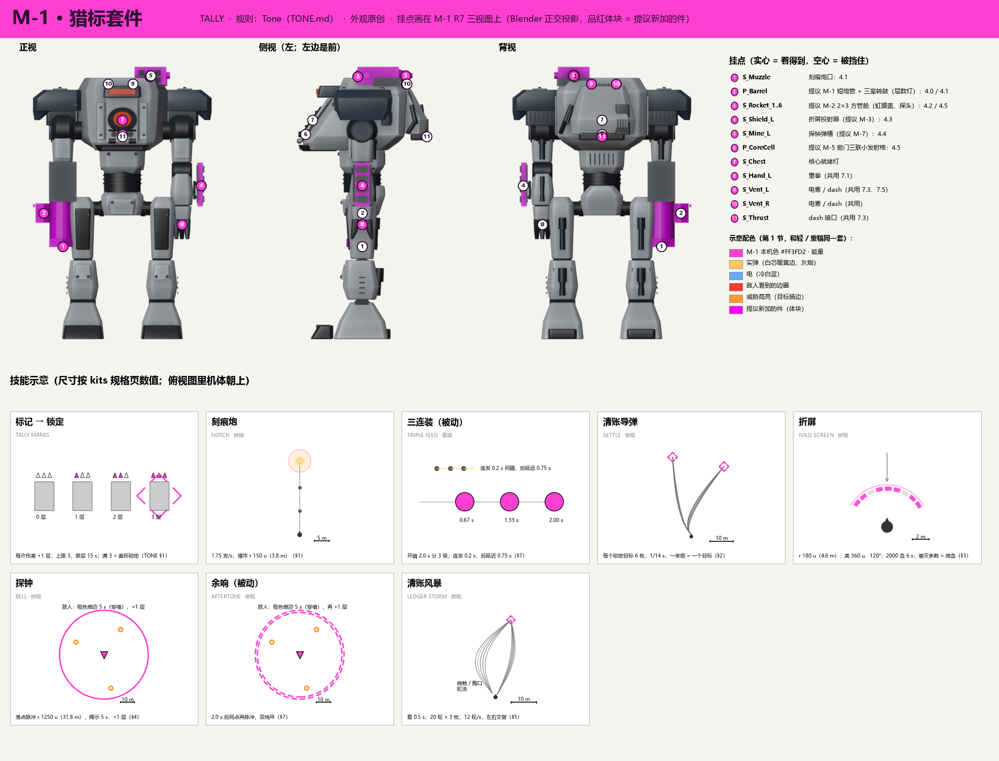
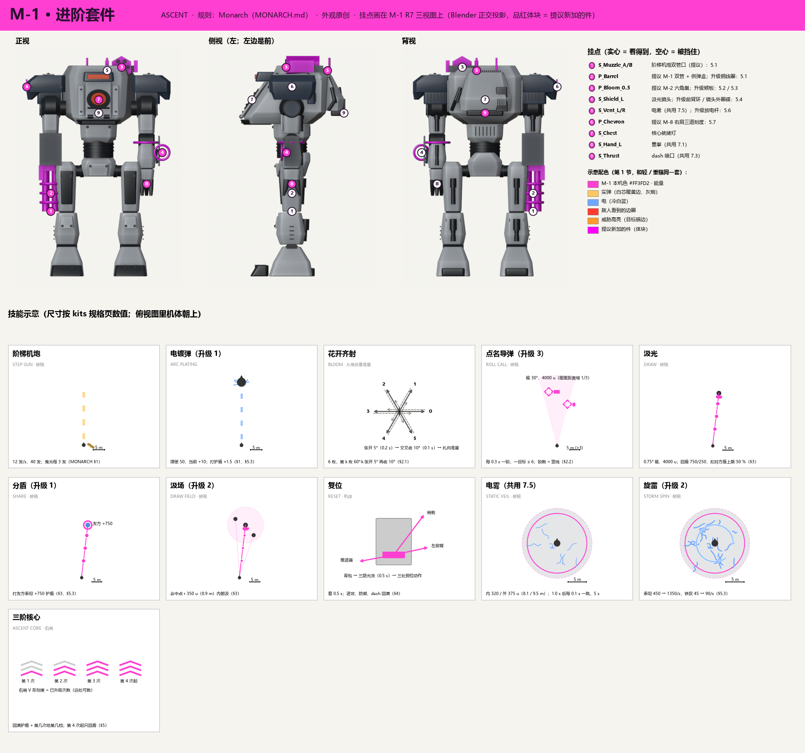
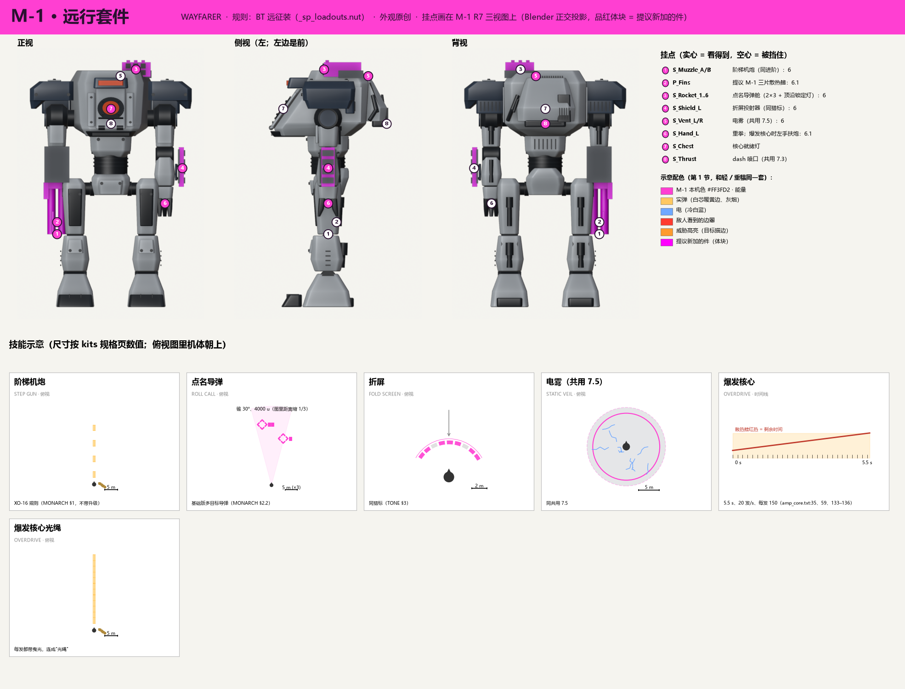

# 中型 M-1 的四套套件：外观和表现设计

2026-11-13，会话 `titan-kits-design-medium`。分支 `titan/kits-design-medium`（从 `titan/model-v3` 开）。
**状态：设计稿，等 lead 审、等用户确认模型改动。M-1 模型一处没改**，图里的挂件都是临时加的体块，没有存回 `Titan_M1.blend`。
**第 2 版（11-13）：** 视觉语言按 lead 对齐，改用轻 / 重稿（[LIGHT-HEAVY.md](LIGHT-HEAVY.md) 第 1 节，PR #119）的同一套；图改成和轻 / 重稿同一种格式。第 1 版的做法和改了什么见第 11 节。

## 先说结论（大白话）

- 中型 M-1 要装四套套件：**分光 SPECTRA**（规则照 Ion）、**猎标 TALLY**（照 Tone）、**进阶 ASCENT**（照 Monarch）、**远行 WAYFARER**（照 BT 远征装）。规则和数值一律照 `../kits/` 的规格页，本文只管"长什么样、从哪里打出来、打出来怎么读"。
- **M-1 身上用 6 个通用座，套件之间换挂件，不换机体。** 右前臂炮管、左肩舱、左前臂外侧投射器、胸口发射器、肩舱后的投掷口，加上所有泰坦共用的背部排气口（电雾、dash）。换套件 = 换 3–5 个挂件，骨架、动画、碰撞体都不动。
- **视觉语言和轻 / 重型同一套**：实弹 = 细直线（白芯暖黄边 + 火星灰烟）；能量 = 硬边几何、菱片、扫描线，用本机色；电 = 冷白蓝折线、每 0.1 s 重画；地面圈画在真实伤害半径，敌人看到警示红；锁定框是菱形，威胁高亮是橙色。
- **M-1 的本机色改成品红 `#FF3FD2`**（SPEC 原来是橙红 `#FF5A1F`）：橙红和敌人看到的警示红、威胁高亮橙、H-1 的琥珀都太近，品红和所有已用的颜色都隔得最远。这要改 M-1 的发光材质，列在要改模型的清单里。
- **四套共用一个本机色，靠形状分**：分光 = 三角光片和刻面（还带一圈彩虹色散边，只有它有）；猎标 = 刻痕和菱形导引；进阶 = 六口成圈、右肩刻度；远行 = 几乎全是实弹，没有能量特效，舱体有一道斜条。
- **让玩家读懂规则的几个设计**：花开齐射的六管排成一圈，火箭从哪个口出去就往哪个方向张开；进阶右肩三道刻度，敌人远远就能数出升了几次；屏障掉血是光条一根根熄灭；能量池是炮管上的三格。
- **要改 M-1 模型的有 9 项**（第 9 节），都是"把炮管、肩舱、护盾垫拆成可换件"、加几个小挂件 / 挂点、改发光色，不动骨架。按模型流程，要先出概念 → 三视图 → 细节图，用户确认后才进 Blender。
- **BT 远征装没有规格页**：五件里四件能借 Monarch / Tone 的页和共用电雾，爆发核心只有武器 `.txt` 的几个数，规格要另补（第 12 节）。

图（`img/`，格式和轻 / 重稿一样：每套一张，三视图上标挂点 + 每个技能一个示意，尺寸按规格页）：

| 图 | 套件 |
|---|---|
| [img/kit-M1-spectra.png](img/kit-M1-spectra.png) | 分光 SPECTRA |
| [img/kit-M1-tally.png](img/kit-M1-tally.png) | 猎标 TALLY |
| [img/kit-M1-ascent.png](img/kit-M1-ascent.png) | 进阶 ASCENT |
| [img/kit-M1-wayfarer.png](img/kit-M1-wayfarer.png) | 远行 WAYFARER |

三视图是 M-1 R7 成品（`model/v3/M1/Titan_M1.blend`）静止姿势的 Blender 正交渲染，用模型自己的材质色；**品红体块 = 提议新加的件**（和轻 / 重稿同一个约定），没有存回模型。挂点圈实心 = 这个视角看得到，空心 = 被挡住。生成脚本：`blender -b <Titan_M1.blend> -P tools/render_kit.py -- <base|spectra|tally|ascent|wayfarer> tools/renders`（渲染图不进仓库），再 `py -3 tools/kit_sheets.py tools/renders img`。

单位：距离按规格页写 TF2 单位 u，括号里是米（1 u = 0.0254 m）。坐标是 Blender 坐标（X 向左、−Y 向前、Z 向上），和 SPEC 3.3 一致。

---

## 1. 视觉语言（照轻 / 重稿第 1 节，这里只写中型的部分）

**一句话：** 和轻 / 重型完全同一套，见 [LIGHT-HEAVY.md 第 1 节](LIGHT-HEAVY.md) 和 `img/visual-language.png`。中型只补两件事：M-1 用什么本机色，四套中型怎么互相区分。

### 1.1 共用规则（摘要，原文为准）

| 类别 | 形状 | 颜色 |
|---|---|---|
| 实弹 | 细直线；曳光每 3 发 1 发；命中出火星 + 灰烟 | 白芯 `#FFF4D6` + 暖黄边 `#FFC860`；烟 `#7A7570` |
| 能量（含护盾、屏障、蓄力） | 硬边几何：菱片、棱片、直边光束、扫描线；没有软烟；光束留 0.2–0.3 s 后碎成菱片 | **本机色** |
| 火 / 铝热 | 软团 + 滴落 + 黑壳发光缝 | 中型不用 |
| 电 | 折线分叉，**每 0.1 s 整体重画**（= 伤害跳的节拍） | 冷白蓝：主弧 `#CFE8FF`、外晕 `#6FA8FF` |

- **范围 = 画面**：地面边圈画在真实伤害半径；不衰减的实线，有衰减的实线画满额、虚线画最远。爆炸第一帧的球 = 伤害外半径。
- **敌我**：自己和队友看到的边圈是本机色；**敌人看到的边圈一律警示红 `#FF3B30`**。效果本体敌我看到的一样。
- **节拍可见**：每 0.1 s 跳伤的东西有同拍的亮度跳动（亮 0.03 s、暗 0.07 s，幅度 15 %）。
- **第一人称不挡准星**：准星周围 8° 以内透明度上限 35 %。
- **锁定框是菱形四角**（本机色），锁满时四角向内收一下；**威胁高亮是橙色实边 `#FF9A2E`**（红 = 区域、橙 = 目标）。
- **蓄力表做在武器本体上**；声音按轻 / 重稿 1.4 节的四类起音 / 主体 / 尾音，大动作前 1 s 预警音。
- 共用的六个动作（重拳、碾步、冲撞、坠击、电雾、熔心弹射）照轻 / 重稿第 7 节，M-1 按同名挂点接（`S_Hand_L`、`S_Foot_L/R`、`S_Thrust`、`S_Vent_L/R`、`S_Chest`、`J_Hatch`），本文不重写。

### 1.2 M-1 的本机色：品红 `#FF3FD2`

| 色 | 色相 | 和最近的已用色差多少 | 结论 |
|---|---|---|---|
| **品红 `#FF3FD2`（选中）** | 约 315° | L-2 电紫 `#A070FF`（约 260°）差 55°；警示红 `#FF3B30`（约 3°）差 48° | 和所有已用色都隔得开；场景里少见，远处显眼 |
| 橙红 `#FF5A1F`（SPEC 原色，没选） | 约 16° | 警示红差 13°；威胁橙 `#FF9A2E`（约 32°）差 16°；H-1 琥珀 `#FFB03A`（约 37°）差 21° | 撞色：M-1 的能量效果会被读成"敌方区域"或"威胁"，也和 H-1 分不开 |
| 柠檬黄 `#E4FF3A`（没选） | 约 68° | 实弹暖黄边 `#FFC860`（约 40°）差 28°；琥珀差 31° | 和实弹曳光、H-1 太近 |

- 已用的本机色：L-1 青 `#3FE0FF`、L-2 电紫 `#A070FF`、H-1 琥珀 `#FFB03A`、H-2 正绿 `#4CFF6A`。
- 改色只改 `MAT_Emissive` 的颜色（发射器核心、传感器横缝、炮身能量槽），不改形状；SPEC 3.4 "传感器和核心发光同色"照旧。列为模型改动 M-9（第 9 节），等用户确认。
- 示意图里体块的"提议件"品红是纯品红 `#FF00FF`（轻 / 重稿的约定），和本机色 `#FF3FD2` 是两回事。

### 1.3 四套中型怎么互相区分（同一个本机色）

| 套件 | 能量 / 实弹的比例 | 形状签名 | 别人一眼看出 |
|---|---|---|---|
| 分光 | 几乎全是能量 | **三角光片、刻面、光束边一圈细彩虹色散**（只有分光有色散，来自"棱镜"） | 三角截面的炮管、光片弹、刻面壳 |
| 猎标 | 实弹为主（榴弹、导弹），能量只在墙和标记上 | **刻痕**（三格小三角）+ 菱形导引点；导弹烟一束一束 | 短粗炮管 + 侧转鼓、方管舱 |
| 进阶 | 实弹 + 少量能量（汲光、护盾）+ 电（电镀弹、旋雷） | **六口成圈的巢、右肩 V 形刻度**、升级件一件件弹出 | 双管机炮、六角巢、肩上亮几道 |
| 远行 | 几乎全是实弹 + 共用电雾；没有自己的能量特效 | **舱体一道斜条**；核心时散热鳍红热、双手扶炮 | 和进阶同一把双管炮，但肩上是 2 × 3 方舱、没有刻度 |

---

## 2. M-1 的挂点：通用座 + 换挂件

**一句话：** 机体上留固定的"座"，每套套件往座上插自己的挂件；同一个座上的挂件外形可以完全不同，但接口位置一样。

| 挂点 | 现有名 / 新名 | 位置（Blender） | 装什么 | 四套分别装 |
|---|---|---|---|---|
| 右前臂炮座 | `W_Cannon`（肘）+ `S_Muzzle`；**新增** `S_Barrel`（炮座下沿，z 3.00） | 肘 (−1.30, 0, 3.65) 往下：炮座 3.00–3.87 固定，3.00 以下是换的炮管 | 主武器 | 三棱步枪 / 刻痕炮 / 阶梯机炮 / 阶梯机炮 + 散热鳍 |
| 左肩舱 | `J_Launcher_L` + `S_Rocket_1..6`；**新增** `S_Pod`（舱座顶面） | 左肩后上，舱座 x 0.25–0.98、y 0.25–0.85、z 5.52–5.70 | 进攻 | 针光 / 清账导弹舱 / 花开六角巢 / 点名导弹舱 |
| 左前臂外侧 | `S_Shield_L`（原护盾垫） | (1.60, 0, 3.25)，挂在左肘上，跟手臂动 | 防御 | 捕光壳花瓣 / 折屏投射器 / 汲光镜头 / 折屏投射器 |
| 胸口发射器 | `S_Chest` | (0, −1.084, 4.78)，舱门中板上 | 核心出口 + 核心就绪灯；共用熔心弹射 | 三片棱叶 / 三联小发射格 / （无挂件）/ （无挂件） |
| 投掷口 | `S_Mine_L` | (0.60, 0.70, 5.92)，肩舱后上 | 抛出的战术物 | 棱栅桩 / 探钟 / — / — |
| 背部排气口（共用） | `S_Vent_L / _R` | (0.23, 0.965, 5.57) / (−0.31, 0.975, 5.57) | 共用电雾（轻 / 重稿 7.5）、dash | 进阶、远行用电雾；进阶的旋雷升级在这里加放电杆 |

**为什么这样分（选中）：** 中型四套的槽位一样（主武器、进攻、防御、战术、核心），"每个槽一个座"最省：动画按座做一次，四套都能用；Unity 按挂点名找发射点（kits-core 的 `IKitFx` 正是这么设计的，见 notes `titan-kits-core-survey.md` 第 3 节）。轻 / 重稿是"每台各写各的发射位置"，因为那边四台是四台不同的机体；中型只有 M-1 一台，所以换挂件。

**没选：**

| 方案 | 为什么没选 |
|---|---|
| 每套一台不同外形的中型机 | 要多做 3 台模型；用户 11-13 定的是"按底盘配"，M-1 是唯一的中型正式模型 |
| 全部挂件挂在背上一个通用背架 | 发射点离眼睛太远，第一人称看不到；背包已经有推进器和百叶 |
| 主武器改成右手握枪 | M-1 右臂是前臂炮、没有手（SPEC 决定 6），加手要改骨架和动画 |
| 电烟另做背包顶罐架（第 1 版） | 轻 / 重稿已经定了所有泰坦共用 `S_Vent_L/R` 弹罐，M-1 就有这两个口，不用加件 |

**高度：** 所有挂件顶面 ≤ 5.96，在 SPEC 的 5.97 上限以内。

---

## 3. 分光 SPECTRA（规则：Ion）

**一句话：** 一池能量（"棱压"）供所有技能用；中距离用三棱步枪压制，针光点杀，捕光壳把对面的子弹攒起来打回去。

### 3.0 棱压（能量池）——在机体上怎么显示

- 规则：上限 1000，停用 0.5 s 后每秒回 80；不够就按不出（[ION.md §0.5](../kits/ION.md)）。
- **外观：** 三棱炮管正面的三道能量槽 = 三格，每格约 333。满 = 三道全亮本机色；用掉的格从上往下熄灭；回能时最上面一格"呼吸"式闪（0.5 s 延迟期间不闪，延迟一过开始闪——看得见"开始回了"）。能量不够时三道槽一起快闪两下（对应规格页"能量条闪还差多少"）。这就是"蓄力表做在武器本体上"。
- **第一人称：** 开镜时三道槽在画面右下；HUD 只放一个小数字。
- **和 TF2 的区别：** 机体上的能量显示做在炮管上、按"格"读。

### 3.1 主武器：三棱步枪 Tri-Prism Rifle（`SPC-P1`）

- **玩法：** 全自动能量步枪，9 发 / s、40 发一匣；腰射免费；开镜 0.35 s 后每枪耗 30 能量，一枪分成 3 发水平扇形（每发 × 0.7）（[ION.md §1](../kits/ION.md)）。
- **从哪里打：** 右前臂炮座。炮管是三角截面（三棱柱），长 1.30 m（z 1.70–3.00），炮口两侧各一片导流翼。`S_Muzzle` 在炮管下端中心。
- **动作：** 腰射时右前臂小幅后坐（沿炮轴 3 cm，每发）。**开镜那 0.35 s：两片导流翼向外张开 15°，到位时"咔"一声**——"可以分裂了"的信号（规格：开镜过渡中不能开火）。关镜翼收回。
- **投射物：** 一枚**扁平的三角光片**（硬边棱片，尖朝前，长 0.6 m、宽 0.25 m），本机色、白芯，后面一段 2 m 的直边残影。分裂时中间一片最亮、两侧淡一级（亮度跟每发伤害走）。弹速 8000 u/s（203 m/s），飞行时间几乎看不到，所以**残影比弹本身重要**：它指出扇形的张角。
- **命中：** 一小簇本机色菱片四溅 + 命中面 0.4 s 的三角形灼痕。打到泰坦弱点（暴击 × 1.5）时菱片变白、多一圈彩虹色散。
- **第一人称：** 炮管在画面右下，每枪三道能量槽轻闪；开镜看得到两片翼张开。**第三人称：** 一串三角光片，开镜时变成三条平行发散的光片流。
- **声音占位（能量类）：** 腰射——短促的高频"嗒"，9 次 / s 连成一串；分裂——每枪叠一层低一点的玻璃"啸"；翼张开金属"咔"；能量不足空响 + 电流"呲"。
- **和 TF2 的区别：** 弹是三角光片、炮管是三棱柱、分裂靠导流翼张开读出来。

### 3.2 进攻：针光 Needle（`SPC-O1`）

- **玩法：** 按下就在准星方向 0.55° 小锥里找第一个目标直接结算：铁驭 300、重甲 1200，最远 4000 u（102 m）；耗 550 能量（[ION.md §2](../kits/ION.md)）。
- **从哪里打：** 左肩舱。原火箭巢换成一根细长方管（截面 0.26 × 0.20 m，长约 1.0 m，前端比舱座再伸出 0.4 m），尾部两片散热鳍。出光口新增挂点 `S_Laser`。
- **动作：** 按下那一刻肩舱座整体后坐 8 cm、0.15 s 回位；散热鳍"啪"地张开 30°，冒一股白汽，1.0 s（规格的充能冷却）后合拢——**鳍张着 = 还不能再打**。
- **效果：** 一条**很细的直边光束**（粗 0.08 m），白芯本机色边，从 `S_Laser` 到命中点；按共用规则留 0.25 s 后**从后往前碎成菱片**消失。没打中东西时在地形上留一个小白点。命中：目标身上一个亮白针孔 + 一圈本机色菱片向外弹（0.3 s）。
- **第一人称：** 左上方肩舱方向射出一条线穿过准星，舱框左上角被照亮一下；**第三人称：** 比任何光束都细的一根直线，读作"点射"。
- **声音占位：** 蓄能短"嘀" → 发射"嗖——叮"（高、尖、带回响）→ 散热鳍"嘶"。
- **和 TF2 的区别：** 从左肩一根方管打出；光束碎成菱片的收法和散热鳍是我们的读数。

### 3.3 防御：捕光壳 Catch Facet（`SPC-D1`）

- **玩法：** 按住时前方张开接弹区，飞来的子弹和投射物被接住存起来（各最多 31）；松手时子弹合成一次霰弹打回准星方向，投射物同一帧各自散开重发。能量 ≥ 100 才能举，按住持续耗能（实测约 124 / s，约 8.5 s 耗尽自动放下），没有时间上限，打不碎（[ION.md §3](../kits/ION.md)；实测数见 notes `titan-kits-core-survey.md` 第 5 节）。
- **从哪里打：** 左前臂外侧三片刻面花瓣（每片 0.83 × 0.22 m），平时贴着前臂。
- **动作：** 按下：**左前臂抬到胸前横着挡**（肩前摆约 80°、肘弯 70°，在 M-1 "肩前摆 ≤ 95° 不穿模"的限位以内），0.1–0.2 s 到位；三片花瓣向外翻开。松手：左臂往前一推（0.15 s），打回的东西从推出的方向出去，然后手臂放下。
- **效果——壳：** 左臂前方一片**刻面球壳**（规则是半径 150 u = 3.8 m 的球、接弹锥 ±60°）：可见部分是正对视线的一片弧，由 6 块三角刻面拼成，本机色半透明 + 等宽扫描线，刻面边是硬直线。**剩余能量用"亮着的刻面数"表示**：满能量 6 面全亮，用掉越多熄灭越多、剩下的闪得越快。
- **效果——接住：** 子弹打到壳上那一点闪一下（0.25 s），变成一颗小亮点**沿刻面边滑到收集点**（眼前 110、左 28、下 22 u），收集点的亮点越攒越多；投射物（导弹、榴弹）被接住时**原样定在壳面上不动**，尾焰熄灭，读得出"接住了一枚导弹"。
- **效果——打回：** 子弹：从收集点喷出一束本机色的锥形菱片散射（霰弹，锥半角约 3.5°），第一个目标身上一大团火星。投射物：定在壳面上的同时弹出去，各自恢复原来的尾焰。壳碎成 6 片刻面向前飞散 0.3 s。
- **第一人称：** 画面左半被刻面壳占住（准星 8° 内透明度 ≤ 35 %）；收集点的亮点团在画面中下偏左，随接弹数变大。**第三人称：** 机体左前方一片发光刻面弧，上面钉着来弹。
- **声音占位：** 展开——玻璃张开"铮"+ 持续低频嗡（随能量降低音调下降）；接弹——每颗清脆"叮"，导弹被接住闷"咚"；打回——加重的"轰"+ 碎玻璃。
- **和 TF2 的区别：** 刻面球壳 + 横臂格挡；接住的弹嵌在壳里；能量用刻面数表示，不用颜色渐变。

### 3.4 战术：棱栅 Prism Fence（`SPC-T1`）

- **玩法：** 一次向左前、正前、右前抛出 3 根桩；落地 1 s 后桩头升起 45 u，相邻桩之间拉激光（只有 0–1、1–2 两道）；敌人碰到线，这一组全部爆炸，每根 200 / 1500、半径 400 u（10.2 m）、电击伤害；桩 300 血可打爆；寿命 13 s；耗 350 能量（[ION.md §4](../kits/ION.md)）。
- **从哪里打：** 三根三棱桩（长 0.22 m）横卧在肩舱后上的弹槽里，从 `S_Mine_L` 前方抛出（规格写 `TITAN_GRENADE` 前方 50 u，我们映射到 `S_Mine_L`）。
- **动作：** 肩舱座向上一仰 15°（0.15 s）把三根桩"弹"出去，然后回位。不用手。
- **效果——飞行和落地：** 三根桩边飞边自转，各拖一条短的直边残影；落地插进地面。**建造 1 s：** 桩头旋转着升起 1.1 m，顶部一颗本机色三角晶体亮起。
- **效果——激光：** 线是一串**往前爬的短划**（编号小的爬向大的），本机色、粗 0.1 m；爬的方向告诉玩家线是活的、怎么连的。**桩 0 和桩 2 之间故意不连**，缺口看得见。地形挡住或落地时间差 > 1 s 时这一段不连，晶体半亮闪烁。
- **效果——范围和爆炸：** 每根桩脚下一圈 **10.2 m 的地面边圈**（伤害半径，不衰减 → 实线；自己看本机色，敌人看警示红）。爆炸是电击伤害：一个 10.2 m 的**冷白蓝折线电弧球**（第一帧 = 伤害半径），被碰到的那根先爆，另外两根同一帧爆（规则：销毁全组）。剩 3 s 寿命时晶体开始闪。
- **第一人称 / 第三人称：** 抛桩时左上角肩舱一仰、三点飞出；之后看到地上的线和红 / 本机色的圈。
- **声音占位：** 抛出三声"嗖"；插地"叮"；升起上行电子音阶 1 s；激光细高频"嗞"；爆炸是电类的"噼"+"啪"断开。
- **和 TF2 的区别：** 三棱桩 + 晶体桩头 + 爬动短划线 + 冷白蓝电爆 + 真实半径边圈。

### 3.5 核心：全谱光束 Full Spectrum（`SPC-C1`）

- **玩法：** 蓄力 1.1 s 后从胸口射出 3.5 s 的粗光束，每 0.1 s 对光束上的每个目标打 325（共 35 跳），射程 6000 u；整个过程移动 × 0.75，放电期间转向也 × 0.75，不能 dash、不能用其他技能（[ION.md §5](../kits/ION.md)）。
- **从哪里打：** 胸口发射器 `S_Chest`。发射器外三片三角**棱叶**（新挂件，平时贴着舱门中板）。
- **动作：** 蓄力 1.1 s：**左脚往前踏半步、膝盖弯下去**做支撑，双臂向两侧略张开让出胸口；三片棱叶翻起 40°，发射器芯越来越亮。放电 3.5 s：机体每跳一次 2 cm 的震动（10 Hz）。结束：棱叶合上，冒热气 2 s（和减速淡出的 2 s 同步）。
- **效果：** 直边粗光束半径 18 u（0.46 m），**白芯 + 本机色外层 + 边上一圈细彩虹色散**（分光独有）。**每一跳从胸口推出一个六边形光环沿光束往前走**，一秒 10 个，光束亮度同拍跳动（共用"节拍可见"）。命中点：白热亮斑 + 菱片四溅，目标表面一道熔痕跟着光束扫。结束时光束碎成菱片。
- **第一人称：** 画面中央一条白柱从下方舱框里射出去（准星 8° 内只用白芯，外层透明）；舱框边缘发白；10 Hz 细震。**第三人称：** 一条带彩虹边、一节一节往前推的品红光柱，从胸口正中出来。
- **声音占位：** 1 s 预警音（大动作规则）+ 蓄力上升的合唱式和声，到顶"咔"；放电低频轰鸣叠 10 Hz 脉冲；结束下降的"呼——"。
- **和 TF2 的区别：** 彩虹色散边 + 六边形节环、从舱门上的发射器打出、踏步支撑。

### 3.6 选中的被动：五棱镜 Penta Lens（规则 Refraction Lens）

- **玩法：** 分成 5 发、每发 × 0.55、能耗 × 1.15，张角 ±1.26°、±2.52°（[ION.md §7](../kits/ION.md)）。
- **外观：** 炮口多一对导流翼，开镜时张到 25°；五片光片，外侧两片最淡。

---

## 4. 猎标 TALLY（规则：Tone）

**一句话：** 先用刻痕炮给目标"记账"（叠标记），记满三笔就能"清账"——一串导弹追着打；墙、声呐、核心都围着这本账转。

### 4.0 标记（每个目标头上的账）

- 规则：每次伤害 +1 层，上限 3，单层 15 s；满 3 层算锁定（[TONE.md 先说结论、§1](../kits/TONE.md)）。
- **外观：** 被标记的敌人头顶出现**三格刻痕**（三个朝上的小三角，本机色），一层亮一格；满三格时出现**菱形锁定框**（共用规则），四角向内收一下。每层自己倒计时，最后 3 s 那一格闪。只有猎标自己和队友看得到；被标记的敌人看到 HUD 边缘的提示。
- **刻痕炮炮身上的三颗刻度灯**同步显示准星下目标的层数（蓄力 / 状态表做在武器本体上）。

### 4.1 主武器：刻痕炮 Notch Cannon（`TLY-P1`）

- **玩法：** 半自动榴弹炮，1.75 发 / s；弹体打中后有冲击伤害和 150 u（3.8 m）半径的小爆炸；每次对敌人造成伤害都加一层标记（[TONE.md §1](../kits/TONE.md)）。
- **从哪里打：** 右前臂炮座。短粗炮管（半径 0.29 m，z 2.10–3.00）+ 六角制退器；炮管外侧一个**三室转鼓**，上面三颗刻度灯。
- **动作：** 每发明显的前臂后坐（沿炮轴 12 cm，0.25 s 回位），转鼓转 1/3 圈。
- **投射物（实弹）：** 一枚深灰短粗榴弹（看得见、比能量弹慢），尾部一条**细直的暖黄边曳光** + 短灰烟。命中：白闪 + 火星 + 灰尘环，爆炸第一帧 = 3.8 m；目标头顶刻痕 +1 格同时亮一下。
- **第一人称：** 每发画面一顿，转鼓在右下转。**第三人称：** 慢、重、一发一发的灰烟弹。
- **声音占位（实弹类）：** 硬瞬态"嘭"（中低频、金属尾音）；转鼓"咔哒"；命中加层——短"叮"（给攻击者的确认音）。
- **和 TF2 的区别：** 炮管 + 侧挂三室转鼓 + 刻度灯，读数在炮身上。

### 4.2 选中的被动：三连装 Triple Feed（规则 Burst Loader）

- **玩法：** 开镜时蓄力，2.0 s 分 3 级，开火时按级数连发，连发间隔 0.2 s，连发后延迟 0.75 s（[TONE.md §7](../kits/TONE.md)）。
- **外观：** 开镜后转鼓每到一级"咔"地转一格、对应一个室亮本机色，2.0 s 三室全亮；开火时三发间隔 0.2 s，转鼓连转三格。三声上行"嘀嘀嘀"表示蓄满。

### 4.3 进攻：清账导弹 Settle Missiles（`TLY-O1`）

- **玩法：** 只能对满 3 层的目标发射；按一下对每个锁定目标各射 6 枚追踪导弹（间隔 1/14 s），射完把这些目标的标记清零；初速 1800 u/s，转向随距离和时间变化，有随机漂移；冲击 350、爆炸 100 / 250、半径 60–120 u（[TONE.md §2](../kits/TONE.md)）。
- **从哪里打：** 左肩舱。2 × 3 方管舱（顶面 5.94），方管口带**虹膜盖**；舱外侧一个小锁定探头。6 个管口就是现有的 `S_Rocket_1..6`。
- **动作：** 有锁定目标时探头亮、虹膜盖预先张开一半；按下：肩舱座向前上方抬 10°（0.1 s），6 个管口**按 1→6 顺序**依次吐弹；锁了两个目标就 1→6 再 1→6。打完虹膜合上。
- **弹道读法：** 导弹出管后**先往左上方抛出、短暂直飞**（直飞段 0–0.1 s），然后弯向目标；随机漂移让 6 条细灰烟散成一束"梳子"。**一束 = 一个目标**，打了几个目标数得出来。
- **投射物（实弹）：** 深灰短弹体、白热小尾焰、细灰烟（2 s 消散）。命中：白闪 + 火星，第一帧 = 120 u（3.0 m），实线 60 u、虚线 120 u（有衰减）。目标的菱形锁定框在第一枚命中时碎掉（标记清零）。
- **声音占位：** 锁定"嘀—嘀"（满 3 层时连续"嘀——"）；发射 6 声快速"咻"；命中闷爆。

### 4.4 防御：折屏 Fold Screen（`TLY-D1`）

- **玩法：** 按一下，在自己站的位置、面朝的水平方向立起一段半径 180 u、高 360 u、张角 120° 的弧形墙（4.6 m、9.1 m），2000 血、6 s；正面来弹被挡，从里往外打不受影响；墙不跟人、不随时间掉血（[TONE.md §3](../kits/TONE.md)）。
- **从哪里打：** 左前臂外侧一根竖导轨 + 四片折叠百叶。
- **动作：** 左前臂向下前方一挥（0.2 s），四片百叶弹出去落到前方地面，墙**一节一节向上展开**（0.3 s 展开完；规则上墙立刻出现，判定从第 0 帧就有，展开只是外观）。
- **效果：** 一排**竖直的本机色光条**（9 条，硬边），条与条之间有缝能看穿，条上是等宽扫描线；底部贴地一条亮线。**掉血 = 光条一根根熄灭**（2000 / 9 ≈ 每 222 血一条），被打的点泛起一圈直边涟漪。最后 3 s 光条同步闪。敌人看到墙的边缘线是警示红，本体一样。
- **第一人称：** 前方一排光条，枪口从缝里打出去；**第三人称：** 机体前一道弧形百叶墙，挡下的弹留 0.3 s 光点。
- **声音占位：** 弹出金属"刷"；展开三段上行"咔咔咔"；被打闷"嘭"+ 嗡；快结束"嘀、嘀、嘀"；消失下行"呜"。
- **和 TF2 的区别：** 有缝的竖百叶、血量看熄灭条数。

### 4.5 战术：探钟 Bell（`TLY-T1`）

- **玩法：** 发射一枚会下坠的声呐弹，碰到任何东西就在那一点脉冲：半径 1250 u（31.8 m）内的敌人被高亮 5 s，每人 +1 层标记（[TONE.md §4](../kits/TONE.md)）。
- **从哪里打：** 一个钟形声呐弹横卧在肩舱后面（长 0.30 m），从 `S_Mine_L` 抛出。
- **动作：** 肩舱座上仰 20°，"嗵"地抛出，抛物线明显下坠。
- **效果：** 钟落地后**倒扣插在地上**；脉冲是一道**贴地的本机色实线环**向外扫到 31.8 m（0.4 s 扫完，最终停在真实半径上）；扫到的敌人立刻描**威胁橙 `#FF9A2E` 实边**（穿墙可见 5 s），同时 +1 格刻痕。被扫的敌人看到的那道环是警示红。
- **声音占位：** 抛出"嗵"；落地钟声"当"（中频、长回响）；脉冲深沉"嗡——"。

### 4.6 选中的被动：余响 Aftertone（规则 Pulse Echo）

- **玩法：** 2.0 s 后同一点再脉冲一次（重新揭示 5 s、再给一层）（[TONE.md §7](../kits/TONE.md)）。
- **外观：** 2.0 s 后**钟的下摆裂成几瓣**，扫出一道**双线环**（两条虚线并排）——一看就知道是第二次。声音：同一个钟声，更短、带金属裂响。

### 4.7 核心：清账风暴 Ledger Storm（`TLY-C1`）

- **玩法：** 蓄力 0.5 s（自己减速到 30 %），然后 20 轮、每轮 3 枚（共 60 枚），12 轮 / s；每轮左右交替；导弹追着准星指的点飞，准星扫到泰坦时导引点粘住；导弹打不下来，寿命 10 s（[TONE.md §5](../kits/TONE.md)）。
- **从哪里打：** 肩舱 + **舱门中板发射器下方的三联小发射格**（新挂件 `S_CoreCell_1..3`）。规则里每轮左右交替（右向量 ± 0.25），"左"放在肩舱、"右"放在胸口三联格，交替就是看得见的左一下右一下。
- **动作：** 蓄力 0.5 s：双脚分开站稳、上身微前倾，肩舱和胸口格的盖子同时打开。发射 1.6 s：两处交替吐弹，每轮小震动。结束：盖子合上冒烟。
- **效果：** 导引点是一个本机色**菱形**（共用锁定框形状）；扫到泰坦时菱形四角收紧"咬住"。60 枚导弹的细灰烟在空中连成一条**弯曲的绳**，绳的末端跟着菱形走——拖动准星就看到绳子甩。
- **声音占位：** 1 s 预警 + 短促上行"呜"；发射密集"咻咻"交替左右声道；命中连成一片的闷爆。
- **和 TF2 的区别：** 两处交替发射、菱形导引点、烟绳。

---

## 5. 进阶 ASCENT（规则：Monarch）

**一句话：** 越打越强。每用一次核心，机体上永久多出一样看得见的东西；右肩三道刻度告诉所有人你升了几次。

### 5.1 主武器：阶梯机炮 Step Gun（`ASC-P1`）

- **玩法：** 全自动弹丸机枪，12 发 / s，40 发一匣（[MONARCH.md §1](../kits/MONARCH.md)）。
- **从哪里打：** 右前臂炮座。**双管**（每根半径 0.10 m 并排）+ 护罩 + 外侧供弹盒。双管交替开火，新挂点 `S_Muzzle_A / _B`。
- **动作：** 双管交替小后坐（各 3 cm），供弹盒弹链往里走；前臂 12 Hz 细抖。
- **投射物（实弹）：** 细直线曳光，每 3 发一条（白芯暖黄边）；枪口焰左右交替的短星形。命中：火星 + 灰烟。
- **声音占位：** 中频"哒哒哒"12 / s，左右管音色略不同；换弹弹链"哗啦"+ 盒盖"咔"。
- **和 TF2 的区别：** 双管交替 + 侧供弹盒。

### 5.2 升级第 1 档：电镀弹 Arc Plating（规则 Arc Rounds core1）

- **玩法：** 弹匣 40 → 50，给的那一刻当前弹匣 +10；伤害带电，打护盾和涡旋类屏障 × 1.5（[MONARCH.md §1、§5.3](../kits/MONARCH.md)）。
- **外观：** 升级那一刻**三圈铜线圈"啪"地套上炮管**（新挂件，平时藏在炮座里）。从此曳光变成冷白蓝；命中带一小簇折线电弧（每 0.1 s 重画，持续 0.2 s）；打到护盾 / 屏障时电弧明显变大（× 1.5 的读数）。每发叠一个"滋"的电声。

### 5.3 进攻：花开齐射 Bloom Salvo（`ASC-O1`）

- **玩法：** 按一下连发 6 枚无制导火箭，每枚先向外张开 5°，再往对侧收 10°，最后对准准星前方 5000 u 的点直飞；第 k 枚的张开方向是绕准星 60°·k；能量 120 满了才能发（[MONARCH.md §2.1](../kits/MONARCH.md)）。
- **从哪里打：** 左肩舱换成**六角巢**：正对前方的六角柱，6 个管口排成一圈（半径 0.18 m），每个口正好在 60°·k 的方向上。新挂点 `S_Bloom_0..5`。
- **动作：** 6 个口**按圈顺时针依次**发射（12 / s），巢每发转 1/6 圈"咔"（只是外观）。
- **弹道读法：** 每枚火箭从它的口出发、**往那个口的方向张开**（0.2 s），交叉收拢到对侧（0.1 s），再一起扎向准星——**发射舱的样子就是弹道的样子**。
- **投射物（实弹）：** 中等火箭，白热尾焰 + 灰烟；6 条烟在准星前画一个花瓣再合成一束。命中：白闪 + 火星 + 灰烟，第一帧 = 伤害外半径。
- **声音占位：** 每发"嗖"，6 声连成一串，转巢"咔"夹在中间；命中闷爆。
- **和 TF2 的区别：** 六口成圈，弹道和发射口一一对应。

### 5.4 升级第 3 档：点名导弹 Roll Call（规则 Multi-Target Missiles core7）

- **玩法：** 第 3 次用核心时进攻换成它：按住扫描，30° 锥、4000 u 内锁重甲目标，每 0.3 s 一把锁，同一目标最多 6 把，最多 8 个目标；松开按锁数发追踪导弹（12 / s）；没锁就走齐射式无制导弹道（[MONARCH.md §2.2](../kits/MONARCH.md)）。
- **外观：** 升级时**六角巢两侧颊板"砰"地弹起**（新挂件），露出两排锁定灯（一侧 3 颗）。按住扫描时巢慢慢转；每锁一把亮一颗灯并"嘀"一声（音高随锁数上升）。准星上的目标是菱形锁定框，框外每一把锁多一道本机色短竖线（最多 6 道）。**敌人从第三人称看得到你锁了几把。** 没锁松手时就是 5.3 的花开弹道。

### 5.5 防御：汲光 Draw（`ASC-D1`）

- **玩法：** 打出一束细光束（0.75° 锥、4000 u），只打中准星前第一个目标；打中敌人：给自己回护盾（重甲 750、其他 250）、扣对方护盾上限的 50 %、减速（[MONARCH.md §3](../kits/MONARCH.md)）。
- **从哪里打：** 左前臂外侧一个**镜头**（半径 0.11 m，朝前）。
- **动作：** 左臂前伸指向准星（0.15 s），镜头亮 → 出光束 → 手臂收回。
- **效果（能量，本机色）：** 一条**细直边光束**。命中后**一颗亮菱片沿光束倒着跑回自己的镜头**（0.3 s），菱片大小表示回了多少（750 大、250 小）；自己身上一层本机色扫描线护套从左臂扩散到全身（0.4 s）。被打的敌人身上剥落一层往下掉的菱片碎屑（= 盾上限被扣），腿部一圈"减速"的扫描线环。
- **第一人称：** 左下伸出的手臂和光束；菱片跑回画面左下时，舱框边一圈本机色闪一下（回盾确认）。**第三人称：** 一条光束 + 往回跑的菱片。
- **声音占位：** 出光"嘶"的吸气；命中"咕咚"吸收；菱片回来上行"叮"（大的音低、小的音高）。
- **和 TF2 的区别：** 用"菱片倒流"表示虹吸方向和回多少。

### 5.6 升级第 1 档：分盾 Share（规则 Energy Transfer core3）

- **玩法：** 打友方泰坦给它 +750 护盾（[MONARCH.md §3、§5.3](../kits/MONARCH.md)）。
- **外观：** 升级时左前臂套上一圈本机色环（新挂件）。打友方时光束不变，菱片**往友方那边跑**，友方身上出现本机色扫描线护套。

### 5.7 升级第 2 档：汲场 Draw Field（规则 Energy Field core6）

- **玩法：** 命中点 350 u（8.9 m）内所有目标各算一次（[MONARCH.md §3](../kits/MONARCH.md)）。
- **外观：** 升级时镜头外圈多一个碟形环（新挂件）。命中点炸开一个 8.9 m 的本机色**刻面半球**（第一帧 = 伤害半径），地面一圈实线边圈（敌人看警示红）；球里每个目标各有一颗菱片跑回来——打一群就是一群菱片往回跑。声音多一声扩散的"嗡"。

### 5.8 战术：复位 Reset（`ASC-T1`）

- **玩法：** 0.5 s 蓄力后把进攻、防御的能量和 dash 能量一次回满（[MONARCH.md §4](../kits/MONARCH.md)）。
- **动作 + 效果：** 不发射东西。0.5 s 蓄力：背包百叶亮起本机色，一道光沿躯干接缝**分三路流向**肩舱、左前臂、背后推进器（三样被回满的东西）；到达时肩舱管口盖开合一次、左前臂镜头闪一下、推进器"噗"一口气。第一人称：舱框边一圈光从后往前扫，HUD 三个图标同时填满。
- **声音占位：** 上行电容充电"呜——"；到位三声"咔、咔、噗"。
- **和 TF2 的区别：** 用三路光流到三个挂件把"回满了什么"演出来。

### 5.9 电雾（共用）+ 升级第 2 档：旋雷 Storm Spin（规则 Maelstrom core5）

- **电雾本身：** 照轻 / 重稿 7.5 "电雾 STATIC VEIL"：从 `S_Vent_L/R` 各弹一罐，机体上方 4 m 炸开；内 320 u / 外 375 u（8.1 / 9.5 m），1.0 s 未通电期，之后每 0.1 s 一跳，5 s（[MONARCH.md §5.3 Maelstrom 细节](../kits/MONARCH.md)）。
- **旋雷玩法：** 对铁驭 45 → 90 / s、对泰坦 450 → 1350 / s（[MONARCH.md §5.3](../kits/MONARCH.md)）。
- **旋雷外观：** 升级时两个排气口上竖起**放电杆**（新挂件）。雾里的冷白蓝电弧加粗、数量 × 2，多一条贴地慢慢转的电弧环（仍按 0.1 s 整体重画）；内外边圈不变（半径没变）。声音：电"嗡"底下多一层旋转的低频"呜呜"。

### 5.10 核心：三阶核心 Ascent Core（`ASC-C1`）

- **玩法：** 核心充满后按下：护盾立刻回满，泰坦按"这是第几次"永久获得一项升级；第 4 次起只回护盾。每档三选一，出战前选好（[MONARCH.md §5](../kits/MONARCH.md)）。我们选中的五项：第 1 档电镀弹 / 分盾，第 2 档旋雷 / 汲场，第 3 档点名导弹。
- **动作 + 效果：** 按下：机体挺身（0.3 s），胸口发射器亮到最亮；全身一层本机色扫描线护盾回满闪光（0.4 s）；**新挂件"咔"地弹出**（0.3 s 机械动作）；**右肩外侧多亮一道本机色 V 形刻度**（新挂件，共三道）。
  - 第 1 次：电镀弹（炮管铜线圈）或分盾（前臂环）
  - 第 2 次：旋雷（排气口放电杆）或汲场（镜头外圈碟）
  - 第 3 次：点名导弹（六角巢颊板）
  - 第 4 次起：只有回盾闪光，刻度不再增加
- **第一人称：** 舱框一圈光 + HUD 显示新升级名；看得到的挂件（线圈、前臂环）在画面里出现。**第三人称 / 敌人：** 数右肩刻度就知道对面升了几次。
- **声音占位：** 1 s 预警 + 厚重"咚"+ 上行和弦；挂件弹出机械"咔嗒"；第几次升级和弦就多一个音。
- **和 TF2 的区别：** 升级用"挂件实体弹出 + 肩上刻度"表示，远处可读。

---

## 6. 远行 WAYFARER（规则：BT 远征装）

**一句话：** 老伙计的配置：一把可靠的机枪、点名导弹、折屏、电雾，核心是让机枪疯狂一阵。挂件全部和别的套件共用，只多散热鳍和一道识别斜条。

**规则从哪来：** BT 远征装的组成在战役脚本里：主武器 `mp_titanweapon_xo16_shorty`（只有 11 行，继承 XO-16）、进攻 `mp_titanweapon_shoulder_rockets`（多目标导弹）、防御 `mp_titanability_particle_wall`、战术 `mp_titanability_smoke`、核心 `mp_titancore_amp_core`（爆发核心）（TF2-Research `local/vpk/client_sp_training/scripts/vscripts/sp/_sp_loadouts.nut`:302、1260–1272；`client_frontend/scripts/vscripts/sh_consts.gnut`:2600）。**没有 kits 规格页**，见第 12 节。

| 件 | 我们的名字 | 规则出处 | 外观 |
|---|---|---|---|
| 主武器 | 阶梯机炮 Step Gun（`WAY-P1`） | XO-16，[MONARCH.md §1](../kits/MONARCH.md)（不带升级） | 和进阶 5.1 同一个炮管，**多三片散热鳍**（爆发核心用），不带铜线圈 |
| 进攻 | 点名导弹 Roll Call（`WAY-O1`） | [MONARCH.md §2.2](../kits/MONARCH.md)（基础版） | 用**猎标的 2 × 3 方管舱体**，顶沿多 6 颗锁定灯；锁定读法同 5.4 |
| 防御 | 折屏 Fold Screen（`WAY-D1`） | [TONE.md §3](../kits/TONE.md) | 和猎标 4.4 完全相同 |
| 战术 | 电雾（共用） | 轻 / 重稿 7.5；[MONARCH.md §5.3 Maelstrom 细节](../kits/MONARCH.md)（不带旋雷） | 从 `S_Vent_L/R` 弹罐，没有放电杆 |
| 核心 | 爆发核心 Overdrive（`WAY-C1`） | `WT/mp_titancore_amp_core.txt`：持续 5.5 s（:35）、20 发 / s（:59）、每发 150（:133–136）、弹匣 200（:57） | 见下 |

### 6.1 核心：爆发核心 Overdrive（`WAY-C1`）

- **玩法：** 主武器换成 5.5 s 的高速版：20 发 / s、每发 150（铁驭和重甲相同）。
- **动作：** 按下：右臂抬平到瞄准姿势锁住，**左手扶住右前臂**（三指爪抓住炮座，0.2 s）——M-1 唯一的"双手持枪"动作，读作"全力开火"。
- **效果（实弹）：** **每发都带曳光**（平时每 3 发一条），枪口前连成一条连续的细直"光绳"（白芯暖黄边）；三片散热鳍从暗灰到亮红（5.5 s 内渐变，读作"还剩多久"——蓄力 / 状态表在武器本体上）；弹壳从炮座下成串抛出；背包热浪扭曲。结束时散热鳍喷一口白汽。
- **第一人称：** 一条光绳 + 下方散热鳍越来越红 + 左手出现在画面左下。**第三人称：** 双手持炮的姿势 + 光绳 + 红热鳍。
- **声音占位：** 1 s 预警 + "咔嚓"上膛低吼；开火更快更密的"哒哒"（20 / s 连成撕裂声）；鳍过热逐渐升高的"嘶"；结束白汽"噗——"。
- **和 TF2 的区别：** 双手扶炮、红热散热鳍做倒计时、光绳。

### 6.2 远行的识别

- 远行的舱体和炮护罩上有一道**石墨蓝斜条**（用 M-1 的 `MAT_Secondary`，不加材质槽）。别的套件没有。

---

## 7. 所有中型套件共通的表现规则

| 规则 | 内容 |
|---|---|
| 判定从眼睛、画面从挂点 | 和现在主炮一样（kits-core 摸底第 1 节）：伤害判定按规格页从眼睛 / 攻击位置算，特效从挂点出发；不一致时以判定为准 |
| 规则时间不被动画拖慢 | 所有到位动作都短于或等于规格里的时间；规格写"立刻"的（折屏立起、针光出伤）判定立刻生效，动画在后面补 |
| 开火动作是叠加动画 | 用现有的 `TitanWeaponOverlay` 叠在走路上，不打断 B-沉 走路 |
| 需要的新动作 | ① 左臂横挡（捕光壳）；② 左臂前挥（折屏）；③ 左臂前指（汲光）；④ 踏步支撑（全谱光束）；⑤ 双手扶炮（爆发核心）；⑥ 挺身（三阶核心）；⑦ 肩舱上仰 15–20°（抛桩、抛钟，`J_Launcher_L` 本来就是关节）。①–③ 要在 M-1 限位内（肩前摆 ≤ 95°） |
| 共用动作 | 重拳、碾步、冲撞、坠击、电雾、熔心弹射照轻 / 重稿第 7 节，颜色用 M-1 本机色 |
| 发光预算 | 挂件上的发光（能量槽、锁定灯、刻度）算进 M-1 的 ≤ 3 % 发光；超了砍挂件上的，不砍机体的三处 |

---

## 8. 给 kits-core 的接口表（挂点名 / 特效键 / 动作事件）

kits-core 的 `IKitFx` 按"发射点（挂点名）、拖尾、爆炸、开火动作事件"接外观。名字是提议，kits-core 可以改名。所有范围键都带"半径"参数，按共用规则画真实半径、敌我两种边圈。

| 件 | 发射点 | 拖尾键 | 命中 / 区域键 | 动作事件 |
|---|---|---|---|---|
| SPC-P1 三棱步枪 | `S_Muzzle` | `fx_prism_shard` / `fx_prism_shard_split` | `fx_hit_prism` / `fx_hit_prism_crit` | `ads_vanes_open` / `ads_vanes_close`、`recoil_light` |
| 棱压 | — | — | — | `energy_slots(0–3)`、`energy_regen_start`、`energy_denied` |
| SPC-O1 针光 | `S_Laser`（新） | `fx_needle_beam` | `fx_hit_needle` | `pod_kick`、`fins_open(1.0 s)` |
| SPC-D1 捕光壳 | `S_Shield_L`；收集点按规格的视角坐标 | — | `fx_facet_shell(facets_lit)`、`fx_catch_bullet`、`fx_catch_proj`、`fx_refire_cone` | `arm_block_raise` / `arm_push_release` |
| SPC-T1 棱栅 | `S_Mine_L` | `fx_stake_trail` | `fx_stake_build`、`fx_fence_beam(0–1,1–2)`、`fx_ring(400)`、`fx_arc_burst(400)` | `pod_pitch_15` |
| SPC-C1 全谱光束 | `S_Chest` | `fx_spectrum_beam`、`fx_hex_ring`（每跳一个） | `fx_hit_spectrum` | `brace_step`、`leaves_open` / `leaves_close` |
| TLY 标记 | 目标头顶 | — | `ui_notch(0–3)`、`ui_lock_diamond` | `drum_pips(0–3)` |
| TLY-P1 刻痕炮 | `S_Muzzle` | `fx_tracer_shell` | `fx_hit_shell(150)` | `recoil_heavy`、`drum_turn`、`burst_charge(level)` |
| TLY-O1 清账导弹 | `S_Rocket_1..6`（按 1→6） | `fx_missile_comb` | `fx_hit_missile(60,120)`、`ui_lock_break` | `pod_raise_10`、`iris_open` / `iris_close` |
| TLY-D1 / WAY-D1 折屏 | 墙位置按规格 | — | `fx_slat_wall(slats_lit)`、`fx_wall_ripple`、`fx_wall_ending` | `arm_swipe_down` |
| TLY-T1 探钟 | `S_Mine_L` | `fx_bell_trail` | `fx_ping_ring(1250)`、`fx_echo_double_ring(1250)`、`ui_threat_outline` | `pod_pitch_20` |
| TLY-C1 清账风暴 | 交替：`S_Rocket_*` / `S_CoreCell_1..3`（新） | `fx_missile_rope` | `ui_aim_diamond(stuck)` | `stance_wide`、`cells_open` |
| ASC-P1 / WAY-P1 阶梯机炮 | `S_Muzzle_A` / `S_Muzzle_B`（新，交替） | `fx_tracer_kinetic`（每 3 发）/ `fx_tracer_arc`（电镀弹） | `fx_hit_bullet` / `fx_hit_arc` | `recoil_alt` |
| ASC-O1 花开齐射 | `S_Bloom_0..5`（新，成圈） | `fx_rocket_smoke` | `fx_hit_rocket` | `rosette_click` |
| ASC-O2 / WAY-O1 点名导弹 | `S_Bloom_*` / `S_Rocket_*` | `fx_missile_lock_trail` | `ui_lock_diamond`、`ui_lock_ticks(n)` | `rosette_scan`、`lock_lamp(n)`、`cheeks_pop`（升级） |
| ASC-D1 汲光 | `S_Shield_L` | `fx_draw_beam`、`fx_draw_shard(size, toFriend)` | `fx_shield_sheath`、`fx_shield_strip`、`fx_draw_field(350)` | `arm_point` |
| ASC-T1 复位 | 背包 | `fx_reset_flow(3 路)` | — | `pod_lids_cycle`、`lens_flash`、`thruster_puff` |
| 电雾（共用） | `S_Vent_L/_R` | 轻 / 重稿 7.5 的键 | + `fx_fog_storm_ring`（旋雷） | `vent_rods_up`（旋雷） |
| ASC-C1 三阶核心 | `S_Chest`（灯） | — | `fx_shield_refill` | `stand_tall`、`upgrade_pop(item)`、`chevron(n)` |
| WAY-C1 爆发核心 | `S_Muzzle_A/_B` | `fx_tracer_rope` | `fx_hit_bullet` | `two_hand_brace`、`fins_heat(t)`、`steam_vent` |

---

## 9. 需要改 M-1 模型的清单（等用户确认，按模型流程先出图）

**都不动骨架、限位、碰撞体、走路**。挂件涂装只用现有 4 个材质槽。

| # | 改什么 | 形状和位置 | 谁要用 | 新挂点 |
|---|---|---|---|---|
| M-1 | 右前臂炮拆成**炮座 + 炮管** | 炮座 z 3.00–3.87 留在 `W_Cannon` 上；z 3.00 以下按套件换：三棱炮管（三角截面、外接圆半径 0.31、长 1.30 + 两 / 四片导流翼）、刻痕炮（半径 0.29、长 0.90 + 六角制退器 + 外侧三室转鼓）、阶梯机炮（双管各半径 0.10、长 1.25 + 护罩 + 供弹盒；远行多三片散热鳍） | 四套 | `S_Barrel`；`S_Muzzle_A/_B`；各炮管的 `S_Muzzle` 跟长度走 |
| M-2 | 左肩火箭巢拆成**舱座 + 舱体** | 舱座 x 0.25–0.98、y 0.25–0.85、z 5.52–5.70；舱体：针光方管（0.26 × 0.20 × 约 1.0 m，前伸 0.4 m + 两片尾鳍）、2 × 3 方管舱（顶 5.94，虹膜盖、外侧探头；远行版顶沿 6 灯）、六角巢（外接半径 0.30、长 0.90，6 口成圈） | 四套 | `S_Pod`、`S_Laser`、`S_Bloom_0..5`；2 × 3 舱沿用 `S_Rocket_1..6` |
| M-3 | 左前臂外侧护盾垫改成**导轨 + 换件** | 导轨 z 2.98–3.80；换件：三片刻面花瓣（每片 0.83 × 0.22 m，可翻开）、折屏投射器（0.12 × 0.32 × 0.95 m + 四片百叶）、汲光镜头（半径 0.11 朝前） | 四套 | 沿用 `S_Shield_L` |
| M-4 | 胸口发射器外**三片棱叶** | 发射器外 0.40 m 处三片三角板，贴舱门中板斜面，可翻起 40°（挂 `J_Hatch` 的子物体，Unity 转它，不加骨头）。要重查开舱门不碰 | 分光 | — |
| M-5 | 舱门中板**三联小发射格** | 发射器下方 z 4.47，三个半径 0.06 的孔，带盖。要重查开舱门不碰 | 猎标 | `S_CoreCell_1..3` |
| M-6 | 肩舱后上**投掷物弹槽** | 分光：三根三棱桩横卧（y 0.62–0.82）；猎标：钟形弹横卧在舱体后面（y 0.80–1.10） | 分光、猎标 | 沿用 `S_Mine_L` |
| M-7 | 进阶的**升级挂件**（默认隐藏） | 炮管三圈铜线圈；左前臂环；镜头外圈碟；两个排气口上的放电杆；六角巢两侧颊板（各 0.10 × 0.65 × 0.32 m，带 3 颗灯）；右肩外侧三道 V 形刻度（发光） | 进阶 | — |
| M-8 | **发光预算复查** | 能量槽、锁定灯、刻度、花瓣边加起来，和机体三处一起 ≤ 3 % | 四套 | — |
| M-9 | **本机色改品红 `#FF3FD2`** | 只改 `MAT_Emissive` 的颜色（SPEC 4.1 写的橙红 `#FF5A1F` 一起改）；形状不动 | 四套 + 共用动作 | — |

**和第 1 版比：** 去掉了"背包顶电烟罐架"（改用共用的 `S_Vent_L/R`，第 2 节）；加了 M-9 改色。

**先出哪些图（按模型流程）：** 每套挂件一张概念图（本文的体块图可当草稿）→ 炮管 / 舱体 / 前臂件三类各一张三视图 → 细节图（导流翼、虹膜盖、六角巢、花瓣的开合）。用户确认后才进 Blender。

---

## 10. 和 TF2 的区别（原创性自查）

本次没有读 `TF2 Refer/`、`Titian Design/`，没有看 TF2 的模型、动画、截图；TF2 的样子只凭一般印象，用来避开。

| 方面 | 我们怎么做 | 刻意避开的 |
|---|---|---|
| 机体 | 四套共用一台 M-1，换挂件 | 一套一台不同的机体 |
| 名字 | 分光 / 猎标 / 进阶 / 远行；每件都是新名字 | TF2 的泰坦名、武器名、技能名 |
| 颜色 | 全游戏统一的类别色 + 本机色品红 | 按泰坦配色的 TF2 样子 |
| 形状母题 | 中型：三角、刻面、色散、刻痕、六口成圈 | TF2 的弹形、枪形、盾形 |
| 读规则的方法 | 能量格在炮管上、刻面数、百叶条数、刻痕 / 菱形锁定、六口成圈、肩上刻度、菱片倒流 | 只靠 HUD 或颜色变化 |
| 发射位置 | 由 M-1 的挂点决定（肩舱、前臂、胸口、排气口） | 照 TF2 的发射位置 |
| 声音 | 只写类别和节奏，自己做 | TF2 的音效 |

---

## 11. 选中和没选（留档）

| 决定 | 选中 | 没选 | 理由 |
|---|---|---|---|
| 套件和机体 | 通用座 + 换挂件 | 每套一台机体；全部挂背架；右手握枪 | 见第 2 节 |
| 视觉语言 | **第 2 版：照轻 / 重稿第 1 节**（lead 11-13 对齐） | **第 1 版**（本 PR 第一次提交）：按效果家族配色——能量紫 `#B04CFF`、实弹暖白、电青白 `#4FE3FF`、屏障冷白、回补绿 `#5CFF9D`、标记黄 `#FFD23F` | 第 1 版和轻 / 重稿两套并存会让同一类伤害在不同泰坦上长得不一样；第 1 版的能量紫撞 L-2 电紫、回补绿撞 H-2 正绿。保留第 1 版的"范围 / 节拍可见"思路，已经包含在共用规则里 |
| M-1 本机色 | 品红 `#FF3FD2` | 橙红 `#FF5A1F`（SPEC 原色）；柠檬黄 `#E4FF3A` | 见 1.2 色相表 |
| 四套怎么分 | 同一本机色，靠形状签名和能量 / 实弹比例 | 每套一个子色 | 共用规则是一台泰坦一个本机色；子色会和别的泰坦撞 |
| 电烟 | 共用电雾（`S_Vent_L/R`） | 第 1 版的背包顶罐架 | 轻 / 重稿已定共用；少一项模型改动 |
| 虹吸 / 回盾的颜色 | 本机色（能量类） | 第 1 版的回补绿 | 共用规则只有四类；绿撞 H-2 |
| 声呐揭示 | 威胁橙描边 | 第 1 版的标记黄 | 共用规则：橙 = 目标 |
| 锁定框 | 菱形四角 | 第 1 版的方括号 | 共用规则 |
| 图的格式 | 每套一张：三视图挂点 + 每技能一个示意（同轻 / 重稿） | 第 1 版：每套两张（挂点图 + 效果图）+ 一张通用挂点图 | lead 要求格式一致 |
| 能量显示 | 炮管三道槽（三格） | 背包能量脊；只用 HUD | 第一人称看得到；共用规则"表做在武器本体上" |
| 捕光壳剩余能量 | 亮着的刻面数 | 颜色渐变 | 颜色渐变不利色盲，也接近原版做法 |
| 折屏血量 | 光条熄灭数 | 透明度；颜色 | 数得出来 |
| 猎标核心交替 | 肩舱 / 胸口交替 | 只从肩舱 | 规则本来就左右交替 |
| 花开齐射舱 | 六口成圈 | 现有 2 × 3 | 口的位置和弹道张开方向一一对应 |
| 进阶升级显示 | 挂件弹出 + 右肩刻度 | 只换颜色；只在 HUD | 远处可读 |
| 远行 | 全部共用件 + 斜条 + 散热鳍 | 单独一套挂件 | 省工；规则和进阶 / 猎标的件相同 |
| 被动 / 升级范围 | lead 给的清单：五棱镜；三连装、余响；电镀弹、旋雷、汲场、点名导弹、分盾 | Ion 其他四个被动；Tone 其他被动；Monarch 第 1 档 Missile Racks、第 2 档 Rearm and Reload、第 3 档 Superior Chassis / XO-16 Accelerator | 不在本轮范围；以后要做，按同样的挂点加 |

---

## 12. 还没定 / 要别人补的

| 项 | 谁 | 说明 |
|---|---|---|
| M-1 本机色改品红 | 用户确认 | 改 `MAT_Emissive` 和 SPEC 4.1；L-1 / L-2 / H-1 / H-2 的本机色不动 |
| BT 远征装的规格页 | lead 派（kits-measure 或 kits-core） | 现在只有 `_sp_loadouts.nut` 的组成和 `amp_core.txt` 的几个数；爆发核心的状态机、`xo16_shorty` 继承后的实际数值、BT 版多目标导弹 / 粒子墙 / 电烟和 MP 版的差别都没核对 |
| 新动作（第 7 节 ①–⑦） | kits-core / 动画 | 要在 M-1 限位内；左臂横挡要查和捕光壳的位置关系 |
| 捕光壳的球心 | kits-core | 规格说球心和锥轴是原生未知；我们画在左臂前方，判定以 kits-core 定的为准 |
| 模型改动 M-1 至 M-9 | 用户确认 | 先出概念 → 三视图 → 细节图 |
| 声音 | 以后 | 本文只写占位 |
| 待同步到 Drive | 本地会话 | 本文是给人读的设计文档，合并后按 CLAUDE.md §5 抄到 Drive `设计规范/` |
