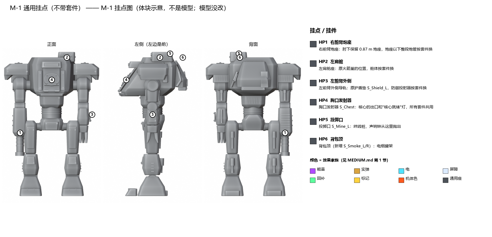
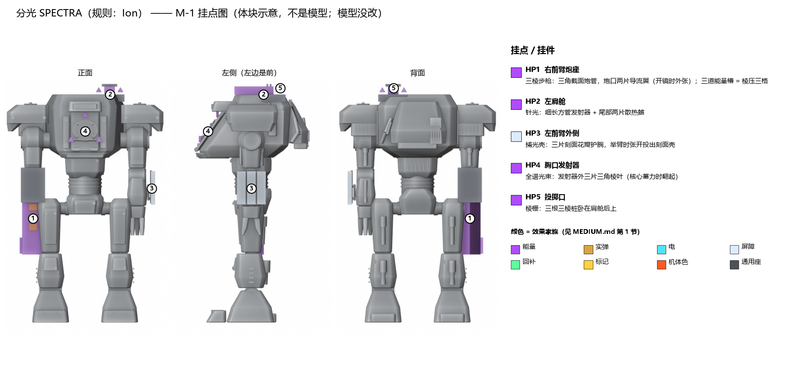
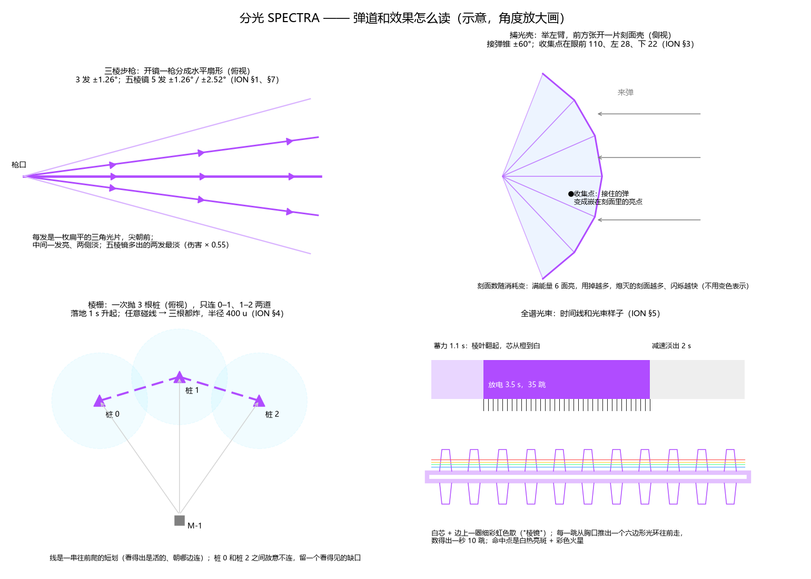
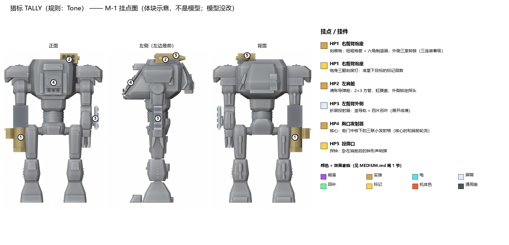
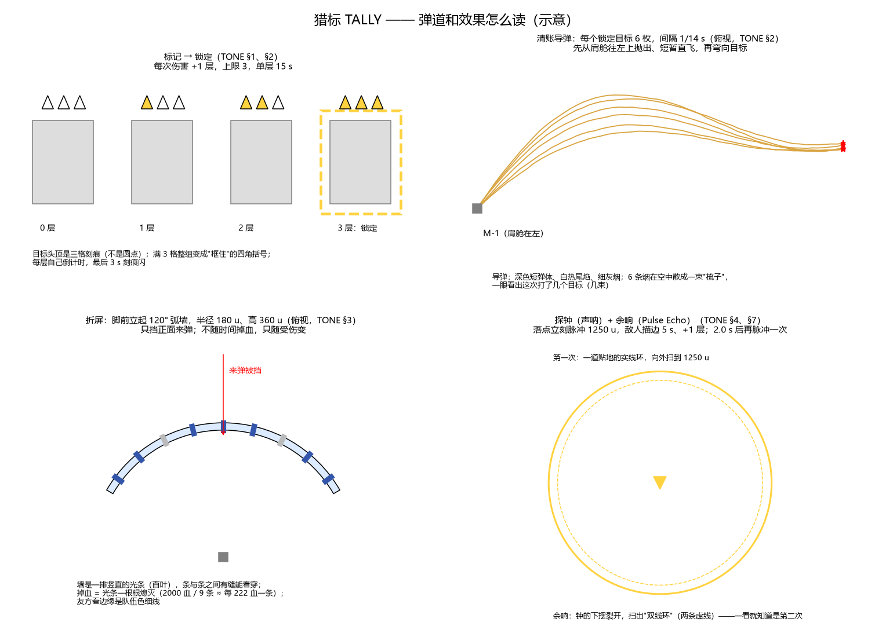
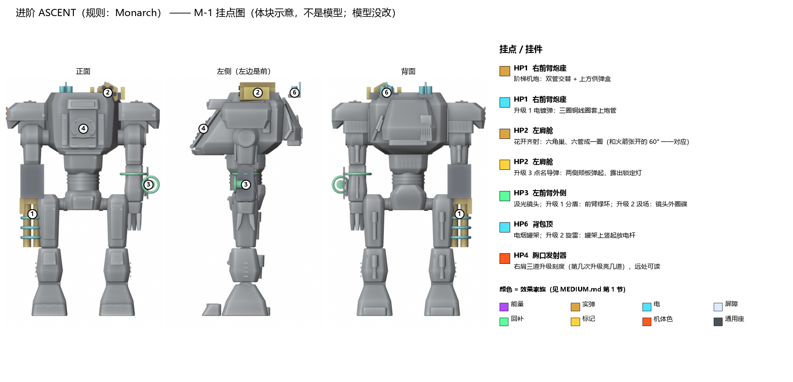
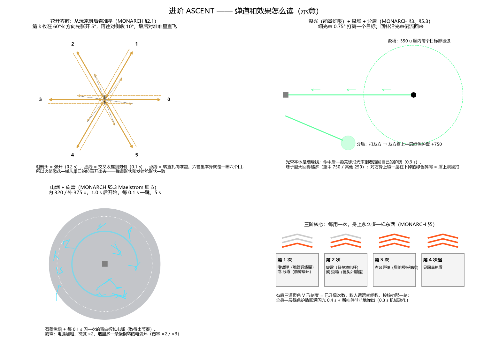
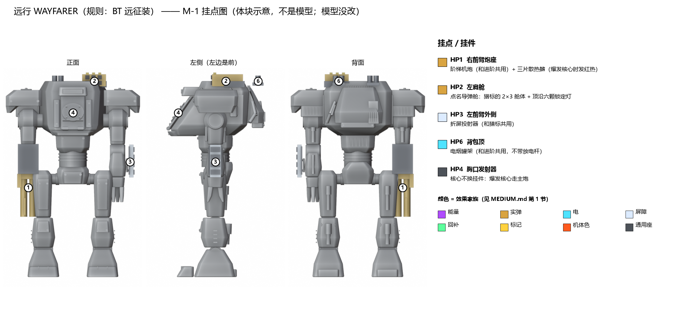
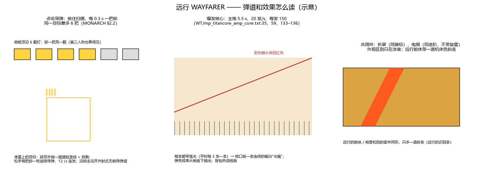

# 中型 M-1 的四套套件：外观和表现设计

2026-11-13，会话 `titan-kits-design-medium`。分支 `titan/kits-design-medium`（从 `titan/model-v3` 开）。
**状态：设计稿，等 lead 审、等用户确认模型改动。M-1 模型一处没改**，图里的挂件都是临时加的体块，没有存回 `Titan_M1.blend`。

## 先说结论（大白话）

- 中型 M-1 要装四套套件：**分光 SPECTRA**（规则照 Ion）、**猎标 TALLY**（照 Tone）、**进阶 ASCENT**（照 Monarch）、**远行 WAYFARER**（照 BT 远征装）。规则和数值一律照 `../kits/` 的规格页，本文只管"长什么样、从哪里打出来、打出来怎么读"。
- **M-1 身上定六个通用挂点，套件之间换挂件，不换机体。** 右前臂炮管、左肩舱、左前臂外侧投射器、胸口发射器、肩舱后的投掷口、背包顶的烟罐架。换套件 = 换 3–5 个挂件，骨架、动画、碰撞体都不动。
- **效果的颜色按"家族"定，不按泰坦定**：能量紫、实弹暖白、电青白、屏障冷白、回补绿、标记黄，机体自己的橙红只用在机体发光和升级刻度上。这一节（第 1 节）是给轻 / 重型那边（`titan-kits-design-lh`）对齐用的，lead 统一后两边一起改。
- **M-1 的名字叫"棱镜"，所以中型的能量武器都带"棱"的样子**：三角截面的炮管、刻面的护壳、光束边上一圈细彩虹色散。这是我们自己的标志，TF2 没有。
- **让玩家读懂规则的几个设计**：花开齐射的六管排成一圈，火箭从哪个口出去就往哪个方向张开；进阶右肩有三道刻度，敌人远远就能数出你升级了几次；猎标的标记是三格刻痕，满三格变成框住的括号；屏障掉血是光条一根根熄灭，不靠颜色变化。
- **要改 M-1 模型的有 9 项**（第 9 节），都是"把炮管、肩舱、护盾垫拆成可换件"和"加几个小挂件 / 挂点"，不动骨架。按模型流程，要先出概念 → 三视图 → 细节图，用户确认后才进 Blender。
- **BT 远征装没有规格页**。它的五件东西里四件能借 Monarch / Tone 的页（XO-16、多目标导弹、粒子墙、电烟），爆发核心只有武器 `.txt` 里的几个数，本文先引 `.txt`，规格要另补（第 12 节）。

图（都在 `img/`）：

| 图 | 内容 |
|---|---|
| [img/base_mounts.png](img/base_mounts.png) | M-1 六个通用挂点，画在三视图上 |
| [img/spectra_mounts.png](img/spectra_mounts.png) · [img/spectra_fx.png](img/spectra_fx.png) | 分光：挂件 · 弹道和效果 |
| [img/tally_mounts.png](img/tally_mounts.png) · [img/tally_fx.png](img/tally_fx.png) | 猎标 |
| [img/ascent_mounts.png](img/ascent_mounts.png) · [img/ascent_fx.png](img/ascent_fx.png) | 进阶 |
| [img/wayfarer_mounts.png](img/wayfarer_mounts.png) · [img/wayfarer_fx.png](img/wayfarer_fx.png) | 远行 |

挂点图是用 M-1 R7 成品（`model/v3/M1/Titan_M1.blend`）在 Blender 里临时加方块、圆柱渲出来的正交三视图（静止姿势，手臂下垂）；**体块的颜色表示效果家族，不是涂装**。挂件的涂装仍只用 M-1 的 4 个材质槽（SPEC 3.4）。生成脚本 [tools/render_kit.py](tools/render_kit.py)、[tools/sheets.py](tools/sheets.py)：先 `blender -b <Titan_M1.blend> -P tools/render_kit.py -- <base|spectra|tally|ascent|wayfarer> tools/renders`（渲染图不进仓库），再 `py -3 tools/sheets.py img`。

单位：距离按规格页写 TF2 单位 u，括号里是米（1 u = 0.0254 m）。坐标是 Blender 坐标（X 向左、−Y 向前、Z 向上），和 SPEC 3.3 一致。

---

## 1. 整套泰坦武器的视觉语言（两边共用，等 lead 对齐）

**一句话：** 看颜色知道是哪类伤害，看形状知道是哪台泰坦，看节奏知道伤害有多快。

### 1.1 颜色按效果家族

| 家族 | 主色 | 芯 / 边 | 用在 | 为什么 |
|---|---|---|---|---|
| 能量 | 紫 `#B04CFF` | 白芯；中型带一圈细彩虹色散边 | 能量弹、光束、激光、刻面护壳充能 | 和火焰（橙）、电（青）、敌我色（红 / 蓝）都分得开 |
| 实弹 | 暖白曳光 `#FFE7B0`，弹体本身不发光 | 弹体深灰；爆炸灰白闪光 + 深色碎片，橙色只占一小圈 | 机枪、榴弹、导弹、火箭 | 实弹不是"光"，靠曳光和烟读 |
| 电 | 青白 `#4FE3FF` | 白色折线 | 电弧弹、电烟、绊线爆炸（`DF_ELECTRICAL`）、旋雷 | 折线形状本身就是"电" |
| 火焰（轻 / 重型那边定） | 建议橙黄 `#FF8A1F` | 黑烟 | 铝热、火墙、火焰核心 | 留给重型 H-1 |
| 屏障 | 冷白半透 `#DCEBFF` | 边缘一条队伍色细线 | 粒子墙、捕光壳、枪盾这类"挡东西的面" | 屏障主体不用敌我色，敌我只在边线上 |
| 回补 | 绿 `#5CFF9D` | — | 回护盾、给友方加盾 | 游戏里通用的"加" |
| 标记 / 锁定 | 黄 `#FFD23F` | — | 标记层、锁定、声呐描边 | 和 HUD 的警示色一致 |
| 机体色 | 每台泰坦自己的发光色（M-1 橙红 `#FF5A1F`） | — | 机体发光、核心就绪、升级刻度 | SPEC 3.4 定过，不拿来做伤害效果 |

- **敌我色（红 / 蓝）不做效果主色**，只出现在屏障边线、锁定框描边和 HUD 上。这样敌方的紫色光束和我方的紫色光束一样亮，靠边线和准星提示分敌我。
- 每个家族在**夜图和亮图**都要能分清：芯一律接近白，靠外圈颜色区分。

### 1.2 形状按泰坦（中型 = 棱）

| 底盘 | 形状母题 | 中型具体怎么用 |
|---|---|---|
| 中型 M-1 棱镜 | **三角、刻面、色散** | 三角截面炮管、三角光片弹、刻面护壳、三棱绊线桩、光束边的彩虹色散、六边形光环 |
| 轻型 / 重型 | 由 `titan-kits-design-lh` 定 | 建议各取一个不重复的母题（例如轻型"线 / 翼"、重型"圆 / 桶"），和 SPEC 第 4 节的剪影特征呼应 |

### 1.3 节奏看得见

- **每一跳伤害都有一个看得见的脉冲**。服务端 10 Hz 的跳伤（激光核心、电烟、绊线检测）画成每 0.1 s 一个闪 / 一个光环，玩家能数出来。
- **蓄力一律"由暗到亮、由慢到快"**，满了有一个清脆的到位信号（光和声同一帧）。
- **持续效果的剩余时间画在效果本身上**（墙的光条、壳的刻面、烟里电弧的密度），不只靠 HUD。

### 1.4 第一人称和第三人称的分工

- **第一人称**：看得到自己的炮管、左前臂投射器、肩舱的一角（抬肩舱时）、舱框边上的反光和抖动；看不到胸口发射器，核心状态靠舱框边缘的光和 HUD。
- **第三人称 / 别人看你**：挂件形状 + 机体色发光 + 效果家族色，三样合起来要在 50 m 外认出"这是哪套、在干什么"。

---

## 2. M-1 的挂点：通用座 + 换挂件

**一句话：** 机体上留 6 个固定的"座"，每套套件往座上插自己的挂件；同一个座上的挂件，外形可以完全不同，但接口位置一样。

| 挂点 | 现有名 / 新名 | 位置（Blender） | 装什么 | 四套分别装 |
|---|---|---|---|---|
| HP1 右前臂炮座 | `W_Cannon`（肘）+ `S_Muzzle`；**新增** `S_Barrel`（炮座下沿，z 3.00） | 肘 (−1.30, 0, 3.65) 往下：炮座 3.00–3.87 固定，3.00 以下是换的炮管 | 主武器 | 三棱步枪 / 刻痕炮 / 阶梯机炮 / 阶梯机炮 + 散热鳍 |
| HP2 左肩舱 | `J_Launcher_L` + `S_Rocket_1..6`；**新增** `S_Pod`（舱座顶面） | 左肩后上，舱座 x 0.25–0.98、y 0.25–0.85、z 5.52–5.70 | 进攻 | 针光 / 清账导弹舱 / 花开六角巢 / 点名导弹舱 |
| HP3 左前臂外侧 | `S_Shield_L`（原护盾垫） | (1.60, 0, 3.25)，挂在左肘上，跟手臂动 | 防御 | 捕光壳花瓣 / 折屏投射器 / 汲光镜头 / 折屏投射器 |
| HP4 胸口发射器 | `S_Chest` | (0, −1.084, 4.78)，舱门中板上 | 核心出口 + 核心就绪灯 | 三片棱叶 / 三联小发射格 / （无挂件）/ （无挂件） |
| HP5 投掷口 | `S_Mine_L` | (0.60, 0.70, 5.92)，肩舱后上 | 抛出的战术物 | 棱栅桩 / 探钟 / — / — |
| HP6 背包顶 | **新增** `S_Smoke_L / _R` | (±0.5, 1.24, 5.70)，背包顶两侧 | 电烟罐 | — / — / 罐架 + 放电杆（升级）/ 罐架 |

**为什么这样分（选中）：** 中型四套的槽位一样（主武器、进攻、防御、战术、核心），所以"每个槽一个座"最省：动画按座做一次，四套都能用；Unity 按挂点名找发射点（kits-core 的 `IKitFx` 正是这么设计的，见 notes `titan-kits-core-survey.md` 第 3 节）。

**没选：**

| 方案 | 为什么没选 |
|---|---|
| 每套一台不同外形的中型机（像 TF2 那样一套一台） | 要多做 3 台模型；用户 11-13 定的是"按底盘配"，M-1 是唯一的中型正式模型 |
| 全部挂件都挂在背上一个通用背架 | 发射点离眼睛太远，第一人称看不到任何东西；而且背包已经有推进器和百叶 |
| 主武器改成右手握枪 | M-1 右臂是前臂炮、没有手（SPEC 决定 6），加手要改骨架和动画 |

**高度：** 所有挂件顶面 ≤ 5.96，在 SPEC 的 5.97 上限以内（肩舱座原顶面 5.92）。

---

## 3. 分光 SPECTRA（规则：Ion）

**一句话：** 一池能量（"棱压"）供所有技能用；中距离用三棱步枪压制，针光点杀，捕光壳把对面的子弹攒起来打回去。

### 3.0 棱压（能量池）——在机体上怎么显示

- 规则：上限 1000，停用 0.5 s 后每秒回 80；不够就按不出（[ION.md §0.5](../kits/ION.md)）。
- **外观：** 三棱炮管正面的三道能量槽 = 三格，每格约 333。满 = 三道全亮紫；用掉的格从上往下熄灭；回能时最上面一格"呼吸"式闪（0.5 s 延迟期间不闪，延迟一过开始闪——玩家能看见"开始回了"）。按技能能量不够时，三道槽一起快闪两下（对应规格页"能量条闪还差多少"）。
- **第一人称：** 三道槽在炮管上，开镜时正好在画面右下角能看到；HUD 另有能量条。
- **和 TF2 的区别：** 机体上的能量显示做在炮管上，用"格"来读；TF2 只在 HUD 上显示。

### 3.1 主武器：三棱步枪 Tri-Prism Rifle（`SPC-P1`）

- **玩法：** 全自动能量步枪，9 发 / s、40 发一匣；腰射免费；开镜 0.35 s 后每枪耗 30 能量，一枪分成 3 发水平扇形（每发 × 0.7）。被动"五棱镜"（选中，规则 Refraction Lens）：分成 5 发、每发 × 0.55、能耗 × 1.15（[ION.md §1、§7](../kits/ION.md)）。
- **从哪里打：** HP1。炮管是三角截面（三棱柱），长 1.30 m（z 1.70–3.00），炮口两侧各一片导流翼。`S_Muzzle` 在炮管下端中心。
- **动作：** 腰射时右前臂小幅后坐（沿炮轴 3 cm，每发）。**开镜那 0.35 s：两片导流翼向外张开 15°，到位时"咔"一声**——这就是"可以分裂了"的信号（规格：开镜过渡中不能开火）。五棱镜：多两片翼，第二对在第一对外侧，张到 25°。关镜翼收回。
- **投射物：** 腰射是一枚**扁平的三角光片**（尖朝前，长 0.6 m、宽 0.25 m），白芯紫边，后面拖一段 2 m 的淡紫残影。分裂时中间一片最亮、两侧淡一级、五棱镜的外侧两片最淡（亮度跟每发伤害走）。弹速 8000 u/s（203 m/s），几乎看不到飞行时间，所以**残影比弹本身重要**：它指出了扇形的张角。
- **命中：** 小的紫色三角火星 + 命中面上留 0.4 s 的三角形灼痕。打到泰坦弱点（暴击 × 1.5）时火星变白、多一圈彩虹色散。
- **第一人称：** 炮管在画面右下，开火时三道能量槽随每枪轻微闪；开镜分裂时看得到两片翼张开。**第三人称：** 一串紫色三角片，开镜时变成三条平行发散的光片流。
- **声音占位：** 腰射——短促的"嗒"（高频、干），9 次 / s 连成一串；开镜分裂——每枪叠一层低一点的"嗡"，三发同时；翼张开的金属"咔"；能量不足时空响 + 电流"呲"。
- **和 TF2 的区别：** 我们的弹是三角光片、炮管是三棱柱、分裂靠导流翼张开读出来；不用 TF2 的弹形和枪形。

### 3.2 进攻：针光 Needle（`SPC-O1`）

- **玩法：** 按下就在准星方向 0.55° 小锥里找第一个目标直接结算：铁驭 300、重甲 1200，最远 4000 u（102 m）；耗 550 能量（[ION.md §2](../kits/ION.md)）。
- **从哪里打：** HP2。原火箭巢换成一根细长方管（截面 0.26 × 0.20 m，长约 1.0 m，前端比舱座再伸出 0.4 m），尾部两片散热鳍。出光口新增挂点 `S_Laser`（方管前端中心）。
- **动作：** 按下的那一刻，肩舱座整体后坐 8 cm、0.15 s 回位；散热鳍"啪"地张开 30°，冒一股白色热气，1.0 s（规格的充能冷却）后合拢——**鳍张着 = 还不能再打**。
- **效果：** 一条**很细的白芯紫边直线**（粗 0.08 m），从 `S_Laser` 一直到命中点，瞬间出现、0.25 s 内从后往前收掉（像针被抽回去）。没打中东西时，打到地形上留一个小白点。命中：目标身上一个亮白的针孔 + 一圈紫色环向外扩（0.3 s）。光束上有彩虹色散边。
- **第一人称：** 左上方肩舱方向射出的一条线穿过准星，舱框左上角被照亮一下；**第三人称：** 一根细直线，比任何光束都细，读作"点射"。
- **声音占位：** 蓄能"嘀"一声很短 → 发射"嗖——叮"（高、尖、带回响）→ 散热鳍"嘶"的泄气声。
- **和 TF2 的区别：** 从左肩一根方管打出，不是手持 / 肩炮的样子；光束"抽回"的收法和散热鳍是我们的读数方式。

### 3.3 防御：捕光壳 Catch Facet（`SPC-D1`）

- **玩法：** 按住时前方张开一个接弹区，飞来的子弹和投射物被接住存起来（各最多 31）；松手时子弹合成一次霰弹打回准星方向，投射物同一帧各自散开重发。能量 ≥ 100 才能举，按住持续耗能（实测约 124 / s，约 8.5 s 耗尽自动放下），没有时间上限，打不碎（[ION.md §3](../kits/ION.md)；实测数见 notes `titan-kits-core-survey.md` 第 5 节）。
- **从哪里打：** HP3。左前臂外侧三片刻面花瓣（每片 0.83 × 0.22 m），平时贴着前臂。
- **动作：** 按下：**左前臂抬到胸前横着挡**（肩前摆约 80°、肘弯 70°，在 M-1 "肩前摆 ≤ 95°不穿模"的限位以内），0.1–0.2 s 内到位；三片花瓣向外翻开成三角形。松手：左臂往前一推（0.15 s），打回的东西从推出的方向出去，然后手臂放下。
- **效果——壳：** 在左臂前方张开一片**刻面球壳**（规则是半径 150 u = 3.8 m 的球、接弹锥 ±60°）：可见部分是正对视线的一片弧形，由 6 块三角刻面拼成，冷白半透明、刻面边是紫色细线。**剩余能量用"亮着的刻面数"表示**：满能量 6 面全亮，用掉越多熄灭越多、剩下的闪得越快（不用变色表示）。
- **效果——接住：** 子弹打到壳上那一点闪一下（0.25 s），然后变成一颗小亮点**沿刻面边滑到收集点**（眼前 110、左 28、下 22 u），收集点处的亮点越攒越多，像一团嵌在玻璃里的火星；投射物（导弹、榴弹）被接住时**原样定在壳面上不动**，尾焰熄灭，读得出"接住了一枚导弹"。
- **效果——打回：** 子弹：从收集点喷出一束紫白色的锥形散射（霰弹，锥半角约 3.5°），第一个目标身上炸开一大团火星。投射物：定在壳面上的那些同时"弹"出去，各自带回原来的尾焰。壳碎成 6 片刻面向前飞散 0.3 s 后消失。
- **第一人称：** 画面左半被刻面壳占住，能透过去看；收集点的火星团在画面中下偏左，随接弹数变大（直接读"攒了多少"）。**第三人称：** 机体左前方一片发光刻面弧，上面钉着来弹。
- **声音占位：** 展开——玻璃张开的"铮"一声 + 持续低频嗡（随能量降低音调下降）；接弹——每颗一个清脆"叮"，导弹被接住是一个闷的"咚"；打回——一声加重的"轰"+ 碎玻璃声。
- **和 TF2 的区别：** TF2 是手掌前一个圆形的旋涡盘；我们是**刻面球壳 + 横臂格挡**，接住的弹嵌在壳里不打转，能量用刻面数表示而不是颜色从蓝变红。

### 3.4 战术：棱栅 Prism Fence（`SPC-T1`）

- **玩法：** 一次向左前、正前、右前抛出 3 根桩；落地 1 s 后桩头升起 45 u，相邻桩之间拉激光（只有 0–1、1–2 两道）；敌人碰到线，这一组桩全部爆炸，每根 200 / 1500、半径 400 u（10.2 m）、电击伤害；桩 300 血可打爆；寿命 13 s；耗 350 能量（Zero-Point 被动没选，见第 11 节）（[ION.md §4](../kits/ION.md)）。
- **从哪里打：** HP5。三根三棱桩（长 0.22 m）横卧在肩舱后上的弹槽里，从 `S_Mine_L` 前方抛出（规格写的是 `TITAN_GRENADE` 前方 50 u，我们映射到 `S_Mine_L`）。
- **动作：** 肩舱座向上一仰 15°（0.15 s）把三根桩"弹"出去，像弹弓；然后回位。不用手。
- **效果——飞行和落地：** 三根桩边飞边转（三棱柱自转），各拖一条短的紫色尾迹，落地后插进地面、三棱朝上。**建造 1 s：** 桩头像花苞一样旋转着升起 1.1 m，顶部一颗紫色三角晶体亮起。
- **效果——激光：** 线是一串**往前爬的短划**（由编号小的桩爬向大的），紫白色，粗 0.1 m；爬的方向告诉玩家这是"活的"、线是怎么连的。**桩 0 和桩 2 之间故意不连**，地面上那个缺口看得见（规则就是只连两道）。地形挡住、落地时间差超过 1 s 时这一段不连，桩头晶体变成闪烁的半亮。
- **效果——爆炸：** 被碰到的那根先爆，另外两根在同一帧爆（规则：销毁全组）：每根是一个 10 m 的**青白电弧球**（电家族），地面留一个星形焦痕 3 s。剩 3 s 寿命时晶体开始闪。
- **第一人称：** 抛桩时左上角看到肩舱一仰、三颗紫点飞出去；之后看到地上的线。**第三人称 / 敌人：** 三根插地的发光桩 + 两道爬动的线；敌方桩的线外侧有一条红色细边（敌我色只用在边上）。
- **声音占位：** 抛出——三声连续的"嗖嗖嗖"；落地——"叮"插地；升起——上行的电子音阶 1 s；激光——持续的细高频"嗞"；爆炸——干脆的电爆"啪轰"。
- **和 TF2 的区别：** 三棱桩 + 晶体桩头 + 爬动的短划线 + 青白电爆；不用 TF2 的桩形和激光样子。

### 3.5 核心：全谱光束 Full Spectrum（`SPC-C1`）

- **玩法：** 蓄力 1.1 s 后从胸口射出 3.5 s 的粗光束，每 0.1 s 对光束上的每个目标打 325（共 35 跳），射程 6000 u；整个过程移动 × 0.75，放电期间转向也 × 0.75，不能 dash、不能用其他技能（[ION.md §5](../kits/ION.md)）。
- **从哪里打：** HP4 胸口发射器 `S_Chest`。发射器外三片三角**棱叶**（新挂件，平时贴着舱门中板）。
- **动作：** 蓄力 1.1 s：**左脚往前踏半步、膝盖弯下去**做支撑姿势（"顶住"），双臂向两侧略张开让出胸口；三片棱叶向外翻起 40°，发射器芯从机体橙红变成白色、越来越亮。放电 3.5 s：机体有持续的小幅后推（每跳一次 2 cm 的震动，10 Hz）。结束：棱叶合上，冒热气 2 s（和减速淡出的 2 s 同步）。
- **效果——光束：** 粗光束半径 18 u（0.46 m），**白芯 + 紫色外晕 + 边上一圈细的彩虹色散**（棱镜分光）。**每一跳从胸口推出一个六边形光环沿光束往前走**，一秒 10 个，数得出跳数。命中点：白热的亮斑 + 彩色火星四溅，目标表面留一道熔痕跟着光束扫过的路径。
- **第一人称：** 画面中央一条白柱从下方舱框里射出去；舱框边缘过曝发白；视角有 10 Hz 的细震。转向变慢本身就是读数。**第三人称：** 一条带彩虹边、一节一节往前推的白紫光柱，从胸口正中出来。
- **声音占位：** 蓄力——上升的合唱式和声 1.1 s，到顶"咔"；放电——低频持续轰鸣，叠 10 Hz 的"嗒嗒"脉冲（跟跳伤同步）；结束——下降的"呼——"和泄气。
- **和 TF2 的区别：** 我们的光束有彩虹色散边和六边形节环，从舱门上的发射器打出、机体做踏步支撑；颜色是白紫而不是 TF2 的配色。

### 3.6 选中的被动：五棱镜 Penta Lens（规则 Refraction Lens）

- 见 3.1。外观上就是炮口多一对导流翼、张角更大；分裂时五片光片、外侧两片最淡。

---

## 4. 猎标 TALLY（规则：Tone）

**一句话：** 先用刻痕炮给目标"记账"（叠标记），记满三笔就能"清账"——一串导弹追着打；墙、声呐、核心都围着这本账转。

### 4.0 标记（每个目标头上的账）

- 规则：每次伤害 +1 层，上限 3，单层 15 s；满 3 层算锁定（[TONE.md 先说结论、§1](../kits/TONE.md)）。
- **外观：** 被标记的敌人头顶出现**三格刻痕**（三个朝上的小三角，黄色），一层亮一格；满三格时刻痕变成**四角括号框住整个目标**。每层自己倒计时，最后 3 s 那一格闪。只有猎标自己（和队友）看得到；被标记的敌人自己看到的是 HUD 边缘的黄色"被记账"提示（避免全场都是 UI）。
- **刻痕炮炮身上的三颗刻度灯**（HP1 外侧）同步显示准星下那个目标的层数——第一人称不用找头顶也能读。

### 4.1 主武器：刻痕炮 Notch Cannon（`TLY-P1`）

- **玩法：** 半自动榴弹炮，1.75 发 / s；弹体打中后有冲击伤害和 150 u 半径的小爆炸；每次对敌人造成伤害都加一层标记（[TONE.md §1](../kits/TONE.md)）。选中的被动"三连装"（规则 Burst Loader）：开镜时蓄力，2.0 s 分 3 级，开火时按级数连发，连发间隔 0.2 s，连发后延迟 0.75 s（[TONE.md §7](../kits/TONE.md)）。
- **从哪里打：** HP1。短粗炮管（半径 0.29 m，z 2.10–3.00）+ 六角制退器；炮管外侧一个**三室转鼓**（六角柱，半径 0.20 m），上面三颗刻度灯。
- **动作：** 每发一次明显的前臂后坐（沿炮轴 12 cm，0.25 s 回位），转鼓转 1/3 圈。三连装蓄力：开镜后转鼓每到一级"咔"地转一格、对应一个室亮黄，2.0 s 三室全亮；开火时三发间隔 0.2 s，转鼓连转三格。
- **投射物：** 一枚深灰色短粗榴弹（看得见，弹速比能量弹慢很多），尾部一个暖白小曳光点，**拖一条短的灰白烟**。命中：灰白闪光 + 深色碎片 + 一小圈 150 u 的冲击波尘环；目标头顶刻痕 +1 格同时亮一下。
- **第一人称：** 每发画面明显一顿（后坐），转鼓在右下转；开镜蓄力时三室一个个亮。**第三人称：** 慢、重、一发一发的灰烟弹。
- **声音占位：** 发射——低沉的"嘭"（中低频、带金属尾音）；转鼓"咔哒"；三连装蓄满——三声上行"嘀嘀嘀"；命中加层——一个短促的"叮"（给攻击者的确认音）。
- **和 TF2 的区别：** 炮管 + 侧挂三室转鼓 + 刻度灯，读数在炮身上；弹是灰烟实弹而不是发光弹。

### 4.2 进攻：清账导弹 Settle Missiles（`TLY-O1`）

- **玩法：** 只能对满 3 层的目标发射；按一下对每个锁定目标各射 6 枚追踪导弹（间隔 1/14 s），射完把这些目标的标记清零；初速 1800 u/s，转向随距离和时间变化，有随机漂移；冲击 350、爆炸 100 / 250（[TONE.md §2](../kits/TONE.md)）。
- **从哪里打：** HP2。2 × 3 方管舱（比原火箭巢略高，顶面 5.94），方管口带**虹膜盖**；舱外侧一个小锁定探头（黄灯）。6 个管口就是现有的 `S_Rocket_1..6`。
- **动作：** 有锁定目标时，探头亮黄、虹膜盖预先张开一半；按下：肩舱座向前上方抬 10°（0.1 s），6 个管口**按 1→6 的顺序**依次吐弹，每口一次小后坐；锁了两个目标就 1→6 再 1→6。打完虹膜合上。
- **弹道读法：** 导弹出管后**先往左上方抛出、短暂直飞**（肩舱在左肩，直飞段 0–0.1 s），然后弯向目标；随机漂移让 6 条烟在空中散成一束"梳子"。**一束 = 一个目标**，所以打了几个目标数得出来。
- **投射物：** 深灰短弹体、白热尾焰（小而亮）、细灰烟（2 s 消散）。命中：灰白小爆 + 橙色只占中心一点。目标头顶的括号框在第一枚命中时"碎掉"（标记清零）。
- **第一人称：** 左上角舱口依次闪、6 条烟从画面左上划向目标。**第三人称：** 左肩连续吐出 6 枚、空中散成梳子。
- **声音占位：** 锁定——黄色探头的"嘀—嘀"（满 3 层时变成连续"嘀——"）；发射——6 声快速的"咻"（14 / s，接近连成一串"咻咻咻咻咻咻"）；命中——闷爆。
- **和 TF2 的区别：** 方管 + 虹膜盖 + 外侧探头的舱体；标记用刻痕 / 括号，导弹烟用"梳子"读目标数。

### 4.3 防御：折屏 Fold Screen（`TLY-D1`）

- **玩法：** 按一下，在自己站的位置、面朝的水平方向立起一段半径 180 u、高 360 u、张角 120° 的弧形墙（4.6 m 半径、9.1 m 高），2000 血、6 s；正面来的子弹和投射物被挡住，从里往外打不受影响；墙不跟人、不随时间掉血（[TONE.md §3](../kits/TONE.md)）。
- **从哪里打：** HP3。左前臂外侧一根竖导轨 + 四片折叠百叶。
- **动作：** 左前臂向下前方一挥（0.2 s），导轨上的四片百叶"刷"地弹出去落到地面前方，然后从地面**一节一节向上展开**成墙（0.3 s 展开完，规则上墙是"立刻出现"的，判定从第 0 帧就有，展开动画只是外观）。
- **效果——墙：** 一排**竖直的光条**（百叶，9 条），冷白半透，条与条之间有细缝能看穿；底部贴地有一条亮线。**掉血 = 光条一根根熄灭**（2000 / 9 ≈ 每掉 222 血熄一条），被打的那一点泛起一圈白色涟漪。最后 3 s（规格有"快结束"音）光条开始同步闪。友方看边线是蓝色细线，敌方看是红色细线。
- **第一人称：** 前方一排光条，枪口从缝里打出去；**第三人称：** 机体前一道弧形百叶墙，挡下的弹在墙面上留下 0.3 s 的光点。
- **声音占位：** 弹出——金属"刷"；展开——三段上行"咔咔咔"；被打——闷的"嘭"加电流嗡；快结束——"嘀、嘀、嘀"；消失——下行"呜"。
- **和 TF2 的区别：** TF2 的墙印象中是一整面网格状的半透明蓝墙；我们是**有缝的竖百叶**，血量看熄灭的条数，颜色是冷白不是蓝。

### 4.4 战术：探钟 Bell（`TLY-T1`）+ 选中被动"余响"Aftertone（规则 Pulse Echo）

- **玩法：** 发射一枚会下坠的声呐弹，碰到任何东西就在那一点脉冲：半径 1250 u（31.8 m）内的敌人被高亮 5 s，每人 +1 层标记。余响：2.0 s 后同一点再脉冲一次（重新揭示 5 s、再给一层）（[TONE.md §4、§7](../kits/TONE.md)）。
- **从哪里打：** HP5。一个钟形声呐弹横卧在肩舱后面（锥形，长 0.30 m），从 `S_Mine_L` 抛出。
- **动作：** 肩舱座上仰 20°，"嗵"地把钟抛出去，抛物线明显下坠。
- **效果：** 钟落地后**倒扣着插在地上**，钟口朝下；第一次脉冲是一道**贴地的实线黄环**向外扫到 31.8 m（0.4 s 扫完），扫过的敌人立刻黄色描边。余响：2.0 s 后**钟的下摆裂成几瓣**，扫出一道**双线环**（两条虚线并排），一看就知道是第二次。描边上同时 +1 格刻痕。
- **第一人称 / 第三人称：** 看到黄环扫过地面、墙后敌人的黄色描边（穿墙可见 5 s）。被扫到的敌人看到 HUD 边缘黄色闪一下。
- **声音占位：** 抛出——"嗵"；落地——钟声"当"（中频、长回响）；第一次脉冲——深沉的"嗡——"；余响——同一个钟声但更短、带金属裂响。
- **和 TF2 的区别：** 弹是钟形、插地倒扣；脉冲是贴地黄环（第二次是双线环）。

### 4.5 核心：清账风暴 Ledger Storm（`TLY-C1`）

- **玩法：** 蓄力 0.5 s（自己减速到 30 %），然后 20 轮、每轮 3 枚导弹（共 60 枚），12 轮 / s；每轮左右交替；导弹追着准星指的点飞，准星扫到泰坦时导引点粘在它身上；导弹打不下来，寿命 10 s（[TONE.md §5](../kits/TONE.md)）。
- **从哪里打：** HP2 肩舱 + HP4 胸口。核心时**舱门中板的发射器下方三联小发射格**（新挂件）打开，和肩舱**一轮一轮交替发射**——规则里每轮左右交替（右向量 ± 0.25），我们把"左"放在肩舱、"右"放在胸口三联格，交替就是看得见的"左一下右一下"。
- **动作：** 蓄力 0.5 s：双脚分开站稳、上身微前倾，肩舱和胸口格的盖子同时打开。发射 1.6 s：肩舱和胸口交替吐弹，机体每轮有小震动。结束：盖子合上冒烟。
- **效果——导引点：** 准星指向的地方出现一个黄色**菱形准标**；扫到泰坦时菱形"咬住"它（四个角收紧成括号）。60 枚导弹的烟在空中连成一条**弯曲的绳**，绳的末端一直跟着菱形走——拖动准星就能看到绳子跟着甩。
- **第一人称：** 画面左上和下方中间交替闪光，60 条细烟汇向菱形。**第三人称：** 从肩和胸交替喷出密集小导弹，空中一条甩动的烟绳。
- **声音占位：** 蓄力——短促上行"呜"；发射——密集的"咻咻"交替左右声道；导弹群——持续的高频呼啸；命中——连成一片的闷爆。
- **和 TF2 的区别：** 交替从肩舱和胸口两处发射、菱形导引点、烟绳；不用 TF2 的发射位置和导引标记。

---

## 5. 进阶 ASCENT（规则：Monarch）

**一句话：** 越打越强。每用一次核心，机体上永久多出一样看得见的东西；右肩三道刻度告诉所有人你升了几次。

### 5.1 主武器：阶梯机炮 Step Gun（`ASC-P1`）+ 升级"电镀弹"Arc Plating（规则 Arc Rounds）

- **玩法：** 全自动弹丸机枪，12 发 / s，40 发一匣（[MONARCH.md §1](../kits/MONARCH.md)）。电镀弹（第 1 档 core1）：弹匣 40 → 50，给的那一刻当前弹匣 +10；伤害带电，打护盾和涡旋类屏障 × 1.5（[MONARCH.md §1、§5.3](../kits/MONARCH.md)）。
- **从哪里打：** HP1。**双管**（每根半径 0.10 m，并排）+ 炮座下方一块护罩 + 外侧供弹盒。双管交替开火（左、右、左……），`S_Muzzle` 在两管中间，开火特效按左右管交替放。
- **动作：** 持续开火时双管交替小后坐（各 3 cm），供弹盒上的弹链往里走；前臂整体有 12 Hz 的细抖。
- **投射物：** 弹丸本身不发光，每 3 发一条暖白曳光；枪口焰是左右交替的短星形。命中：灰白火花 + 碎屑。
- **电镀弹：** 升级那一刻，**三圈铜线圈"啪"地套上炮管**（新挂件，平时藏在炮座里），线圈发青白光；从此曳光变成青白、命中带一小簇折线电弧；打到护盾 / 屏障时电弧明显变大（× 1.5 的读数）。
- **第一人称：** 右下双管交替闪，升级后看得到青白线圈。**第三人称：** 一条暖白（升级后青白）的曳光流。
- **声音占位：** 开火——中频"哒哒哒"，12 / s，左右管音色略不同（交替感）；电镀弹——每发叠一个"滋"的电声；换弹——弹链"哗啦"+ 盒盖"咔"。
- **和 TF2 的区别：** 双管交替 + 侧供弹盒；电弧弹用"套上线圈"这个机械动作显示，不是改枪的颜色。

### 5.2 进攻：花开齐射 Bloom Salvo（`ASC-O1`）

- **玩法：** 按一下连发 6 枚无制导火箭，每枚先向外张开 5°，再往对侧收 10°，最后对准准星前方 5000 u 的点直飞；第 k 枚的张开方向是绕准星 60°·k；能量 120 满了才能发（[MONARCH.md §2.1](../kits/MONARCH.md)）。
- **从哪里打：** HP2。**六角巢**：一个正对前方的六角柱，6 个管口排成一圈（半径 0.18 m），每个口正好在 60°·k 的方向上。新挂点 `S_Bloom_0..5` 按圈排列（取代 2 × 3 排列的 `S_Rocket_1..6`）。
- **动作：** 6 个口**按圈顺时针依次**发射（12 / s），六角巢每发转一下 1/6 圈的"咔"（只是外观，不影响方向）。
- **弹道读法：** 每枚火箭从它所在的那个口出发，**往那个口的方向张开**（0.2 s），然后交叉收拢到对侧（0.1 s），再一起扎向准星——**发射舱的样子就是弹道的样子**，像一朵花开再合拢。
- **投射物：** 中等大小的火箭，白热尾焰 + 灰烟；6 条烟在准星前画出一个"花瓣"形状再合成一束。命中：灰白爆炸 + 橙色中心小圈 + 黑烟。
- **第一人称：** 6 枚火箭从左上方出来，在准星周围画一朵花再收拢；**第三人称：** 左肩一圈六口轮流喷火。
- **声音占位：** 每发"嗖"（中频），6 声连成一串，转巢"咔"夹在中间；命中闷爆连成一片。
- **和 TF2 的区别：** 六口成圈的巢让"张开再收拢"的弹道和发射口一一对应；这是为读弹道专门做的形状。

### 5.3 升级第 3 档：点名导弹 Roll Call（`ASC-O2`，规则 Multi-Target Missiles core7）

- **玩法：** 第 3 次用核心时进攻换成它：按住扫描，30° 锥、4000 u 内锁重甲目标，每 0.3 s 一把锁，同一目标最多 6 把，最多 8 个目标；松开按锁数发追踪导弹（12 / s）；没锁就走齐射式无制导弹道（[MONARCH.md §2.2](../kits/MONARCH.md)）。
- **从哪里打：** 还是 HP2 的六角巢；升级时**巢的两侧颊板"砰"地弹起**（新挂件），露出两排黄色锁定灯（一侧 3 颗，共 6 颗）。
- **动作：** 按住扫描时六角巢慢慢转动（"在找"），每锁一把亮一颗灯并"嘀"一声；松开时巢停转、按锁数依次发射。
- **效果：** 准星上的目标外框外侧，每一把锁多一道黄色短竖线（最多 6 道）；导弹带黄色细尾迹，和花开齐射的灰烟区分开。没锁松手时就是 5.2 的花开弹道。
- **第一人称 / 第三人称：** 第一人称看准星旁的锁数竖线；第三人称看颊板上的灯——**敌人看得到你锁了几把**。
- **声音占位：** 扫描——低的"嗡"循环；每把锁"嘀"（音高随锁数上升）；满 6 把——连续"嘀——"；发射——"咻"连发。

### 5.4 防御：汲光 Draw（`ASC-D1`）+ 升级"分盾"Share（规则 Energy Transfer）、"汲场"Draw Field（规则 Energy Field）

- **玩法：** 打出一束细光束（0.75° 锥、4000 u），只打中准星前第一个目标；打中敌人：给自己回护盾（重甲 750、其他 250）、扣对方护盾上限的 50 %、减速。分盾（第 1 档 core3）：打友方泰坦给它 +750 护盾。汲场（第 2 档 core6）：变成命中点 350 u（8.9 m）内的范围效果（[MONARCH.md §3、§5.3](../kits/MONARCH.md)）。
- **从哪里打：** HP3。左前臂外侧一个**镜头**（半径 0.11 m，朝前）。
- **动作：** 左臂前伸指向准星（0.15 s），镜头发绿光 → 出光束 → 手臂收回。
- **效果：** 一条**细绿线**（回补家族）。命中后**一颗亮绿珠沿光束倒着跑回自己的镜头**（0.3 s），珠子大小表示回了多少（750 大、250 小）；自己身上一层绿色护套从左臂扩散到全身（0.4 s）。被打的敌人身上剥落一层往下掉的绿色碎屑（= 盾上限被扣）+ 腿部一圈蓝灰色"减速"的地面光环。
- **分盾：** 升级时左前臂套上一圈绿环（新挂件）。打友方时光束不变，绿珠**往友方那边跑**，友方身上出现绿色护套。
- **汲场：** 升级时镜头外圈多一个碟形环（新挂件）。命中点炸开一个 8.9 m 的绿白**刻面半球**，球里每个目标各有一颗绿珠跑回来——打一群就是一群珠子往回跑。
- **第一人称：** 左下方伸出的手臂和绿线；绿珠跑回到画面左下角时，舱框边一圈绿光闪一下（回盾确认）。**第三人称：** 一条绿线 + 往回跑的珠子。
- **声音占位：** 出光——"嘶"的吸气声；命中——"咕咚"的吸收声；绿珠回来——上行"叮"（大珠音低、小珠音高）；汲场——一声扩散的"嗡"。
- **和 TF2 的区别：** 用"珠子倒流"表示虹吸方向和回多少；绿色属于回补家族，不用 TF2 的颜色和光束样子。

### 5.5 战术：复位 Reset（`ASC-T1`）

- **玩法：** 0.5 s 蓄力后把进攻、防御的能量和 dash 能量一次回满（[MONARCH.md §4](../kits/MONARCH.md)）。
- **从哪里打：** 不发射东西。背包是"能量来源"。
- **动作 + 效果：** 0.5 s 蓄力：背包百叶亮起机体色橙红，一道光沿躯干的接缝**分三路流向**肩舱、左前臂、背后推进器（三样被回满的东西）；到达时：肩舱的管口盖开合一次、左前臂镜头闪一下、推进器"噗"喷一口气。
- **第一人称：** 舱框边一圈橙光从后往前扫过，HUD 三个技能图标同时填满。**第三人称：** 三路光流 + 三处"到位"动作。
- **声音占位：** 蓄力——上行的电容充电"呜——"；到位——三声快速的"咔、咔、噗"。
- **和 TF2 的区别：** 用"三路光流到三个挂件"把"回满了什么"演出来。

### 5.6 电烟 Fog（共用）+ 升级"旋雷"Storm Spin（规则 Maelstrom core5）

- **玩法：** 电烟内半径 320 u、外半径 375 u（8.1 / 9.5 m），1.0 s 后开始伤害，每 0.1 s 一跳，持续 5 s。旋雷：对铁驭 45 → 90 / s、对泰坦 450 → 1350 / s（[MONARCH.md §5.3 Maelstrom 细节](../kits/MONARCH.md)）。
- **从哪里打：** HP6 背包顶两个罐架（每架 2 罐，共 4 罐），新挂点 `S_Smoke_L / _R`。
- **动作：** 4 个罐子从背包顶"嘭"地向上四散弹出，落在机体四周，0.2 s 后爆开成烟。
- **效果：** **石墨色**的烟（不是白烟），烟里每 0.1 s 闪一次青白折线电弧（数得出节奏），前 1.0 s 只冒烟不闪（还没开始伤害）。旋雷：罐架上竖起两根放电杆（新挂件）；烟里电弧加粗、密度 × 2，多一条贴地慢慢转的青白电弧环。
- **第一人称：** 画面四周被灰烟包住、电弧从边缘闪过。**第三人称：** 一团灰色电烟，旋雷时看得到旋转的电环。
- **声音占位：** 弹罐——四声"嘭"；起烟——"嘶——"；电弧——10 Hz 的"噼啪"；旋雷——底下多一层旋转的低频"呜呜"。
- **和 TF2 的区别：** 背包顶罐架抛罐、石墨色烟、10 Hz 可数的电弧、旋转电环。

### 5.7 核心：三阶核心 Ascent Core（`ASC-C1`）

- **玩法：** 核心充满后按下：护盾立刻回满，泰坦按"这是第几次"永久获得一项升级；第 4 次起只回护盾。每档三选一，出战前选好（[MONARCH.md §5](../kits/MONARCH.md)）。我们选中的五项：第 1 档电镀弹 / 分盾，第 2 档旋雷 / 汲场，第 3 档点名导弹。
- **从哪里打：** HP4 胸口发射器只做"核心就绪"灯；升级挂件分布在各个座上。
- **动作 + 效果：** 按下：机体挺身（0.3 s），胸口发射器亮到最亮；全身一层绿色护盾回满闪光（0.4 s）；**新挂件"咔"地弹出**（0.3 s 机械动作，见每项）；**右肩外侧多亮一道橙色 V 形刻度**（新挂件，共三道，机体发光色）。
  - 第 1 次：电镀弹（炮管铜线圈）或分盾（前臂绿环）
  - 第 2 次：旋雷（背包放电杆）或汲场（镜头外圈碟）
  - 第 3 次：点名导弹（肩舱颊板弹起）
  - 第 4 次起：只有绿色回盾闪光，刻度不再增加
- **第一人称：** 舱框一圈绿光 + HUD 显示新升级名；看得到的挂件（线圈、绿环）在画面里出现。**第三人称 / 敌人：** 数右肩刻度就知道对面升了几次。
- **声音占位：** 激活——厚重的"咚"+ 上行和弦；挂件弹出——明显的机械"咔嗒"；第几次升级，和弦就多一个音。
- **和 TF2 的区别：** 升级用"挂件实体弹出 + 肩上刻度"表示，远处可读；不靠 TF2 的特效。

---

## 6. 远行 WAYFARER（规则：BT 远征装）

**一句话：** 老伙计的配置：一把可靠的机枪、点名导弹、折屏、电烟，核心是让机枪疯狂一阵。挂件全部和别的套件共用，只多一道识别斜条和散热鳍。

**规则从哪来：** BT 远征装的组成在战役脚本里：主武器 `mp_titanweapon_xo16_shorty`（只有 11 行，继承 XO-16）、进攻 `mp_titanweapon_shoulder_rockets`（多目标导弹）、防御 `mp_titanability_particle_wall`、战术 `mp_titanability_smoke`、核心 `mp_titancore_amp_core`（爆发核心）（TF2-Research `local/vpk/client_sp_training/scripts/vscripts/sp/_sp_loadouts.nut`:302、1260–1272；`client_frontend/scripts/vscripts/sh_consts.gnut`:2600）。**没有 kits 规格页**，见第 12 节。

| 件 | 我们的名字 | 规则出处 | 外观 |
|---|---|---|---|
| 主武器 | 阶梯机炮 Step Gun（`WAY-P1`） | XO-16，[MONARCH.md §1](../kits/MONARCH.md)（不带升级） | 和进阶 5.1 同一个炮管，**多三片散热鳍**（爆发核心用），不带铜线圈 |
| 进攻 | 点名导弹 Roll Call（`WAY-O1`） | [MONARCH.md §2.2](../kits/MONARCH.md)（基础版，不带 Monarch 的升级 mod） | 用**猎标的 2 × 3 方管舱体**，顶沿多 6 颗锁定灯；锁定读法同 5.3 |
| 防御 | 折屏 Fold Screen（`WAY-D1`） | [TONE.md §3](../kits/TONE.md) | 和猎标 4.3 完全相同 |
| 战术 | 电烟 Fog（`WAY-T1`） | [MONARCH.md §5.3 Maelstrom 细节](../kits/MONARCH.md)（不带旋雷） | 和进阶 5.6 同一个罐架，不带放电杆 |
| 核心 | 爆发核心 Overdrive（`WAY-C1`） | `WT/mp_titancore_amp_core.txt`：持续 5.5 s（:35）、20 发 / s（:59）、每发 150（:133–136）、弹匣 200（:57） | 见下 |

### 6.1 核心：爆发核心 Overdrive（`WAY-C1`）

- **玩法：** 主武器换成 5.5 s 的高速版：20 发 / s、每发 150（铁驭和重甲相同）。
- **动作：** 按下：机体右臂抬平到瞄准姿势锁住，左手扶住右前臂（左三指爪抓住炮座，0.2 s）——这是 M-1 唯一一个"双手持枪"的动作，读作"全力开火"。
- **效果：** **每发都有曳光**（平时每 3 发一条），枪口前连成一条连续的暖白"光绳"；三片散热鳍从暗到红热（随剩余时间变化，5.5 s 内从暗灰到亮红，读作"还剩多久"）；弹壳从炮座下方成串抛出；背包热浪扭曲。结束时散热鳍喷一口白汽。
- **第一人称：** 画面中一条光绳 + 下方散热鳍越来越红 + 左手出现在画面左下扶着炮。**第三人称：** 双手持炮的姿势 + 光绳 + 红热鳍。
- **声音占位：** 激活——"咔嚓"上膛 + 低吼；开火——比平时更快更密的"哒哒"（20 / s 连成一片的撕裂声）；鳍过热——逐渐升高的"嘶"；结束——白汽"噗——"。
- **和 TF2 的区别：** 双手扶炮的姿势、红热散热鳍做倒计时、光绳。

### 6.2 远行的识别

- 远行的舱体和炮护罩上有一道**石墨蓝斜条**（用 M-1 的 `MAT_Secondary`，不加材质槽）。别的套件没有。

---

## 7. 所有套件共通的表现规则

| 规则 | 内容 |
|---|---|
| 判定从眼睛、画面从挂点 | 和现在主炮一样（kits-core 摸底第 1 节）：伤害判定按规格页从眼睛 / 攻击位置算，特效从挂点出发；两者不一致时以判定为准，特效只做外观 |
| 规则时间不被动画拖慢 | 所有"0.1 s 到位"类动作都短于或等于规格里的时间；规格写"立刻"的（折屏立起、针光出伤）判定立刻生效，动画在后面补 |
| 开火动作是叠加动画 | 用现有的 `TitanWeaponOverlay`（手臂叠加动画器）叠在走路上，不打断 B-沉 走路 |
| 需要的新动作 | ① 左臂横挡（捕光壳按住）；② 左臂前挥（折屏）；③ 左臂前指（汲光）；④ 踏步支撑（全谱光束）；⑤ 双手扶炮（爆发核心）；⑥ 挺身（三阶核心）；⑦ 肩舱上仰 15–20°（抛桩、抛钟，`J_Launcher_L` 本来就是关节）。①–③ 要在 M-1 限位内（肩前摆 ≤ 95°） |
| 敌我 | 效果主体同色，敌我只在边线、描边、HUD 上 |
| 发光预算 | 挂件上的发光（能量槽、锁定灯、刻度）算进 M-1 的 ≤ 3 % 发光；超了就砍挂件上的，不砍机体的三处 |

---

## 8. 给 kits-core 的接口表（挂点名 / 特效键 / 动作事件）

kits-core 的 `IKitFx` 按"发射点（挂点名）、拖尾、爆炸、开火动作事件"接外观。下面每件给一行，名字是提议，kits-core 可以改名，告诉我就行。

| 件 | 发射点 | 拖尾键 | 命中 / 区域键 | 动作事件 |
|---|---|---|---|---|
| SPC-P1 三棱步枪 | `S_Muzzle` | `fx_prism_shard`（腰射）/ `fx_prism_shard_split`（分裂） | `fx_hit_prism` / `fx_hit_prism_crit` | `ads_vanes_open` / `ads_vanes_close`、`recoil_light` |
| 棱压 | — | — | — | `energy_slots(level 0–3)`、`energy_regen_start`、`energy_denied` |
| SPC-O1 针光 | `S_Laser`（新） | `fx_needle_beam` | `fx_hit_needle` | `pod_kick`、`fins_open(1.0 s)` |
| SPC-D1 捕光壳 | `S_Shield_L`；收集点按规格的视角坐标 | — | `fx_facet_shell(facets_lit)`、`fx_catch_bullet`、`fx_catch_proj`、`fx_refire_cone` | `arm_block_raise` / `arm_push_release` |
| SPC-T1 棱栅 | `S_Mine_L` | `fx_stake_trail` | `fx_stake_build`、`fx_fence_beam(0–1,1–2)`、`fx_arc_burst_400` | `pod_pitch_15` |
| SPC-C1 全谱光束 | `S_Chest` | `fx_spectrum_beam`、`fx_hex_ring`（每跳一个） | `fx_hit_spectrum` | `brace_step`、`leaves_open` / `leaves_close`、`core_glow_white` |
| TLY 标记 | 目标头顶 | — | `ui_notch(0–3)`、`ui_lock_brackets` | `drum_pips(0–3)` |
| TLY-P1 刻痕炮 | `S_Muzzle` | `fx_shell_smoke` | `fx_hit_shell_150` | `recoil_heavy`、`drum_turn`、`burst_charge(level)` |
| TLY-O1 清账导弹 | `S_Rocket_1..6`（按 1→6） | `fx_missile_comb` | `fx_hit_missile`、`ui_brackets_break` | `pod_raise_10`、`iris_open` / `iris_close` |
| TLY-D1 / WAY-D1 折屏 | 墙位置按规格（脚下、朝向） | — | `fx_slat_wall(slats_lit)`、`fx_wall_ripple`、`fx_wall_ending` | `arm_swipe_down` |
| TLY-T1 探钟 | `S_Mine_L` | `fx_bell_trail` | `fx_ping_ring`、`fx_echo_double_ring`、`ui_reveal_outline` | `pod_pitch_20` |
| TLY-C1 清账风暴 | 交替：`S_Rocket_*` / `S_CoreCell_1..3`（新） | `fx_missile_rope` | `ui_aim_diamond(stuck)` | `stance_wide`、`cells_open` |
| ASC-P1 / WAY-P1 阶梯机炮 | `S_Muzzle_A` / `S_Muzzle_B`（新，交替） | `fx_tracer_warm`（每 3 发）/ `fx_tracer_arc`（电镀弹） | `fx_hit_bullet` / `fx_hit_arc` | `recoil_alt` |
| ASC-O1 花开齐射 | `S_Bloom_0..5`（新，成圈） | `fx_rocket_smoke` | `fx_hit_rocket` | `rosette_click` |
| ASC-O2 / WAY-O1 点名导弹 | `S_Bloom_*` / `S_Rocket_*` | `fx_missile_lock_trail` | `ui_lock_ticks(n)` | `rosette_scan`、`lock_lamp(n)`、`cheeks_pop`（升级） |
| ASC-D1 汲光 | `S_Shield_L` | `fx_draw_beam`、`fx_draw_bead(size, toFriend)` | `fx_shield_sheath`、`fx_shield_strip`、`fx_draw_field_350` | `arm_point` |
| ASC-T1 复位 | 背包 | `fx_reset_flow(3 路)` | — | `pod_lids_cycle`、`lens_flash`、`thruster_puff` |
| ASC / WAY 电烟 | `S_Smoke_L/_R`（新） | `fx_canister_arc` | `fx_fog(electric)`、`fx_fog_storm_ring`（旋雷） | — |
| ASC-C1 三阶核心 | `S_Chest`（灯） | — | `fx_shield_refill` | `stand_tall`、`upgrade_pop(item)`、`chevron(n)` |
| WAY-C1 爆发核心 | `S_Muzzle_A/_B` | `fx_tracer_rope` | `fx_hit_bullet` | `two_hand_brace`、`fins_heat(t)`、`steam_vent` |

---

## 9. 需要改 M-1 模型的清单（等用户确认，按模型流程先出图）

**都不动骨架、限位、碰撞体、走路**；都是"把一件拆成座 + 换件"或"加挂件 / 挂点"。挂件涂装只用现有 4 个材质槽。

| # | 改什么 | 形状和位置 | 谁要用 | 新挂点 |
|---|---|---|---|---|
| M-1 | 右前臂炮拆成**炮座 + 炮管** | 炮座 z 3.00–3.87 留在 `W_Cannon` 上；z 3.00 以下的炮管按套件换：三棱炮管（三角截面、外接圆半径 0.31、长 1.30 + 两 / 四片导流翼）、刻痕炮（半径 0.29、长 0.90 + 六角制退器 + 外侧三室转鼓）、阶梯机炮（双管各半径 0.10、长 1.25 + 护罩 + 供弹盒；远行多三片散热鳍） | 四套 | `S_Barrel`；阶梯机炮 `S_Muzzle_A/_B`；各炮管的 `S_Muzzle` 跟炮管长度走 |
| M-2 | 左肩火箭巢拆成**舱座 + 舱体** | 舱座 x 0.25–0.98、y 0.25–0.85、z 5.52–5.70；舱体：针光方管（0.26 × 0.20 × 约 1.0 m，前伸 0.4 m + 两片尾鳍）、2 × 3 方管舱（顶 5.94，虹膜盖、外侧探头）、六角巢（正对前方的六角柱，外接半径 0.30、长 0.90，6 口成圈） | 四套 | `S_Pod`、`S_Laser`、`S_Bloom_0..5`；2 × 3 舱沿用 `S_Rocket_1..6` |
| M-3 | 左前臂外侧护盾垫改成**导轨 + 换件** | 导轨 z 2.98–3.80；换件：三片刻面花瓣（每片 0.83 × 0.22 m，可翻开）、折屏投射器（0.12 × 0.32 × 0.95 m + 四片百叶）、汲光镜头（半径 0.11 朝前） | 四套 | 沿用 `S_Shield_L` |
| M-4 | 胸口发射器外**三片棱叶** | 发射器外 0.40 m 处三片三角板，贴舱门中板斜面，可翻起 40°（挂 `J_Hatch` 的子物体，Unity 转它，不加骨头）。要重查开舱门不碰 | 分光 | — |
| M-5 | 舱门中板**三联小发射格** | 发射器下方 z 4.47，三个半径 0.06 的孔，带盖。要重查开舱门不碰 | 猎标 | `S_CoreCell_1..3` |
| M-6 | 背包顶**两个电烟罐架** | x 0.38–0.74 和 −0.62–−0.26，y 1.08–1.40，z 5.57–5.86，每架两罐；顶面 ≤ 5.97 | 进阶、远行 | `S_Smoke_L / _R` |
| M-7 | 肩舱后上**投掷物弹槽** | 分光：三根三棱桩横卧（y 0.62–0.82）；猎标：钟形弹横卧在舱体后面（y 0.80–1.10） | 分光、猎标 | 沿用 `S_Mine_L` |
| M-8 | 进阶的**升级挂件**（默认隐藏） | 炮管三圈铜线圈；左前臂绿环；镜头外圈碟；罐架两根放电杆；六角巢两侧颊板（各 0.10 × 0.65 × 0.32 m，带 3 颗灯）；右肩外侧三道 V 形刻度（发光） | 进阶 | — |
| M-9 | **发光预算复查** | 能量槽、锁定灯、刻度、刻面花瓣边加起来，和机体三处一起 ≤ 3 % | 四套 | — |

**先出哪些图（按模型流程）：** 每套挂件一张概念图（本文的体块图可当草稿）→ 炮管 / 舱体 / 前臂件三类各一张三视图 → 细节图（导流翼、虹膜盖、六角巢、花瓣的开合）。用户确认后才进 Blender。

---

## 10. 和 TF2 的区别（原创性自查）

本次没有读 `TF2 Refer/`、`Titian Design/`，没有看 TF2 的模型、动画、截图；TF2 的样子只凭一般印象，用来避开。

| 方面 | 我们怎么做 | 刻意避开的 |
|---|---|---|
| 机体 | 四套共用一台 M-1，换挂件 | 一套一台不同的机体 |
| 名字 | 分光 / 猎标 / 进阶 / 远行；每件都是新名字 | TF2 的泰坦名、武器名、技能名 |
| 颜色 | 按效果家族统一，能量紫、实弹暖白、电青白、屏障冷白 | 按泰坦配色、能量蓝、护盾蓝网格 |
| 形状母题 | 中型 = 三角、刻面、色散 | TF2 的弹形、枪形、盾形 |
| 读规则的方法 | 能量格在炮管上、刻面数、百叶条数、刻痕 / 括号、六口成圈、肩上刻度、绿珠倒流 | 只靠 HUD 或颜色变化 |
| 发射位置 | 由 M-1 的挂点决定（肩舱、前臂、胸口、背包顶） | 照 TF2 的发射位置 |
| 声音 | 只写类别和节奏，自己做 | TF2 的音效 |

---

## 11. 选中和没选（留档）

| 决定 | 选中 | 没选 | 理由 |
|---|---|---|---|
| 套件和机体 | 通用座 + 换挂件 | 每套一台机体；全部挂在背架；右手握枪 | 见第 2 节 |
| 颜色怎么分 | 按效果家族 | 按泰坦（每台一种能量色）；按敌我（红 / 蓝） | 按泰坦会让"这是什么伤害"读不出来；敌我色做主色会让效果和 HUD 打架 |
| 中型母题 | 三角 / 刻面 / 色散（来自"棱镜"） | 圆环 / 网格 | 呼应 M-1 名字，且和 TF2 印象不同 |
| 能量显示 | 炮管三道槽（三格） | 背包能量脊；只用 HUD | 炮管在第一人称看得到 |
| 捕光壳剩余能量 | 亮着的刻面数 | 颜色渐变 | 颜色渐变和规格原版的做法一样，且色盲不友好 |
| 折屏血量 | 光条熄灭数 | 透明度；颜色 | 数得出来 |
| 猎标核心交替 | 肩舱 / 胸口交替 | 只从肩舱 | 规则本来就左右交替，两处发射让交替看得见 |
| 花开齐射舱 | 六口成圈 | 现有 2 × 3 | 口的位置和弹道张开方向一一对应 |
| 进阶升级显示 | 挂件弹出 + 右肩刻度 | 只换颜色；只在 HUD | 远处可读 |
| 远行 | 全部共用件 + 斜条 + 散热鳍 | 单独一套挂件 | 省工；远行的武器和进阶 / 猎标同规则 |
| 被动 / 升级范围 | lead 给的清单：五棱镜；三连装、余响；电镀弹、旋雷、汲场、点名导弹、分盾 | Ion 其他四个被动（Entangled Energy、Zero-Point Tripwire、Vortex Amplifier、Grand Cannon）；Tone 其他被动；Monarch 第 1 档 Missile Racks、第 2 档 Rearm and Reload、第 3 档 Superior Chassis / XO-16 Accelerator | 没选的不改外观或不在本轮范围；以后要做，按同样的挂点加 |

---

## 12. 还没定 / 要别人补的

| 项 | 谁 | 说明 |
|---|---|---|
| 视觉语言（第 1 节）和轻 / 重型对齐 | lead + `titan-kits-design-lh` | 颜色家族、敌我只上边线、节奏可数，这三条希望两边一致；火焰色由那边定 |
| BT 远征装的规格页 | lead 派（kits-measure 或 kits-core） | 现在只有 `_sp_loadouts.nut` 的组成和 `amp_core.txt` 的几个数；爆发核心的状态机、`xo16_shorty` 继承后的实际数值、BT 版多目标导弹 / 粒子墙 / 电烟和 MP 版的差别都没核对 |
| 新动作（第 7 节 ①–⑦） | kits-core / 动画 | 要在 M-1 限位内；左臂横挡要查和捕光壳的位置关系 |
| 捕光壳的球心 | kits-core | 规格说球心和锥轴是原生未知；我们画在左臂前方，判定以 kits-core 定的为准，外观跟着判定走 |
| 模型改动 M-1 至 M-9 | 用户确认 | 先出概念 → 三视图 → 细节图 |
| 声音 | 以后 | 本文只写占位 |
| 待同步到 Drive | 本地会话 | 本文是给人读的设计文档，合并后按 CLAUDE.md §5 抄到 Drive `设计规范/` |
