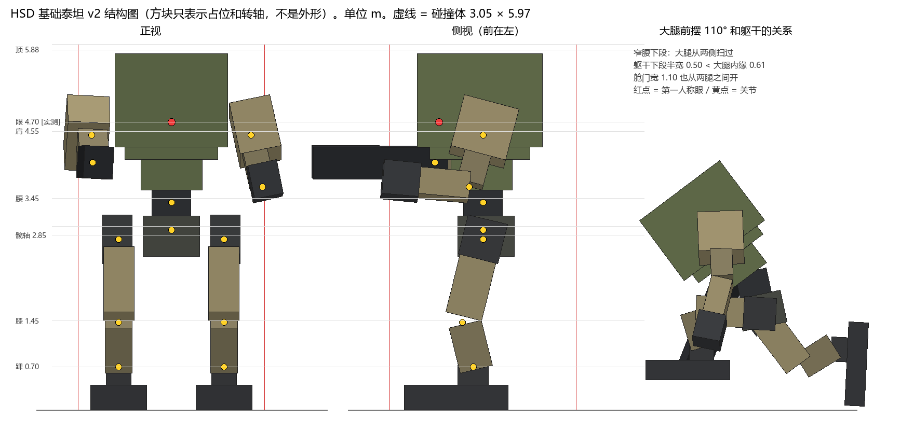
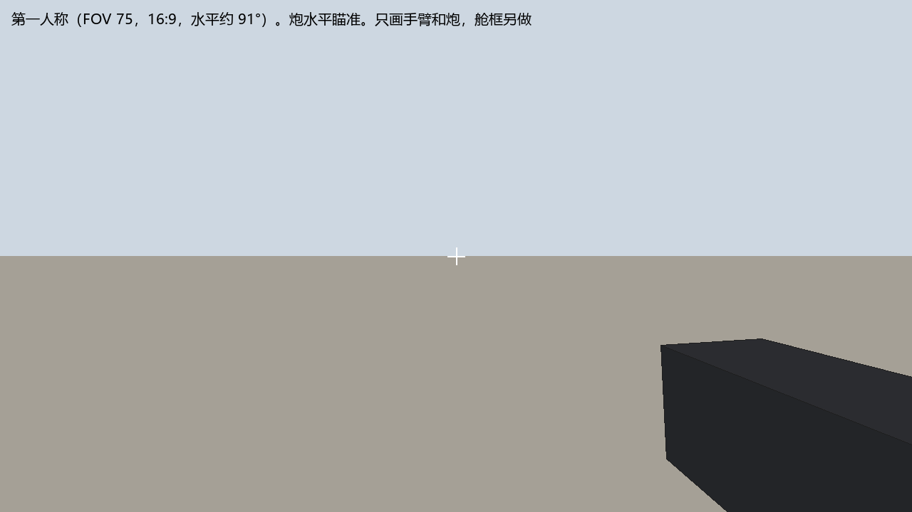
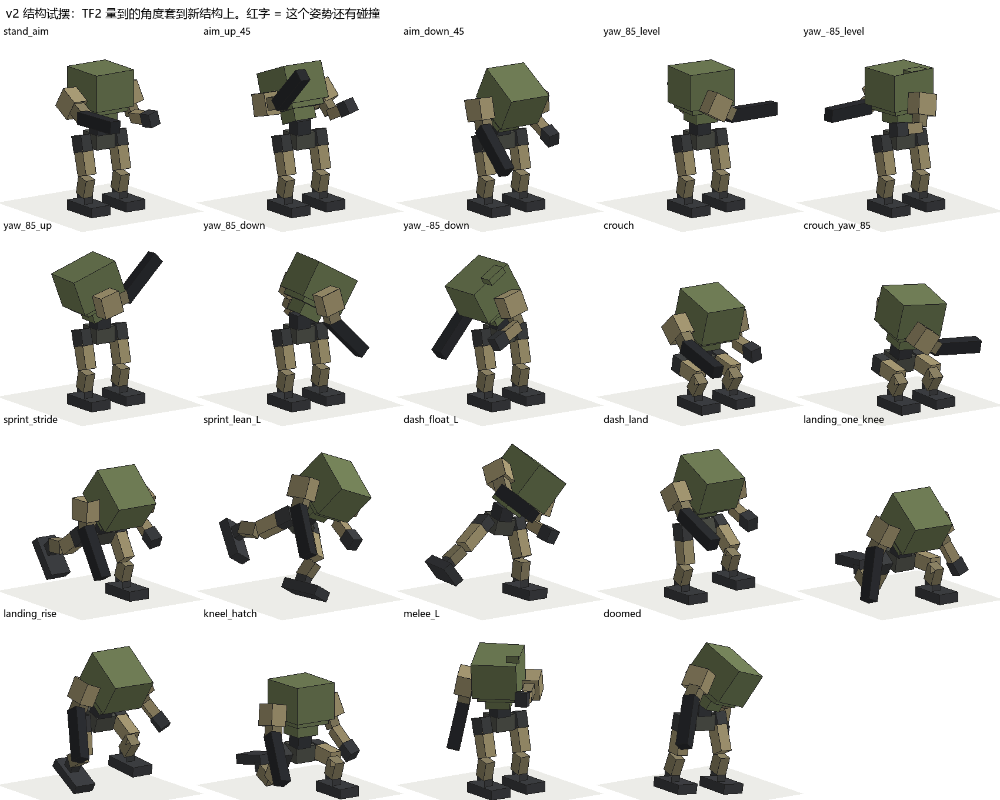

# HSD 基础泰坦 v2：由实测反推的结构

2026-11-02。这次先定动作要求，再推结构和比例，最后才建模。外形服从结构。



**为什么重做：** 旧模型的比例照原画定，没有对照过 TF2。

| 项（中型，米） | TF2 实测 | 旧模型 | v2 |
|---|---|---|---|
| 眼高（碰撞体规定，不能改） | 4.70 | 4.70 | 4.70 |
| 髋轴高 | 2.80 | **3.60** | 2.85 |
| 骨盆高（站 / 蹲） | 2.99 / 1.82 | 3.60 / 2.37 | 2.94 / 1.77 |
| 膝高 | 1.40 | **2.10** | 1.45 |
| 大腿长 / 小腿长 | 1.40 / 0.76 | 1.50 / **1.40** | 1.40 / 0.75 |
| 肩高 | 4.2–4.8（肘动） | **5.30** | 4.55 |
| 炮或枪的高度（水平瞄准） | 4.1–4.2 | 4.4 | 4.04 |
| 主体最高点（站） | 5.92 | 6.25 | 5.88 |
| 蹲时最高点 | 4.79 | 约 5.4 | 4.82 |

最关键的差别：旧模型把身体放得太高，腿下段太长，肩高过了眼睛。TF2 的肩比眼睛低或接近，所以水平瞄准时枪正好出现在视野右下角。

## 1. 要求 → 结构

"依据"列的数据在 `../../pose/TITAN-POSE-CAMERA.md` 和 [out/tf2_geometry.txt](out/tf2_geometry.txt)。

| # | 实测要求 | 依据 | 结构上的做法 | 验证 |
|---|---|---|---|---|
| 1 | 上身跟视线转 ±85°，腿不动 | 腰扭 −86…88 | 腰是一根独立立柱，转轴在 3.45 m | 通过，含蹲和上下瞄 |
| 2 | 大腿前摆到约 110°，同时上身前弯 25° | 髋 −62…+68，全部动作到 110 | **躯干下段做窄**（半宽 0.50），大腿从它两侧扫过（内缘 0.61） | 通过 |
| 3 | 上身前弯到 45°，后仰 25° | 腰前弯 −19…41，dash 落地更大 | 腰柱留出 0.40 的高度，躯干下段离骨盆顶 0.40 | 通过 |
| 4 | 蹲到骨盆 1.8 m | 蹲 72 u | 髋 92° + 膝 115° 能到 1.77；顶 4.82，和 TF2 一样不塞进蹲姿碰撞体 | 通过 |
| 5 | 冲刺跑骨盆前倾 33°、转弯骨盆侧倾 ±34° | 3.1 节 | 骨盆是独立关节（前倾 −25…35，侧倾 ±35，左右 ±30） | 通过 |
| 6 | dash 身体侧倾到 36° | 3.1 节 | 腰侧弯 ±30 + 骨盆 ±10 | 通过 |
| 7 | 水平瞄准时炮在第一人称视野里 | 肩低于眼 | 肩 4.55；上臂 0.90 前摆 60° + 肘 30°，炮内收 8° | 炮口向右 30°、向下 18°，见下图 |
| 8 | 炮能上下瞄 | 胸跟 30–60°，手臂补 | 肩前摆 −60…120，肘 0–120 | 通过 |
| 9 | 跪下、舱门开 120°，铁驭进出 | 用户要的登场和上下机 | 舱门宽 1.10，铰链在下边，从两腿之间翻开 | 站和跪都通过 |
| 10 | 轮廓顶不超碰撞体 | 碰撞体 5.97 | 站立顶 5.88；后仰瞄准时最高 6.26，TF2 走路也到 6.19 | 可接受 |
| 11 | 喷射 dash、损伤分级 | 第 3.3、5.2 节 | 预留挂点（第 3 节） | 建模时做 |



## 2. 外形规则

结构推出来的形状。`out/blueprint.png` 的方块是占位和转轴，不是外形。

1. **上大下窄的躯干。** 上段宽 1.84、深 2.04、高 1.52，往下收成过渡段（宽 1.52），再收成近似圆的下段（直径约 1.0）。收窄的斜面是必须的，不是装饰。
2. **下段要接近圆。** 腰转 85° 时，下段的深度方向会转到两腿之间，所以前后和左右都不能超过 ±0.50。
3. **看得见的腰柱。** 腰柱半径约 0.32，高约 0.6，露在外面。
4. **髋很宽，骨盆很窄。** 髋轴 ±0.86，骨盆半宽 0.46，大腿挂在骨盆外侧。
5. **肩在躯干两侧，不在顶上。** 肩轴 ±1.30，低于眼睛。
6. **短粗的小腿，长大腿。** 小腿 0.75，脚 1.70 长。
7. **炮是前臂。** 肘到炮口 2.00，水平时炮口约 x 2.8，比旧模型短 0.3。

保留旧设计里用户定过的部分：单眼、胸前舱门（下翻）、三指左爪、右前臂炮、肩上火箭巢、一根天线、楔形整块脚、编号 713、沙色加橄榄绿的大色块。`../refs/` 只用来参考这些部件的风格和配色，**比例不要照它**。

## 3. 关节和挂点

全部坐标、限位、零件框、每个姿势的期望关节矩阵都在 [out/spec.json](out/spec.json)。

**层级：**

```
Titan_M_Base
└ J_Pelvis
  ├ J_Waist → J_Torso（J_Waist 和 J_Torso 同点，一个转动就够，保留两个名字给以后拆分）
  │   ├ J_Hatch, J_Optic, J_Launcher_L
  │   ├ J_Shoulder_L → J_Elbow_L → J_Wrist_L → J_Finger_L_1..3, S_Hand_L
  │   └ J_Shoulder_R → J_Elbow_R → W_Cannon → S_Muzzle
  ├ J_Hip_L → J_Knee_L → J_Ankle_L
  └ J_Hip_R → J_Knee_R → J_Ankle_R
```

**限位（度）：**

| 关节 | 自由度和范围 | 依据 |
|---|---|---|
| 骨盆 | 左右 ±30，前倾 −25…35，侧倾 ±35 | 瞄准分配、冲刺跑 |
| 腰 | 左右 ±90，前弯 −25…45，侧弯 ±30 | 第 2.2 节 |
| 髋 | 前摆 −65…110，外展 −20…60，扭 −35…60 | 第 2.2 节 |
| 膝 | 0–140 | 蹲和跪 |
| 踝 | 俯仰 −35…60，侧向 ±20 | 脚掌下压很大 |
| 肩（三轴） | 前摆 −60…120，外展 −30…90，扭 ±45 | 手臂抬到 111，再留余量 |
| 肘 | 左 0–140，右 0–120（炮） | 炮不用握持，比 TF2 小 |
| 腕 | 左 ±45 / ±60 | |
| 舱门 | 0–120 | |
| 单眼 | 左右 ±40，上下 ±25 | TF2 头可到 44 |

**挂点（S_ 开头，新增的加粗）：** `S_Eye`、`S_Seat`、`S_Muzzle`、`S_Hand_L`；**`S_Chest`**；喷口 **`S_Thrust`、`S_Vent_L`、`S_Vent_R`**（躯干背面）；火箭 **`S_Rocket_1..6`**；损伤 **`S_Dmg_Torso_F`、`S_Dmg_Torso_B`、`S_Dmg_Shoulder_L/R`、`S_Dmg_Elbow_L/R`、`S_Dmg_Thigh_L/R`、`S_Dmg_Knee_L/R`**；脚底 **`S_Foot_L`、`S_Foot_R`**。

## 4. 验证结果

`design.py` 用方块模型做碰撞检查（零件框都收进 2 cm，只判断真的穿进去）。

**TF2 真实动画（中型和重型的待机、走、跑、冲刺跑、蹲走、dash，共 784 帧）：** 772 帧没有碰撞，12 帧有（1.5 %）。

| 剩下的碰撞 | 帧数 | 判断 |
|---|---|---|
| 左爪、左前臂碰大腿 | 7（有重叠） | 手臂这里用固定姿势，没有用 TF2 的手臂动作。做动画时抬手就行 |
| 两脚相碰 | 3 | 后退时交叉步，动画里避开 |
| 骨盆碰大腿 | 4 | 大腿内收偏多的帧 |
| 躯干下段碰髋 | 1 | 单帧 |

**手摆的 19 个姿势：** 全部没有碰撞（含登场单膝跪、起身、跪下开舱门、近战、濒死）。



**这些验证的局限：**

- 方块比实际零件简单。建模后要用真实网格再跑一遍，这是新会话的验收项。
- 动画角度是按关节角度套用的，不是真的播 TF2 动画。大腿扭转没有用。
- 姿势是我定的第一版，以后可以调。
- 这张表只覆盖中型。轻型和重型以后从这台改比例。
- 三视图和原画没有更新。如果要 GPT 出新的概念图，应该以这张结构图为依据。

## 5. 文件

| 文件 | 内容 |
|---|---|
| [design.py](design.py) | 结构参数、碰撞检查、姿势集 |
| [draw.py](draw.py) | 从参数生成图和 `spec.json` |
| [out/spec.json](out/spec.json) | 给建模用的全部数据 |
| [out/report.json](out/report.json) | 验证结果 |
