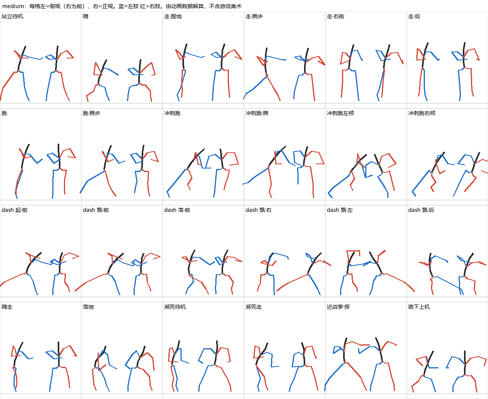

# 泰坦的姿态、关节、镜头和视觉效果

2026-11-02。研究对象是 TF2 的三种底盘。只借规则和数值，不用模型、动画和截图本身。

**数据等级：** 〔动画〕= 解码游戏模型的动画数据算出；〔实测〕= 本地 Northstar 逐帧记录（144 fps）；〔文件〕= 设置文件或脚本；〔推断〕= 由数据推出，没有直接验证。

单位：1 u = 2.54 cm。身体角度都从模型参考姿态算起，所以"胸前倾"是相对值，用来比较状态之间的差别。

你问的"收集时候的镜头"，我按语音误识别理解成**射击时候的镜头**（第 4.3 节）。如果指捡电池，见第 8 节，那部分还没测。

## 1. 结论

| 问题 | 答案 |
|---|---|
| 关节有范围限制吗 | **活着的时候没有，和铁驭一样。** 姿态完全由动画决定，引擎不限制关节。唯一写明的关节限制是死亡布娃娃用的，三种底盘数值相同（第 2.1 节） |
| 那"范围"怎么定 | 看动画实际用到多少。常规动作的范围比想象中集中，极端值只出现在处决和死亡动画里（第 2.2 节） |
| 身体和镜头的关系 | **互相独立。** 走路时骨盆上下起伏 15.5 u，第一人称镜头只晃约 0.4 u。镜头不挂在身体动画上（第 4.1 节） |
| 机械感从哪来 | 不靠限制转向。三个来源：腿迈步滞后、大幅的身体动作（第 3 节）、硬朗的镜头事件（第 4 节） |
| 对现有建模目标的影响 | `BASE-TITAN-TARGET.md` 的**腰部左右 ±35° 明显不够**，TF2 用到约 ±85°。需要你决定（第 6 节） |

## 2. 关节

### 2.1 真正存在的限制

三层，只有第一层影响活着时的玩法：

| 层 | 内容 | 轻 / 中 / 重 | 铁驭（对照） | 来源 |
|---|---|---|---|---|
| 瞄准姿态参数 `aim_yaw` | 上身能跟视线转多少 | −75…70 / ±90 / ±90 | ±135 | 〔动画〕 |
| 瞄准姿态参数 `aim_pitch` | 上身能跟视线俯仰多少 | −75…85 / ±70 / ±87 | −85…90 | 〔动画〕 |
| 腿不动时视线可偏多少 | `aimAngleForward` | ±40 | ±60 | 〔文件〕 |
| 死亡布娃娃约束 | 只有变成尸体才生效 | 三种相同，见下 | 同样机制，数值不同 | 〔动画〕 |

视角本身的俯仰极限：铁驭和泰坦都能到 ±89°〔实测〕。超过身体的跟随范围后，视角继续转，身体不再跟：Ion 的胸在视角 +70° 和 +89° 时完全一样〔实测〕。

布娃娃约束（度，轴是骨骼本地轴）：

| 关节 | x | y | z |
|---|---|---|---|
| 髋 thigh | −15…15 | −15…5 | −10…55 |
| 大腿下段 thighLow | 0 | 0 | −45…45 |
| 膝 knee | 0 | 0 | −55…25 |
| 踝 ankle | −20…10 | −5…5 | −20…20 |
| 脊柱 A / B / C | ±5 / ±10 / ±15 | 同左 | 同左 |
| 肩 shoulder | −5…5 | −50…25 | −90…30 |
| 肘 elbow | −5…5 | −135…15 | −5…5 |
| 腕 wrist | −30…30 | −5…5 | −45…45 |

### 2.2 动画实际用到的范围

每格是"中型（轻 / 重）"，单位度，已去掉参考姿态。"移动"= 待机、走、跑、冲刺跑、蹲走、dash；"常规"= 再加开火、换弹、落地等；"全部"= 再加受击、处决、死亡和剧情，取 0.5%–99.5% 分位。

| 关节 | 移动 | 常规 | 全部 | 单帧极端值 | 建模目标现值 |
|---|---|---|---|---|---|
| 腰·左右扭 | −86…88（−72…67 / −88…80） | −85…83 | −62…49 | ±90 | **±35** |
| 腰·前弯（+）后仰（−） | −19…36（−2…31 / −4…36） | −19…41 | −22…73 | −111…108 | 无 |
| 腰·侧弯 | −22…27（−19…22 / −30…26） | −20…27 | −32…35 | −53…52 | 无 |
| 脖子·左右 | 0…44 | −5…43 | −42…63 | −74…88 | 单眼 ±25 |
| 脖子·俯仰 | −7…14 | −27…28 | −49…41 | −76…91 | 单眼 ±15 |
| 肩·手臂抬起角（0 垂下，90 水平） | 18…111 | 18…111 | 9…177 | 0…177 | ±90 |
| 肘·左（0 伸直） | 0…105 | 0…123 | 0…127 | 0…161 | 0–130 |
| 肘·右（持枪臂） | 75…142（100…132 / 94…142） | 54…141 | 0…135 | 0…161 | 0–130 |
| 髋·前后摆 | −62…68（−45…54 / −43…92） | −59…68 | −50…110 | −79…136 | ±60 |
| 髋·外展 | −18…58 | −18…58 | −24…57 | −38…72 | 无 |
| 膝（0 伸直） | 0…81（9…77 / 0…87） | 0…81 | 0…109 | 0…179 | 0–130 |
| 踝·小腿和脚的夹角 | 1…59（1…59 / 7…103） | 2…54 | 3…69 | 0…109 | ±30（共 60） |

读这张表要注意两点：

- **腰扭 ±85° 不是瞄准造成的，是横移造成的。** 泰坦横着走时骨盆转向移动方向，胸继续朝前（第 3.2 节）。
- 膝和肘的 160–179° 都来自处决和死亡，比如被撕手臂的动画，玩法里用不到。

完整数据：[out/joint_ranges_clean.csv](out/joint_ranges_clean.csv)。

### 2.3 瞄准时动作怎么分给身体

站姿，从正前瞄到极限，各部位转了多少〔动画〕。**手臂基本不动，靠腰和骨盆。**

| 瞄准方向 | 轻型 | 中型 | 重型 |
|---|---|---|---|
| 向左：胸 / 骨盆 / 腰 | −85 / −32 / −52 | −84 / −1 / −82 | −60 / −15 / −45 |
| 向右：胸 / 骨盆 / 腰 | +85 / +54 / +31 | +75 / +7 / +68 | +67 / +17 / +51 |
| 向上：胸 / 骨盆 / 腰 | −60 / −15 / −47 | −29 / −3 / −22 | −63 / −12 / −45 |
| 向下：胸 / 骨盆 / 腰 | +47 / +15 / +46 | +32 / 0 / +32 | +44 / +10 / +32 |

中型向上时还靠抬右臂 +23° 补足（上表没列）。

运行中胸部实际跟随视角的量〔实测〕，取视角 ±89° 时相对平视的差：

| | Ronin | Ion | Legion |
|---|---|---|---|
| 向上 | 57° | 36° | 40° |
| 向下 | 50° | 33° | 48° |

## 3. 各状态的身体姿态



轻型和重型的图：[poses_light.png](out/poses_light.png)、[poses_heavy.png](out/poses_heavy.png)。完整表：[out/state_poses.csv](out/state_poses.csv)。

### 3.1 姿态表（中型，来自动画）

髋高和起伏单位 u。胸前倾、胸侧倾是平均值，括号是一个周期内的摆动幅度。

| 状态 | 周期 | 髋高 | 起伏 | 胸前倾 | 胸侧倾 | 特点 |
|---|---|---|---|---|---|---|
| 站立待机 | 2 s | 118 | 0 | 16 | −6 | 两脚前后错开约 104 u，上身右转约 30° 持枪 |
| 蹲 | 3.3 s | 72 | 0.3 | 18 | −8 | 膝约 51°，髋高降 40 % |
| 走 | 1.17 s | 117 | 15.5 | 14（14） | 1（11） | 步幅约 138 u，骨盆左右摆 13° |
| 跑 | 1.1 s | 112 | 13.7 | 15（11） | −6（15） | 步幅约 161 u |
| 冲刺跑 | 0.87 s | 118 | 12.6 | **41**（3） | −1（20） | 骨盆前倾 33°，骨盆左右摆 42°，幅度最大的移动状态 |
| 冲刺跑转弯 | 0.87 s | 102 | 11 | 34 | **∓25** | 骨盆侧倾 ±34°，髋降 16 u，像摩托过弯 |
| 蹲走 | 1.17 s | 92 | 15.3 | 19（15） | −6（10） | |
| dash 前·飘 | 0.27 s | 85 | 1 | 35 | −22 | 髋降 32 u，身体压低前冲 |
| dash 左·飘 | 0.27 s | 85 | 1 | 14 | **−36** | 两脚分开约 159 u，向滑动方向侧倾 |
| dash 右·飘 | 0.27 s | 85 | 1 | 26 | **+26** | 同上，反向 |
| dash 后·飘 | 0.27 s | 74 | 2 | 10 | +20 | 骨盆后仰 20°，像往后坐 |
| dash 落地 | 0.4 s | 82–100 | 12–41 | 18–23（25–31） | 侧倾幅度最大 48 | 三步小碎步（0.08 / 0.42 / 0.75 周期处踩脚），把冲力收住 |
| 濒死待机 | 8.3 s | 104 | 3 | 28（18） | −2（40） | 身体重心后移，上身晃动、扭动，不再是干净的姿势 |
| 濒死走 | 6.4 s | 108 | 13 | 27（28） | −10（50） | 蹒跚；动画本身配 68 u/s 的脚速 |
| 近战拳 | 0.7 s | 109 | 22 | 27（32） | −11（10） | 胸扭转幅度 **101°**，整个上身抡出去 |

三种底盘的差别：

| 项 | 轻 | 中 | 重 |
|---|---|---|---|
| 待机髋高 | 136 | 118 | 129 |
| 待机胸前倾 | 14 | 16 | 24 |
| 蹲时髋高 / 胸前倾 | 96 / 14 | 72 / 18 | 107 / 40 |
| 两脚左右间距 | 92 | 83 | 124 |
| 走的周期 | 1.0 s | 1.17 s | 1.17 s |
| 冲刺跑转弯骨盆侧倾 | −5 / +13 | ±34 | −24 / +19 |

- 轻型的走和跑是**同一套动画**（数据完全相同），走得比较快的单一步态。
- 重型的 dash 上身和中型相同，腿不同：飘的时候膝更弯（约 70°）。

### 3.2 下半身怎么跟

- **横移：** 不是螃蟹步。腿和骨盆朝移动方向，胸继续朝视线。动画按移动方向在 3 个方向（左前、前、右前，后退也一样）之间混合，所以需要腰部大幅扭转〔动画〕。
- **原地转身（Ion）：** 〔实测〕胸几乎 1:1 跟视线（慢转时差不到 2°；300°/s 快转时滞后约 17°，很快追上）。脚**钉在地上不动**，一直到某个时刻才迈一步，每步腿转约 60°，耗时约 0.3–0.5 s。转身停止后腿可以停在偏 36° 的位置不再修正。
- 触发迈步的角度约 40°，和设置文件的 `aimAngleForward` ±40 吻合〔推断，只分析了 Ion〕。
- 这是最值得学的一条：**视线从不受限，腿滞后。** 既不卡手，又显得重。
- **脚和地面：** 走、跑、冲刺跑、dash 都有脚部 IK 规则，模型里有 `foot_left` / `foot_right` 两条链〔动画〕。斜坡和台阶上的表现没有实测。

### 3.3 动画事件

- 走、跑、冲刺跑每周期两次脚步事件，dash 落地三次。
- dash 从起步第 1/3 处开始在 `THRUST`、`vent_left`、`vent_right` 三处喷射，到落地中段停止：**dash 的视觉是喷气推动，不是腿蹬**。
- 混入混出时间：dash 0.15 s；走和跑混入 0.95 s、混出 0.55 s（中型），冲刺跑混入 0.95 s（中型）/ 0.2 s（轻、重）。

## 4. 镜头

镜头数值三种底盘几乎相同，除非注明。下面的 pitch 负值是抬头。

### 4.1 常驻

| 项 | 铁驭 | 泰坦 | 来源 |
|---|---|---|---|
| FOV | 70 | **75**，所有状态不变（冲刺跑、dash 都不变） | 〔实测〕 |
| 眼高 | 60 | 185，蹲 125 | 〔实测〕 |
| 走路镜头 | | 只有上下约 0.4 u，无旋转 | 〔实测〕 |
| 横移、后退 | | 无旋转 | 〔实测〕 |
| 蹲下 | | 镜头 185 → 125，FOV 不变 | 〔实测〕 |

### 4.2 移动事件

| 事件 | 镜头 | 时间 |
|---|---|---|
| 冲刺跑 | 下沉 25.6 u；同时小幅周期摆动：俯仰 −1.06…+0.51°，左右 ±1.1°，滚转 0…1.76° | 下沉约 1 s 到位，松开约 0.3 s 回升；摆动周期约 0.8 s，和步频一致 |
| dash 左 / 右 | 滚转 ∓8.5°（以前清单写 10°，实测 8.5–8.6°） | 按键后约 0.18 s 到峰值，再约 0.5 s 近似线性回零 |
| dash 前 / 后 | **没有旋转** | |
| 换状态 | 蹲 / 站的高度切换平滑 | |

上面这些三种底盘相同，所以**底盘差别不在镜头事件上**。

### 4.3 射击

| 项 | 数值 |
|---|---|
| ADS 只改 FOV | Ronin、Ion 75 → 55；Legion 不变（转管）〔实测〕 |
| ADS 看到的变化 | 枪上抬到画面中下方，舱框不动，准星缩小 |
| Ronin（散弹）腰射 | 〔11-04 改正，见 full/TF2-GAPS.md：峰值在 0.05–0.06 s，−6.2…−8.2°；下面的 −4.9° 是偏晚的采样〕一枪上跳 −4.9° 于 0.1 s，0.3 s 回到约 −0.1°；滚转约 ±1.7°，左右 −1.9°；ADS 略大（−6.9°） |
| Ion（分裂枪） | 几乎没有：俯仰约 0.1°，滚转约 0.5° |
| Legion（转管） | 〔11-04 改正，见 full/TF2-GAPS.md：只算开火段是俯仰 ±0.5°，左右 ±0.95°，滚转 ±0.82°；下面的数混进了换弹镜头动画〕连射时摆动约：俯仰 −3…+2°，左右 −2.7°，滚转 3.6°〔实测〕 |
| 反馈的分配 | 武器文件有 `viewkick_hipfire_weaponFraction` 0.7 这类键：后坐分给枪和镜头两部分〔文件，XO-16〕 |

各武器的弹簧在 `scripts/weapons/springs.txt`，例如 XO-16 俯仰 55 / 8，散弹 300 / 30。

### 4.4 被击中

规律很干净〔实测 + 文件 `JoltCockpit`〕：

```
强度 = min(伤害 / 2000, 1)
镜头 = 7° × 强度 的旋转 + 7 u × 强度 的位移，位移朝向伤害来源（见下面的改正）
正面来袭：抬头 + 眼睛前移；侧面来袭：滚转和左右同时偏，眼睛移向来源
```

**11-04 改正：** 这里原来写"方向远离伤害来源""正面来袭：抬头 + 后退"。日志相反：来源在正前方（`hurtbig_ion`）时眼睛沿视线 +7.03 u，来源在左（`hurtside_ion`）时向左 +5.27 u，都是朝来源。TF2 脚本算的方向是镜头减来源，再传给原生的 `CockpitJolt`；为什么结果相反没查明，内部取反只是推断。只测了正前和左 90°，**右侧和背后没测**，来源有高度差也没测。

| 输入 | 实测 |
|---|---|
| 正面 1000 | 俯仰 −3.5°，位移 3.5 u |
| 正面 2000 | 俯仰 −7.0°，位移 7.0 u |
| 侧面 1500 | 滚转 −5.3°，左右 +5.3°，位移 5.3 u |

曲线（2000 伤害）：0.15 s 内快速冲到，约 0.26 s 峰值，0.57 s 过零，反向过冲 +0.84°（0.70 s），约 1.4 s 完全平息。**三种底盘相同**，`viewPunchSpring` 的底盘差别不作用在这里。

### 4.5 特殊事件

| 事件 | 镜头 | 来源 |
|---|---|---|
| 近战（Ion、Legion） | 动画驱动的大动作，约 0.8 s：左右 +22 / −14°，滚转 −17 / +14°，俯仰 −4 / +14°，前冲 25 u；之后约 0.8 s 小幅余震（约 0.6°） | 〔实测〕 |
| 近战（Ronin 剑） | 温和得多：左右 −16 / +7°，滚转 +5°，俯仰 ±5°，位移 6 u | 〔实测〕 |
| 核心启动 | 小幅抖动：俯仰约 ±3°，滚转约 ±1.5°，位移约 ±10 u，高度约 ±8 u。Ion 较弱（±1.8°）| 〔实测〕；爆发类用 `CreateShake` 16 / 5 Hz / 2 s，〔文件〕|
| 处决 | 切到**第三人称镜头**（`CE_FLAG_TITAN_3P_CAM`），隐藏主 HUD | 〔文件〕，没实测 |
| 上机（动画） | 约 3.25 s 的第一人称镜头动画，铁驭爬上去：滚转可到 75°，俯仰 −30…+64°；末尾黑场 0.2 s 切入驾驶舱 | 〔实测〕 |
| 开机 | 曝光补偿 −6 闪 0.1 s，LCD 屏幕效果约 2.05 s | 〔文件〕 |
| 下机 | 一开始就切到铁驭，FOV 70；低头看向舱门（俯仰约 43°），约 1.6 s 落定 | 〔实测〕 |
| 弹射 | 按三下，约 0.95 s 后弹出。向上 1500–1700 u/s（实测第一帧 1400，地图有顶，高度只到约 500）。**视角强制低头约 80°，看着脚下的泰坦**；FOV 变 70；弹出后约 0.35 s 无敌 | 〔实测 + 文件〕 |

## 5. 视觉效果

截图只放本地，不进任何仓库：`TF2-Research/local/titan-shots/`（156 张），总览 `local/sheet_*.jpg`。

### 5.1 从驾驶舱看

```
舱内能看到：舱框（屏幕四边）+ 右下的手和枪 + 贴在舱框上的 HUD
看不到：自己的腿、脚、躯干
```

这证实了 `TITAN-DESIGN.md` 第 1 节当时"没实测"的判断。三种底盘的舱框几乎一样，差别主要是枪。

| 状态 | 画面 |
|---|---|
| 正常 | 小地图在左上贴舱框；血条是顶部横梁；技能和弹药在左下屏幕 |
| 护盾被打 | 全屏青色闪光和六边形纹，血条上方护盾段减少 |
| 船体被打 | 全屏红色闪光，准星边变红，舱内屏幕跳火花 |
| 火花规则 | 每损失 1000 血按比例冒火花；刚进濒死固定 20 束；从 6 处面板冒出 〔文件〕 |
| EMP | 画面碎成像素块，HUD 闪烁，持续数秒 |
| 核心启动 | 屏幕中上方出现 "XX CORE ONLINE" 大字；Ion 从舱内射出红色瞄准线；Legion 出现大框 |
| 濒死 | 舱框亮橙红（灯光颜色 0.6, 0.06, 0，半径 70，持续闪），大量火花，血条变成警示条纹并提示自毁键 |
| 弹射 | 舱盖打开，光线变化，警报声；弹出后看到自己的泰坦爆炸 |
| 通用 | 上机后 HUD 分块启动（上下左右中各自延迟），带色差 〔文件 ConVar〕 |

### 5.2 从外面看

`ModelFX` 里写好的分级，**只给别人看**（`ModelFX_HideFromLocalPlayer`）。

| 阶段 | 外观 | 挂点 |
|---|---|---|
| 完好 | 干净 | |
| 护盾被打 | 全身一层蓝色能量壳 | 全身 |
| 第 1 级损伤 | 背部通风口冒白烟 | `dam_vents`、`dam_vent_left/right` |
| 第 2 级 | 通风口喷火 | `dam_vent_left/right` |
| 第 3 级 | 通风口持续烧 | `dam_vents` |
| 被打时 | 肩、肘、膝、大腿处爆点、电弧、火花，飞碎片 | `exp_*`、`dam_*` |
| 濒死 | **全身肢体着火**（肩、肘、大腿、膝各一处），身上射出光束，通风口强火 | `exp_L/R_*`、`exp_torso_main` |
| 死亡 | 白色闪光 → 大火球 → 躯干、舱门、手臂飞散 → 烟 | 碎片挂 `exp_torso_*`、`exp_*` |

**可以直接借的做法：** 不做血条也能读出状态，白烟 → 火 → 全身着火。需要的只是在模型上留挂点。

## 6. 对 HSD 的建议

`BASE-TITAN-TARGET.md` 现在没改，下面等你决定。

| 项 | 目标文档现值 | TF2 用量 | 建议 |
|---|---|---|---|
| 腰·左右扭 | ±35° | 移动 ±85 | **要改，见下** |
| 骨盆 | 没有单独转动 | 瞄准时轻型 ±30–50，重型 ±15 | 加一个骨盆左右转动 |
| 髋 前后 | ±60° | −62…+68，重型到 +92 | 改成 −60…+90 |
| 肩 | ±90° | 手臂抬到 110，处决类更高 | 上抬放到 120° |
| 膝 0–130°、肘 0–130°、踝 ±30° | | 够用 | 不改；右肘是炮臂，另看 |
| 单眼 ±25 / ±15 | | 头 ±44，但头在 TF2 里只是表现 | 不改 |
| 挂点 | 只有 `S_Eye` 等 | 喷口 3 个、损伤点十多个 | 补：`S_Vent_L/R`、`S_Thrust`，肩肘膝大腿各一个 `S_Dmg_*` |

**腰怎么办：**

| 方案 | 做法 | 好处 | 代价 |
|---|---|---|---|
| A 骨盆 ±30 + 腰 ±55 | 轻型的分配 | 合起来 ±85 | 要多同时转一个关节，腿还要反向补偿；实测不比 B 更干净 |
| B 腰 ±85（**推荐，改过**） | 中型的分配 | 只改一个数值，模型结构不动 | 舱门下沿和髋毂有 1 处轻微接触 |
| C 保持 ±35 | 不改 | 模型不用动 | 横移和侧向瞄准的第三人称姿势做不出来；要么限制视线（你不想要），要么炮不指向准星 |

**2026-11-02 更正：** 原来推荐 A，理由是"B 很可能穿模"，那是猜的。在中模上实测（`../model/pose-test/`）：腰转 85° 只有舱门和髋毂 1 对零件接触，A 反而有 2 对。所以改推荐 B。腰管和躯干、骨盆之间的碰撞这次的检测没有覆盖，是看图判断的。

其他已有证据的做法：

1. **镜头和身体分开写。** 身体动画不驱动第一人称镜头。
2. **转身：** 视线不限，上身跟，腿超过约 40° 才迈一步（每步约 60°，0.3–0.5 s）。这比之前"机械感来自镜头"的结论多了一个具体手段，而且只影响第三人称。
3. **被击中：** 第 4.4 节的公式可以直接照写。
4. **dash：** 左右滚转 8.5°，前后没有；身体压低 30 u 左右，视觉靠喷口。
5. **FOV 固定 75**，驾驶时不做冲刺 FOV 变化。

这些和第一人称有关的镜头事件，用 `fps-camera-design` 规程落地时要按 R5 的规则再过一遍（默认规则见 HSD-Unity#62）。

## 7. 你没问、我补的观察点

| 观察点 | 结果在 |
|---|---|
| 瞄准时动作怎么分给身体 | 2.3 |
| 腿和视线的关系、原地转身 | 3.2 |
| 俯仰极限和身体跟随 | 2.1、2.3 |
| FOV | 4.1 |
| 被击中镜头的规律 | 4.4 |
| 近战、核心、上下机、弹射的镜头 | 4.5 |
| 驾驶舱里到底看得见什么 | 5.1 |
| 别人看你：损伤分级和挂点 | 5.2 |
| dash 的喷口和脚步事件 | 3.3 |
| 和铁驭对照 | 2.1、4.1 |

## 8. 没做到的

| 项 | 状态 |
|---|---|
| 第三人称开泰坦 | `thirdperson` 命令没效果，所以自己驾驶时的身体是通过挂点数值看的，外观是看别的泰坦 |
| 泰坦跑动时的外观 | 外观图都是站着或慢走时拍的，跑和 dash 的外观只有骨架图 |
| 处决的镜头 | 只读了脚本。第三人称切换是确定的，轨迹需要有目标才能测 |
| 呼叫降落的镜头和视觉 | 动画（`at_hotdrop_*`，约 3 s）读到了，运行中没测 |
| 牛仔骑乘、捡电池 | 动画名有，都没测 |
| 斜坡和台阶上的脚 | 有 IK 链，没测 |
| 落地 | 泰坦不能跳，从高处落下的镜头没测（`viewkickFallDist*` 有键） |
| 转身规律 | 只分析了 Ion；"约 40° 触发"是推断 |
| 铁驭 | 只对照了瞄准范围、布娃娃和设置，没算逐帧关节 |
| 飞行、悬停、剑核心等专属姿态 | 动画在，这次没统计，选定泰坦后再做 |

## 9. 文件

| 文件 | 作用 |
|---|---|
| [mdl53.py](mdl53.py)、[anim53.py](anim53.py) | 读 MDL v53：骨骼、序列、分段动画 |
| [joints.py](joints.py)、[summarize.py](summarize.py)、[clean_tables.py](clean_tables.py) | 逐帧关节和状态表 |
| [aimgrid.py](aimgrid.py)、[events.py](events.py)、[ragdoll.py](ragdoll.py) | 瞄准分配、动画事件、布娃娃限制 |
| [draw_poses.py](draw_poses.py) | 骨架图 |
| [analyze_cam.py](analyze_cam.py)、[analyze_cam2.py](analyze_cam2.py) | 实测切段和曲线 |
| `../plans_titan.py` | 实验：`t1_cam`、`t1_ext`、`t1_pitch` |
| `../../../mod/HSD.TF2Diag/...hsd_diag_titan*.gnut` | 新命令 `hsd_hurt`、`hsd_hurtpet`、`hsd_shield`、`hsd_watch`、`hsd_eject`、`hsd_emp`；新日志 `CK`、`BD` |

运行：`runtime/data/20261102_133605_t1_cam`、`20261102_134451_t1_ext`、`20261102_135017_t1_pitch`。

解码验证：`@ref` 对骨骼静止姿态的差不到 0.1°（根骨除外，根骨带坐标系转换）；走路时脚掌贴地，前后左右和高度都合理；身体朝向变化和运行中的挂点数据相符。

版权：`local/titan-models/`（解包模型）、`local/titan-shots/`（截图）都在不进版本库的 `local/` 下。如果要留档，按 D-76 放进私有仓库 `HSD-RawData`。
