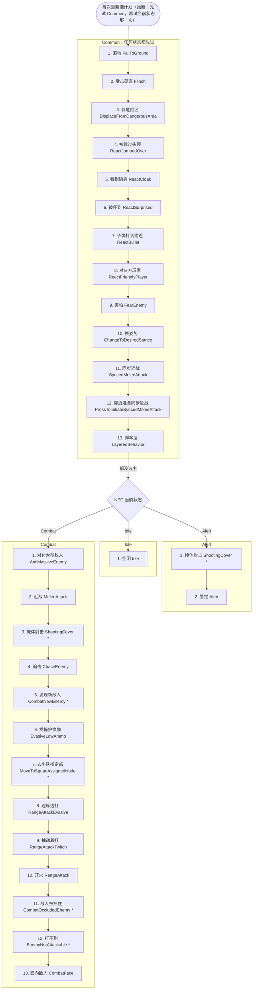
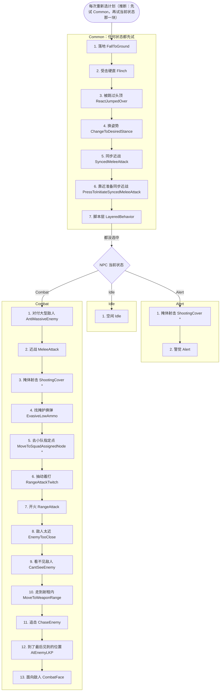
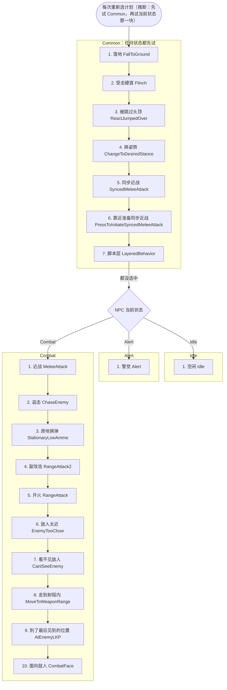
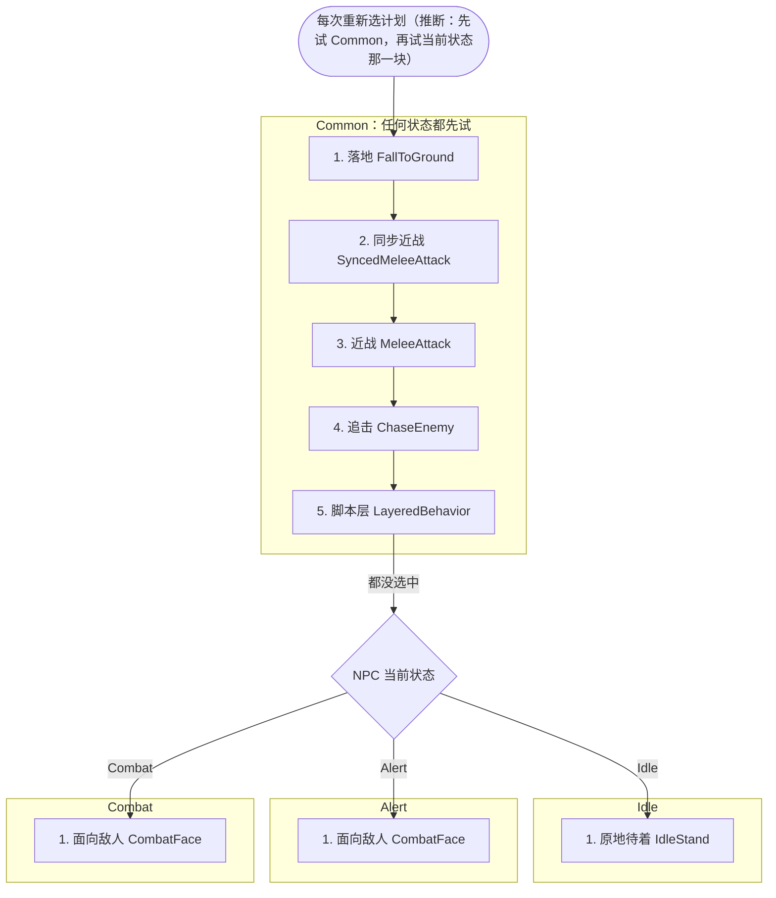
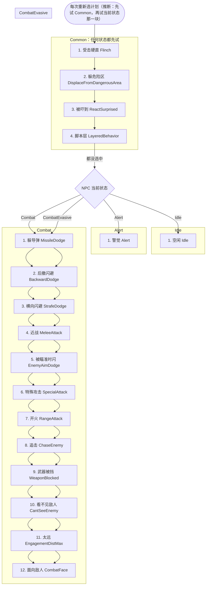
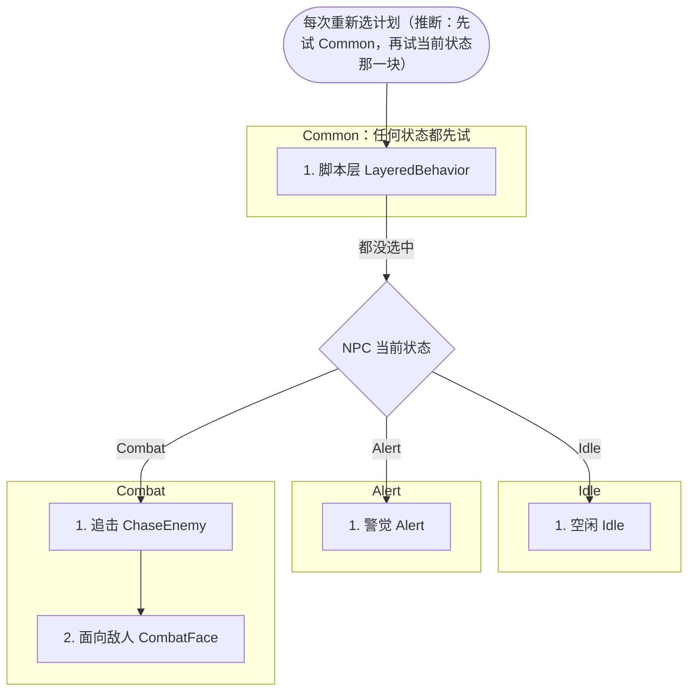
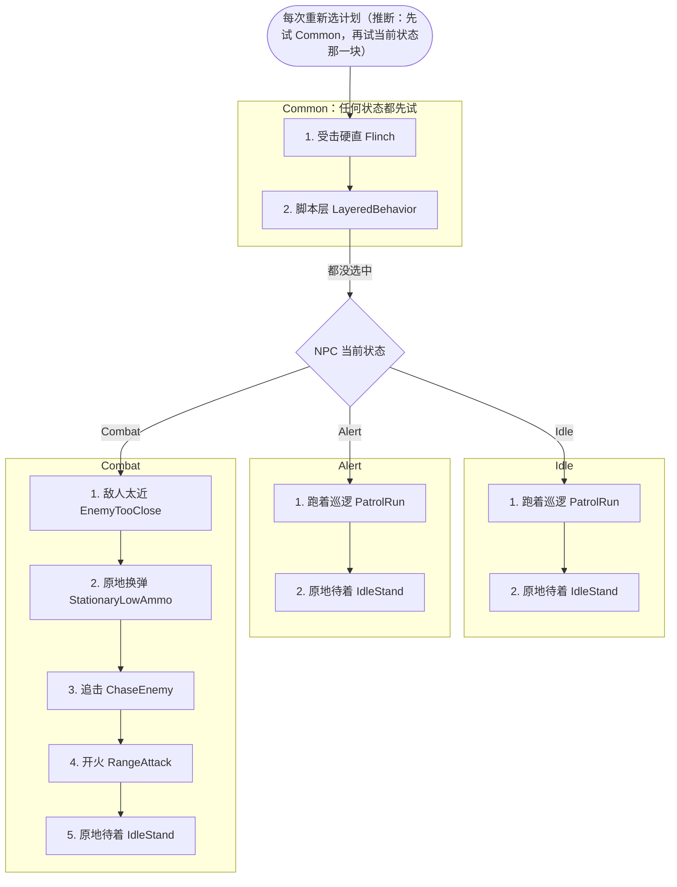
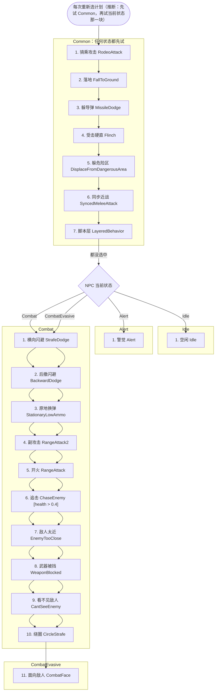
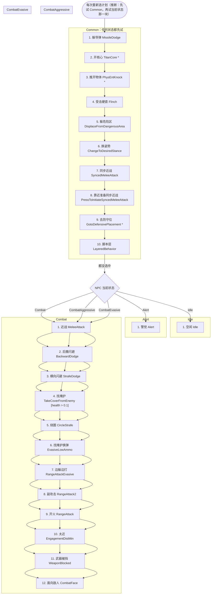

# TF2 敌人 AI 规格（读文件，AI-SPEC）

会话 `tf2-ai-spec`，2026-11-08。任务来源：[../MUST-RUN-1108.md](../MUST-RUN-1108.md) 第 1 项。只读文件，不开游戏。实测和原生代码由 `tf2-ai-live` 写在 [AI-LIVE.md](AI-LIVE.md)。FD 的部分在 [FD-RULES.md](FD-RULES.md)。

## 先说结论

- **TF2 的敌人 AI 是"设置文件 + 行为树 + 计划表"三层，三层都在文件里，而且都是 Respawn 原版。** 每种敌人的设置文件写数值（血量、武器、视野、发现时间、闪避次数……）；行为树写"按什么顺序挑下一步做什么"；计划表写"每一步由哪些动作组成、遇到什么情况中断"。删掉 TF2 以后，这三层都能照着在 Unity 里搭出来。
- **缺的是每一步的具体做法。** 比如"去找掩体"怎么挑掩体、"开火"时子弹怎么偏，这些写在 `server.dll` 的 C++ 里，文件里只有名字。本文把这些地方都标成"原生"，交给 `tf2-ai-live`（读 Ghidra 和实测）。
- **"跑得快就不容易被打中"是脚本里的明确规则。** 玩家在跑墙、在空中、或速度超过 180 时算"快速铁驭"。原版战役里，NPC 对快速铁驭每次开火只有一半机会正常打，另一半强制打偏。Northstar 的多人版按 AI 强度档给命中机会：默认档（Low）是 25 %，机械单位 20 %。
- 另外，一个 11-08 之前没注意到的事实：**行为树和计划表在零售战役包里也有一份**，和 Northstar 的逐字节相同（只差换行符），所以它们是 Respawn 原版，不是社区重写的。设置文件也一样：零售多人包、零售战役包、Northstar 三份完全相同。

怎么读这份文档：第 1 节讲来源；第 2 节是每种敌人的图鉴；第 3–4 节是行为树和计划（"它会做什么、什么时候做"）；第 5 节是感知；第 6 节是出场；第 7 节是命中规则；第 8 节列出交给原生代码研究的部分；第 9 节是"能不能脱离 TF2"。

## 研究清单

状态：☐ 没做 · ◐ 做了一部分 · ☑ 做完 · ✗ 做不了（写原因）

| # | 项 | 要回答什么 | 状态 |
|---|---|---|---|
| 0 | 存档 | `Northstar.CustomServers` 整个 mod 和 `mod_original_playlists_v2.txt` 进 `HSD-RawData`，钉住 1.31.14 | ☑ HSD-RawData#11（没合并） |
| A-1 | 图鉴：步兵类 | 步兵、盾兵队长、特种兵、无人机召唤兵：血量、武器、手雷、近战、弱点、特殊规则，分多人 / 战役 | ☑ 第 2 节（速度、hitbox 位置、只读原生的键要实测，见 2.20） |
| A-2 | 图鉴：机械步兵 | 幽灵、迫击炮幽灵、潜行者 + 爬行（断腿、背包过载） | ☑ 第 2 节（速度、hitbox 位置、只读原生的键要实测，见 2.20） |
| A-3 | 图鉴：死神和扁虱 | 死神（核爆、放扁虱、远跳、闪避）、扁虱（引爆距离、时间） | ☑ 第 2 节（速度、hitbox 位置、只读原生的键要实测，见 2.20） |
| A-4 | 图鉴：无人机 | 全部变体：普通、光束、隐身、电浆、火箭、护盾、工作 | ☑ 第 2 节（速度、hitbox 位置、只读原生的键要实测，见 2.20） |
| A-5 | 图鉴：AI 铁驭 | 精英铁驭 + 刺客三种 | ☑ 第 2 节（速度、hitbox 位置、只读原生的键要实测，见 2.20） |
| A-6 | 图鉴：AI 泰坦 | 普通、核弹、电弧、迫击炮、狙击、FD boss | ☑ 第 2 节（速度、hitbox 位置、只读原生的键要实测，见 2.20） |
| A-7 | 设置文件全表 | 每种敌人每个键的多人 / 战役值（脚本生成） | ☑ `data/aisettings-resolved.tsv` |
| B-1 | 行为树 | 每种敌人的选择器顺序画成流程图，带条件 | ☑ 第 3 节 + [BEHAVIOR-TREES.md](BEHAVIOR-TREES.md) |
| B-2 | 计划 | 每种敌人用到的计划：任务 + 打断条件 | ☑ 第 4 节 + [SCHEDULES.md](SCHEDULES.md)（选择器 → 计划的对应按名字推断） |
| B-3 | 原生部分 | 标出哪些是 C++（交给 `tf2-ai-live`） | ☑ 第 8 节 |
| C-1 | 感知 | 视野、察觉、遗忘、视距等键的含义和每种敌人的值 | ☑ 第 5 节（含义大部分按键名推断，已标出） |
| D-1 | 出场 | 空投舱、运输机滑索、幽灵架、死神跃迁降落、NPC 泰坦降落 | ◐ 第 6 节：脚本部分齐了；取自动画的时长要实测（6.13） |
| E-1 | 快速铁驭打偏 | 战役原版和 Northstar 多人两版伪代码 | ☑ 第 7.1–7.3 节 |
| E-2 | 瞄准收拢 | 每档难度 / 强度的瞄准参数 | ☑ 第 7.5 节（参数含义要原生确认） |
| E-3 | 武器上的 NPC 键 | 敌人用的每把武器的 `npc_*` 键 | ☑ 第 7.7 节 + `data/weapon-npc-keys.tsv` |
| F | FD 能读到的部分 | [FD-RULES.md](FD-RULES.md) | ☑（波次内容本地没有，已写明） |
| G | 能不能脱离 TF2 | 第 9 节 | ☑ |

不做：潜行者四足兽（prowler）和蜘蛛（Apex 有，走 R5）；炮塔（W3 已做）；友军 AI、Boss 战阶段（要用户先定）。

---

## 1. 来源和可信度

路径缩写（和 [../SCAN-1108.md](../SCAN-1108.md) 一致）：

| 缩写 | 路径 | 是什么 |
|---|---|---|
| `AS` | `TF2-Research/local/vpk/client_mp_common/scripts/aisettings/` | NPC 设置文件，146 个 |
| `AB` | `TF2-Research/local/vpk/client_sp_training/scripts/aibehavior/` | 行为树 36 棵 + `behaviors.txt` + `common_schedules.txt` |
| `SV` | `TF2-Research/local/vpk/client_sp_training/scripts/vscripts/` | 零售服务端脚本（战役包，含多人分支） |
| `V` | `TF2-Research/local/vpk/client_mp_common/scripts/vscripts/` | 零售多人共享 / 客户端脚本 |
| `WT` | `TF2-Research/local/vpk/client_mp_common/scripts/weapons/` | 武器 `.txt` |
| `NS` | `HSD-RawData/tf2/northstar-1.31.14/mods/Northstar.CustomServers/mod/scripts/`（= 本机 `<TF2>/R2Northstar/mods/Northstar.CustomServers/mod/scripts/`） | Northstar 1.31.14 服务端 mod |

| 资料 | 几份 | 是否相同 | 结论 |
|---|---|---|---|
| 设置文件 `aisettings/` | `AS`、战役包 `aisettings/`、`NS/aisettings/` | 去掉换行符差别后完全相同（`NS` 多一个 `synced_melee_data.rson`） | Respawn 原版。一份文件里用 `[$mp]` / `[$sp]` 标签同时写多人和战役的值 |
| 行为树 + 计划表 `aibehavior/` | `AB`、`NS/aibehavior/` | 38 个文件去掉换行符差别后完全相同 | Respawn 原版（11-08 新确认；之前以为只有 Northstar 有） |
| 服务端脚本 | `SV`（战役包）、`NS/vscripts/` | 不同 | `SV` 是原版；`NS` 一部分是社区重写，例如 `NS/vscripts/mp/_ai_mp.gnut:14` 注释 "unsure what the logic for deciding this should be" |
| 武器 | `WT` | — | 原版。`MP_BASE` / `SP_BASE` 两块分别写多人和战役值 |

**多人值和战役值。** 设置文件和武器文件里，带 `[$mp]` 的行和 `MP_BASE` 块是多人值，带 `[$sp]` 的行和 `SP_BASE` 块是战役值。本文表格里一格写成 "50 / 90" 时，前面是多人、后面是战役；只写一个数就是两边一样。**HSD 是单人 PvE，默认建议参考战役值，但这是设计决定，本文不替用户选。**

**生成的数据（`pve/data/`，由 `pve/tools/` 的脚本从原文件生成，可以随时重跑）：**

| 文件 | 内容 | 脚本 |
|---|---|---|
| `data/aisettings-resolved.tsv` | 145 种 NPC × 每个键：多人值、战役值、出自哪个文件哪一行（`#base` 继承已展开） | `tools/kv_resolve.py` |
| `data/behavior-trees.tsv`、`data/bt-users.tsv` | 每棵行为树每一项；哪些 NPC 用哪棵树 | `tools/bt_sched.py` |
| `data/schedules.tsv` | 126 个计划的每个任务和打断条件，带行号 | `tools/bt_sched.py` |
| `data/weapon-npc-keys.tsv` | 111 把带 NPC 键的武器 × 每个 `npc_*` / `proficiency_*` 键和几个对照键 | `tools/weapon_npc_keys.py` |
| [BEHAVIOR-TREES.md](BEHAVIOR-TREES.md)、[SCHEDULES.md](SCHEDULES.md) | 全部 36 棵树的流程图、全部 126 个计划的表（附录） | `tools/bt_sched.py` |

重跑（在 `TF2-Research/pve/` 下）：

```bash
py -3 -I tools/kv_resolve.py ../local/vpk/client_mp_common/scripts/aisettings data/aisettings-resolved.tsv
```

```bash
py -3 -I tools/weapon_npc_keys.py ../local/vpk/client_mp_common/scripts/weapons data/weapon-npc-keys.tsv
```

```bash
py -3 -I tools/bt_sched.py ../local/vpk/client_sp_training/scripts/aibehavior data/aisettings-resolved.tsv .
```

```bash
py -3 -I tools/fill_spec.py AI-SPEC.md ../local/vpk/client_sp_training/scripts/aibehavior data/aisettings-resolved.tsv data/weapon-npc-keys.tsv
```

最后一条把本文里 `<!-- kt:… -->` 和 `<!-- chart:… -->` 之间的表和图重新生成。

**11-08 扫读（SCAN-1108）的两处更正：** 计划一共 126 个，不是 124 个（第 2039、2060 行两个 `Schedule` 前面多一个空格，数漏了）；"`soldier_drone_summoner` 没有召唤键"不对，召唤键 `SummonDrone` 在特种兵上（见第 2 节）。

---

## 2. 图鉴

白话：
- **弱点倍率来自玩家手里的枪，不来自敌人**；而且只在玩家打时生效（2.1.1）。泰坦和死神靠暴击点，潜行者的头和背包另有规则。
- **多人的死神不会核爆**（`SV/mp/_ai_superspectre.nut:730–735`：多人里 `ShouldNukeOnDeath` 永远返回 false），11-08 扫读说"死后核爆"只对战役成立。
- 潜行者：断腿就爬（爬行时血量**设成**最大值的 50 %）、打背包会过载自爆；盾兵队长的盾 620、只挡正面 105°、碎后 15 s 重建；泰坦的真实血量在玩家设置 `.set` 里，不在 aisettings（aisettings 写的 8000 不用）。
- 走跑速度由动画决定，文件里没有（要实测）。

### 2.0 先说明

- 这份草稿只写"这种敌人和别的不一样的地方"：血量、武器、近战、弱点、特殊状态、计时、死亡。完整的 aisettings 键表由主会话用脚本生成，这里只引用和规则有关的键。
- 全部来自文件，没有开游戏。每个数字都带 `文件:行号`。
- 标记：
  - `MP` / `SP`：多人 / 战役取值（aisettings 里的 `[$mp]` / `[$sp]`）。没有标签的键两边一样，写成"同"。
  - `（推断）`：只从键名或函数名推出来，脚本里没有用到它的代码。
  - `（原生）`：逻辑在 server.dll（脚本只调用 `npc.Set*` / `Code*` 或只有设置键），交给原生代码那一路。
  - `NS`：Northstar 1.31.14 和零售脚本 SV 的差别。

路径缩写（任务给的 + 我新加的 4 个）：

| 缩写 | 路径 |
|---|---|
| AS | `TF2-Research/local/vpk/client_mp_common/scripts/aisettings/` |
| SV | `TF2-Research/local/vpk/client_sp_training/scripts/vscripts/`（零售服务端，含 `#if MP` 分支） |
| V | `TF2-Research/local/vpk/client_mp_common/scripts/vscripts/` |
| WT | `TF2-Research/local/vpk/client_mp_common/scripts/weapons/` |
| NS | `HSD-RawData/tf2/northstar-1.31.14/mods/Northstar.CustomServers/mod/scripts/` |
| DD（新） | `TF2-Research/local/vpk/client_mp_common/scripts/damage/damagedefs.txt`（和 SP 包的同名文件逐字相同） |
| PS（新） | `TF2-Research/local/vpk/client_mp_common/scripts/players/mp/`（泰坦的玩家设置 `.set`） |
| FE（新） | `TF2-Research/local/vpk/client_frontend/scripts/vscripts/`（`sh_consts.gnut` 在这里） |
| AB（新） | `TF2-Research/local/vpk/client_sp_training/scripts/aibehavior/`（行为树） |

**SV 和 NS 的总体关系（已逐个比对）：** 下面用到的 AI 脚本（`ai/_ai_stalker`、`_ai_personal_shield`、`_ai_spectre`、`_ai_suicide_spectres`、`_ai_drone`、`_ai_cloak_drone`、`_ai_pilots`、`_ai_nuke_titans`、`_ai_emp_titans`、`_ai_mortar_titans`、`_ai_spawn`、`_ai_spawn_content`、`mp/_ai_superspectre.nut`、`mp/_titan_npc.nut`、`mp/_base_gametype.gnut` 的部位伤害函数）在 NS 里和 SV 只差换行和缩进，规则一样。真正的差别只有：

1. NS `vscripts/ai/_ai_soldiers.gnut:62-79` 多了一个空的步兵死亡回调（只为让客户端收到死亡事件，不改玩法）。
2. NS 有 4 个 SV 没有的空壳文件：`vscripts/ai/_ai_mortar_spectres.gnut:1-7`（返回空数组）、`vscripts/ai/_ai_sniper_titans.gnut`（只有一行注释）、`vscripts/ai/_ai_soldiers_mp.gnut`（只有一行注释）、`vscripts/gamemodes/_gamemode_fd.nut:1-11`（FD 空壳）。这说明零售多人服务端里有这几个文件，但内容我们拿不到。

---

### 2.1 所有敌人共用的规则（各节会引用）

#### 2.1.1 部位伤害（弱点）只对玩家生效

`SV/mp/_base_gametype.gnut:471-558`（NS 相同）。每次伤害按下面顺序判断，只走第一条命中的分支：

1. 攻击者不是玩家 → 不做任何部位加成（L473-476）。
2. 受害者是泰坦 → 乘"暴击倍率"（L520-523，见 2.1.3）。
3. 受害者是死神 → 武器带 `critical_hit` 且打中暴击判定盒时，乘暴击倍率并加 `DF_CRITICAL`（L524-531）。
4. 受害者是潜行者 → 打中 `HITGROUP_GEAR`（背包）只加 `DF_CRITICAL` 标记，**不乘倍率**；头部也不乘倍率，潜行者的头另有规则（L532-541，见2.8）。
5. 其他（步兵、幽灵、铁驭、扁虱、无人机）且是有效爆头 → 乘玩家武器的 `damage_headshot_scale`（L542-545，倍率函数 L452-469）。

所以**弱点倍率来自玩家手里的枪，不来自敌人**。例：R-201 的 `damage_headshot_scale` MP 1.5、SP 3（`WT/mp_weapon_rspn101.txt:124,177`）；L-STAR MP 1.5、SP 2（`WT/mp_weapon_lstar.txt:342,392`）。

#### 2.1.2 什么算有效爆头

`V/sh_damage_utility.gnut:68-128`：

1. 伤害已带 `DF_HEADSHOT` → 算（L72-73）。
2. 攻击者是泰坦，且受害者不是幽灵 → 不算（L88）。
3. 命中组不是 `HITGROUP_HEAD` → 不算（L91）。命中组先用 `hitGroup`，没有时用 hitbox 反查（L80-81）。
4. 攻击者不是玩家 → 不算（L94）。
5. 距离 > 武器的 `damage_far_distance`（`GetMaxDamageFarDist`）→ 不算（L109-112）。
6. 最后看武器 `allow_headshots`（L115）。

头部在模型的哪个 hitbox、命中组怎么分配，在模型数据里（原生 / 要实测）。

#### 2.1.3 暴击（泰坦、死神）

`V/sh_damage_utility.gnut:52-65`：武器带 `critical_hit` 且 `IsCriticalHit(...)` 为真（原生，按 hitbox 判断）时，乘 `critical_hit_damage_scale`。例：泰坦武器 `mp_titanweapon_particle_accelerator` 是 1.5（`WT/mp_titanweapon_particle_accelerator.txt:159-160`）；铁驭步枪多为 1（如 `WT/mp_weapon_rspn101.txt:90`）。哪些 hitbox 是暴击点在模型里（原生 / 要实测）。

#### 2.1.4 电击 / EMP 反应

`SV/weapons/_weapon_utility.nut:3027-3150`。会触发这段的伤害来源：EMP 手雷、近炸雷、充能工具、帝王能量汲取（L219-222）。对各类敌人：

| 敌人 | 反应 | 出处 |
|---|---|---|
| 潜行者、幽灵 | 能打断时播 `ACT_STUNNED` | L3051-3058 |
| 死神 | 没被挂载、没在上下文动作、能打断时播 `ACT_STUNNED` | L3060-3068 |
| 步兵（含专家、护盾队长） | 播 `ACT_STUNNED`，期间允许受伤动画 | L3070-3079 |
| 空中无人机（工蜂除外） | 进入"重启"5 s，见2.11 | L3085-3092，`DRONE_REBOOT_TIME` L121 |
| 所有被电的 | 发 `ArcStunned` 信号（护盾队长的护盾会因此消失） | L3100 |
| 带 `destroyed_by_emp` 状态的 | 伤害改成当前血量（一击毁掉） | L3120-3121 |
| MP 泰坦 | EMP 减速 2.5 s | L3133-3136 |
| MP 机械单位（非泰坦） | EMP 减速 2.5 s，伤害 ×2.05 | L3140-3145 |
| MP 人类 | 伤害 ×0.99 | L3147-3151 |

`IsMechanical()` 应该读 aisettings 的 `mechanical` 键（推断）。

#### 2.1.5 移动速度

人形 NPC、幽灵、潜行者、死神、泰坦的行走 / 奔跑速度由动画决定，aisettings 里没有速度键（原生 / 要实测）。文件里只有几个提示：`footstepSprintSpeedThreshold`（步兵 100 `AS/npc_soldier.txt:19`，潜行者 85 `AS/npc_stalker.txt:24`，死神 500 `AS/npc_super_spectre.txt:33`，推断是"超过这个速度用冲刺脚步声"）。只有无人机（飞行速度键）和扁虱（速度倍率）有明确数字。

#### 2.1.6 MP：每 3 个步兵 / 幽灵发一把火箭筒

`SV/ai/_ai_spawn_content.gnut:702-739`：只在 MP（L705-706）。计数器从 0 开始，每生成一个就减 1，减到 ≤0 时发 `mp_weapon_rocket_launcher` 并重置为 3（L713-721），所以第 1、4、7……个拿到，即每 3 个 1 把（代码注释写"每第 4 个"，和代码不一致；11-08 主会话复核改正）。步兵和幽灵都走这条（L297-298、L343-344）。拿到火箭筒的步兵换背火箭的模型（L723-738）。之后敌人换目标时：目标是重甲就切到反泰坦武器，否则切回普通枪（`SV/ai/_ai_soldiers.gnut:294-367`）。火箭筒 NPC 数值：MP 直击 80、对泰坦 800、爆炸 100（`WT/mp_weapon_rocket_launcher.txt:108-112`），每次 1 发，间隔 3.5–4 s（L123-126）。

---

### 2.2 步兵 npc_soldier（含 npc_soldier_sidearm）

| 项 | MP | SP | 出处 |
|---|---|---|---|
| 血量 | 50 | 90 | `AS/npc_soldier.txt:51-52` |
| 护甲 | normal | 同 | `AS/npc_soldier.txt:5` |
| 主武器 | mp_weapon_rspn101 | 同 | `AS/npc_soldier.txt:41` |
| 主武器 NPC 伤害 近/远 | 10 / 8 | 13 / 8 | `WT/mp_weapon_rspn101.txt:135-136,200-201` |
| 连发 / 间隔 | 2–4 发 / 0.5–0.8 s | 同 | `WT/mp_weapon_rspn101.txt:216-219` |
| 手雷 | mp_weapon_frag_grenade | 同 | `AS/npc_soldier.txt:29` |
| 手雷 NPC 爆炸伤害 | 125 | 32 | `WT/mp_weapon_frag_grenade.txt:38,64` |
| 手雷半径 内/外，引信 | 5 / 320，3.25 s | 同 | `WT/mp_weapon_frag_grenade.txt:128-129,145` |
| 近战伤害 | 30 | 53 | `AS/npc_soldier.txt:69-72` |
| 近战距离 / 伤害半径 | 40 / 40 | 60 / 60 | `AS/npc_soldier.txt:73-76` |
| 冲撞近战 | 20 伤害，半径 35，距离 0，±30°，间隔 3 s，只打玩家 | 同 | `AS/npc_soldier.txt:79-86` |
| 受伤动画阈值（8 s 内累计） | 15 | 39 | `AS/npc_soldier.txt:54-56`（推断：8 s 是 `RepeatDamageTimeInterval`） |
| 重伤动画阈值 | 80（注释：比血量高，普通步兵永远不触发） | 同 | `AS/npc_soldier.txt:58` |
| 摔死高度 | 300 | 同 | `AS/npc_soldier.txt:62`（推断） |
| 蹲着打的距离 内/外 | 350 / 450 | 500 / 650 | `AS/npc_soldier.txt:102-103,140-141`（推断） |
| 反应几率 | 60 | 90 | `AS/npc_soldier.txt:196-199`（推断） |

**特殊规则**

1. 弱点：头。玩家有效爆头时伤害乘玩家武器的爆头倍率（见 2.1.1、2.1.2）。aisettings 只给了辅助瞄准的头部挂点 `HEADSHOT`，半径 8（`AS/npc_soldier.txt:66-67`）。
2. 冲撞近战距离是 0（`AS/npc_soldier.txt:82`），所以实际不会冲撞（推断）。
3. 生成时打开"蹲着打"标志（`SV/ai/_ai_spawn_content.gnut:273`）；如果当前武器是手枪类（`WT_SIDEARM`），关掉蹲着打（L172-174）。
4. MP 每个小兵：永远警觉、贴近小队、听到声音就找新敌人、不巡逻不调查（`SV/ai/_ai_soldiers.gnut:150-171`）。
5. MP 每 3 个发一把火箭筒（2.1.6）。
6. 被 EMP：播眩晕动画；MP 伤害 ×0.99（2.1.4）。
7. 模型按武器子类换（步枪 / 冲锋枪 / 霰弹 / 机枪），MP 的步枪兵随机三选一（`SV/ai/_ai_spawn_content.gnut:768-863`），只影响外观。
8. 死亡：布娃娃或碎块，由伤害标志决定（原生 / `sh_death_package`）。
9. **npc_soldier_sidearm**：只把武器换成 `mp_weapon_semipistol`（`AS/npc_soldier_sidearm.txt:5`）。NPC 伤害 MP 13/10、SP 20/10，连发 2–5 发、间隔 0.2–0.3 s（`WT/mp_weapon_semipistol.txt:113-114,128-131,163-164,179-182`）。拿手枪时不蹲着打（规则 3）。

**原生 / 要实测：** 走跑速度、换掩体、扔雷时机（`SelectSchedule_ThrowGrenade`）、近战判定时机、开枪散布全是原生。

**NS：** 只多一个空死亡回调（2.0）。

---

### 2.3 护盾队长 npc_soldier_shield_captain（和 npc_soldier_drone_summoner）

继承步兵（`#base`，`AS/npc_soldier_shield_captain.txt:1`），下表只列改动。

| 项 | MP | SP | 出处 |
|---|---|---|---|
| 血量 | 350 | 150 | `AS/npc_soldier_shield_captain.txt:9-10` |
| 受伤动画阈值 | 260 | 110 | `AS/npc_soldier_shield_captain.txt:12-13` |
| 主武器 | mp_weapon_lmg | 同 | `AS/npc_soldier_shield_captain.txt:7` |
| 机枪 NPC 伤害 近/远 | 15 / 11 | 12 / 8 | `WT/mp_weapon_lmg.txt:130-131,186-187` |
| 连发 / 间隔 | 3–6 发 / 1.0–1.5 s | 5–10 发 / 1.0–1.5 s | `WT/mp_weapon_lmg.txt:149-152,206-209` |
| 瞄准转速 | 3（步兵 7） | 同 | `AS/npc_soldier_shield_captain.txt:15` |
| 个人护盾 | 有（`PersonalShield 1`） | 同 | `AS/npc_soldier_shield_captain.txt:5` |
| 护盾血量 | 620 | 同 | `SV/ai/_ai_personal_shield.gnut:5,118-119` |
| 护盾半径 / 高度 / 正面角 | 45 / 102 / 105° | 同 | `SV/ai/_ai_personal_shield.gnut:91-94`，`SV/ai/_ai_drone.gnut:24` |
| 护盾没了以后重建 | 15 s | 同 | `SV/ai/_ai_personal_shield.gnut:34-40` |
| 贴身电击伤害（普通 / 重甲） | 15 / 100，内 128、外 256 | 同 | `DD:255-267` |

**特殊规则**

1. 生成时（`SV/ai/_ai_spawn_content.gnut:300-304`）：关掉逃跑、手势、掩体射击、蹲着打，然后启动护盾线程。
2. 护盾是一个 `vortex_sphere`，吸收子弹、挡 NPC 射线（`SF_ABSORB_BULLETS | SF_BLOCK_OWNER_WEAPON | SF_BLOCK_NPC_WEAPON_LOF | SF_ABSORB_CYLINDER`，`SV/ai/_ai_personal_shield.gnut:103`）。圆柱形，中心在队长脚下 + (0,0,45−64) = 往下 19（L117）。
3. 跟随：每帧把护盾移到队长位置（0.1 s 移过去），朝向转到队长视线的水平角，转动用 1.35 s（`SV/ai/_ai_personal_shield.gnut:245-260`）。所以快速绕到侧面时护盾跟不上。
4. 护盾只挡正面 105° 的弧（`bullet_fov`，L93、L107）。从侧后打能绕过（推断：弧外不吸收是 vortex 原生行为）。
5. 护盾血量 620，被打掉就消失（vortex 吸收伤害的细节是原生）。护盾带 `destroyed_by_emp` 状态（L114），被 EMP 打一下直接毁（2.1.4）。
6. 护盾线程在这些情况结束：护盾被毁、队长死、队长被电（`ArcStunned`）、MP 下特效被删（L166-173）。结束后等 15 s 重建（L34-40）。
7. 被处决（同步近战）时护盾立刻删除（L19、L22-29）。
8. 贴身电击（"疼痛护盾"模式 `AI_PERSONAL_SHIELD_PAIN_SHIELD_STYLE = true`，L6）：每帧检查每个敌方铁驭（`SV/ai/_ai_personal_shield.gnut:262-297, 308-357`）：
   1. 距上次被这类护盾电过 < 1.0 s → 跳过（L316-319）。
   2. 和护盾中心的水平距离在 半径−15 到 半径+5 之间（30–50）（L330-333）。
   3. 高度差 ≤ 102（L335-338）。
   4. 在护盾正面弧内（L340）。
   5. 满足就：EMP 眩晕 1.5 s（1.0 + 0.5），屏幕 EMP 强度 0.4、1.0 s、淡出 0.5 s（L345-348）；再在玩家脚下放一次 `damagedef_shield_captain_arc_shield`（L291，数值见上表）。不推开（推开只在旧模式 L351-354）。
9. 护盾血量低于 50% 时队长喊话（`PERSONAL_SHIELD_HEALTH_FRAC_DAMAGED 0.5`，L7、L216-227），只是语音。
10. MP：队长隐身时隐藏护盾特效（L206-211）。

**npc_soldier_drone_summoner**：文件只有 `#base "npc_soldier_shield_captain.txt"`（`AS/npc_soldier_drone_summoner.txt:1-4`），所以就是护盾队长。召唤无人机靠 `SummonDrone` 键（`SV/_on_spawned.gnut:171`，`AISetting_SummonDrone()` 是原生取值，推断读这个键），这个文件没有，所以只有关卡给了 `script_drone_type` 键时才会召唤（L156-169）。旧名 `npc_soldier_drone_summoner_shield` 被重定向到它（L248-249）。`SV/ai/_ai_spawn.gnut:287` 引用的 `npc_soldier_drone_summoner_rocket` 在 AS 里没有这个文件。

**原生 / 要实测：** vortex 吸收子弹和扣护盾血的方式、护盾挡住队长自己开枪吗（`SF_BLOCK_OWNER_WEAPON` 的确切含义）（推断）。

**NS：** 只有 `1.00` 写成 `1.0` 的差别（NS `vscripts/ai/_ai_personal_shield.gnut:317`）。

---

### 2.4 专家 npc_soldier_specialist（含 _militia、pve_specialist）

继承步兵。

| 项 | MP | SP | 出处 |
|---|---|---|---|
| 血量 | 120 | 同（无标签） | `AS/npc_soldier_specialist.txt:15` |
| 受伤动画阈值 | 90 | 同 | `AS/npc_soldier_specialist.txt:16` |
| 主武器 | mp_weapon_lstar | 同 | `AS/npc_soldier_specialist.txt:12` |
| L-STAR NPC 伤害 近/远 | 15 / 10 | 10 / 10（对泰坦 30） | `WT/mp_weapon_lstar.txt:346-349,396-398` |
| 连发 / 间隔 | 5–8 发 / 3–4 s | 5–8 发 / 2–3 s | `WT/mp_weapon_lstar.txt:360-363,410-413` |
| "手雷" | mp_weapon_frag_drone（扔扁虱） | 同 | `AS/npc_soldier_specialist.txt:13` |
| 召唤无人机 | npc_drone_plasma | 同 | `AS/npc_soldier_specialist.txt:4` |
| 机械单位 | 是（`mechanical 1`） | 同 | `AS/npc_soldier_specialist.txt:9` |

**特殊规则**

1. 召唤电浆无人机（`SV/ai/_ai_drone.gnut:1023-1070`），循环：
   1. 打开掩体射击、蹲着打（L1034）。
   2. 等随机 0–1 s（L1044）。
   3. 挂在别的东西上 → 跳过（L1047-1048）。
   4. 面前 64 处向上净空 < 120 → 跳过（L1051-1052，L1073-1088，`DRONE_MINIMUM_DEPLOY_CLEARANCE_FROM_GROUND` L25）。
   5. 没有活着的敌人 → 跳过（L1054-1056）。
   6. 不能打断（正在做动作）→ 跳过（L896-898）。
   7. 放出无人机：净空 ≥ 256 用"旋转抛出"动画，120–256 用"室内"动画（L912-926）。无人机先不可碰撞，3 s 后才能碰（L938、L952-957）。无人机继承主人当前敌人的最后位置（L864-869）。
   8. 一直等到无人机死或被骇（L1066、L1091-1098）。
   9. 再等 15 s（L1068），回到 2。
   10. MP：主人死后，它放的无人机随机 2–10 s 后自毁（L876-891、L943-945）。
2. 扔扁虱：`mp_weapon_frag_drone` 落地后生成 `npc_frag_drone_throwable`，敌人设为扔的人的当前敌人（`V/weapons/mp_weapon_frag_drone.nut:50-105`）；NPC 扔的扁虱爆炸用 `damagedef_frag_drone_throwable_NPC`（`SV/ai/_ai_suicide_spectres.gnut:163-167`）。详细规则见2.10。什么时候扔是原生的扔雷计划。
3. 机械单位：MP 被 EMP 时减速 2.5 s、伤害 ×2.05，同时也播步兵的眩晕动画（2.1.4）（推断：`IsMechanical` 读 `mechanical`）。
4. 死亡碎块用幽灵的四肢模型（`AS/npc_soldier_specialist.txt:22-38`），外观。
5. 不按武器换模型（`IsGenericGrunt 0`，L7；`SV/ai/_ai_spawn_content.gnut:771-772`）。
6. **_militia**：只换模型和标题，其余逐行相同（`AS/npc_soldier_specialist_militia.txt:1-44`）。
7. **npc_soldier_pve_specialist**：和专家相同，换成护盾队长的模型，多一个 `returnToIdleTime 3`（`AS/npc_soldier_pve_specialist.txt:18-20,44`）。

**原生 / 要实测：** 扔扁虱的距离和频率。

---

### 2.5 pve_eliteguard / pve_sandbox

| 项 | 值 | 出处 |
|---|---|---|
| npc_soldier_pve_eliteguard | 步兵 + 换模型 `imc_grunt_rifle_pve.mdl` + `returnToIdleTime 3` | `AS/npc_soldier_pve_eliteguard.txt:1-11` |
| npc_soldier_pve_sandbox | 步兵 + `returnToIdleTime 3` | `AS/npc_soldier_pve_sandbox.txt:1-6` |

**特殊规则：** 没有。SV、V、NS 脚本里都找不到这三个 `pve_*` 名字的引用（全文搜过），只存在于 aisettings。`returnToIdleTime` 推断是"多久没见到敌人回到空闲状态"（推断，原生读取）。

---

### 2.6 幽灵 npc_spectre

| 项 | MP | SP | 出处 |
|---|---|---|---|
| 血量 | 100 | 130 | `AS/npc_spectre.txt:169-170` |
| 护甲 / 机械 | normal / 是 | 同 | `AS/npc_spectre.txt:15,21` |
| 主武器 | mp_weapon_rspn101（数值同步兵） | 同 | `AS/npc_spectre.txt:38` |
| 近战伤害 | 20 | 53 | `AS/npc_spectre.txt:163-167` |
| 近战距离 / 半径 | 65 / 40 | 60 / 60 | `AS/npc_spectre.txt:175-179` |
| 冲撞近战 | 80（重甲也 80），半径 25，距离 135，间隔 1 s，打任何护甲 | 同 | `AS/npc_spectre.txt:181-188` |
| 远跳 | 每 15–30 s 检查一次，距离 400–700，高 300 | 同 | `AS/npc_spectre.txt:41-45` |
| 受伤动画阈值 重伤 / 累计 | 32 / 70 | 同 | `AS/npc_spectre.txt:172-173` |
| 追击停步距离 普通 / 对重甲 | 300 / 800 | 同 | `AS/npc_spectre.txt:25-26` |
| 骇入距离 | 150 | 同 | `AS/npc_spectre.txt:154` |

**特殊规则**

1. 弱点：头（2.1.1）。爆头击杀时额外做外观：死亡回调里如果是有效爆头，隐藏头部身体组、标记爆头（`SV/ai/_ai_spectre.gnut:21-37`）。这是死后才做的，不加伤害。
2. 可被骇入：SP 一直可以；MP 只有队伍是 IMC / 民兵且游戏列表变量 `enable_spectre_hacking` 为 1 时才可以（`SV/ai/_ai_spawn_content.gnut:319-333`）。骇入是玩家动作：提示距离 96、朝向点积 0.85（`SV/pilot/sh_pilot_leeching.gnut:16-17`），骇入时周围 384 内的幽灵一起转阵营（`SV/pilot/_pilot_leeching.gnut:13,275-304`）。
3. 玩家泰坦带被动 `PAS_WIFI_SPECTRE` 踩到幽灵 → 不受伤，直接被骇（`SV/_codecallbacks_common.gnut:155-185`）。
4. 被 EMP：播眩晕动画；MP 额外减速 2.5 s、伤害 ×2.05（2.1.4）。
5. MP 打开蹲着打（`SV/ai/_ai_spawn_content.gnut:321`）；MP 每 4 个发一把火箭筒（2.1.6）。
6. SP：关卡给 `carrying_battery 1` 时背一块泰坦电池，死后电池掉下并以向上 200 的速度弹出（`SV/ai/_ai_spectre.gnut:105-131`）。
7. 死亡：碎块四肢 + `P_exp_spectre_death` 特效（`AS/npc_spectre.txt:47-63`），什么时候碎由伤害标志决定（原生）。

**原生 / 要实测：** 远跳、冲撞的触发条件。

---

### 2.7 迫击炮幽灵 npc_spectre_mortar

继承幽灵（`AS/npc_spectre_mortar.txt:1`）。只改：`minGoalRadius 8`（L6）、`assaultHarvester 0`（L7）、MP 的视野竖直角（L9-26）。

**特殊规则：找不到。**
- `SV/ai/_ai_stationary_firing_positions.gnut:67-75` 调用 `MortarSpectreGetSquadFiringPositions`，SV 里没有这个函数的定义；NS 的版本是空壳，直接返回空数组（NS `vscripts/ai/_ai_mortar_spectres.gnut:1-7`）。零售多人服务端有这个文件，我们没有。
- WT 里没有幽灵迫击炮武器文件。
- 唯一线索：迫击炮泰坦的导弹追踪函数对非泰坦主人用音效 `weapon_spectremortar_projectile`（`SV/ai/_ai_mortar_titans.gnut:88-90`），推断迫击炮幽灵用同一套导弹逻辑（见2.16）（推断）。
- FD 界面里有它的编号和图标（`V/gamemodes/sh_gamemode_fd.nut:50,102`）。

**原生 / 要实测：** 全部（要实测或另找资料）。

---

### 2.8 潜行者 npc_stalker 家族

| 项 | MP | SP | 出处 |
|---|---|---|---|
| 血量 | 150 | 250 | `AS/npc_stalker.txt:116,123` |
| 护甲 / 机械 | normal / 是 | 同 | `AS/npc_stalker.txt:18,25` |
| 主武器 | mp_weapon_lstar（数值见2.4） | 同 | `AS/npc_stalker.txt:47` |
| 近战伤害 | 20 | 53 | `AS/npc_stalker.txt:114-115,121-122` |
| 近战距离 / 半径 | 50 / 30 | 60 / 60 | `AS/npc_stalker.txt:128-132` |
| 受伤动画 重伤 / 累计 | 80（注释"MP 关掉"）/ 50 | 59 / 75 | `AS/npc_stalker.txt:118-119,125-126` |
| 追击停步 普通 / 对重甲 | 500 / 800 | 75 / 200 | `AS/npc_stalker.txt:30-34` |
| 智能弹药锁点 | 头、左右臂、左右脚 | 同 | `AS/npc_stalker.txt:154-158` |
| 爆头即死所需累计伤害 | 最大血量的 30% | 同 | `SV/ai/_ai_stalker.gnut:8` |
| 爬行后血量 | 最大血量 × 0.5 | 同 | `SV/ai/_ai_stalker.gnut:414` |
| 爬行刚开始无敌 | 0.75 s | 同 | `SV/ai/_ai_stalker.gnut:113-120` |
| 爬行自毁 | 基础 8 s，见规则 | 同 | `SV/ai/_ai_stalker.gnut:421-447` |
| 背包过载 | 等 1.0 s → 2.1 s 连续小爆 → 一次大爆 → 死 | 同 | `SV/ai/_ai_stalker.gnut:326-355` |
| 小爆（普通 / 重甲，内 / 外） | 25 / 150，100 / 200 | 同 | `DD:213-225` |
| 大爆 | 50 / 300，200 / 350 | 同 | `DD:227-239` |
| 被泰坦踩死时的爆炸 | 50 / 500，200 / 350 | 只 MP | `DD:241-253`，`SV/ai/_ai_stalker.gnut:55-67` |

**特殊规则（伤害回调 `SV/ai/_ai_stalker.gnut:101-160`，按顺序）**

1. 已死 → 不处理（L103-104）。
2. 背包已经炸掉（"熔毁中"）→ 伤害 ×0，完全无敌（L106-110，判断见 L252-259）。
3. 正在爬行，且开始爬行不到 0.75 s → 伤害 0（L113-120）。
4. 取命中组，小于 GENERIC 当 GENERIC（L122-124）；把这次伤害累加到该部位，记时间（L129-130）。
5. **打背包**：攻击者是玩家 + 命中组 `HITGROUP_GEAR` + 伤害带 `DF_BULLET`（L222-236）→
   1. 本次伤害改成"血量 − 1"，这一枪打不死（L136-139）；
   2. 启动过载（L141，函数 L261-356）：
      - 没在爬行且能爬（活着、没在播脚本动画，L358-367）→ 先摔倒转爬行（L265-266）；
      - 隐藏背包身体组（L271），对 AI 画危险区（L296）；
      - 等 1.0 s（L326）；
      - 之后 2.1 s 内反复小爆：每次间隔在 [min, max] 里随机，min 从 0.4 线性降到 0.1，max = min + （0.21 线性降到 0.1）（L328-339）；小爆在胸口挂点（L344、L353）；
      - 到 2.1 s 放一次大爆（L346-349），然后潜行者以 `DF_GIB` 死亡（L312-322）。
   3. 结束。
6. 伤害不带 `DF_DISMEMBERMENT` → 到此为止，按普通伤害扣血（L145-148）。在 WT 里搜 `DF_DISMEMBERMENT`，带它的有 24 个武器文件：alternator_smg、autopistol、car、doubletake、esaw、frag_grenade、g2、hemlok、hemlok_smg、lmg、lstar、mastiff、r97、rspn101、rspn101_og、satchel、semipistol、shotgun、shotgun_pistol、smart_pistol、sniper、vinson、wingman、wingman_n。不带的铁驭武器有 dmr、epg、softball、mgl、pulse_lmg、rocket_launcher、arc_launcher、defender、smr 和其余手雷（按文件搜索结果）。
7. 按部位断肢（`TryDismemberStalker` L162-220）：
   - **头**（L195-198，函数 L557-599）：有效爆头（2.1.2）+ 攻击者是活着的玩家时：如果本次伤害 ≥ 当前血量，或者头部累计伤害 ≥ 最大血量 × 30% → 本次伤害改为最大血量（即死），隐藏头部，标记爆头 / 击杀。否则什么都不加。注意：头部**没有**通用爆头倍率（1.1 的第 4 条）。
   - **左臂**（L200-208）：打掉左臂（只要带断肢标志的一枪）→ 换单手动作，关掉同步近战。
   - **右臂**：没有分支，打不掉。
   - **左腿 / 右腿**（L210-216，函数 L369-388）：
     - 已经在爬 → 可以再打掉另一条腿（外观），不改状态；
     - 不能爬（在播脚本动画）→ 不断腿；
     - 否则打掉这条腿 → 转爬行（规则 9）。
   - 断肢例外：EMP 手雷、近炸雷永远不断肢（L534-540）。每个肢体只能断一次（L546-547）。
   - 断肢的"部位血量比例"参数（臂 0.085、腿 0.17，L201、L211、L215）**传进去了但函数里没用**（L532-555），所以一枪就断。
8. **踉跄**：这一枪不是头、也没有导致转爬行，且没在爬、没在转爬行途中，且血量 ≤ 50% → 播"站立转踉跄"动画并永久打开踉跄动作修饰（L152-159，动画函数 L485-521）。
9. **转爬行**（`EnableStalkerCrawlingBehavior` L390-419）：
   1. 等当前动作能打断（L449-477）。
   2. 关掉骇入、关掉重武器，换成 `crawlingSettingsWrapper` 指定的设置（`npc_stalker_crawling`，`AS/npc_stalker.txt:28`），行为树换成 `behavior_stalker_crawling`（L399-402）。
   3. 关闭：穿越、移动射击、远程攻击、瞄准（L408）；打开爬行修饰、关踉跄（L409-410）；可以被地面处决（L411）。
   4. **血量直接设为最大血量 × 0.5**（L414）。注意是"设为"不是"减到"：残血的潜行者转爬行会回血到一半（MP 75、SP 125）。
   5. 记开始时间（0.75 s 无敌用）。
   6. 启动自毁计时（L421-447）：死亡时间 = 现在 + 16 s；每 1 s 检查一次：敌人活着、敌人最后已知位置离自己 < 500、并且 3 s 内见过敌人 → 死亡时间 = max(现在 + 8, 原死亡时间)；超过死亡时间就死。
10. 爬行者（`AS/npc_stalker_crawling.txt`）：无武器（L11）、近战 30–35、距离 45、半径 40、近战无间隔（L23-28）、追击停步 45（L19）、眼睛偏移 (5,0,20)（L16-17）。行为树只有：落地、同步近战、近战、追击（`AB/behavior_stalker_crawling.txt:1-11`），战斗块只有"面向"（L28-32）。
11. 爬行中死亡：等一帧后直接变布娃娃（`SV/ai/_ai_stalker.gnut:85-91`）。
12. 不能被处决（`SetCanBeMeleeExecuted(false)`，L35）；爬行后可以被地面处决（L411）。
13. 被 EMP：播眩晕动画；MP 减速 2.5 s、伤害 ×2.05（2.1.4）。
14. 生成时如果设置里 `ScriptSpawnAsCrawler 1`（爬行者设置自带，`AS/npc_stalker_crawling.txt:4`）→ 直接以爬行状态出生（`SV/ai/_ai_stalker.gnut:43-48`）。

**变体（只写差别）**

| 变体 | 差别 | 出处 |
|---|---|---|
| npc_stalker_fd | 爬行设置换成 `_crawling_fd`，`minGoalRadius 16` | `AS/npc_stalker_fd.txt:4-5` |
| npc_stalker_crawling_fd | `minGoalRadius 16` | `AS/npc_stalker_crawling_fd.txt:4` |
| npc_stalker_zombie | 出生就踉跄（`SpawnLimping`），无武器，血量 150（两边），不走路动画，可被骇（距离 150） | `AS/npc_stalker_zombie.txt:4-14`，踉跄 `SV/ai/_ai_spawn_content.gnut:76-77` |
| npc_stalker_zombie_mossy | 僵尸 + 青苔模型 | `AS/npc_stalker_zombie_mossy.txt` |
| npc_stalker_crawling_mossy | 爬行者 + 青苔模型，血量 150 | `AS/npc_stalker_crawling_mossy.txt:6-10` |

僵尸潜行者从"幽灵架"出来（`SV/mp/_spectre_rack.nut`，NS 同文件 L328-356 有它的分支）。

**原生 / 要实测：** 背包、腿、头在模型上的 hitbox 范围；转爬行和踉跄动画时长；`longJumpHeight 2000`（`AS/npc_stalker.txt:50`）没有配套的距离键，推断不远跳（推断）。

**NS：** 相同。

---

### 2.9 死神 npc_super_spectre 家族

| 项 | MP | SP | 出处 |
|---|---|---|---|
| 血量 | 3500 | 3000 | `AS/npc_super_spectre.txt:68-69` |
| 护甲 / 体型 | heavy / HULL_MEDIUM | 同 | `AS/npc_super_spectre.txt:3,11-12` |
| 主武器 | mp_weapon_super_spectre（臂炮） | 同 | `AS/npc_super_spectre.txt:38` |
| 臂炮 NPC 伤害 近/远（对泰坦） | 60 / 50（150） | 15 / 12（150） | `WT/mp_weapon_super_spectre.txt:68-73,112-115` |
| 臂炮爆炸 普通 / 重甲，半径 内/外 | 15 / 100，30 / 80 | 同 | `WT/mp_weapon_super_spectre.txt:41-42,74-75,118-119` |
| 臂炮连发 / 间隔 / 开火前 | 12–18 发 / 2–3 s / 0.5 s | 同 | `WT/mp_weapon_super_spectre.txt:84-91,128-135` |
| 交战距离 对轻甲 / 对重甲 | 100–1500 / 1000–2000 | 同 | `WT/mp_weapon_super_spectre.txt:77-80` |
| 臂炮弹速 / 寿命 / 蓄力特效 | 1400 / 16 s / 1.5 s | 同 | `WT/mp_weapon_super_spectre.txt:93`，`V/weapons/mp_weapon_super_spectre.nut:31,75` |
| 副武器（发扁虱） | mp_weapon_spectre_spawner | 同 | `AS/npc_super_spectre.txt:40`，`SV/ai/_ai_spawn_content.gnut:359` |
| 近战（对轻甲 / 对重甲） | 50–70 / 1000–2000 | 20–30 / 1000–2000 | `AS/npc_super_spectre.txt:112-115,122-125` |
| 冲撞近战（对轻甲 / 对重甲） | 60–80 / 1000–2000 | 40–50 / 1000–2000 | `AS/npc_super_spectre.txt:116-119,126-129` |
| 近战距离 / 半径；冲撞距离 / 半径 / 高 | 150 / 120；150 / 100 / 120 | 同 | `AS/npc_super_spectre.txt:131-135` |
| 近战角度 | 360°（`MeleeCosAngleRange -1`）；冲撞 ±60° | 同 | `AS/npc_super_spectre.txt:107,139` |
| 地面重击（常用近战） | 80 / 重甲 1800，内 100 / 外 200 | 60 / 1500，250 / 300 | `DD:111-129`，注释 `AS/npc_super_spectre.txt:106` |
| 受伤动画 重伤 / 累计 / 打断 | 450 / 2400 / 500 | 同 | `AS/npc_super_spectre.txt:71-73` |
| 闪避次数 | 6 s 内最多 1 次 | 6 s 内最多 2 次 | `AS/npc_super_spectre.txt:177-181` |
| 远跳 | 每 8–15 s 检查，600–1000，高 300 | 同 | `AS/npc_super_spectre.txt:191-195` |
| 发扁虱 | 关（`enable_frag_drones 0`） | 开 | `AS/npc_super_spectre.txt:202-203` |
| 死后核爆键 | `nuke_on_death 1`，但 MP 脚本永远不爆（规则 6） | 1 | `AS/npc_super_spectre.txt:209`，`SV/mp/_ai_superspectre.nut:730-736` |
| 核爆每次（普通 / 重甲，内 / 外） | 85 / 700，330 / 430 | 40 / 700，330 / 430 | `DD:131-143` |
| 跃迁降落伤害 | 400 / 重甲 23000，内 90 / 外 256 | 同 | `DD:82-95` |

**特殊规则**

1. 弱点：暴击点。只有玩家武器带 `critical_hit` 且打中暴击 hitbox 才乘暴击倍率（1.1 第 3 条、1.3）。没有爆头倍率。暴击 hitbox 在哪是模型数据（原生）；辅助瞄准中心挂点是 `exp_torso_core_fx`、头 `HEADFOCUS`（`AS/npc_super_spectre.txt:101-104`），推断核心在胸口（推断）。
2. 受到 `suicideSpectreAoE` 来源的伤害 ×0.666（`SV/mp/_ai_superspectre.nut:72-80`）。注意扁虱爆炸的伤害来源是它的 damagedef 编号（`SV/ai/_ai_suicide_spectres.gnut:122-124`），不是 `suicideSpectreAoE`，所以这条多半打不到扁虱爆炸（推断）。
3. 不可骇入（`leechMaxDist 0`，L66；生成时 `DisableLeeching`，`SV/ai/_ai_spawn_content.gnut:361`）；不能被泰坦踩（`titanStompable 0`，L162，推断）；不能被骑（`rodeoMaxDist 0`，L163）。脚本里有"被骇后回血到 50%"（`SV/mp/_ai_superspectre.nut:289-293`），但因为不可骇入用不到。
4. 被 EMP：播眩晕动画（2.1.4）；MP 机械单位减速 + ×2.05。
5. **发扁虱**（`SuperSpectreThink`，`SV/mp/_ai_superspectre.nut:295-337`；MP 默认关，只有 SP 或别的设置打开时才跑）：
   1. 出生后先等 10–20 s（L26-27、L326）。
   2. 之后每 40 s 检查一次（L28、L335）。满足下面全部才发（L256-287）：开关打开；全场活着的扁虱 ≤ 5；自己发的活着的 ≤ 5；有敌人且有最后已知位置；那个位置离自己 ≤ 1500。
   3. 在自己周围 200–2000 的导航网格上随机取 64 个点，取前 10 个（L341、L483-528；要求头顶 200 内无遮挡，L512-514）。少于 4 个就不发（L25、L343）。
   4. 请求原生"特殊远程攻击"，次数 = 点数 + 2（L346）。每收到一次动画信号 `OnSpecialAttack` 发一颗（L349-373）。
   5. 先发 2 颗到"敌人面前"：敌人位置 + 敌人朝向 × 400，在 0–500 内取点（L24、L357-366）；再发预先取的点。
   6. 每颗：弹道按 3.0 s 落到目标点算初速（L33、L591），引信 = 3.0 + 随机 1–2.5 s（L594）。弹体销毁时在落点（导航网格 100 内夹取）生成一个"罐装"扁虱（L603-627）。
   7. 罐装扁虱展开：无敌，先闭合待机随机 0.5–2.5 s，（MP 再等能打断），播打开动画，再等 0.6 s（L548-575），展开动画里的事件 `frag_drone_armed` 才让它"上膛"（`SV/ai/_ai_suicide_spectres.gnut:91-97`）。
   8. 死神死亡时，它发出的、还没开始爆的扁虱全部被杀死（因此全部爆炸）（`SV/mp/_ai_superspectre.nut:307-324`）。
6. **死亡**（`SV/mp/_ai_superspectre.nut:117-181`）：
   - 下面任一条成立就"普通爆"：`ShouldNukeOnDeath` 为假；不在地上；不能打断；致死这一下伤害 > 300；凶手是泰坦（L125-129）。普通爆 = 播爆炸音、变碎块，SP 若设了掉电池就掉一块（L131-138）。
   - `ShouldNukeOnDeath`：**MP 一律返回假**（L732-733），SP 返回 `nuke_on_death == 1`（L735）。所以零售 MP 的死神死后从不核爆。
   - 核爆（只 SP）：在 `HIJACK` 挂点放倒计时音，给 AI 画危险区（L144-152）；等死亡动画里的事件 `death_explosion`（L180）；然后在身体中心连放 8 次 `damagedef_reaper_nuke`，每次间隔随机 0.01–0.21 s（L192-225），同时变碎块（L105-115）。
7. **跃迁降落**（关卡或生成选项要求 warpfall 时，`SV/ai/_ai_spawn_content.gnut:756-766`；函数 `SV/mp/_ai_superspectre.nut:657-728`）：隐藏 + 无敌，挂在 +1000 高的移动器上 → 等 0.5 s → 播音 → 等 0.4 s → 显形 → 0.2 s 落到地面 → 解除无敌 → 在落点放 `damagedef_reaper_fall` → 再等 0.1 s。
8. **FD 发射站**（`ReaperMinionLauncherThink`，`SV/mp/_ai_superspectre.nut:376-415`）：走到 8000 内最近的空闲"死神发射点"；到了就发扁虱（设置 `npc_frag_drone_fd`）：活着的少于 4 个才补到 4 个（L424-435），**看得见敌人时不发**（L437-438）；发完后等到自己的扁虱 ≤ 2 个再来（L412-413）。谁调用它在缺失的 FD 脚本里。
9. 闪避相关键：`StrafeDodgeDamage 400`、`lockOnDodgeHealthThreshold 0.8`、`missileAwarenessCos -0.1`、前 / 后闪避阈值 800 / 400（`AS/npc_super_spectre.txt:183-188`），全由原生读取（推断含义：受到 400 伤害触发横闪；被锁定且血量 < 80% 时闪避）。
10. `specialRangeAttackMinDist 700` / `MaxDist 1500`（L149-150）是原生特殊攻击距离（推断就是发扁虱的距离）。
11. 臂炮还有两个模组 `aggressive_ai`（开火前延迟 ×0.1、最远射程 ×0.5）和 `aggressive_ai_fd`（另加伤害 ×0.7）（`WT/mp_weapon_super_spectre.txt:213-226`），脚本里找不到谁加这两个模组。
12. 有一个没注册的"血量低于 33% 拆上下身体组"回调（`SV/mp/_ai_superspectre.nut:67,82-98`），被注释掉了，不生效。

**变体**

| 变体 | 差别 | 出处 |
|---|---|---|
| _aitdm | 不发扁虱，`enable_harvester_assault 1`，强制走路距离 300，重伤阈值 1000，血量同 | `AS/npc_super_spectre_aitdm.txt:4-16` |
| _burnmeter | 不发扁虱，MP 头顶信息换成赏金样式 | `AS/npc_super_spectre_burnmeter.txt:4-5` |
| _calmer | `nuke_on_death 0`（SP 也不核爆） | `AS/npc_super_spectre_calmer.txt:4` |
| _fd | 不发扁虱，`assaultHarvester 0`，`minGoalRadius 64`，强制走路距离 0 | `AS/npc_super_spectre_fd.txt:4-10` |

**原生 / 要实测：** 地面重击、冲撞、远跳、闪避的触发；`death_explosion` 动画事件离死亡多久；暴击 hitbox。

**NS：** 脚本相同。NS 自己写的 AITDM 模式用 `npc_super_spectre_aitdm` 生成死神（NS `vscripts/gamemodes/_gamemode_aitdm.nut:300`），这是社区代码。

---

### 2.10 扁虱 npc_frag_drone 家族

| 项 | MP | SP | 出处 |
|---|---|---|---|
| 血量 基础 / FD / 投掷 | 110 / 100 / 60 | 45 / 45 / 60 | `AS/npc_frag_drone.txt:28-29`，`_fd.txt:7-8`，`_throwable.txt:8-9` |
| 速度倍率 基础 | 0.8–1.5 | 同 | `AS/npc_frag_drone.txt:12-13` |
| 速度倍率 FD | 2.0–2.5 | 同 | `AS/npc_frag_drone_fd.txt:21-22` |
| 触发距离 基础 / FD / 投掷 | 200 / 200 / 100 | 200 / 200 / 200 | `AS/npc_frag_drone.txt:91`，`_fd.txt:15`，`_throwable.txt:6` |
| `suicideExplosionDelay` 基础 / 投掷 | 2.1 / 1.25 | 2.1 / 2.1 | `AS/npc_frag_drone.txt:90`，`_throwable.txt:5`（脚本不读，原生） |
| 追击时间 `SuicideChaseTime` | FD 10 s，投掷 0，基础无 | FD 3，投掷 3（但只 MP 读） | `AS/npc_frag_drone_fd.txt:4-5`，`_throwable.txt:17-18`，`SV/ai/_ai_suicide_spectres.gnut:386-419` |
| 爆炸（NPC 的）普通 / 重甲 | 200 / 300，内 200 / 外 300 | 90 / 300，内 180 / 外 300 | `DD:198-211` |
| 爆炸（玩家扔的） | 200 / 300，内 200 / 外 350 | 130 / 300，内 180 / 外 300 | `DD:179-196` |
| 爆炸（FD） | 130 / 600，内 200 / 外 350 | 130 / 600，内 180 / 外 300 | `DD:160-177` |
| 危险区（只给 AI 看） | 60 / 300，200 / 300 | 90 | `DD:145-158` |
| 视距 | 3000（覆盖设置里的 2000） | 同 | `SV/ai/_ai_suicide_spectres.gnut:84`，`FE/sh_consts.gnut:1734`，`AS/npc_frag_drone.txt:31-33` |

**特殊规则**

1. 生成时（`MakeSuicideSpectre`，`SV/ai/_ai_suicide_spectres.gnut:67-92`）：不近战（L70，所以设置里的 120 近战用不到，`AS/npc_frag_drone.txt:61-64`）、不开枪（L78）、不可骇、偏好冲刺（L75）、速度倍率 1.0（L73）。
2. "上膛"：普通扁虱出生就上膛（`SV/_entitystructs.gnut:523`）；罐装的（死神发的、被扔的）要等展开动画事件 `frag_drone_armed`（L91-97）。没上膛时不追不爆。
3. 追击循环，每 0.1 s（L253-323）：
   1. 有敌人：速度倍率 = 按距离插值，距离 ≤ 200 用最大倍率，≥ 850 用最小倍率（L287、L307-308）。投掷扁虱在 850 内播追击音（L288-306）。
   2. 全局每 0.05 s 只允许一个扁虱开始过载（L312-313、L384），错开爆炸。
   3. 检查最近的敌人和当前敌人（L325-379）：活着、没隐身、不是"不可作为目标"、玩家没相位；距离 ≤ 触发距离；高度差 ≤ 40。高度差 > 40 时只有一种例外：敌人在上方、站在地上、看得见、距上次检查 > 2 s，且从自己竖直向上到敌人高度的体积检测没被挡 → 也算触发（L355-373）。
4. **任何伤害都会让它开始过载**：伤害回调每次都发 `SuicideSpectreExploding` 信号（L553），这会结束追击等待（L256），转入过载流程（L195-199）。
5. 伤害回调其他规则（L522-576）：不播受伤动画（L550）。伤害不是玩家直接造成的（手雷、爆炸、别的扁虱）时：如果这一下会打死它，或者来源是另一个扁虱 → 伤害改为 0，改为"连锁爆炸"（L555-566）；已经在连锁中 → 伤害 0（L567-571）。
6. 连锁延迟：距上一次连锁 > 1.0 s 就把序号清零；延迟 = 序号 × 0.14 s，序号 +1（L242-251）。
7. **过载**（L381-478）：
   1. MP 且设置里有 `SuicideChaseTime`：速度拉到最大倍率，最多追这么久；途中贴近敌人时，如果那个敌人是泰坦且自己能打断 → 跳向泰坦，延迟 0，直接爆（L386-418）。注意这一步**不看** `JumpAtTitans` 键，所以 FD 扁虱追击阶段也会跳泰坦。
   2. 等能打断、不在动画中（MP 还要在地上）（L421-432）。
   3. 播过载音，给 AI 画危险区（L441-443）。
   4. 当前敌人是泰坦 + `JumpAtTitans` 没设或为 1 + 自己**不能**打断 → 跳向泰坦（L456-462；跳跃：朝敌人眼睛方向最多 100、向上 256，L480-497）。FD 设了 `JumpAtTitans 0`（`AS/npc_frag_drone_fd.txt:18`）。
   5. 否则播站立爆炸动画（可用 `OverrideOverloadAnim` 覆盖），非投掷扁虱再等 0.25 s（L465-477）。
   6. 等连锁延迟，然后以 `suicideSpectreAoE` 死亡（L202-230）。
8. **死亡 = 爆炸**（`FragDroneDeath_Think` L105-130）：不管怎么死都在原地放一次范围伤害。damagedef 选择：设置里有 `damageDefOverride`（FD）就用它；主人是玩家用 `_PLAYER`；否则用 `_NPC`（L154-168）。同时震屏：振幅 10、频率 105、1.25 s、半径 768（L126）。然后变碎块。
9. MP 下爆炸的"攻击者"：主人是玩家算玩家，否则算扁虱自己（L132-138）。
10. 设置里 `meleeable 0`（L67）、`shootableByFriendlyPlayer 1`（L81）——推断：不能被近战处决、友军玩家能打爆它（推断）。
11. **投掷扁虱**（`npc_frag_drone_throwable`，由 `mp_weapon_frag_drone` 生成，`V/weapons/mp_weapon_frag_drone.nut`）：
    1. 弹体第一次撞到朝上的面（法线点积 ≥ 0.7，非 func_brush）→ 0.75 s 后、离地 15 内时展开（L16-33、L118-129）。
    2. 落点夹到导航网格（20,20,36 范围），夹不到就直接炸掉（L65-76）。
    3. 玩家扔的：主人设为玩家，更新 1000 内的敌人记忆（L79-83）；NPC 扔的：敌人 = 主人的当前敌人（L84-89）。SP 且主人活着时跟随主人（L91-95）。
    4. 展开延迟 0–0.1 s（L101）。
    5. 寿命 15 s，到时自动过载（L108-116）。
    6. 玩家扔的扁虱不伤主人自己（L164-177）。
12. 速度只有倍率，基础速度是动画（原生 / 要实测）。

**原生 / 要实测：** 爆炸动画时长（即实际引信）、`suicideExplosionDelay` 的用途、跳泰坦的动画轨迹。

**NS：** 相同。

---

### 2.11 无人机 npc_drone 家族

| 变体 | 血量 MP / SP | 武器 | 战斗 / 非战斗最高速度 | 悬停高度 | 出处 |
|---|---|---|---|---|---|
| npc_drone（基础） | 100 / 90 | 无 | 600 / 150 | 100 | `AS/npc_drone.txt:15-16,95-96,104` |
| _beam | 同基础 | mp_weapon_dronebeam | 同 | 同 | `AS/npc_drone_beam.txt:4` |
| _plasma | 同基础 | mp_weapon_droneplasma | 同 | 同 | `AS/npc_drone_plasma.txt:4` |
| _plasma_fast | 同基础 | 同 plasma | 600 / 600 | 同 | `AS/npc_drone_plasma_fast.txt:4` |
| _plasma_fd | 同基础 | 同 plasma | 400 / 300，到点容差 400，刹车 0 s，智能弹药锁 small | 同 | `AS/npc_drone_plasma_fd.txt:10-19` |
| _rocket | 同基础 | mp_weapon_dronerocket | 同 | 同 | `AS/npc_drone_rocket.txt:4` |
| _rocket_fast | 同基础 | 同 rocket | 600 / 600 | 同 | `AS/npc_drone_rocket_fast.txt:4` |
| _shield | 350 / 350 | 无（非战斗 AI） | 同 | 同 | `AS/npc_drone_shield.txt:6-8` |
| _cloaked | 脚本设 250 | 无 | 1500 / 1500 | 300 | `AS/npc_drone_cloaked.txt:4-14`，`SV/ai/_ai_cloak_drone.gnut:55-56` |
| _worker | 20 / 20 | 无（工蜂） | 200 / 120 | 100 | `AS/npc_drone_worker.txt:16-17,88-89,98` |
| _worker_fast | 同 worker | 无 | 400 / 400 | 同 | `AS/npc_drone_worker_fast.txt:4-5` |

| 武器 | MP | SP | 出处 |
|---|---|---|---|
| 光束：NPC 伤害 近/远（对泰坦） | 30 / 35（1150） | 35 / 35（400） | `WT/mp_weapon_dronebeam.txt:61-64,102-105` |
| 光束：蓄力 / 每次发数 / 间隔 | 1.0–1.3 s / 1 / 2.5 s | 同 | `WT/mp_weapon_dronebeam.txt:76-79,123-124` |
| 光束：交战 / 最远 | 400–1500 / 5000 | 200–1500 / 4000 | `WT/mp_weapon_dronebeam.txt:69-74,110-115` |
| 电浆：直击 近/远，爆炸 普通/重甲，半径 | 10 / 5，10 / 50，30–50 | 同（MP/SP 分块只差高亮网络键，L168-178） | `WT/mp_weapon_droneplasma.txt:47-58` |
| 电浆：连发 / 间隔 / 射速 / 弹速 | 6–9 / 4–6 s / 5 / 600 | 同 | `WT/mp_weapon_droneplasma.txt:87-97,113`，`V/weapons/mp_weapon_droneplasma.nut:22` |
| 电浆 `fd_damage` 模组 | 直击 20 / 15，爆炸 0 / 100 | 同 | `WT/mp_weapon_droneplasma.txt:182-192` |
| 火箭：NPC 直击 / 爆炸 / 重甲（对泰坦） | 20 / 20 / 80（150） | 20 / 20 / 80（200） | `WT/mp_weapon_dronerocket.txt:72-91` |
| 火箭：每轮 / 间隔 / 开火前 / 弹速 | 3 发 / 0.7–1.4 s / 0.3 s / 1600 | 同 | `WT/mp_weapon_dronerocket.txt:18,96,281-284` |

**特殊规则**

1. 基础无人机只是"看见才知道"：设置注释说"暂时基本是瞎的，除非你在正前方"（`AS/npc_drone.txt:60`）。基础型 `drone_type_basic` 在类型分发里没有分支（`SV/ai/_ai_drone.gnut:127-165`），也没武器，推断只会飞（推断）。
2. 攻击型（光束 / 火箭 / 电浆）每 0.25 s（`SV/ai/_ai_drone.gnut:168-228`）：
   1. 主人死了或自己有敌人 → 关掉"跟随"。
   2. 主人活着，且自己没敌人或离主人超过 768（`DRONE_LEASH_DISTANCE_SQR 589824`，L28）→ 清敌人，回去跟主人。
   3. 目标是另一架无人机时准确度倍率设为 100，否则恢复原值（L174-175、L218-225）。
3. EMP：EMP 手雷和近炸雷对无人机伤害改为 0，但触发重启（`SV/mp/_codecallbacks.gnut:129-133`，来源表 `SV/weapons/_grenade.nut:87-88`；这个文件在 `mp/` 目录，SP 是否也走它没核对）。重启 5 s：不被当目标、忽略一切、关感知、攻击型关攻击模式，之后恢复（`SV/weapons/_weapon_utility.nut:3163-3249`）。工蜂（marvin 型）不受影响（L3087-3088）。
4. 不可骇入、不可骑（`leechMaxDist 0`、`rodeoMaxDist 0`，`AS/npc_drone.txt:26,80`）。
5. 死亡：只有爆炸特效和声音，按类型换特效，**没有死亡伤害**（`SV/ai/_ai_drone.gnut:1100-1151`）。
6. 弱点：辅助瞄准中心挂点叫 `HEADSHOT`（`AS/npc_drone.txt:51`）。能不能被"爆头"取决于模型命中组（原生 / 要实测）。
7. **护盾无人机**（`DroneShieldThink` L241-387，`MakeDroneShield` L474-620）：每 0.25 s：
   1. 重启中 → 撤护盾。主人死 → 撤护盾并结束。
   2. 主人换了或主人上下泰坦 → 撤掉重建。
   3. 离主人太远就撤：人 256、泰坦 400（L26-27、L366-371）。
   4. 否则在主人身上生成护盾：人 半径 90 / 高 190 / 正面 105°；泰坦 半径 200 / 高 450 / 正面 115°（L18-24）；护盾血量常量 200 但设成无敌（L532-544，注释说会随时间耗尽，代码里没看到耗尽逻辑）。护盾跟随主人位置 0.1 s、朝向 0.75 s（L643-649）。
   5. **只 SP**：敌方玩家贴到护盾边（半径−15 到 +5、高度内、正面弧内）→ EMP 眩晕 1.5 s、失去空中控制 1.0 s，被以 正前 ×300、向上 400 弹开；每人冷却 1.75 s（L535-538、L678-712）。
   6. 主人死后：撤护盾，往下 5000 找地面，找不到就自毁，找到就飞过去降落（L959-984）。
   7. 另有"没有主人时 1.5 s + 3 s 后变成火箭无人机、保留血量"（L61-118），但脚本里没人调用 `DroneHasNoOwner`（推断是原生回调）。
   8. `DRONE_SHIELD_COOLDOWN 8`（L17）定义了但没用到。
8. **隐身无人机**（`SV/ai/_ai_cloak_drone.gnut`，`SpawnCloakDrone` L36-88，由 FD 调用，调用方缺失）：
   1. 出生在给定点 + 随机 ±64 + 高 300 + 已有隐身无人机数 × 128（L41）。血量 250（L55-56），自己"忽略一切"不打人（L62）。
   2. 选目标（每 1 s，L203-282）：同队、活着；只选泰坦 / 幽灵 / 步兵 / 死神（L217-218）；排除电弧泰坦（目标名 `empTitan`）、扁虱、上一个目标、忙碌中、被挂载、已隐身、小队太散（小队中心离他 > 256，L667-677）、已被别的隐身无人机跟着或小队已被认领、有敌方铁驭在骑、被声呐标记。
   3. 打分（L606-642）：离发电机 > 1300 时按距离给 0–1 分（越近越高，10000 外 0 分）；泰坦 +0.75，其中电弧 −0.1、迫击炮 −0.2。取最高分。
   4. 10 s 内找不到目标 → 跃迁离开（隐藏）直到找到（L262-271）。
   5. 跟随（L321-430）：每 0.25 s 计算路线到"目标小队中心 + 高 300"，被挡就试低 75/150/250、高 150/300/800/1500（L351-353）；全都不通就跃迁到目标上方。目标走到离发电机 1300 内就换人（L10、L373-378）；目标被声呐标记或被骑就放弃。
   6. 跟丢后如果自己几乎没动（< 64），跃迁回出生点（L201、L288-290）。
   7. 隐身光环（L131-144，`SV/weapons/_cloaker.gnut:9-113`）：先等 2 s；之后每 1.5 s 检查自己正下方 350 处半径 400 内的同队 NPC，满足条件（同第 2 步的类型和排除）就隐身：淡入 2.0 s；离开范围就解除：淡出 1.5 s（`_cloaker.gnut:98-113`）。自己隐藏时不给别人隐身（`_ai_cloak_drone.gnut:161-162`）。
   8. 跃迁离开：0.3 s 后隐藏、不可碰撞、不被当目标，再等 2.0 s 移到新位置（L542-576）。
9. **工蜂**（marvin 型）：非战斗，走 `MarvinJobThink`（`SV/ai/_ai_spawn_content.gnut:192-196`），不算敌人。

**原生 / 要实测：** 飞行加速度、悬停抖动（`randomHoverAmount 3`，`AS/npc_drone.txt:93`）、巡逻 300–600（L101-102）的用法；光束穿透 96 / 保留 0.5（`WT/mp_weapon_dronebeam.txt:12-13`）是原生子弹逻辑。

**NS：** 相同（只有一处换行）。

---

### 2.12 精英铁驭 npc_pilot_elite 家族

| 项 | elite | assassin | assassin_cqb | assassin_sniper | 出处 |
|---|---|---|---|---|---|
| 血量 | 250（MP、SP 同） | 1500 | 1500 | 1500（注释"测试用 hack"） | `AS/npc_pilot_elite.txt:23-24`，`_assassin.txt:18`，`_assassin_sniper.txt:11` |
| 主武器 | mp_weapon_r97 | r97 | r97 | mp_weapon_dmr | `AS/npc_pilot_elite.txt:20`，`_assassin.txt:15`，`_assassin_sniper.txt:8` |
| 行为树 | behavior_pilot_elite | 同 elite | _assassin_cqb | _assassin_sniper | 同上 + `_cqb.txt:6` |
| 可隐身 | — | — | 是 | 是 | `_cqb.txt:8`，`_sniper.txt:6` |
| 开枪解除隐身 | — | 是 | 是 | 是 | `_assassin.txt:84`，`_sniper.txt:13` |
| 闪避 | 4 s 内 2 次，间隔 ≥ 1.5 s | 同 | 5 s 内 3 次，间隔 ≥ 1.0 s | 同 assassin | `AS/npc_pilot_elite.txt:79-81`，`_cqb.txt:13-15` |
| 格挡 | 7 s 内 3 次 | 同 | （注释掉，继承 3/7） | 同 | `AS/npc_pilot_elite.txt:76-77` |

共同数值（elite 和 assassin 一样）：

| 项 | 值 | 出处 |
|---|---|---|
| 近战 | 70–80，距离 80，半径 32，角度 cos 0.2，无间隔 | `AS/npc_pilot_elite.txt:63-72` |
| 冲撞近战 | 180–200，距离 220，半径 70，间隔 3 s | `AS/npc_pilot_elite.txt:68-73` |
| 横闪触发伤害 | 300 | `AS/npc_pilot_elite.txt:84` |
| 绕圈 | elite 500 / 30°；assassin 400 | `AS/npc_pilot_elite.txt:86-87`，`_assassin.txt:70` |
| 受伤动画 重伤 / 打断 / 累计 | 250 / 150 / 300 | `AS/npc_pilot_elite.txt:26-28` |
| 武器熟练度 | VERYGOOD（生成时写死） | `SV/ai/_ai_spawn_content.gnut:255-258` |
| R-97 NPC 伤害 近/远 | MP 9 / 7，SP 9 / 7；连发 4–7，间隔 0.5–0.7 s | `WT/mp_weapon_r97.txt:128-129,176-177,211-214` |
| DMR NPC 伤害 | 40（对泰坦 100），1 发，间隔 2–3 s | `WT/mp_weapon_dmr.txt:121-123,188-191` |

**特殊规则**

1. 弱点：头（2.1.1）。辅助瞄准头部半径 13（`AS/npc_pilot_elite.txt:61`）。
2. 战斗优先级（行为树，选择函数是原生）：
   - elite：近战 → 换武器 → 弹少躲避 → 绕圈 → 掩体射击 → 扔雷 → 躲着打 / 抽动着打 / 打 → 面向（`AB/behavior_pilot_elite.txt:26-48`）。闪避只在"躲避战斗"块里（L50-63），正常战斗块里的闪避被注释掉了（L28-30）。
   - assassin：远跳 → 横闪 → 前闪 → 近战 → …（`AB/behavior_pilot_elite_assassin.txt` 战斗块）。
   - assassin_cqb：远跳 → 横闪 → 前闪 → 同步近战（处决）→ 近战 → … → 追击（无血量条件）。
   - assassin_sniper：远跳 → 横闪 → 近战后脱离 → 狙击 → 前闪 → …。
   - "追击"在 elite 和 assassin 里有条件 `health > 0.4`（推断：血量高于 40% 才追）。
3. 行为树里没有跑墙、二段跳（全文无相关计划）（推断：原生也没给 NPC 跑墙）。
4. 隐身、格挡、闪避、嘲讽（`tauntInterval 60`，L92）都只有设置键，脚本不读（原生）。
5. 精英铁驭呼叫泰坦的代码在 `#if NPC_TITAN_PILOT_PROTOTYPE` 里，这个开关是 0（`SV/ai/_ai_pilots.gnut:3,157-159`），所以 NPC 铁驭不叫泰坦。
6. **_s2s**：只把战斗视距拉到 15000（`AS/npc_pilot_elite_s2s.txt:5`，注释：开场要打远处的船）。

**原生 / 要实测：** 闪避距离、格挡效果（挡什么、减多少）、隐身强度。

---

### 2.13 AI 泰坦通用 npc_titan

| 项 | MP | SP | 出处 |
|---|---|---|---|
| aisettings 血量 | 8000，**会被覆盖** | 8000 | `AS/npc_titan.txt:33-34` |
| 实际血量 | = 泰坦设置文件 `health`（见下表） | 同 | `SV/ai/_ai_spawn_content.gnut:564-574` |
| FD 血量升级 | +2500（`fd_health_upgrade`） | — | `SV/ai/_ai_spawn_content.gnut:565-566`，`PS/titan_atlas_tracker.set:46-49` |
| 硬核模式 | 血量 ×0.5 | — | `SV/ai/_ai_spawn_content.gnut:568-569` |
| 护盾 | 设置文件 `healthShield` | 同 | `SV/titan/sh_titan_soul.gnut:96-98` |
| 默认武器 | mp_titanweapon_particle_accelerator | 同 | `AS/npc_titan.txt:24` |
| 近战（对轻甲 / 重甲） | 150–300 / 500–600，距离 200，半径 120 | 同 | `AS/npc_titan.txt:68-76` |
| 冲撞近战（对轻甲 / 重甲） | 500–700 / 700–1000，距离 270，半径 150，高 150 | 同 | `AS/npc_titan.txt:77-83` |
| 近战间隔 / 冲撞间隔 / 最多连击 | 2 s / 3 s / 2 | 同 | `AS/npc_titan.txt:84-86` |
| 同步近战（处决）距离 / 按键距离 | 80 / 300 | 同 | `AS/npc_titan.txt:91-92` |
| 受伤动画 重伤 / 3 s 内累计 / 打断 | 1000 / 3000 / 300 | 同 | `AS/npc_titan.txt:36-39` |
| 轻 / 重受伤动画最短间隔 | 1.5 s / 8 s | 同 | `AS/npc_titan.txt:40-41` |
| 闪避（基础） | 8 s 内 2 次 | 同 | `AS/npc_titan.txt:147-148` |
| 横闪触发伤害 | 800 | 同 | `AS/npc_titan.txt:103` |
| 踩踏伤害 | 速度 ≥ 50，每 1.0 s 或每 150 距离 | 同 | `AS/npc_titan.txt:135-138`（推断） |
| 共享能量 | 1000，0.2 s 后每秒回 100 | 同 | `AS/npc_titan.txt:167-169` |
| 可骑位 | 3 | 同 | `SV/ai/_ai_spawn_content.gnut:3,592` |

按底盘：

| 设置文件 | 血量 MP / SP | 毁灭态血量 MP / SP | 护盾 | 每格血 MP / SP | 出处 |
|---|---|---|---|---|---|
| titan_atlas（Ion/Tone/Monarch 底） | 10000 / 9000 | 2500 / 4000 | 2500 | 2500 / 1500 | `PS/titan_atlas.set:43-52` |
| titan_ogre（Scorch/Legion 底） | 12500 / 10500 | 2500 / 4000 | 2500 | 2500 / 1500 | `PS/titan_ogre.set:42-51` |
| titan_stryder（Ronin/Northstar 底） | 7500 / 7500 | 2500 / 4000 | 2500 | 2500 / 1500 | `PS/titan_stryder.set:50-59` |

| 底盘 aisettings | 闪避 MP | 闪避 SP | 其他 | 出处 |
|---|---|---|---|---|
| npc_titan_atlas | 12 s 内 1 次 | 8 s 内 2 次 | 累计受伤阈值 3400 | `AS/npc_titan_atlas.txt:9-15` |
| npc_titan_ogre | 12 s 内 0 次（不闪） | 10 s 内 1 次 | 横闪伤害 1000，冲撞距离 300，累计 3500 | `AS/npc_titan_ogre.txt:8-17` |
| npc_titan_stryder | 12 s 内 2 次 | 8 s 内 3 次 | 找掩体半径 1500 | `AS/npc_titan_stryder.txt:8-17` |

**特殊规则**

1. 血量：生成时取设置文件的基础 `health`（不含职业模组），FD 升级 +2500，硬核 ×0.5，覆盖 aisettings（`SV/ai/_ai_spawn_content.gnut:564-574`）。设置文件里的 `sur_level_*` 等模组对 NPC 不生效（注释"不返回模组值"，L567）。
2. 弱点：暴击点（2.1.3）。泰坦没有爆头。
3. 护盾：生成灵魂时护盾 = 设置文件 `healthShield`（`SV/titan/sh_titan_soul.gnut:96-98`）。伤害先扣护盾；`DF_BYPASS_SHIELD` 跳过护盾；强制击杀清空护盾（`SV/mp/_codecallbacks.gnut:908-930`）。
4. MP：永远警觉（`SV/ai/_ai_spawn_content.gnut:539-542`）。
5. 不能用穿越（跳上跳下），除非设置里有 `can_traverse`（L656-660）；敌方泰坦的设置都没有这个键（只有 `npc_titan_buddy.txt` 有）。
6. 关卡可用 `disable_offhand_*` 键拿掉某个技能（L608-642）。
7. 空降：`script_hotdrop` 1/3 = 泰坦降落，2/4 = 跃迁降落（L443-466、L580-589）。
8. SP 掉电池（`SV/mp/_titan_npc.nut:581-623`，只 SP，L59-64）：只对设了掉电池（关卡键 `drop_battery`，`SV/ai/_ai_spawn_content.gnut:177-180`）且不是民兵的泰坦（L583-584）。merc boss 掉 4 块；其他泰坦：玩家泰坦处于毁灭态必掉 1 块，否则按玩家泰坦血量：≤ 20% 必掉，≤ 50% 有 70% 机会，其余 40%（L35-41、L704-723）。
9. 泰坦的毁灭态、分段回血、处决、弹射这些属于泰坦通用系统，不在本节（`SV/titan/` 下）。

**原生 / 要实测：** 走跑速度（动画）、闪避距离（推断用设置文件的 `dodgeSpeed 700` 等，`PS/titan_atlas.set:31-41`，NPC 是否用要实测）、暴击 hitbox。

---

### 2.14 核弹泰坦（npc_titan_nuke、npc_titan_ogre_meteor_nuke、npc_titan_ogre_minigun_nuke）

| 项 | MP | SP | 出处 |
|---|---|---|---|
| npc_titan_nuke 血量（titan_ogre） | 12500 | 10500 | `AS/npc_titan_nuke.txt:6`，`PS/titan_ogre.set:43-47` |
| ogre_meteor_nuke 血量 | 15000 | 10500 | `PS/titan_ogre_meteor_nuke.set:14-22` |
| ogre_minigun_nuke 血量 | 12500 | 10500 | `PS/titan_ogre_minigun_nuke.set:14-22` |
| 核弹（NPC 型 4）：次数 / 总时长 | 3 次 / 1.5 s（每 0.5 s 一次） | 同 | `SV/titan/sh_titan.gnut:926-931,967` |
| 每次伤害 普通 / 重甲 | 75 × 10/3 = 250 / 2500 × 10/3 ≈ 8333 | 同 | `SV/titan/sh_titan.gnut:921-922,932-935` |
| 半径 内 / 外 | 350 / 750 | 同 | `SV/titan/sh_titan.gnut:929,1019-1022` |
| 起爆前等待 | 1.3 s（弹射动画之后） | 同 | `SV/titan/sh_titan.gnut:865-891`（等待在 L880） |
| 寻找发电机的"到达"距离 | 400，目标点半径 100 | 同 | `SV/ai/_ai_nuke_titans.gnut:39-40` |

**特殊规则（`SV/ai/_ai_nuke_titans.gnut`，入口 `NukeTitanThink` L18-28；调用方在缺失的 FD 脚本）**

1. 装上核弹（`NPC_SetNuclearPayload`，默认值 4，`SV/titan/sh_titan.gnut:295-298`），挂伤害后回调（L22-23）。
2. 伤害后回调（L75-113）：有玩家主人 → 不管；没装核弹 → 不管；不在毁灭态 → 不管；已在弹射 → 不管。第一次检查时记"触发血量 = 最大血量"（L99-102），所以**一进毁灭态的第一下伤害就弹射核爆**（L104-112）。
3. 弹射 = `TitanEjectPlayer`（L10-16，函数本体 `SV/titan/sh_titan.gnut:327`）。核弹弹射用专门的弹射动画 `at_nuclear_eject_standing`（`SV/titan/sh_titan.gnut:480-482`），之后等 1.3 s 起爆、泰坦死亡（L865-891），连锁 3 次爆炸（L914-1040）。弹射动画时长要实测。
4. 落地后走向发电机（L31-72）：等 FD 发的信号 `FD_ReachedHarvester` 或寻路失败（L37）；在发电机周围取 5 个邻近导航点，按离自己远近排序，只留离发电机 ≤ 400 且走得到的（L43-54）；把敌人设为发电机，往最近的点走（目标半径 100）；每 0.5 s 检查，进入发电机 400 内就自爆弹射（L57-71）。毁灭 / 死亡时停止（L35）。
5. `IsNukeTitan()` 只认 `npc_titan_nuke` 这个名字（`V/_utility_shared.nut:2921-2924`）；脚本注释说核弹逻辑默认对象是 `npc_titan_ogre_meteor_nuke`（`SV/ai/_ai_nuke_titans.gnut:20-21`）。
6. 各变体：
   - `npc_titan_nuke`：武器锁定（`WeaponCapacity Locked`），边走边面向敌人距离 500，`is_nuke_titan 1`（`AS/npc_titan_nuke.txt:5-8`；`is_nuke_titan` 脚本不读，原生 / 推断）。
   - `npc_titan_ogre_meteor_nuke`：Scorch 武器组，`minGoalRadius 32`，外观编号（`AS/npc_titan_ogre_meteor_nuke.txt:5-10`）。
   - `npc_titan_ogre_minigun_nuke`：Legion 武器组，行为树 `behavior_titan_ogre_minigun_nuke`，它和普通 Legion 的唯一差别是去掉了"去防守位置"（`AB/behavior_titan_ogre_minigun_nuke.txt:10`）。
7. NPC 核弹爆炸没有玩家核弹的"第 0 次小爆"和"额外一次"（`SV/titan/sh_titan.gnut:982-983,1013-1018`）。

**原生 / 要实测：** 弹射动画时长、FD 的生成和信号。

---

### 2.15 电弧泰坦（npc_titan_arc、npc_titan_stryder_arc、npc_titan_stryder_leadwall_arc）

| 项 | MP | SP | 出处 |
|---|---|---|---|
| npc_titan_arc 血量（titan_stryder） | 7500 | 7500 | `AS/npc_titan_arc.txt:6`，`PS/titan_stryder.set:51-55` |
| leadwall_arc 血量 / 护盾 | 7500 / **0** | 7500 / 2500 | `PS/titan_stryder_leadwall_arc.set:6-15` |
| 电场伤害 对铁驭·普通 / 对泰坦 | 40 / 150 | 同 | `SV/ai/_ai_emp_titans.gnut:7-8` |
| 电场间隔 | 0.3 s | 同 | `SV/ai/_ai_emp_titans.gnut:10` |
| 电场半径 内 / 外 | 150 / 330 | 同 | `FE/sh_consts.gnut:1736-1739` |
| 屏幕电击强度 / 时长 / 淡出 | 0.085（远处 ×0.6）/ 0.35 s / 0.35 s | 同 | `SV/ai/_ai_emp_titans.gnut:160-174` |

**特殊规则（`EMPTitanThinkConstant`，`SV/ai/_ai_emp_titans.gnut:23-127`；调用方在缺失的 FD 脚本）**

1. 立刻禁止被骑，目标名设成 `empTitan`（隐身无人机据此跳过它）（L30-34）。
2. 等空降结束（L37）。
3. 在 `hijack` 挂点放电场特效，把 AI 危险区半径设为 330（L45-82）。
4. 先随机等 0–0.3 s（L105），然后每 0.3 s 在挂点做一次范围伤害：普通 40、重甲 150、内 150、外 330，不伤自己，带 `DF_ELECTRICAL | DF_STOPS_TITAN_REGEN`（打断泰坦回护盾）（L107-126）。内外半径之间的衰减是原生的（推断线性）。
5. 被电场打中的：火箭弹、哨戒炮、手雷 → 伤害 0（L139-144）；玩家 → 加屏幕电击，强度按距离从 0.085 降到 0.051（L152-175）。
6. 进入毁灭态、死亡、收到 `StopEMPField` 时关掉电场，恢复可骑（L25-28、L84-103）。
7. `IsArcTitan()` 只认 `npc_titan_arc`（`V/_utility_shared.nut:2916-2919`）；`titan.s.electrocutedPlayers` 只对它记录，这个表在哪初始化找不到（推断在 FD 脚本）。
8. 变体：
   - `npc_titan_arc`：武器锁定，Stryder 设置，`is_arc_titan 1`，边走边面向 1024（`AS/npc_titan_arc.txt:5-9`）。
   - `npc_titan_stryder_arc`：按 `titan_stryder_arc` 设置给武器（`AS/npc_titan_stryder_arc.txt:5-6`）。
   - `npc_titan_stryder_leadwall_arc`：Ronin（霰弹）+ 电弧外观，MP 没有护盾（上表）（`AS/npc_titan_stryder_leadwall_arc.txt:6-10`）。

**原生 / 要实测：** 电场特效范围和伤害衰减曲线。

---

### 2.16 迫击炮泰坦（npc_titan_mortar、npc_titan_atlas_tracker_mortar）

| 项 | MP | SP | 出处 |
|---|---|---|---|
| npc_titan_mortar 血量（titan_atlas） | 10000 | 9000 | `AS/npc_titan_mortar.txt:6`，`PS/titan_atlas.set:44-48` |
| atlas_tracker_mortar 血量 | 7500 | 9000 | `PS/titan_atlas_tracker_mortar.set:9-17` |
| 武器 | 换成 mp_titanweapon_rocketeer_rocketstream + 模组 coop_mortar_titan | 同 | `SV/ai/_ai_mortar_titans.gnut:295-297,216` |
| 找炮位的范围 | 1024（注释里原来是 3072） | 同 | `SV/ai/_ai_mortar_titans.gnut:19` |
| 开打前等待（来时受伤） | 3 s 无大伤 | 同 | `SV/ai/_ai_mortar_titans.gnut:20` |
| 被打断后重新开打 | 7 s 无大伤 | 同 | `SV/ai/_ai_mortar_titans.gnut:21` |
| 最短连续炮击 | 5 s | 同 | `SV/ai/_ai_mortar_titans.gnut:306,346` |
| 打断条件 | 敌方玩家 < 256，或 血+盾 < 开打时的 90% | 同 | `SV/ai/_ai_mortar_titans.gnut:18,370-380` |
| "大伤"门槛 | 75 | 同 | `SV/ai/_ai_mortar_titans.gnut:259,327` |

**特殊规则（`MortarTitanThink`，`SV/ai/_ai_mortar_titans.gnut:285-356`；调用方在缺失的 FD 脚本）**

1. 换武器为火箭流，挂导弹回调，脚本名 `mortar_titan`（L294-302）。
2. 等空降结束（L304）。
3. 在出生点 1024 内随机找一个空闲"迫击炮位"；没有就每 5 s 再找（L307-313）。占用它，死后释放（L317-325）。
4. 循环（L329-355）：
   1. 记下 血 + 盾。走到炮位：走路时视距压到 320、听觉 0、偏好冲刺（L116-169）。
   2. 到了以后如果比出发时少了 > 75，或者不能打断 → 等到"连续 3 s 内每秒掉血都不超过 75"再来（`MortarAIWaitToEngage` L259-277），回到 4.1。
   3. 跪下（动画 `at_mortar_stand2knee`），开始炮击：给武器加 `coop_mortar_titan` 模组，循环播跪姿开火动画（L171-222）。实际开火由动画事件驱动（原生）。
   4. 至少打 5 s。
   5. 之后每 1 s 检查打断条件：任何敌方玩家进入 256，或 血+盾 低于开打时的 90%（L358-381）。
   6. 停止，去掉模组，站起来（L224-257）。
   7. 等"连续 7 s 无大伤"后回到 4.1。
5. 导弹（`MortarMissileThink` L63-114）：
   1. 只伤活物，寿命 6 s（L75-77）。
   2. 目标 = 发电机，加随机偏移 ±r，r 随出生后时间从 220（60 s）收紧到 100（180 s）（L85-86）。
   3. 预计飞行时间 = 按距离 0–7000 映射 0–5 s；追踪速度从 10 升到 max，max 按距离 2500–7000 从 400 降到 200（L94-96）。
   4. 每 0.25 s：进度 = (已飞时间 / 预计时间)²，追踪速度按进度插值；进度到 1 后清掉目标（L98-113）。
6. 武器原始数值（未加模组）：火箭流 NPC 1 发、间隔 0.75–1.5 s（`WT/mp_titanweapon_rocketeer_rocketstream.txt:331-334`）；`coop_mortar_titan` 模组只换特效（L386-390）。
7. `IsMortarTitan()` 只认 `npc_titan_mortar`（`V/_utility_shared.nut:2926-2929`）。`atlas_tracker_mortar`：`minGoalRadius 32`、`assaultHarvester 0`、允许蹲姿动画（`AS/npc_titan_atlas_tracker_mortar.txt:6-9`）。

**原生 / 要实测：** 每次跪姿动画里开几炮、多快。

---

### 2.17 狙击泰坦（npc_titan_sniper、npc_titan_stryder_sniper、_fd、npc_titan_atlas_tracker_fd_sniper）

| 项 | 值 | 出处 |
|---|---|---|
| npc_titan_sniper | Atlas 设置（10000 / 9000），武器锁定，绕圈 2500 / 每步 5°，优先距离 3500，战斗视距 9500，进攻阈值 0.8 | `AS/npc_titan_sniper.txt:8-19` |
| npc_titan_stryder_sniper | Northstar 武器组（7500 / 7500），战斗视距 12000，远跳每 10–20 s、500–8000、高 360 | `AS/npc_titan_stryder_sniper.txt:5-16` |
| npc_titan_stryder_sniper_fd | 上一行 + `minGoalRadius 100`、`assaultHarvester 0` | `AS/npc_titan_stryder_sniper_fd.txt:5-6` |
| npc_titan_atlas_tracker_fd_sniper | Tone 武器组（10000 / 9000）+ 同上两键 | `AS/npc_titan_atlas_tracker_fd_sniper.txt:5-6` |

**特殊规则**

1. 行为树 `behavior_titan_sniper` 和普通泰坦的差别（`AB/behavior_titan_sniper.txt` 对 `behavior_titan.txt`）：多了落地、飞行核心（不是普通核心）、"开枪跳"、后闪、"保持最小交战距离"、"血量 < 50% 弹少躲避"、"看不见敌人"；去掉了按键处决和"保持最大交战距离"。
2. 远跳最短 500（注释：不太远，狙击手可以用来防身，`AS/npc_titan_stryder_sniper.txt:14`）。
3. 狙击泰坦专用脚本找不到：NS 的 `vscripts/ai/_ai_sniper_titans.gnut` 只有一行注释，SV 没有这个文件。

**原生 / 要实测：** 狙击开火节奏、交战距离阈值。

---

### 2.18 Boss 泰坦（FD 的 *_boss_fd，SP 的 merc boss）

**FD 的 `*_boss_fd`**：和对应普通变体逐行相同，只多 `titanCamoIndex` / `titanDecalIndex` / `titanSkinIndex`（外观）：

| 文件 | 基于 | 出处 |
|---|---|---|
| npc_titan_atlas_stickybomb_boss_fd | Ion | `AS/npc_titan_atlas_stickybomb_boss_fd.txt:20-22` |
| npc_titan_atlas_tracker_boss_fd | Tone | `AS/npc_titan_atlas_tracker_boss_fd.txt:20-22` |
| npc_titan_atlas_vanguard_boss_fd | Monarch | `AS/npc_titan_atlas_vanguard_boss_fd.txt:20-22` |
| npc_titan_ogre_meteor_boss_fd | Scorch | `AS/npc_titan_ogre_meteor_boss_fd.txt:24-26` |
| npc_titan_ogre_minigun_boss_fd | Legion | `AS/npc_titan_ogre_minigun_boss_fd.txt:28-30` |
| npc_titan_stryder_leadwall_boss_fd | Ronin | `AS/npc_titan_stryder_leadwall_boss_fd.txt:42-44` |
| npc_titan_stryder_sniper_boss_fd | Northstar | `AS/npc_titan_stryder_sniper_boss_fd.txt:23-25` |

FD boss 的血量倍率、出场规则都在缺失的 FD 脚本里。外观编号生效方式：`SV/_on_spawned.gnut:70-80`。

**SP merc boss（`SV/ai/_ai_boss_titan.gnut`，MP 直接返回不生效，L25-26）**：

1. 按关卡键 `TitanType` 分类（`SV/ai/_ai_spawn_content.gnut:130-144`；"weak"一律改成"hench"）。
2. 生成时（L128-185，只 IMC）：
   - weak / hench：变"中血泰坦"：不回血，护盾清零，格数 = 最大血量 / 每格血 − 2，血量 = 格数 × 每格血，跳过毁灭态（L692-723）。**注意代码里这个分支没有 break，会接着执行 boss 分支**（L136-139）：登记 boss、按 `DamageState` 设伤害状态、播开场。
   - boss：登记、伤害状态、受核心伤害减免（L141-152）。
   - merc：换 boss 皮肤、登记、伤害状态、核心减免、播开场（L156-172）。
3. 伤害状态（`DamageState` 0–3）：血量 ×1.0 / 0.6 / 0.3 / 0.1；≥1 随机炸掉一只手臂，≥2 炸掉躯干外壳（L751-780）。
4. 核心减免（L98-126，倍率常量 L20-21）：`mp_titancore_salvo_core` ×0.6；`mp_titancore_flame_wave`（含 `_secondary`）、`mp_titancore_shift_core`、`mp_titanweapon_flightcore_rockets`、`mp_titancore_amp_core`、`damagedef_nuclear_core`、带 `Smart_Core` 模组的武器 ×0.5。激光核心另在自己的武器脚本里处理（注释 L106）。
5. Master 难度：merc 血量 ×2（`SV/sp/_sp_difficulty.gnut:23,382-401`）。
6. 开场时 boss 和玩家都无敌（L231-232、L296、L353-359）。
7. SP 死亡：merc 掉 4 块电池（2.13规则 8）。

---

### 2.19 赏金泰坦（_bounty，赏金猎人模式 AT 用；设置文件里的键叫 `at_aiSettingsFile`）

每个都只把 MP 头顶信息换成 `ui/targetinfo_titan_bounty`，其他和基础变体一样：

| 文件 | 基于 | 出处 |
|---|---|---|
| npc_titan_atlas_stickybomb_bounty | Ion | `AS/npc_titan_atlas_stickybomb_bounty.txt:4` |
| npc_titan_atlas_ion_prime_bounty | Ion 赏金 + Ion Prime 设置 | `AS/npc_titan_atlas_ion_prime_bounty.txt:4` |
| npc_titan_atlas_tracker_bounty | Tone | `AS/npc_titan_atlas_tracker_bounty.txt:4` |
| npc_titan_atlas_vanguard_bounty | Monarch | `AS/npc_titan_atlas_vanguard_bounty.txt:4` |
| npc_titan_ogre_meteor_bounty | Scorch | `AS/npc_titan_ogre_meteor_bounty.txt:4` |
| npc_titan_ogre_scorch_prime_bounty | Scorch 赏金 + Scorch Prime 设置 | `AS/npc_titan_ogre_scorch_prime_bounty.txt:4-5` |
| npc_titan_ogre_minigun_bounty | Legion | `AS/npc_titan_ogre_minigun_bounty.txt:4` |
| npc_titan_ogre_legion_prime_bounty | Legion 赏金 + Legion Prime 设置 | `AS/npc_titan_ogre_legion_prime_bounty.txt:4-5` |
| npc_titan_stryder_leadwall_bounty | Ronin | `AS/npc_titan_stryder_leadwall_bounty.txt:4` |
| npc_titan_stryder_sniper_bounty | Northstar | `AS/npc_titan_stryder_sniper_bounty.txt:4` |
| npc_titan_stryder_northstar_prime_bounty | Northstar 赏金 + Northstar Prime 设置 | `AS/npc_titan_stryder_northstar_prime_bounty.txt:4-5` |

设置文件里 `at_aiSettingsFile` 指向的名字有 4 个在 AS 里不存在：`npc_titan_atlas_tone_prime_bounty`（`PS/titan_atlas_tone_prime.set:11`）、`npc_titan_ogre_scorch_legion_bounty`（`PS/titan_ogre_legion_prime.set:9`）、`npc_titan_stryder_northstar_bounty`（`PS/titan_stryder_northstar_prime.set:9`）、`npc_titan_stryder_ronin_bounty`（`PS/titan_stryder_ronin_prime.set:9`）。NS 的赏金模式（社区写的）用自己的列表（NS `vscripts/gamemodes/_gamemode_at.nut:50-56`）。

---

### 2.20 找不到 / 缺失

1. **FD 服务端**：生成波次、发电机、核弹 / 电弧 / 迫击炮泰坦和隐身无人机的调用方、`FD_ReachedHarvester` 信号、boss 倍率、`fd_damage` 模组谁加，全在零售多人服务端里；SV 没有，NS 是空壳（NS `vscripts/gamemodes/_gamemode_fd.nut:1-11`）。
2. **迫击炮幽灵**：脚本和武器都没有（2.7）。
3. **狙击泰坦脚本**：NS 空壳，SV 没有（2.17）。
4. **hitbox / 命中组 / 暴击点**：在模型里，脚本只按命中组编号判断。潜行者背包、死神暴击点、无人机能否爆头都要实测。
5. **移动速度**：除了无人机和扁虱倍率，都是动画决定。
6. **只有设置键、脚本不读的**（原生）：`suicideExplosionDelay`、`StrafeDodgeDamage`、`lockOnDodgeHealthThreshold`、`specialRangeAttack*`、`canCloak`、`decloakOnShoot`、`blockPeriod`、`tauntInterval`、`windup_time`（Legion，`AS/npc_titan_ogre_minigun.txt:26`）、`is_nuke_titan` / `is_arc_titan` / `is_mortar_titan`、`assaultHarvester`、`enable_harvester_assault`、`returnToIdleTime`。
7. 文件里引用了但不存在的设置：`npc_soldier_drone_summoner_rocket`（`SV/ai/_ai_spawn.gnut:287`），以及2.19的 4 个赏金名。
8. `IsSniperSpectre()` 永远返回假（`V/_utility_shared.nut:2942-2945`）；SV `mp/_sniper_spectres.nut` 是 R1 塔防遗留的狙击点系统，现在的 FD 里看不到用法，没展开。


### 2.21 各类敌人的设置值一览（脚本生成）

只列和图鉴有关的键；其余键见 `data/aisettings-resolved.tsv`。"—" 表示文件里没写，用原生默认值。

<!-- kt:health -->
| 键 | `soldier` | `shield_captain` | `specialist` | `drone_summoner` | `spectre` | `spectre_mortar` | `stalker` | `stalker_crawling` | `super_spectre` | `frag_drone` | `drone` | `pilot_elite` | `pilot_elite_assassin` | `titan` |
|---|---|---|---|---|---|---|---|---|---|---|---|---|---|---|
| `AdditionalScriptWeapon` | — | — | — | — | — | — | — | — | mp_weapon_spectre_spawner | — | — | — | — | — |
| `ArmorType` | normal | normal | normal | normal | normal | normal | normal | normal | heavy | normal | — | normal | normal | heavy |
| `assaultHarvester` | — | — | — | — | — | 0 | — | — | — | — | — | — | — | — |
| `BehaviorSelector` | behavior_soldier / behavior_sp_soldier | behavior_soldier / behavior_sp_soldier | behavior_soldier / behavior_sp_soldier | behavior_soldier / behavior_sp_soldier | behavior_spectre | behavior_spectre | behavior_stalker | behavior_stalker_crawling | behavior_super_spectre | behavior_frag_drone | behavior_drone | behavior_pilot_elite | behavior_pilot_elite | behavior_titan |
| `breakOutOfPainDamageThreshold` | — | — | — | — | — | — | — | — | 500 | — | — | 150 | — | 300 |
| `crawlingSettingsWrapper` | — | — | — | — | — | — | npc_stalker_crawling | npc_stalker_crawling | — | — | — | — | — | — |
| `decloakOnShoot` | — | — | — | — | — | — | — | — | — | — | — | — | 1 | — |
| `DefaultWeapon` | mp_weapon_rspn101 | mp_weapon_lmg | mp_weapon_lstar | mp_weapon_lmg | mp_weapon_rspn101 | mp_weapon_rspn101 | mp_weapon_lstar | （空） | mp_weapon_super_spectre | （空） | — | mp_weapon_r97 | mp_weapon_r97 | mp_titanweapon_particle_accelerator |
| `drone_type` | — | — | — | — | — | — | — | — | — | — | drone_type_basic | — | — | — |
| `enable_frag_drones` | — | — | — | — | — | — | — | — | 0 / 1 | — | — | — | — | — |
| `fallDeathHeight` | 300 | 300 | 300 | 300 | — | — | — | — | — | — | — | — | — | — |
| `GrenadeWeaponName` | mp_weapon_frag_grenade | mp_weapon_frag_grenade | mp_weapon_frag_drone | mp_weapon_frag_grenade | — | — | — | — | — | — | — | — | — | — |
| `Health` | 50 / 90 | 350 / 150 | 120 | 350 / 150 | 100 / 130 | 100 / 130 | 150 / 250 | 150 / 250 | 3500 / 3000 | 110 / 45 | 100 / 90 | 250 | 1500 | 8000 |
| `heavyPainMinInterval` | — | — | — | — | — | — | — | — | — | — | — | — | — | 8 |
| `hoverHeight` | — | — | — | — | — | — | — | — | — | — | 100 | — | — | — |
| `HullType` | HULL_HUMAN | HULL_HUMAN | HULL_HUMAN | HULL_HUMAN | HULL_HUMAN | HULL_HUMAN | HULL_HUMAN | HULL_HUMAN | HULL_MEDIUM | HULL_HUMAN | HULL_SMALL | HULL_HUMAN | HULL_HUMAN | HULL_TITAN |
| `leechMaxDist` | — | — | — | — | 150 | 150 | — | — | 0 | 0 | 0 | 0 | 0 | — |
| `lightPainMinInterval` | — | — | — | — | — | — | — | — | — | — | — | — | — | 1.5 |
| `maxFlyingSpeed` | — | — | — | — | — | — | — | — | — | — | 600 | — | — | — |
| `maxFlyingSpeedNonCombat` | — | — | — | — | — | — | — | — | — | — | 150 | — | — | — |
| `maxSpeedScale` | — | — | — | — | — | — | — | — | — | 1.5 | — | — | — | — |
| `mechanical` | — | — | 1 | — | 1 | 1 | 1 | 1 | 1 | 1 | 1 | — | — | 1 |
| `MeleeChargeCosAngleRange` | 0.866 | 0.866 | 0.866 | 0.866 | — | — | — | — | 0.5 | — | — | — | — | — |
| `MeleeChargeDamageMax` | 20 | 20 | 20 | 20 | 80 | 80 | — | — | 80 / 50 | — | — | 200 | 200 | 700 |
| `MeleeChargeDamageMin` | 20 | 20 | 20 | 20 | 80 | 80 | — | — | 60 / 40 | — | — | 180 | 180 | 500 |
| `MeleeChargeDamageRadius` | 35 | 35 | 35 | 35 | 25 | 25 | — | — | 100 | — | — | 70 | 70 | 150 |
| `meleeChargeInterval` | 3 | 3 | 3 | 3 | 1 | 1 | — | — | — | — | — | 3 | 3 | 3 |
| `MeleeChargeOnlyPlayers` | 1 | 1 | 1 | 1 | — | — | — | — | — | — | — | — | — | — |
| `MeleeChargeRange` | 0 | 0 | 0 | 0 | 135 | 135 | — | — | 150 | — | — | 220 | 220 | 270 |
| `MeleeCosAngleRange` | — | — | — | — | — | — | — | — | -1 | — | — | 0.2 | 0.2 | — |
| `MeleeDamageMax` | 30 / 53 | 30 / 53 | 30 / 53 | 30 / 53 | 20 / 53 | 20 / 53 | 20 / 53 | 35 | 70 / 30 | 120 | — | 80 | 80 | 300 |
| `MeleeDamageMaxHeavyArmor` | — | — | — | — | — | — | — | — | 2000 | — | — | — | — | 600 |
| `MeleeDamageMin` | 30 / 53 | 30 / 53 | 30 / 53 | 30 / 53 | 20 / 53 | 20 / 53 | 20 / 53 | 30 | 50 / 20 | 120 | — | 70 | 70 | 150 |
| `MeleeDamageMinHeavyArmor` | — | — | — | — | — | — | — | — | 1000 | — | — | — | — | 500 |
| `MeleeDamageRadius` | 40 / 60 | 40 / 60 | 40 / 60 | 40 / 60 | 40 / 60 | 40 / 60 | 30 / 60 | 40 | 120 | 32 | — | 32 | 32 | 120 |
| `meleeInterval` | — | — | — | — | — | — | — | 0 | — | — | — | 0 | 0 | 2 |
| `MeleeMaxCombo` | — | — | — | — | — | — | — | — | — | — | — | — | — | 2 |
| `MeleeRange` | 40 / 60 | 40 / 60 | 40 / 60 | 40 / 60 | 65 / 60 | 65 / 60 | 50 / 60 | 45 | 150 | 16 | — | 80 | 80 | 200 |
| `minSpeedScale` | — | — | — | — | — | — | — | — | — | 0.8 | — | — | — | — |
| `npc_titan_player_settings` | — | — | — | — | — | — | — | — | — | — | — | — | — | titan_atlas |
| `nuke_on_death` | — | — | — | — | — | — | — | — | 1 | — | — | — | — | — |
| `PainOnHeavyDamageThreshold` | 80 | 80 | 80 | 80 | 32 | 32 | 80 / 59 | 80 / 59 | 450 | — | 0 | 250 | — | 1000 |
| `PainOnRepeatDamageThreshold` | 15 / 39 | 260 / 110 | 90 | 260 / 110 | 70 | 70 | 50 / 75 | 50 / 75 | 2400 | — | — | 300 | — | 3000 |
| `PainOnSurpriseHit` | 1 | 1 | 1 | 1 | — | — | — | — | 0 | — | — | — | — | — |
| `PersonalShield` | — | 1 | — | 1 | — | — | — | — | — | — | — | — | — | — |
| `RepeatDamageTimeInterval` | 8 | 8 | 8 | 8 | — | — | — | — | — | — | — | — | — | 3 |
| `ScriptSpawnAsCrawler` | — | — | — | — | — | — | — | 1 | — | — | — | — | — | — |
| `SmartAmmoLockType` | small | small | small | small | — | — | — | — | large | — | any | — | — | large |
| `suicideExplosionDelay` | — | — | — | — | — | — | — | — | — | 2.1 | — | — | — | — |
| `suicideExplosionDistance` | — | — | — | — | — | — | — | — | — | 200.0 | — | — | — | — |
| `SummonDrone` | — | — | npc_drone_plasma | — | — | — | — | — | — | — | — | — | — | — |
| `titanStompable` | — | — | — | — | — | — | — | — | 0 | — | — | — | — | — |
<!-- /kt -->

---

## 3. 行为树：它按什么顺序挑下一步

### 3.1 怎么运作

1. 设置文件的 `BehaviorSelector` 指定一棵树。多人和战役可以不同：步兵多人用 `behavior_soldier`、战役用 `behavior_sp_soldier`（`AS/npc_soldier.txt:15–16`）；自动泰坦多人用 `behavior_mp_auto_titan`、战役用 `behavior_sp_auto_titan`。全部对应关系见 `data/bt-users.tsv`。
2. 一棵树分几块（`Selector … Selector_End`）：`Common`、`Idle`、`Alert`、`Combat`，泰坦、死神、AI 铁驭还有 `CombatAggressive`（进攻）和 `CombatEvasive`（躲避）。
3. 每块里是一串 `SelectSchedule_*`（选择器）。**从上往下试，第一个"想做"的选择器返回一个计划，NPC 就去做这个计划**（推断：选择函数在 `server.dll` 里）。
4. 先试 `Common`，都不想做再试当前状态那一块（推断）。状态：
   - `Idle`：没有敌人，也没听到什么；
   - `Alert`：听到或看到可疑的东西，但没有确定的敌人；
   - `Combat`：有敌人。
   状态怎么切换是原生的；和感知（第 5 节）有关。
5. **什么时候重新选：** 当前计划做完、失败，或者计划的某个打断条件成立（第 4 节），就从头再选一次（推断，Source 引擎 AI 的通常做法）。
6. 选择器后面可以带条件，比如 `SelectSchedule_ChaseEnemy health > 0.4`：血量比例大于 0.4 才试这一项（推断）。只出现过 `health > x` 和 `health < x` 两种写法。
7. 名字前带 `CAI_Combatant::` 的选择器（图里标 `*`）是"战斗型 NPC"这个 C++ 类自己的选择器：掩体射击、发现新敌人、去小队指定点、敌人被挡住、打不到、狙击。只有步兵、幽灵、AI 铁驭用。
8. **进攻 / 躲避块怎么选**（推断，原生）：设置文件里有一组键，看名字是拿自己和敌人的血量、护盾、掉血速度比：

<!-- kt:combat -->
| 键 | `soldier` | `shield_captain` | `specialist` | `drone_summoner` | `spectre` | `spectre_mortar` | `stalker` | `stalker_crawling` | `super_spectre` | `frag_drone` | `drone` | `pilot_elite` | `pilot_elite_assassin` | `titan` |
|---|---|---|---|---|---|---|---|---|---|---|---|---|---|---|
| `aggresiveCombatHealthChangeRateDiff` | — | — | — | — | — | — | — | — | — | — | — | — | — | 100 |
| `aggressiveCombatHealthSegmentPct` | — | — | — | — | — | — | — | — | — | — | — | — | — | 0.0 |
| `aggressiveCombatTotalHealthDiffPct` | — | — | — | — | — | — | — | — | — | — | — | 0.95 | — | 0.3 |
| `AimAngularSpeed` | 7 | 3 | 7 | 3 | 7 | 7 | 7 | 7 | 20 | — | 10 | 7 | 20 | 10 |
| `allowCower` | — | — | — | — | 0 | 0 | — | — | — | — | — | — | — | — |
| `allowFlee` | 1 | 1 | 1 | 1 | — | — | — | — | — | — | — | — | — | 0 |
| `allowInvestigate` | （空） / 1 | （空） / 1 | （空） / 1 | （空） / 1 | — | — | — | — | — | 1 | — | — | — | 1 |
| `allowPatrol` | （空） / 1 | （空） / 1 | （空） / 1 | （空） / 1 | — | — | — | — | — | 1 | — | — | — | 1 |
| `allowSignals` | 1 | 1 | 1 | 1 | — | — | — | — | — | — | — | — | — | 1 |
| `allowUseCover` | 1 | 1 | 1 | 1 | 1 | 1 | — | — | — | — | — | 1 | — | — |
| `blockPeriod` | — | — | — | — | — | — | — | — | — | — | — | 7 | 7 | — |
| `chaseOnlyReachable` | — | — | — | — | — | — | — | — | 1 | — | — | — | — | — |
| `chaseStopDist` | — | — | — | — | 300 | 300 | 500 / 75 | 45 | 150 | 16 | 800 | 16 | 16 | 200 |
| `chaseStopDistHeavyArmor` | — | — | — | — | 800 | 800 | 800 / 200 | 800 / 200 | 1200 | 16 | 1200 | 250 | 250 | 1000 |
| `circleStrafeAngleIncrement` | — | — | — | — | — | — | — | — | — | — | — | 30 | — | 20 |
| `circleStrafeDist` | — | — | — | — | — | — | — | — | — | — | — | 500 | 400 | 1000 |
| `crouchCombatDistInner` | 350 / 500 | 350 / 500 | 350 / 500 | 350 / 500 | 300 / 400 | 300 | — | — | — | — | — | — | — | — |
| `crouchCombatDistOuter` | 450 / 650 | 450 / 650 | 450 / 650 | 450 / 650 | 350 / 500 | 350 | — | — | — | — | — | — | — | — |
| `dodgeBackwardThreshold` | — | — | — | — | — | — | — | — | 400 | — | — | 0 | 0 | 1600 |
| `dodgeForwardThreshold` | — | — | — | — | — | — | — | — | 800 | — | — | 800 | 800 | 1000 |
| `dodgePeriod` | — | — | — | — | — | — | — | — | 6 | — | — | 4 | 4 | 8 |
| `evasiveCombatHealthChangeRateDiff` | — | — | — | — | — | — | — | — | — | — | — | — | — | -200 |
| `evasiveCombatHealthSegmentPct` | — | — | — | — | — | — | — | — | — | — | — | — | — | 0.0 |
| `evasiveCombatShieldPct` | — | — | — | — | — | — | — | — | — | — | — | — | — | 0.8 |
| `evasiveCombatTotalHealthDiffPct` | — | — | — | — | — | — | — | — | — | — | — | 0.8 | — | 1.0 / 0.2 |
| `faceEnemyStrictToleranceAngle` | 30 | 30 | 30 | 30 | 30 | 30 | 25 | 25 | 45 | 180 | 1 | — | — | — |
| `faceEnemyToleranceAngle` | — | 35 | — | 35 | — | — | — | 45 | 45 | 180 | 2 | — | — | 85 |
| `faceEnemyWhileMovingDist` | 600 / 400 | 600 / 400 | 600 / 400 | 600 / 400 | 600 | 600 | 60 | 60 | — | — | — | 1000 | — | 3500 |
| `faceEnemyWhileMovingDuration` | — | — | — | — | — | — | — | — | — | — | — | — | — | 3 |
| `lockOnDodgeHealthThreshold` | — | — | — | — | — | — | — | — | 0.8 | — | — | — | — | — |
| `longJumpCheckMaxInterval` | — | — | — | — | 30 | 30 | — | — | 15 | — | — | — | — | — |
| `longJumpCheckMinInterval` | — | — | — | — | 15 | 15 | — | — | 8 | — | — | — | — | — |
| `longJumpHeight` | — | — | — | — | 300 | 300 | 2000 | 2000 | 300 | — | — | — | — | — |
| `longJumpMaxDist` | — | — | — | — | 700 | 700 | — | — | 1000 | — | — | — | — | — |
| `longJumpMinDist` | — | — | — | — | 400 | 400 | — | — | 600 | — | — | — | — | — |
| `maxBlockPerPeriod` | — | — | — | — | — | — | — | — | — | — | — | 3 | 3 | — |
| `maxDodgePerPeriod` | — | — | — | — | — | — | — | — | 1 / 2 | — | — | 2 | 2 | 2 |
| `minConsecutiveDodgeTime` | — | — | — | — | — | — | — | — | 0 | — | — | 1.5 | 1.5 | — |
| `MoveYawSpeed` | 12 | 12 | 12 | 12 | 12 | 12 | 12 | 12 | 15 | 30 | 15 | 30 | 30 | 15 |
| `shootingCoverFightRadius` | — | — | — | — | （空） / 600 | （空） / 600 | — | — | — | — | — | — | — | — |
| `specialRangeAttackMaxDist` | — | — | — | — | — | — | — | — | 1500 | — | — | — | — | — |
| `specialRangeAttackMinDist` | — | — | — | — | — | — | — | — | 700 | — | — | — | — | — |
| `StrafeDodgeDamage` | — | — | — | — | — | — | — | — | 400 | — | — | 300 | 300 | 800 |
| `takeCoverFromEnemyRadius` | — | — | — | — | — | — | — | — | — | — | — | — | — | 700 |
| `tauntInterval` | — | — | — | — | — | — | — | — | — | — | — | 60 | 60 | — |
| `YawSpeed` | — | — | — | — | — | — | — | — | — | — | 35 | 30 | 30 | 25 |
<!-- /kt -->

   按名字读：`evasiveCombatShieldPct 0.8` = 护盾低于 80 % 考虑躲避；`evasiveCombatTotalHealthDiffPct` = 自己总血量比敌人低多少时躲避；`evasiveCombatHealthChangeRateDiff -200` = 自己掉血比敌人快 200/s 时躲避；`aggressiveCombatTotalHealthDiffPct 0.3` 和 `aggresiveCombatHealthChangeRateDiff 100` 是反过来的进攻条件。**这些全是按键名猜的，确切公式要读原生代码。** 注意泰坦的 `evasiveCombatTotalHealthDiffPct` 多人 1.0、战役 0.2，差很多。

### 3.2 每种敌人

图里每个框是一个选择器："序号. 中文 英文名 [条件]"。框的顺序就是优先级。每张图下面是"用到的计划"，是按选择器名字推断的（第 3.3 节）。被 `//` 注释掉的项不画，见附录。

#### 步兵（多人 `behavior_soldier`）

用它的：`npc_soldier`、盾兵队长、特种兵、无人机召唤兵、`pve_*` 三种等 15 个设置文件（战役全部换成 `behavior_sp_soldier`）。

<!-- chart:behavior_soldier -->


用到的计划（按选择器名推断）：`SCHED_FALL_TO_GROUND`、`SCHED_BIG_FLINCH`、`SCHED_DISPLACE_FROM_DANGEROUS_AREA`、`SCHED_REACT_JUMPED_OVER`、`SCHED_REACT_CLOAK_APPEAR`、`SCHED_REACT_CLOAK_DISAPPEAR`、`SCHED_REACT_SURPRISED`、`SCHED_REACT_BULLET`、`SCHED_SIGNAL_SALUTE`、`SCHED_RUN_FROM_ENEMY`、`SCHED_RUN_FROM_ENEMY_FALLBACK`、`SCHED_COWER`、`SCHED_STAND_UP`、`SCHED_CROUCH_DOWN`、`SCHED_WAIT_FOR_SYNCED_MELEE_ANIM_END`、`SCHED_PRESS_TO_INITIATE_SYNCED_MELEE_ATTACK`、`SCHED_MOVE_TO_ASSAULT_POINT`、`SCHED_HOLD_ASSAULT_POINT`、`SCHED_FORCED_GO`、`SCHED_FOLLOW`、`SCHED_IDLE_STAND`、`SCHED_IDLE_WANDER`、`SCHED_PATROL_PATH`、`SCHED_MOVE_TO_SHOOTING_COVER`、`SCHED_IDLE_INSIDE_SHOOTING_COVER`、`SCHED_CHECK_INSIDE_SHOOTING_COVER`、`SCHED_ADVANCE_FROM_SHOOTING_COVER`、`SCHED_RETREAT_TO_SHOOTING_COVER`、`SCHED_GRENADE_FROM_SHOOTING_COVER`、`SCHED_GRENADE_ADVANCE_FROM_SHOOTING_COVER`、`SCHED_WAIT_WHILE_ADVANCED_FROM_SHOOTING_COVER`、`SCHED_ALERT_FACE`、`SCHED_ALERT_FACE_BESTSOUND`、`SCHED_ALERT_SCAN`、`SCHED_ALERT_STAND`、`SCHED_INVESTIGATE_SOUND`、`SCHED_INVESTIGATE_CORPSE`、`SCHED_TAKE_COVER_FROM_ENEMY`、`SCHED_MELEE_ATTACK1`、`SCHED_MELEE_CHARGE`、`SCHED_DIRECTIONAL_MELEE`、`SCHED_CHASE_ENEMY`、`SCHED_CHASE_ENEMY_RANGE_ATTACKING`、`SCHED_SIGNAL_ACKNOWLEDGE`、`SCHED_HIDE_AND_RELOAD`、`SCHED_MOVE_TO_SQUAD_ASSIGNED_NODE`、`SCHED_RANGE_ATTACK1_EVASIVE`、`SCHED_RANGE_ATTACK_TWITCH`、`SCHED_RANGE_ATTACK1`、`SCHED_RANGE_ATTACK_WAIT`、`SCHED_MOVE_TO_ENGAGEMENT_RANGE`、`SCHED_WAIT_FACING_ENEMY`、`SCHED_COMBAT_FACE`
<!-- /chart -->

白话：
- 平时站着或巡逻；听到动静就转过去看、去查看声音和尸体（`Alert` 先试掩体射击）。
- 有敌人时：敌人是泰坦就换打法 → 敌人贴脸就近战 → 有合适掩体就进掩体打（探头、连发、退回、从掩体扔雷）→ 否则追 → 弹匣空了找掩护换弹 → 去小队指定点 → 边移动边打 / 抽动着打 / 站定打 → 敌人被挡住或打不到时换位置 → 实在没事做就面向敌人。
- `Common` 里先处理：落地、受击硬直、躲手雷火圈、被跳过头顶、看到隐身、被吓到、子弹打在附近、害怕（遇到泰坦逃跑）、换姿势、同步近战。

**战役版 `behavior_sp_soldier` 和多人版的差别**（`AB/behavior_sp_soldier.txt`）：`Combat` 多了"换武器"（第 3 位）、"太远就靠近"`EngagementDistMax`、"太远就断视线"`BreakEnemyLosIfOutsideEngageDist`、"扔雷"`ThrowGrenade`（多人版这一项被注释掉了）；"找掩护换弹"和"去小队指定点"的先后对调。`Common`、`Idle`、`Alert` 相同。

#### 幽灵（`behavior_spectre`，含迫击炮幽灵）

<!-- chart:behavior_spectre -->


用到的计划（按选择器名推断）：`SCHED_FALL_TO_GROUND`、`SCHED_BIG_FLINCH`、`SCHED_REACT_JUMPED_OVER`、`SCHED_STAND_UP`、`SCHED_CROUCH_DOWN`、`SCHED_WAIT_FOR_SYNCED_MELEE_ANIM_END`、`SCHED_PRESS_TO_INITIATE_SYNCED_MELEE_ATTACK`、`SCHED_MOVE_TO_ASSAULT_POINT`、`SCHED_HOLD_ASSAULT_POINT`、`SCHED_FORCED_GO`、`SCHED_FOLLOW`、`SCHED_IDLE_STAND`、`SCHED_IDLE_WANDER`、`SCHED_PATROL_PATH`、`SCHED_MOVE_TO_SHOOTING_COVER`、`SCHED_IDLE_INSIDE_SHOOTING_COVER`、`SCHED_CHECK_INSIDE_SHOOTING_COVER`、`SCHED_ADVANCE_FROM_SHOOTING_COVER`、`SCHED_RETREAT_TO_SHOOTING_COVER`、`SCHED_GRENADE_FROM_SHOOTING_COVER`、`SCHED_GRENADE_ADVANCE_FROM_SHOOTING_COVER`、`SCHED_WAIT_WHILE_ADVANCED_FROM_SHOOTING_COVER`、`SCHED_ALERT_FACE`、`SCHED_ALERT_FACE_BESTSOUND`、`SCHED_ALERT_SCAN`、`SCHED_ALERT_STAND`、`SCHED_INVESTIGATE_SOUND`、`SCHED_INVESTIGATE_CORPSE`、`SCHED_TAKE_COVER_FROM_ENEMY`、`SCHED_MELEE_ATTACK1`、`SCHED_MELEE_CHARGE`、`SCHED_DIRECTIONAL_MELEE`、`SCHED_HIDE_AND_RELOAD`、`SCHED_MOVE_TO_SQUAD_ASSIGNED_NODE`、`SCHED_RANGE_ATTACK_TWITCH`、`SCHED_RANGE_ATTACK1`、`SCHED_RANGE_ATTACK_WAIT`、`SCHED_BACK_AWAY_FROM_ENEMY`、`SCHED_MOVE_AWAY_FROM_ENEMY`、`SCHED_MOVE_TO_ENEMY`、`SCHED_COMBAT_WAIT`、`SCHED_COMBAT_SWEEP`、`SCHED_MOVE_TO_WEAPON_RANGE`、`SCHED_CHASE_ENEMY`、`SCHED_CHASE_ENEMY_RANGE_ATTACKING`、`SCHED_COMBAT_FACE`
<!-- /chart -->

白话：和步兵很像，但**没有**害怕、被吓到、子弹反应、躲危险区这些反应；不追击优先，而是先打，打不到再"走到射程内 → 追 → 去最后见到的位置"。会远跳（`longJump*` 键，但 `LongJump` 在树里被注释掉了）。

#### 潜行者（`behavior_stalker`）和爬行潜行者（`behavior_stalker_crawling`）

<!-- chart:behavior_stalker -->


用到的计划（按选择器名推断）：`SCHED_FALL_TO_GROUND`、`SCHED_BIG_FLINCH`、`SCHED_REACT_JUMPED_OVER`、`SCHED_STAND_UP`、`SCHED_CROUCH_DOWN`、`SCHED_WAIT_FOR_SYNCED_MELEE_ANIM_END`、`SCHED_PRESS_TO_INITIATE_SYNCED_MELEE_ATTACK`、`SCHED_MOVE_TO_ASSAULT_POINT`、`SCHED_HOLD_ASSAULT_POINT`、`SCHED_FORCED_GO`、`SCHED_FOLLOW`、`SCHED_IDLE_STAND`、`SCHED_IDLE_WANDER`、`SCHED_PATROL_PATH`、`SCHED_ALERT_FACE`、`SCHED_ALERT_FACE_BESTSOUND`、`SCHED_ALERT_SCAN`、`SCHED_ALERT_STAND`、`SCHED_INVESTIGATE_SOUND`、`SCHED_INVESTIGATE_CORPSE`、`SCHED_MELEE_ATTACK1`、`SCHED_MELEE_CHARGE`、`SCHED_DIRECTIONAL_MELEE`、`SCHED_CHASE_ENEMY`、`SCHED_CHASE_ENEMY_RANGE_ATTACKING`、`SCHED_RELOAD`、`SCHED_RANGE_ATTACK2`、`SCHED_RANGE_ATTACK1`、`SCHED_RANGE_ATTACK_WAIT`、`SCHED_BACK_AWAY_FROM_ENEMY`、`SCHED_MOVE_AWAY_FROM_ENEMY`、`SCHED_MOVE_TO_ENEMY`、`SCHED_COMBAT_WAIT`、`SCHED_COMBAT_SWEEP`、`SCHED_MOVE_TO_WEAPON_RANGE`、`SCHED_COMBAT_FACE`
<!-- /chart -->

<!-- chart:behavior_stalker_crawling -->


用到的计划（按选择器名推断）：`SCHED_FALL_TO_GROUND`、`SCHED_WAIT_FOR_SYNCED_MELEE_ANIM_END`、`SCHED_MELEE_ATTACK1`、`SCHED_MELEE_CHARGE`、`SCHED_DIRECTIONAL_MELEE`、`SCHED_CHASE_ENEMY`、`SCHED_CHASE_ENEMY_RANGE_ATTACKING`、`SCHED_MOVE_TO_ASSAULT_POINT`、`SCHED_HOLD_ASSAULT_POINT`、`SCHED_FORCED_GO`、`SCHED_FOLLOW`、`SCHED_IDLE_STAND`、`SCHED_COMBAT_FACE`
<!-- /chart -->

白话：潜行者不找掩体、不躲，近战 → 追 → 原地换弹 → 副攻击 → 开火 → 太近后退 → 看不见就去找。断腿以后换成爬行树：`Common` 里直接"同步近战 → 近战 → 追击"，别的状态只会面向敌人，也就是只会爬过来咬人。

#### 死神（`behavior_super_spectre`）

<!-- chart:behavior_super_spectre -->


用到的计划（按选择器名推断）：`SCHED_BIG_FLINCH`、`SCHED_DISPLACE_FROM_DANGEROUS_AREA`、`SCHED_REACT_SURPRISED`、`SCHED_MOVE_TO_ASSAULT_POINT`、`SCHED_HOLD_ASSAULT_POINT`、`SCHED_FORCED_GO`、`SCHED_FOLLOW`、`SCHED_IDLE_STAND`、`SCHED_IDLE_WANDER`、`SCHED_PATROL_PATH`、`SCHED_ALERT_FACE`、`SCHED_ALERT_FACE_BESTSOUND`、`SCHED_ALERT_SCAN`、`SCHED_ALERT_STAND`、`SCHED_INVESTIGATE_SOUND`、`SCHED_INVESTIGATE_CORPSE`、`SCHED_DODGE`、`SCHED_STRAFE_DODGE`、`SCHED_STRAFE_DODGE_PATH`、`SCHED_DODGE_FORWARD`、`SCHED_MELEE_ATTACK1`、`SCHED_MELEE_CHARGE`、`SCHED_DIRECTIONAL_MELEE`、`SCHED_SPECIAL_ATTACK`、`SCHED_RANGE_ATTACK1`、`SCHED_RANGE_ATTACK_WAIT`、`SCHED_ESTABLISH_LINE_OF_FIRE`、`SCHED_MOVE_AWAY`、`SCHED_CHARGE_ATTACK_RUN`、`SCHED_MOVE_TO_ENEMY`、`SCHED_COMBAT_WAIT`、`SCHED_COMBAT_SWEEP`、`SCHED_MOVE_TO_ENGAGEMENT_RANGE`、`SCHED_COMBAT_FACE`、`SCHED_DODGE_BACKWARD`、`SCHED_DODGE_PATH`、`SCHED_CHASE_ENEMY`、`SCHED_CHASE_ENEMY_RANGE_ATTACKING`
<!-- /chart -->

白话：
- 进攻块：躲导弹 → 远跳（600–1000）→ 横向闪避 → 前冲闪避 → 近战 → 特殊攻击（放扁虱，700–1500 距离）→ 开火 → 武器被挡 → 冲撞 → 看不见 → 太远靠近 → 面向。
- 躲避块：躲导弹 → 后撤闪避 → 横向闪避 → 近战 → 被瞄准时闪 → 特殊攻击 → 开火 → 追 → …。
- 死神只有 `Combat` 和 `CombatEvasive`，没有 `CombatAggressive`；它的设置里也没有进攻 / 躲避那组键，什么时候进躲避块不清楚（原生）。`lockOnDodgeHealthThreshold 0.8`（推断：血量低于 80 % 时被锁定会闪避）。

#### 扁虱（`behavior_frag_drone`）和无人机（`behavior_drone`）

<!-- chart:behavior_frag_drone -->


用到的计划（按选择器名推断）：`SCHED_MOVE_TO_ASSAULT_POINT`、`SCHED_HOLD_ASSAULT_POINT`、`SCHED_FORCED_GO`、`SCHED_FOLLOW`、`SCHED_IDLE_STAND`、`SCHED_IDLE_WANDER`、`SCHED_PATROL_PATH`、`SCHED_ALERT_FACE`、`SCHED_ALERT_FACE_BESTSOUND`、`SCHED_ALERT_SCAN`、`SCHED_ALERT_STAND`、`SCHED_INVESTIGATE_SOUND`、`SCHED_INVESTIGATE_CORPSE`、`SCHED_CHASE_ENEMY`、`SCHED_CHASE_ENEMY_RANGE_ATTACKING`、`SCHED_COMBAT_FACE`
<!-- /chart -->

<!-- chart:behavior_drone -->


用到的计划（按选择器名推断）：`SCHED_BIG_FLINCH`、`SCHED_MOVE_TO_ASSAULT_POINT`、`SCHED_HOLD_ASSAULT_POINT`、`SCHED_FORCED_GO`、`SCHED_FOLLOW`、`SCHED_PATROL_RUN`、`SCHED_IDLE_STAND`、`SCHED_BACK_AWAY_FROM_ENEMY`、`SCHED_MOVE_AWAY_FROM_ENEMY`、`SCHED_RELOAD`、`SCHED_CHASE_ENEMY`、`SCHED_CHASE_ENEMY_RANGE_ATTACKING`、`SCHED_RANGE_ATTACK1`、`SCHED_RANGE_ATTACK_WAIT`
<!-- /chart -->

白话：扁虱只会"追 → 面向"，引爆是脚本 / 原生的距离判定（见图鉴）。无人机：敌人太近就拉开 → 原地换弹 → 追 → 开火 → 原地悬停；空闲和警觉时跑着巡逻。

#### AI 铁驭（`behavior_pilot_elite`）

用它的：`npc_pilot_elite`、`npc_pilot_elite_assassin`、`npc_pilot_elite_s2s`。**注意：`npc_pilot_elite_assassin` 用的是普通精英树，不是 `behavior_pilot_elite_assassin`**（那棵树没有设置文件指向它）。刺客 CQB 和狙击各有自己的树。

<!-- chart:behavior_pilot_elite -->


用到的计划（按选择器名推断）：`SCHED_RODEO_ATTACK`、`SCHED_FALL_TO_GROUND`、`SCHED_DODGE`、`SCHED_STRAFE_DODGE`、`SCHED_BIG_FLINCH`、`SCHED_DISPLACE_FROM_DANGEROUS_AREA`、`SCHED_WAIT_FOR_SYNCED_MELEE_ANIM_END`、`SCHED_MOVE_TO_ASSAULT_POINT`、`SCHED_HOLD_ASSAULT_POINT`、`SCHED_FORCED_GO`、`SCHED_FOLLOW`、`SCHED_IDLE_STAND`、`SCHED_IDLE_WANDER`、`SCHED_PATROL_PATH`、`SCHED_ALERT_FACE`、`SCHED_ALERT_FACE_BESTSOUND`、`SCHED_ALERT_SCAN`、`SCHED_ALERT_STAND`、`SCHED_INVESTIGATE_SOUND`、`SCHED_INVESTIGATE_CORPSE`、`SCHED_MELEE_ATTACK1`、`SCHED_MELEE_CHARGE`、`SCHED_DIRECTIONAL_MELEE`、`SCHED_SWITCH_TO_PENDING_WEAPON`、`SCHED_HIDE_AND_RELOAD`、`SCHED_CIRCLE_STRAFE`、`SCHED_MOVE_TO_SHOOTING_COVER`、`SCHED_IDLE_INSIDE_SHOOTING_COVER`、`SCHED_CHECK_INSIDE_SHOOTING_COVER`、`SCHED_ADVANCE_FROM_SHOOTING_COVER`、`SCHED_RETREAT_TO_SHOOTING_COVER`、`SCHED_GRENADE_FROM_SHOOTING_COVER`、`SCHED_GRENADE_ADVANCE_FROM_SHOOTING_COVER`、`SCHED_WAIT_WHILE_ADVANCED_FROM_SHOOTING_COVER`、`SCHED_THROW_GRENADE`、`SCHED_RANGE_ATTACK1_EVASIVE`、`SCHED_RANGE_ATTACK_TWITCH`、`SCHED_RANGE_ATTACK1`、`SCHED_RANGE_ATTACK_WAIT`、`SCHED_COMBAT_FACE`、`SCHED_STRAFE_DODGE_PATH`、`SCHED_DODGE_BACKWARD`、`SCHED_RELOAD`、`SCHED_RANGE_ATTACK2`、`SCHED_CHASE_ENEMY`、`SCHED_CHASE_ENEMY_RANGE_ATTACKING`、`SCHED_BACK_AWAY_FROM_ENEMY`、`SCHED_MOVE_AWAY_FROM_ENEMY`、`SCHED_ESTABLISH_LINE_OF_FIRE`、`SCHED_MOVE_AWAY`、`SCHED_MOVE_TO_ENEMY`、`SCHED_COMBAT_WAIT`、`SCHED_COMBAT_SWEEP`
<!-- /chart -->

白话：
- 普通块：近战 → 换武器 → 找掩护换弹 → 绕圈 → 掩体射击 → 扔雷 → 边躲边打 → 抽动着打 → 开火 → 面向。
- 躲避块：横向闪避 → 后撤闪避 → 原地换弹 → 副攻击 → 开火 → 血量 > 0.4 才追 → 太近后退 → 武器被挡 → 看不见 → 绕圈 → 面向。
- `Common` 第一项是"骑乘攻击"：骑在泰坦上时开火。
- **树里没有跑墙、二段跳。** 跑墙如果有，只能在原生的移动 / 寻路里（`tf2-ai-live` L-7 实测）。

| 树 | 和普通精英的差别（`Combat` 块） |
|---|---|
| `behavior_pilot_elite_assassin_cqb`（刺客近战） | 第一项远跳，然后横向 / 前冲闪避、同步近战、近战；没有掩体射击；追击不看血量。躲避块也先远跳、近战后脱离 |
| `behavior_pilot_elite_assassin_sniper`（刺客狙击） | 远跳 → 横向闪避 → 近战后脱离 → **狙击**（`CAI_Combatant::SelectSchedule_Snipe`）→ 前冲闪避 → 近战；`RangeAttack` 被注释掉，只靠狙击开火 |
| `behavior_pilot_elite_assassin`（没人用） | 远跳 → 横向 / 前冲闪避 → 近战 → 副攻击 → 开火 → 追（血量 > 0.4）… |

全图见附录 [BEHAVIOR-TREES.md](BEHAVIOR-TREES.md)。

#### AI 泰坦（`behavior_titan` 和各变体）

<!-- chart:behavior_titan -->


用到的计划（按选择器名推断）：`SCHED_DODGE`、`SCHED_STRAFE_DODGE`、`SCHED_KNOCK_AWAY_PHYS_ENTS`、`SCHED_BIG_FLINCH`、`SCHED_DISPLACE_FROM_DANGEROUS_AREA`、`SCHED_STAND_UP`、`SCHED_CROUCH_DOWN`、`SCHED_WAIT_FOR_SYNCED_MELEE_ANIM_END`、`SCHED_PRESS_TO_INITIATE_SYNCED_MELEE_ATTACK`、`SCHED_TITAN_MOVE_TO_DEFENSIVE_PLACMENT`、`SCHED_MOVE_TO_ASSAULT_POINT`、`SCHED_HOLD_ASSAULT_POINT`、`SCHED_FORCED_GO`、`SCHED_FOLLOW`、`SCHED_IDLE_STAND`、`SCHED_IDLE_WANDER`、`SCHED_PATROL_PATH`、`SCHED_ALERT_FACE`、`SCHED_ALERT_FACE_BESTSOUND`、`SCHED_ALERT_SCAN`、`SCHED_ALERT_STAND`、`SCHED_INVESTIGATE_SOUND`、`SCHED_INVESTIGATE_CORPSE`、`SCHED_STRAFE_DODGE_PATH`、`SCHED_MELEE_ATTACK1`、`SCHED_MELEE_CHARGE`、`SCHED_DIRECTIONAL_MELEE`、`SCHED_MOVE_TO_ENGAGEMENT_RANGE`、`SCHED_CIRCLE_STRAFE`、`SCHED_RELOAD`、`SCHED_RANGE_ATTACK1_EVASIVE`、`SCHED_RANGE_ATTACK2`、`SCHED_RANGE_ATTACK1`、`SCHED_RANGE_ATTACK_WAIT`、`SCHED_MOVE_AWAY_FROM_ENEMY`、`SCHED_BACK_AWAY_FROM_ENEMY`、`SCHED_ESTABLISH_LINE_OF_FIRE`、`SCHED_MOVE_AWAY`、`SCHED_MOVE_TO_ENEMY`、`SCHED_COMBAT_WAIT`、`SCHED_COMBAT_SWEEP`、`SCHED_COMBAT_FACE`、`SCHED_DODGE_FORWARD`、`SCHED_CHASE_ENEMY`、`SCHED_CHASE_ENEMY_RANGE_ATTACKING`、`SCHED_DODGE_BACKWARD`、`SCHED_TAKE_COVER_FROM_ENEMY`、`SCHED_HIDE_AND_RELOAD`
<!-- /chart -->

白话（`behavior_titan`，普通 / 核弹 / 电弧 / 迫击炮泰坦都用它）：
- `Common`：躲导弹 → 开核心 → 推开物体 → 受击硬直 → 躲危险区 → 换姿势 → 同步近战（处决）→ 去防守位。
- 普通块：横向闪避 → 近战 → 太远靠近 → 绕圈 → 原地换弹 → 边躲边打 → 副攻击 → 开火 → 太近拉开 → 武器被挡 → 看不见 → 面向。
- 进攻块：近战优先，追击；躲避块：后撤闪避、血量 > 0.1 找掩护、绕圈、找掩护换弹。
- 核弹、电弧、迫击炮泰坦的特殊行为是脚本加的（图鉴），不在树里。

各变体（`Combat` 块和普通泰坦的主要差别；全图见附录）：

| 树 | 用的设置文件（举例） | 差别 |
|---|---|---|
| `behavior_titan_long_range` | Tone `atlas_tracker*`（含 FD 狙击、迫击炮）、Monarch `atlas_vanguard*` | 加后撤闪避；血量 < 0.5 才找掩护换弹；没有副攻击 |
| `behavior_titan_sniper` | Northstar `stryder_sniper*`、`npc_titan_sniper` | `Common` 有"飞行核心"；加"跳着打"、后撤闪避；不追、不绕圈（普通块） |
| `behavior_titan_shotgun` | Ronin `stryder_leadwall*` | 加前冲闪避、追击；会找掩护换弹 |
| `behavior_titan_ogre_minigun` / `_nuke` | Legion `ogre_minigun*` | 追击；没有前冲闪避和副攻击；`_nuke` 不去防守位 |
| `behavior_titan_ogre_meteor` | Scorch `ogre_meteor*`（含核弹版） | 追击、绕圈、副攻击 |
| `behavior_titan_rocketeer` | Brute `stryder_rocketeer*` | 加"跳着打" |
| `behavior_titan_melee` / `_melee_core` | `ogre_fighter*`、`leadwall_shift_core` | 近战型：追击优先；核心期间只近战、前冲、追 |
| `behavior_mp_auto_titan` | 玩家的自动泰坦（多人） | 很保守：近战、换弹、开火、面向；闪避和追击都被注释掉 |

### 3.3 选择器 → 计划（按名字推断）

选择器函数在原生代码里，它到底返回哪个计划文件里没写。下面按选择器名、计划名和相关设置键配对，**全部是推断**，用来照着搭；`tf2-ai-live` 的 N-4 到 N-7 会核对其中几项。完整词表（66 个）在附录 [BEHAVIOR-TREES.md](BEHAVIOR-TREES.md) 末尾。

| 选择器 | 做什么 | 可能返回的计划 | 相关键 |
|---|---|---|---|
| `Flinch` | 受击硬直 | `SCHED_BIG_FLINCH` | `PainOnHeavyDamageThreshold`、`PainOnRepeatDamageThreshold` + `RepeatDamageTimeInterval`、`heavyPainMinInterval` |
| `DisplaceFromDangerousArea` | 移出手雷 / 火圈 | `SCHED_DISPLACE_FROM_DANGEROUS_AREA` | `braceWhenDangerousAreaDisplacementFails` |
| `FearEnemy` | 逃跑 / 缩起来 | `SCHED_RUN_FROM_ENEMY` → `_FALLBACK` → `_FALLBACK_COMPLETE`，失败时 `SCHED_COWER` | `allowFlee` |
| `ShootingCover` | 掩体射击 | `SCHED_MOVE_TO_SHOOTING_COVER` → `IDLE_INSIDE` / `CHECK_INSIDE` → `ADVANCE_FROM` → `RETREAT_TO`；扔雷 `GRENADE_FROM` / `GRENADE_ADVANCE_FROM` | `allowUseCover`、`shootingCoverFightRadius` |
| `ChaseEnemy` | 追 | `SCHED_CHASE_ENEMY` | `chaseStopDist`（对重甲 `chaseStopDistHeavyArmor`）、`chaseOnlyReachable` |
| `EvasiveLowAmmo` / `StationaryLowAmmo` | 换弹 | `SCHED_HIDE_AND_RELOAD` / `SCHED_RELOAD` | 武器弹匣 |
| `RangeAttack` | 开火 | `SCHED_RANGE_ATTACK1`，连发之间 `SCHED_RANGE_ATTACK_WAIT` | 武器 `npc_min/max_burst`、`npc_rest_time_between_bursts_*`（7.7 节） |
| `RangeAttackEvasive` / `RangeAttackTwitch` | 边动边打 | `SCHED_RANGE_ATTACK1_EVASIVE` / `SCHED_RANGE_ATTACK_TWITCH` | — |
| `MeleeAttack` | 近战 | `SCHED_MELEE_ATTACK1`、`SCHED_MELEE_CHARGE` | `MeleeRange`、`MeleeDamage*`、`MeleeCharge*` |
| `StrafeDodge` / `ForwardDodge` / `BackwardDodge` | 闪避 | `SCHED_STRAFE_DODGE` / `SCHED_DODGE_FORWARD` / `SCHED_DODGE_BACKWARD` | `StrafeDodgeDamage`、`dodgePeriod` + `maxDodgePerPeriod`、`dodgeForwardThreshold`、`dodgeBackwardThreshold` |
| `CircleStrafe` | 绕圈 | `SCHED_CIRCLE_STRAFE` | `circleStrafeDist`、`circleStrafeAngleIncrement` |
| `TakeCoverFromEnemy` | 找掩护 | `SCHED_TAKE_COVER_FROM_ENEMY` | `takeCoverFromEnemyRadius` |
| `EngagementDistMax` / `Min` | 调距离 | `SCHED_MOVE_TO_ENGAGEMENT_RANGE` / `SCHED_MOVE_AWAY_FROM_ENEMY` | 武器 `npc_min/max_engage_range` |
| `MoveToWeaponRange` | 走到射程内 | `SCHED_MOVE_TO_WEAPON_RANGE`（失败转 `SCHED_CHASE_ENEMY`，成功转 `SCHED_COMBAT_FACE`） | 武器 `npc_max_range` |
| `CantSeeEnemy` / `AtEnemyLKP` | 找敌人 | `SCHED_MOVE_TO_ENEMY`、`SCHED_COMBAT_WAIT`、`SCHED_COMBAT_SWEEP` | — |
| `SpecialAttack` | 特殊攻击 | `SCHED_SPECIAL_ATTACK` | `specialRangeAttackMinDist` / `MaxDist` |
| `ChargeAttack` | 冲撞 | `SCHED_CHARGE_ATTACK_RUN` | — |
| `Snipe` | 狙击 | `SCHED_PREPARE_TO_SNIPE` → `SCHED_SNIPE_WAIT` | — |
| `LongJump` / `ShootJump` / `TitanCore` | 远跳 / 跳着打 / 开核心 | 计划表里没有对应计划（原生或脚本） | `longJump*` |
| `CombatFace` | 兜底 | `SCHED_COMBAT_FACE` | `faceEnemy*` |

---

## 4. 计划：每一步做什么、什么时候中断

### 4.1 规则

- 一个计划 = 一串任务（按顺序做完）+ 一组打断条件。**做到一半，任何一个打断条件成立，就放弃这个计划，回到行为树重新选**（第 3.1 节第 5 条）。
- `TASK_SET_FAIL_SCHEDULE x`：这个计划失败时改做 `x`。`TASK_SET_SCHEDULE x`：做完后接着做 `x`。
- 任务和条件的实现都在原生代码里，名字基本能看懂；下面的中文是按名字翻的（推断）。
- 全部 126 个计划的原文在附录 [SCHEDULES.md](SCHEDULES.md)。

### 4.2 敌人最常用的计划

"任务"一列按顺序；数字是参数（多数是秒或距离，含义推断）。"打断"一列只写关键的几个，全部见附录。行号是 `AB/common_schedules.txt` 的。

| 计划（行） | 任务 | 什么时候中断 |
|---|---|---|
| `SCHED_RANGE_ATTACK1`（166） | 停下 → 瞄准敌人 → 喊"开火" → 打一个连发 | 新敌人、重伤、弹匣空、开火线被友军挡、视线被挡、太近、站在危险区、要换武器、能近战、被吓到 / 看到隐身 / 被跳过 |
| `SCHED_RANGE_ATTACK_WAIT`（118） | 等连发间隔 | 新敌人、重伤、太近、危险区、不再面向敌人、被吓到等 |
| `SCHED_RANGE_ATTACK1_EVASIVE`（141） | 停下 → 边躲边打 | 同上，另加弹匣空 |
| `SCHED_CHASE_ENEMY`（866） | 排除危险区路线 → 找到敌人的路 → 跑 → 喊话 → 跑到位 → 面向敌人 3 | 新敌人、敌人死了、够不着、能近战、**能开枪了**、太近、丢了目标、危险区、处于危险中、被吓到等 |
| `SCHED_MOVE_TO_WEAPON_RANGE`（1366） | 失败就改追击 → 找射程内能看见敌人的点 → 走 → 到了面向敌人 | 能开枪了、丢了目标、危险等 |
| `SCHED_MOVE_TO_SHOOTING_COVER`（2120） | 找射击掩体的路 → 跑 → 对齐掩体朝向 | 能近战、危险区、被吓到、掩体被识破、离掩体太近 |
| `SCHED_IDLE_INSIDE_SHOOTING_COVER`（2144） | 停 → 对齐 → 换弹 → 掩体待机动作 → 等 0.5 | 同上 |
| `SCHED_ADVANCE_FROM_SHOOTING_COVER`（2191） | 探出动作（最多 5 s）→ 开始掩体连发 | 同上 |
| `SCHED_RETREAT_TO_SHOOTING_COVER`（2213） | 退回动作（最多 3 s）→ 对齐 → 换弹 → 等 0.5 | 同上 |
| `SCHED_GRENADE_FROM_SHOOTING_COVER`（2237） | 喊"扔雷" → 掩体扔雷动作（最多 5 s） | 能近战、被吓到、掩体被识破 |
| `SCHED_HIDE_AND_RELOAD`（725） | 失败就原地换弹 → 在半径内找掩护 → 冲刺过去 → 记住"在掩护里" → 面向 → 换弹 → 喊话 | 处于危险中、能近战、重伤、危险区、被吓到 |
| `SCHED_RELOAD`（751） | 停 → 看敌人 1 s → 换弹 → 喊话 | 危险、危险区、能近战、被吓到 |
| `SCHED_TAKE_COVER_FROM_ENEMY`（1154） | 喊话 → 停 → 找挡住敌人视线的位置 → 走 → 记住"在掩护里" | 被吓到、被跳过、有防守位、危险区 |
| `SCHED_MELEE_ATTACK1`（790） | 停 → 严格面向敌人 1.5 → 喊话 → 近战 | （没有打断） |
| `SCHED_MELEE_CHARGE`（806） | 面向敌人 1.5 → 喊话 → 冲刺近战 | （没有打断） |
| `SCHED_COMBAT_FACE`（613） | 停 → 面向敌人 3 → 等到能攻击（0.5） | 能近战、小队搜索、危险区、被吓到、子弹反应、隐身、被跳过 |
| `SCHED_MOVE_TO_ENEMY`（1312） | 允许误差 72 → 排除危险区 → 找去敌人最后位置的路 → 走 → 到了面向 | 很不一样的新敌人、敌人死了、丢了目标、能开枪、能近战、危险区 |
| `SCHED_COMBAT_WAIT`（667） | 停 → 换弹（0.5）→ 喊话 → 待机 → 面向敌人等 1 s | 处于危险中、看见敌人、能看到敌人最后位置、能开枪、能近战等 |
| `SCHED_STRAFE_DODGE`（1794） | 停 → 横向闪避 | 重伤 |
| `SCHED_DODGE_FORWARD` / `_BACKWARD`（1748 / 1763） | 停 → 面向敌人播前冲 / 后撤动作 | 重伤 |
| `SCHED_CIRCLE_STRAFE`（1843） | 找绕圈路线 → 看敌人 0.5 → 跑 → 到了面向 | 能近战、危险、危险区、被吓到、被跳过 |
| `SCHED_CHARGE_ATTACK_RUN`（927） | 找去敌人的路 → 跑 → 跑到位 → 面向 1.5 | 新敌人、敌人死了、够不着、能近战、太近、丢了目标、危险区 |
| `SCHED_SPECIAL_ATTACK`（240） | 停 → 严格面向 3 → 开始动作 → 特殊攻击 → 结束动作 | 要让路 |
| `SCHED_BIG_FLINCH`（985） | 大硬直 → 0.5 s 内重新响应声音 | 受伤打断 |
| `SCHED_DISPLACE_FROM_DANGEROUS_AREA`（1176） | 喊话 → 移出危险区 | 重伤 |
| `SCHED_RUN_FROM_ENEMY`（1209） | 喊话 → 标记"在逃跑" → 停 → 找 1500 内的安全点 → 找 300 内无限掩护 → 冲刺逃跑 → 到了转"逃跑完成" | 新敌人、敌人死了 |
| `SCHED_RUN_FROM_ENEMY_FALLBACK_COMPLETE`（1249） | 随机等 ≤ 1 s → 打手势 → 换弹 → 喊话 → 有视线就面向 → 打手势 | 能看到敌人最后位置、看见敌人、受伤、危险区 |
| `SCHED_COWER`（1091） | 停 → 面向 2 → 设"受任何伤就死、立刻布娃娃" → 缩成一团 → 取消可逃跑 → 清掉两个标志 | （没有打断） |
| `SCHED_PREPARE_TO_SNIPE`（1504） / `SCHED_SNIPE_WAIT`（1524） | 去能看到敌人的位置 → 停 → 面向 → 设"武器被挡"计时 5 s → 举枪；之后瞄准 → 等连发间隔 → 等 0.2 | 危险、能近战；`SNIPE_WAIT` 另加能开枪、武器被挡计时到 |
| `SCHED_IDLE_STAND`（49） | 停 → 面向敌人 5 → 待机 → 等 1 | 新敌人、看到害怕的、受伤、被激怒、听到玩家 / 战斗 / 子弹、危险区、被吓到 |
| `SCHED_ALERT_SCAN`（347）/ `SCHED_ALERT_FACE_BESTSOUND`（324） | 扫视 1 s / 面向最响的声音、等 1.5 | 新敌人、看见敌人、受伤、听到战斗 / 玩家 / 子弹等 |
| `SCHED_INVESTIGATE_SOUND`（467） | 找去声音位置且有视线的路 → 走 → 停 → 面向 → 看 1.5 → 张望 → 等 0.3 → 通知"敌人跑了" → 等 1.7 | 新敌人、看见敌人、重伤、被吓到、发现尸体、新声音 |
| `SCHED_PATROL_RUN`（1586） | 找随机节点（找路最多 5 s）→ 跑 | 新敌人、看见敌人、听到战斗 / 玩家、受伤、被激怒 |

### 4.3 打断条件（55 个，含义全部按名字推断）

| 条件 | 含义 | 条件 | 含义 |
|---|---|---|---|
| `COND_NEW_ENEMY` | 有新敌人 | `COND_VERY_DIFFERENT_NEW_ENEMY` | 新敌人和原来的差很多（类型 / 位置） |
| `COND_SEE_ENEMY` | 看见敌人 | `COND_SEE_ENEMY_VERY_CLOSE` | 看见很近的敌人 |
| `COND_LOST_ENEMY` | 丢了敌人 | `COND_ENEMY_DEAD` | 敌人死了 |
| `COND_ENEMY_OCCLUDED` | 敌人被挡住 | `COND_ENEMY_UNREACHABLE` | 敌人够不着（没路） |
| `COND_LOS_TO_ENEMY_LKP` | 能看到敌人最后出现的位置 | `COND_TOO_CLOSE_TO_ATTACK` | 离敌人太近，武器打不了 |
| `COND_CAN_RANGE_ATTACK1` / `2` | 能用主 / 副远程攻击 | `COND_CAN_MELEE_ATTACK1`、`COND_ANY_MELEE_ATTACK` | 能近战 |
| `COND_CAN_SYNCED_MELEE_ATTACK` | 能同步近战 | `COND_NOT_FACING_ENEMY` | 没有面向敌人 |
| `COND_NO_PRIMARY_AMMO` / `_CLIP_AMMO` | 没弹药 / 弹匣空 | `COND_SWITCH_WEAPON_REQUEST` | 要换武器 |
| `COND_WEAPON_BLOCKED_BY_FRIEND` | 开火线上有友军 | `COND_WEAPON_SIGHT_OCCLUDED` | 开火线被挡 |
| `COND_WEAPON_BLOCKED_TIMER` | "武器被挡"计时到 | `COND_LIGHT_DAMAGE` / `COND_HEAVY_DAMAGE` | 受轻伤 / 重伤（阈值见设置的 `PainOn*`，推断） |
| `COND_INTERRUPT_DAMAGE` | 受到能打断的伤害 | `COND_IN_DANGER` | 处于危险中（被瞄准 / 被打？） |
| `COND_INSIDE_DANGEROUS_AREA` | 站在危险区里（手雷、火） | `COND_PATH_INVOLVES_DANGEROUS_CLUSTER` | 路线穿过危险区 |
| `COND_SEE_FEAR` | 看到害怕的东西 | `COND_PROVOKED` | 被激怒（被友军打？） |
| `COND_HEAR_COMBAT` / `_PLAYER` / `_BULLET_IMPACT` | 听到战斗 / 玩家 / 子弹落点 | `COND_NEW_INVESTIGATE_SOUND` | 有新的要查看的声音 |
| `COND_REACT_SURPRISED` / `_CLOAK` / `_JUMPED_OVER` / `_BULLET` / `_CORPSE` / `_FRIENDLY_PLAYER` | 要做对应的反应动作 | `COND_IDLE_INTERRUPT` | 空闲动作被打断 |
| `COND_GIVE_WAY` | 要给别人让路 | `COND_PLAYER_PUSHING` | 玩家在推它 |
| `COND_SQUAD_SEARCH` / `_ENGAGE` / `_TAKING_POSITION` | 小队在搜索 / 交战 / 占位 | `COND_ATTACK_SLOT_AVAILABLE` | 有空的攻击名额（同时开火人数上限，推断） |
| `COND_SHOOTING_COVER_HINT_COMPROMISED` | 射击掩体被识破 | `COND_TOO_CLOSE_FOR_SHOOTING_COVER` | 离敌人太近，掩体没用 |
| `COND_DEFENSIVE_PLACEMENT` | 有防守位可去 | `COND_TARGET_MOVED_FROM_MARK` / `COND_FOLLOW_*` / `COND_FOUND_WAIT_POINT` | 跟随相关（友军用） |
| `COND_NO_CUSTOM_INTERRUPTS` | 不接受自定义打断 | | |

---

## 5. 感知

### 5.1 键的含义

文件里只有 `FOV_Near_Dist` / `FOV_Far_Dist` / `FOV_Vert_Offset` 三个键有注释（`AS/npc_soldier.txt:173–175`），其余**按键名推断**。

| 键 | 含义 | 依据 |
|---|---|---|
| `FOV_<状态>_<Near/Far>_<Horz/Vert>` | 视野角度（度），按状态（Idle / Alert / Combat）和远近分开 | 键名 |
| `FOV_Near_Dist`、`FOV_Far_Dist` | 近于 `Near_Dist` 用近处视野，远于 `Far_Dist` 用远处视野；中间**水平角插值、竖直角用远处值** | 文件注释 |
| `FOV_Vert_Offset` | 视野中心的俯仰偏移，−20 = 往下看 20°（"高处的铁驭感觉更好"） | 文件注释 |
| `NoticeDist<Near/Far>_<状态>`、`NoticeTime<Near/Far>_<状态>` | 察觉：目标在 `NoticeDistNear` 以内，要连续看到 `NoticeTimeNear` 秒才算发现；在 `NoticeDistFar` 处要 `NoticeTimeFar` 秒；中间插值（推断） | 键名 |
| `NoticeTimePeripheral_<状态>` | 目标在视野边缘（余光）时察觉要多久（推断） | 键名 |
| `NoticeForgetPreTime` | 还没察觉完时目标离开视线，察觉进度保留多久（推断） | 键名 |
| `NoticeForgetPostTime` | 已经察觉的敌人看不见以后，多久忘掉（推断） | 键名 |
| `LookDistDefault_<状态>` | 最远能看多远（推断） | 键名 |
| `aiEnemy_immediateThreatDist` | 敌人在这个距离内算"眼前威胁"，优先打（推断） | 键名 |
| `aiEnemy_usePriorityDist`、`aiEnemy_priority` | 远于这个距离时按目标优先级挑敌人；`aiEnemy_priority` 是这种 NPC 当目标时的优先级（推断） | 键名 |
| `enemyAimAtMeWidth`（`…HeavyArmor`） | 判断"敌人瞄着我"用的宽度（单位），给闪避用（推断） | 键名 |
| `reactChanceDefault`、`reactBulletChanceDefault`、`reactFriendlyChanceDefault` | 做反应动作的概率（%） | 键名 |
| `reactSurprised_maxRadius`、`reactSurprised_distDelta` | 被吓到的最大距离、距离变化量（推断） | 键名 |
| `missileAwarenessCos` | 导弹方向和"朝向自己"夹角余弦大于这个值才躲（推断） | 键名 |
| `suppressLSP_duration` | 丢了目标以后，向目标最后出现的位置压制射击多久（秒，推断；武器上有 `npc_suppress_lsp_allowed`） | 键名 |

**听觉：** 设置文件里没有听觉键。计划的打断条件里有"听到战斗 / 玩家 / 子弹落点"，声音半径和判定是原生的。

### 5.2 各类敌人的值

"—" = 文件里没写，用原生默认（**潜行者、死神、AI 铁驭、泰坦都没有察觉 / 遗忘键**，要看原生代码或实测，`tf2-ai-live` L-3 / L-4）。

<!-- kt:perception -->
| 键 | `soldier` | `shield_captain` | `specialist` | `drone_summoner` | `spectre` | `spectre_mortar` | `stalker` | `stalker_crawling` | `super_spectre` | `frag_drone` | `drone` | `pilot_elite` | `pilot_elite_assassin` | `titan` |
|---|---|---|---|---|---|---|---|---|---|---|---|---|---|---|
| `aiEnemy_immediateThreatDist` | 94 / 230 | 94 / 230 | 94 / 230 | 94 / 230 | 94 / 200 | 94 / 200 | 200 | 200 | — | — | — | — | — | （空） / 800 |
| `aiEnemy_priority` | — | — | — | — | — | — | — | — | 20 | — | — | — | — | 50 |
| `aiEnemy_usePriorityDist` | （空） / 2000 | （空） / 2000 | （空） / 2000 | （空） / 2000 | 1300 | 1300 | 1300 | 1300 | 1500 | 1300 | — | — | — | 2200 |
| `enemyAimAtMeWidth` | 100 | 100 | 100 | 100 | — | — | — | — | — | — | — | — | — | — |
| `enemyAimAtMeWidthHeavyArmor` | — | — | — | — | — | — | — | — | 75 | — | — | — | — | 50 |
| `FOV_Alert_Far_Horz` | 100 | 100 | 100 | 100 | 100 | 100 | 60 | 60 | 60 | 360 | 110 | 60 | 60 | 170 |
| `FOV_Alert_Far_Vert` | 60 | 60 | 60 | 60 | 60 | 180 / 60 | 50 | 50 | 60 | 180 | 110 | 60 | 60 | 70 |
| `FOV_Alert_Near_Horz` | 130 / 180 | 130 / 180 | 130 / 180 | 130 / 180 | 130 / 180 | 130 | 130 | 130 | 130 | 360 | 150 | 130 | 130 | 180 |
| `FOV_Alert_Near_Vert` | 180 / 100 | 180 / 100 | 180 / 100 | 180 / 100 | 180 / 100 | 120 / 180 | 70 | 70 | 180 | 180 | 180 | 180 | 180 | 90 |
| `FOV_Combat_Far_Horz` | 100 | 100 | 100 | 100 | 100 | 100 | 60 | 60 | 130 | 360 | 130 | 130 | 130 | 170 |
| `FOV_Combat_Far_Vert` | 60 | 60 | 60 | 60 | 60 | 120 / 60 | 50 | 50 | 60 | 180 | 60 | 100 | 100 | 90 |
| `FOV_Combat_Near_Horz` | 130 / 180 | 130 / 180 | 130 / 180 | 130 / 180 | 130 / 180 | 130 | 130 | 130 | 160 | 360 | 160 | 180 | 180 | 180 |
| `FOV_Combat_Near_Vert` | 180 / 80 | 180 / 80 | 180 / 80 | 180 / 80 | 180 / 80 | 180 | 70 | 70 | 180 | 180 | 180 | 180 | 180 | 120 |
| `FOV_Far_Dist` | 2000 | 2000 | 2000 | 2000 | 2000 | 2000 | 1000 | 1000 | 2000 | — | 1700 | 1000 | 1000 | 1000 |
| `FOV_Idle_Far_Horz` | 100 / 80 | 100 / 80 | 100 / 80 | 100 / 80 | 100 | 100 | 60 | 60 | 60 | 360 | 400 | 60 | 60 | 100 |
| `FOV_Idle_Far_Vert` | 60 | 60 | 60 | 60 | 60 | 60 | 50 | 50 | 60 | 180 | 400 | 60 | 60 | 70 |
| `FOV_Idle_Near_Horz` | 130 / 170 | 130 / 170 | 130 / 170 | 130 / 170 | 130 / 170 | 130 | 130 | 130 | 130 | 360 | 360 | 130 | 130 | 140 |
| `FOV_Idle_Near_Vert` | 180 / 80 | 180 / 80 | 180 / 80 | 180 / 80 | 180 / 80 | 180 | 70 | 70 | 180 | 180 | 360 | 180 | 180 | 120 |
| `FOV_Near_Dist` | 150 | 150 | 150 | 150 | 150 | 150 | 350 | 350 | 500 | — | 500 | 150 | 150 | 180 |
| `FOV_Vert_Offset` | -20 | -20 | -20 | -20 | -20 | -20 | 0 | 0 | 0 | — | 0 | 0 | 0 | -20 |
| `LookDistDefault_Alert` | 3000 | 3000 | 3000 | 3000 | — | — | — | — | — | 2000 | — | — | — | — |
| `LookDistDefault_Combat` | 5000 | 5000 | 5000 | 5000 | — | — | — | — | — | 2000 | — | — | — | — |
| `LookDistDefault_Idle` | 1500 | 1500 | 1500 | 1500 | — | — | — | — | — | 2000 | — | — | — | — |
| `missileAwarenessCos` | — | — | — | — | — | — | — | — | -0.1 | — | — | — | — | — |
| `NoticeDistFar_Alert` | 2000 / 1800 | 2000 / 1800 | 2000 / 1800 | 2000 / 1800 | 2000 / 1800 | 2000 / 1800 | — | — | — | — | 2000 | — | — | — |
| `NoticeDistFar_Combat` | 2000 / 2500 | 2000 / 2500 | 2000 / 2500 | 2000 / 2500 | 2000 / 2500 | 2000 / 2500 | — | — | — | — | 2000 | — | — | — |
| `NoticeDistFar_Idle` | 2000 / 1500 | 2000 / 1500 | 2000 / 1500 | 2000 / 1500 | 2000 / 1500 | 2000 / 1500 | — | — | — | — | 2000 | — | — | — |
| `NoticeDistNear_Alert` | 300 | 300 | 300 | 300 | 300 | 300 | — | — | — | — | 300 | — | — | — |
| `NoticeDistNear_Combat` | 300 | 300 | 300 | 300 | 300 | 300 | — | — | — | — | 1000 | — | — | — |
| `NoticeDistNear_Idle` | 150 | 150 | 150 | 150 | 150 | 150 | — | — | — | — | 200 | — | — | — |
| `NoticeForgetPostTime` | 5.0 | 5.0 | 5.0 | 5.0 | 5.0 | 5.0 | — | — | — | — | 5.0 | — | — | — |
| `NoticeForgetPreTime` | 1.0 | 1.0 | 1.0 | 1.0 | 1.0 | 1.0 | — | — | — | — | 0.3 | — | — | — |
| `NoticeTimeFar_Alert` | 1.0 / 0.75 | 1.0 / 0.75 | 1.0 / 0.75 | 1.0 / 0.75 | 1.0 / 0.75 | 1.0 / 0.75 | — | — | — | — | 1.0 | — | — | — |
| `NoticeTimeFar_Combat` | 1.0 / 0.5 | 1.0 / 0.5 | 1.0 / 0.5 | 1.0 / 0.5 | 1.0 / 0.5 | 1.0 / 0.5 | — | — | — | — | 1.0 | — | — | — |
| `NoticeTimeFar_Idle` | 1.0 / 2.0 | 1.0 / 2.0 | 1.0 / 2.0 | 1.0 / 2.0 | 1.0 / 2.0 | 1.0 / 2.0 | — | — | — | — | 1.0 | — | — | — |
| `NoticeTimeNear_Alert` | 0.1 / 0.2 | 0.1 / 0.2 | 0.1 / 0.2 | 0.1 / 0.2 | 0.1 / 0.2 | 0.1 / 0.2 | — | — | — | — | 0.1 | — | — | — |
| `NoticeTimeNear_Combat` | 0.0 / 0.1 | 0.0 / 0.1 | 0.0 / 0.1 | 0.0 / 0.1 | 0.0 / 0.1 | 0.0 / 0.1 | — | — | — | — | 0.0 | — | — | — |
| `NoticeTimeNear_Idle` | 0.1 / 0.5 | 0.1 / 0.5 | 0.1 / 0.5 | 0.1 / 0.5 | 0.1 / 0.5 | 0.1 / 0.5 | — | — | — | — | 0.1 | — | — | — |
| `NoticeTimePeripheral_Alert` | 0.7 / 1.0 | 0.7 / 1.0 | 0.7 / 1.0 | 0.7 / 1.0 | 0.7 / 1.0 | 0.7 / 1.0 | — | — | — | — | — | — | — | — |
| `NoticeTimePeripheral_Combat` | 0.7 / 0.75 | 0.7 / 0.75 | 0.7 / 0.75 | 0.7 / 0.75 | 0.7 / 0.75 | 0.7 / 0.75 | — | — | — | — | — | — | — | — |
| `NoticeTimePeripheral_Idle` | 0.7 / 2.0 | 0.7 / 2.0 | 0.7 / 2.0 | 0.7 / 2.0 | 0.7 / 2.0 | 0.7 / 2.0 | — | — | — | — | — | — | — | — |
| `reactBulletChanceDefault` | 60 / 90 | 60 / 90 | 60 / 90 | 60 / 90 | — | — | — | — | — | — | — | — | — | — |
| `reactChanceDefault` | 60 / 90 | 60 / 90 | 60 / 90 | 60 / 90 | 90 | 90 | 90 | 90 | 100 | — | — | — | — | 100 |
| `reactFriendlyChanceDefault` | 100 | 100 | 100 | 100 | — | — | — | — | — | — | — | — | — | — |
| `reactSurprised_distDelta` | — | — | — | — | — | — | — | — | 600 | — | — | — | — | — |
| `reactSurprised_maxRadius` | — | — | — | — | — | — | — | — | 2000 | — | — | — | — | — |
| `suppressLSP_duration` | 10 | 10 | 10 | 10 | 1.5 | 1.5 | 8 | 8 | 5 | — | — | — | — | — |
<!-- /kt -->

几个读法：
- 步兵多人版近处水平视野 130°、竖直 180°，远处 100° × 60°；战役版近处更宽（170–180°）但竖直更窄（80–100°）。
- 步兵多人版察觉更快、更一致：近处 0.1 / 0.1 / 0 s，远处都是 1.0 s，余光 0.7 s；战役版空闲时慢很多（近 0.5 s、远 2.0 s、余光 2.0 s），战斗时快（近 0.1、远 0.5）。
- 扁虱 360° 全向。无人机空闲时 360° 全向（远处水平写的是 400）。

---

## 6. 出场

白话：
- **TF2 的出场全是"先演一段，再交给 AI"。** 脚本控制出场的时间线（等多久、从多高落下、什么时候无敌 / 不可瞄准、落地伤害），出场结束后 NPC 才开始按行为树行动。
- 能照做的：死神跃迁降落（全写在脚本里，1 帧 + 1.2 s，落地 400 伤害）、NPC 泰坦降落的无敌 / 不可瞄准窗口和落地伤害、泡泡护盾、幽灵架的放出顺序、运输机的落点算法和滑索速度、死神放扁虱的计时、Attrition 的刷怪数量规则。
- 缺的：大部分时长取自动画（空投舱下落、出舱、运输机投放、泰坦降落和起身），本地读不到，列在 6.13，交给 `tf2-ai-live` L-8 实测。原版空投舱的砸人伤害和原版多人的刷怪节奏本地没有文件；本地能测的只是 Northstar 版。
- 11-08 扫读的更正：运输机的 768 不是"放绳距离"，而是"找不到航线时往四个方向各挪 768 再找"；"一舱 4 人"是 Northstar 写死的。

这一节写 TF2 敌人怎么"进场"：从哪儿来、多久落地、落在哪、落地时伤不伤人、落地后先干什么、多久清理。只记规则、时间和数字，不借模型、声音、动画。

本节另加两个缩写（`SV`、`NS` 见第 1 节）：
- `FE` = `TF2-Research\local\vpk\client_frontend\scripts\vscripts\`（全局常量 `sh_consts.gnut`、`_settings.nut`）
- `DMG` = `TF2-Research\local\vpk\client_sp_training\scripts\damage\damagedefs.txt`（和 client_mp_common 里的同名文件逐字相同）
- `（推断）` 意思是从代码读出来的含义，没实测；`（原生）` 是 C++ 里做的，脚本看不到；`（来自动画，要实测）` 是时长取自动画，本地没有数值。
- 对照过：下面引用的 NS 文件里，`_droppod_fireteam`、`_goblin_dropship`、`_spectre_rack`、`_ai_superspectre`、`_titan_hotdrop`、`_ai_spawn_content`、`_squad_spawn`、`_vehicle_dropship_new`、`_zipline` 和 SV 只有排版差别（空行、换行、分号），逻辑相同。**NS 独有**的是 `ai/_droppod.gnut`、`gamemodes/_ai_gamemodes.gnut`、`gamemodes/_gamemode_aitdm.nut`、`mp/spawn.nut`。
- 更正 `SCAN-1108.md` §1.5：
  - "放绳距离 768"不对。768 是"在给定点找不到合法航线时，往左右前后各挪 768 再找"的距离。原版 SV 里也有这个值（`SV/ai/_squad_spawn.gnut:160`、`SV/sp/_infinite_spawners.gnut:213`、`SV/mp/_goblin_dropship.nut:517`），不是 Northstar 才有。
  - "一舱 4 人"：4 是 NS 写死的循环次数（`NS/vscripts/gamemodes/_ai_gamemodes.gnut:73`）。原版舱体脚本最多只给 4 个人配了出舱动画（`SV/ai/_droppod_fireteam.gnut:57–79`）。
  - 死神降落前面还有 1 帧，落地后还有 0.1 s，见 6.6。

---

### 6.1 关卡刷怪点直接出生 + 所有出场共用的出生流程

关卡里放的 spawner 直接 `SpawnEntity()` + `DispatchSpawn()`，没有入场动画。下面这些步骤所有出场方式都会走（`CommonNPCOnSpawned`）。

出生那一刻（`SV/ai/_ai_spawn_content.gnut:40–419`）：
1. 记下出生时间和出生点（`:42–43`）。
2. 如果 spawner 带 `script_goal_radius`，就在自己脚下设攻击点，用这个半径（`:45–53`）；`script_goal_height` 同理（`:55–62`）。
3. 警觉：spawn option 或 `start_alert` 键（`:116–119`）。MP 泰坦一律 `alwaysalert = 1`（`:539–542`）。
4. MP 步兵自动配反泰坦火箭：计数器从 0 开始，每次减 1，≤0 就发一把火箭筒并重置为 3（`:713–718`）。所以是第 1、4、7……个拿到，即每 3 个 1 把；注释写的是"每第 4 个"，和代码不一致。SP 不发（`:705–706`）。
5. 按职业分别初始化（`:182–409`），其中和出场有关的：
   - `npc_dropship`：开灯皮肤，挂动画事件 `dropship_warpout` → 跃迁离场（`:216–224`）。
   - `npc_frag_drone`：变成自爆单位（`:227–229`）。
   - `npc_soldier` 带召唤无人机设置：开 `DroneGruntThink`（`:306–309`，见 6.9）。
   - `npc_super_spectre`（死神）：给发射扁虱的副武器、开 `SuperSpectreThink`（扁虱计时从这一刻开始）、再看要不要跃迁降落（`:355–375`，见 6.6、6.8）。
   - `npc_titan`：走泰坦初始化，最后看要不要降落（`:580–589`，见 6.7）。
6. 最后 `AssaultLinkedMoveTarget`：如果 spawner 连着 `info_move_target` 链，就沿链跑（`:411`）。

沿移动目标链跑（`SV/ai/_ai_spawn.gnut:437–582`）：
- 每个点默认目标半径 750、高度 750（`:460–461`），可被点上的 `script_goal_radius` / `script_goal_height` 覆盖（`:470–474`）。
- 点上的 `script_predelay` 先等（`:463–468`），到点后 `path_wait` 再等（`:555–560`）。
- 等"到达 / 进入半径 / 寻路失败"三个信号之一；寻路失败的话 3 s 内重试（注释说是给还在下落的 NPC 用的）（`:517–527`）。
- 有子节点就随机挑一个继续，没有就结束（`:565–580`）。

同一帧出生的自动编队（`SV/ai/_ai_spawn.gnut:638–696`）：
- IMC / 民兵两队，同一帧里出生、没有 squadname 的 NPC，等到本帧结束（`:670`）后，如果超过 1 个，就合成一个自动小队 `autosquad_team_<队>`（`:682–694`）。
- 运输机、炮塔不参与（`:641–648`）。

---

### 6.2 空投舱（drop pod：步兵 / 幽灵 / 潜行者）

来源说明：
- 舱体落下的脚本 `LaunchAnimDropPod` 只在 NS 里有（`NS/vscripts/ai/_droppod.gnut`），所有 SV 包里都没有。代码风格像 Respawn 原文（注释提到 "match R1"，`:135`），但来源不能确认（推断）。
- 舱门和人出舱的脚本 `_droppod_fireteam` 是原版（`SV/ai/_droppod_fireteam.gnut`）。
- 本地所有 SP 包里都没有脚本调用空投舱放 AI（只有初始化 `SV/sp/_sp_sh_init.gnut:89`）。所以下面的完整流程是 NS 的 MP 版。

时间线（`NS/vscripts/gamemodes/_ai_gamemodes.gnut:63–92`）：

| t | 事件 | 出处 |
|---|---|---|
| 0 | 在目标点创建舱体（prop_dynamic，物理碰撞，去掉 titanclip），朝向 0 | `NS/vscripts/ai/_droppod.gnut:108–126`；`NS/vscripts/gamemodes/_ai_gamemodes.gnut:65` |
| 0 | 舱体先设为不实心；生成舱门（物理道具，不实心，挂在 `HATCH` 点上）；播 `idle` | `SV/ai/_droppod_fireteam.gnut:39–49`、`:160–188` |
| 0 | 舱体开始播下落动画 `pod_testpath`，参照点 = 目标点，混合时间 0；播下落声 | `NS/vscripts/ai/_droppod.gnut:37–80`（`:68`、`:70–77`） |
| 动画里的 `OnImpact` 事件 | 撞击特效；震屏（7, 0.15, 1.75 s, 半径 768）；在目标点上方 32 放一个推人点：力度 140×0.75 = 105、半径 192 | `NS/vscripts/ai/_droppod.gnut:158–171`、`:128–138`（来自动画，要实测） |
| 撞击后 | 每 0.1 s 查一次：250 以内的玩家有没有和舱体包围盒（放大 1.42 倍，对付 45° 旋转）相交；没人挡了才把舱体设为实心，推人点删掉 | `NS/vscripts/ai/_droppod.gnut:82–106`、`:147–150` |
| 动画结束 | 舱体脱离参照点 | `NS/vscripts/ai/_droppod.gnut:50–61`、`:77–78`（时长来自动画，要实测） |
| 动画结束 | **这时才生成 4 个 NPC**（同一种类），放在目标点，编进新小队，换武器，挂到舱内 `ATTACH` 点 | `NS/vscripts/gamemodes/_ai_gamemodes.gnut:71–85` |
| 同一刻 | 开门：从舱体 `origin` 点到 `hatch` 点打一条线，碰到实体 → 门直接删掉；没碰到 → 门脱离，沿门的前方以 500 飞出 | `SV/ai/_droppod_fireteam.gnut:114–117`、`:123–136`、`:190–195` |
| 同一刻 | 每个人按序号播出舱动画 `pt_dp_exit_a/b/c/d`，播的同时就解除挂接 | `SV/ai/_droppod_fireteam.gnut:57–79`、`:234–241` |
| 每人出舱动画完 | 发 `npc_deployed` 信号 | `SV/ai/_droppod_fireteam.gnut:243–245`（来自动画，要实测） |
| 同一刻（不等出舱完） | 小队开始执行 `SquadHandler`（见 6.11） | `NS/vscripts/gamemodes/_ai_gamemodes.gnut:89–91` |
| 最后一个人出舱完或死掉后 | 再等 10 s 清理舱体；如果带 `DISSOLVE_AFTER_DISEMBARKS` 标志就立刻清理 | `SV/ai/_droppod_fireteam.gnut:101–110`、`:119–120` |
| 清理 | 门和舱体溶解消失，都先设为不实心 | `SV/ai/_droppod_fireteam.gnut:138–158` |

补充：
- 原版 `GuyHangsInPod` 支持"人先在舱里、舱落地才开门"：人挂在 `ATTACH`、播 `pt_dp_idle_x`、省资源模式，等 `OpenDoor` 信号（`SV/ai/_droppod_fireteam.gnut:216–231`）。NS 是落地后才生成人，所以这一段不会走到。
- 落点：MP 用地图里的 `info_spawnpoint_droppod`（开局用 `info_spawnpoint_droppod_start`），这些点由原生接口 `SpawnPoints_GetDropPod()` 给出（原生）。投放时脚本**不做**落点空间检查。
- 预警：NS 给死神和泰坦放了地面标记（6.6、6.7），**空投舱没有**。
- 落地伤害：
  - NS 版**不造成伤害**，只推开玩家。`:167–169` 算了 flags=11、半径 192，但没有用。
  - 原版有伤害来源 `droppod_impact`，死亡回放也有专门时长（`SV/mp/_base_gametype.gnut:880`；`FE/sh_consts.gnut:685` = 2.0 s）。但本地找不到哪里打出这个伤害（推断：原版在缺失的 `_droppod.gnut` 里，或者是原生的）。
- 无敌 / 不可瞄准：空投舱流程里没有设置。出舱的人可以被打（推断）。
- 原版泰坦落点检查里有一个给空投舱用的函数 `DropPodFindDropNodes`（`SV/titan/_titan_hotdrop.gnut:635–645`）：不在泰坦禁降区、往上 8000 的竖直空间能通（打到天空也算）、四角高差合格（6.7 有细节）。本地没有调用者（推断：原版预计算空投点时用）。

---

### 6.3 运输机 + 滑索（MP 和 SP 刷怪器共用：`RunDropshipDropoff`）

谁会调用：
- 原版 SP 无限刷怪器（6.10）。
- 原版工具函数 `CreateZipLineSquadDropTable`（`SV/ai/_squad_spawn.gnut:152–167`，本地没有调用者）。
- NS Attrition（`NS/vscripts/gamemodes/_ai_gamemodes.gnut:34–61`），参数照抄上面那个原版函数：距离 768、风格 `ZIPLINE_NPC`、生成函数 `CreateSoldier`。

**A. 落点（悬停点）怎么选**
1. 预先分析：地图加载时，对每个导航节点、8 个朝向（每 45° 一档）检查运输机两段投放动画能不能飞（`SV/sh_flightpath.gnut:18–19`、`:322–338`）。
   - 两段动画：`gd_goblin_zipline_strafe` 和 `dropship_flyer_attack_vertical_successful`（`:25–26`、`:243–245`）。每次投放把顺序打乱，第一个能用的就用（`:486–491`；`SV/mp/_goblin_dropship.nut:581`、`:594–615`）。
   - 碰撞盒：(−325, −325, −96) 到 (325, 325, 185)（`SV/sh_flightpath.gnut:326–327`）。
   - 沿动画轨迹每秒采 1.5 个点（`:614`），几乎共线的点去掉（`:666`）。逐段打碰撞盒，碰到天空不算，离终点 16 以内也不算（`SV/sh_flightpath_utility.gnut:91–127`）。
   - 悬停投放点 = 动画里 `dropship_deploy` 事件那一刻的运输机 `ORIGIN`（`SV/sh_flightpath.gnut:763–776`）（事件时刻来自动画，要实测）。
2. MP 地图加载时，从空投舱点里挑出"能做滑索投放"的点，存成列表（`SV/mp/_goblin_dropship.nut:62–82`、`:512–551`）。
3. 投放时用 `ZIPLINE_NPC` 风格找点（`SV/sh_flightpath_utility.gnut:622–661`）：
   - 先在给定点找：取最近的导航节点，在它预先算好、能用的朝向里挑离要求朝向最近的一个（`:632`；最近节点逻辑 `:238–291`，邻居搜索已注释掉）。
   - 不行就依次试：右 768、左 768、后 768、前 768（`:641–656`）。
   - 再不行：在原点最近的节点里随便取（`:660`）。
4. 运输机动画参照点 = 节点位置 + 700 高（`SV/sh_flightpath.gnut:241`；`SV/sh_flightpath_utility.gnut:335–337`）。
5. 选中的节点占用 10 s（`SV/sh_flightpath_utility.gnut:751`；`SV/sh_flightpath.gnut:21`，注释写"stub"）。
6. 找不到就打印一行，直接返回，不出运输机（`SV/mp/_goblin_dropship.nut:617–621`）。

**B. 每个人的着地点怎么选**（`SV/mp/_goblin_dropship.nut:91–343`）
1. 从悬停点出发，朝运输机左右两侧、向下 50° 各打一条 3000 长的线（`:122–127`、`:223–224`）；没打到就失败。
2. 取命中点最近的导航节点，用 `NavMesh_GetNeighborPositions` 取它周围 20 个候选点（`:236–246`）。
3. 每侧选 3 个点，对应 3 个挂绳点（`:305–331`）：
   - 中间点：候选里和"投放方向"夹角最小的。
   - 左右点：先按方向筛（点积 ≥ 0），再挑离中间点最接近 128 的（`OPTIMAL_ZIPNODE_DIST_SQRD = 128²`，`:18`、`:440–441`）。左右方向向侧面偏 0.2（`:295–299`）。
4. 每个候选都要过三关（`:416–447`）：
   - 和投放方向的点积 ≥ 0.3，否则整侧失败（`:421–422`）。
   - 从"人挂在绳上的位置"到候选点打人形碰撞盒，要全通（`:425–427`）。
   - 能找到挂钩点：从运输机挂绳点沿"人→着地点"方向打线，长度 = 距离 + 1500，要打到东西，而且离挂绳点至少 300（`:430`；`SV/pilot/_zipline.gnut:630–655`）。
5. 投放时这一步每做一段就等 1 帧，分摊开销（`SV/mp/_goblin_dropship.nut:651–652`、`:731–735`）。运行时跳过航线碰撞检查（`ignoreCollision = true`，`:651`），因为预先已经分析过。

**C. 时间线**

| t | 事件 | 出处 |
|---|---|---|
| 0 | 选好点，开始跃迁特效流程 | `SV/mp/_goblin_dropship.nut:656` |
| 0 → 2.0 | 先等 2.0 s（注释说这段本该去掉，但开场系统依赖它） | `SV/_utility_shared.nut:2550`、`:2559–2560` |
| 2.0 | 在动画起点放跃迁特效 | `SV/_utility_shared.nut:2562–2569`；起点 `SV/sh_flightpath_utility.gnut:839` |
| 2.1 | 跃迁声 | `SV/_utility_shared.nut:2571–2572` |
| 2.7 | 特效流程结束（`WARPINFXTIME = 2.7`） | `SV/_utility_shared.nut:2574`；`FE/sh_consts.gnut:739` |
| 2.7 | 生成运输机：生命 7800（可改），物理碰撞；队伍取自调用方 | `SV/mp/_goblin_dropship.nut:563–566`、`:657–669` |
| 2.7 | 生成乘员：人数 = min(给的生成函数个数, 6)。MP（NS）给 4 个，SP 默认给 6 个 | `SV/vehicle/_vehicle_dropship_new.nut:155`；`SV/sh_flightpath_utility.gnut:52–55` |
| 2.7 | 乘员：省资源模式、隐藏名字、挂到挂绳点、播乘坐待机动画 | `SV/vehicle/_vehicle_dropship_new.nut:393–398`、`:445–454` |
| 2.7 | 运输机先隐藏，开始播投放动画 | `SV/mp/_goblin_dropship.nut:718–721` |
| 2.7 | 发 `OnDropoff` 信号，带上乘员名单。这时人还在机上；NS 这一刻就给他们换武器、开巡逻 / 调查 / 手势 / 逃跑 | `SV/mp/_goblin_dropship.nut:725`；`NS/vscripts/gamemodes/_ai_gamemodes.gnut:49–60` |
| 2.86 | 运输机显形（等 0.16 s） | `SV/mp/_goblin_dropship.nut:737–742` |
| 动画里的 `deploy` 信号 | 每个乘员开始滑索（下面 D） | `SV/vehicle/_vehicle_dropship_new.nut:400`、`:410–415`（来自动画，要实测） |
| 动画里的 `dropship_warpout` 事件 | 跃迁离场特效和声音，下一帧删掉运输机 | `SV/ai/_ai_spawn_content.gnut:221`；`SV/vehicle/_vehicle_dropship_new.nut:297–307`、`:496–504`（来自动画，要实测） |
| 动画结束 + 2.0 s | 线程结束；运输机如果还活着就删掉 | `SV/mp/_goblin_dropship.nut:685–698`、`:727–728` |

**D. 单个乘员滑索**（`SV/pilot/_zipline.gnut:97–327`）
- 设 d1 = 人到挂钩点的距离。
- 没找到着地点或挂钩点：这个人**永远挂在机上**（`WaitForever`）（`:113–114`、`:123–127`）。
1. 射绳：绳端从挂绳点移到挂钩点，用时 `pinTime = d1/1000 × 0.4` s（`:232`、`:260`）。
   - `ZiplineMover` 里面有 wait（`:814–833`），这里是直接调用，会卡住当前线程。接着又 `wait pinTime`（`:266`）。所以按代码读，射绳到人挂上一共是 **2 × pinTime**（推断，要实测）。
2. 绳子吊点：从机上挂绳点移到"挂钩点下方 180"，用时 `d1/1000 × 2.5` s，前 0.5 s 加速（总时长 ≤ 0.5 s 就不加速）；0.2 s 转到行进方向（`:238`、`:338–362`）。
3. 人挂上吊点，播准备动画 `pt_zipline_ready2slide`（`:275–278`）（来自动画，要实测）。然后循环播滑行动画（`:285`；`FE/sh_consts.gnut:2106`）。
4. 再滑 `(d2 − 100)/100 × 0.15` s。d2 = 人到着地点的距离；减去的 100 留给落地动画；小于 0 按 0 算（`:294–298`、`:312`）。
   - `Graph` 是原生函数，这里按"线性、不夹紧"理解（原生，推断）。
5. 松手：绳子收回，中点 0.3 s 回到直线，再 0.4 s 收到挂钩点（`:420–524`）。
6. 落地动画：从 10 个里随机一个，其中 6 个是 `pt_zipline_land`，所以 60% 是它（`:25–36`、`:151`）。开脚贴地、显示名字（`:157–160`）。
7. 速度 = 吊点最后一帧的位移 × 15（`:162–164`）。换算成每秒速度要看服务器帧率（推断，要实测）。
8. 保护：
   - 落地动画结束时如果卡在实体里，就拉回导航网格，搜索范围 400（`:169–185`）。
   - 15 s 内一旦寻路失败，就直接传送到着地点（`:317–327`）。
9. 结束：退出省资源模式；落地动画完、解除挂接后，从队友那里同步敌人记忆，发 `npc_deployed`（`SV/vehicle/_vehicle_dropship_new.nut:417–443`）。

**E. 座位**（`SV/vehicle/_vehicle_dropship_new.nut:123–140`）
- 两侧都用时顺序是：左 A、右 A、左 C、右 C（这个座位配的是右 B 的待机动画，原文如此）、左 B、右 B。
- 4 个人 = 左 2 + 右 2。

**F. 无敌 / 伤害**
- 运输机和乘员都没有设无敌或不可瞄准，乘员只隐藏了名字（推断：可以被打）。
- 运输机挨一次 ≥ 450 的伤害会出受损特效（`SV/vehicle/_vehicle_dropship_new.nut:355–359`）。
- 运输机死时还挂在机上的人，每人受 500 伤害，算在运输机最后的攻击者头上；死了就变布娃娃（`SV/vehicle/_vehicle_dropship_new.nut:374–389`）。
- 落地不造成伤害。
- 关卡旗标 `DisableDropships` 打开时直接不出运输机（`SV/mp/_goblin_dropship.nut:569–570`）。

---

### 6.4 SP 关卡运输机（关卡里摆的 `npc_dropship_soldiers` / `npc_dropship_widow`）

和 6.3 不是同一套：航线和着地点都由关卡摆放，不用导航分析（`SV/sp/_sp_dropship.nut`）。

**关卡怎么摆**（`SV/sp/_sp_dropship.nut:95–191`）
- spawner 自己的位置和朝向 = 悬停投放点（`:147–148`）。
- 连向运输机的 `info_target` 链 = 进场航点；从运输机连出去的链 = 离场航点（`:117–145`）。
- 连着的 NPC spawner = 乘员；`info_dropship_deploy_position` = 着地点（`:119–122`）。
- 乘员和着地点按"在运输机右边还是左边"分组，每组按"越靠前越先"排序，再按座位顺序 [0, 2, 1]（即 A、C、B）分配（`:550–585`、`:616–631`）。
- 可选 `deploy_anim`（直接播整段动画）、`deploy_flag_wait`、`DeleteSoldiers`（乘员换成纯模型）（`:179–181`）。

**时间线（走航点的版本）**

| t | 事件 | 出处 |
|---|---|---|
| 0 → 2.7 | 跃迁进场特效，位置在第一个进场航点（有 `deploy_anim` 就在动画起点），同 6.3 | `SV/sp/_sp_dropship.nut:308–321` |
| 2.7 | 生成运输机，生命 7800；生成乘员 | `:327–367`；`:12` |
| 2.7 | 乘员挂到挂绳点、播待机动画，省资源、隐藏名字 | `SV/sp/_sp_dropship_zipline.nut:112–126` |
| 飞行 | 按航点直线飞，速度 2500/s；最后一段到投放点时间 ×2，全程减速 | `SV/sp/_sp_dropship.nut:11`、`:480–512` |
| 到点 | 有 `deploy_flag_wait` 而且旗标还没开：先发 `ropesout`（先把绳射出去），等旗标 | `:515–519` |
| 到点 | 发 `deploy` | `:521` |
| +5 s | 离场：第一段时间 ×2，全程加速；最后跃迁离场 | `:522–547` |

**单个乘员**（`SV/sp/_sp_dropship_zipline.nut:148–257`）
1. 先算松手点：落地动画第 0 帧左手 `L_HAND` 相对身体的偏移，转到"挂绳点→着地点"的方向，加到着地点上（`:164–169`）。落地动画也是 10 选 1，其中 60% 是 `pt_zipline_land`（`:40–51`、`:103`）。
2. 绳端：从挂绳点朝"松手点上方 100"打线，最长 3000（`:7–8`、`:175–178`）。
3. 射绳用时 = 距离 / 1500，后半段减速（`:319–333`）。
4. 等 `deploy`（如果之前收到的是 `ropesout`），再随机等 0–0.5 s，错开每个人（`:195–199`）。
5. 播 `pt_zipline_ready2slide`（来自动画，要实测）。然后从挂绳点滑到松手点：用时 = 距离 / 300，加速时间 min(1, 用时)，0.2 s 内转向（`:186–189`、`:215–236`）。
6. 到点后以着地点为参照播落地动画，混合 0.5 s（`:240–253`）。
7. 绳子收回用时 = 距离 / 3500，中点用一半时间（`:335–361`）。
8. 运输机被打死时，还没下机的人受"最大生命 + 1"伤害（必死）（`:363–373`）。
9. 下机后恢复正常 AI 并显示名字（`:141–145`）。

**`npc_dropship_widow`（大运输机，跳下来）**（`SV/sp/_sp_dropship_widow.nut`）
- 每侧 16 个座位（下排 8 + 上排 8），两侧共 32 个（`:50–71`）。座位顺序表见 `SV/sp/_sp_dropship.nut:629`。
- 着地点：运输机正下方的地面点，向左右各偏 550，在半径 400 内的导航网格上随机取点，按"越靠前越先"排序（`:77–90`）。
- 收到 `deploy` 后：每人随机等 0–1.0 s → 播跳出动画 → 朝着地点给速度，下落时间 = 距离 / 600 → 循环播下落动画 → 落地，或者离地面 128 以内 → 播落地动画，再给 (0, 0, −200) 的速度（`:182–236`；`:196`、`:202`、`:216`、`:220`、`:235–236`）。
- 生命 7800（`:7`）。

**SP 和 MP 的差别（6.3 对 6.4）**

| 项 | MP / 刷怪器（6.3） | SP 关卡运输机（6.4） |
|---|---|---|
| 悬停点 | 导航分析 + 768 回退 | 关卡摆放 |
| 着地点 | 运行时射线 + 导航网格挑选 | 关卡摆的 `info_dropship_deploy_position` |
| 射绳速度 | 2500/s（1000 用 0.4 s） | 1500/s |
| 滑行速度 | 400/s（1000 用 2.5 s）+ 动画尾段 | 300/s |
| 机毁乘员伤害 | 500 | 最大生命 + 1 |
| 人数 | ≤ 6（NS 给 4） | 看关卡（widow 最多 32） |

---

### 6.5 幽灵架 / 潜行者架（spectre rack / stalker rack）

文件在 `mp/` 目录，但调用都在 SP：触发器、控制台破解、电弧连接器、关卡脚本（`SV/_trigger_functions_sp.gnut:100–123`、`SV/_script_movers.gnut:546–548`、`SV/sh_toy_arc_connectors.nut:585–586`）。本地 MP 没有调用（推断：MP 不用）。"潜行者架"就是同一套代码（`IsStalkerRack` 认的是同一组类型，`SV/mp/_spectre_rack.nut:69–75`）。

**地图加载时**（`SV/mp/_spectre_rack.nut:77–140`）
- 三种架子：`npc_spectre_rack_wall` / `_multi` / `_triple`（`:48–50`）。
- 有几个挂点 `spectre_attach_1..N` 就要连几个 spawner，数量必须相等（`:83–108`）。
- 每个挂点放一个**纯模型**假人播待机动画（`:111–133`）：潜行者 `st_medbay_idle_armed`，幽灵 `sp_med_bay_dropidle_A`（`:316–339`）。
- 绿色待机灯，除非设了 `DisableStatusLights`（`:136–137`）。

**激活后时间线**
1. 两个提示音 + 待机灯换成橙色闪灯；6 s 后灯全部删掉（`:155–177`）。
2. 挂点顺序打乱；每放出一个，随机等 0–0.25 s 再放下一个（`:179–198`）。
3. 每个人（`:200–276`）：
   - spawner 带 `script_delay` 就先等（`:219–223`）。
   - 删假人 → 生成真 NPC → 设为"忙碌"（`:225–229`）。
   - 有激活者（比如玩家破解）就改成激活者的队伍（`:231–233`）。
   - 挂到挂点、播待机动画；50% 播一句台词（`:253–257`）。
   - **设为不可瞄准**，播下架动画（`:259–260`）。潜行者 `st_medbay_drop_armed`，自爆幽灵 `sp_med_bay_drop_unarmed`，幽灵 `sp_med_bay_drop_A`（`:341–367`）（来自动画，要实测）。
   - 解除挂接，只保留朝向的偏航角（防止移动平台上歪着）（`:261–263`）。
   - 设标题、友军高亮、显示名字（`:270–272`）。
   - **再等 1 s** → 恢复可瞄准、取消忙碌（`:273–275`）。
- 不可瞄准窗口 = 下架动画全长 + 1 s。没有设无敌，只是"不可瞄准"。
- 架上的假人是纯模型，不是 NPC。
- SP 里友方潜行者攒到 6 个解锁成就（`:13`、`:369–395`）。和出场规则无关。

---

### 6.6 死神跃迁降落（reaper warpfall）

**触发**：死神出生时带 warpfall spawn option，或关卡键 `script_hotdrop` 等于字符串 `"warpfall"`（不区分大小写）（`SV/ai/_ai_spawn_content.gnut:756–766`）。注意：泰坦用的是数字 1–4（6.7），死神用字符串。

**时间线**（`SV/mp/_ai_superspectre.nut:657–728`）

| t | 事件 | 出处 |
|---|---|---|
| 0 | 记下出生点；挂到一个移动器上；**隐藏、省资源、无敌** | `:661–666` |
| +1 帧 | 移动器抬到出生点上方 1000 | `:668–671` |
| 同一刻 | 步兵"敌方增援"台词；地面播开始声；在上方 1000 再往下 104 处放跃迁特效 | `:673–680` |
| +0.5 s | 地面播"落下"声 | `:700–702` |
| +0.9 s | **显形**；身上挂拖尾烟，偏移 +152 | `:704–708` |
| +0.9 → +1.1 s | 匀速直线落回出生点，用时 0.2 s（1000/0.2 = 5000/s） | `:710–712` |
| +1.1 s | 退出省资源、**取消无敌**；删拖尾；撞击特效；**落地爆炸伤害** | `:714–725` |
| +1.2 s | 解除挂接、速度清零、发 `WarpfallComplete` | `:727`、`:683–699` |

总长 = 1 帧 + 1.2 s，全部写死在脚本里，不靠动画。NS 注释说"死神 warpfall 大约 1.2 s"，和这个一致（`NS/vscripts/gamemodes/_ai_gamemodes.gnut:97`）。

**落地伤害** `damagedef_reaper_fall`（`DMG:82–95`）：
- 伤害 400，对重甲（泰坦）23000。
- 内半径 90，外半径 256；冲量 40000。
- 不伤自己；穿盾、跳过濒死状态、打成布娃娃。
- 攻击者算死神自己（`SV/mp/_ai_superspectre.nut:720–725`）。

**无敌 / 不可瞄准**：
- 无敌从 t=0 到 +1.1 s。
- 没有调用不可瞄准，只是隐藏到 +0.9 s（推断：隐藏期间别的 AI 能不能瞄它要实测）。

**落地后**：
- 没有落地动画。扁虱计时从出生那一刻已经在走（6.8）。
- NS 的 MP 版（`NS/vscripts/gamemodes/_ai_gamemodes.gnut:94–123`，Northstar 写的）：
  - 先放地面标记 `P_ar_titan_droppoint`，只给敌方看，同时放一块"AI 回避区"（按 `damagedef_reaper_fall`），持续 4.7 + 1.2 = 5.9 s（`:97–98`、`:126–169`）。
  - 等 4.7 s 才生成死神（注释说"和 FD 一样"）（`:94`、`:100`）。
  - 降落期间隐藏名字，`WarpfallComplete` 后再显示（`:115–119`）。
  - 之后执行 `ReaperHandler`：目标半径 500；每 10–20 s 走向最近的敌方玩家（按水平距离）（`NS/vscripts/gamemodes/_gamemode_aitdm.nut:501–522`）。

---

### 6.7 NPC 泰坦降落（titanfall / warpfall，附落地泡泡护盾）

**触发**（`SV/ai/_ai_spawn_content.gnut:443–466`、`:580–589`）
- spawn option `Titanfall` → 普通降落。注意先查 titanfall 再查 warpfall，两个都设时按 titanfall 走（`:445–448`）。
- spawn option `Warpfall` → 快速降落。
- 关卡键 `script_hotdrop`：0 = 不降落；1 或 3 = 普通降落；2 或 4 = 快速降落。3 和 4 表示**不要泡泡护盾**（`SV/titan/_titan_hotdrop.gnut:764–777`）。
- 动画：普通 `at_hotdrop_drop_2knee_turbo`，快速 `at_hotdrop_drop_2knee_turbo_upgraded`。落地后都会马上站起（`standImmediately = true`）（`SV/ai/_ai_spawn_content.gnut:583`、`:587`；`SV/sh_flightpath.gnut:42`）。
- 其他调用（落地后不马上站起，保持跪姿）：开发用的生成 BT（`SV/ai/_ai_utility.gnut:284`）；NPC 铁驭叫泰坦（`SV/ai/_ai_pilots.gnut:349`，这个功能在原版里关掉了，见 6.12）。

**时间线**（`SV/titan/_titan_hotdrop.gnut:349–398`，内部调用 `:221–332`）

| t | 事件 | 出处 |
|---|---|---|
| 0 | 标记"正在降落"；省资源；不碰触发器；不吸附准星 | `:354–359` |
| 0 | 撞击时刻 T = 动画里 `titan_impact` 事件的进度 × 动画总长 | `:361`、`:334–347`（来自动画，要实测） |
| 0 | 步兵台词；**MP**：敌方玩家 240 以内收到泰坦降落警告，120 以内是"近距离"版 | `:365–371`；`SV/titan/_replacement_titans.gnut:924–941`（240 = 2 × 120） |
| 0 | 要泡泡：**设为不可瞄准**，并安排 T − 0.1 s 时出泡泡 | `:373–377` |
| 0 | 隐藏名字；不可上机；挂动画事件 `titan_impact` / `second_stage` / `set_usable` | `:244–250` |
| 0 | 修正落点：取动画在 T 时刻 `OFFSET` 点的位置，上下 ±20 打泰坦碰撞盒，把落点高度对到地面，再加 3 | `:276–281`、`:454–462` |
| 0 | **无敌**（注释说"直到泡泡出来"，实际在动画结束时才取消，见下） | `:283`、`:315` |
| 0 | 带 `PAS_BUBBLESHIELD` 被动：T 时出玩家版泡泡；带 `PAS_WARPFALL` 被动：朝向转 180° | `:285–292` |
| 0 | 一直渲染；按动画播开场声；跪姿；开始播降落动画 | `:296–306` |
| T − 0.1 | 出泡泡（要泡泡时） | `:376`、`:440–451` |
| T（`titan_impact`） | 显示名字；**撞击伤害**（下面）；震屏（16, 150, 2 s, 半径 1500）；物理冲击半径 512（只推不伤、推玩家、水平推、看视线）；解除这里的禁降 | `:474–479`、`:491–516` |
| `second_stage` 事件 | 落地声 | `:464–472`（来自动画，要实测） |
| 降落动画结束 | 检查能不能站；不能站就硬放到落点。**取消无敌** | `:306–315`（来自动画，要实测） |
| 同一刻 | 没有关闭跪姿上机时：跪姿 + 播跪姿待机 | `:317–331` |
| 接着 | 站姿 + 播 `at_hotdrop_quickstand`（贴地重力） | `:381–385`（来自动画，要实测） |
| 站起后 | 恢复省资源 / 触发器 / 准星吸附；标记"降落结束"，发 `TitanHotDropComplete`；**恢复可瞄准** | `:387–394` |
| 之后 | 如果泡泡还在，线程等泡泡结束 | `:396–397` |

**撞击伤害**：
- 普通 / 快速降落都用 `damagedef_titan_fall`，中心在泰坦脚下（`SV/titan/_titan_hotdrop.gnut:499–504`；`DMG:52–65`）：
  - 伤害 400，对重甲 23000。
  - 内半径 90，外半径 120（`FE/sh_consts.gnut:1647–1648`）；冲量 50000。
  - 不伤自己；穿盾；跳过濒死；打成布娃娃。
- 只对**玩家驾驶的泰坦**有减免（`:713–748`）：
  - 离中心 < 90：不减免。
  - 在泡泡里：伤害归零。
  - 否则朝外打一条 120 长的碰撞盒；能走通 85% 以上 → 伤害 × 0.15，按 400 的速度推开，并且踉跄。
  - NPC 泰坦挨这一下不减免（推断：基本必死）。
- `damagedef_titan_hotdrop`（150 / 150，内 80，外 250，`DMG:67–80`）只在玩家开场降落 `TitanHotDrop` 里用（`:153–158`），NPC 不走。

**泡泡护盾**（`SV/_bubble_shield.gnut`）：
- 半球：挡子弹、投射物和范围伤害，不挡玩家和 AI（`:201–213`）。
- 半径 240，触发柱高 240 + 50（`FE/_settings.nut:898–900`）。
- MP：泡泡存在期间，450 以内敌方不能降泰坦（`:248`；`FE/sh_consts.gnut:1650`）。
- 泡泡期间泰坦的 AI 目标优先级改成 10（`:136`）（推断：别人优先打它）。
- 每 0.5–0.8 s 伤害一次里面的敌人（`:365–366`、`:368–390`）：
  - 公式：底数 + a·n² + b·n + c，n = 第几次碰到（`:472`；多项式定义 `SV/_utility_shared.nut:381–392`）。
  - 泰坦：250 + 12n² + 5n + 2。
  - 铁驭和 AI：30 + 2n² + n + 1（`:14–18`、`:47–49`）。
  - 上限常量定义了但没用。
  - 每次附带 EMP 状态（0.1, 1.0 s, 0.2）（`:477`）。
- 结束：每 0.2 s 查一次，泰坦站起后再过 3.0 s 泡泡消失；这 3 s 里泰坦移动超过 40 会提前结束（`:286–307`、`:319–336`、`:104–120`；`:20`、`:23`）。
- 所以 NPC 泡泡时长 ≈（T − 0.1）到"站起动画结束 + 3 s"（来自动画，要实测）。

**落点怎么选**：
- NPC 就落在自己的出生点，脚本只做上面那一步 ±20 的高度修正。
- 地图预先分析用 `TitanFindDropNodes` 检查导航节点能不能降泰坦（`SV/titan/_replacement_titans_drop.gnut:386–435`；`SV/sh_flightpath.gnut:403–413`）：
  - 碰撞盒 (−65, −65, 0) 到 (65, 65, 240)。
  - 不在禁降区：据点 125、CTF 旗点 270、关卡摆的禁降圆柱（`SV/titan/_titan_hotdrop.gnut:518–550`；`FE/sh_consts.gnut:699–700`）。
  - 往上 8000 能通，打到天空也算（`:647–707`）。
  - 能站。
  - 从上方 1000 往下打碰撞盒，落点高差 ≤ 20（`SV/titan/_replacement_titans_drop.gnut:316–355`、`:438–441`）。
  - 四角 ±64 打线：每角高差 ≤ 48，总和 ≤ 96（`SV/titan/_titan_hotdrop.gnut:597–632`）。
- 这套检查给"玩家叫泰坦"和 NPC 铁驭叫泰坦用。

**快速降落的预告**（SP 用，`NPCPrespawnWarpfallSequence`，`SV/titan/_titan_hotdrop.gnut:400–428`）：
- 呼叫声 → 等 1.1 s → 开始声 + 在动画起点下方 104 放跃迁特效 → 等 0.9 s → 再生成泰坦（`SV/titan/_replacement_titans.gnut:60–61`）。
- 只在 `sp_beacon` 的 Boss 战用过（`client_sp_beacon\...\sp\hubs\sp_beacon.nut:1560`）。

**NS 的 MP 版**（`NS/vscripts/gamemodes/_ai_gamemodes.gnut:171–189`，Northstar 写的）：
- 用 `TEAM_BOTH` 生成，不管传进来的队伍（给 Bounty Hunt 用）（`:175`）。
- 同时设 Titanfall 和 Warpfall，按上面的优先规则实际走普通降落。
- 地面标记 + 回避区持续 5.0 s。这个时长是 NS 自己定的，和真实撞击时刻 T 无关（`:172`、`:180`）。

---

### 6.8 死神发射扁虱（frag drone launch）

**普通死神**（`SV/mp/_ai_superspectre.nut:295–374`）
1. 出生后先随机等 10–20 s（`:26–27`、`:326`）。
2. 之后每 40 s 检查一次能不能发（`:28`、`:330–336`）：
   - AI 设置里 `enable_frag_drones = 1`（`:305`）。
   - 全场死神放出的扁虱 ≤ 5，自己放出的 ≤ 5（`:262–268`）。
   - 有敌人，而且敌人最后已知位置在 1500 以内（`:270–284`）。
3. 选落点（`:483–528`）：
   - 死神头顶 200 要空，否则不发（`:512–514`）。
   - 在死神周围 200–2000 的导航网格上随机取 64 个候选，取前 10 个（`:23`、`:341`、`:516–525`）。
   - 不到 4 个就不发（`:25`、`:343–344`）。
4. 请求一次特殊远程攻击，次数 = 落点数 + 2（`:346`）（原生）。
5. 每收到一次 `OnSpecialAttack`（动画事件）发一枚（原生，来自动画，要实测）：
   - 先发 2 枚到敌人面前：敌人位置 + 朝向 × 400，半径 0–500（`:353–366`）。
   - 再发其余的（`:368–373`）。
   - 线程会被行为切换打断（`:328`、`:351`）。
6. 每枚弹（`:577–635`）：
   - 从 `launch` 挂点射出，速度按"3.0 s 后到达"计算（`:33`、`:591`）。
   - 引信 = 3.0 + 随机 1.0–2.5 s（`:594`）。
   - 弹消失时：落点对齐导航网格（搜索 100），生成一个**未激活的扁虱罐**，编进死神的小队（`:603–626`）。

**扁虱罐打开**（`SV/mp/_ai_superspectre.nut:548–575`）
- **无敌**。
- 播"关着"待机 0.5–2.5 s 随机 → MP 还要等到可打断 → 播打开动画 → 等 0.6 s → 取消无敌。
- 真正"激活、会冲人"要等动画事件 `frag_drone_armed`（`SV/ai/_ai_suicide_spectres.gnut:91–97`、`:268`）（来自动画，要实测）。
- 死神死时，它放出的、还没开始爆的扁虱全部自毁（`SV/mp/_ai_superspectre.nut:307–323`）。

**FD 版**（`ReaperMinionLauncherThink`，`SV/mp/_ai_superspectre.nut:376–479`）
- 先走到 8000 以内最近的"发射死神"站位，战斗半径 96（`:381–393`）。
- 最多同时 4 只（`:424–430`）。
- 只在看不见敌人时发（`:437–438`）。
- 动画：起手 → 每发一只播一次发射 → 收手。
- 剩余扁虱 ≤ 2 才发下一轮（`:412–413`）。
- 本地没有调用（NS 的 FD 是 11 行空壳，`NS/vscripts/gamemodes/_gamemode_fd.nut`）。

---

### 6.9 召唤者步兵放无人机（drone summoner grunt）

**谁会放**：步兵的关卡键 `script_drone_type`（写 `none` 就不放），否则取 AI 设置里的 SummonDrone（`SV/_on_spawned.gnut:156–172`）。

**循环**（`SV/ai/_ai_drone.gnut:1023–1070`）
1. 每次先随机等 0–1 s。
2. 跳过的情况：
   - 正挂在别的东西上。
   - 身前 64 处离天花板不到 120（`:25`、`:1073–1089`）。
   - 没有活着的敌人。
3. 放出一架；等它死掉或被破解；再等 15 s；回到 1。

**放出一架**（`:894–957`、`:845–872`）
- 必须可打断（`:897–898`）。
- 按身前 64 处的竖直空间选动画：≥ 256 用"旋转抛出"，120–256 用"室内"，再低就失败（`:904–926`）。
- 无人机在步兵位置生成，先不实心，3.0 s 后变实心（注释：等动画里的缩放完成）（`:931–941`、`:952–957`）。
- 无人机播出场动画期间不感知（`:849`、`:862`、`:871`）。
- 动画结束后继承步兵的敌人最后已知位置（`:864–869`）（来自动画，要实测）。
- MP：主人死后 2–10 s 无人机自己死掉；SP 不会（`:875–891`、`:943–945`）。

---

### 6.10 SP 无限刷怪（`_infinite_spawners`）

`SV/sp/_infinite_spawners.gnut`：

| 方式 | 规则 | 出处 |
|---|---|---|
| 定时刷 | 每隔 rate（默认 2 s）把一组 spawner 各刷一次，不管场上有多少 | `:98–126` |
| 死了再刷 | 每个 spawner 各管一个；人死后等 2 s 再刷 | `:84–96` |
| 先按顺序后随机 | 先按数组顺序，再随机；每个人死 / 删除 / 被破解后等 min–max 随机秒数 | `:47–65` |
| 运输机补员 | 先从 spawner 刷一批（必须同一小队）；场上 ≥ 4 就等有人死；< 4 就叫一架 6.3 的运输机（IMC，默认 6 人，朝向 0，距离 768），补来的人编进同一小队 | `:135–205`、`:207–236` |

"补员时附近有玩家就不来"的检查（1000 距离）整段被注释掉了（`:166–195`）。

---

### 6.11 MP Attrition（aitdm）：刷多少、什么时候刷

**来源**：`NS/vscripts/gamemodes/_gamemode_aitdm.nut` 全部是 Northstar 写的，不是原版。原版 MP 刷 AI 的函数在 SV 注释里提到过（`SpawnNeutralAI()` / `SpawnTeamAI()`，`SV/titan/_titan_hotdrop.gnut:411`），但本地没有。所以下面是"社区复刻的节奏"，只能当参考。

**参数**（`:5–11`）

| 名字 | 值 | 意思 |
|---|---|---|
| `SQUADS_PER_TEAM` | 4 | 每队小队数 |
| `REAPERS_PER_TEAM` | 2 | 每队死神上限 |
| `LEVEL_SPECTRES` | 125 | 分数到这里开始刷幽灵 |
| `LEVEL_STALKERS` | 380 | 分数到这里开始刷潜行者 |
| `LEVEL_REAPERS` | 500 | 分数到这里开始刷死神 |

都可以由别的脚本改（`:66–90`）。

**武器**（`:49–60`）
- 步兵从 R-201 / DMR / R-97 / LMG 里随机。
- 幽灵从 Hemlok SMG / Double Take / Mastiff 里随机。
- 潜行者从 Hemlok SMG / L-STAR / Mastiff 里随机。
- playlist 变量 `aitdm_archer_grunts` 打开时全部用火箭筒。

**开局**（`:99–107`、`:180–272`）
1. 只有 AIN 版本对、导航节点数 > 0 才刷（`:102`）。
2. 每队取自己的 `info_spawnpoint_droppod_start`。`mp_rise` 特殊处理：取离本队运输机起点 2000 以内的点（`:189–224`）。
3. 运输机点 = 给每个空投点找最近的"能滑索"点，距离 < 2000 才要（`NS/vscripts/gamemodes/_ai_gamemodes.gnut:12`、`:214–232`）。
4. 空投舱数 = 随机 0 到点数（`:233`）。
5. 依次刷 4 个小队：
   - 还有空投舱名额，或者没有运输机点 → 空投舱（4 个步兵）。
   - 否则 → 运输机（4 个步兵）（`:237–261`）。
   - 只在第一个之后等 2 s（注释："原版第一波之后有延迟"）（`:262–266`）。
6. 再等 15 s，开始常驻刷怪（`:269–271`）。

**常驻刷怪**：每队一个线程，每帧跑一轮（`:275–328`）
1. **升级**（`:337–370`）：
   - 队伍分数过 125 → 刷怪名单加幽灵；过 380 → 加潜行者；过 500 → 开死神。
   - 同时设全局 `defcon` 2 / 3 / 4（屏幕上"敌方 X 来了"的提示）。
   - 下标是交叉的：升级函数里民兵用下标 1（`:340`），刷怪函数里民兵用下标 0（`:280`）。效果是**民兵得分会升级 IMC 刷出来的怪**，反过来也一样。提示用的名字也是交叉的：民兵得分设 `IMCdefcon`（`:342`）（推断：有意设计）。
2. 数量 = 本队**全部** NPC（包括关卡脚本刷的；注释里有 TODO）（`:288–290`）。
3. **死神**：已开启，而且本队死神 < 2 → 在空投点里挑一个靠近本队区域的点，降一只（`npc_super_spectre_aitdm`）。这一步会卡住线程：4.7 s 预警 + 约 1.2 s 降落（`:294–302`）。
4. **普通**：本队 NPC < 4 × 4 − 2 = **14** → 从刷怪名单里随机挑一种（`:305–307`）：
   - 挑到步兵、而且有滑索点：(n − 1)/n 的概率叫运输机（n = 滑索点数）。叫完线程卡 20 s，然后跳过本轮剩下的步骤（`:309–318`、`:330–334`）。
   - 否则空投舱，线程卡到舱落地、人生成为止（`:321–323`）。
5. 等 1 帧，回到 1（`:326`）。

所以每队同一时间最多只有一个"正在进场"的单位，节奏取决于进场本身用多久。

**刷在哪**（`:375–392`）
- 先用 `DecideSpawnZone_Generic` 选本队的刷怪区（`NS/vscripts/mp/spawn.nut:471–568`，Northstar 写的）：
  - 本队玩家在当前区里都刚死过（20 s 内死在区里），才换区（`NS/vscripts/mp/spawn.nut:397–416`）。
  - 候选区：区里没有敌方玩家、而且离己方出生点比离敌方近。
  - 按"离己方出生点近 + 靠前线"打分，在前 3 名里随机挑一个。
- 选到区后，最多试 20 次：随机取一个点，离区中心水平距离 < 6000 就用（`:382–388`）。
- 选不到区或试满 20 次：在全部点里随机取（`:391`）。

**落地后：小队**（`SquadHandler`，`:397–487`）
1. 小队成员一直显示在敌方玩家的小地图上（`:401–409`）。
2. 等到场上有敌方 NPC（`:413–414`）。
3. 全队冲向某个**敌方 NPC** 的位置（不是玩家），目标半径 1600（注释：潜行者最少要 1600）（`:428–443`）。
4. 之后每 5–15 s 换一个随机敌方 NPC 的位置（`:446–486`）。

**落地后：死神**：见 6.6 的 `ReaperHandler`。

**计分**（`:116–176`，和升级门槛有关）
- 步兵 / 幽灵 / 潜行者 1 分，死神 3 分，玩家 5 分，泰坦再加 10 分。
- 破解幽灵 +1 分（`:490–498`）。
- 没有主人的 NPC 泰坦杀人不算分（`:125–126`）。

**没启用**：`AITdm_CleanupBoredNPCThread`（"没人看见、没人在附近就删掉"的清理）写了但调用被注释掉了（`:442`、`:521`、`:526–590`）。

---

### 6.12 找过但不算出场的

- `SV/spawnslot/cl_spawnslot_system.gnut`：只是客户端的画面设置（天空、雾、色调），和出场无关。
- `SV/ai/_squad_spawn.gnut:19–56`、`:107–149`：运输机侧门跳下（`DropOffAISide_*`）。动画起始偏移 9.75 / 10.0 / 10.5 / 11.25 s，离场前等 1.5 s，动画长度减 0.2 s 混合。本地没有调用（推断：废弃代码）。同文件 `GetInstantSpawnRadius`（64 / 运输机 512 / 泰坦 256 / 死神 128，`:58–87`）也没有调用。
- NPC 铁驭叫泰坦（`SV/ai/_ai_pilots.gnut:164–263`）：
  - 原版里开关 `NPC_TITAN_PILOT_PROTOTYPE = 0`，整段编译时去掉了（`:3`、`:157–159`）。
  - 留档参数：进入战斗后 2–10 s 第一次可叫（`:153–154`）；之后每次间隔 45–60 s（`:51–52`、`:721–722`）；每 1–2 s 找一次点（`:191`）；300 以内有敌人不叫（`:198`）；找点从"视线前 250 再往外 800"开始，找不到就在脚下找（`SV/ai/_ai_utility.gnut:160–185`）。
- `SV/titan/_replacement_titans_drop.gnut:8–17`：玩家叫泰坦时根据准星找落点的规则（视线距离 2000、视角 10–80° 等）。这是玩家用的，不是敌人出场。
- Bounty Hunt（`NS/vscripts/gamemodes/_gamemode_at.nut`，Northstar 写的）：
  - 有波次：第一波前多等 10 s，波次之间 5 s，每波最多 2 个营地，同时最多 4 队空投（`:37–42`、`:741–806`、`:901`）。
  - 波次内容来自数据表，这里没有展开。

---

### 6.13 缺什么（时间来自动画或原生，要实测）

下面这些时间本地脚本里没有数值，要 `tf2-ai-live` 实测，或者从动画文件里取：

1. **空投舱** `pod_testpath`：总长、`OnImpact` 事件时刻、起始高度和水平偏移。**出舱** `pt_dp_exit_a/b/c/d` 各自多长。
2. **空投舱撞击伤害**：原版有伤害来源 `droppod_impact`，但本地没有原版投放代码，NS 版不伤人。要测：被砸中会不会死，半径多大。
3. **MP 运输机**两段动画 `gd_goblin_zipline_strafe`、`dropship_flyer_attack_vertical_successful`：总长、`dropship_deploy` 和 `deploy` 的时刻、`dropship_warpout` 的时刻、悬停点相对节点的高度（参照点已经 +700）。
4. **滑索**：
   - `pt_zipline_ready2slide` 的长度。
   - 10 个落地动画的长度。
   - 射绳到挂上到底是 1 × 还是 2 × pinTime（代码读出来是 2 ×）。
   - 落地速度"每帧位移 × 15"对应的实际速度（要知道服务器帧率）。
   - `Graph` 是不是线性不夹紧。
5. **SP 运输机**：widow 跳出、下落、落地三个动画的长度（`st_widow_spawner_leap_short` / `_fall` / `_land`）。
6. **幽灵架下架动画**：`sp_med_bay_drop_A`、`st_medbay_drop_armed`、`sp_med_bay_drop_unarmed` 的长度，等于"不可瞄准窗口 − 1 s"。
7. **死神降落**：脚本全写死了（1 帧 + 1.2 s），只要核对。另外要看隐藏期间能不能被 AI 选为目标。
8. **泰坦降落**：
   - `at_hotdrop_drop_2knee_turbo` 和 `_upgraded` 的总长和 `titan_impact` 时刻 T。
   - `second_stage` 时刻。
   - `at_hotdrop_quickstand` 的长度。
   - 由这些算出：无敌窗口 = 0 到降落动画结束；不可瞄准窗口 = 0 到站起结束；泡泡时长 = T − 0.1 到站起 + 3 s。
9. **扁虱**：
   - 死神 `OnSpecialAttack` 两次之间的间隔（原生动画）。
   - `sd_closed_to_open` 里 `frag_drone_armed` 的时刻。
   - FD 版 `sspec_*` 三个动画的长度。
10. **无人机**：`dr_activate_drone_spin` / `_indoor` 和对应步兵动画的长度。
11. **原生函数含义**：`CreateShake` 参数（这里按"振幅、频率、时长、半径"理解）；`StatusEffect_AddTimed` 参数顺序；`RequestSpecialRangeAttack` 怎么排动画。
12. **原版 MP 刷怪节奏**（Attrition / FD）：本地只有 Northstar 重写。本地实测只能测 Northstar 版；原版要看官方服务器的录像或实机。

---

## 7. 命中：AI 怎么打你

### 7.1 "快速铁驭"

`SV/_utility.gnut:4188–4205`（零售原版，战役和多人共用）：

```text
IsFastPilot(player):
    if 玩家在挂墙:               return false
    if 玩家在跑墙:               return true
    if 玩家不在地上:             return true      // 跳、下落、滑索、钩爪在空中都算
    if |平滑速度| > 180 或 |速度| > 180:  return true      // 三维速度长度，单位 u/s
    return false
```

180 u/s 大约是走路和冲刺之间。滑铲在地上，靠速度 > 180 算快。

### 7.2 战役原版

调用链：原生在 NPC 对玩家开枪时调用 `CodeCallback_ForceAIMissPlayer(npc, player)`（`SV/mp/_codecallbacks.gnut:798–800`），它直接转给 `SPMP_Callback_ForceAIMissPlayer`。**返回 true = 这一下必须打偏。** 多久问一次（每发 / 每个连发）是原生的，见 `tf2-ai-live` L-2。

`SV/sp/_sp_difficulty.gnut:17, 404–472`：

```text
const MFP_CHANCE_TO_HIT = 0.5                    // "Extra chance to miss if player is fast."

ForceAIMissPlayer(npc, player):
    if npc 手上没有武器:          return false
    if 玩家在泰坦里:              return false
    if not IsFastPilot(player):   return false
    chanceToHit = 0.5
    return Random(0, 1) >= chanceToHit           // 一半机会强制打偏
```

原版里写了但被注释掉、**没有生效**的两段（留档，以后可以当开关）：

```text
// 1) 最近挨打越多越容易打偏（L410–416）
recentDamage = 1.5 s 内的伤害，3.0 s 淡出
missChance  = GraphCapped(recentDamage, 20, 100, 0.0, 1.0)
if Random < missChance: return true

// 2) 按难度给命中机会（L425–468）
Easy:   机械单位 0.25，其他 0.1
Normal / Hard / Master: 0.5
"case 3"（垂直于视线移动）：
    if 速度 < 200: return false
    if 视线方向和速度方向点积 > 0.8: return false      // 正对着 NPC 跑不算
    chanceToHit = GraphCapped(距离, 400, 800, 95, 10) × GraphCapped(速度, 200, 400, 1.0, 0.5)
    // 注意：95 / 10 是百分数，和 Random(0,1) 比的话量纲不对，原版本来就没启用
```

### 7.3 Northstar 多人版

`NS/vscripts/mp/_ai_mp.gnut:38–67`（社区维护的文件，这个函数是不是 Respawn 原样无法确认），调用点 `NS/vscripts/mp/_codecallbacks.gnut:865–867`：

```text
ForceAIMissPlayer(npc, player):
    if 比赛已经结束（Postmatch）:            return true
    if 玩家在泰坦里:                         return false
    L = AI 强度档                            // 0 VeryLow, 1 Low, 2 Medium, 3 High, 4 VeryHigh
    if L <= Medium 且 玩家正在骑敌方泰坦:     return true
    if 流血倒地开启 且 该打偏倒地玩家:        return true
    if 玩家在做情境动作（上下泰坦、处决等）:   return Random(0,1) >= 0.25     // 75 % 打偏
    if IsFastPilot(player):
        chance = (L + 1) × 0.125
        if L <= Medium 且 npc 是机械单位:     chance = chance / 1.25
        return Random(0,1) >= chance
    return false
```

命中机会（快速铁驭时，每次被问到）：

| 强度档 | 普通 | 机械单位（幽灵、潜行者、死神、无人机等） |
|---|---|---|
| VeryLow (0) | 0.125 | 0.1 |
| **Low (1，默认)** | **0.25** | **0.2** |
| Medium (2) | 0.375 | 0.3 |
| High (3) | 0.5 | 0.5 |
| VeryHigh (4) | 0.625 | 0.625 |

- 默认档：playlist 变量 `riff_ai_lethality`，没写时取 `eAILethality.Low`（`V/gamemodes/sh_riff_settings.gnut:60`）；Northstar 的 playlist 默认块写的也是 `riff_ai_lethality 1`（`mod_original_playlists_v2.txt:75`）。FD 的 `fd` 和 `fd_easy`–`fd_insane` 几个 playlist（同文件 L627–840）都没有改这个变量，所以 FD 也是 Low：快速铁驭时普通敌人 25 %、机械敌人 20 % 正常开火。
- 强度档的枚举：`SV/ai/_ai_lethality.gnut:3–10`。

### 7.4 熟练度（proficiency）

熟练度有 5 档：`POOR`、`AVERAGE`、`GOOD`、`VERYGOOD`、`PERFECT`（枚举在原生里；先后顺序从 `clamp( x - 1, POOR, PERFECT )` 这类写法看出来，`SV/sp/_sp_difficulty.gnut:365`）。它通过武器上的 `proficiency_<档>_spreadscale`（散布倍率）、`_additional_rest`（连发之间额外休息）、`_bias`（推断：瞄准偏向）起作用（7.7 节）。

| 谁 | 怎么定 | 出处 |
|---|---|---|
| 战役步兵等 | 默认 `GOOD`；敌人是玩家、且不是重甲（不是泰坦）时按难度：Easy `POOR`、Normal `AVERAGE`、Hard `GOOD`、Master `PERFECT` + `accuracyMultiplier = 8` | `SV/sp/_sp_difficulty.gnut:474–503`；重甲判定 `SV/ai/_ai_soldiers.gnut:294–297` |
| 战役 NPC 泰坦 | 搭档泰坦 `VERYGOOD`；其他按难度（普通 / boss）：Easy `POOR` / `GOOD`，Normal `AVERAGE` / `VERYGOOD`，Hard `GOOD` / `PERFECT`，Master `PERFECT` / `PERFECT`；再加设置里的 `ProficiencyAdjust`；玩家泰坦濒死时敌方泰坦降一档 | `SV/sp/_sp_difficulty.gnut:308–367, 104–124, 196–210` |
| 多人 NPC 泰坦 | `GOOD`，准确度倍率 1.0；玩家的自动泰坦没有"增强 AI"被动时 `AVERAGE`，并禁用重火力和核心 | `SV/ai/_ai_lethality.gnut:46–83` |
| 多人步兵等 | Northstar：一律 `VERYGOOD`（社区写的，注释说不知道原版逻辑） | `NS/vscripts/mp/_ai_mp.gnut:12–16` |

### 7.5 瞄准收拢参数

原版注释（`SV/sp/_sp_difficulty.gnut:36`）："cone and aim patterns dictate how long it takes npcs to aim at a freshly visible target"——这几组参数决定 NPC 对刚出现的目标要多久才瞄准。

| 档 | `NPCSetAimConeFocusParams` | `NPCSetAimPatternFocusParams` | `NPCSetReacquireParams` | 出处 |
|---|---|---|---|---|
| 战役 Easy | 8, 3.5 | 5, 2.5, 0.2 | 2.5, 2 | `_sp_difficulty.gnut:38–40` |
| 战役 Normal | 6, 3 | 5, 2.5, 0.2 | 3, 2.5 | `:45–47` |
| 战役 Hard | 3, 2.0 | 3, 0.5, 0.8 | 4, 3 | `:52–54` |
| 战役 Master | 0.2, 1.0 | 0.2, 0.1, 0.8 | 5, 3.5 | `:59–61` |
| 多人 VeryLow / Low / Medium | 不调用（原生默认） | 不调用 | 不调用 | `SV/ai/_ai_lethality.gnut:21–34` |
| 多人 High | 6, 2.5 | 4, 0.3, 0.8 | 不调用 | `:26–29` |
| 多人 VeryHigh | 5, 2.0 | 4, 0.3, 0.8 | 不调用 | `:30–33` |

参数含义（推断，要原生确认，`tf2-ai-live` N-2）：
- `AimConeFocusParams(a, b)`：难度越高两个数都越小。武器上有 `npc_spread_cone_focus_time` 和 `npc_spread_defocused_cone_multiplier` 两个键，猜 `a` = 散布锥从"没对准"收拢到"对准"要几秒，`b` = 没对准时散布锥放大几倍。
- `AimPatternFocusParams(a, b, c)`：武器上有 `npc_spread_pattern_focus_time`、`npc_spread_pattern_not_in_fov_time`、`npc_spread_pattern_not_in_fov_factor`，猜和"目标不在 NPC 视野里时"的瞄准图案有关。
- `ReacquireParams(a, b)`：难度越高越大，猜是丢了目标以后还保持瞄准状态的时间（秒）。

**战役里伤害到玩家的另外几条**（`SV/sp/_sp_difficulty.gnut`）：
- 打玩家的伤害按难度乘 0.5 / 1 / 1.5 / 1.9（L18–21, 227–255）。
- 铁驭状态下，**单次伤害上限** = max(5, 每发上限 − 0.25 s 内已受伤害)，每发上限按难度 40 / 60 / 70 / 80（L41–62, 181–192）。也就是说战役里很难被一下打死。
- 玩家在泰坦里、被看不见的（视野 70° 外）人形单位打时，伤害 × 0.4（L16, 169–175）。
- 刚读档时伤害减少（`LoadSaveTimeDamageMultiplier`，L157）。

### 7.6 多人：按强度档改伤害

`V/gamemodes/sh_riff_settings.gnut:129–134`：强度 High / VeryHigh 时，EMP 手雷打幽灵 × 0.8 / 0.6，电弧炮打幽灵 × 0.75 / 0.61。

### 7.7 敌人武器上的 NPC 键

每格"多人 / 战役"。`<KEEP_DEFAULT>` = 原文就这么写，用上一层的默认值。全部 111 把武器见 `data/weapon-npc-keys.tsv`。

<!-- kt:weapons -->
| 键 | `rspn101` | `lmg` | `lstar` | `semipistol` | `r97` | `dmr` | `super_spectre` | `spectre_spawner` | `droneplasma` | `dronerocket` | `dronebeam` | `frag_grenade` |
|---|---|---|---|---|---|---|---|---|---|---|---|---|
| `ammo_clip_size` | 24 / 32 | 80 | 35 | 12 | 40 | 6 | -1 | 5 | -1 | -1 | 1 / 10 | 200 / 4 |
| `damage_far_value` | 17 / 15 | 25 / 18 | 18 / 19 | 20 / 28 | 12 / 14 | 55 / 90 | 15 | 0 | 5 | 150 | 100 | 10 |
| `damage_headshot_scale` | 1.5 / 3 | 1.5 / 3 | 1.5 / 2 | 2 | 1.5 / 3 | 2.0 | — | — | — | — | — | — |
| `damage_near_value` | 25 | 35 / 25 | 25 | 30 / 40 | 20 | 55 / 90 | 20 | 0 | 10 | 150 | 100 | 10 |
| `fire_rate` | 13.5 | 9.0 | 12.0 | 8 | 18 | 3.0 | 6.0 | 1.3 | 5.0 | 4 | 1 | 2 |
| `npc_accuracy_multiplier_pilot` | — | — | — | — | — | 1.0 / 3.0 | — | — | — | — | — | — |
| `npc_aim_at_feet` | — | — | — | — | — | — | 1 | — | — | 0 | — | — |
| `npc_charge_time_max` | — | — | — | — | — | — | — | — | — | — | 1.3 | — |
| `npc_charge_time_min` | — | — | — | — | — | — | — | — | — | — | 1.0 | — |
| `npc_damage_far_distance` | — | <KEEP_DEFAULT> / 2000 | 2000 / <KEEP_DEFAULT> | 1000 / <KEEP_DEFAULT> | — | — | 3000 | 0 | 3000 | 3000 | 15000 | — |
| `npc_damage_far_value` | 8 | 11 / 8 | 10 | 10 | 7 | 40 | 50 / 12 | 0 | 5 | 20 | 35 | — |
| `npc_damage_far_value_titanarmor` | 0 / <KEEP_DEFAULT> | 0 / 12 | 0 / 30 | 0 / <KEEP_DEFAULT> | 0 / <KEEP_DEFAULT> | 100 | 150 | — | 30 | 150 / 200 | 1150 / 400 | — |
| `npc_damage_near_distance` | — | <KEEP_DEFAULT> / 1000 | 1250 / <KEEP_DEFAULT> | 800 / <KEEP_DEFAULT> | — | — | 1000 | 0 | 1000 | 1200 | 200 | — |
| `npc_damage_near_value` | 10 / 13 | 15 / 12 | 15 / 10 | 13 / 20 | 9 | 40 | 60 / 15 | 0 | 10 | 20 | 30 / 35 | — |
| `npc_damage_near_value_titanarmor` | 0 / <KEEP_DEFAULT> | 0 / 20 | 0 / 30 | 0 / <KEEP_DEFAULT> | 0 / <KEEP_DEFAULT> | 100 | 150 | — | 50 | 150 / 200 | 1150 / 400 | — |
| `npc_dangerous_to_normal_armor` | — | — | — | — | — | — | — | — | — | — | — | 1 |
| `npc_explosion_damage` | — | — | — | — | — | — | 15 | 0 | 10 | 20 | — | 125 / 32 |
| `npc_explosion_damage_heavy_armor` | — | — | — | — | — | — | 100 | 0 | 50 | 80 | — | — |
| `npc_fire_at_enemy_defense_time` | — | — | — | — | — | — | 1.0 | — | 1.0 | — | — | — |
| `npc_lead_time_max_dist` | — | — | 4000 | — | — | — | 4000 | — | 4000 | 8000 | — | — |
| `npc_lead_time_min_dist` | — | — | 10 | — | — | — | 100 | — | 100 | 100 | — | — |
| `npc_lead_time_scale` | — | — | 0.0005 | — | — | — | 0.001 | — | 0.0011 | 0.0012 | — | — |
| `npc_max_burst` | 4 | 6 / 10 | 8 | 5 | 7 | 1 | 18 | 1 | 9 | 3 | 1 | — |
| `npc_max_engage_range` | 2000 | 2500 | 1500 | 1000 | 1100 | 8000 | 1500 | — | 2200 | 1500 | 1500 | — |
| `npc_max_engage_range_heavy_armor` | 2000 / 3000 | 2500 / 3000 | 3000 | 2500 | 2000 | 8000 | 2000 | — | 3000 | 2000 | 400 / 2500 | — |
| `npc_max_range` | 2500 / 4000 | 2500 / 4000 | 3000 | 8000 | 2000 / 4000 | 8000 | 6000 | 5000 | 4000 | 2000 | 5000 / 4000 | 1200 |
| `npc_min_burst` | 2 | 3 / 5 | 5 | 2 | 4 | 1 | 12 | 1 | 6 | 3 | 1 | — |
| `npc_min_engage_range` | 0 | 0 | 100 | 0 | 0 | 500 | 100 | — | 0 | 400 | 400 / 200 | — |
| `npc_min_engage_range_heavy_armor` | 500 | 500 | 500 | 0 | 500 | 500 | 1000 | — | 1800 | 500 | 400 / 0 | — |
| `npc_min_range` | — | — | 0 | 0 | — | 0 | 100 | 0 | 0 | 0 | 0 | 600 |
| `npc_miss_fast_player` | — | — | 1 | — | — | — | 0 | — | 0 | 0 | — | — |
| `npc_pre_fire_delay` | — | — | — | — | — | — | 0.5 | — | 0.5 | 0.3 | — | — |
| `npc_pre_fire_delay_interval` | — | — | — | — | — | — | 1.5 | — | 1.5 | 0.3 | — | — |
| `npc_reload_enabled` | — | — | — | — | — | — | — | — | — | — | 0 | — |
| `npc_rest_time_between_bursts_expedite` | — | — | — | — | — | — | 1.5 | — | 1.5 | 2.0 | 1.0 | — |
| `npc_rest_time_between_bursts_max` | 0.8 | 1.5 | 4.0 / 3.0 | 0.3 | 0.7 | 3.0 | 3 | — | 6 | 1.4 | 2.5 | — |
| `npc_rest_time_between_bursts_min` | 0.5 | 1.0 | 3.0 / 2.0 | 0.2 | 0.5 | 2.0 | 2 | — | 4 | 0.7 | 2.5 | — |
| `npc_spread_defocused_cone_multiplier` | — | — | — | — | — | — | 1.0 | — | 1.0 | — | — | — |
| `npc_suppress_lsp_allowed` | — | — | — | — | — | 0 / <KEEP_DEFAULT> | — | — | — | — | — | — |
| `npc_vortex_block` | — | — | — | — | — | — | — | — | — | — | — | 0 |
| `proficiency_average_additional_rest` | 0.2 | — | — | — | — | — | — | — | — | — | — | — |
| `proficiency_average_bias` | — | — | 0.3 | — | — | — | — | — | — | — | — | — |
| `proficiency_average_spreadscale` | 2.0 / 3.5 | 2.5 / 5.0 | 5.0 | 5.0 | 3.5 | 2.2 | 1.2 / 2.2 | — | 3.0 | 3.0 | — | — |
| `proficiency_good_additional_rest` | 0.2 | — | — | — | — | — | — | — | — | — | — | — |
| `proficiency_good_bias` | — | — | 0.5 | — | — | — | — | — | — | — | — | — |
| `proficiency_good_spreadscale` | 3.0 | 4.0 | 4.0 | 3.33333 | 3.0 | 2.0 | 0.8 / 1.8 | — | 2.0 | 2.0 | — | — |
| `proficiency_perfect_bias` | — | — | — | — | — | — | — | 1.0 | — | — | — | — |
| `proficiency_perfect_spreadscale` | <KEEP_DEFAULT> / 1.75 | <KEEP_DEFAULT> / 2 | — | — | — | — | — | 1.6 | — | — | — | — |
| `proficiency_poor_additional_rest` | 0.2 | — | — | — | — | — | — | — | — | — | — | — |
| `proficiency_poor_spreadscale` | 5.0 | 7.0 | 6.0 | 7.0 | 5.0 | 3.0 | 1.7 / 2.7 | — | 4.0 | 3.0 | — | — |
| `proficiency_very_good_bias` | — | — | 0.5 | — | — | — | — | 1.0 | — | — | — | — |
| `proficiency_very_good_spreadscale` | 2.5 | 2.5 | 3.0 | 1.66667 | 2.5 | 1.5 | 0.5 / 1.5 | 2.2 | 1.5 | 2.0 | — | — |
<!-- /kt -->

键的含义（按键名推断，除非另注）：

| 键 | 含义 |
|---|---|
| `npc_damage_near_value` / `far_value`（`_titanarmor`） | NPC 用这把枪的伤害，近 / 远（对泰坦另算）。**比玩家用的伤害低很多**：R-201 玩家 25 / 17，NPC 10 / 8（多人） |
| `npc_damage_near_distance` / `far_distance` | 近 / 远伤害的分界距离；没写时用武器本身的 `damage_near/far_distance` |
| `npc_min_burst` / `npc_max_burst` | 一个连发打几发（随机） |
| `npc_rest_time_between_bursts_min` / `max` | 连发之间休息几秒（随机），再加熟练度的 `_additional_rest` |
| `npc_rest_time_between_bursts_expedite` | 加急时的休息（推断） |
| `npc_min_range` / `npc_max_range` | 能开枪的最近 / 最远距离 |
| `npc_min_engage_range` / `npc_max_engage_range`（`_heavy_armor`） | 想保持的交战距离（对重甲另算），对应行为树"太近 / 太远" |
| `proficiency_<档>_spreadscale` | 这档熟练度的散布倍率。**R-201 多人原文是 POOR 5.0、AVERAGE 2.0、GOOD 3.0、VERYGOOD 2.5，AVERAGE 比 GOOD 还准**，战役是 5.0 / 3.5 / 3.0 / 2.5 / 1.75（递减） |
| `npc_miss_fast_player` | 武器层面的"打偏快速铁驭"开关。L-STAR 写 1；死神、无人机、炮塔、Mastiff、MGL、SMR 写 0；其他没写（默认值在原生里，`tf2-ai-live` N-3）。脚本里没有读它的地方，所以是原生在调用 7.2 / 7.3 之前先看这个键（推断） |
| `npc_lead_time_scale`、`_min_dist`、`_max_dist` | 打移动目标时的提前量（推断） |
| `npc_aim_at_feet` | 瞄脚（爆炸武器，推断） |
| `npc_pre_fire_delay`、`_interval` | 开第一枪前的延迟（推断） |
| `npc_charge_time_min` / `max` | 蓄力武器的蓄力时间 |
| `npc_accuracy_multiplier_pilot` | 打铁驭时的准确度倍率（DMR 多人 1.0、战役 3.0） |

---

## 8. 交给原生代码研究的部分

下面这些在文件里只有名字或参数，做法在 `server.dll` 里。HSD 照做时可以先按"推断"搭，等 `tf2-ai-live` 核对。

| # | 什么 | 文件里有什么 | AI-LIVE 对应项 |
|---|---|---|---|
| 1 | 66 个选择器的判断条件和返回哪个计划 | 名字、顺序、`health >` 条件 | N-4（掩体射击）、N-5（追击）、N-6（闪避）、N-7（抽动着打） |
| 2 | 122 种任务、55 种条件的实现 | 名字、参数 | — |
| 3 | 进攻 / 躲避块的切换公式 | `aggressive*` / `evasive*` 键 | — |
| 4 | 察觉进度怎么累积、怎么忘；听觉 | `Notice*`、`FOV*` 键 | L-3、L-4 |
| 5 | 子弹怎么偏、偏多少；多久问一次"要不要打偏" | 7.2 / 7.3 的脚本 | N-1、L-2 |
| 6 | 瞄准收拢三组参数的含义 | 7.5 的数 | N-2 |
| 7 | `npc_miss_fast_player` 的默认值和接入点 | 武器键 | N-3 |
| 8 | 熟练度怎么换算成散布 | 武器 `proficiency_*` | — |
| 9 | 找掩体、找路、远跳、闪避的移动 | 计划里的任务名 | N-4 |
| 10 | AI 铁驭会不会跑墙 | 树里没有 | L-7 |

---

## 9. 能不能脱离 TF2

按 11-07 的完成标准拆成四条：规则写全、数值齐、有对照、原料存好。

### 9.1 已经能照做（删掉 TF2 也行）

| 块 | 规则 | 数值 | 原料 | 在哪 |
|---|---|---|---|---|
| 每种敌人的设置（血量、武器、近战、闪避、视野、察觉……） | 全 | 全，多人 / 战役都有 | 已存（`HSD-RawData` `tf2/local/`、`tf2/northstar-1.31.14/`） | 第 2 节、`data/aisettings-resolved.tsv` |
| 弱点和伤害规则（爆头、暴击、潜行者断腿 / 背包、盾兵护盾、EMP 反应） | 全 | 全 | 已存 | 第 2.1 节和各敌人小节 |
| 特殊敌人的脚本行为（死神放扁虱 / 战役核爆、扁虱过载、核弹 / 电弧 / 迫击炮泰坦、无人机召唤、隐身无人机） | 全 | 全 | 已存 | 第 2 节 |
| 行为树：每种敌人按什么顺序挑下一步 | 全（顺序和条件） | — | 已存，且是原版 | 第 3 节、[BEHAVIOR-TREES.md](BEHAVIOR-TREES.md) |
| 计划：每一步由哪些动作组成、什么时候中断 | 全（任务名和参数） | 全 | 已存 | 第 4 节、[SCHEDULES.md](SCHEDULES.md) |
| "快速铁驭打偏"规则（两版） | 全 | 全 | 已存 | 第 7.1–7.3 节 |
| 熟练度、瞄准收拢参数、战役对玩家的伤害上限 | 全（怎么定） | 全 | 已存 | 第 7.4–7.6 节 |
| 敌人武器的 NPC 键（伤害、连发、射程、散布倍率） | 全 | 全 | 已存 | 第 7.7 节、`data/weapon-npc-keys.tsv` |
| 出场的脚本部分（死神跃迁降落、泰坦降落的无敌 / 落地伤害 / 泡泡护盾、幽灵架、运输机落点和滑索速度、Attrition 刷怪数量） | 全 | 全 | 已存 | 第 6 节 |
| FD 的难度表、波次状态机、经济和商店、采集器、Aegis 升级全表 | 全 | 全 | 已存 | [FD-RULES.md](FD-RULES.md) |

### 9.2 还缺（缺在哪）

| 缺什么 | 为什么 | 怎么补 | 删 TF2 前必须做吗 |
|---|---|---|---|
| 66 个选择器的判断条件、122 种任务、55 种条件的实现 | 原生 C++ | Ghidra（工程已存，删游戏不影响）。先按第 3.3 节的推断搭 | 不必（Ghidra 工程在） |
| 进攻 / 躲避块的切换公式、察觉进度怎么累积和忘、听觉 | 原生 | Ghidra + 实测 L-3 / L-4 | **实测要** |
| 子弹怎么偏、多久问一次"要不要打偏"、`npc_miss_fast_player` 默认值 | 原生 | `tf2-ai-live` N-1 / L-2 / N-3 | **实测要** |
| 瞄准收拢三组参数的含义 | 原生 | N-2 | 不必 |
| 敌人走跑速度、出场里取自动画的时长（第 6.13 节）、hitbox 和暴击点位置 | 在动画 / 模型里，脚本读不到 | 实测（L-6、L-8）；hitbox 可以从 `.mdl` 解（MDL v53 解码器已有，原料已存） | **实测要** |
| 命中率和移动状态 / 距离的关系（对照数据） | 只有实测能拿到 | L-1 | **要** |
| 每种敌人的行为对照录像 | 只有实测能拿到 | L-6 | **要** |
| AI 铁驭会不会跑墙 | 树里没有，可能在原生寻路里 | L-7 | **要** |
| 原版多人的刷怪节奏、原版空投舱砸人伤害、迫击炮幽灵和狙击泰坦的脚本 | 零售多人服务端脚本本地没有（Northstar 里是空壳） | 没有本地来源；要么找二手资料，要么自己设计（用户定） | 做不了 |
| FD 每波刷什么、难度变量的具体用法、按击杀给不给钱、MVP 怎么算 | FD 服务端是空壳 | 同上（FD-RULES 第 8 节） | 做不了 |

**一句话：** 敌人"是什么、按什么顺序做什么、什么时候中断、打你时故意打偏多少"已经能脱离 TF2 照做；"每一步具体怎么动、怎么瞄、多快"要等 `tf2-ai-live` 的实测和原生代码，其中实测部分必须在删 TF2 之前做完。按 REBUILD-GAP 第 6 节，建议这一块收尾时做一次"删 TF2 演习"：新会话只拿本文和 `HSD-RawData`，写一种敌人（比如步兵）的 Unity 规格，看它卡在哪。
