# 附录：TF2 全部行为树（脚本生成）

由 `tools/bt_sched.py` 从 `aibehavior/behavior_*.txt` 生成，不要手改。正文和含义见 [AI-SPEC.md](AI-SPEC.md) 第 3 节。

- 来源：`TF2-Research/local/vpk/client_sp_training/scripts/aibehavior/`（零售战役包，Respawn 原版）。Northstar 1.31.14 `mod/scripts/aibehavior/` 和它逐字节相同（去掉换行符差别），见 AI-SPEC 第 3.1 节。
- 每块（Selector）从上往下试，第一个返回计划的胜出（推断：选择函数在 `server.dll` 里，原生）。`[health > 0.4]` 这类条件写在树里，含义是"血量比例大于 0.4 才试这一项"（推断）。
- 被 `//` 注释掉的项不画进图，表里标"注释掉"。
- 共 36 棵树，66 种不同的 `SelectSchedule_*`。

## behavior_drone

- 多人用它的设置文件：`npc_drone`, `npc_drone_beam`, `npc_drone_cloaked`, `npc_drone_plasma`, `npc_drone_plasma_fast`, `npc_drone_plasma_fd`, `npc_drone_rocket`, `npc_drone_rocket_fast`, `npc_drone_shield`, `npc_drone_worker`, `npc_drone_worker_fast`
- 战役用它的设置文件：`npc_drone`, `npc_drone_beam`, `npc_drone_cloaked`, `npc_drone_plasma`, `npc_drone_plasma_fast`, `npc_drone_plasma_fd`, `npc_drone_rocket`, `npc_drone_rocket_fast`, `npc_drone_shield`, `npc_drone_worker`, `npc_drone_worker_fast`

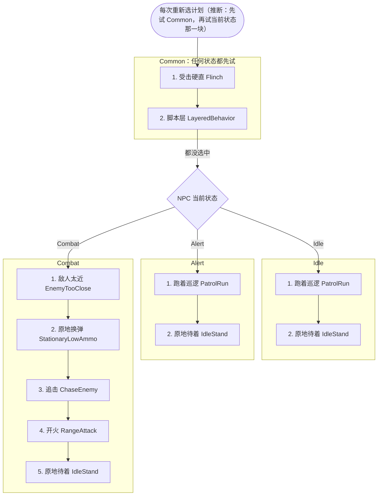

用到的计划（按选择器名推断）：`SCHED_BIG_FLINCH`、`SCHED_MOVE_TO_ASSAULT_POINT`、`SCHED_HOLD_ASSAULT_POINT`、`SCHED_FORCED_GO`、`SCHED_FOLLOW`、`SCHED_PATROL_RUN`、`SCHED_IDLE_STAND`、`SCHED_BACK_AWAY_FROM_ENEMY`、`SCHED_MOVE_AWAY_FROM_ENEMY`、`SCHED_RELOAD`、`SCHED_CHASE_ENEMY`、`SCHED_CHASE_ENEMY_RANGE_ATTACKING`、`SCHED_RANGE_ATTACK1`、`SCHED_RANGE_ATTACK_WAIT`

| 块 | # | 选择器 | 类 | 条件 | 行 |
|---|---|---|---|---|---|
| Common | 1 | `SelectSchedule_Flinch` |  |  | behavior_drone.txt:3 |
| Common | 2 | `SelectSchedule_LayeredBehavior` |  |  | behavior_drone.txt:4 |
| Idle | 1 | `SelectSchedule_PatrolRun` |  |  | behavior_drone.txt:11 |
| Idle | 2 | `SelectSchedule_IdleStand` |  |  | behavior_drone.txt:12 |
| Alert | 1 | `SelectSchedule_PatrolRun` |  |  | behavior_drone.txt:19 |
| Alert | 2 | `SelectSchedule_IdleStand` |  |  | behavior_drone.txt:20 |
| Combat | 1 | `SelectSchedule_EnemyTooClose` |  |  | behavior_drone.txt:27 |
| Combat | 2 | `SelectSchedule_StationaryLowAmmo` |  |  | behavior_drone.txt:28 |
| Combat | 3 | `SelectSchedule_ChaseEnemy` |  |  | behavior_drone.txt:29 |
| Combat | 4 | `SelectSchedule_RangeAttack` |  |  | behavior_drone.txt:30 |
| Combat | 5 | `SelectSchedule_IdleStand` |  |  | behavior_drone.txt:31 |

## behavior_dropship

- 多人用它的设置文件：`npc_dropship`, `npc_dropship_dogfighter`, `npc_dropship_hero`
- 战役用它的设置文件：`npc_dropship`, `npc_dropship_dogfighter`, `npc_dropship_hero`

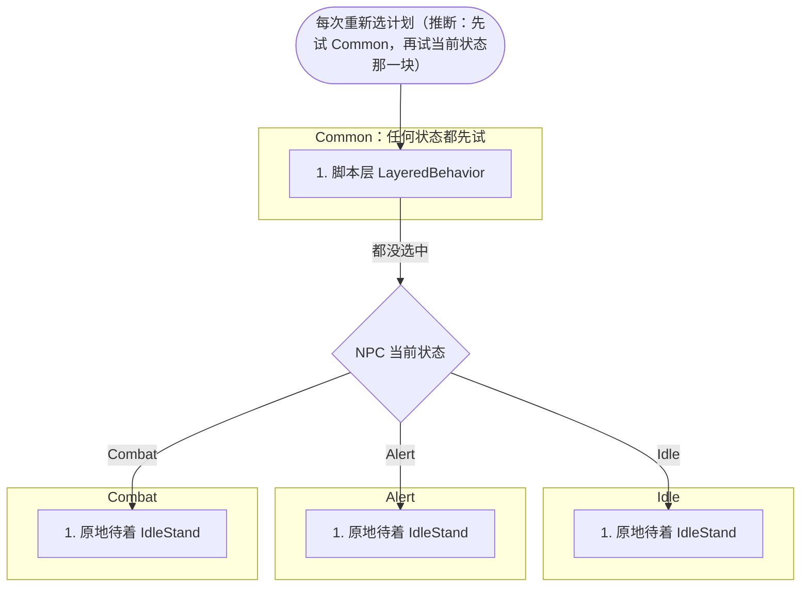

用到的计划（按选择器名推断）：`SCHED_MOVE_TO_ASSAULT_POINT`、`SCHED_HOLD_ASSAULT_POINT`、`SCHED_FORCED_GO`、`SCHED_FOLLOW`、`SCHED_IDLE_STAND`

| 块 | # | 选择器 | 类 | 条件 | 行 |
|---|---|---|---|---|---|
| Common | 1 | `SelectSchedule_LayeredBehavior` |  |  | behavior_dropship.txt:2 |
| Idle | 1 | `SelectSchedule_IdleStand` |  |  | behavior_dropship.txt:8 |
| Alert | 1 | `SelectSchedule_IdleStand` |  |  | behavior_dropship.txt:14 |
| Combat | 1 | `SelectSchedule_IdleStand` |  |  | behavior_dropship.txt:20 |

## behavior_flyer

- 多人用它的设置文件：（无）
- 战役用它的设置文件：（无）

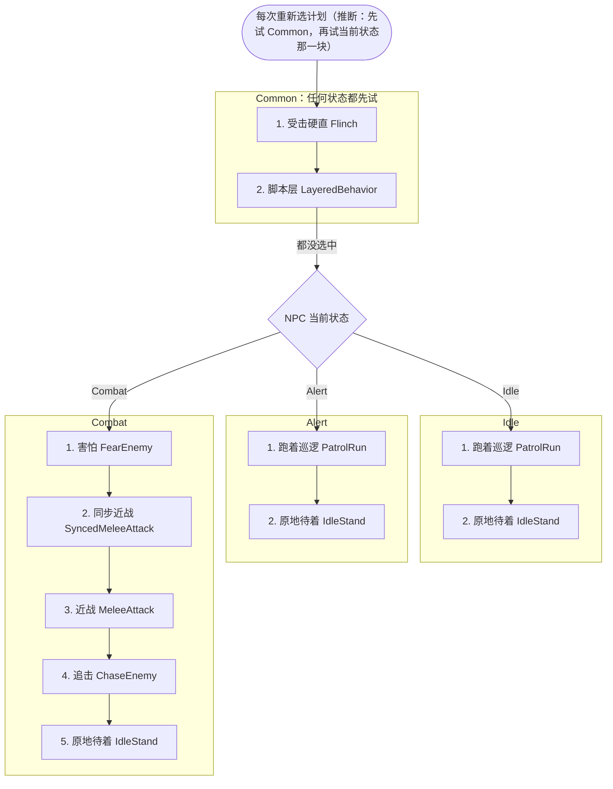

用到的计划（按选择器名推断）：`SCHED_BIG_FLINCH`、`SCHED_MOVE_TO_ASSAULT_POINT`、`SCHED_HOLD_ASSAULT_POINT`、`SCHED_FORCED_GO`、`SCHED_FOLLOW`、`SCHED_PATROL_RUN`、`SCHED_IDLE_STAND`、`SCHED_RUN_FROM_ENEMY`、`SCHED_RUN_FROM_ENEMY_FALLBACK`、`SCHED_COWER`、`SCHED_WAIT_FOR_SYNCED_MELEE_ANIM_END`、`SCHED_MELEE_ATTACK1`、`SCHED_MELEE_CHARGE`、`SCHED_DIRECTIONAL_MELEE`、`SCHED_CHASE_ENEMY`、`SCHED_CHASE_ENEMY_RANGE_ATTACKING`

| 块 | # | 选择器 | 类 | 条件 | 行 |
|---|---|---|---|---|---|
| Common | 1 | `SelectSchedule_Flinch` |  |  | behavior_flyer.txt:3 |
| Common | 2 | `SelectSchedule_LayeredBehavior` |  |  | behavior_flyer.txt:4 |
| Idle | 1 | `SelectSchedule_PatrolRun` |  |  | behavior_flyer.txt:11 |
| Idle | 2 | `SelectSchedule_IdleStand` |  |  | behavior_flyer.txt:12 |
| Alert | 1 | `SelectSchedule_PatrolRun` |  |  | behavior_flyer.txt:19 |
| Alert | 2 | `SelectSchedule_IdleStand` |  |  | behavior_flyer.txt:20 |
| Combat | 1 | `SelectSchedule_FearEnemy` |  |  | behavior_flyer.txt:27 |
| Combat | 2 | `SelectSchedule_SyncedMeleeAttack` |  |  | behavior_flyer.txt:28 |
| Combat | 3 | `SelectSchedule_MeleeAttack` |  |  | behavior_flyer.txt:29 |
| Combat | 4 | `SelectSchedule_ChaseEnemy` |  |  | behavior_flyer.txt:30 |
| Combat | 5 | `SelectSchedule_IdleStand` |  |  | behavior_flyer.txt:31 |

## behavior_frag_drone

- 多人用它的设置文件：`npc_frag_drone`, `npc_frag_drone_fd`, `npc_frag_drone_throwable`
- 战役用它的设置文件：`npc_frag_drone`, `npc_frag_drone_fd`, `npc_frag_drone_throwable`

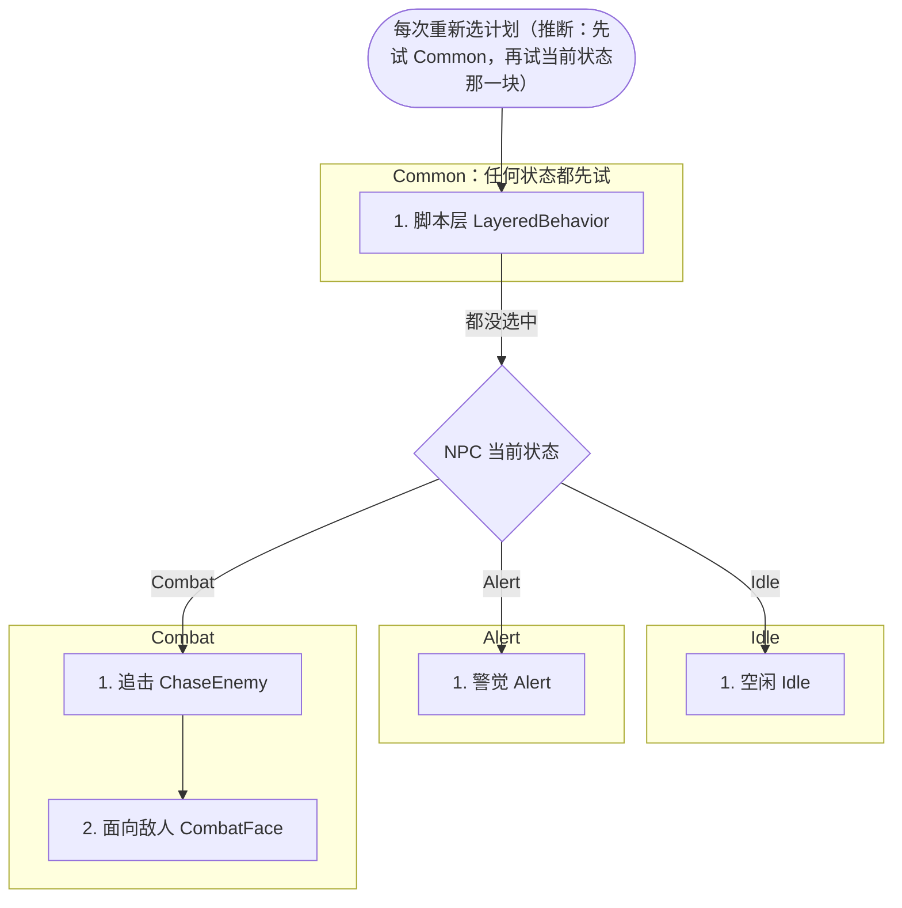

用到的计划（按选择器名推断）：`SCHED_MOVE_TO_ASSAULT_POINT`、`SCHED_HOLD_ASSAULT_POINT`、`SCHED_FORCED_GO`、`SCHED_FOLLOW`、`SCHED_IDLE_STAND`、`SCHED_IDLE_WANDER`、`SCHED_PATROL_PATH`、`SCHED_ALERT_FACE`、`SCHED_ALERT_FACE_BESTSOUND`、`SCHED_ALERT_SCAN`、`SCHED_ALERT_STAND`、`SCHED_INVESTIGATE_SOUND`、`SCHED_INVESTIGATE_CORPSE`、`SCHED_CHASE_ENEMY`、`SCHED_CHASE_ENEMY_RANGE_ATTACKING`、`SCHED_COMBAT_FACE`

| 块 | # | 选择器 | 类 | 条件 | 行 |
|---|---|---|---|---|---|
| Common | 1 | `SelectSchedule_LayeredBehavior` |  |  | behavior_frag_drone.txt:3 |
| Idle | 1 | `SelectSchedule_Idle` |  |  | behavior_frag_drone.txt:10 |
| Alert | 1 | `SelectSchedule_Alert` |  |  | behavior_frag_drone.txt:17 |
| Combat | 1 | `SelectSchedule_ChaseEnemy` |  |  | behavior_frag_drone.txt:24 |
| Combat | 2 | `SelectSchedule_CombatFace` |  |  | behavior_frag_drone.txt:25 |

## behavior_goliath

- 多人用它的设置文件：（无）
- 战役用它的设置文件：（无）

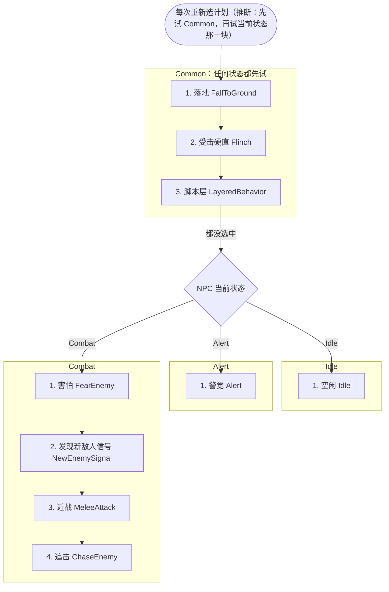

用到的计划（按选择器名推断）：`SCHED_FALL_TO_GROUND`、`SCHED_BIG_FLINCH`、`SCHED_MOVE_TO_ASSAULT_POINT`、`SCHED_HOLD_ASSAULT_POINT`、`SCHED_FORCED_GO`、`SCHED_FOLLOW`、`SCHED_IDLE_STAND`、`SCHED_IDLE_WANDER`、`SCHED_PATROL_PATH`、`SCHED_ALERT_FACE`、`SCHED_ALERT_FACE_BESTSOUND`、`SCHED_ALERT_SCAN`、`SCHED_ALERT_STAND`、`SCHED_INVESTIGATE_SOUND`、`SCHED_INVESTIGATE_CORPSE`、`SCHED_RUN_FROM_ENEMY`、`SCHED_RUN_FROM_ENEMY_FALLBACK`、`SCHED_COWER`、`SCHED_SIGNAL_FORWARD`、`SCHED_SIGNAL_TAUNT`、`SCHED_MELEE_ATTACK1`、`SCHED_MELEE_CHARGE`、`SCHED_DIRECTIONAL_MELEE`、`SCHED_CHASE_ENEMY`、`SCHED_CHASE_ENEMY_RANGE_ATTACKING`

| 块 | # | 选择器 | 类 | 条件 | 行 |
|---|---|---|---|---|---|
| Common | 1 | `SelectSchedule_FallToGround` |  |  | behavior_goliath.txt:3 |
| Common | 2 | `SelectSchedule_Flinch` |  |  | behavior_goliath.txt:4 |
| Common | 3 | `SelectSchedule_LayeredBehavior` |  |  | behavior_goliath.txt:5 |
| Idle | 1 | `SelectSchedule_Idle` |  |  | behavior_goliath.txt:12 |
| Alert | 1 | `SelectSchedule_Alert` |  |  | behavior_goliath.txt:19 |
| Combat | 1 | `SelectSchedule_FearEnemy` |  |  | behavior_goliath.txt:26 |
| Combat | 2 | `SelectSchedule_NewEnemySignal` |  |  | behavior_goliath.txt:27 |
| Combat | 3 | `SelectSchedule_MeleeAttack` |  |  | behavior_goliath.txt:28 |
| Combat | 4 | `SelectSchedule_ChaseEnemy` |  |  | behavior_goliath.txt:29 |

## behavior_gunship

- 多人用它的设置文件：`npc_gunship`, `npc_gunship_scripted`
- 战役用它的设置文件：`npc_gunship`, `npc_gunship_scripted`

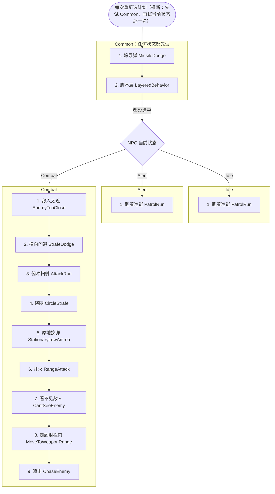

用到的计划（按选择器名推断）：`SCHED_DODGE`、`SCHED_STRAFE_DODGE`、`SCHED_MOVE_TO_ASSAULT_POINT`、`SCHED_HOLD_ASSAULT_POINT`、`SCHED_FORCED_GO`、`SCHED_FOLLOW`、`SCHED_PATROL_RUN`、`SCHED_BACK_AWAY_FROM_ENEMY`、`SCHED_MOVE_AWAY_FROM_ENEMY`、`SCHED_STRAFE_DODGE_PATH`、`SCHED_ATTACK_RUN`、`SCHED_CIRCLE_STRAFE`、`SCHED_RELOAD`、`SCHED_RANGE_ATTACK1`、`SCHED_RANGE_ATTACK_WAIT`、`SCHED_MOVE_TO_ENEMY`、`SCHED_COMBAT_WAIT`、`SCHED_COMBAT_SWEEP`、`SCHED_MOVE_TO_WEAPON_RANGE`、`SCHED_CHASE_ENEMY`、`SCHED_CHASE_ENEMY_RANGE_ATTACKING`

| 块 | # | 选择器 | 类 | 条件 | 行 |
|---|---|---|---|---|---|
| Common | 1 | `SelectSchedule_MissileDodge` |  |  | behavior_gunship.txt:3 |
| Common | 2 | `SelectSchedule_LayeredBehavior` |  |  | behavior_gunship.txt:4 |
| Idle | 1 | `SelectSchedule_PatrolRun` |  |  | behavior_gunship.txt:10 |
| Alert | 1 | `SelectSchedule_PatrolRun` |  |  | behavior_gunship.txt:16 |
| Combat | 1 | `SelectSchedule_EnemyTooClose` |  |  | behavior_gunship.txt:21 |
| Combat | 2 | `SelectSchedule_StrafeDodge` |  |  | behavior_gunship.txt:22 |
| Combat | 3 | `SelectSchedule_AttackRun` |  |  | behavior_gunship.txt:23 |
| Combat | 4 | `SelectSchedule_CircleStrafe` |  |  | behavior_gunship.txt:24 |
| Combat | 5 | `SelectSchedule_StationaryLowAmmo` |  |  | behavior_gunship.txt:25 |
| Combat | 6 | `SelectSchedule_RangeAttack` |  |  | behavior_gunship.txt:26 |
| Combat | 7 | `SelectSchedule_CantSeeEnemy` |  |  | behavior_gunship.txt:27 |
| Combat | 8 | `SelectSchedule_MoveToWeaponRange` |  |  | behavior_gunship.txt:28 |
| Combat | 9 | `SelectSchedule_ChaseEnemy` |  |  | behavior_gunship.txt:29 |

## behavior_marvin

- 多人用它的设置文件：`npc_marvin`
- 战役用它的设置文件：`npc_marvin`

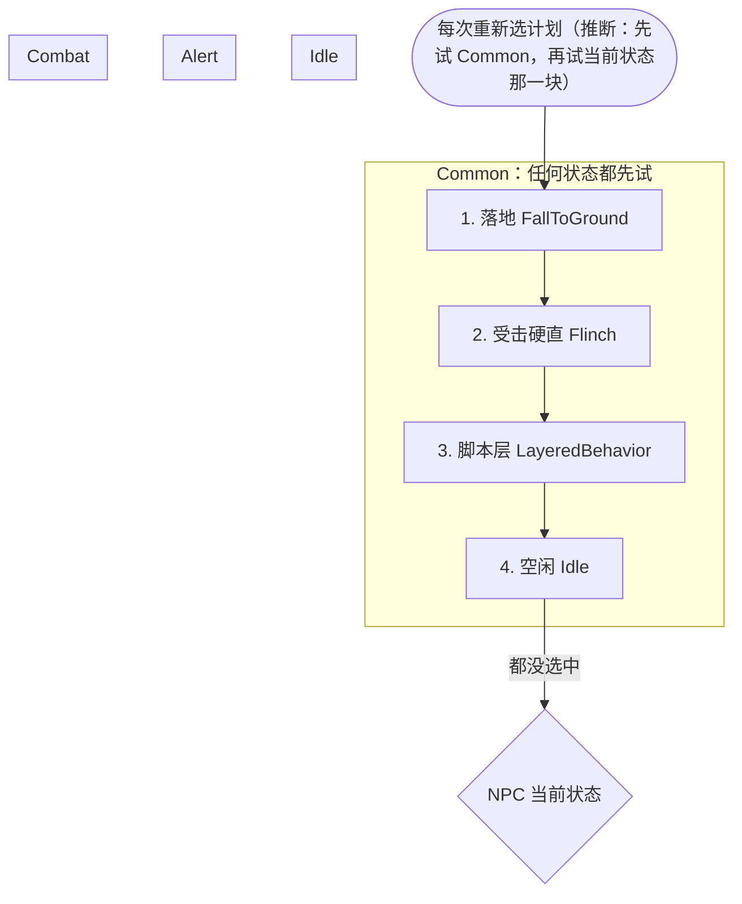

用到的计划（按选择器名推断）：`SCHED_FALL_TO_GROUND`、`SCHED_BIG_FLINCH`、`SCHED_MOVE_TO_ASSAULT_POINT`、`SCHED_HOLD_ASSAULT_POINT`、`SCHED_FORCED_GO`、`SCHED_FOLLOW`、`SCHED_IDLE_STAND`、`SCHED_IDLE_WANDER`、`SCHED_PATROL_PATH`

| 块 | # | 选择器 | 类 | 条件 | 行 |
|---|---|---|---|---|---|
| Common | 1 | `SelectSchedule_FallToGround` |  |  | behavior_marvin.txt:3 |
| Common | 2 | `SelectSchedule_Flinch` |  |  | behavior_marvin.txt:4 |
| Common | 3 | `SelectSchedule_LayeredBehavior` |  |  | behavior_marvin.txt:5 |
| Common | 4 | `SelectSchedule_Idle` |  |  | behavior_marvin.txt:6 |

## behavior_mp_auto_titan

- 多人用它的设置文件：`npc_titan_auto`, `npc_titan_auto_atlas`, `npc_titan_auto_atlas_ion_prime`, `npc_titan_auto_atlas_rocketeer`, `npc_titan_auto_atlas_stickybomb`, `npc_titan_auto_atlas_tone_prime`, `npc_titan_auto_atlas_tracker`, `npc_titan_auto_atlas_vanguard`, `npc_titan_auto_ogre`, `npc_titan_auto_ogre_fighter`, `npc_titan_auto_ogre_legion_prime`, `npc_titan_auto_ogre_meteor`, `npc_titan_auto_ogre_minigun`, `npc_titan_auto_ogre_scorch_prime`, `npc_titan_auto_stryder`, `npc_titan_auto_stryder_arc`, `npc_titan_auto_stryder_leadwall`, `npc_titan_auto_stryder_northstar_prime`, `npc_titan_auto_stryder_ronin_prime`, `npc_titan_auto_stryder_sniper`
- 战役用它的设置文件：（无）

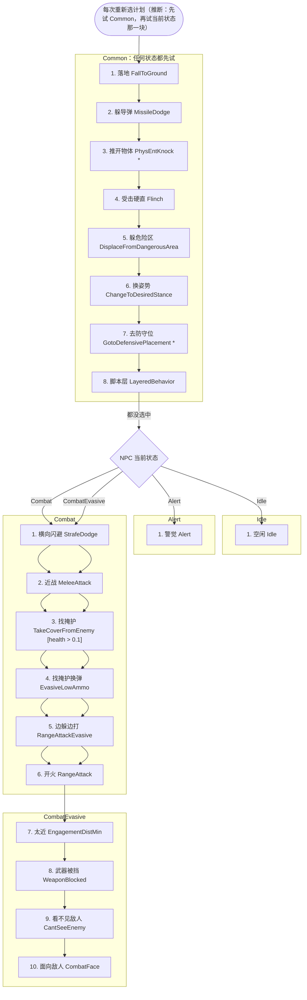

用到的计划（按选择器名推断）：`SCHED_FALL_TO_GROUND`、`SCHED_DODGE`、`SCHED_STRAFE_DODGE`、`SCHED_KNOCK_AWAY_PHYS_ENTS`、`SCHED_BIG_FLINCH`、`SCHED_DISPLACE_FROM_DANGEROUS_AREA`、`SCHED_STAND_UP`、`SCHED_CROUCH_DOWN`、`SCHED_TITAN_MOVE_TO_DEFENSIVE_PLACMENT`、`SCHED_MOVE_TO_ASSAULT_POINT`、`SCHED_HOLD_ASSAULT_POINT`、`SCHED_FORCED_GO`、`SCHED_FOLLOW`、`SCHED_IDLE_STAND`、`SCHED_IDLE_WANDER`、`SCHED_PATROL_PATH`、`SCHED_ALERT_FACE`、`SCHED_ALERT_FACE_BESTSOUND`、`SCHED_ALERT_SCAN`、`SCHED_ALERT_STAND`、`SCHED_INVESTIGATE_SOUND`、`SCHED_INVESTIGATE_CORPSE`、`SCHED_MELEE_ATTACK1`、`SCHED_MELEE_CHARGE`、`SCHED_DIRECTIONAL_MELEE`、`SCHED_RELOAD`、`SCHED_RANGE_ATTACK1`、`SCHED_RANGE_ATTACK_WAIT`、`SCHED_ESTABLISH_LINE_OF_FIRE`、`SCHED_MOVE_AWAY`、`SCHED_MOVE_TO_ENEMY`、`SCHED_COMBAT_WAIT`、`SCHED_COMBAT_SWEEP`、`SCHED_COMBAT_FACE`、`SCHED_STRAFE_DODGE_PATH`、`SCHED_TAKE_COVER_FROM_ENEMY`、`SCHED_HIDE_AND_RELOAD`、`SCHED_RANGE_ATTACK1_EVASIVE`、`SCHED_MOVE_AWAY_FROM_ENEMY`、`SCHED_BACK_AWAY_FROM_ENEMY`

| 块 | # | 选择器 | 类 | 条件 | 行 |
|---|---|---|---|---|---|
| Common | 1 | `SelectSchedule_FallToGround` |  |  | behavior_mp_auto_titan.txt:3 |
| Common | 2 | `SelectSchedule_MissileDodge` |  |  | behavior_mp_auto_titan.txt:4 |
| Common | 3 | `SelectSchedule_PhysEntKnock` | CNPC_Titan |  | behavior_mp_auto_titan.txt:5 |
| Common | 4 | `SelectSchedule_Flinch` |  |  | behavior_mp_auto_titan.txt:6 |
| Common | 5 | `SelectSchedule_DisplaceFromDangerousArea` |  |  | behavior_mp_auto_titan.txt:7 |
| Common | 6 | `SelectSchedule_ChangeToDesiredStance` |  |  | behavior_mp_auto_titan.txt:8 |
| Common | 7 | `SelectSchedule_GotoDefensivePlacement` | CNPC_Titan |  | behavior_mp_auto_titan.txt:9 |
| Common | 8 | `SelectSchedule_LayeredBehavior` |  |  | behavior_mp_auto_titan.txt:10 |
| Idle | 1 | `SelectSchedule_Idle` |  |  | behavior_mp_auto_titan.txt:16 |
| Alert | 1 | `SelectSchedule_Alert` |  |  | behavior_mp_auto_titan.txt:22 |
| Combat | 注释掉 | `SelectSchedule_StrafeDodge` |  |  | behavior_mp_auto_titan.txt:28 |
| Combat | 注释掉 | `SelectSchedule_ForwardDodge` |  |  | behavior_mp_auto_titan.txt:29 |
| Combat | 1 | `SelectSchedule_MeleeAttack` |  |  | behavior_mp_auto_titan.txt:30 |
| Combat | 注释掉 | `SelectSchedule_EvasiveLowAmmo` |  |  | behavior_mp_auto_titan.txt:31 |
| Combat | 注释掉 | `SelectSchedule_ChaseEnemy` |  |  | behavior_mp_auto_titan.txt:32 |
| Combat | 注释掉 | `SelectSchedule_EngagementDistMax` |  |  | behavior_mp_auto_titan.txt:33 |
| Combat | 2 | `SelectSchedule_StationaryLowAmmo` |  |  | behavior_mp_auto_titan.txt:34 |
| Combat | 注释掉 | `SelectSchedule_RangeAttackEvasive` |  |  | behavior_mp_auto_titan.txt:35 |
| Combat | 3 | `SelectSchedule_RangeAttack` |  |  | behavior_mp_auto_titan.txt:36 |
| Combat | 注释掉 | `SelectSchedule_EngagementDistMin` |  |  | behavior_mp_auto_titan.txt:37 |
| Combat | 4 | `SelectSchedule_WeaponBlocked` |  |  | behavior_mp_auto_titan.txt:38 |
| Combat | 5 | `SelectSchedule_CantSeeEnemy` |  |  | behavior_mp_auto_titan.txt:39 |
| Combat | 注释掉 | `SelectSchedule_MoveToWeaponRange` |  |  | behavior_mp_auto_titan.txt:40 |
| Combat | 6 | `SelectSchedule_CombatFace` |  |  | behavior_mp_auto_titan.txt:41 |
| CombatEvasive | 1 | `SelectSchedule_StrafeDodge` |  |  | behavior_mp_auto_titan.txt:47 |
| CombatEvasive | 2 | `SelectSchedule_MeleeAttack` |  |  | behavior_mp_auto_titan.txt:48 |
| CombatEvasive | 注释掉 | `SelectSchedule_BackwardDodge` |  |  | behavior_mp_auto_titan.txt:49 |
| CombatEvasive | 3 | `SelectSchedule_TakeCoverFromEnemy` |  | health > 0.1 | behavior_mp_auto_titan.txt:50 |
| CombatEvasive | 4 | `SelectSchedule_EvasiveLowAmmo` |  |  | behavior_mp_auto_titan.txt:51 |
| CombatEvasive | 5 | `SelectSchedule_RangeAttackEvasive` |  |  | behavior_mp_auto_titan.txt:52 |
| CombatEvasive | 6 | `SelectSchedule_RangeAttack` |  |  | behavior_mp_auto_titan.txt:53 |
| CombatEvasive | 7 | `SelectSchedule_EngagementDistMin` |  |  | behavior_mp_auto_titan.txt:54 |
| CombatEvasive | 8 | `SelectSchedule_WeaponBlocked` |  |  | behavior_mp_auto_titan.txt:55 |
| CombatEvasive | 9 | `SelectSchedule_CantSeeEnemy` |  |  | behavior_mp_auto_titan.txt:56 |
| CombatEvasive | 10 | `SelectSchedule_CombatFace` |  |  | behavior_mp_auto_titan.txt:57 |

## behavior_mp_auto_titan_enhanced

- 多人用它的设置文件：（无）
- 战役用它的设置文件：（无）

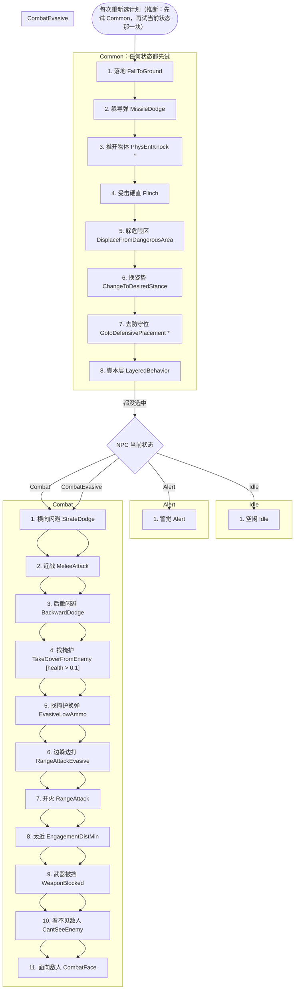

用到的计划（按选择器名推断）：`SCHED_FALL_TO_GROUND`、`SCHED_DODGE`、`SCHED_STRAFE_DODGE`、`SCHED_KNOCK_AWAY_PHYS_ENTS`、`SCHED_BIG_FLINCH`、`SCHED_DISPLACE_FROM_DANGEROUS_AREA`、`SCHED_STAND_UP`、`SCHED_CROUCH_DOWN`、`SCHED_TITAN_MOVE_TO_DEFENSIVE_PLACMENT`、`SCHED_MOVE_TO_ASSAULT_POINT`、`SCHED_HOLD_ASSAULT_POINT`、`SCHED_FORCED_GO`、`SCHED_FOLLOW`、`SCHED_IDLE_STAND`、`SCHED_IDLE_WANDER`、`SCHED_PATROL_PATH`、`SCHED_ALERT_FACE`、`SCHED_ALERT_FACE_BESTSOUND`、`SCHED_ALERT_SCAN`、`SCHED_ALERT_STAND`、`SCHED_INVESTIGATE_SOUND`、`SCHED_INVESTIGATE_CORPSE`、`SCHED_STRAFE_DODGE_PATH`、`SCHED_DODGE_FORWARD`、`SCHED_MELEE_ATTACK1`、`SCHED_MELEE_CHARGE`、`SCHED_DIRECTIONAL_MELEE`、`SCHED_CHASE_ENEMY`、`SCHED_CHASE_ENEMY_RANGE_ATTACKING`、`SCHED_CIRCLE_STRAFE`、`SCHED_RELOAD`、`SCHED_RANGE_ATTACK1_EVASIVE`、`SCHED_RANGE_ATTACK1`、`SCHED_RANGE_ATTACK_WAIT`、`SCHED_ESTABLISH_LINE_OF_FIRE`、`SCHED_MOVE_AWAY`、`SCHED_MOVE_TO_ENEMY`、`SCHED_COMBAT_WAIT`、`SCHED_COMBAT_SWEEP`、`SCHED_COMBAT_FACE`、`SCHED_DODGE_BACKWARD`、`SCHED_TAKE_COVER_FROM_ENEMY`、`SCHED_HIDE_AND_RELOAD`、`SCHED_MOVE_AWAY_FROM_ENEMY`、`SCHED_BACK_AWAY_FROM_ENEMY`

| 块 | # | 选择器 | 类 | 条件 | 行 |
|---|---|---|---|---|---|
| Common | 1 | `SelectSchedule_FallToGround` |  |  | behavior_mp_auto_titan_enhanced.txt:3 |
| Common | 2 | `SelectSchedule_MissileDodge` |  |  | behavior_mp_auto_titan_enhanced.txt:4 |
| Common | 3 | `SelectSchedule_PhysEntKnock` | CNPC_Titan |  | behavior_mp_auto_titan_enhanced.txt:5 |
| Common | 4 | `SelectSchedule_Flinch` |  |  | behavior_mp_auto_titan_enhanced.txt:6 |
| Common | 5 | `SelectSchedule_DisplaceFromDangerousArea` |  |  | behavior_mp_auto_titan_enhanced.txt:7 |
| Common | 6 | `SelectSchedule_ChangeToDesiredStance` |  |  | behavior_mp_auto_titan_enhanced.txt:8 |
| Common | 7 | `SelectSchedule_GotoDefensivePlacement` | CNPC_Titan |  | behavior_mp_auto_titan_enhanced.txt:9 |
| Common | 8 | `SelectSchedule_LayeredBehavior` |  |  | behavior_mp_auto_titan_enhanced.txt:10 |
| Idle | 1 | `SelectSchedule_Idle` |  |  | behavior_mp_auto_titan_enhanced.txt:16 |
| Alert | 1 | `SelectSchedule_Alert` |  |  | behavior_mp_auto_titan_enhanced.txt:22 |
| Combat | 1 | `SelectSchedule_StrafeDodge` |  |  | behavior_mp_auto_titan_enhanced.txt:28 |
| Combat | 2 | `SelectSchedule_ForwardDodge` |  |  | behavior_mp_auto_titan_enhanced.txt:29 |
| Combat | 3 | `SelectSchedule_MeleeAttack` |  |  | behavior_mp_auto_titan_enhanced.txt:30 |
| Combat | 注释掉 | `SelectSchedule_EvasiveLowAmmo` |  |  | behavior_mp_auto_titan_enhanced.txt:31 |
| Combat | 4 | `SelectSchedule_ChaseEnemy` |  |  | behavior_mp_auto_titan_enhanced.txt:32 |
| Combat | 注释掉 | `SelectSchedule_EngagementDistMax` |  |  | behavior_mp_auto_titan_enhanced.txt:33 |
| Combat | 5 | `SelectSchedule_CircleStrafe` |  |  | behavior_mp_auto_titan_enhanced.txt:34 |
| Combat | 6 | `SelectSchedule_StationaryLowAmmo` |  |  | behavior_mp_auto_titan_enhanced.txt:35 |
| Combat | 7 | `SelectSchedule_RangeAttackEvasive` |  |  | behavior_mp_auto_titan_enhanced.txt:36 |
| Combat | 8 | `SelectSchedule_RangeAttack` |  |  | behavior_mp_auto_titan_enhanced.txt:37 |
| Combat | 注释掉 | `SelectSchedule_EngagementDistMin` |  |  | behavior_mp_auto_titan_enhanced.txt:38 |
| Combat | 9 | `SelectSchedule_WeaponBlocked` |  |  | behavior_mp_auto_titan_enhanced.txt:39 |
| Combat | 10 | `SelectSchedule_CantSeeEnemy` |  |  | behavior_mp_auto_titan_enhanced.txt:40 |
| Combat | 注释掉 | `SelectSchedule_MoveToWeaponRange` |  |  | behavior_mp_auto_titan_enhanced.txt:41 |
| Combat | 11 | `SelectSchedule_CombatFace` |  |  | behavior_mp_auto_titan_enhanced.txt:42 |
| CombatEvasive | 1 | `SelectSchedule_StrafeDodge` |  |  | behavior_mp_auto_titan_enhanced.txt:48 |
| CombatEvasive | 2 | `SelectSchedule_MeleeAttack` |  |  | behavior_mp_auto_titan_enhanced.txt:49 |
| CombatEvasive | 3 | `SelectSchedule_BackwardDodge` |  |  | behavior_mp_auto_titan_enhanced.txt:50 |
| CombatEvasive | 4 | `SelectSchedule_TakeCoverFromEnemy` |  | health > 0.1 | behavior_mp_auto_titan_enhanced.txt:51 |
| CombatEvasive | 5 | `SelectSchedule_EvasiveLowAmmo` |  |  | behavior_mp_auto_titan_enhanced.txt:52 |
| CombatEvasive | 6 | `SelectSchedule_RangeAttackEvasive` |  |  | behavior_mp_auto_titan_enhanced.txt:53 |
| CombatEvasive | 7 | `SelectSchedule_RangeAttack` |  |  | behavior_mp_auto_titan_enhanced.txt:54 |
| CombatEvasive | 8 | `SelectSchedule_EngagementDistMin` |  |  | behavior_mp_auto_titan_enhanced.txt:55 |
| CombatEvasive | 9 | `SelectSchedule_WeaponBlocked` |  |  | behavior_mp_auto_titan_enhanced.txt:56 |
| CombatEvasive | 10 | `SelectSchedule_CantSeeEnemy` |  |  | behavior_mp_auto_titan_enhanced.txt:57 |
| CombatEvasive | 11 | `SelectSchedule_CombatFace` |  |  | behavior_mp_auto_titan_enhanced.txt:58 |

## behavior_mp_auto_titan_enhanced_guard

- 多人用它的设置文件：（无）
- 战役用它的设置文件：（无）

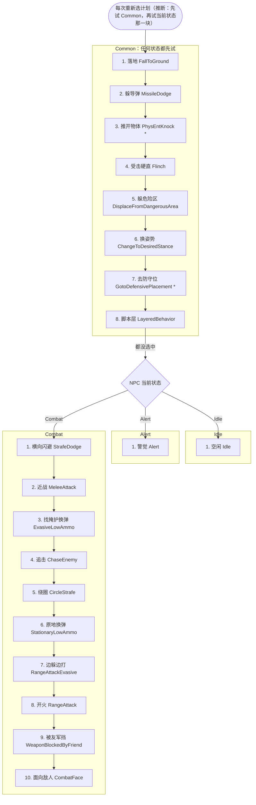

用到的计划（按选择器名推断）：`SCHED_FALL_TO_GROUND`、`SCHED_DODGE`、`SCHED_STRAFE_DODGE`、`SCHED_KNOCK_AWAY_PHYS_ENTS`、`SCHED_BIG_FLINCH`、`SCHED_DISPLACE_FROM_DANGEROUS_AREA`、`SCHED_STAND_UP`、`SCHED_CROUCH_DOWN`、`SCHED_TITAN_MOVE_TO_DEFENSIVE_PLACMENT`、`SCHED_MOVE_TO_ASSAULT_POINT`、`SCHED_HOLD_ASSAULT_POINT`、`SCHED_FORCED_GO`、`SCHED_FOLLOW`、`SCHED_IDLE_STAND`、`SCHED_IDLE_WANDER`、`SCHED_PATROL_PATH`、`SCHED_ALERT_FACE`、`SCHED_ALERT_FACE_BESTSOUND`、`SCHED_ALERT_SCAN`、`SCHED_ALERT_STAND`、`SCHED_INVESTIGATE_SOUND`、`SCHED_INVESTIGATE_CORPSE`、`SCHED_STRAFE_DODGE_PATH`、`SCHED_MELEE_ATTACK1`、`SCHED_MELEE_CHARGE`、`SCHED_DIRECTIONAL_MELEE`、`SCHED_HIDE_AND_RELOAD`、`SCHED_CHASE_ENEMY`、`SCHED_CHASE_ENEMY_RANGE_ATTACKING`、`SCHED_CIRCLE_STRAFE`、`SCHED_RELOAD`、`SCHED_RANGE_ATTACK1_EVASIVE`、`SCHED_RANGE_ATTACK1`、`SCHED_RANGE_ATTACK_WAIT`、`SCHED_ESTABLISH_LINE_OF_FIRE`、`SCHED_COMBAT_FACE`

| 块 | # | 选择器 | 类 | 条件 | 行 |
|---|---|---|---|---|---|
| Common | 1 | `SelectSchedule_FallToGround` |  |  | behavior_mp_auto_titan_enhanced_guard.txt:3 |
| Common | 2 | `SelectSchedule_MissileDodge` |  |  | behavior_mp_auto_titan_enhanced_guard.txt:4 |
| Common | 3 | `SelectSchedule_PhysEntKnock` | CNPC_Titan |  | behavior_mp_auto_titan_enhanced_guard.txt:5 |
| Common | 4 | `SelectSchedule_Flinch` |  |  | behavior_mp_auto_titan_enhanced_guard.txt:6 |
| Common | 5 | `SelectSchedule_DisplaceFromDangerousArea` |  |  | behavior_mp_auto_titan_enhanced_guard.txt:7 |
| Common | 6 | `SelectSchedule_ChangeToDesiredStance` |  |  | behavior_mp_auto_titan_enhanced_guard.txt:8 |
| Common | 7 | `SelectSchedule_GotoDefensivePlacement` | CNPC_Titan |  | behavior_mp_auto_titan_enhanced_guard.txt:9 |
| Common | 8 | `SelectSchedule_LayeredBehavior` |  |  | behavior_mp_auto_titan_enhanced_guard.txt:10 |
| Idle | 1 | `SelectSchedule_Idle` |  |  | behavior_mp_auto_titan_enhanced_guard.txt:16 |
| Alert | 1 | `SelectSchedule_Alert` |  |  | behavior_mp_auto_titan_enhanced_guard.txt:22 |
| Combat | 1 | `SelectSchedule_StrafeDodge` |  |  | behavior_mp_auto_titan_enhanced_guard.txt:28 |
| Combat | 2 | `SelectSchedule_MeleeAttack` |  |  | behavior_mp_auto_titan_enhanced_guard.txt:29 |
| Combat | 3 | `SelectSchedule_EvasiveLowAmmo` |  |  | behavior_mp_auto_titan_enhanced_guard.txt:30 |
| Combat | 4 | `SelectSchedule_ChaseEnemy` |  |  | behavior_mp_auto_titan_enhanced_guard.txt:31 |
| Combat | 5 | `SelectSchedule_CircleStrafe` |  |  | behavior_mp_auto_titan_enhanced_guard.txt:32 |
| Combat | 6 | `SelectSchedule_StationaryLowAmmo` |  |  | behavior_mp_auto_titan_enhanced_guard.txt:33 |
| Combat | 7 | `SelectSchedule_RangeAttackEvasive` |  |  | behavior_mp_auto_titan_enhanced_guard.txt:34 |
| Combat | 8 | `SelectSchedule_RangeAttack` |  |  | behavior_mp_auto_titan_enhanced_guard.txt:35 |
| Combat | 9 | `SelectSchedule_WeaponBlockedByFriend` |  |  | behavior_mp_auto_titan_enhanced_guard.txt:36 |
| Combat | 10 | `SelectSchedule_CombatFace` |  |  | behavior_mp_auto_titan_enhanced_guard.txt:37 |

## behavior_mp_auto_titan_guard

- 多人用它的设置文件：（无）
- 战役用它的设置文件：（无）

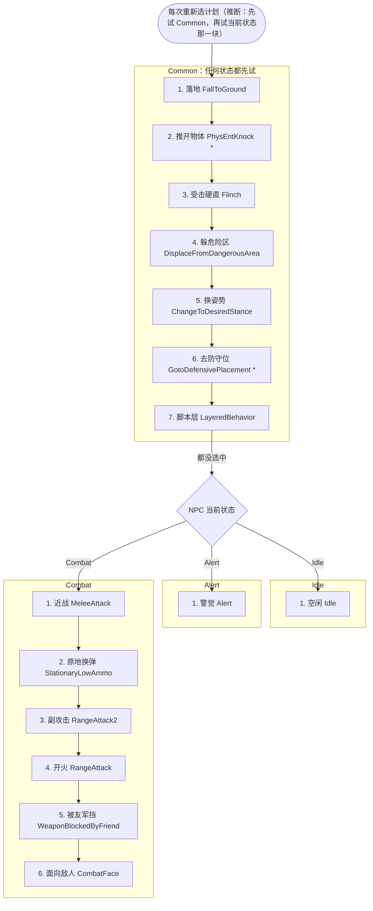

用到的计划（按选择器名推断）：`SCHED_FALL_TO_GROUND`、`SCHED_KNOCK_AWAY_PHYS_ENTS`、`SCHED_BIG_FLINCH`、`SCHED_DISPLACE_FROM_DANGEROUS_AREA`、`SCHED_STAND_UP`、`SCHED_CROUCH_DOWN`、`SCHED_TITAN_MOVE_TO_DEFENSIVE_PLACMENT`、`SCHED_MOVE_TO_ASSAULT_POINT`、`SCHED_HOLD_ASSAULT_POINT`、`SCHED_FORCED_GO`、`SCHED_FOLLOW`、`SCHED_IDLE_STAND`、`SCHED_IDLE_WANDER`、`SCHED_PATROL_PATH`、`SCHED_ALERT_FACE`、`SCHED_ALERT_FACE_BESTSOUND`、`SCHED_ALERT_SCAN`、`SCHED_ALERT_STAND`、`SCHED_INVESTIGATE_SOUND`、`SCHED_INVESTIGATE_CORPSE`、`SCHED_MELEE_ATTACK1`、`SCHED_MELEE_CHARGE`、`SCHED_DIRECTIONAL_MELEE`、`SCHED_RELOAD`、`SCHED_RANGE_ATTACK2`、`SCHED_RANGE_ATTACK1`、`SCHED_RANGE_ATTACK_WAIT`、`SCHED_ESTABLISH_LINE_OF_FIRE`、`SCHED_COMBAT_FACE`

| 块 | # | 选择器 | 类 | 条件 | 行 |
|---|---|---|---|---|---|
| Common | 1 | `SelectSchedule_FallToGround` |  |  | behavior_mp_auto_titan_guard.txt:3 |
| Common | 注释掉 | `SelectSchedule_MissileDodge` |  |  | behavior_mp_auto_titan_guard.txt:4 |
| Common | 2 | `SelectSchedule_PhysEntKnock` | CNPC_Titan |  | behavior_mp_auto_titan_guard.txt:5 |
| Common | 3 | `SelectSchedule_Flinch` |  |  | behavior_mp_auto_titan_guard.txt:6 |
| Common | 4 | `SelectSchedule_DisplaceFromDangerousArea` |  |  | behavior_mp_auto_titan_guard.txt:7 |
| Common | 5 | `SelectSchedule_ChangeToDesiredStance` |  |  | behavior_mp_auto_titan_guard.txt:8 |
| Common | 6 | `SelectSchedule_GotoDefensivePlacement` | CNPC_Titan |  | behavior_mp_auto_titan_guard.txt:9 |
| Common | 7 | `SelectSchedule_LayeredBehavior` |  |  | behavior_mp_auto_titan_guard.txt:10 |
| Idle | 1 | `SelectSchedule_Idle` |  |  | behavior_mp_auto_titan_guard.txt:16 |
| Alert | 1 | `SelectSchedule_Alert` |  |  | behavior_mp_auto_titan_guard.txt:22 |
| Combat | 注释掉 | `SelectSchedule_StrafeDodge` |  |  | behavior_mp_auto_titan_guard.txt:28 |
| Combat | 注释掉 | `SelectSchedule_ForwardDodge` |  |  | behavior_mp_auto_titan_guard.txt:29 |
| Combat | 1 | `SelectSchedule_MeleeAttack` |  |  | behavior_mp_auto_titan_guard.txt:30 |
| Combat | 注释掉 | `SelectSchedule_EvasiveLowAmmo` |  |  | behavior_mp_auto_titan_guard.txt:31 |
| Combat | 注释掉 | `SelectSchedule_ChaseEnemy` |  |  | behavior_mp_auto_titan_guard.txt:32 |
| Combat | 注释掉 | `SelectSchedule_EngagementDistMax` |  |  | behavior_mp_auto_titan_guard.txt:33 |
| Combat | 2 | `SelectSchedule_StationaryLowAmmo` |  |  | behavior_mp_auto_titan_guard.txt:34 |
| Combat | 注释掉 | `SelectSchedule_RangeAttackEvasive` |  |  | behavior_mp_auto_titan_guard.txt:35 |
| Combat | 3 | `SelectSchedule_RangeAttack2` |  |  | behavior_mp_auto_titan_guard.txt:36 |
| Combat | 4 | `SelectSchedule_RangeAttack` |  |  | behavior_mp_auto_titan_guard.txt:37 |
| Combat | 注释掉 | `SelectSchedule_EngagementDistMin` |  |  | behavior_mp_auto_titan_guard.txt:38 |
| Combat | 5 | `SelectSchedule_WeaponBlockedByFriend` |  |  | behavior_mp_auto_titan_guard.txt:39 |
| Combat | 注释掉 | `SelectSchedule_CantSeeEnemy` |  |  | behavior_mp_auto_titan_guard.txt:40 |
| Combat | 注释掉 | `SelectSchedule_MoveToWeaponRange` |  |  | behavior_mp_auto_titan_guard.txt:41 |
| Combat | 6 | `SelectSchedule_CombatFace` |  |  | behavior_mp_auto_titan_guard.txt:42 |

## behavior_pilot_elite

- 多人用它的设置文件：`npc_pilot_elite`, `npc_pilot_elite_assassin`, `npc_pilot_elite_s2s`
- 战役用它的设置文件：`npc_pilot_elite`, `npc_pilot_elite_assassin`, `npc_pilot_elite_s2s`

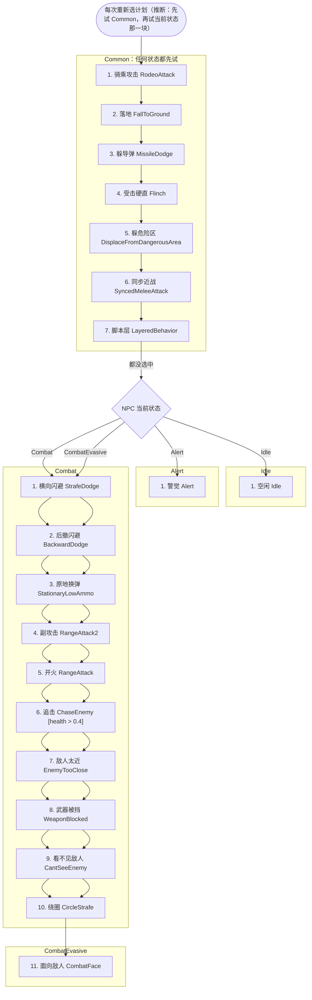

用到的计划（按选择器名推断）：`SCHED_RODEO_ATTACK`、`SCHED_FALL_TO_GROUND`、`SCHED_DODGE`、`SCHED_STRAFE_DODGE`、`SCHED_BIG_FLINCH`、`SCHED_DISPLACE_FROM_DANGEROUS_AREA`、`SCHED_WAIT_FOR_SYNCED_MELEE_ANIM_END`、`SCHED_MOVE_TO_ASSAULT_POINT`、`SCHED_HOLD_ASSAULT_POINT`、`SCHED_FORCED_GO`、`SCHED_FOLLOW`、`SCHED_IDLE_STAND`、`SCHED_IDLE_WANDER`、`SCHED_PATROL_PATH`、`SCHED_ALERT_FACE`、`SCHED_ALERT_FACE_BESTSOUND`、`SCHED_ALERT_SCAN`、`SCHED_ALERT_STAND`、`SCHED_INVESTIGATE_SOUND`、`SCHED_INVESTIGATE_CORPSE`、`SCHED_MELEE_ATTACK1`、`SCHED_MELEE_CHARGE`、`SCHED_DIRECTIONAL_MELEE`、`SCHED_SWITCH_TO_PENDING_WEAPON`、`SCHED_HIDE_AND_RELOAD`、`SCHED_CIRCLE_STRAFE`、`SCHED_MOVE_TO_SHOOTING_COVER`、`SCHED_IDLE_INSIDE_SHOOTING_COVER`、`SCHED_CHECK_INSIDE_SHOOTING_COVER`、`SCHED_ADVANCE_FROM_SHOOTING_COVER`、`SCHED_RETREAT_TO_SHOOTING_COVER`、`SCHED_GRENADE_FROM_SHOOTING_COVER`、`SCHED_GRENADE_ADVANCE_FROM_SHOOTING_COVER`、`SCHED_WAIT_WHILE_ADVANCED_FROM_SHOOTING_COVER`、`SCHED_THROW_GRENADE`、`SCHED_RANGE_ATTACK1_EVASIVE`、`SCHED_RANGE_ATTACK_TWITCH`、`SCHED_RANGE_ATTACK1`、`SCHED_RANGE_ATTACK_WAIT`、`SCHED_COMBAT_FACE`、`SCHED_STRAFE_DODGE_PATH`、`SCHED_DODGE_BACKWARD`、`SCHED_RELOAD`、`SCHED_RANGE_ATTACK2`、`SCHED_CHASE_ENEMY`、`SCHED_CHASE_ENEMY_RANGE_ATTACKING`、`SCHED_BACK_AWAY_FROM_ENEMY`、`SCHED_MOVE_AWAY_FROM_ENEMY`、`SCHED_ESTABLISH_LINE_OF_FIRE`、`SCHED_MOVE_AWAY`、`SCHED_MOVE_TO_ENEMY`、`SCHED_COMBAT_WAIT`、`SCHED_COMBAT_SWEEP`

| 块 | # | 选择器 | 类 | 条件 | 行 |
|---|---|---|---|---|---|
| Common | 1 | `SelectSchedule_RodeoAttack` |  |  | behavior_pilot_elite.txt:3 |
| Common | 2 | `SelectSchedule_FallToGround` |  |  | behavior_pilot_elite.txt:4 |
| Common | 3 | `SelectSchedule_MissileDodge` |  |  | behavior_pilot_elite.txt:5 |
| Common | 4 | `SelectSchedule_Flinch` |  |  | behavior_pilot_elite.txt:6 |
| Common | 5 | `SelectSchedule_DisplaceFromDangerousArea` |  |  | behavior_pilot_elite.txt:7 |
| Common | 注释掉 | `SelectSchedule_ChangeToDesiredStance` |  |  | behavior_pilot_elite.txt:8 |
| Common | 6 | `SelectSchedule_SyncedMeleeAttack` |  |  | behavior_pilot_elite.txt:9 |
| Common | 7 | `SelectSchedule_LayeredBehavior` |  |  | behavior_pilot_elite.txt:10 |
| Idle | 1 | `SelectSchedule_Idle` |  |  | behavior_pilot_elite.txt:16 |
| Alert | 1 | `SelectSchedule_Alert` |  |  | behavior_pilot_elite.txt:22 |
| Combat | 注释掉 | `SelectSchedule_StrafeDodge` |  |  | behavior_pilot_elite.txt:28 |
| Combat | 注释掉 | `SelectSchedule_ForwardDodge` |  |  | behavior_pilot_elite.txt:29 |
| Combat | 1 | `SelectSchedule_MeleeAttack` |  |  | behavior_pilot_elite.txt:31 |
| Combat | 注释掉 | `SelectSchedule_CombatNewEnemy` | CAI_Combatant |  | behavior_pilot_elite.txt:33 |
| Combat | 2 | `SelectSchedule_SwitchWeapon` |  |  | behavior_pilot_elite.txt:34 |
| Combat | 3 | `SelectSchedule_EvasiveLowAmmo` |  |  | behavior_pilot_elite.txt:35 |
| Combat | 4 | `SelectSchedule_CircleStrafe` |  |  | behavior_pilot_elite.txt:37 |
| Combat | 5 | `SelectSchedule_ShootingCover` | CAI_Combatant |  | behavior_pilot_elite.txt:38 |
| Combat | 注释掉 | `SelectSchedule_Taunt` |  | health > 0.8 | behavior_pilot_elite.txt:39 |
| Combat | 6 | `SelectSchedule_ThrowGrenade` |  |  | behavior_pilot_elite.txt:41 |
| Combat | 7 | `SelectSchedule_RangeAttackEvasive` |  |  | behavior_pilot_elite.txt:42 |
| Combat | 8 | `SelectSchedule_RangeAttackTwitch` |  |  | behavior_pilot_elite.txt:43 |
| Combat | 9 | `SelectSchedule_RangeAttack` |  |  | behavior_pilot_elite.txt:44 |
| Combat | 注释掉 | `SelectSchedule_ChaseEnemy` |  | health > 0.4 | behavior_pilot_elite.txt:45 |
| Combat | 10 | `SelectSchedule_CombatFace` |  |  | behavior_pilot_elite.txt:47 |
| CombatEvasive | 1 | `SelectSchedule_StrafeDodge` |  |  | behavior_pilot_elite.txt:52 |
| CombatEvasive | 2 | `SelectSchedule_BackwardDodge` |  |  | behavior_pilot_elite.txt:53 |
| CombatEvasive | 3 | `SelectSchedule_StationaryLowAmmo` |  |  | behavior_pilot_elite.txt:54 |
| CombatEvasive | 4 | `SelectSchedule_RangeAttack2` |  |  | behavior_pilot_elite.txt:55 |
| CombatEvasive | 5 | `SelectSchedule_RangeAttack` |  |  | behavior_pilot_elite.txt:56 |
| CombatEvasive | 6 | `SelectSchedule_ChaseEnemy` |  | health > 0.4 | behavior_pilot_elite.txt:57 |
| CombatEvasive | 7 | `SelectSchedule_EnemyTooClose` |  |  | behavior_pilot_elite.txt:58 |
| CombatEvasive | 8 | `SelectSchedule_WeaponBlocked` |  |  | behavior_pilot_elite.txt:59 |
| CombatEvasive | 9 | `SelectSchedule_CantSeeEnemy` |  |  | behavior_pilot_elite.txt:60 |
| CombatEvasive | 10 | `SelectSchedule_CircleStrafe` |  |  | behavior_pilot_elite.txt:61 |
| CombatEvasive | 11 | `SelectSchedule_CombatFace` |  |  | behavior_pilot_elite.txt:62 |

## behavior_pilot_elite_assassin

- 多人用它的设置文件：（无）
- 战役用它的设置文件：（无）

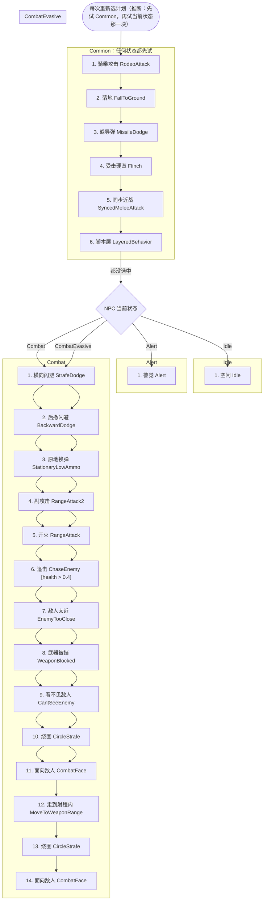

用到的计划（按选择器名推断）：`SCHED_RODEO_ATTACK`、`SCHED_FALL_TO_GROUND`、`SCHED_DODGE`、`SCHED_STRAFE_DODGE`、`SCHED_BIG_FLINCH`、`SCHED_WAIT_FOR_SYNCED_MELEE_ANIM_END`、`SCHED_MOVE_TO_ASSAULT_POINT`、`SCHED_HOLD_ASSAULT_POINT`、`SCHED_FORCED_GO`、`SCHED_FOLLOW`、`SCHED_IDLE_STAND`、`SCHED_IDLE_WANDER`、`SCHED_PATROL_PATH`、`SCHED_ALERT_FACE`、`SCHED_ALERT_FACE_BESTSOUND`、`SCHED_ALERT_SCAN`、`SCHED_ALERT_STAND`、`SCHED_INVESTIGATE_SOUND`、`SCHED_INVESTIGATE_CORPSE`、`SCHED_STRAFE_DODGE_PATH`、`SCHED_DODGE_FORWARD`、`SCHED_MELEE_ATTACK1`、`SCHED_MELEE_CHARGE`、`SCHED_DIRECTIONAL_MELEE`、`SCHED_RELOAD`、`SCHED_RANGE_ATTACK2`、`SCHED_RANGE_ATTACK1`、`SCHED_RANGE_ATTACK_WAIT`、`SCHED_CHASE_ENEMY`、`SCHED_CHASE_ENEMY_RANGE_ATTACKING`、`SCHED_BACK_AWAY_FROM_ENEMY`、`SCHED_MOVE_AWAY_FROM_ENEMY`、`SCHED_ESTABLISH_LINE_OF_FIRE`、`SCHED_MOVE_AWAY`、`SCHED_MOVE_TO_ENEMY`、`SCHED_COMBAT_WAIT`、`SCHED_COMBAT_SWEEP`、`SCHED_MOVE_TO_WEAPON_RANGE`、`SCHED_CIRCLE_STRAFE`、`SCHED_COMBAT_FACE`、`SCHED_DODGE_BACKWARD`

| 块 | # | 选择器 | 类 | 条件 | 行 |
|---|---|---|---|---|---|
| Common | 1 | `SelectSchedule_RodeoAttack` |  |  | behavior_pilot_elite_assassin.txt:3 |
| Common | 2 | `SelectSchedule_FallToGround` |  |  | behavior_pilot_elite_assassin.txt:4 |
| Common | 3 | `SelectSchedule_MissileDodge` |  |  | behavior_pilot_elite_assassin.txt:5 |
| Common | 4 | `SelectSchedule_Flinch` |  |  | behavior_pilot_elite_assassin.txt:6 |
| Common | 5 | `SelectSchedule_SyncedMeleeAttack` |  |  | behavior_pilot_elite_assassin.txt:7 |
| Common | 6 | `SelectSchedule_LayeredBehavior` |  |  | behavior_pilot_elite_assassin.txt:8 |
| Idle | 1 | `SelectSchedule_Idle` |  |  | behavior_pilot_elite_assassin.txt:14 |
| Alert | 1 | `SelectSchedule_Alert` |  |  | behavior_pilot_elite_assassin.txt:20 |
| Combat | 1 | `SelectSchedule_LongJump` |  |  | behavior_pilot_elite_assassin.txt:26 |
| Combat | 2 | `SelectSchedule_StrafeDodge` |  |  | behavior_pilot_elite_assassin.txt:27 |
| Combat | 3 | `SelectSchedule_ForwardDodge` |  |  | behavior_pilot_elite_assassin.txt:28 |
| Combat | 4 | `SelectSchedule_MeleeAttack` |  |  | behavior_pilot_elite_assassin.txt:29 |
| Combat | 5 | `SelectSchedule_StationaryLowAmmo` |  |  | behavior_pilot_elite_assassin.txt:30 |
| Combat | 6 | `SelectSchedule_RangeAttack2` |  |  | behavior_pilot_elite_assassin.txt:31 |
| Combat | 7 | `SelectSchedule_RangeAttack` |  |  | behavior_pilot_elite_assassin.txt:32 |
| Combat | 注释掉 | `SelectSchedule_Taunt` |  | health > 0.8 | behavior_pilot_elite_assassin.txt:33 |
| Combat | 8 | `SelectSchedule_ChaseEnemy` |  | health > 0.4 | behavior_pilot_elite_assassin.txt:34 |
| Combat | 9 | `SelectSchedule_EnemyTooClose` |  |  | behavior_pilot_elite_assassin.txt:35 |
| Combat | 10 | `SelectSchedule_WeaponBlocked` |  |  | behavior_pilot_elite_assassin.txt:36 |
| Combat | 11 | `SelectSchedule_CantSeeEnemy` |  |  | behavior_pilot_elite_assassin.txt:37 |
| Combat | 12 | `SelectSchedule_MoveToWeaponRange` |  |  | behavior_pilot_elite_assassin.txt:38 |
| Combat | 13 | `SelectSchedule_CircleStrafe` |  |  | behavior_pilot_elite_assassin.txt:39 |
| Combat | 14 | `SelectSchedule_CombatFace` |  |  | behavior_pilot_elite_assassin.txt:40 |
| CombatEvasive | 1 | `SelectSchedule_StrafeDodge` |  |  | behavior_pilot_elite_assassin.txt:46 |
| CombatEvasive | 2 | `SelectSchedule_BackwardDodge` |  |  | behavior_pilot_elite_assassin.txt:47 |
| CombatEvasive | 3 | `SelectSchedule_StationaryLowAmmo` |  |  | behavior_pilot_elite_assassin.txt:48 |
| CombatEvasive | 4 | `SelectSchedule_RangeAttack2` |  |  | behavior_pilot_elite_assassin.txt:49 |
| CombatEvasive | 5 | `SelectSchedule_RangeAttack` |  |  | behavior_pilot_elite_assassin.txt:50 |
| CombatEvasive | 6 | `SelectSchedule_ChaseEnemy` |  | health > 0.4 | behavior_pilot_elite_assassin.txt:51 |
| CombatEvasive | 7 | `SelectSchedule_EnemyTooClose` |  |  | behavior_pilot_elite_assassin.txt:52 |
| CombatEvasive | 8 | `SelectSchedule_WeaponBlocked` |  |  | behavior_pilot_elite_assassin.txt:53 |
| CombatEvasive | 9 | `SelectSchedule_CantSeeEnemy` |  |  | behavior_pilot_elite_assassin.txt:54 |
| CombatEvasive | 10 | `SelectSchedule_CircleStrafe` |  |  | behavior_pilot_elite_assassin.txt:55 |
| CombatEvasive | 11 | `SelectSchedule_CombatFace` |  |  | behavior_pilot_elite_assassin.txt:56 |

## behavior_pilot_elite_assassin_cqb

- 多人用它的设置文件：`npc_pilot_elite_assassin_cqb`
- 战役用它的设置文件：`npc_pilot_elite_assassin_cqb`

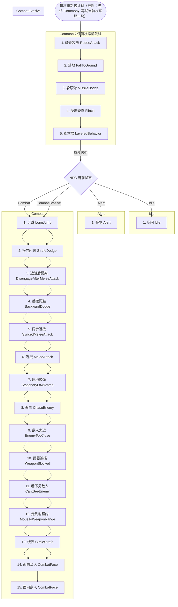

用到的计划（按选择器名推断）：`SCHED_RODEO_ATTACK`、`SCHED_FALL_TO_GROUND`、`SCHED_DODGE`、`SCHED_STRAFE_DODGE`、`SCHED_BIG_FLINCH`、`SCHED_MOVE_TO_ASSAULT_POINT`、`SCHED_HOLD_ASSAULT_POINT`、`SCHED_FORCED_GO`、`SCHED_FOLLOW`、`SCHED_IDLE_STAND`、`SCHED_IDLE_WANDER`、`SCHED_PATROL_PATH`、`SCHED_ALERT_FACE`、`SCHED_ALERT_FACE_BESTSOUND`、`SCHED_ALERT_SCAN`、`SCHED_ALERT_STAND`、`SCHED_INVESTIGATE_SOUND`、`SCHED_INVESTIGATE_CORPSE`、`SCHED_STRAFE_DODGE_PATH`、`SCHED_DODGE_FORWARD`、`SCHED_WAIT_FOR_SYNCED_MELEE_ANIM_END`、`SCHED_MELEE_ATTACK1`、`SCHED_MELEE_CHARGE`、`SCHED_DIRECTIONAL_MELEE`、`SCHED_RELOAD`、`SCHED_MOVE_TO_WEAPON_RANGE`、`SCHED_CHASE_ENEMY`、`SCHED_CHASE_ENEMY_RANGE_ATTACKING`、`SCHED_RANGE_ATTACK2`、`SCHED_RANGE_ATTACK1`、`SCHED_RANGE_ATTACK_WAIT`、`SCHED_BACK_AWAY_FROM_ENEMY`、`SCHED_MOVE_AWAY_FROM_ENEMY`、`SCHED_ESTABLISH_LINE_OF_FIRE`、`SCHED_MOVE_AWAY`、`SCHED_MOVE_TO_ENEMY`、`SCHED_COMBAT_WAIT`、`SCHED_COMBAT_SWEEP`、`SCHED_CIRCLE_STRAFE`、`SCHED_COMBAT_FACE`、`SCHED_MELEE_DISENGAGE`、`SCHED_DODGE_BACKWARD`

| 块 | # | 选择器 | 类 | 条件 | 行 |
|---|---|---|---|---|---|
| Common | 1 | `SelectSchedule_RodeoAttack` |  |  | behavior_pilot_elite_assassin_cqb.txt:3 |
| Common | 2 | `SelectSchedule_FallToGround` |  |  | behavior_pilot_elite_assassin_cqb.txt:4 |
| Common | 3 | `SelectSchedule_MissileDodge` |  |  | behavior_pilot_elite_assassin_cqb.txt:5 |
| Common | 4 | `SelectSchedule_Flinch` |  |  | behavior_pilot_elite_assassin_cqb.txt:6 |
| Common | 5 | `SelectSchedule_LayeredBehavior` |  |  | behavior_pilot_elite_assassin_cqb.txt:7 |
| Idle | 1 | `SelectSchedule_Idle` |  |  | behavior_pilot_elite_assassin_cqb.txt:13 |
| Alert | 1 | `SelectSchedule_Alert` |  |  | behavior_pilot_elite_assassin_cqb.txt:19 |
| Combat | 1 | `SelectSchedule_LongJump` |  |  | behavior_pilot_elite_assassin_cqb.txt:25 |
| Combat | 2 | `SelectSchedule_StrafeDodge` |  |  | behavior_pilot_elite_assassin_cqb.txt:26 |
| Combat | 注释掉 | `SelectSchedule_DisengageAfterMeleeAttack` |  |  | behavior_pilot_elite_assassin_cqb.txt:27 |
| Combat | 3 | `SelectSchedule_ForwardDodge` |  |  | behavior_pilot_elite_assassin_cqb.txt:28 |
| Combat | 4 | `SelectSchedule_SyncedMeleeAttack` |  |  | behavior_pilot_elite_assassin_cqb.txt:29 |
| Combat | 5 | `SelectSchedule_MeleeAttack` |  |  | behavior_pilot_elite_assassin_cqb.txt:30 |
| Combat | 6 | `SelectSchedule_StationaryLowAmmo` |  |  | behavior_pilot_elite_assassin_cqb.txt:31 |
| Combat | 注释掉 | `SelectSchedule_Taunt` |  |  | behavior_pilot_elite_assassin_cqb.txt:32 |
| Combat | 7 | `SelectSchedule_MoveToWeaponRange` |  |  | behavior_pilot_elite_assassin_cqb.txt:33 |
| Combat | 8 | `SelectSchedule_ChaseEnemy` |  |  | behavior_pilot_elite_assassin_cqb.txt:34 |
| Combat | 9 | `SelectSchedule_RangeAttack2` |  |  | behavior_pilot_elite_assassin_cqb.txt:35 |
| Combat | 10 | `SelectSchedule_RangeAttack` |  |  | behavior_pilot_elite_assassin_cqb.txt:36 |
| Combat | 11 | `SelectSchedule_EnemyTooClose` |  |  | behavior_pilot_elite_assassin_cqb.txt:37 |
| Combat | 12 | `SelectSchedule_WeaponBlocked` |  |  | behavior_pilot_elite_assassin_cqb.txt:38 |
| Combat | 13 | `SelectSchedule_CantSeeEnemy` |  |  | behavior_pilot_elite_assassin_cqb.txt:39 |
| Combat | 14 | `SelectSchedule_CircleStrafe` |  |  | behavior_pilot_elite_assassin_cqb.txt:40 |
| Combat | 15 | `SelectSchedule_CombatFace` |  |  | behavior_pilot_elite_assassin_cqb.txt:41 |
| CombatEvasive | 1 | `SelectSchedule_LongJump` |  |  | behavior_pilot_elite_assassin_cqb.txt:47 |
| CombatEvasive | 2 | `SelectSchedule_StrafeDodge` |  |  | behavior_pilot_elite_assassin_cqb.txt:48 |
| CombatEvasive | 3 | `SelectSchedule_DisengageAfterMeleeAttack` |  |  | behavior_pilot_elite_assassin_cqb.txt:49 |
| CombatEvasive | 4 | `SelectSchedule_BackwardDodge` |  |  | behavior_pilot_elite_assassin_cqb.txt:50 |
| CombatEvasive | 5 | `SelectSchedule_SyncedMeleeAttack` |  |  | behavior_pilot_elite_assassin_cqb.txt:51 |
| CombatEvasive | 6 | `SelectSchedule_MeleeAttack` |  |  | behavior_pilot_elite_assassin_cqb.txt:52 |
| CombatEvasive | 7 | `SelectSchedule_StationaryLowAmmo` |  |  | behavior_pilot_elite_assassin_cqb.txt:53 |
| CombatEvasive | 注释掉 | `SelectSchedule_RangeAttack2` |  |  | behavior_pilot_elite_assassin_cqb.txt:54 |
| CombatEvasive | 注释掉 | `SelectSchedule_RangeAttack` |  |  | behavior_pilot_elite_assassin_cqb.txt:55 |
| CombatEvasive | 注释掉 | `SelectSchedule_Taunt` |  |  | behavior_pilot_elite_assassin_cqb.txt:56 |
| CombatEvasive | 8 | `SelectSchedule_ChaseEnemy` |  |  | behavior_pilot_elite_assassin_cqb.txt:57 |
| CombatEvasive | 9 | `SelectSchedule_EnemyTooClose` |  |  | behavior_pilot_elite_assassin_cqb.txt:58 |
| CombatEvasive | 10 | `SelectSchedule_WeaponBlocked` |  |  | behavior_pilot_elite_assassin_cqb.txt:59 |
| CombatEvasive | 11 | `SelectSchedule_CantSeeEnemy` |  |  | behavior_pilot_elite_assassin_cqb.txt:60 |
| CombatEvasive | 12 | `SelectSchedule_MoveToWeaponRange` |  |  | behavior_pilot_elite_assassin_cqb.txt:61 |
| CombatEvasive | 13 | `SelectSchedule_CircleStrafe` |  |  | behavior_pilot_elite_assassin_cqb.txt:62 |
| CombatEvasive | 14 | `SelectSchedule_CombatFace` |  |  | behavior_pilot_elite_assassin_cqb.txt:63 |

## behavior_pilot_elite_assassin_sniper

- 多人用它的设置文件：`npc_pilot_elite_assassin_sniper`
- 战役用它的设置文件：`npc_pilot_elite_assassin_sniper`

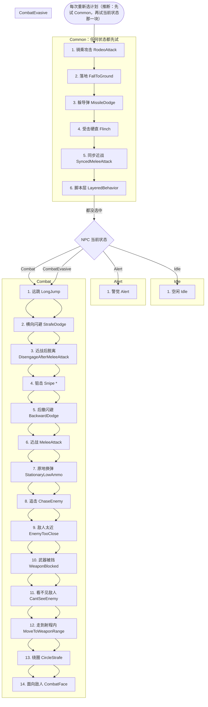

用到的计划（按选择器名推断）：`SCHED_RODEO_ATTACK`、`SCHED_FALL_TO_GROUND`、`SCHED_DODGE`、`SCHED_STRAFE_DODGE`、`SCHED_BIG_FLINCH`、`SCHED_WAIT_FOR_SYNCED_MELEE_ANIM_END`、`SCHED_MOVE_TO_ASSAULT_POINT`、`SCHED_HOLD_ASSAULT_POINT`、`SCHED_FORCED_GO`、`SCHED_FOLLOW`、`SCHED_IDLE_STAND`、`SCHED_IDLE_WANDER`、`SCHED_PATROL_PATH`、`SCHED_ALERT_FACE`、`SCHED_ALERT_FACE_BESTSOUND`、`SCHED_ALERT_SCAN`、`SCHED_ALERT_STAND`、`SCHED_INVESTIGATE_SOUND`、`SCHED_INVESTIGATE_CORPSE`、`SCHED_STRAFE_DODGE_PATH`、`SCHED_MELEE_DISENGAGE`、`SCHED_PREPARE_TO_SNIPE`、`SCHED_SNIPE_WAIT`、`SCHED_DODGE_FORWARD`、`SCHED_MELEE_ATTACK1`、`SCHED_MELEE_CHARGE`、`SCHED_DIRECTIONAL_MELEE`、`SCHED_RELOAD`、`SCHED_CHASE_ENEMY`、`SCHED_CHASE_ENEMY_RANGE_ATTACKING`、`SCHED_BACK_AWAY_FROM_ENEMY`、`SCHED_MOVE_AWAY_FROM_ENEMY`、`SCHED_ESTABLISH_LINE_OF_FIRE`、`SCHED_MOVE_AWAY`、`SCHED_MOVE_TO_ENEMY`、`SCHED_COMBAT_WAIT`、`SCHED_COMBAT_SWEEP`、`SCHED_MOVE_TO_WEAPON_RANGE`、`SCHED_CIRCLE_STRAFE`、`SCHED_COMBAT_FACE`、`SCHED_DODGE_BACKWARD`

| 块 | # | 选择器 | 类 | 条件 | 行 |
|---|---|---|---|---|---|
| Common | 1 | `SelectSchedule_RodeoAttack` |  |  | behavior_pilot_elite_assassin_sniper.txt:3 |
| Common | 2 | `SelectSchedule_FallToGround` |  |  | behavior_pilot_elite_assassin_sniper.txt:4 |
| Common | 3 | `SelectSchedule_MissileDodge` |  |  | behavior_pilot_elite_assassin_sniper.txt:5 |
| Common | 4 | `SelectSchedule_Flinch` |  |  | behavior_pilot_elite_assassin_sniper.txt:6 |
| Common | 5 | `SelectSchedule_SyncedMeleeAttack` |  |  | behavior_pilot_elite_assassin_sniper.txt:7 |
| Common | 6 | `SelectSchedule_LayeredBehavior` |  |  | behavior_pilot_elite_assassin_sniper.txt:8 |
| Idle | 1 | `SelectSchedule_Idle` |  |  | behavior_pilot_elite_assassin_sniper.txt:14 |
| Alert | 1 | `SelectSchedule_Alert` |  |  | behavior_pilot_elite_assassin_sniper.txt:20 |
| Combat | 1 | `SelectSchedule_LongJump` |  |  | behavior_pilot_elite_assassin_sniper.txt:26 |
| Combat | 2 | `SelectSchedule_StrafeDodge` |  |  | behavior_pilot_elite_assassin_sniper.txt:27 |
| Combat | 3 | `SelectSchedule_DisengageAfterMeleeAttack` |  |  | behavior_pilot_elite_assassin_sniper.txt:28 |
| Combat | 4 | `SelectSchedule_Snipe` | CAI_Combatant |  | behavior_pilot_elite_assassin_sniper.txt:29 |
| Combat | 5 | `SelectSchedule_ForwardDodge` |  |  | behavior_pilot_elite_assassin_sniper.txt:30 |
| Combat | 6 | `SelectSchedule_MeleeAttack` |  |  | behavior_pilot_elite_assassin_sniper.txt:31 |
| Combat | 7 | `SelectSchedule_StationaryLowAmmo` |  |  | behavior_pilot_elite_assassin_sniper.txt:32 |
| Combat | 注释掉 | `SelectSchedule_RangeAttack` |  |  | behavior_pilot_elite_assassin_sniper.txt:33 |
| Combat | 注释掉 | `SelectSchedule_Taunt` |  |  | behavior_pilot_elite_assassin_sniper.txt:34 |
| Combat | 8 | `SelectSchedule_ChaseEnemy` |  |  | behavior_pilot_elite_assassin_sniper.txt:35 |
| Combat | 9 | `SelectSchedule_EnemyTooClose` |  |  | behavior_pilot_elite_assassin_sniper.txt:36 |
| Combat | 10 | `SelectSchedule_WeaponBlocked` |  |  | behavior_pilot_elite_assassin_sniper.txt:37 |
| Combat | 11 | `SelectSchedule_CantSeeEnemy` |  |  | behavior_pilot_elite_assassin_sniper.txt:38 |
| Combat | 12 | `SelectSchedule_MoveToWeaponRange` |  |  | behavior_pilot_elite_assassin_sniper.txt:39 |
| Combat | 13 | `SelectSchedule_CircleStrafe` |  |  | behavior_pilot_elite_assassin_sniper.txt:40 |
| Combat | 14 | `SelectSchedule_CombatFace` |  |  | behavior_pilot_elite_assassin_sniper.txt:41 |
| CombatEvasive | 1 | `SelectSchedule_LongJump` |  |  | behavior_pilot_elite_assassin_sniper.txt:47 |
| CombatEvasive | 2 | `SelectSchedule_StrafeDodge` |  |  | behavior_pilot_elite_assassin_sniper.txt:48 |
| CombatEvasive | 3 | `SelectSchedule_DisengageAfterMeleeAttack` |  |  | behavior_pilot_elite_assassin_sniper.txt:49 |
| CombatEvasive | 4 | `SelectSchedule_Snipe` | CAI_Combatant |  | behavior_pilot_elite_assassin_sniper.txt:50 |
| CombatEvasive | 5 | `SelectSchedule_BackwardDodge` |  |  | behavior_pilot_elite_assassin_sniper.txt:51 |
| CombatEvasive | 6 | `SelectSchedule_MeleeAttack` |  |  | behavior_pilot_elite_assassin_sniper.txt:52 |
| CombatEvasive | 7 | `SelectSchedule_StationaryLowAmmo` |  |  | behavior_pilot_elite_assassin_sniper.txt:53 |
| CombatEvasive | 注释掉 | `SelectSchedule_RangeAttack2` |  |  | behavior_pilot_elite_assassin_sniper.txt:54 |
| CombatEvasive | 注释掉 | `SelectSchedule_RangeAttack` |  |  | behavior_pilot_elite_assassin_sniper.txt:55 |
| CombatEvasive | 注释掉 | `SelectSchedule_Taunt` |  |  | behavior_pilot_elite_assassin_sniper.txt:56 |
| CombatEvasive | 8 | `SelectSchedule_ChaseEnemy` |  |  | behavior_pilot_elite_assassin_sniper.txt:57 |
| CombatEvasive | 9 | `SelectSchedule_EnemyTooClose` |  |  | behavior_pilot_elite_assassin_sniper.txt:58 |
| CombatEvasive | 10 | `SelectSchedule_WeaponBlocked` |  |  | behavior_pilot_elite_assassin_sniper.txt:59 |
| CombatEvasive | 11 | `SelectSchedule_CantSeeEnemy` |  |  | behavior_pilot_elite_assassin_sniper.txt:60 |
| CombatEvasive | 12 | `SelectSchedule_MoveToWeaponRange` |  |  | behavior_pilot_elite_assassin_sniper.txt:61 |
| CombatEvasive | 13 | `SelectSchedule_CircleStrafe` |  |  | behavior_pilot_elite_assassin_sniper.txt:62 |
| CombatEvasive | 14 | `SelectSchedule_CombatFace` |  |  | behavior_pilot_elite_assassin_sniper.txt:63 |

## behavior_prowler

- 多人用它的设置文件：`npc_prowler`
- 战役用它的设置文件：`npc_prowler`

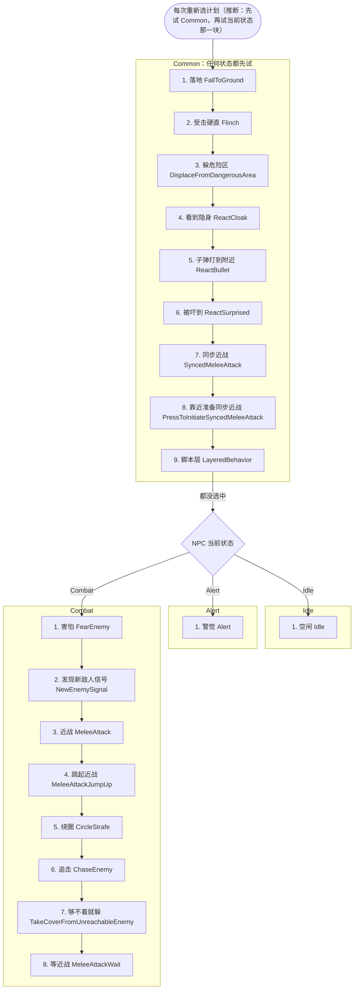

用到的计划（按选择器名推断）：`SCHED_FALL_TO_GROUND`、`SCHED_BIG_FLINCH`、`SCHED_DISPLACE_FROM_DANGEROUS_AREA`、`SCHED_REACT_CLOAK_APPEAR`、`SCHED_REACT_CLOAK_DISAPPEAR`、`SCHED_REACT_BULLET`、`SCHED_REACT_SURPRISED`、`SCHED_WAIT_FOR_SYNCED_MELEE_ANIM_END`、`SCHED_PRESS_TO_INITIATE_SYNCED_MELEE_ATTACK`、`SCHED_MOVE_TO_ASSAULT_POINT`、`SCHED_HOLD_ASSAULT_POINT`、`SCHED_FORCED_GO`、`SCHED_FOLLOW`、`SCHED_IDLE_STAND`、`SCHED_IDLE_WANDER`、`SCHED_PATROL_PATH`、`SCHED_ALERT_FACE`、`SCHED_ALERT_FACE_BESTSOUND`、`SCHED_ALERT_SCAN`、`SCHED_ALERT_STAND`、`SCHED_INVESTIGATE_SOUND`、`SCHED_INVESTIGATE_CORPSE`、`SCHED_RUN_FROM_ENEMY`、`SCHED_RUN_FROM_ENEMY_FALLBACK`、`SCHED_COWER`、`SCHED_SIGNAL_FORWARD`、`SCHED_SIGNAL_TAUNT`、`SCHED_MELEE_ATTACK1`、`SCHED_MELEE_CHARGE`、`SCHED_DIRECTIONAL_MELEE`、`SCHED_CIRCLE_STRAFE`、`SCHED_CHASE_ENEMY`、`SCHED_CHASE_ENEMY_RANGE_ATTACKING`、`SCHED_TAKE_COVER_FROM_ENEMY`、`SCHED_MELEE_ATTACK_WAIT`

| 块 | # | 选择器 | 类 | 条件 | 行 |
|---|---|---|---|---|---|
| Common | 1 | `SelectSchedule_FallToGround` |  |  | behavior_prowler.txt:3 |
| Common | 2 | `SelectSchedule_Flinch` |  |  | behavior_prowler.txt:4 |
| Common | 3 | `SelectSchedule_DisplaceFromDangerousArea` |  |  | behavior_prowler.txt:5 |
| Common | 注释掉 | `SelectSchedule_ReactJumpedOver` |  |  | behavior_prowler.txt:6 |
| Common | 4 | `SelectSchedule_ReactCloak` |  |  | behavior_prowler.txt:7 |
| Common | 5 | `SelectSchedule_ReactBullet` |  |  | behavior_prowler.txt:8 |
| Common | 6 | `SelectSchedule_ReactSurprised` |  |  | behavior_prowler.txt:9 |
| Common | 7 | `SelectSchedule_SyncedMeleeAttack` |  |  | behavior_prowler.txt:10 |
| Common | 8 | `SelectSchedule_PressToInitiateSyncedMeleeAttack` |  |  | behavior_prowler.txt:11 |
| Common | 9 | `SelectSchedule_LayeredBehavior` |  |  | behavior_prowler.txt:12 |
| Idle | 1 | `SelectSchedule_Idle` |  |  | behavior_prowler.txt:19 |
| Alert | 1 | `SelectSchedule_Alert` |  |  | behavior_prowler.txt:26 |
| Combat | 1 | `SelectSchedule_FearEnemy` |  |  | behavior_prowler.txt:33 |
| Combat | 2 | `SelectSchedule_NewEnemySignal` |  |  | behavior_prowler.txt:34 |
| Combat | 3 | `SelectSchedule_MeleeAttack` |  |  | behavior_prowler.txt:35 |
| Combat | 4 | `SelectSchedule_MeleeAttackJumpUp` |  |  | behavior_prowler.txt:36 |
| Combat | 5 | `SelectSchedule_CircleStrafe` |  |  | behavior_prowler.txt:37 |
| Combat | 6 | `SelectSchedule_ChaseEnemy` |  |  | behavior_prowler.txt:38 |
| Combat | 7 | `SelectSchedule_TakeCoverFromUnreachableEnemy` |  |  | behavior_prowler.txt:39 |
| Combat | 8 | `SelectSchedule_MeleeAttackWait` |  |  | behavior_prowler.txt:40 |

## behavior_prowler_cqb

- 多人用它的设置文件：（无）
- 战役用它的设置文件：（无）

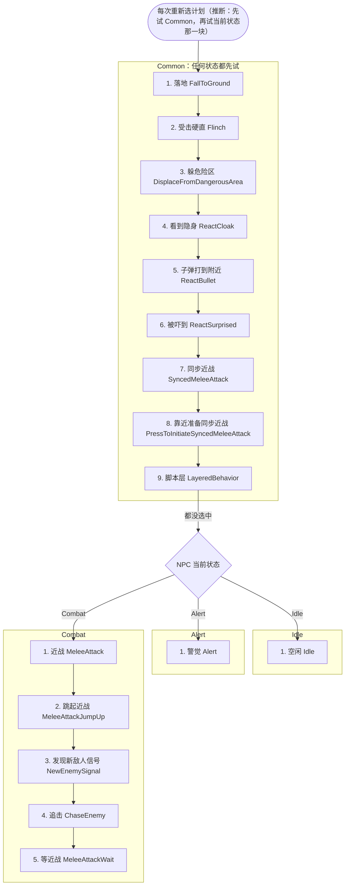

用到的计划（按选择器名推断）：`SCHED_FALL_TO_GROUND`、`SCHED_BIG_FLINCH`、`SCHED_DISPLACE_FROM_DANGEROUS_AREA`、`SCHED_REACT_CLOAK_APPEAR`、`SCHED_REACT_CLOAK_DISAPPEAR`、`SCHED_REACT_BULLET`、`SCHED_REACT_SURPRISED`、`SCHED_WAIT_FOR_SYNCED_MELEE_ANIM_END`、`SCHED_PRESS_TO_INITIATE_SYNCED_MELEE_ATTACK`、`SCHED_MOVE_TO_ASSAULT_POINT`、`SCHED_HOLD_ASSAULT_POINT`、`SCHED_FORCED_GO`、`SCHED_FOLLOW`、`SCHED_IDLE_STAND`、`SCHED_IDLE_WANDER`、`SCHED_PATROL_PATH`、`SCHED_ALERT_FACE`、`SCHED_ALERT_FACE_BESTSOUND`、`SCHED_ALERT_SCAN`、`SCHED_ALERT_STAND`、`SCHED_INVESTIGATE_SOUND`、`SCHED_INVESTIGATE_CORPSE`、`SCHED_MELEE_ATTACK1`、`SCHED_MELEE_CHARGE`、`SCHED_DIRECTIONAL_MELEE`、`SCHED_SIGNAL_FORWARD`、`SCHED_SIGNAL_TAUNT`、`SCHED_CHASE_ENEMY`、`SCHED_CHASE_ENEMY_RANGE_ATTACKING`、`SCHED_MELEE_ATTACK_WAIT`

| 块 | # | 选择器 | 类 | 条件 | 行 |
|---|---|---|---|---|---|
| Common | 1 | `SelectSchedule_FallToGround` |  |  | behavior_prowler_cqb.txt:3 |
| Common | 2 | `SelectSchedule_Flinch` |  |  | behavior_prowler_cqb.txt:4 |
| Common | 3 | `SelectSchedule_DisplaceFromDangerousArea` |  |  | behavior_prowler_cqb.txt:5 |
| Common | 4 | `SelectSchedule_ReactCloak` |  |  | behavior_prowler_cqb.txt:6 |
| Common | 5 | `SelectSchedule_ReactBullet` |  |  | behavior_prowler_cqb.txt:7 |
| Common | 6 | `SelectSchedule_ReactSurprised` |  |  | behavior_prowler_cqb.txt:8 |
| Common | 7 | `SelectSchedule_SyncedMeleeAttack` |  |  | behavior_prowler_cqb.txt:9 |
| Common | 8 | `SelectSchedule_PressToInitiateSyncedMeleeAttack` |  |  | behavior_prowler_cqb.txt:10 |
| Common | 9 | `SelectSchedule_LayeredBehavior` |  |  | behavior_prowler_cqb.txt:11 |
| Idle | 1 | `SelectSchedule_Idle` |  |  | behavior_prowler_cqb.txt:18 |
| Alert | 1 | `SelectSchedule_Alert` |  |  | behavior_prowler_cqb.txt:25 |
| Combat | 1 | `SelectSchedule_MeleeAttack` |  |  | behavior_prowler_cqb.txt:32 |
| Combat | 2 | `SelectSchedule_MeleeAttackJumpUp` |  |  | behavior_prowler_cqb.txt:33 |
| Combat | 3 | `SelectSchedule_NewEnemySignal` |  |  | behavior_prowler_cqb.txt:34 |
| Combat | 4 | `SelectSchedule_ChaseEnemy` |  |  | behavior_prowler_cqb.txt:35 |
| Combat | 5 | `SelectSchedule_MeleeAttackWait` |  |  | behavior_prowler_cqb.txt:36 |

## behavior_soldier

- 多人用它的设置文件：`npc_soldier`, `npc_soldier_bish`, `npc_soldier_blisk`, `npc_soldier_drone_summoner`, `npc_soldier_hero_bear`, `npc_soldier_hero_sarah`, `npc_soldier_pve_eliteguard`, `npc_soldier_pve_sandbox`, `npc_soldier_pve_specialist`, `npc_soldier_shield_captain`, `npc_soldier_sidearm`, `npc_soldier_specialist`, `npc_soldier_specialist_militia`, `npc_soldier_spyglass`, `npc_soldier_training_sentry`
- 战役用它的设置文件：（无）

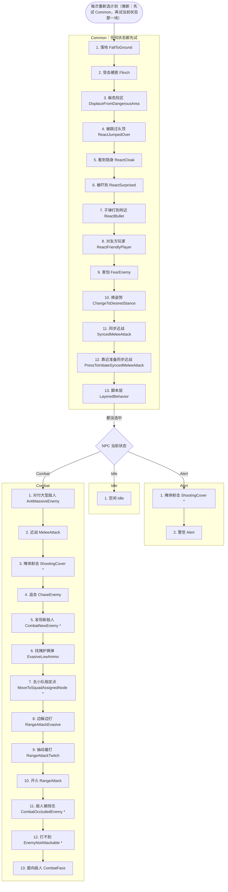

用到的计划（按选择器名推断）：`SCHED_FALL_TO_GROUND`、`SCHED_BIG_FLINCH`、`SCHED_DISPLACE_FROM_DANGEROUS_AREA`、`SCHED_REACT_JUMPED_OVER`、`SCHED_REACT_CLOAK_APPEAR`、`SCHED_REACT_CLOAK_DISAPPEAR`、`SCHED_REACT_SURPRISED`、`SCHED_REACT_BULLET`、`SCHED_SIGNAL_SALUTE`、`SCHED_RUN_FROM_ENEMY`、`SCHED_RUN_FROM_ENEMY_FALLBACK`、`SCHED_COWER`、`SCHED_STAND_UP`、`SCHED_CROUCH_DOWN`、`SCHED_WAIT_FOR_SYNCED_MELEE_ANIM_END`、`SCHED_PRESS_TO_INITIATE_SYNCED_MELEE_ATTACK`、`SCHED_MOVE_TO_ASSAULT_POINT`、`SCHED_HOLD_ASSAULT_POINT`、`SCHED_FORCED_GO`、`SCHED_FOLLOW`、`SCHED_IDLE_STAND`、`SCHED_IDLE_WANDER`、`SCHED_PATROL_PATH`、`SCHED_MOVE_TO_SHOOTING_COVER`、`SCHED_IDLE_INSIDE_SHOOTING_COVER`、`SCHED_CHECK_INSIDE_SHOOTING_COVER`、`SCHED_ADVANCE_FROM_SHOOTING_COVER`、`SCHED_RETREAT_TO_SHOOTING_COVER`、`SCHED_GRENADE_FROM_SHOOTING_COVER`、`SCHED_GRENADE_ADVANCE_FROM_SHOOTING_COVER`、`SCHED_WAIT_WHILE_ADVANCED_FROM_SHOOTING_COVER`、`SCHED_ALERT_FACE`、`SCHED_ALERT_FACE_BESTSOUND`、`SCHED_ALERT_SCAN`、`SCHED_ALERT_STAND`、`SCHED_INVESTIGATE_SOUND`、`SCHED_INVESTIGATE_CORPSE`、`SCHED_TAKE_COVER_FROM_ENEMY`、`SCHED_MELEE_ATTACK1`、`SCHED_MELEE_CHARGE`、`SCHED_DIRECTIONAL_MELEE`、`SCHED_CHASE_ENEMY`、`SCHED_CHASE_ENEMY_RANGE_ATTACKING`、`SCHED_SIGNAL_ACKNOWLEDGE`、`SCHED_HIDE_AND_RELOAD`、`SCHED_MOVE_TO_SQUAD_ASSIGNED_NODE`、`SCHED_RANGE_ATTACK1_EVASIVE`、`SCHED_RANGE_ATTACK_TWITCH`、`SCHED_RANGE_ATTACK1`、`SCHED_RANGE_ATTACK_WAIT`、`SCHED_MOVE_TO_ENGAGEMENT_RANGE`、`SCHED_WAIT_FACING_ENEMY`、`SCHED_COMBAT_FACE`

| 块 | # | 选择器 | 类 | 条件 | 行 |
|---|---|---|---|---|---|
| Common | 1 | `SelectSchedule_FallToGround` |  |  | behavior_soldier.txt:3 |
| Common | 2 | `SelectSchedule_Flinch` |  |  | behavior_soldier.txt:4 |
| Common | 3 | `SelectSchedule_DisplaceFromDangerousArea` |  |  | behavior_soldier.txt:5 |
| Common | 4 | `SelectSchedule_ReactJumpedOver` |  |  | behavior_soldier.txt:6 |
| Common | 5 | `SelectSchedule_ReactCloak` |  |  | behavior_soldier.txt:7 |
| Common | 6 | `SelectSchedule_ReactSurprised` |  |  | behavior_soldier.txt:8 |
| Common | 7 | `SelectSchedule_ReactBullet` |  |  | behavior_soldier.txt:9 |
| Common | 8 | `SelectSchedule_ReactFriendlyPlayer` |  |  | behavior_soldier.txt:10 |
| Common | 9 | `SelectSchedule_FearEnemy` |  |  | behavior_soldier.txt:11 |
| Common | 10 | `SelectSchedule_ChangeToDesiredStance` |  |  | behavior_soldier.txt:12 |
| Common | 11 | `SelectSchedule_SyncedMeleeAttack` |  |  | behavior_soldier.txt:13 |
| Common | 12 | `SelectSchedule_PressToInitiateSyncedMeleeAttack` |  |  | behavior_soldier.txt:14 |
| Common | 13 | `SelectSchedule_LayeredBehavior` |  |  | behavior_soldier.txt:15 |
| Idle | 1 | `SelectSchedule_Idle` |  |  | behavior_soldier.txt:21 |
| Alert | 1 | `SelectSchedule_ShootingCover` | CAI_Combatant |  | behavior_soldier.txt:27 |
| Alert | 2 | `SelectSchedule_Alert` |  |  | behavior_soldier.txt:28 |
| Combat | 1 | `SelectSchedule_AntiMassiveEnemy` |  |  | behavior_soldier.txt:34 |
| Combat | 2 | `SelectSchedule_MeleeAttack` |  |  | behavior_soldier.txt:36 |
| Combat | 3 | `SelectSchedule_ShootingCover` | CAI_Combatant |  | behavior_soldier.txt:37 |
| Combat | 4 | `SelectSchedule_ChaseEnemy` |  |  | behavior_soldier.txt:38 |
| Combat | 5 | `SelectSchedule_CombatNewEnemy` | CAI_Combatant |  | behavior_soldier.txt:40 |
| Combat | 6 | `SelectSchedule_EvasiveLowAmmo` |  |  | behavior_soldier.txt:41 |
| Combat | 7 | `SelectSchedule_MoveToSquadAssignedNode` | CAI_Combatant |  | behavior_soldier.txt:43 |
| Combat | 注释掉 | `SelectSchedule_ThrowGrenade` |  |  | behavior_soldier.txt:44 |
| Combat | 8 | `SelectSchedule_RangeAttackEvasive` |  |  | behavior_soldier.txt:45 |
| Combat | 9 | `SelectSchedule_RangeAttackTwitch` |  |  | behavior_soldier.txt:46 |
| Combat | 10 | `SelectSchedule_RangeAttack` |  |  | behavior_soldier.txt:47 |
| Combat | 11 | `SelectSchedule_CombatOccludedEnemy` | CAI_Combatant |  | behavior_soldier.txt:49 |
| Combat | 12 | `SelectSchedule_EnemyNotAttackable` | CAI_Combatant |  | behavior_soldier.txt:50 |
| Combat | 13 | `SelectSchedule_CombatFace` |  |  | behavior_soldier.txt:52 |

## behavior_sp_auto_titan

- 多人用它的设置文件：（无）
- 战役用它的设置文件：`npc_titan_auto`, `npc_titan_auto_atlas`, `npc_titan_auto_atlas_ion_prime`, `npc_titan_auto_atlas_rocketeer`, `npc_titan_auto_atlas_stickybomb`, `npc_titan_auto_atlas_tone_prime`, `npc_titan_auto_atlas_tracker`, `npc_titan_auto_atlas_vanguard`, `npc_titan_auto_ogre`, `npc_titan_auto_ogre_fighter`, `npc_titan_auto_ogre_legion_prime`, `npc_titan_auto_ogre_meteor`, `npc_titan_auto_ogre_minigun`, `npc_titan_auto_ogre_scorch_prime`, `npc_titan_auto_stryder`, `npc_titan_auto_stryder_arc`, `npc_titan_auto_stryder_leadwall`, `npc_titan_auto_stryder_northstar_prime`, `npc_titan_auto_stryder_ronin_prime`, `npc_titan_auto_stryder_sniper`

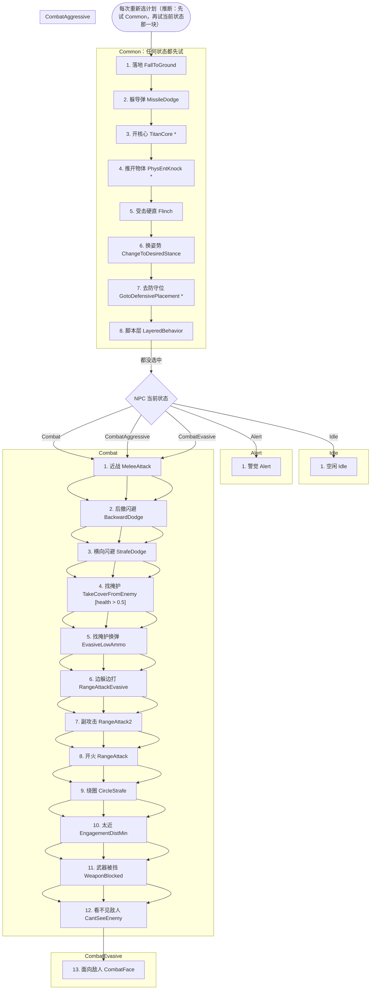

用到的计划（按选择器名推断）：`SCHED_FALL_TO_GROUND`、`SCHED_DODGE`、`SCHED_STRAFE_DODGE`、`SCHED_KNOCK_AWAY_PHYS_ENTS`、`SCHED_BIG_FLINCH`、`SCHED_STAND_UP`、`SCHED_CROUCH_DOWN`、`SCHED_TITAN_MOVE_TO_DEFENSIVE_PLACMENT`、`SCHED_MOVE_TO_ASSAULT_POINT`、`SCHED_HOLD_ASSAULT_POINT`、`SCHED_FORCED_GO`、`SCHED_FOLLOW`、`SCHED_IDLE_STAND`、`SCHED_IDLE_WANDER`、`SCHED_PATROL_PATH`、`SCHED_ALERT_FACE`、`SCHED_ALERT_FACE_BESTSOUND`、`SCHED_ALERT_SCAN`、`SCHED_ALERT_STAND`、`SCHED_INVESTIGATE_SOUND`、`SCHED_INVESTIGATE_CORPSE`、`SCHED_STRAFE_DODGE_PATH`、`SCHED_DODGE_FORWARD`、`SCHED_DODGE_BACKWARD`、`SCHED_MELEE_ATTACK1`、`SCHED_MELEE_CHARGE`、`SCHED_DIRECTIONAL_MELEE`、`SCHED_RELOAD`、`SCHED_RANGE_ATTACK1_EVASIVE`、`SCHED_RANGE_ATTACK2`、`SCHED_RANGE_ATTACK1`、`SCHED_RANGE_ATTACK_WAIT`、`SCHED_MOVE_AWAY_FROM_ENEMY`、`SCHED_BACK_AWAY_FROM_ENEMY`、`SCHED_ESTABLISH_LINE_OF_FIRE`、`SCHED_MOVE_AWAY`、`SCHED_MOVE_TO_ENEMY`、`SCHED_COMBAT_WAIT`、`SCHED_COMBAT_SWEEP`、`SCHED_COMBAT_FACE`、`SCHED_CHASE_ENEMY`、`SCHED_CHASE_ENEMY_RANGE_ATTACKING`、`SCHED_CIRCLE_STRAFE`、`SCHED_TAKE_COVER_FROM_ENEMY`、`SCHED_HIDE_AND_RELOAD`

| 块 | # | 选择器 | 类 | 条件 | 行 |
|---|---|---|---|---|---|
| Common | 1 | `SelectSchedule_FallToGround` |  |  | behavior_sp_auto_titan.txt:3 |
| Common | 2 | `SelectSchedule_MissileDodge` |  |  | behavior_sp_auto_titan.txt:4 |
| Common | 3 | `SelectSchedule_TitanCore` | CNPC_Titan |  | behavior_sp_auto_titan.txt:5 |
| Common | 4 | `SelectSchedule_PhysEntKnock` | CNPC_Titan |  | behavior_sp_auto_titan.txt:6 |
| Common | 5 | `SelectSchedule_Flinch` |  |  | behavior_sp_auto_titan.txt:7 |
| Common | 6 | `SelectSchedule_ChangeToDesiredStance` |  |  | behavior_sp_auto_titan.txt:8 |
| Common | 7 | `SelectSchedule_GotoDefensivePlacement` | CNPC_Titan |  | behavior_sp_auto_titan.txt:9 |
| Common | 8 | `SelectSchedule_LayeredBehavior` |  |  | behavior_sp_auto_titan.txt:10 |
| Idle | 1 | `SelectSchedule_Idle` |  |  | behavior_sp_auto_titan.txt:16 |
| Alert | 1 | `SelectSchedule_Alert` |  |  | behavior_sp_auto_titan.txt:22 |
| Combat | 1 | `SelectSchedule_StrafeDodge` |  |  | behavior_sp_auto_titan.txt:28 |
| Combat | 2 | `SelectSchedule_ForwardDodge` |  |  | behavior_sp_auto_titan.txt:29 |
| Combat | 3 | `SelectSchedule_BackwardDodge` |  |  | behavior_sp_auto_titan.txt:30 |
| Combat | 4 | `SelectSchedule_MeleeAttack` |  |  | behavior_sp_auto_titan.txt:31 |
| Combat | 注释掉 | `SelectSchedule_EvasiveLowAmmo` |  |  | behavior_sp_auto_titan.txt:32 |
| Combat | 注释掉 | `SelectSchedule_ChaseEnemy` |  |  | behavior_sp_auto_titan.txt:33 |
| Combat | 注释掉 | `SelectSchedule_EngagementDistMax` |  |  | behavior_sp_auto_titan.txt:34 |
| Combat | 5 | `SelectSchedule_StationaryLowAmmo` |  |  | behavior_sp_auto_titan.txt:35 |
| Combat | 6 | `SelectSchedule_RangeAttackEvasive` |  |  | behavior_sp_auto_titan.txt:36 |
| Combat | 7 | `SelectSchedule_RangeAttack2` |  |  | behavior_sp_auto_titan.txt:37 |
| Combat | 8 | `SelectSchedule_RangeAttack` |  |  | behavior_sp_auto_titan.txt:38 |
| Combat | 9 | `SelectSchedule_EngagementDistMin` |  |  | behavior_sp_auto_titan.txt:39 |
| Combat | 10 | `SelectSchedule_WeaponBlocked` |  |  | behavior_sp_auto_titan.txt:40 |
| Combat | 11 | `SelectSchedule_CantSeeEnemy` |  |  | behavior_sp_auto_titan.txt:41 |
| Combat | 注释掉 | `SelectSchedule_MoveToWeaponRange` |  |  | behavior_sp_auto_titan.txt:42 |
| Combat | 12 | `SelectSchedule_CombatFace` |  |  | behavior_sp_auto_titan.txt:43 |
| CombatAggressive | 1 | `SelectSchedule_StrafeDodge` |  |  | behavior_sp_auto_titan.txt:48 |
| CombatAggressive | 2 | `SelectSchedule_ForwardDodge` |  |  | behavior_sp_auto_titan.txt:49 |
| CombatAggressive | 3 | `SelectSchedule_MeleeAttack` |  |  | behavior_sp_auto_titan.txt:50 |
| CombatAggressive | 4 | `SelectSchedule_ChaseEnemy` |  |  | behavior_sp_auto_titan.txt:51 |
| CombatAggressive | 5 | `SelectSchedule_CircleStrafe` |  |  | behavior_sp_auto_titan.txt:52 |
| CombatAggressive | 6 | `SelectSchedule_StationaryLowAmmo` |  |  | behavior_sp_auto_titan.txt:53 |
| CombatAggressive | 7 | `SelectSchedule_RangeAttackEvasive` |  |  | behavior_sp_auto_titan.txt:54 |
| CombatAggressive | 8 | `SelectSchedule_RangeAttack2` |  |  | behavior_sp_auto_titan.txt:55 |
| CombatAggressive | 9 | `SelectSchedule_RangeAttack` |  |  | behavior_sp_auto_titan.txt:56 |
| CombatAggressive | 10 | `SelectSchedule_WeaponBlocked` |  |  | behavior_sp_auto_titan.txt:57 |
| CombatAggressive | 11 | `SelectSchedule_CantSeeEnemy` |  |  | behavior_sp_auto_titan.txt:58 |
| CombatAggressive | 12 | `SelectSchedule_CombatFace` |  |  | behavior_sp_auto_titan.txt:59 |
| CombatEvasive | 注释掉 | `SelectSchedule_FearEnemy` |  |  | behavior_sp_auto_titan.txt:65 |
| CombatEvasive | 1 | `SelectSchedule_MeleeAttack` |  |  | behavior_sp_auto_titan.txt:66 |
| CombatEvasive | 2 | `SelectSchedule_BackwardDodge` |  |  | behavior_sp_auto_titan.txt:67 |
| CombatEvasive | 3 | `SelectSchedule_StrafeDodge` |  |  | behavior_sp_auto_titan.txt:68 |
| CombatEvasive | 4 | `SelectSchedule_TakeCoverFromEnemy` |  | health > 0.5 | behavior_sp_auto_titan.txt:69 |
| CombatEvasive | 5 | `SelectSchedule_EvasiveLowAmmo` |  |  | behavior_sp_auto_titan.txt:70 |
| CombatEvasive | 6 | `SelectSchedule_RangeAttackEvasive` |  |  | behavior_sp_auto_titan.txt:71 |
| CombatEvasive | 7 | `SelectSchedule_RangeAttack2` |  |  | behavior_sp_auto_titan.txt:72 |
| CombatEvasive | 8 | `SelectSchedule_RangeAttack` |  |  | behavior_sp_auto_titan.txt:73 |
| CombatEvasive | 9 | `SelectSchedule_CircleStrafe` |  |  | behavior_sp_auto_titan.txt:74 |
| CombatEvasive | 10 | `SelectSchedule_EngagementDistMin` |  |  | behavior_sp_auto_titan.txt:75 |
| CombatEvasive | 11 | `SelectSchedule_WeaponBlocked` |  |  | behavior_sp_auto_titan.txt:76 |
| CombatEvasive | 12 | `SelectSchedule_CantSeeEnemy` |  |  | behavior_sp_auto_titan.txt:77 |
| CombatEvasive | 13 | `SelectSchedule_CombatFace` |  |  | behavior_sp_auto_titan.txt:78 |

## behavior_sp_npc_titan_proto_stasisgun

- 多人用它的设置文件：`npc_titan_proto_stasisgun`
- 战役用它的设置文件：`npc_titan_proto_stasisgun`

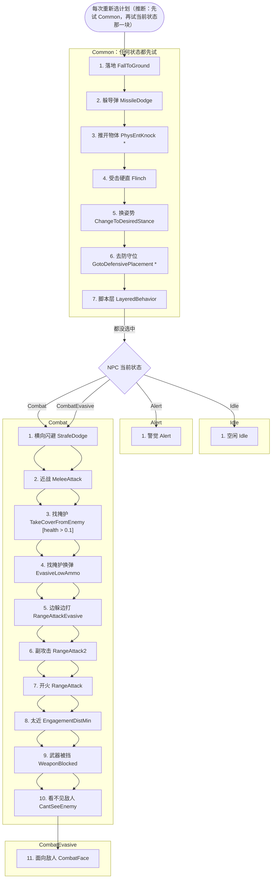

用到的计划（按选择器名推断）：`SCHED_FALL_TO_GROUND`、`SCHED_DODGE`、`SCHED_STRAFE_DODGE`、`SCHED_KNOCK_AWAY_PHYS_ENTS`、`SCHED_BIG_FLINCH`、`SCHED_STAND_UP`、`SCHED_CROUCH_DOWN`、`SCHED_TITAN_MOVE_TO_DEFENSIVE_PLACMENT`、`SCHED_MOVE_TO_ASSAULT_POINT`、`SCHED_HOLD_ASSAULT_POINT`、`SCHED_FORCED_GO`、`SCHED_FOLLOW`、`SCHED_IDLE_STAND`、`SCHED_IDLE_WANDER`、`SCHED_PATROL_PATH`、`SCHED_ALERT_FACE`、`SCHED_ALERT_FACE_BESTSOUND`、`SCHED_ALERT_SCAN`、`SCHED_ALERT_STAND`、`SCHED_INVESTIGATE_SOUND`、`SCHED_INVESTIGATE_CORPSE`、`SCHED_STRAFE_DODGE_PATH`、`SCHED_MELEE_ATTACK1`、`SCHED_MELEE_CHARGE`、`SCHED_DIRECTIONAL_MELEE`、`SCHED_MOVE_AWAY_FROM_ENEMY`、`SCHED_BACK_AWAY_FROM_ENEMY`、`SCHED_CHASE_ENEMY`、`SCHED_CHASE_ENEMY_RANGE_ATTACKING`、`SCHED_RELOAD`、`SCHED_RANGE_ATTACK2`、`SCHED_RANGE_ATTACK1`、`SCHED_RANGE_ATTACK_WAIT`、`SCHED_ESTABLISH_LINE_OF_FIRE`、`SCHED_MOVE_AWAY`、`SCHED_MOVE_TO_ENEMY`、`SCHED_COMBAT_WAIT`、`SCHED_COMBAT_SWEEP`、`SCHED_COMBAT_FACE`、`SCHED_TAKE_COVER_FROM_ENEMY`、`SCHED_HIDE_AND_RELOAD`、`SCHED_RANGE_ATTACK1_EVASIVE`

| 块 | # | 选择器 | 类 | 条件 | 行 |
|---|---|---|---|---|---|
| Common | 1 | `SelectSchedule_FallToGround` |  |  | behavior_sp_npc_titan_proto_stasisgun.txt:3 |
| Common | 2 | `SelectSchedule_MissileDodge` |  |  | behavior_sp_npc_titan_proto_stasisgun.txt:4 |
| Common | 3 | `SelectSchedule_PhysEntKnock` | CNPC_Titan |  | behavior_sp_npc_titan_proto_stasisgun.txt:5 |
| Common | 4 | `SelectSchedule_Flinch` |  |  | behavior_sp_npc_titan_proto_stasisgun.txt:6 |
| Common | 5 | `SelectSchedule_ChangeToDesiredStance` |  |  | behavior_sp_npc_titan_proto_stasisgun.txt:7 |
| Common | 6 | `SelectSchedule_GotoDefensivePlacement` | CNPC_Titan |  | behavior_sp_npc_titan_proto_stasisgun.txt:8 |
| Common | 7 | `SelectSchedule_LayeredBehavior` |  |  | behavior_sp_npc_titan_proto_stasisgun.txt:9 |
| Idle | 1 | `SelectSchedule_Idle` |  |  | behavior_sp_npc_titan_proto_stasisgun.txt:15 |
| Alert | 1 | `SelectSchedule_Alert` |  |  | behavior_sp_npc_titan_proto_stasisgun.txt:21 |
| Combat | 1 | `SelectSchedule_StrafeDodge` |  |  | behavior_sp_npc_titan_proto_stasisgun.txt:27 |
| Combat | 注释掉 | `SelectSchedule_ForwardDodge` |  |  | behavior_sp_npc_titan_proto_stasisgun.txt:28 |
| Combat | 2 | `SelectSchedule_MeleeAttack` |  |  | behavior_sp_npc_titan_proto_stasisgun.txt:29 |
| Combat | 3 | `SelectSchedule_EngagementDistMin` |  |  | behavior_sp_npc_titan_proto_stasisgun.txt:30 |
| Combat | 注释掉 | `SelectSchedule_EvasiveLowAmmo` |  |  | behavior_sp_npc_titan_proto_stasisgun.txt:31 |
| Combat | 4 | `SelectSchedule_ChaseEnemy` |  |  | behavior_sp_npc_titan_proto_stasisgun.txt:32 |
| Combat | 注释掉 | `SelectSchedule_EngagementDistMax` |  |  | behavior_sp_npc_titan_proto_stasisgun.txt:33 |
| Combat | 5 | `SelectSchedule_StationaryLowAmmo` |  |  | behavior_sp_npc_titan_proto_stasisgun.txt:34 |
| Combat | 注释掉 | `SelectSchedule_RangeAttackEvasive` |  |  | behavior_sp_npc_titan_proto_stasisgun.txt:35 |
| Combat | 6 | `SelectSchedule_RangeAttack2` |  |  | behavior_sp_npc_titan_proto_stasisgun.txt:36 |
| Combat | 7 | `SelectSchedule_RangeAttack` |  |  | behavior_sp_npc_titan_proto_stasisgun.txt:37 |
| Combat | 8 | `SelectSchedule_WeaponBlocked` |  |  | behavior_sp_npc_titan_proto_stasisgun.txt:38 |
| Combat | 9 | `SelectSchedule_CantSeeEnemy` |  |  | behavior_sp_npc_titan_proto_stasisgun.txt:39 |
| Combat | 注释掉 | `SelectSchedule_MoveToWeaponRange` |  |  | behavior_sp_npc_titan_proto_stasisgun.txt:40 |
| Combat | 10 | `SelectSchedule_CombatFace` |  |  | behavior_sp_npc_titan_proto_stasisgun.txt:41 |
| CombatEvasive | 注释掉 | `SelectSchedule_FearEnemy` |  |  | behavior_sp_npc_titan_proto_stasisgun.txt:47 |
| CombatEvasive | 1 | `SelectSchedule_StrafeDodge` |  |  | behavior_sp_npc_titan_proto_stasisgun.txt:48 |
| CombatEvasive | 2 | `SelectSchedule_MeleeAttack` |  |  | behavior_sp_npc_titan_proto_stasisgun.txt:49 |
| CombatEvasive | 注释掉 | `SelectSchedule_BackwardDodge` |  |  | behavior_sp_npc_titan_proto_stasisgun.txt:50 |
| CombatEvasive | 3 | `SelectSchedule_TakeCoverFromEnemy` |  | health > 0.1 | behavior_sp_npc_titan_proto_stasisgun.txt:51 |
| CombatEvasive | 4 | `SelectSchedule_EvasiveLowAmmo` |  |  | behavior_sp_npc_titan_proto_stasisgun.txt:52 |
| CombatEvasive | 5 | `SelectSchedule_RangeAttackEvasive` |  |  | behavior_sp_npc_titan_proto_stasisgun.txt:53 |
| CombatEvasive | 6 | `SelectSchedule_RangeAttack2` |  |  | behavior_sp_npc_titan_proto_stasisgun.txt:54 |
| CombatEvasive | 7 | `SelectSchedule_RangeAttack` |  |  | behavior_sp_npc_titan_proto_stasisgun.txt:55 |
| CombatEvasive | 8 | `SelectSchedule_EngagementDistMin` |  |  | behavior_sp_npc_titan_proto_stasisgun.txt:56 |
| CombatEvasive | 9 | `SelectSchedule_WeaponBlocked` |  |  | behavior_sp_npc_titan_proto_stasisgun.txt:57 |
| CombatEvasive | 10 | `SelectSchedule_CantSeeEnemy` |  |  | behavior_sp_npc_titan_proto_stasisgun.txt:58 |
| CombatEvasive | 11 | `SelectSchedule_CombatFace` |  |  | behavior_sp_npc_titan_proto_stasisgun.txt:59 |

## behavior_sp_soldier

- 多人用它的设置文件：（无）
- 战役用它的设置文件：`npc_soldier`, `npc_soldier_bish`, `npc_soldier_blisk`, `npc_soldier_drone_summoner`, `npc_soldier_hero_bear`, `npc_soldier_hero_sarah`, `npc_soldier_pve_eliteguard`, `npc_soldier_pve_sandbox`, `npc_soldier_pve_specialist`, `npc_soldier_shield_captain`, `npc_soldier_sidearm`, `npc_soldier_specialist`, `npc_soldier_specialist_militia`, `npc_soldier_spyglass`, `npc_soldier_training_sentry`

```mermaid
flowchart TD
  start(["每次重新选计划（推断：先试 Common，再试当前状态那一块）"])
  subgraph Common["Common：任何状态都先试"]
    c1["1. 落地 FallToGround"]
    c2["2. 受击硬直 Flinch"]
    c3["3. 躲危险区 DisplaceFromDangerousArea"]
    c4["4. 被跳过头顶 ReactJumpedOver"]
    c5["5. 看到隐身 ReactCloak"]
    c6["6. 被吓到 ReactSurprised"]
    c7["7. 子弹打到附近 ReactBullet"]
    c8["8. 对友方玩家 ReactFriendlyPlayer"]
    c9["9. 害怕 FearEnemy"]
    c10["10. 换姿势 ChangeToDesiredStance"]
    c11["11. 同步近战 SyncedMeleeAttack"]
    c12["12. 靠近准备同步近战 PressToInitiateSyncedMeleeAttack"]
    c13["13. 脚本层 LayeredBehavior"]
    c1 --> c2
    c2 --> c3
    c3 --> c4
    c4 --> c5
    c5 --> c6
    c6 --> c7
    c7 --> c8
    c8 --> c9
    c9 --> c10
    c10 --> c11
    c11 --> c12
    c12 --> c13
  end
  start --> c1
  st{"NPC 当前状态"}
  c13 -- 都没选中 --> st
  subgraph Idle["Idle"]
    id1["1. 空闲 Idle"]
  end
  st -- Idle --> id1
  subgraph Alert["Alert"]
    al1["1. 掩体射击 ShootingCover *"]
    al2["2. 警觉 Alert"]
    al1 --> al2
  end
  st -- Alert --> al1
  subgraph Combat["Combat"]
    co1["1. 对付大型敌人 AntiMassiveEnemy"]
    co2["2. 近战 MeleeAttack"]
    co3["3. 换武器 SwitchWeapon"]
    co4["4. 掩体射击 ShootingCover *"]
    co5["5. 追击 ChaseEnemy"]
    co6["6. 发现新敌人 CombatNewEnemy *"]
    co7["7. 去小队指定点 MoveToSquadAssignedNode *"]
    co8["8. 找掩护换弹 EvasiveLowAmmo"]
    co9["9. 太远 EngagementDistMax"]
    co10["10. 太远就断视线 BreakEnemyLosIfOutsideEngageDist"]
    co11["11. 扔雷 ThrowGrenade"]
    co12["12. 边躲边打 RangeAttackEvasive"]
    co13["13. 抽动着打 RangeAttackTwitch"]
    co14["14. 开火 RangeAttack"]
    co15["15. 敌人被挡住 CombatOccludedEnemy *"]
    co16["16. 打不到 EnemyNotAttackable *"]
    co17["17. 面向敌人 CombatFace"]
    co1 --> co2
    co2 --> co3
    co3 --> co4
    co4 --> co5
    co5 --> co6
    co6 --> co7
    co7 --> co8
    co8 --> co9
    co9 --> co10
    co10 --> co11
    co11 --> co12
    co12 --> co13
    co13 --> co14
    co14 --> co15
    co15 --> co16
    co16 --> co17
  end
  st -- Combat --> co1
```

用到的计划（按选择器名推断）：`SCHED_FALL_TO_GROUND`、`SCHED_BIG_FLINCH`、`SCHED_DISPLACE_FROM_DANGEROUS_AREA`、`SCHED_REACT_JUMPED_OVER`、`SCHED_REACT_CLOAK_APPEAR`、`SCHED_REACT_CLOAK_DISAPPEAR`、`SCHED_REACT_SURPRISED`、`SCHED_REACT_BULLET`、`SCHED_SIGNAL_SALUTE`、`SCHED_RUN_FROM_ENEMY`、`SCHED_RUN_FROM_ENEMY_FALLBACK`、`SCHED_COWER`、`SCHED_STAND_UP`、`SCHED_CROUCH_DOWN`、`SCHED_WAIT_FOR_SYNCED_MELEE_ANIM_END`、`SCHED_PRESS_TO_INITIATE_SYNCED_MELEE_ATTACK`、`SCHED_MOVE_TO_ASSAULT_POINT`、`SCHED_HOLD_ASSAULT_POINT`、`SCHED_FORCED_GO`、`SCHED_FOLLOW`、`SCHED_IDLE_STAND`、`SCHED_IDLE_WANDER`、`SCHED_PATROL_PATH`、`SCHED_MOVE_TO_SHOOTING_COVER`、`SCHED_IDLE_INSIDE_SHOOTING_COVER`、`SCHED_CHECK_INSIDE_SHOOTING_COVER`、`SCHED_ADVANCE_FROM_SHOOTING_COVER`、`SCHED_RETREAT_TO_SHOOTING_COVER`、`SCHED_GRENADE_FROM_SHOOTING_COVER`、`SCHED_GRENADE_ADVANCE_FROM_SHOOTING_COVER`、`SCHED_WAIT_WHILE_ADVANCED_FROM_SHOOTING_COVER`、`SCHED_ALERT_FACE`、`SCHED_ALERT_FACE_BESTSOUND`、`SCHED_ALERT_SCAN`、`SCHED_ALERT_STAND`、`SCHED_INVESTIGATE_SOUND`、`SCHED_INVESTIGATE_CORPSE`、`SCHED_TAKE_COVER_FROM_ENEMY`、`SCHED_MELEE_ATTACK1`、`SCHED_MELEE_CHARGE`、`SCHED_DIRECTIONAL_MELEE`、`SCHED_SWITCH_TO_PENDING_WEAPON`、`SCHED_CHASE_ENEMY`、`SCHED_CHASE_ENEMY_RANGE_ATTACKING`、`SCHED_SIGNAL_ACKNOWLEDGE`、`SCHED_MOVE_TO_SQUAD_ASSIGNED_NODE`、`SCHED_HIDE_AND_RELOAD`、`SCHED_MOVE_TO_ENGAGEMENT_RANGE`、`SCHED_THROW_GRENADE`、`SCHED_RANGE_ATTACK1_EVASIVE`、`SCHED_RANGE_ATTACK_TWITCH`、`SCHED_RANGE_ATTACK1`、`SCHED_RANGE_ATTACK_WAIT`、`SCHED_WAIT_FACING_ENEMY`、`SCHED_COMBAT_FACE`

| 块 | # | 选择器 | 类 | 条件 | 行 |
|---|---|---|---|---|---|
| Common | 1 | `SelectSchedule_FallToGround` |  |  | behavior_sp_soldier.txt:3 |
| Common | 2 | `SelectSchedule_Flinch` |  |  | behavior_sp_soldier.txt:4 |
| Common | 3 | `SelectSchedule_DisplaceFromDangerousArea` |  |  | behavior_sp_soldier.txt:5 |
| Common | 4 | `SelectSchedule_ReactJumpedOver` |  |  | behavior_sp_soldier.txt:6 |
| Common | 5 | `SelectSchedule_ReactCloak` |  |  | behavior_sp_soldier.txt:7 |
| Common | 6 | `SelectSchedule_ReactSurprised` |  |  | behavior_sp_soldier.txt:8 |
| Common | 7 | `SelectSchedule_ReactBullet` |  |  | behavior_sp_soldier.txt:9 |
| Common | 8 | `SelectSchedule_ReactFriendlyPlayer` |  |  | behavior_sp_soldier.txt:10 |
| Common | 9 | `SelectSchedule_FearEnemy` |  |  | behavior_sp_soldier.txt:11 |
| Common | 10 | `SelectSchedule_ChangeToDesiredStance` |  |  | behavior_sp_soldier.txt:12 |
| Common | 11 | `SelectSchedule_SyncedMeleeAttack` |  |  | behavior_sp_soldier.txt:13 |
| Common | 12 | `SelectSchedule_PressToInitiateSyncedMeleeAttack` |  |  | behavior_sp_soldier.txt:14 |
| Common | 13 | `SelectSchedule_LayeredBehavior` |  |  | behavior_sp_soldier.txt:15 |
| Idle | 1 | `SelectSchedule_Idle` |  |  | behavior_sp_soldier.txt:21 |
| Alert | 1 | `SelectSchedule_ShootingCover` | CAI_Combatant |  | behavior_sp_soldier.txt:27 |
| Alert | 2 | `SelectSchedule_Alert` |  |  | behavior_sp_soldier.txt:28 |
| Combat | 1 | `SelectSchedule_AntiMassiveEnemy` |  |  | behavior_sp_soldier.txt:34 |
| Combat | 2 | `SelectSchedule_MeleeAttack` |  |  | behavior_sp_soldier.txt:36 |
| Combat | 3 | `SelectSchedule_SwitchWeapon` |  |  | behavior_sp_soldier.txt:37 |
| Combat | 4 | `SelectSchedule_ShootingCover` | CAI_Combatant |  | behavior_sp_soldier.txt:38 |
| Combat | 5 | `SelectSchedule_ChaseEnemy` |  |  | behavior_sp_soldier.txt:39 |
| Combat | 6 | `SelectSchedule_CombatNewEnemy` | CAI_Combatant |  | behavior_sp_soldier.txt:41 |
| Combat | 7 | `SelectSchedule_MoveToSquadAssignedNode` | CAI_Combatant |  | behavior_sp_soldier.txt:42 |
| Combat | 8 | `SelectSchedule_EvasiveLowAmmo` |  |  | behavior_sp_soldier.txt:44 |
| Combat | 9 | `SelectSchedule_EngagementDistMax` |  |  | behavior_sp_soldier.txt:45 |
| Combat | 10 | `SelectSchedule_BreakEnemyLosIfOutsideEngageDist` |  |  | behavior_sp_soldier.txt:46 |
| Combat | 11 | `SelectSchedule_ThrowGrenade` |  |  | behavior_sp_soldier.txt:48 |
| Combat | 12 | `SelectSchedule_RangeAttackEvasive` |  |  | behavior_sp_soldier.txt:49 |
| Combat | 13 | `SelectSchedule_RangeAttackTwitch` |  |  | behavior_sp_soldier.txt:50 |
| Combat | 14 | `SelectSchedule_RangeAttack` |  |  | behavior_sp_soldier.txt:51 |
| Combat | 15 | `SelectSchedule_CombatOccludedEnemy` | CAI_Combatant |  | behavior_sp_soldier.txt:53 |
| Combat | 16 | `SelectSchedule_EnemyNotAttackable` | CAI_Combatant |  | behavior_sp_soldier.txt:54 |
| Combat | 17 | `SelectSchedule_CombatFace` |  |  | behavior_sp_soldier.txt:56 |

## behavior_spectre

- 多人用它的设置文件：`npc_spectre`, `npc_spectre_mortar`
- 战役用它的设置文件：`npc_spectre`, `npc_spectre_mortar`

```mermaid
flowchart TD
  start(["每次重新选计划（推断：先试 Common，再试当前状态那一块）"])
  subgraph Common["Common：任何状态都先试"]
    c1["1. 落地 FallToGround"]
    c2["2. 受击硬直 Flinch"]
    c3["3. 被跳过头顶 ReactJumpedOver"]
    c4["4. 换姿势 ChangeToDesiredStance"]
    c5["5. 同步近战 SyncedMeleeAttack"]
    c6["6. 靠近准备同步近战 PressToInitiateSyncedMeleeAttack"]
    c7["7. 脚本层 LayeredBehavior"]
    c1 --> c2
    c2 --> c3
    c3 --> c4
    c4 --> c5
    c5 --> c6
    c6 --> c7
  end
  start --> c1
  st{"NPC 当前状态"}
  c7 -- 都没选中 --> st
  subgraph Idle["Idle"]
    id1["1. 空闲 Idle"]
  end
  st -- Idle --> id1
  subgraph Alert["Alert"]
    al1["1. 掩体射击 ShootingCover *"]
    al2["2. 警觉 Alert"]
    al1 --> al2
  end
  st -- Alert --> al1
  subgraph Combat["Combat"]
    co1["1. 对付大型敌人 AntiMassiveEnemy"]
    co2["2. 近战 MeleeAttack"]
    co3["3. 掩体射击 ShootingCover *"]
    co4["4. 找掩护换弹 EvasiveLowAmmo"]
    co5["5. 去小队指定点 MoveToSquadAssignedNode *"]
    co6["6. 抽动着打 RangeAttackTwitch"]
    co7["7. 开火 RangeAttack"]
    co8["8. 敌人太近 EnemyTooClose"]
    co9["9. 看不见敌人 CantSeeEnemy"]
    co10["10. 走到射程内 MoveToWeaponRange"]
    co11["11. 追击 ChaseEnemy"]
    co12["12. 到了最后见到的位置 AtEnemyLKP"]
    co13["13. 面向敌人 CombatFace"]
    co1 --> co2
    co2 --> co3
    co3 --> co4
    co4 --> co5
    co5 --> co6
    co6 --> co7
    co7 --> co8
    co8 --> co9
    co9 --> co10
    co10 --> co11
    co11 --> co12
    co12 --> co13
  end
  st -- Combat --> co1
```

用到的计划（按选择器名推断）：`SCHED_FALL_TO_GROUND`、`SCHED_BIG_FLINCH`、`SCHED_REACT_JUMPED_OVER`、`SCHED_STAND_UP`、`SCHED_CROUCH_DOWN`、`SCHED_WAIT_FOR_SYNCED_MELEE_ANIM_END`、`SCHED_PRESS_TO_INITIATE_SYNCED_MELEE_ATTACK`、`SCHED_MOVE_TO_ASSAULT_POINT`、`SCHED_HOLD_ASSAULT_POINT`、`SCHED_FORCED_GO`、`SCHED_FOLLOW`、`SCHED_IDLE_STAND`、`SCHED_IDLE_WANDER`、`SCHED_PATROL_PATH`、`SCHED_MOVE_TO_SHOOTING_COVER`、`SCHED_IDLE_INSIDE_SHOOTING_COVER`、`SCHED_CHECK_INSIDE_SHOOTING_COVER`、`SCHED_ADVANCE_FROM_SHOOTING_COVER`、`SCHED_RETREAT_TO_SHOOTING_COVER`、`SCHED_GRENADE_FROM_SHOOTING_COVER`、`SCHED_GRENADE_ADVANCE_FROM_SHOOTING_COVER`、`SCHED_WAIT_WHILE_ADVANCED_FROM_SHOOTING_COVER`、`SCHED_ALERT_FACE`、`SCHED_ALERT_FACE_BESTSOUND`、`SCHED_ALERT_SCAN`、`SCHED_ALERT_STAND`、`SCHED_INVESTIGATE_SOUND`、`SCHED_INVESTIGATE_CORPSE`、`SCHED_TAKE_COVER_FROM_ENEMY`、`SCHED_MELEE_ATTACK1`、`SCHED_MELEE_CHARGE`、`SCHED_DIRECTIONAL_MELEE`、`SCHED_HIDE_AND_RELOAD`、`SCHED_MOVE_TO_SQUAD_ASSIGNED_NODE`、`SCHED_RANGE_ATTACK_TWITCH`、`SCHED_RANGE_ATTACK1`、`SCHED_RANGE_ATTACK_WAIT`、`SCHED_BACK_AWAY_FROM_ENEMY`、`SCHED_MOVE_AWAY_FROM_ENEMY`、`SCHED_MOVE_TO_ENEMY`、`SCHED_COMBAT_WAIT`、`SCHED_COMBAT_SWEEP`、`SCHED_MOVE_TO_WEAPON_RANGE`、`SCHED_CHASE_ENEMY`、`SCHED_CHASE_ENEMY_RANGE_ATTACKING`、`SCHED_COMBAT_FACE`

| 块 | # | 选择器 | 类 | 条件 | 行 |
|---|---|---|---|---|---|
| Common | 1 | `SelectSchedule_FallToGround` |  |  | behavior_spectre.txt:3 |
| Common | 2 | `SelectSchedule_Flinch` |  |  | behavior_spectre.txt:4 |
| Common | 3 | `SelectSchedule_ReactJumpedOver` |  |  | behavior_spectre.txt:5 |
| Common | 4 | `SelectSchedule_ChangeToDesiredStance` |  |  | behavior_spectre.txt:6 |
| Common | 5 | `SelectSchedule_SyncedMeleeAttack` |  |  | behavior_spectre.txt:7 |
| Common | 6 | `SelectSchedule_PressToInitiateSyncedMeleeAttack` |  |  | behavior_spectre.txt:8 |
| Common | 7 | `SelectSchedule_LayeredBehavior` |  |  | behavior_spectre.txt:9 |
| Idle | 1 | `SelectSchedule_Idle` |  |  | behavior_spectre.txt:15 |
| Alert | 1 | `SelectSchedule_ShootingCover` | CAI_Combatant |  | behavior_spectre.txt:21 |
| Alert | 2 | `SelectSchedule_Alert` |  |  | behavior_spectre.txt:22 |
| Combat | 1 | `SelectSchedule_AntiMassiveEnemy` |  |  | behavior_spectre.txt:28 |
| Combat | 2 | `SelectSchedule_MeleeAttack` |  |  | behavior_spectre.txt:30 |
| Combat | 3 | `SelectSchedule_ShootingCover` | CAI_Combatant |  | behavior_spectre.txt:31 |
| Combat | 4 | `SelectSchedule_EvasiveLowAmmo` |  |  | behavior_spectre.txt:32 |
| Combat | 5 | `SelectSchedule_MoveToSquadAssignedNode` | CAI_Combatant |  | behavior_spectre.txt:34 |
| Combat | 注释掉 | `SelectSchedule_ThrowGrenade` |  |  | behavior_spectre.txt:35 |
| Combat | 注释掉 | `SelectSchedule_RangeAttackEvasive` |  |  | behavior_spectre.txt:36 |
| Combat | 注释掉 | `SelectSchedule_LongJump` |  |  | behavior_spectre.txt:37 |
| Combat | 6 | `SelectSchedule_RangeAttackTwitch` |  |  | behavior_spectre.txt:38 |
| Combat | 7 | `SelectSchedule_RangeAttack` |  |  | behavior_spectre.txt:39 |
| Combat | 8 | `SelectSchedule_EnemyTooClose` |  |  | behavior_spectre.txt:41 |
| Combat | 9 | `SelectSchedule_CantSeeEnemy` |  |  | behavior_spectre.txt:42 |
| Combat | 10 | `SelectSchedule_MoveToWeaponRange` |  |  | behavior_spectre.txt:43 |
| Combat | 11 | `SelectSchedule_ChaseEnemy` |  |  | behavior_spectre.txt:44 |
| Combat | 12 | `SelectSchedule_AtEnemyLKP` |  |  | behavior_spectre.txt:45 |
| Combat | 13 | `SelectSchedule_CombatFace` |  |  | behavior_spectre.txt:46 |

## behavior_stalker

- 多人用它的设置文件：`npc_stalker`, `npc_stalker_fd`, `npc_stalker_zombie`, `npc_stalker_zombie_mossy`
- 战役用它的设置文件：`npc_stalker`, `npc_stalker_fd`, `npc_stalker_zombie`, `npc_stalker_zombie_mossy`

```mermaid
flowchart TD
  start(["每次重新选计划（推断：先试 Common，再试当前状态那一块）"])
  subgraph Common["Common：任何状态都先试"]
    c1["1. 落地 FallToGround"]
    c2["2. 受击硬直 Flinch"]
    c3["3. 被跳过头顶 ReactJumpedOver"]
    c4["4. 换姿势 ChangeToDesiredStance"]
    c5["5. 同步近战 SyncedMeleeAttack"]
    c6["6. 靠近准备同步近战 PressToInitiateSyncedMeleeAttack"]
    c7["7. 脚本层 LayeredBehavior"]
    c1 --> c2
    c2 --> c3
    c3 --> c4
    c4 --> c5
    c5 --> c6
    c6 --> c7
  end
  start --> c1
  st{"NPC 当前状态"}
  c7 -- 都没选中 --> st
  subgraph Idle["Idle"]
    id1["1. 空闲 Idle"]
  end
  st -- Idle --> id1
  subgraph Alert["Alert"]
    al1["1. 警觉 Alert"]
  end
  st -- Alert --> al1
  subgraph Combat["Combat"]
    co1["1. 近战 MeleeAttack"]
    co2["2. 追击 ChaseEnemy"]
    co3["3. 原地换弹 StationaryLowAmmo"]
    co4["4. 副攻击 RangeAttack2"]
    co5["5. 开火 RangeAttack"]
    co6["6. 敌人太近 EnemyTooClose"]
    co7["7. 看不见敌人 CantSeeEnemy"]
    co8["8. 走到射程内 MoveToWeaponRange"]
    co9["9. 到了最后见到的位置 AtEnemyLKP"]
    co10["10. 面向敌人 CombatFace"]
    co1 --> co2
    co2 --> co3
    co3 --> co4
    co4 --> co5
    co5 --> co6
    co6 --> co7
    co7 --> co8
    co8 --> co9
    co9 --> co10
  end
  st -- Combat --> co1
```

用到的计划（按选择器名推断）：`SCHED_FALL_TO_GROUND`、`SCHED_BIG_FLINCH`、`SCHED_REACT_JUMPED_OVER`、`SCHED_STAND_UP`、`SCHED_CROUCH_DOWN`、`SCHED_WAIT_FOR_SYNCED_MELEE_ANIM_END`、`SCHED_PRESS_TO_INITIATE_SYNCED_MELEE_ATTACK`、`SCHED_MOVE_TO_ASSAULT_POINT`、`SCHED_HOLD_ASSAULT_POINT`、`SCHED_FORCED_GO`、`SCHED_FOLLOW`、`SCHED_IDLE_STAND`、`SCHED_IDLE_WANDER`、`SCHED_PATROL_PATH`、`SCHED_ALERT_FACE`、`SCHED_ALERT_FACE_BESTSOUND`、`SCHED_ALERT_SCAN`、`SCHED_ALERT_STAND`、`SCHED_INVESTIGATE_SOUND`、`SCHED_INVESTIGATE_CORPSE`、`SCHED_MELEE_ATTACK1`、`SCHED_MELEE_CHARGE`、`SCHED_DIRECTIONAL_MELEE`、`SCHED_CHASE_ENEMY`、`SCHED_CHASE_ENEMY_RANGE_ATTACKING`、`SCHED_RELOAD`、`SCHED_RANGE_ATTACK2`、`SCHED_RANGE_ATTACK1`、`SCHED_RANGE_ATTACK_WAIT`、`SCHED_BACK_AWAY_FROM_ENEMY`、`SCHED_MOVE_AWAY_FROM_ENEMY`、`SCHED_MOVE_TO_ENEMY`、`SCHED_COMBAT_WAIT`、`SCHED_COMBAT_SWEEP`、`SCHED_MOVE_TO_WEAPON_RANGE`、`SCHED_COMBAT_FACE`

| 块 | # | 选择器 | 类 | 条件 | 行 |
|---|---|---|---|---|---|
| Common | 1 | `SelectSchedule_FallToGround` |  |  | behavior_stalker.txt:3 |
| Common | 2 | `SelectSchedule_Flinch` |  |  | behavior_stalker.txt:4 |
| Common | 3 | `SelectSchedule_ReactJumpedOver` |  |  | behavior_stalker.txt:5 |
| Common | 4 | `SelectSchedule_ChangeToDesiredStance` |  |  | behavior_stalker.txt:6 |
| Common | 5 | `SelectSchedule_SyncedMeleeAttack` |  |  | behavior_stalker.txt:7 |
| Common | 6 | `SelectSchedule_PressToInitiateSyncedMeleeAttack` |  |  | behavior_stalker.txt:8 |
| Common | 7 | `SelectSchedule_LayeredBehavior` |  |  | behavior_stalker.txt:9 |
| Idle | 1 | `SelectSchedule_Idle` |  |  | behavior_stalker.txt:15 |
| Alert | 1 | `SelectSchedule_Alert` |  |  | behavior_stalker.txt:21 |
| Combat | 1 | `SelectSchedule_MeleeAttack` |  |  | behavior_stalker.txt:27 |
| Combat | 2 | `SelectSchedule_ChaseEnemy` |  |  | behavior_stalker.txt:28 |
| Combat | 3 | `SelectSchedule_StationaryLowAmmo` |  |  | behavior_stalker.txt:30 |
| Combat | 4 | `SelectSchedule_RangeAttack2` |  |  | behavior_stalker.txt:31 |
| Combat | 5 | `SelectSchedule_RangeAttack` |  |  | behavior_stalker.txt:32 |
| Combat | 6 | `SelectSchedule_EnemyTooClose` |  |  | behavior_stalker.txt:34 |
| Combat | 7 | `SelectSchedule_CantSeeEnemy` |  |  | behavior_stalker.txt:35 |
| Combat | 8 | `SelectSchedule_MoveToWeaponRange` |  |  | behavior_stalker.txt:36 |
| Combat | 9 | `SelectSchedule_AtEnemyLKP` |  |  | behavior_stalker.txt:37 |
| Combat | 10 | `SelectSchedule_CombatFace` |  |  | behavior_stalker.txt:38 |

## behavior_stalker_crawling

- 多人用它的设置文件：`npc_stalker_crawling`, `npc_stalker_crawling_fd`, `npc_stalker_crawling_mossy`
- 战役用它的设置文件：`npc_stalker_crawling`, `npc_stalker_crawling_fd`, `npc_stalker_crawling_mossy`

```mermaid
flowchart TD
  start(["每次重新选计划（推断：先试 Common，再试当前状态那一块）"])
  subgraph Common["Common：任何状态都先试"]
    c1["1. 落地 FallToGround"]
    c2["2. 同步近战 SyncedMeleeAttack"]
    c3["3. 近战 MeleeAttack"]
    c4["4. 追击 ChaseEnemy"]
    c5["5. 脚本层 LayeredBehavior"]
    c1 --> c2
    c2 --> c3
    c3 --> c4
    c4 --> c5
  end
  start --> c1
  st{"NPC 当前状态"}
  c5 -- 都没选中 --> st
  subgraph Idle["Idle"]
    id1["1. 原地待着 IdleStand"]
  end
  st -- Idle --> id1
  subgraph Alert["Alert"]
    al1["1. 面向敌人 CombatFace"]
  end
  st -- Alert --> al1
  subgraph Combat["Combat"]
    co1["1. 面向敌人 CombatFace"]
  end
  st -- Combat --> co1
```

用到的计划（按选择器名推断）：`SCHED_FALL_TO_GROUND`、`SCHED_WAIT_FOR_SYNCED_MELEE_ANIM_END`、`SCHED_MELEE_ATTACK1`、`SCHED_MELEE_CHARGE`、`SCHED_DIRECTIONAL_MELEE`、`SCHED_CHASE_ENEMY`、`SCHED_CHASE_ENEMY_RANGE_ATTACKING`、`SCHED_MOVE_TO_ASSAULT_POINT`、`SCHED_HOLD_ASSAULT_POINT`、`SCHED_FORCED_GO`、`SCHED_FOLLOW`、`SCHED_IDLE_STAND`、`SCHED_COMBAT_FACE`

| 块 | # | 选择器 | 类 | 条件 | 行 |
|---|---|---|---|---|---|
| Common | 1 | `SelectSchedule_FallToGround` |  |  | behavior_stalker_crawling.txt:3 |
| Common | 2 | `SelectSchedule_SyncedMeleeAttack` |  |  | behavior_stalker_crawling.txt:5 |
| Common | 3 | `SelectSchedule_MeleeAttack` |  |  | behavior_stalker_crawling.txt:6 |
| Common | 4 | `SelectSchedule_ChaseEnemy` |  |  | behavior_stalker_crawling.txt:7 |
| Common | 5 | `SelectSchedule_LayeredBehavior` |  |  | behavior_stalker_crawling.txt:9 |
| Idle | 1 | `SelectSchedule_IdleStand` |  |  | behavior_stalker_crawling.txt:16 |
| Alert | 1 | `SelectSchedule_CombatFace` |  |  | behavior_stalker_crawling.txt:23 |
| Combat | 1 | `SelectSchedule_CombatFace` |  |  | behavior_stalker_crawling.txt:30 |

## behavior_super_spectre

- 多人用它的设置文件：`npc_super_spectre`, `npc_super_spectre_aitdm`, `npc_super_spectre_burnmeter`, `npc_super_spectre_calmer`, `npc_super_spectre_fd`
- 战役用它的设置文件：`npc_super_spectre`, `npc_super_spectre_aitdm`, `npc_super_spectre_burnmeter`, `npc_super_spectre_calmer`, `npc_super_spectre_fd`

```mermaid
flowchart TD
  start(["每次重新选计划（推断：先试 Common，再试当前状态那一块）"])
  subgraph Common["Common：任何状态都先试"]
    c1["1. 受击硬直 Flinch"]
    c2["2. 躲危险区 DisplaceFromDangerousArea"]
    c3["3. 被吓到 ReactSurprised"]
    c4["4. 脚本层 LayeredBehavior"]
    c1 --> c2
    c2 --> c3
    c3 --> c4
  end
  start --> c1
  st{"NPC 当前状态"}
  c4 -- 都没选中 --> st
  subgraph Idle["Idle"]
    id1["1. 空闲 Idle"]
  end
  st -- Idle --> id1
  subgraph Alert["Alert"]
    al1["1. 警觉 Alert"]
  end
  st -- Alert --> al1
  subgraph Combat["Combat"]
    co1["1. 躲导弹 MissileDodge"]
    co2["2. 远跳 LongJump"]
    co3["3. 横向闪避 StrafeDodge"]
    co4["4. 前冲闪避 ForwardDodge"]
    co5["5. 近战 MeleeAttack"]
    co6["6. 特殊攻击 SpecialAttack"]
    co7["7. 开火 RangeAttack"]
    co8["8. 武器被挡 WeaponBlocked"]
    co9["9. 冲撞 ChargeAttack"]
    co10["10. 看不见敌人 CantSeeEnemy"]
    co11["11. 太远 EngagementDistMax"]
    co12["12. 面向敌人 CombatFace"]
    co1 --> co2
    co2 --> co3
    co3 --> co4
    co4 --> co5
    co5 --> co6
    co6 --> co7
    co7 --> co8
    co8 --> co9
    co9 --> co10
    co10 --> co11
    co11 --> co12
  end
  st -- Combat --> co1
  subgraph CombatEvasive["CombatEvasive"]
    co1["1. 躲导弹 MissileDodge"]
    co2["2. 后撤闪避 BackwardDodge"]
    co3["3. 横向闪避 StrafeDodge"]
    co4["4. 近战 MeleeAttack"]
    co5["5. 被瞄准时闪 EnemyAimDodge"]
    co6["6. 特殊攻击 SpecialAttack"]
    co7["7. 开火 RangeAttack"]
    co8["8. 追击 ChaseEnemy"]
    co9["9. 武器被挡 WeaponBlocked"]
    co10["10. 看不见敌人 CantSeeEnemy"]
    co11["11. 太远 EngagementDistMax"]
    co12["12. 面向敌人 CombatFace"]
    co1 --> co2
    co2 --> co3
    co3 --> co4
    co4 --> co5
    co5 --> co6
    co6 --> co7
    co7 --> co8
    co8 --> co9
    co9 --> co10
    co10 --> co11
    co11 --> co12
  end
  st -- CombatEvasive --> co1
```

用到的计划（按选择器名推断）：`SCHED_BIG_FLINCH`、`SCHED_DISPLACE_FROM_DANGEROUS_AREA`、`SCHED_REACT_SURPRISED`、`SCHED_MOVE_TO_ASSAULT_POINT`、`SCHED_HOLD_ASSAULT_POINT`、`SCHED_FORCED_GO`、`SCHED_FOLLOW`、`SCHED_IDLE_STAND`、`SCHED_IDLE_WANDER`、`SCHED_PATROL_PATH`、`SCHED_ALERT_FACE`、`SCHED_ALERT_FACE_BESTSOUND`、`SCHED_ALERT_SCAN`、`SCHED_ALERT_STAND`、`SCHED_INVESTIGATE_SOUND`、`SCHED_INVESTIGATE_CORPSE`、`SCHED_DODGE`、`SCHED_STRAFE_DODGE`、`SCHED_STRAFE_DODGE_PATH`、`SCHED_DODGE_FORWARD`、`SCHED_MELEE_ATTACK1`、`SCHED_MELEE_CHARGE`、`SCHED_DIRECTIONAL_MELEE`、`SCHED_SPECIAL_ATTACK`、`SCHED_RANGE_ATTACK1`、`SCHED_RANGE_ATTACK_WAIT`、`SCHED_ESTABLISH_LINE_OF_FIRE`、`SCHED_MOVE_AWAY`、`SCHED_CHARGE_ATTACK_RUN`、`SCHED_MOVE_TO_ENEMY`、`SCHED_COMBAT_WAIT`、`SCHED_COMBAT_SWEEP`、`SCHED_MOVE_TO_ENGAGEMENT_RANGE`、`SCHED_COMBAT_FACE`、`SCHED_DODGE_BACKWARD`、`SCHED_DODGE_PATH`、`SCHED_CHASE_ENEMY`、`SCHED_CHASE_ENEMY_RANGE_ATTACKING`

| 块 | # | 选择器 | 类 | 条件 | 行 |
|---|---|---|---|---|---|
| Common | 注释掉 | `SelectSchedule_FallToGround` |  |  | behavior_super_spectre.txt:3 |
| Common | 1 | `SelectSchedule_Flinch` |  |  | behavior_super_spectre.txt:4 |
| Common | 2 | `SelectSchedule_DisplaceFromDangerousArea` |  |  | behavior_super_spectre.txt:5 |
| Common | 3 | `SelectSchedule_ReactSurprised` |  |  | behavior_super_spectre.txt:6 |
| Common | 4 | `SelectSchedule_LayeredBehavior` |  |  | behavior_super_spectre.txt:7 |
| Idle | 1 | `SelectSchedule_Idle` |  |  | behavior_super_spectre.txt:13 |
| Alert | 1 | `SelectSchedule_Alert` |  |  | behavior_super_spectre.txt:19 |
| Combat | 1 | `SelectSchedule_MissileDodge` |  |  | behavior_super_spectre.txt:25 |
| Combat | 2 | `SelectSchedule_LongJump` |  |  | behavior_super_spectre.txt:26 |
| Combat | 3 | `SelectSchedule_StrafeDodge` |  |  | behavior_super_spectre.txt:27 |
| Combat | 4 | `SelectSchedule_ForwardDodge` |  |  | behavior_super_spectre.txt:28 |
| Combat | 5 | `SelectSchedule_MeleeAttack` |  |  | behavior_super_spectre.txt:29 |
| Combat | 6 | `SelectSchedule_SpecialAttack` |  |  | behavior_super_spectre.txt:30 |
| Combat | 7 | `SelectSchedule_RangeAttack` |  |  | behavior_super_spectre.txt:31 |
| Combat | 8 | `SelectSchedule_WeaponBlocked` |  |  | behavior_super_spectre.txt:32 |
| Combat | 9 | `SelectSchedule_ChargeAttack` |  |  | behavior_super_spectre.txt:33 |
| Combat | 10 | `SelectSchedule_CantSeeEnemy` |  |  | behavior_super_spectre.txt:34 |
| Combat | 11 | `SelectSchedule_EngagementDistMax` |  |  | behavior_super_spectre.txt:35 |
| Combat | 注释掉 | `SelectSchedule_EngagementDistMin` |  |  | behavior_super_spectre.txt:36 |
| Combat | 12 | `SelectSchedule_CombatFace` |  |  | behavior_super_spectre.txt:37 |
| CombatEvasive | 1 | `SelectSchedule_MissileDodge` |  |  | behavior_super_spectre.txt:43 |
| CombatEvasive | 2 | `SelectSchedule_BackwardDodge` |  |  | behavior_super_spectre.txt:44 |
| CombatEvasive | 3 | `SelectSchedule_StrafeDodge` |  |  | behavior_super_spectre.txt:45 |
| CombatEvasive | 4 | `SelectSchedule_MeleeAttack` |  |  | behavior_super_spectre.txt:46 |
| CombatEvasive | 5 | `SelectSchedule_EnemyAimDodge` |  |  | behavior_super_spectre.txt:47 |
| CombatEvasive | 注释掉 | `SelectSchedule_TakeCoverFromEnemy` |  | health > 0.1 | behavior_super_spectre.txt:48 |
| CombatEvasive | 6 | `SelectSchedule_SpecialAttack` |  |  | behavior_super_spectre.txt:49 |
| CombatEvasive | 7 | `SelectSchedule_RangeAttack` |  |  | behavior_super_spectre.txt:50 |
| CombatEvasive | 8 | `SelectSchedule_ChaseEnemy` |  |  | behavior_super_spectre.txt:51 |
| CombatEvasive | 注释掉 | `SelectSchedule_EnemyTooClose` |  |  | behavior_super_spectre.txt:52 |
| CombatEvasive | 9 | `SelectSchedule_WeaponBlocked` |  |  | behavior_super_spectre.txt:53 |
| CombatEvasive | 10 | `SelectSchedule_CantSeeEnemy` |  |  | behavior_super_spectre.txt:54 |
| CombatEvasive | 11 | `SelectSchedule_EngagementDistMax` |  |  | behavior_super_spectre.txt:55 |
| CombatEvasive | 注释掉 | `SelectSchedule_EngagementDistMin` |  |  | behavior_super_spectre.txt:56 |
| CombatEvasive | 12 | `SelectSchedule_CombatFace` |  |  | behavior_super_spectre.txt:57 |

## behavior_titan

- 多人用它的设置文件：`npc_titan`, `npc_titan_arc`, `npc_titan_atlas`, `npc_titan_atlas_ion_prime_bounty`, `npc_titan_atlas_stickybomb`, `npc_titan_atlas_stickybomb_boss_fd`, `npc_titan_atlas_stickybomb_bounty`, `npc_titan_mortar`, `npc_titan_nuke`, `npc_titan_ogre`, `npc_titan_stryder`, `npc_titan_stryder_arc`
- 战役用它的设置文件：`npc_titan`, `npc_titan_arc`, `npc_titan_atlas`, `npc_titan_atlas_ion_prime_bounty`, `npc_titan_atlas_stickybomb`, `npc_titan_atlas_stickybomb_boss_fd`, `npc_titan_atlas_stickybomb_bounty`, `npc_titan_mortar`, `npc_titan_nuke`, `npc_titan_ogre`, `npc_titan_stryder`, `npc_titan_stryder_arc`

```mermaid
flowchart TD
  start(["每次重新选计划（推断：先试 Common，再试当前状态那一块）"])
  subgraph Common["Common：任何状态都先试"]
    c1["1. 躲导弹 MissileDodge"]
    c2["2. 开核心 TitanCore *"]
    c3["3. 推开物体 PhysEntKnock *"]
    c4["4. 受击硬直 Flinch"]
    c5["5. 躲危险区 DisplaceFromDangerousArea"]
    c6["6. 换姿势 ChangeToDesiredStance"]
    c7["7. 同步近战 SyncedMeleeAttack"]
    c8["8. 靠近准备同步近战 PressToInitiateSyncedMeleeAttack"]
    c9["9. 去防守位 GotoDefensivePlacement *"]
    c10["10. 脚本层 LayeredBehavior"]
    c1 --> c2
    c2 --> c3
    c3 --> c4
    c4 --> c5
    c5 --> c6
    c6 --> c7
    c7 --> c8
    c8 --> c9
    c9 --> c10
  end
  start --> c1
  st{"NPC 当前状态"}
  c10 -- 都没选中 --> st
  subgraph Idle["Idle"]
    id1["1. 空闲 Idle"]
  end
  st -- Idle --> id1
  subgraph Alert["Alert"]
    al1["1. 警觉 Alert"]
  end
  st -- Alert --> al1
  subgraph Combat["Combat"]
    co1["1. 横向闪避 StrafeDodge"]
    co2["2. 近战 MeleeAttack"]
    co3["3. 太远 EngagementDistMax"]
    co4["4. 绕圈 CircleStrafe"]
    co5["5. 原地换弹 StationaryLowAmmo"]
    co6["6. 边躲边打 RangeAttackEvasive"]
    co7["7. 副攻击 RangeAttack2"]
    co8["8. 开火 RangeAttack"]
    co9["9. 太近 EngagementDistMin"]
    co10["10. 武器被挡 WeaponBlocked"]
    co11["11. 看不见敌人 CantSeeEnemy"]
    co12["12. 面向敌人 CombatFace"]
    co1 --> co2
    co2 --> co3
    co3 --> co4
    co4 --> co5
    co5 --> co6
    co6 --> co7
    co7 --> co8
    co8 --> co9
    co9 --> co10
    co10 --> co11
    co11 --> co12
  end
  st -- Combat --> co1
  subgraph CombatAggressive["CombatAggressive"]
    co1["1. 近战 MeleeAttack"]
    co2["2. 横向闪避 StrafeDodge"]
    co3["3. 前冲闪避 ForwardDodge"]
    co4["4. 追击 ChaseEnemy"]
    co5["5. 原地换弹 StationaryLowAmmo"]
    co6["6. 边躲边打 RangeAttackEvasive"]
    co7["7. 副攻击 RangeAttack2"]
    co8["8. 开火 RangeAttack"]
    co9["9. 武器被挡 WeaponBlocked"]
    co10["10. 看不见敌人 CantSeeEnemy"]
    co11["11. 面向敌人 CombatFace"]
    co1 --> co2
    co2 --> co3
    co3 --> co4
    co4 --> co5
    co5 --> co6
    co6 --> co7
    co7 --> co8
    co8 --> co9
    co9 --> co10
    co10 --> co11
  end
  st -- CombatAggressive --> co1
  subgraph CombatEvasive["CombatEvasive"]
    co1["1. 近战 MeleeAttack"]
    co2["2. 后撤闪避 BackwardDodge"]
    co3["3. 横向闪避 StrafeDodge"]
    co4["4. 找掩护 TakeCoverFromEnemy [health > 0.1]"]
    co5["5. 绕圈 CircleStrafe"]
    co6["6. 找掩护换弹 EvasiveLowAmmo"]
    co7["7. 边躲边打 RangeAttackEvasive"]
    co8["8. 副攻击 RangeAttack2"]
    co9["9. 开火 RangeAttack"]
    co10["10. 太近 EngagementDistMin"]
    co11["11. 武器被挡 WeaponBlocked"]
    co12["12. 面向敌人 CombatFace"]
    co1 --> co2
    co2 --> co3
    co3 --> co4
    co4 --> co5
    co5 --> co6
    co6 --> co7
    co7 --> co8
    co8 --> co9
    co9 --> co10
    co10 --> co11
    co11 --> co12
  end
  st -- CombatEvasive --> co1
```

用到的计划（按选择器名推断）：`SCHED_DODGE`、`SCHED_STRAFE_DODGE`、`SCHED_KNOCK_AWAY_PHYS_ENTS`、`SCHED_BIG_FLINCH`、`SCHED_DISPLACE_FROM_DANGEROUS_AREA`、`SCHED_STAND_UP`、`SCHED_CROUCH_DOWN`、`SCHED_WAIT_FOR_SYNCED_MELEE_ANIM_END`、`SCHED_PRESS_TO_INITIATE_SYNCED_MELEE_ATTACK`、`SCHED_TITAN_MOVE_TO_DEFENSIVE_PLACMENT`、`SCHED_MOVE_TO_ASSAULT_POINT`、`SCHED_HOLD_ASSAULT_POINT`、`SCHED_FORCED_GO`、`SCHED_FOLLOW`、`SCHED_IDLE_STAND`、`SCHED_IDLE_WANDER`、`SCHED_PATROL_PATH`、`SCHED_ALERT_FACE`、`SCHED_ALERT_FACE_BESTSOUND`、`SCHED_ALERT_SCAN`、`SCHED_ALERT_STAND`、`SCHED_INVESTIGATE_SOUND`、`SCHED_INVESTIGATE_CORPSE`、`SCHED_STRAFE_DODGE_PATH`、`SCHED_MELEE_ATTACK1`、`SCHED_MELEE_CHARGE`、`SCHED_DIRECTIONAL_MELEE`、`SCHED_MOVE_TO_ENGAGEMENT_RANGE`、`SCHED_CIRCLE_STRAFE`、`SCHED_RELOAD`、`SCHED_RANGE_ATTACK1_EVASIVE`、`SCHED_RANGE_ATTACK2`、`SCHED_RANGE_ATTACK1`、`SCHED_RANGE_ATTACK_WAIT`、`SCHED_MOVE_AWAY_FROM_ENEMY`、`SCHED_BACK_AWAY_FROM_ENEMY`、`SCHED_ESTABLISH_LINE_OF_FIRE`、`SCHED_MOVE_AWAY`、`SCHED_MOVE_TO_ENEMY`、`SCHED_COMBAT_WAIT`、`SCHED_COMBAT_SWEEP`、`SCHED_COMBAT_FACE`、`SCHED_DODGE_FORWARD`、`SCHED_CHASE_ENEMY`、`SCHED_CHASE_ENEMY_RANGE_ATTACKING`、`SCHED_DODGE_BACKWARD`、`SCHED_TAKE_COVER_FROM_ENEMY`、`SCHED_HIDE_AND_RELOAD`

| 块 | # | 选择器 | 类 | 条件 | 行 |
|---|---|---|---|---|---|
| Common | 1 | `SelectSchedule_MissileDodge` |  |  | behavior_titan.txt:3 |
| Common | 2 | `SelectSchedule_TitanCore` | CNPC_Titan |  | behavior_titan.txt:4 |
| Common | 3 | `SelectSchedule_PhysEntKnock` | CNPC_Titan |  | behavior_titan.txt:5 |
| Common | 4 | `SelectSchedule_Flinch` |  |  | behavior_titan.txt:6 |
| Common | 5 | `SelectSchedule_DisplaceFromDangerousArea` |  |  | behavior_titan.txt:7 |
| Common | 6 | `SelectSchedule_ChangeToDesiredStance` |  |  | behavior_titan.txt:8 |
| Common | 7 | `SelectSchedule_SyncedMeleeAttack` |  |  | behavior_titan.txt:9 |
| Common | 8 | `SelectSchedule_PressToInitiateSyncedMeleeAttack` |  |  | behavior_titan.txt:10 |
| Common | 9 | `SelectSchedule_GotoDefensivePlacement` | CNPC_Titan |  | behavior_titan.txt:11 |
| Common | 10 | `SelectSchedule_LayeredBehavior` |  |  | behavior_titan.txt:12 |
| Idle | 1 | `SelectSchedule_Idle` |  |  | behavior_titan.txt:18 |
| Alert | 1 | `SelectSchedule_Alert` |  |  | behavior_titan.txt:24 |
| Combat | 1 | `SelectSchedule_StrafeDodge` |  |  | behavior_titan.txt:30 |
| Combat | 注释掉 | `SelectSchedule_ForwardDodge` |  |  | behavior_titan.txt:31 |
| Combat | 2 | `SelectSchedule_MeleeAttack` |  |  | behavior_titan.txt:32 |
| Combat | 注释掉 | `SelectSchedule_EvasiveLowAmmo` |  |  | behavior_titan.txt:33 |
| Combat | 注释掉 | `SelectSchedule_ChaseEnemy` |  |  | behavior_titan.txt:34 |
| Combat | 3 | `SelectSchedule_EngagementDistMax` |  |  | behavior_titan.txt:35 |
| Combat | 4 | `SelectSchedule_CircleStrafe` |  |  | behavior_titan.txt:36 |
| Combat | 5 | `SelectSchedule_StationaryLowAmmo` |  |  | behavior_titan.txt:37 |
| Combat | 6 | `SelectSchedule_RangeAttackEvasive` |  |  | behavior_titan.txt:38 |
| Combat | 7 | `SelectSchedule_RangeAttack2` |  |  | behavior_titan.txt:39 |
| Combat | 8 | `SelectSchedule_RangeAttack` |  |  | behavior_titan.txt:40 |
| Combat | 9 | `SelectSchedule_EngagementDistMin` |  |  | behavior_titan.txt:41 |
| Combat | 10 | `SelectSchedule_WeaponBlocked` |  |  | behavior_titan.txt:42 |
| Combat | 11 | `SelectSchedule_CantSeeEnemy` |  |  | behavior_titan.txt:43 |
| Combat | 注释掉 | `SelectSchedule_MoveToWeaponRange` |  |  | behavior_titan.txt:44 |
| Combat | 12 | `SelectSchedule_CombatFace` |  |  | behavior_titan.txt:45 |
| CombatAggressive | 1 | `SelectSchedule_MeleeAttack` |  |  | behavior_titan.txt:50 |
| CombatAggressive | 2 | `SelectSchedule_StrafeDodge` |  |  | behavior_titan.txt:51 |
| CombatAggressive | 3 | `SelectSchedule_ForwardDodge` |  |  | behavior_titan.txt:52 |
| CombatAggressive | 4 | `SelectSchedule_ChaseEnemy` |  |  | behavior_titan.txt:53 |
| CombatAggressive | 注释掉 | `SelectSchedule_CircleStrafe` |  |  | behavior_titan.txt:54 |
| CombatAggressive | 5 | `SelectSchedule_StationaryLowAmmo` |  |  | behavior_titan.txt:55 |
| CombatAggressive | 6 | `SelectSchedule_RangeAttackEvasive` |  |  | behavior_titan.txt:56 |
| CombatAggressive | 7 | `SelectSchedule_RangeAttack2` |  |  | behavior_titan.txt:57 |
| CombatAggressive | 8 | `SelectSchedule_RangeAttack` |  |  | behavior_titan.txt:58 |
| CombatAggressive | 9 | `SelectSchedule_WeaponBlocked` |  |  | behavior_titan.txt:59 |
| CombatAggressive | 10 | `SelectSchedule_CantSeeEnemy` |  |  | behavior_titan.txt:60 |
| CombatAggressive | 11 | `SelectSchedule_CombatFace` |  |  | behavior_titan.txt:61 |
| CombatEvasive | 注释掉 | `SelectSchedule_FearEnemy` |  |  | behavior_titan.txt:67 |
| CombatEvasive | 1 | `SelectSchedule_MeleeAttack` |  |  | behavior_titan.txt:68 |
| CombatEvasive | 2 | `SelectSchedule_BackwardDodge` |  |  | behavior_titan.txt:69 |
| CombatEvasive | 3 | `SelectSchedule_StrafeDodge` |  |  | behavior_titan.txt:70 |
| CombatEvasive | 4 | `SelectSchedule_TakeCoverFromEnemy` |  | health > 0.1 | behavior_titan.txt:71 |
| CombatEvasive | 5 | `SelectSchedule_CircleStrafe` |  |  | behavior_titan.txt:72 |
| CombatEvasive | 6 | `SelectSchedule_EvasiveLowAmmo` |  |  | behavior_titan.txt:73 |
| CombatEvasive | 7 | `SelectSchedule_RangeAttackEvasive` |  |  | behavior_titan.txt:74 |
| CombatEvasive | 8 | `SelectSchedule_RangeAttack2` |  |  | behavior_titan.txt:75 |
| CombatEvasive | 9 | `SelectSchedule_RangeAttack` |  |  | behavior_titan.txt:76 |
| CombatEvasive | 10 | `SelectSchedule_EngagementDistMin` |  |  | behavior_titan.txt:77 |
| CombatEvasive | 11 | `SelectSchedule_WeaponBlocked` |  |  | behavior_titan.txt:78 |
| CombatEvasive | 注释掉 | `SelectSchedule_CantSeeEnemy` |  |  | behavior_titan.txt:79 |
| CombatEvasive | 12 | `SelectSchedule_CombatFace` |  |  | behavior_titan.txt:80 |

## behavior_titan_buddy

- 多人用它的设置文件：`npc_titan_buddy`, `npc_titan_buddy_s2s`, `npc_titan_buddy_skyway`, `npc_titan_sarah`, `npc_titan_vanguard`
- 战役用它的设置文件：`npc_titan_buddy`, `npc_titan_buddy_s2s`, `npc_titan_buddy_skyway`, `npc_titan_sarah`, `npc_titan_vanguard`

```mermaid
flowchart TD
  start(["每次重新选计划（推断：先试 Common，再试当前状态那一块）"])
  subgraph Common["Common：任何状态都先试"]
    c1["1. 躲导弹 MissileDodge"]
    c2["2. 推开物体 PhysEntKnock *"]
    c3["3. 受击硬直 Flinch"]
    c4["4. 躲危险区 DisplaceFromDangerousArea"]
    c5["5. 换姿势 ChangeToDesiredStance"]
    c6["6. 同步近战 SyncedMeleeAttack"]
    c7["7. 靠近准备同步近战 PressToInitiateSyncedMeleeAttack"]
    c8["8. 去防守位 GotoDefensivePlacement *"]
    c9["9. 脚本层 LayeredBehavior"]
    c1 --> c2
    c2 --> c3
    c3 --> c4
    c4 --> c5
    c5 --> c6
    c6 --> c7
    c7 --> c8
    c8 --> c9
  end
  start --> c1
  st{"NPC 当前状态"}
  c9 -- 都没选中 --> st
  subgraph Idle["Idle"]
    id1["1. 空闲 Idle"]
  end
  st -- Idle --> id1
  subgraph Alert["Alert"]
    al1["1. 警觉 Alert"]
  end
  st -- Alert --> al1
  subgraph Combat["Combat"]
    co1["1. 横向闪避 StrafeDodge"]
    co2["2. 前冲闪避 ForwardDodge"]
    co3["3. 近战 MeleeAttack"]
    co4["4. 太远 EngagementDistMax"]
    co5["5. 绕圈 CircleStrafe"]
    co6["6. 原地换弹 StationaryLowAmmo"]
    co7["7. 边躲边打 RangeAttackEvasive"]
    co8["8. 副攻击 RangeAttack2"]
    co9["9. 开火 RangeAttack"]
    co10["10. 太近 EngagementDistMin"]
    co11["11. 武器被挡 WeaponBlocked"]
    co12["12. 看不见敌人 CantSeeEnemy"]
    co13["13. 面向敌人 CombatFace"]
    co1 --> co2
    co2 --> co3
    co3 --> co4
    co4 --> co5
    co5 --> co6
    co6 --> co7
    co7 --> co8
    co8 --> co9
    co9 --> co10
    co10 --> co11
    co11 --> co12
    co12 --> co13
  end
  st -- Combat --> co1
  subgraph CombatAggressive["CombatAggressive"]
    co1["1. 近战 MeleeAttack"]
    co2["2. 横向闪避 StrafeDodge"]
    co3["3. 前冲闪避 ForwardDodge"]
    co4["4. 原地换弹 StationaryLowAmmo"]
    co5["5. 边躲边打 RangeAttackEvasive"]
    co6["6. 副攻击 RangeAttack2"]
    co7["7. 开火 RangeAttack"]
    co8["8. 武器被挡 WeaponBlocked"]
    co9["9. 看不见敌人 CantSeeEnemy"]
    co10["10. 面向敌人 CombatFace"]
    co1 --> co2
    co2 --> co3
    co3 --> co4
    co4 --> co5
    co5 --> co6
    co6 --> co7
    co7 --> co8
    co8 --> co9
    co9 --> co10
  end
  st -- CombatAggressive --> co1
  subgraph CombatEvasive["CombatEvasive"]
    co1["1. 近战 MeleeAttack"]
    co2["2. 后撤闪避 BackwardDodge"]
    co3["3. 横向闪避 StrafeDodge"]
    co4["4. 找掩护 TakeCoverFromEnemy [health > 0.1]"]
    co5["5. 绕圈 CircleStrafe"]
    co6["6. 找掩护换弹 EvasiveLowAmmo"]
    co7["7. 边躲边打 RangeAttackEvasive"]
    co8["8. 副攻击 RangeAttack2"]
    co9["9. 开火 RangeAttack"]
    co10["10. 太近 EngagementDistMin"]
    co11["11. 武器被挡 WeaponBlocked"]
    co12["12. 看不见敌人 CantSeeEnemy"]
    co13["13. 面向敌人 CombatFace"]
    co1 --> co2
    co2 --> co3
    co3 --> co4
    co4 --> co5
    co5 --> co6
    co6 --> co7
    co7 --> co8
    co8 --> co9
    co9 --> co10
    co10 --> co11
    co11 --> co12
    co12 --> co13
  end
  st -- CombatEvasive --> co1
```

用到的计划（按选择器名推断）：`SCHED_DODGE`、`SCHED_STRAFE_DODGE`、`SCHED_KNOCK_AWAY_PHYS_ENTS`、`SCHED_BIG_FLINCH`、`SCHED_DISPLACE_FROM_DANGEROUS_AREA`、`SCHED_STAND_UP`、`SCHED_CROUCH_DOWN`、`SCHED_WAIT_FOR_SYNCED_MELEE_ANIM_END`、`SCHED_PRESS_TO_INITIATE_SYNCED_MELEE_ATTACK`、`SCHED_TITAN_MOVE_TO_DEFENSIVE_PLACMENT`、`SCHED_MOVE_TO_ASSAULT_POINT`、`SCHED_HOLD_ASSAULT_POINT`、`SCHED_FORCED_GO`、`SCHED_FOLLOW`、`SCHED_IDLE_STAND`、`SCHED_IDLE_WANDER`、`SCHED_PATROL_PATH`、`SCHED_ALERT_FACE`、`SCHED_ALERT_FACE_BESTSOUND`、`SCHED_ALERT_SCAN`、`SCHED_ALERT_STAND`、`SCHED_INVESTIGATE_SOUND`、`SCHED_INVESTIGATE_CORPSE`、`SCHED_STRAFE_DODGE_PATH`、`SCHED_DODGE_FORWARD`、`SCHED_MELEE_ATTACK1`、`SCHED_MELEE_CHARGE`、`SCHED_DIRECTIONAL_MELEE`、`SCHED_MOVE_TO_ENGAGEMENT_RANGE`、`SCHED_CIRCLE_STRAFE`、`SCHED_RELOAD`、`SCHED_RANGE_ATTACK1_EVASIVE`、`SCHED_RANGE_ATTACK2`、`SCHED_RANGE_ATTACK1`、`SCHED_RANGE_ATTACK_WAIT`、`SCHED_MOVE_AWAY_FROM_ENEMY`、`SCHED_BACK_AWAY_FROM_ENEMY`、`SCHED_ESTABLISH_LINE_OF_FIRE`、`SCHED_MOVE_AWAY`、`SCHED_MOVE_TO_ENEMY`、`SCHED_COMBAT_WAIT`、`SCHED_COMBAT_SWEEP`、`SCHED_COMBAT_FACE`、`SCHED_DODGE_BACKWARD`、`SCHED_TAKE_COVER_FROM_ENEMY`、`SCHED_HIDE_AND_RELOAD`

| 块 | # | 选择器 | 类 | 条件 | 行 |
|---|---|---|---|---|---|
| Common | 1 | `SelectSchedule_MissileDodge` |  |  | behavior_titan_buddy.txt:3 |
| Common | 注释掉 | `SelectSchedule_TitanCore` | CNPC_Titan |  | behavior_titan_buddy.txt:4 |
| Common | 2 | `SelectSchedule_PhysEntKnock` | CNPC_Titan |  | behavior_titan_buddy.txt:5 |
| Common | 3 | `SelectSchedule_Flinch` |  |  | behavior_titan_buddy.txt:6 |
| Common | 4 | `SelectSchedule_DisplaceFromDangerousArea` |  |  | behavior_titan_buddy.txt:7 |
| Common | 5 | `SelectSchedule_ChangeToDesiredStance` |  |  | behavior_titan_buddy.txt:8 |
| Common | 6 | `SelectSchedule_SyncedMeleeAttack` |  |  | behavior_titan_buddy.txt:9 |
| Common | 7 | `SelectSchedule_PressToInitiateSyncedMeleeAttack` |  |  | behavior_titan_buddy.txt:10 |
| Common | 8 | `SelectSchedule_GotoDefensivePlacement` | CNPC_Titan |  | behavior_titan_buddy.txt:11 |
| Common | 9 | `SelectSchedule_LayeredBehavior` |  |  | behavior_titan_buddy.txt:12 |
| Idle | 1 | `SelectSchedule_Idle` |  |  | behavior_titan_buddy.txt:18 |
| Alert | 1 | `SelectSchedule_Alert` |  |  | behavior_titan_buddy.txt:24 |
| Combat | 1 | `SelectSchedule_StrafeDodge` |  |  | behavior_titan_buddy.txt:30 |
| Combat | 2 | `SelectSchedule_ForwardDodge` |  |  | behavior_titan_buddy.txt:31 |
| Combat | 3 | `SelectSchedule_MeleeAttack` |  |  | behavior_titan_buddy.txt:32 |
| Combat | 注释掉 | `SelectSchedule_EvasiveLowAmmo` |  |  | behavior_titan_buddy.txt:33 |
| Combat | 注释掉 | `SelectSchedule_ChaseEnemy` |  |  | behavior_titan_buddy.txt:34 |
| Combat | 4 | `SelectSchedule_EngagementDistMax` |  |  | behavior_titan_buddy.txt:35 |
| Combat | 5 | `SelectSchedule_CircleStrafe` |  |  | behavior_titan_buddy.txt:36 |
| Combat | 6 | `SelectSchedule_StationaryLowAmmo` |  |  | behavior_titan_buddy.txt:37 |
| Combat | 7 | `SelectSchedule_RangeAttackEvasive` |  |  | behavior_titan_buddy.txt:38 |
| Combat | 8 | `SelectSchedule_RangeAttack2` |  |  | behavior_titan_buddy.txt:39 |
| Combat | 9 | `SelectSchedule_RangeAttack` |  |  | behavior_titan_buddy.txt:40 |
| Combat | 10 | `SelectSchedule_EngagementDistMin` |  |  | behavior_titan_buddy.txt:41 |
| Combat | 11 | `SelectSchedule_WeaponBlocked` |  |  | behavior_titan_buddy.txt:42 |
| Combat | 12 | `SelectSchedule_CantSeeEnemy` |  |  | behavior_titan_buddy.txt:43 |
| Combat | 注释掉 | `SelectSchedule_MoveToWeaponRange` |  |  | behavior_titan_buddy.txt:44 |
| Combat | 13 | `SelectSchedule_CombatFace` |  |  | behavior_titan_buddy.txt:45 |
| CombatAggressive | 1 | `SelectSchedule_MeleeAttack` |  |  | behavior_titan_buddy.txt:50 |
| CombatAggressive | 2 | `SelectSchedule_StrafeDodge` |  |  | behavior_titan_buddy.txt:51 |
| CombatAggressive | 3 | `SelectSchedule_ForwardDodge` |  |  | behavior_titan_buddy.txt:52 |
| CombatAggressive | 注释掉 | `SelectSchedule_ChaseEnemy` |  |  | behavior_titan_buddy.txt:53 |
| CombatAggressive | 注释掉 | `SelectSchedule_CircleStrafe` |  |  | behavior_titan_buddy.txt:54 |
| CombatAggressive | 4 | `SelectSchedule_StationaryLowAmmo` |  |  | behavior_titan_buddy.txt:55 |
| CombatAggressive | 5 | `SelectSchedule_RangeAttackEvasive` |  |  | behavior_titan_buddy.txt:56 |
| CombatAggressive | 6 | `SelectSchedule_RangeAttack2` |  |  | behavior_titan_buddy.txt:57 |
| CombatAggressive | 7 | `SelectSchedule_RangeAttack` |  |  | behavior_titan_buddy.txt:58 |
| CombatAggressive | 8 | `SelectSchedule_WeaponBlocked` |  |  | behavior_titan_buddy.txt:59 |
| CombatAggressive | 9 | `SelectSchedule_CantSeeEnemy` |  |  | behavior_titan_buddy.txt:60 |
| CombatAggressive | 10 | `SelectSchedule_CombatFace` |  |  | behavior_titan_buddy.txt:61 |
| CombatEvasive | 注释掉 | `SelectSchedule_FearEnemy` |  |  | behavior_titan_buddy.txt:67 |
| CombatEvasive | 1 | `SelectSchedule_MeleeAttack` |  |  | behavior_titan_buddy.txt:68 |
| CombatEvasive | 2 | `SelectSchedule_BackwardDodge` |  |  | behavior_titan_buddy.txt:69 |
| CombatEvasive | 3 | `SelectSchedule_StrafeDodge` |  |  | behavior_titan_buddy.txt:70 |
| CombatEvasive | 4 | `SelectSchedule_TakeCoverFromEnemy` |  | health > 0.1 | behavior_titan_buddy.txt:71 |
| CombatEvasive | 5 | `SelectSchedule_CircleStrafe` |  |  | behavior_titan_buddy.txt:72 |
| CombatEvasive | 6 | `SelectSchedule_EvasiveLowAmmo` |  |  | behavior_titan_buddy.txt:73 |
| CombatEvasive | 7 | `SelectSchedule_RangeAttackEvasive` |  |  | behavior_titan_buddy.txt:74 |
| CombatEvasive | 8 | `SelectSchedule_RangeAttack2` |  |  | behavior_titan_buddy.txt:75 |
| CombatEvasive | 9 | `SelectSchedule_RangeAttack` |  |  | behavior_titan_buddy.txt:76 |
| CombatEvasive | 10 | `SelectSchedule_EngagementDistMin` |  |  | behavior_titan_buddy.txt:77 |
| CombatEvasive | 11 | `SelectSchedule_WeaponBlocked` |  |  | behavior_titan_buddy.txt:78 |
| CombatEvasive | 12 | `SelectSchedule_CantSeeEnemy` |  |  | behavior_titan_buddy.txt:79 |
| CombatEvasive | 13 | `SelectSchedule_CombatFace` |  |  | behavior_titan_buddy.txt:80 |

## behavior_titan_long_range

- 多人用它的设置文件：`npc_titan_atlas_tracker`, `npc_titan_atlas_tracker_boss_fd`, `npc_titan_atlas_tracker_bounty`, `npc_titan_atlas_tracker_fd_sniper`, `npc_titan_atlas_tracker_mortar`, `npc_titan_atlas_vanguard`, `npc_titan_atlas_vanguard_boss_fd`, `npc_titan_atlas_vanguard_bounty`
- 战役用它的设置文件：`npc_titan_atlas_tracker`, `npc_titan_atlas_tracker_boss_fd`, `npc_titan_atlas_tracker_bounty`, `npc_titan_atlas_tracker_fd_sniper`, `npc_titan_atlas_tracker_mortar`, `npc_titan_atlas_vanguard`, `npc_titan_atlas_vanguard_boss_fd`, `npc_titan_atlas_vanguard_bounty`

```mermaid
flowchart TD
  start(["每次重新选计划（推断：先试 Common，再试当前状态那一块）"])
  subgraph Common["Common：任何状态都先试"]
    c1["1. 躲导弹 MissileDodge"]
    c2["2. 开核心 TitanCore *"]
    c3["3. 推开物体 PhysEntKnock *"]
    c4["4. 受击硬直 Flinch"]
    c5["5. 躲危险区 DisplaceFromDangerousArea"]
    c6["6. 换姿势 ChangeToDesiredStance"]
    c7["7. 同步近战 SyncedMeleeAttack"]
    c8["8. 去防守位 GotoDefensivePlacement *"]
    c9["9. 脚本层 LayeredBehavior"]
    c1 --> c2
    c2 --> c3
    c3 --> c4
    c4 --> c5
    c5 --> c6
    c6 --> c7
    c7 --> c8
    c8 --> c9
  end
  start --> c1
  st{"NPC 当前状态"}
  c9 -- 都没选中 --> st
  subgraph Idle["Idle"]
    id1["1. 空闲 Idle"]
  end
  st -- Idle --> id1
  subgraph Alert["Alert"]
    al1["1. 警觉 Alert"]
  end
  st -- Alert --> al1
  subgraph Combat["Combat"]
    co1["1. 横向闪避 StrafeDodge"]
    co2["2. 近战 MeleeAttack"]
    co3["3. 后撤闪避 BackwardDodge"]
    co4["4. 太远 EngagementDistMax"]
    co5["5. 太近 EngagementDistMin"]
    co6["6. 绕圈 CircleStrafe"]
    co7["7. 找掩护换弹 EvasiveLowAmmo [health < 0.5]"]
    co8["8. 原地换弹 StationaryLowAmmo"]
    co9["9. 边躲边打 RangeAttackEvasive"]
    co10["10. 开火 RangeAttack"]
    co11["11. 武器被挡 WeaponBlocked"]
    co12["12. 看不见敌人 CantSeeEnemy"]
    co13["13. 面向敌人 CombatFace"]
    co1 --> co2
    co2 --> co3
    co3 --> co4
    co4 --> co5
    co5 --> co6
    co6 --> co7
    co7 --> co8
    co8 --> co9
    co9 --> co10
    co10 --> co11
    co11 --> co12
    co12 --> co13
  end
  st -- Combat --> co1
  subgraph CombatAggressive["CombatAggressive"]
    co1["1. 近战 MeleeAttack"]
    co2["2. 横向闪避 StrafeDodge"]
    co3["3. 前冲闪避 ForwardDodge"]
    co4["4. 追击 ChaseEnemy"]
    co5["5. 原地换弹 StationaryLowAmmo"]
    co6["6. 边躲边打 RangeAttackEvasive"]
    co7["7. 开火 RangeAttack"]
    co8["8. 武器被挡 WeaponBlocked"]
    co9["9. 看不见敌人 CantSeeEnemy"]
    co10["10. 面向敌人 CombatFace"]
    co1 --> co2
    co2 --> co3
    co3 --> co4
    co4 --> co5
    co5 --> co6
    co6 --> co7
    co7 --> co8
    co8 --> co9
    co9 --> co10
  end
  st -- CombatAggressive --> co1
  subgraph CombatEvasive["CombatEvasive"]
    co1["1. 近战 MeleeAttack"]
    co2["2. 后撤闪避 BackwardDodge"]
    co3["3. 横向闪避 StrafeDodge"]
    co4["4. 找掩护 TakeCoverFromEnemy [health > 0.1]"]
    co5["5. 太近 EngagementDistMin"]
    co6["6. 绕圈 CircleStrafe"]
    co7["7. 找掩护换弹 EvasiveLowAmmo"]
    co8["8. 边躲边打 RangeAttackEvasive"]
    co9["9. 开火 RangeAttack"]
    co10["10. 武器被挡 WeaponBlocked"]
    co11["11. 看不见敌人 CantSeeEnemy"]
    co12["12. 面向敌人 CombatFace"]
    co1 --> co2
    co2 --> co3
    co3 --> co4
    co4 --> co5
    co5 --> co6
    co6 --> co7
    co7 --> co8
    co8 --> co9
    co9 --> co10
    co10 --> co11
    co11 --> co12
  end
  st -- CombatEvasive --> co1
```

用到的计划（按选择器名推断）：`SCHED_DODGE`、`SCHED_STRAFE_DODGE`、`SCHED_KNOCK_AWAY_PHYS_ENTS`、`SCHED_BIG_FLINCH`、`SCHED_DISPLACE_FROM_DANGEROUS_AREA`、`SCHED_STAND_UP`、`SCHED_CROUCH_DOWN`、`SCHED_WAIT_FOR_SYNCED_MELEE_ANIM_END`、`SCHED_TITAN_MOVE_TO_DEFENSIVE_PLACMENT`、`SCHED_MOVE_TO_ASSAULT_POINT`、`SCHED_HOLD_ASSAULT_POINT`、`SCHED_FORCED_GO`、`SCHED_FOLLOW`、`SCHED_IDLE_STAND`、`SCHED_IDLE_WANDER`、`SCHED_PATROL_PATH`、`SCHED_ALERT_FACE`、`SCHED_ALERT_FACE_BESTSOUND`、`SCHED_ALERT_SCAN`、`SCHED_ALERT_STAND`、`SCHED_INVESTIGATE_SOUND`、`SCHED_INVESTIGATE_CORPSE`、`SCHED_STRAFE_DODGE_PATH`、`SCHED_MELEE_ATTACK1`、`SCHED_MELEE_CHARGE`、`SCHED_DIRECTIONAL_MELEE`、`SCHED_DODGE_BACKWARD`、`SCHED_MOVE_TO_ENGAGEMENT_RANGE`、`SCHED_MOVE_AWAY_FROM_ENEMY`、`SCHED_BACK_AWAY_FROM_ENEMY`、`SCHED_CIRCLE_STRAFE`、`SCHED_HIDE_AND_RELOAD`、`SCHED_RELOAD`、`SCHED_RANGE_ATTACK1_EVASIVE`、`SCHED_RANGE_ATTACK1`、`SCHED_RANGE_ATTACK_WAIT`、`SCHED_ESTABLISH_LINE_OF_FIRE`、`SCHED_MOVE_AWAY`、`SCHED_MOVE_TO_ENEMY`、`SCHED_COMBAT_WAIT`、`SCHED_COMBAT_SWEEP`、`SCHED_COMBAT_FACE`、`SCHED_DODGE_FORWARD`、`SCHED_CHASE_ENEMY`、`SCHED_CHASE_ENEMY_RANGE_ATTACKING`、`SCHED_TAKE_COVER_FROM_ENEMY`

| 块 | # | 选择器 | 类 | 条件 | 行 |
|---|---|---|---|---|---|
| Common | 1 | `SelectSchedule_MissileDodge` |  |  | behavior_titan_long_range.txt:3 |
| Common | 2 | `SelectSchedule_TitanCore` | CNPC_Titan |  | behavior_titan_long_range.txt:4 |
| Common | 3 | `SelectSchedule_PhysEntKnock` | CNPC_Titan |  | behavior_titan_long_range.txt:5 |
| Common | 4 | `SelectSchedule_Flinch` |  |  | behavior_titan_long_range.txt:6 |
| Common | 5 | `SelectSchedule_DisplaceFromDangerousArea` |  |  | behavior_titan_long_range.txt:7 |
| Common | 6 | `SelectSchedule_ChangeToDesiredStance` |  |  | behavior_titan_long_range.txt:8 |
| Common | 7 | `SelectSchedule_SyncedMeleeAttack` |  |  | behavior_titan_long_range.txt:9 |
| Common | 8 | `SelectSchedule_GotoDefensivePlacement` | CNPC_Titan |  | behavior_titan_long_range.txt:10 |
| Common | 9 | `SelectSchedule_LayeredBehavior` |  |  | behavior_titan_long_range.txt:11 |
| Idle | 1 | `SelectSchedule_Idle` |  |  | behavior_titan_long_range.txt:17 |
| Alert | 1 | `SelectSchedule_Alert` |  |  | behavior_titan_long_range.txt:23 |
| Combat | 1 | `SelectSchedule_StrafeDodge` |  |  | behavior_titan_long_range.txt:29 |
| Combat | 注释掉 | `SelectSchedule_ForwardDodge` |  |  | behavior_titan_long_range.txt:30 |
| Combat | 2 | `SelectSchedule_MeleeAttack` |  |  | behavior_titan_long_range.txt:31 |
| Combat | 注释掉 | `SelectSchedule_EvasiveLowAmmo` |  |  | behavior_titan_long_range.txt:32 |
| Combat | 注释掉 | `SelectSchedule_ChaseEnemy` |  |  | behavior_titan_long_range.txt:33 |
| Combat | 3 | `SelectSchedule_BackwardDodge` |  |  | behavior_titan_long_range.txt:34 |
| Combat | 4 | `SelectSchedule_EngagementDistMax` |  |  | behavior_titan_long_range.txt:35 |
| Combat | 5 | `SelectSchedule_EngagementDistMin` |  |  | behavior_titan_long_range.txt:36 |
| Combat | 6 | `SelectSchedule_CircleStrafe` |  |  | behavior_titan_long_range.txt:37 |
| Combat | 7 | `SelectSchedule_EvasiveLowAmmo` |  | health < 0.5 | behavior_titan_long_range.txt:38 |
| Combat | 8 | `SelectSchedule_StationaryLowAmmo` |  |  | behavior_titan_long_range.txt:39 |
| Combat | 9 | `SelectSchedule_RangeAttackEvasive` |  |  | behavior_titan_long_range.txt:40 |
| Combat | 10 | `SelectSchedule_RangeAttack` |  |  | behavior_titan_long_range.txt:41 |
| Combat | 11 | `SelectSchedule_WeaponBlocked` |  |  | behavior_titan_long_range.txt:42 |
| Combat | 12 | `SelectSchedule_CantSeeEnemy` |  |  | behavior_titan_long_range.txt:43 |
| Combat | 13 | `SelectSchedule_CombatFace` |  |  | behavior_titan_long_range.txt:44 |
| CombatAggressive | 1 | `SelectSchedule_MeleeAttack` |  |  | behavior_titan_long_range.txt:50 |
| CombatAggressive | 2 | `SelectSchedule_StrafeDodge` |  |  | behavior_titan_long_range.txt:51 |
| CombatAggressive | 3 | `SelectSchedule_ForwardDodge` |  |  | behavior_titan_long_range.txt:52 |
| CombatAggressive | 4 | `SelectSchedule_ChaseEnemy` |  |  | behavior_titan_long_range.txt:53 |
| CombatAggressive | 注释掉 | `SelectSchedule_CircleStrafe` |  |  | behavior_titan_long_range.txt:54 |
| CombatAggressive | 5 | `SelectSchedule_StationaryLowAmmo` |  |  | behavior_titan_long_range.txt:55 |
| CombatAggressive | 6 | `SelectSchedule_RangeAttackEvasive` |  |  | behavior_titan_long_range.txt:56 |
| CombatAggressive | 7 | `SelectSchedule_RangeAttack` |  |  | behavior_titan_long_range.txt:57 |
| CombatAggressive | 8 | `SelectSchedule_WeaponBlocked` |  |  | behavior_titan_long_range.txt:58 |
| CombatAggressive | 9 | `SelectSchedule_CantSeeEnemy` |  |  | behavior_titan_long_range.txt:59 |
| CombatAggressive | 10 | `SelectSchedule_CombatFace` |  |  | behavior_titan_long_range.txt:60 |
| CombatEvasive | 注释掉 | `SelectSchedule_FearEnemy` |  |  | behavior_titan_long_range.txt:66 |
| CombatEvasive | 1 | `SelectSchedule_MeleeAttack` |  |  | behavior_titan_long_range.txt:67 |
| CombatEvasive | 2 | `SelectSchedule_BackwardDodge` |  |  | behavior_titan_long_range.txt:68 |
| CombatEvasive | 3 | `SelectSchedule_StrafeDodge` |  |  | behavior_titan_long_range.txt:69 |
| CombatEvasive | 4 | `SelectSchedule_TakeCoverFromEnemy` |  | health > 0.1 | behavior_titan_long_range.txt:70 |
| CombatEvasive | 5 | `SelectSchedule_EngagementDistMin` |  |  | behavior_titan_long_range.txt:71 |
| CombatEvasive | 6 | `SelectSchedule_CircleStrafe` |  |  | behavior_titan_long_range.txt:72 |
| CombatEvasive | 7 | `SelectSchedule_EvasiveLowAmmo` |  |  | behavior_titan_long_range.txt:73 |
| CombatEvasive | 8 | `SelectSchedule_RangeAttackEvasive` |  |  | behavior_titan_long_range.txt:74 |
| CombatEvasive | 9 | `SelectSchedule_RangeAttack` |  |  | behavior_titan_long_range.txt:75 |
| CombatEvasive | 10 | `SelectSchedule_WeaponBlocked` |  |  | behavior_titan_long_range.txt:76 |
| CombatEvasive | 11 | `SelectSchedule_CantSeeEnemy` |  |  | behavior_titan_long_range.txt:77 |
| CombatEvasive | 12 | `SelectSchedule_CombatFace` |  |  | behavior_titan_long_range.txt:78 |

## behavior_titan_melee

- 多人用它的设置文件：`npc_titan_ogre_fighter`
- 战役用它的设置文件：`npc_titan_ogre_fighter`

```mermaid
flowchart TD
  start(["每次重新选计划（推断：先试 Common，再试当前状态那一块）"])
  subgraph Common["Common：任何状态都先试"]
    c1["1. 躲导弹 MissileDodge"]
    c2["2. 开核心 TitanCore *"]
    c3["3. 推开物体 PhysEntKnock *"]
    c4["4. 受击硬直 Flinch"]
    c5["5. 躲危险区 DisplaceFromDangerousArea"]
    c6["6. 换姿势 ChangeToDesiredStance"]
    c7["7. 同步近战 SyncedMeleeAttack"]
    c8["8. 靠近准备同步近战 PressToInitiateSyncedMeleeAttack"]
    c9["9. 去防守位 GotoDefensivePlacement *"]
    c10["10. 脚本层 LayeredBehavior"]
    c1 --> c2
    c2 --> c3
    c3 --> c4
    c4 --> c5
    c5 --> c6
    c6 --> c7
    c7 --> c8
    c8 --> c9
    c9 --> c10
  end
  start --> c1
  st{"NPC 当前状态"}
  c10 -- 都没选中 --> st
  subgraph Idle["Idle"]
    id1["1. 空闲 Idle"]
  end
  st -- Idle --> id1
  subgraph Alert["Alert"]
    al1["1. 警觉 Alert"]
  end
  st -- Alert --> al1
  subgraph Combat["Combat"]
    co1["1. 横向闪避 StrafeDodge"]
    co2["2. 前冲闪避 ForwardDodge"]
    co3["3. 近战 MeleeAttack"]
    co4["4. 追击 ChaseEnemy"]
    co5["5. 太远 EngagementDistMax"]
    co6["6. 原地换弹 StationaryLowAmmo"]
    co7["7. 副攻击 RangeAttack2"]
    co8["8. 开火 RangeAttack"]
    co9["9. 太近 EngagementDistMin"]
    co10["10. 武器被挡 WeaponBlocked"]
    co11["11. 看不见敌人 CantSeeEnemy"]
    co12["12. 面向敌人 CombatFace"]
    co1 --> co2
    co2 --> co3
    co3 --> co4
    co4 --> co5
    co5 --> co6
    co6 --> co7
    co7 --> co8
    co8 --> co9
    co9 --> co10
    co10 --> co11
    co11 --> co12
  end
  st -- Combat --> co1
  subgraph CombatAggressive["CombatAggressive"]
    co1["1. 近战 MeleeAttack"]
    co2["2. 横向闪避 StrafeDodge"]
    co3["3. 前冲闪避 ForwardDodge"]
    co4["4. 追击 ChaseEnemy"]
    co5["5. 太远 EngagementDistMax"]
    co6["6. 原地换弹 StationaryLowAmmo"]
    co7["7. 副攻击 RangeAttack2"]
    co8["8. 开火 RangeAttack"]
    co9["9. 武器被挡 WeaponBlocked"]
    co10["10. 看不见敌人 CantSeeEnemy"]
    co11["11. 面向敌人 CombatFace"]
    co1 --> co2
    co2 --> co3
    co3 --> co4
    co4 --> co5
    co5 --> co6
    co6 --> co7
    co7 --> co8
    co8 --> co9
    co9 --> co10
    co10 --> co11
  end
  st -- CombatAggressive --> co1
  subgraph CombatEvasive["CombatEvasive"]
    co1["1. 近战 MeleeAttack"]
    co2["2. 后撤闪避 BackwardDodge"]
    co3["3. 横向闪避 StrafeDodge"]
    co4["4. 找掩护 TakeCoverFromEnemy [health > 0.1]"]
    co5["5. 绕圈 CircleStrafe"]
    co6["6. 找掩护换弹 EvasiveLowAmmo"]
    co7["7. 副攻击 RangeAttack2"]
    co8["8. 开火 RangeAttack"]
    co9["9. 太近 EngagementDistMin"]
    co10["10. 武器被挡 WeaponBlocked"]
    co11["11. 看不见敌人 CantSeeEnemy"]
    co12["12. 面向敌人 CombatFace"]
    co1 --> co2
    co2 --> co3
    co3 --> co4
    co4 --> co5
    co5 --> co6
    co6 --> co7
    co7 --> co8
    co8 --> co9
    co9 --> co10
    co10 --> co11
    co11 --> co12
  end
  st -- CombatEvasive --> co1
```

用到的计划（按选择器名推断）：`SCHED_DODGE`、`SCHED_STRAFE_DODGE`、`SCHED_KNOCK_AWAY_PHYS_ENTS`、`SCHED_BIG_FLINCH`、`SCHED_DISPLACE_FROM_DANGEROUS_AREA`、`SCHED_STAND_UP`、`SCHED_CROUCH_DOWN`、`SCHED_WAIT_FOR_SYNCED_MELEE_ANIM_END`、`SCHED_PRESS_TO_INITIATE_SYNCED_MELEE_ATTACK`、`SCHED_TITAN_MOVE_TO_DEFENSIVE_PLACMENT`、`SCHED_MOVE_TO_ASSAULT_POINT`、`SCHED_HOLD_ASSAULT_POINT`、`SCHED_FORCED_GO`、`SCHED_FOLLOW`、`SCHED_IDLE_STAND`、`SCHED_IDLE_WANDER`、`SCHED_PATROL_PATH`、`SCHED_ALERT_FACE`、`SCHED_ALERT_FACE_BESTSOUND`、`SCHED_ALERT_SCAN`、`SCHED_ALERT_STAND`、`SCHED_INVESTIGATE_SOUND`、`SCHED_INVESTIGATE_CORPSE`、`SCHED_STRAFE_DODGE_PATH`、`SCHED_DODGE_FORWARD`、`SCHED_MELEE_ATTACK1`、`SCHED_MELEE_CHARGE`、`SCHED_DIRECTIONAL_MELEE`、`SCHED_CHASE_ENEMY`、`SCHED_CHASE_ENEMY_RANGE_ATTACKING`、`SCHED_MOVE_TO_ENGAGEMENT_RANGE`、`SCHED_RELOAD`、`SCHED_RANGE_ATTACK2`、`SCHED_RANGE_ATTACK1`、`SCHED_RANGE_ATTACK_WAIT`、`SCHED_MOVE_AWAY_FROM_ENEMY`、`SCHED_BACK_AWAY_FROM_ENEMY`、`SCHED_ESTABLISH_LINE_OF_FIRE`、`SCHED_MOVE_AWAY`、`SCHED_MOVE_TO_ENEMY`、`SCHED_COMBAT_WAIT`、`SCHED_COMBAT_SWEEP`、`SCHED_COMBAT_FACE`、`SCHED_DODGE_BACKWARD`、`SCHED_TAKE_COVER_FROM_ENEMY`、`SCHED_CIRCLE_STRAFE`、`SCHED_HIDE_AND_RELOAD`

| 块 | # | 选择器 | 类 | 条件 | 行 |
|---|---|---|---|---|---|
| Common | 1 | `SelectSchedule_MissileDodge` |  |  | behavior_titan_melee.txt:3 |
| Common | 2 | `SelectSchedule_TitanCore` | CNPC_Titan |  | behavior_titan_melee.txt:4 |
| Common | 3 | `SelectSchedule_PhysEntKnock` | CNPC_Titan |  | behavior_titan_melee.txt:5 |
| Common | 4 | `SelectSchedule_Flinch` |  |  | behavior_titan_melee.txt:6 |
| Common | 5 | `SelectSchedule_DisplaceFromDangerousArea` |  |  | behavior_titan_melee.txt:7 |
| Common | 6 | `SelectSchedule_ChangeToDesiredStance` |  |  | behavior_titan_melee.txt:8 |
| Common | 7 | `SelectSchedule_SyncedMeleeAttack` |  |  | behavior_titan_melee.txt:9 |
| Common | 8 | `SelectSchedule_PressToInitiateSyncedMeleeAttack` |  |  | behavior_titan_melee.txt:10 |
| Common | 9 | `SelectSchedule_GotoDefensivePlacement` | CNPC_Titan |  | behavior_titan_melee.txt:11 |
| Common | 10 | `SelectSchedule_LayeredBehavior` |  |  | behavior_titan_melee.txt:12 |
| Idle | 1 | `SelectSchedule_Idle` |  |  | behavior_titan_melee.txt:18 |
| Alert | 1 | `SelectSchedule_Alert` |  |  | behavior_titan_melee.txt:24 |
| Combat | 1 | `SelectSchedule_StrafeDodge` |  |  | behavior_titan_melee.txt:30 |
| Combat | 2 | `SelectSchedule_ForwardDodge` |  |  | behavior_titan_melee.txt:31 |
| Combat | 3 | `SelectSchedule_MeleeAttack` |  |  | behavior_titan_melee.txt:32 |
| Combat | 注释掉 | `SelectSchedule_EvasiveLowAmmo` |  |  | behavior_titan_melee.txt:33 |
| Combat | 4 | `SelectSchedule_ChaseEnemy` |  |  | behavior_titan_melee.txt:34 |
| Combat | 5 | `SelectSchedule_EngagementDistMax` |  |  | behavior_titan_melee.txt:35 |
| Combat | 6 | `SelectSchedule_StationaryLowAmmo` |  |  | behavior_titan_melee.txt:36 |
| Combat | 注释掉 | `SelectSchedule_RangeAttackEvasive` |  |  | behavior_titan_melee.txt:37 |
| Combat | 7 | `SelectSchedule_RangeAttack2` |  |  | behavior_titan_melee.txt:38 |
| Combat | 8 | `SelectSchedule_RangeAttack` |  |  | behavior_titan_melee.txt:39 |
| Combat | 9 | `SelectSchedule_EngagementDistMin` |  |  | behavior_titan_melee.txt:40 |
| Combat | 10 | `SelectSchedule_WeaponBlocked` |  |  | behavior_titan_melee.txt:41 |
| Combat | 11 | `SelectSchedule_CantSeeEnemy` |  |  | behavior_titan_melee.txt:42 |
| Combat | 注释掉 | `SelectSchedule_MoveToWeaponRange` |  |  | behavior_titan_melee.txt:43 |
| Combat | 12 | `SelectSchedule_CombatFace` |  |  | behavior_titan_melee.txt:44 |
| CombatAggressive | 1 | `SelectSchedule_MeleeAttack` |  |  | behavior_titan_melee.txt:49 |
| CombatAggressive | 2 | `SelectSchedule_StrafeDodge` |  |  | behavior_titan_melee.txt:50 |
| CombatAggressive | 3 | `SelectSchedule_ForwardDodge` |  |  | behavior_titan_melee.txt:51 |
| CombatAggressive | 4 | `SelectSchedule_ChaseEnemy` |  |  | behavior_titan_melee.txt:52 |
| CombatAggressive | 5 | `SelectSchedule_EngagementDistMax` |  |  | behavior_titan_melee.txt:53 |
| CombatAggressive | 6 | `SelectSchedule_StationaryLowAmmo` |  |  | behavior_titan_melee.txt:54 |
| CombatAggressive | 注释掉 | `SelectSchedule_RangeAttackEvasive` |  |  | behavior_titan_melee.txt:55 |
| CombatAggressive | 7 | `SelectSchedule_RangeAttack2` |  |  | behavior_titan_melee.txt:56 |
| CombatAggressive | 8 | `SelectSchedule_RangeAttack` |  |  | behavior_titan_melee.txt:57 |
| CombatAggressive | 9 | `SelectSchedule_WeaponBlocked` |  |  | behavior_titan_melee.txt:58 |
| CombatAggressive | 10 | `SelectSchedule_CantSeeEnemy` |  |  | behavior_titan_melee.txt:59 |
| CombatAggressive | 11 | `SelectSchedule_CombatFace` |  |  | behavior_titan_melee.txt:60 |
| CombatEvasive | 注释掉 | `SelectSchedule_FearEnemy` |  |  | behavior_titan_melee.txt:66 |
| CombatEvasive | 1 | `SelectSchedule_MeleeAttack` |  |  | behavior_titan_melee.txt:67 |
| CombatEvasive | 2 | `SelectSchedule_BackwardDodge` |  |  | behavior_titan_melee.txt:68 |
| CombatEvasive | 3 | `SelectSchedule_StrafeDodge` |  |  | behavior_titan_melee.txt:69 |
| CombatEvasive | 4 | `SelectSchedule_TakeCoverFromEnemy` |  | health > 0.1 | behavior_titan_melee.txt:70 |
| CombatEvasive | 5 | `SelectSchedule_CircleStrafe` |  |  | behavior_titan_melee.txt:71 |
| CombatEvasive | 6 | `SelectSchedule_EvasiveLowAmmo` |  |  | behavior_titan_melee.txt:72 |
| CombatEvasive | 注释掉 | `SelectSchedule_RangeAttackEvasive` |  |  | behavior_titan_melee.txt:73 |
| CombatEvasive | 7 | `SelectSchedule_RangeAttack2` |  |  | behavior_titan_melee.txt:74 |
| CombatEvasive | 8 | `SelectSchedule_RangeAttack` |  |  | behavior_titan_melee.txt:75 |
| CombatEvasive | 9 | `SelectSchedule_EngagementDistMin` |  |  | behavior_titan_melee.txt:76 |
| CombatEvasive | 10 | `SelectSchedule_WeaponBlocked` |  |  | behavior_titan_melee.txt:77 |
| CombatEvasive | 11 | `SelectSchedule_CantSeeEnemy` |  |  | behavior_titan_melee.txt:78 |
| CombatEvasive | 12 | `SelectSchedule_CombatFace` |  |  | behavior_titan_melee.txt:79 |

## behavior_titan_melee_core

- 多人用它的设置文件：`npc_titan_ogre_fighter_berserker_core`, `npc_titan_stryder_leadwall_shift_core`
- 战役用它的设置文件：`npc_titan_ogre_fighter_berserker_core`, `npc_titan_stryder_leadwall_shift_core`

```mermaid
flowchart TD
  start(["每次重新选计划（推断：先试 Common，再试当前状态那一块）"])
  subgraph Common["Common：任何状态都先试"]
    c1["1. 躲导弹 MissileDodge"]
    c2["2. 开核心 TitanCore *"]
    c3["3. 推开物体 PhysEntKnock *"]
    c4["4. 受击硬直 Flinch"]
    c5["5. 躲危险区 DisplaceFromDangerousArea"]
    c6["6. 换姿势 ChangeToDesiredStance"]
    c7["7. 同步近战 SyncedMeleeAttack"]
    c8["8. 脚本层 LayeredBehavior"]
    c1 --> c2
    c2 --> c3
    c3 --> c4
    c4 --> c5
    c5 --> c6
    c6 --> c7
    c7 --> c8
  end
  start --> c1
  st{"NPC 当前状态"}
  c8 -- 都没选中 --> st
  subgraph Idle["Idle"]
    id1["1. 空闲 Idle"]
  end
  st -- Idle --> id1
  subgraph Alert["Alert"]
    al1["1. 警觉 Alert"]
  end
  st -- Alert --> al1
  subgraph Combat["Combat"]
    co1["1. 近战 MeleeAttack"]
    co2["2. 前冲闪避 ForwardDodge"]
    co3["3. 追击 ChaseEnemy"]
    co4["4. 太远 EngagementDistMax"]
    co5["5. 绕圈 CircleStrafe"]
    co6["6. 原地换弹 StationaryLowAmmo"]
    co7["7. 武器被挡 WeaponBlocked"]
    co8["8. 看不见敌人 CantSeeEnemy"]
    co9["9. 面向敌人 CombatFace"]
    co1 --> co2
    co2 --> co3
    co3 --> co4
    co4 --> co5
    co5 --> co6
    co6 --> co7
    co7 --> co8
    co8 --> co9
  end
  st -- Combat --> co1
```

用到的计划（按选择器名推断）：`SCHED_DODGE`、`SCHED_STRAFE_DODGE`、`SCHED_KNOCK_AWAY_PHYS_ENTS`、`SCHED_BIG_FLINCH`、`SCHED_DISPLACE_FROM_DANGEROUS_AREA`、`SCHED_STAND_UP`、`SCHED_CROUCH_DOWN`、`SCHED_WAIT_FOR_SYNCED_MELEE_ANIM_END`、`SCHED_MOVE_TO_ASSAULT_POINT`、`SCHED_HOLD_ASSAULT_POINT`、`SCHED_FORCED_GO`、`SCHED_FOLLOW`、`SCHED_IDLE_STAND`、`SCHED_IDLE_WANDER`、`SCHED_PATROL_PATH`、`SCHED_ALERT_FACE`、`SCHED_ALERT_FACE_BESTSOUND`、`SCHED_ALERT_SCAN`、`SCHED_ALERT_STAND`、`SCHED_INVESTIGATE_SOUND`、`SCHED_INVESTIGATE_CORPSE`、`SCHED_MELEE_ATTACK1`、`SCHED_MELEE_CHARGE`、`SCHED_DIRECTIONAL_MELEE`、`SCHED_DODGE_FORWARD`、`SCHED_CHASE_ENEMY`、`SCHED_CHASE_ENEMY_RANGE_ATTACKING`、`SCHED_MOVE_TO_ENGAGEMENT_RANGE`、`SCHED_CIRCLE_STRAFE`、`SCHED_RELOAD`、`SCHED_ESTABLISH_LINE_OF_FIRE`、`SCHED_MOVE_AWAY`、`SCHED_MOVE_TO_ENEMY`、`SCHED_COMBAT_WAIT`、`SCHED_COMBAT_SWEEP`、`SCHED_COMBAT_FACE`

| 块 | # | 选择器 | 类 | 条件 | 行 |
|---|---|---|---|---|---|
| Common | 1 | `SelectSchedule_MissileDodge` |  |  | behavior_titan_melee_core.txt:3 |
| Common | 2 | `SelectSchedule_TitanCore` | CNPC_Titan |  | behavior_titan_melee_core.txt:4 |
| Common | 3 | `SelectSchedule_PhysEntKnock` | CNPC_Titan |  | behavior_titan_melee_core.txt:5 |
| Common | 4 | `SelectSchedule_Flinch` |  |  | behavior_titan_melee_core.txt:6 |
| Common | 5 | `SelectSchedule_DisplaceFromDangerousArea` |  |  | behavior_titan_melee_core.txt:7 |
| Common | 6 | `SelectSchedule_ChangeToDesiredStance` |  |  | behavior_titan_melee_core.txt:8 |
| Common | 7 | `SelectSchedule_SyncedMeleeAttack` |  |  | behavior_titan_melee_core.txt:9 |
| Common | 8 | `SelectSchedule_LayeredBehavior` |  |  | behavior_titan_melee_core.txt:10 |
| Idle | 1 | `SelectSchedule_Idle` |  |  | behavior_titan_melee_core.txt:16 |
| Alert | 1 | `SelectSchedule_Alert` |  |  | behavior_titan_melee_core.txt:22 |
| Combat | 1 | `SelectSchedule_MeleeAttack` |  |  | behavior_titan_melee_core.txt:28 |
| Combat | 2 | `SelectSchedule_ForwardDodge` |  |  | behavior_titan_melee_core.txt:29 |
| Combat | 3 | `SelectSchedule_ChaseEnemy` |  |  | behavior_titan_melee_core.txt:30 |
| Combat | 4 | `SelectSchedule_EngagementDistMax` |  |  | behavior_titan_melee_core.txt:31 |
| Combat | 5 | `SelectSchedule_CircleStrafe` |  |  | behavior_titan_melee_core.txt:32 |
| Combat | 6 | `SelectSchedule_StationaryLowAmmo` |  |  | behavior_titan_melee_core.txt:33 |
| Combat | 7 | `SelectSchedule_WeaponBlocked` |  |  | behavior_titan_melee_core.txt:34 |
| Combat | 8 | `SelectSchedule_CantSeeEnemy` |  |  | behavior_titan_melee_core.txt:35 |
| Combat | 9 | `SelectSchedule_CombatFace` |  |  | behavior_titan_melee_core.txt:36 |

## behavior_titan_ogre_meteor

- 多人用它的设置文件：`npc_titan_ogre_meteor`, `npc_titan_ogre_meteor_boss_fd`, `npc_titan_ogre_meteor_bounty`, `npc_titan_ogre_meteor_nuke`, `npc_titan_ogre_scorch_prime_bounty`
- 战役用它的设置文件：`npc_titan_ogre_meteor`, `npc_titan_ogre_meteor_boss_fd`, `npc_titan_ogre_meteor_bounty`, `npc_titan_ogre_meteor_nuke`, `npc_titan_ogre_scorch_prime_bounty`

```mermaid
flowchart TD
  start(["每次重新选计划（推断：先试 Common，再试当前状态那一块）"])
  subgraph Common["Common：任何状态都先试"]
    c1["1. 躲导弹 MissileDodge"]
    c2["2. 开核心 TitanCore *"]
    c3["3. 推开物体 PhysEntKnock *"]
    c4["4. 受击硬直 Flinch"]
    c5["5. 躲危险区 DisplaceFromDangerousArea"]
    c6["6. 换姿势 ChangeToDesiredStance"]
    c7["7. 同步近战 SyncedMeleeAttack"]
    c8["8. 靠近准备同步近战 PressToInitiateSyncedMeleeAttack"]
    c9["9. 去防守位 GotoDefensivePlacement *"]
    c10["10. 脚本层 LayeredBehavior"]
    c1 --> c2
    c2 --> c3
    c3 --> c4
    c4 --> c5
    c5 --> c6
    c6 --> c7
    c7 --> c8
    c8 --> c9
    c9 --> c10
  end
  start --> c1
  st{"NPC 当前状态"}
  c10 -- 都没选中 --> st
  subgraph Idle["Idle"]
    id1["1. 空闲 Idle"]
  end
  st -- Idle --> id1
  subgraph Alert["Alert"]
    al1["1. 警觉 Alert"]
  end
  st -- Alert --> al1
  subgraph Combat["Combat"]
    co1["1. 横向闪避 StrafeDodge"]
    co2["2. 近战 MeleeAttack"]
    co3["3. 追击 ChaseEnemy"]
    co4["4. 太远 EngagementDistMax"]
    co5["5. 绕圈 CircleStrafe"]
    co6["6. 原地换弹 StationaryLowAmmo"]
    co7["7. 边躲边打 RangeAttackEvasive"]
    co8["8. 副攻击 RangeAttack2"]
    co9["9. 开火 RangeAttack"]
    co10["10. 太近 EngagementDistMin"]
    co11["11. 武器被挡 WeaponBlocked"]
    co12["12. 看不见敌人 CantSeeEnemy"]
    co13["13. 面向敌人 CombatFace"]
    co1 --> co2
    co2 --> co3
    co3 --> co4
    co4 --> co5
    co5 --> co6
    co6 --> co7
    co7 --> co8
    co8 --> co9
    co9 --> co10
    co10 --> co11
    co11 --> co12
    co12 --> co13
  end
  st -- Combat --> co1
  subgraph CombatAggressive["CombatAggressive"]
    co1["1. 近战 MeleeAttack"]
    co2["2. 横向闪避 StrafeDodge"]
    co3["3. 前冲闪避 ForwardDodge"]
    co4["4. 追击 ChaseEnemy"]
    co5["5. 绕圈 CircleStrafe"]
    co6["6. 原地换弹 StationaryLowAmmo"]
    co7["7. 副攻击 RangeAttack2"]
    co8["8. 开火 RangeAttack"]
    co9["9. 武器被挡 WeaponBlocked"]
    co10["10. 看不见敌人 CantSeeEnemy"]
    co11["11. 面向敌人 CombatFace"]
    co1 --> co2
    co2 --> co3
    co3 --> co4
    co4 --> co5
    co5 --> co6
    co6 --> co7
    co7 --> co8
    co8 --> co9
    co9 --> co10
    co10 --> co11
  end
  st -- CombatAggressive --> co1
  subgraph CombatEvasive["CombatEvasive"]
    co1["1. 近战 MeleeAttack"]
    co2["2. 后撤闪避 BackwardDodge"]
    co3["3. 横向闪避 StrafeDodge"]
    co4["4. 找掩护 TakeCoverFromEnemy [health > 0.1]"]
    co5["5. 绕圈 CircleStrafe"]
    co6["6. 找掩护换弹 EvasiveLowAmmo"]
    co7["7. 边躲边打 RangeAttackEvasive"]
    co8["8. 副攻击 RangeAttack2"]
    co9["9. 开火 RangeAttack"]
    co10["10. 太近 EngagementDistMin"]
    co11["11. 武器被挡 WeaponBlocked"]
    co12["12. 面向敌人 CombatFace"]
    co1 --> co2
    co2 --> co3
    co3 --> co4
    co4 --> co5
    co5 --> co6
    co6 --> co7
    co7 --> co8
    co8 --> co9
    co9 --> co10
    co10 --> co11
    co11 --> co12
  end
  st -- CombatEvasive --> co1
```

用到的计划（按选择器名推断）：`SCHED_DODGE`、`SCHED_STRAFE_DODGE`、`SCHED_KNOCK_AWAY_PHYS_ENTS`、`SCHED_BIG_FLINCH`、`SCHED_DISPLACE_FROM_DANGEROUS_AREA`、`SCHED_STAND_UP`、`SCHED_CROUCH_DOWN`、`SCHED_WAIT_FOR_SYNCED_MELEE_ANIM_END`、`SCHED_PRESS_TO_INITIATE_SYNCED_MELEE_ATTACK`、`SCHED_TITAN_MOVE_TO_DEFENSIVE_PLACMENT`、`SCHED_MOVE_TO_ASSAULT_POINT`、`SCHED_HOLD_ASSAULT_POINT`、`SCHED_FORCED_GO`、`SCHED_FOLLOW`、`SCHED_IDLE_STAND`、`SCHED_IDLE_WANDER`、`SCHED_PATROL_PATH`、`SCHED_ALERT_FACE`、`SCHED_ALERT_FACE_BESTSOUND`、`SCHED_ALERT_SCAN`、`SCHED_ALERT_STAND`、`SCHED_INVESTIGATE_SOUND`、`SCHED_INVESTIGATE_CORPSE`、`SCHED_STRAFE_DODGE_PATH`、`SCHED_MELEE_ATTACK1`、`SCHED_MELEE_CHARGE`、`SCHED_DIRECTIONAL_MELEE`、`SCHED_CHASE_ENEMY`、`SCHED_CHASE_ENEMY_RANGE_ATTACKING`、`SCHED_MOVE_TO_ENGAGEMENT_RANGE`、`SCHED_CIRCLE_STRAFE`、`SCHED_RELOAD`、`SCHED_RANGE_ATTACK1_EVASIVE`、`SCHED_RANGE_ATTACK2`、`SCHED_RANGE_ATTACK1`、`SCHED_RANGE_ATTACK_WAIT`、`SCHED_MOVE_AWAY_FROM_ENEMY`、`SCHED_BACK_AWAY_FROM_ENEMY`、`SCHED_ESTABLISH_LINE_OF_FIRE`、`SCHED_MOVE_AWAY`、`SCHED_MOVE_TO_ENEMY`、`SCHED_COMBAT_WAIT`、`SCHED_COMBAT_SWEEP`、`SCHED_COMBAT_FACE`、`SCHED_DODGE_FORWARD`、`SCHED_DODGE_BACKWARD`、`SCHED_TAKE_COVER_FROM_ENEMY`、`SCHED_HIDE_AND_RELOAD`

| 块 | # | 选择器 | 类 | 条件 | 行 |
|---|---|---|---|---|---|
| Common | 1 | `SelectSchedule_MissileDodge` |  |  | behavior_titan_ogre_meteor.txt:3 |
| Common | 2 | `SelectSchedule_TitanCore` | CNPC_Titan |  | behavior_titan_ogre_meteor.txt:4 |
| Common | 3 | `SelectSchedule_PhysEntKnock` | CNPC_Titan |  | behavior_titan_ogre_meteor.txt:5 |
| Common | 4 | `SelectSchedule_Flinch` |  |  | behavior_titan_ogre_meteor.txt:6 |
| Common | 5 | `SelectSchedule_DisplaceFromDangerousArea` |  |  | behavior_titan_ogre_meteor.txt:7 |
| Common | 6 | `SelectSchedule_ChangeToDesiredStance` |  |  | behavior_titan_ogre_meteor.txt:8 |
| Common | 7 | `SelectSchedule_SyncedMeleeAttack` |  |  | behavior_titan_ogre_meteor.txt:9 |
| Common | 8 | `SelectSchedule_PressToInitiateSyncedMeleeAttack` |  |  | behavior_titan_ogre_meteor.txt:10 |
| Common | 9 | `SelectSchedule_GotoDefensivePlacement` | CNPC_Titan |  | behavior_titan_ogre_meteor.txt:11 |
| Common | 10 | `SelectSchedule_LayeredBehavior` |  |  | behavior_titan_ogre_meteor.txt:12 |
| Idle | 1 | `SelectSchedule_Idle` |  |  | behavior_titan_ogre_meteor.txt:18 |
| Alert | 1 | `SelectSchedule_Alert` |  |  | behavior_titan_ogre_meteor.txt:24 |
| Combat | 1 | `SelectSchedule_StrafeDodge` |  |  | behavior_titan_ogre_meteor.txt:30 |
| Combat | 注释掉 | `SelectSchedule_ForwardDodge` |  |  | behavior_titan_ogre_meteor.txt:31 |
| Combat | 2 | `SelectSchedule_MeleeAttack` |  |  | behavior_titan_ogre_meteor.txt:32 |
| Combat | 注释掉 | `SelectSchedule_EvasiveLowAmmo` |  |  | behavior_titan_ogre_meteor.txt:33 |
| Combat | 3 | `SelectSchedule_ChaseEnemy` |  |  | behavior_titan_ogre_meteor.txt:34 |
| Combat | 4 | `SelectSchedule_EngagementDistMax` |  |  | behavior_titan_ogre_meteor.txt:35 |
| Combat | 5 | `SelectSchedule_CircleStrafe` |  |  | behavior_titan_ogre_meteor.txt:36 |
| Combat | 6 | `SelectSchedule_StationaryLowAmmo` |  |  | behavior_titan_ogre_meteor.txt:37 |
| Combat | 7 | `SelectSchedule_RangeAttackEvasive` |  |  | behavior_titan_ogre_meteor.txt:38 |
| Combat | 8 | `SelectSchedule_RangeAttack2` |  |  | behavior_titan_ogre_meteor.txt:39 |
| Combat | 9 | `SelectSchedule_RangeAttack` |  |  | behavior_titan_ogre_meteor.txt:40 |
| Combat | 10 | `SelectSchedule_EngagementDistMin` |  |  | behavior_titan_ogre_meteor.txt:41 |
| Combat | 11 | `SelectSchedule_WeaponBlocked` |  |  | behavior_titan_ogre_meteor.txt:42 |
| Combat | 12 | `SelectSchedule_CantSeeEnemy` |  |  | behavior_titan_ogre_meteor.txt:43 |
| Combat | 注释掉 | `SelectSchedule_MoveToWeaponRange` |  |  | behavior_titan_ogre_meteor.txt:44 |
| Combat | 13 | `SelectSchedule_CombatFace` |  |  | behavior_titan_ogre_meteor.txt:45 |
| CombatAggressive | 1 | `SelectSchedule_MeleeAttack` |  |  | behavior_titan_ogre_meteor.txt:50 |
| CombatAggressive | 2 | `SelectSchedule_StrafeDodge` |  |  | behavior_titan_ogre_meteor.txt:51 |
| CombatAggressive | 3 | `SelectSchedule_ForwardDodge` |  |  | behavior_titan_ogre_meteor.txt:52 |
| CombatAggressive | 4 | `SelectSchedule_ChaseEnemy` |  |  | behavior_titan_ogre_meteor.txt:53 |
| CombatAggressive | 5 | `SelectSchedule_CircleStrafe` |  |  | behavior_titan_ogre_meteor.txt:54 |
| CombatAggressive | 6 | `SelectSchedule_StationaryLowAmmo` |  |  | behavior_titan_ogre_meteor.txt:55 |
| CombatAggressive | 注释掉 | `SelectSchedule_RangeAttackEvasive` |  |  | behavior_titan_ogre_meteor.txt:56 |
| CombatAggressive | 7 | `SelectSchedule_RangeAttack2` |  |  | behavior_titan_ogre_meteor.txt:57 |
| CombatAggressive | 8 | `SelectSchedule_RangeAttack` |  |  | behavior_titan_ogre_meteor.txt:58 |
| CombatAggressive | 9 | `SelectSchedule_WeaponBlocked` |  |  | behavior_titan_ogre_meteor.txt:59 |
| CombatAggressive | 10 | `SelectSchedule_CantSeeEnemy` |  |  | behavior_titan_ogre_meteor.txt:60 |
| CombatAggressive | 11 | `SelectSchedule_CombatFace` |  |  | behavior_titan_ogre_meteor.txt:61 |
| CombatEvasive | 注释掉 | `SelectSchedule_FearEnemy` |  |  | behavior_titan_ogre_meteor.txt:67 |
| CombatEvasive | 1 | `SelectSchedule_MeleeAttack` |  |  | behavior_titan_ogre_meteor.txt:68 |
| CombatEvasive | 2 | `SelectSchedule_BackwardDodge` |  |  | behavior_titan_ogre_meteor.txt:69 |
| CombatEvasive | 3 | `SelectSchedule_StrafeDodge` |  |  | behavior_titan_ogre_meteor.txt:70 |
| CombatEvasive | 4 | `SelectSchedule_TakeCoverFromEnemy` |  | health > 0.1 | behavior_titan_ogre_meteor.txt:71 |
| CombatEvasive | 5 | `SelectSchedule_CircleStrafe` |  |  | behavior_titan_ogre_meteor.txt:72 |
| CombatEvasive | 6 | `SelectSchedule_EvasiveLowAmmo` |  |  | behavior_titan_ogre_meteor.txt:73 |
| CombatEvasive | 7 | `SelectSchedule_RangeAttackEvasive` |  |  | behavior_titan_ogre_meteor.txt:74 |
| CombatEvasive | 8 | `SelectSchedule_RangeAttack2` |  |  | behavior_titan_ogre_meteor.txt:75 |
| CombatEvasive | 9 | `SelectSchedule_RangeAttack` |  |  | behavior_titan_ogre_meteor.txt:76 |
| CombatEvasive | 10 | `SelectSchedule_EngagementDistMin` |  |  | behavior_titan_ogre_meteor.txt:77 |
| CombatEvasive | 11 | `SelectSchedule_WeaponBlocked` |  |  | behavior_titan_ogre_meteor.txt:78 |
| CombatEvasive | 注释掉 | `SelectSchedule_CantSeeEnemy` |  |  | behavior_titan_ogre_meteor.txt:79 |
| CombatEvasive | 12 | `SelectSchedule_CombatFace` |  |  | behavior_titan_ogre_meteor.txt:80 |

## behavior_titan_ogre_minigun

- 多人用它的设置文件：`npc_titan_ogre_legion_prime_bounty`, `npc_titan_ogre_minigun`, `npc_titan_ogre_minigun_boss_fd`, `npc_titan_ogre_minigun_bounty`
- 战役用它的设置文件：`npc_titan_ogre_legion_prime_bounty`, `npc_titan_ogre_minigun`, `npc_titan_ogre_minigun_boss_fd`, `npc_titan_ogre_minigun_bounty`

```mermaid
flowchart TD
  start(["每次重新选计划（推断：先试 Common，再试当前状态那一块）"])
  subgraph Common["Common：任何状态都先试"]
    c1["1. 躲导弹 MissileDodge"]
    c2["2. 开核心 TitanCore *"]
    c3["3. 推开物体 PhysEntKnock *"]
    c4["4. 受击硬直 Flinch"]
    c5["5. 躲危险区 DisplaceFromDangerousArea"]
    c6["6. 换姿势 ChangeToDesiredStance"]
    c7["7. 同步近战 SyncedMeleeAttack"]
    c8["8. 去防守位 GotoDefensivePlacement *"]
    c9["9. 脚本层 LayeredBehavior"]
    c1 --> c2
    c2 --> c3
    c3 --> c4
    c4 --> c5
    c5 --> c6
    c6 --> c7
    c7 --> c8
    c8 --> c9
  end
  start --> c1
  st{"NPC 当前状态"}
  c9 -- 都没选中 --> st
  subgraph Idle["Idle"]
    id1["1. 空闲 Idle"]
  end
  st -- Idle --> id1
  subgraph Alert["Alert"]
    al1["1. 警觉 Alert"]
  end
  st -- Alert --> al1
  subgraph Combat["Combat"]
    co1["1. 横向闪避 StrafeDodge"]
    co2["2. 近战 MeleeAttack"]
    co3["3. 追击 ChaseEnemy"]
    co4["4. 原地换弹 StationaryLowAmmo"]
    co5["5. 边躲边打 RangeAttackEvasive"]
    co6["6. 开火 RangeAttack"]
    co7["7. 太近 EngagementDistMin"]
    co8["8. 武器被挡 WeaponBlocked"]
    co9["9. 看不见敌人 CantSeeEnemy"]
    co10["10. 面向敌人 CombatFace"]
    co1 --> co2
    co2 --> co3
    co3 --> co4
    co4 --> co5
    co5 --> co6
    co6 --> co7
    co7 --> co8
    co8 --> co9
    co9 --> co10
  end
  st -- Combat --> co1
  subgraph CombatAggressive["CombatAggressive"]
    co1["1. 近战 MeleeAttack"]
    co2["2. 横向闪避 StrafeDodge"]
    co3["3. 追击 ChaseEnemy"]
    co4["4. 原地换弹 StationaryLowAmmo"]
    co5["5. 开火 RangeAttack"]
    co6["6. 武器被挡 WeaponBlocked"]
    co7["7. 看不见敌人 CantSeeEnemy"]
    co8["8. 面向敌人 CombatFace"]
    co1 --> co2
    co2 --> co3
    co3 --> co4
    co4 --> co5
    co5 --> co6
    co6 --> co7
    co7 --> co8
  end
  st -- CombatAggressive --> co1
  subgraph CombatEvasive["CombatEvasive"]
    co1["1. 近战 MeleeAttack"]
    co2["2. 后撤闪避 BackwardDodge"]
    co3["3. 横向闪避 StrafeDodge"]
    co4["4. 找掩护 TakeCoverFromEnemy [health > 0.1]"]
    co5["5. 绕圈 CircleStrafe"]
    co6["6. 找掩护换弹 EvasiveLowAmmo"]
    co7["7. 边躲边打 RangeAttackEvasive"]
    co8["8. 开火 RangeAttack"]
    co9["9. 太近 EngagementDistMin"]
    co10["10. 武器被挡 WeaponBlocked"]
    co11["11. 看不见敌人 CantSeeEnemy"]
    co12["12. 面向敌人 CombatFace"]
    co1 --> co2
    co2 --> co3
    co3 --> co4
    co4 --> co5
    co5 --> co6
    co6 --> co7
    co7 --> co8
    co8 --> co9
    co9 --> co10
    co10 --> co11
    co11 --> co12
  end
  st -- CombatEvasive --> co1
```

用到的计划（按选择器名推断）：`SCHED_DODGE`、`SCHED_STRAFE_DODGE`、`SCHED_KNOCK_AWAY_PHYS_ENTS`、`SCHED_BIG_FLINCH`、`SCHED_DISPLACE_FROM_DANGEROUS_AREA`、`SCHED_STAND_UP`、`SCHED_CROUCH_DOWN`、`SCHED_WAIT_FOR_SYNCED_MELEE_ANIM_END`、`SCHED_TITAN_MOVE_TO_DEFENSIVE_PLACMENT`、`SCHED_MOVE_TO_ASSAULT_POINT`、`SCHED_HOLD_ASSAULT_POINT`、`SCHED_FORCED_GO`、`SCHED_FOLLOW`、`SCHED_IDLE_STAND`、`SCHED_IDLE_WANDER`、`SCHED_PATROL_PATH`、`SCHED_ALERT_FACE`、`SCHED_ALERT_FACE_BESTSOUND`、`SCHED_ALERT_SCAN`、`SCHED_ALERT_STAND`、`SCHED_INVESTIGATE_SOUND`、`SCHED_INVESTIGATE_CORPSE`、`SCHED_STRAFE_DODGE_PATH`、`SCHED_MELEE_ATTACK1`、`SCHED_MELEE_CHARGE`、`SCHED_DIRECTIONAL_MELEE`、`SCHED_CHASE_ENEMY`、`SCHED_CHASE_ENEMY_RANGE_ATTACKING`、`SCHED_RELOAD`、`SCHED_RANGE_ATTACK1_EVASIVE`、`SCHED_RANGE_ATTACK1`、`SCHED_RANGE_ATTACK_WAIT`、`SCHED_MOVE_AWAY_FROM_ENEMY`、`SCHED_BACK_AWAY_FROM_ENEMY`、`SCHED_ESTABLISH_LINE_OF_FIRE`、`SCHED_MOVE_AWAY`、`SCHED_MOVE_TO_ENEMY`、`SCHED_COMBAT_WAIT`、`SCHED_COMBAT_SWEEP`、`SCHED_COMBAT_FACE`、`SCHED_DODGE_BACKWARD`、`SCHED_TAKE_COVER_FROM_ENEMY`、`SCHED_CIRCLE_STRAFE`、`SCHED_HIDE_AND_RELOAD`

| 块 | # | 选择器 | 类 | 条件 | 行 |
|---|---|---|---|---|---|
| Common | 1 | `SelectSchedule_MissileDodge` |  |  | behavior_titan_ogre_minigun.txt:3 |
| Common | 2 | `SelectSchedule_TitanCore` | CNPC_Titan |  | behavior_titan_ogre_minigun.txt:4 |
| Common | 3 | `SelectSchedule_PhysEntKnock` | CNPC_Titan |  | behavior_titan_ogre_minigun.txt:5 |
| Common | 4 | `SelectSchedule_Flinch` |  |  | behavior_titan_ogre_minigun.txt:6 |
| Common | 5 | `SelectSchedule_DisplaceFromDangerousArea` |  |  | behavior_titan_ogre_minigun.txt:7 |
| Common | 6 | `SelectSchedule_ChangeToDesiredStance` |  |  | behavior_titan_ogre_minigun.txt:8 |
| Common | 7 | `SelectSchedule_SyncedMeleeAttack` |  |  | behavior_titan_ogre_minigun.txt:9 |
| Common | 8 | `SelectSchedule_GotoDefensivePlacement` | CNPC_Titan |  | behavior_titan_ogre_minigun.txt:10 |
| Common | 9 | `SelectSchedule_LayeredBehavior` |  |  | behavior_titan_ogre_minigun.txt:11 |
| Idle | 1 | `SelectSchedule_Idle` |  |  | behavior_titan_ogre_minigun.txt:17 |
| Alert | 1 | `SelectSchedule_Alert` |  |  | behavior_titan_ogre_minigun.txt:23 |
| Combat | 1 | `SelectSchedule_StrafeDodge` |  |  | behavior_titan_ogre_minigun.txt:29 |
| Combat | 注释掉 | `SelectSchedule_ForwardDodge` |  |  | behavior_titan_ogre_minigun.txt:30 |
| Combat | 2 | `SelectSchedule_MeleeAttack` |  |  | behavior_titan_ogre_minigun.txt:31 |
| Combat | 注释掉 | `SelectSchedule_EvasiveLowAmmo` |  |  | behavior_titan_ogre_minigun.txt:32 |
| Combat | 3 | `SelectSchedule_ChaseEnemy` |  |  | behavior_titan_ogre_minigun.txt:33 |
| Combat | 注释掉 | `SelectSchedule_EngagementDistMax` |  |  | behavior_titan_ogre_minigun.txt:34 |
| Combat | 注释掉 | `SelectSchedule_CircleStrafe` |  |  | behavior_titan_ogre_minigun.txt:35 |
| Combat | 4 | `SelectSchedule_StationaryLowAmmo` |  |  | behavior_titan_ogre_minigun.txt:36 |
| Combat | 5 | `SelectSchedule_RangeAttackEvasive` |  |  | behavior_titan_ogre_minigun.txt:37 |
| Combat | 6 | `SelectSchedule_RangeAttack` |  |  | behavior_titan_ogre_minigun.txt:38 |
| Combat | 7 | `SelectSchedule_EngagementDistMin` |  |  | behavior_titan_ogre_minigun.txt:39 |
| Combat | 8 | `SelectSchedule_WeaponBlocked` |  |  | behavior_titan_ogre_minigun.txt:40 |
| Combat | 9 | `SelectSchedule_CantSeeEnemy` |  |  | behavior_titan_ogre_minigun.txt:41 |
| Combat | 注释掉 | `SelectSchedule_MoveToWeaponRange` |  |  | behavior_titan_ogre_minigun.txt:42 |
| Combat | 10 | `SelectSchedule_CombatFace` |  |  | behavior_titan_ogre_minigun.txt:43 |
| CombatAggressive | 1 | `SelectSchedule_MeleeAttack` |  |  | behavior_titan_ogre_minigun.txt:48 |
| CombatAggressive | 2 | `SelectSchedule_StrafeDodge` |  |  | behavior_titan_ogre_minigun.txt:49 |
| CombatAggressive | 注释掉 | `SelectSchedule_ForwardDodge` |  |  | behavior_titan_ogre_minigun.txt:50 |
| CombatAggressive | 3 | `SelectSchedule_ChaseEnemy` |  |  | behavior_titan_ogre_minigun.txt:51 |
| CombatAggressive | 注释掉 | `SelectSchedule_CircleStrafe` |  |  | behavior_titan_ogre_minigun.txt:52 |
| CombatAggressive | 4 | `SelectSchedule_StationaryLowAmmo` |  |  | behavior_titan_ogre_minigun.txt:53 |
| CombatAggressive | 注释掉 | `SelectSchedule_RangeAttackEvasive` |  |  | behavior_titan_ogre_minigun.txt:54 |
| CombatAggressive | 5 | `SelectSchedule_RangeAttack` |  |  | behavior_titan_ogre_minigun.txt:55 |
| CombatAggressive | 6 | `SelectSchedule_WeaponBlocked` |  |  | behavior_titan_ogre_minigun.txt:56 |
| CombatAggressive | 7 | `SelectSchedule_CantSeeEnemy` |  |  | behavior_titan_ogre_minigun.txt:57 |
| CombatAggressive | 8 | `SelectSchedule_CombatFace` |  |  | behavior_titan_ogre_minigun.txt:58 |
| CombatEvasive | 注释掉 | `SelectSchedule_FearEnemy` |  |  | behavior_titan_ogre_minigun.txt:64 |
| CombatEvasive | 1 | `SelectSchedule_MeleeAttack` |  |  | behavior_titan_ogre_minigun.txt:65 |
| CombatEvasive | 2 | `SelectSchedule_BackwardDodge` |  |  | behavior_titan_ogre_minigun.txt:66 |
| CombatEvasive | 3 | `SelectSchedule_StrafeDodge` |  |  | behavior_titan_ogre_minigun.txt:67 |
| CombatEvasive | 4 | `SelectSchedule_TakeCoverFromEnemy` |  | health > 0.1 | behavior_titan_ogre_minigun.txt:68 |
| CombatEvasive | 5 | `SelectSchedule_CircleStrafe` |  |  | behavior_titan_ogre_minigun.txt:69 |
| CombatEvasive | 6 | `SelectSchedule_EvasiveLowAmmo` |  |  | behavior_titan_ogre_minigun.txt:70 |
| CombatEvasive | 7 | `SelectSchedule_RangeAttackEvasive` |  |  | behavior_titan_ogre_minigun.txt:71 |
| CombatEvasive | 8 | `SelectSchedule_RangeAttack` |  |  | behavior_titan_ogre_minigun.txt:72 |
| CombatEvasive | 9 | `SelectSchedule_EngagementDistMin` |  |  | behavior_titan_ogre_minigun.txt:73 |
| CombatEvasive | 10 | `SelectSchedule_WeaponBlocked` |  |  | behavior_titan_ogre_minigun.txt:74 |
| CombatEvasive | 11 | `SelectSchedule_CantSeeEnemy` |  |  | behavior_titan_ogre_minigun.txt:75 |
| CombatEvasive | 12 | `SelectSchedule_CombatFace` |  |  | behavior_titan_ogre_minigun.txt:76 |

## behavior_titan_ogre_minigun_nuke

- 多人用它的设置文件：`npc_titan_ogre_minigun_nuke`
- 战役用它的设置文件：`npc_titan_ogre_minigun_nuke`

```mermaid
flowchart TD
  start(["每次重新选计划（推断：先试 Common，再试当前状态那一块）"])
  subgraph Common["Common：任何状态都先试"]
    c1["1. 躲导弹 MissileDodge"]
    c2["2. 开核心 TitanCore *"]
    c3["3. 推开物体 PhysEntKnock *"]
    c4["4. 受击硬直 Flinch"]
    c5["5. 躲危险区 DisplaceFromDangerousArea"]
    c6["6. 换姿势 ChangeToDesiredStance"]
    c7["7. 同步近战 SyncedMeleeAttack"]
    c8["8. 脚本层 LayeredBehavior"]
    c1 --> c2
    c2 --> c3
    c3 --> c4
    c4 --> c5
    c5 --> c6
    c6 --> c7
    c7 --> c8
  end
  start --> c1
  st{"NPC 当前状态"}
  c8 -- 都没选中 --> st
  subgraph Idle["Idle"]
    id1["1. 空闲 Idle"]
  end
  st -- Idle --> id1
  subgraph Alert["Alert"]
    al1["1. 警觉 Alert"]
  end
  st -- Alert --> al1
  subgraph Combat["Combat"]
    co1["1. 横向闪避 StrafeDodge"]
    co2["2. 近战 MeleeAttack"]
    co3["3. 追击 ChaseEnemy"]
    co4["4. 原地换弹 StationaryLowAmmo"]
    co5["5. 边躲边打 RangeAttackEvasive"]
    co6["6. 开火 RangeAttack"]
    co7["7. 太近 EngagementDistMin"]
    co8["8. 武器被挡 WeaponBlocked"]
    co9["9. 看不见敌人 CantSeeEnemy"]
    co10["10. 面向敌人 CombatFace"]
    co1 --> co2
    co2 --> co3
    co3 --> co4
    co4 --> co5
    co5 --> co6
    co6 --> co7
    co7 --> co8
    co8 --> co9
    co9 --> co10
  end
  st -- Combat --> co1
  subgraph CombatAggressive["CombatAggressive"]
    co1["1. 近战 MeleeAttack"]
    co2["2. 横向闪避 StrafeDodge"]
    co3["3. 追击 ChaseEnemy"]
    co4["4. 原地换弹 StationaryLowAmmo"]
    co5["5. 开火 RangeAttack"]
    co6["6. 武器被挡 WeaponBlocked"]
    co7["7. 看不见敌人 CantSeeEnemy"]
    co8["8. 面向敌人 CombatFace"]
    co1 --> co2
    co2 --> co3
    co3 --> co4
    co4 --> co5
    co5 --> co6
    co6 --> co7
    co7 --> co8
  end
  st -- CombatAggressive --> co1
  subgraph CombatEvasive["CombatEvasive"]
    co1["1. 近战 MeleeAttack"]
    co2["2. 后撤闪避 BackwardDodge"]
    co3["3. 横向闪避 StrafeDodge"]
    co4["4. 找掩护 TakeCoverFromEnemy [health > 0.1]"]
    co5["5. 绕圈 CircleStrafe"]
    co6["6. 找掩护换弹 EvasiveLowAmmo"]
    co7["7. 边躲边打 RangeAttackEvasive"]
    co8["8. 开火 RangeAttack"]
    co9["9. 太近 EngagementDistMin"]
    co10["10. 武器被挡 WeaponBlocked"]
    co11["11. 看不见敌人 CantSeeEnemy"]
    co12["12. 面向敌人 CombatFace"]
    co1 --> co2
    co2 --> co3
    co3 --> co4
    co4 --> co5
    co5 --> co6
    co6 --> co7
    co7 --> co8
    co8 --> co9
    co9 --> co10
    co10 --> co11
    co11 --> co12
  end
  st -- CombatEvasive --> co1
```

用到的计划（按选择器名推断）：`SCHED_DODGE`、`SCHED_STRAFE_DODGE`、`SCHED_KNOCK_AWAY_PHYS_ENTS`、`SCHED_BIG_FLINCH`、`SCHED_DISPLACE_FROM_DANGEROUS_AREA`、`SCHED_STAND_UP`、`SCHED_CROUCH_DOWN`、`SCHED_WAIT_FOR_SYNCED_MELEE_ANIM_END`、`SCHED_MOVE_TO_ASSAULT_POINT`、`SCHED_HOLD_ASSAULT_POINT`、`SCHED_FORCED_GO`、`SCHED_FOLLOW`、`SCHED_IDLE_STAND`、`SCHED_IDLE_WANDER`、`SCHED_PATROL_PATH`、`SCHED_ALERT_FACE`、`SCHED_ALERT_FACE_BESTSOUND`、`SCHED_ALERT_SCAN`、`SCHED_ALERT_STAND`、`SCHED_INVESTIGATE_SOUND`、`SCHED_INVESTIGATE_CORPSE`、`SCHED_STRAFE_DODGE_PATH`、`SCHED_MELEE_ATTACK1`、`SCHED_MELEE_CHARGE`、`SCHED_DIRECTIONAL_MELEE`、`SCHED_CHASE_ENEMY`、`SCHED_CHASE_ENEMY_RANGE_ATTACKING`、`SCHED_RELOAD`、`SCHED_RANGE_ATTACK1_EVASIVE`、`SCHED_RANGE_ATTACK1`、`SCHED_RANGE_ATTACK_WAIT`、`SCHED_MOVE_AWAY_FROM_ENEMY`、`SCHED_BACK_AWAY_FROM_ENEMY`、`SCHED_ESTABLISH_LINE_OF_FIRE`、`SCHED_MOVE_AWAY`、`SCHED_MOVE_TO_ENEMY`、`SCHED_COMBAT_WAIT`、`SCHED_COMBAT_SWEEP`、`SCHED_COMBAT_FACE`、`SCHED_DODGE_BACKWARD`、`SCHED_TAKE_COVER_FROM_ENEMY`、`SCHED_CIRCLE_STRAFE`、`SCHED_HIDE_AND_RELOAD`

| 块 | # | 选择器 | 类 | 条件 | 行 |
|---|---|---|---|---|---|
| Common | 1 | `SelectSchedule_MissileDodge` |  |  | behavior_titan_ogre_minigun_nuke.txt:3 |
| Common | 2 | `SelectSchedule_TitanCore` | CNPC_Titan |  | behavior_titan_ogre_minigun_nuke.txt:4 |
| Common | 3 | `SelectSchedule_PhysEntKnock` | CNPC_Titan |  | behavior_titan_ogre_minigun_nuke.txt:5 |
| Common | 4 | `SelectSchedule_Flinch` |  |  | behavior_titan_ogre_minigun_nuke.txt:6 |
| Common | 5 | `SelectSchedule_DisplaceFromDangerousArea` |  |  | behavior_titan_ogre_minigun_nuke.txt:7 |
| Common | 6 | `SelectSchedule_ChangeToDesiredStance` |  |  | behavior_titan_ogre_minigun_nuke.txt:8 |
| Common | 7 | `SelectSchedule_SyncedMeleeAttack` |  |  | behavior_titan_ogre_minigun_nuke.txt:9 |
| Common | 注释掉 | `SelectSchedule_GotoDefensivePlacement` | CNPC_Titan |  | behavior_titan_ogre_minigun_nuke.txt:10 |
| Common | 8 | `SelectSchedule_LayeredBehavior` |  |  | behavior_titan_ogre_minigun_nuke.txt:11 |
| Idle | 1 | `SelectSchedule_Idle` |  |  | behavior_titan_ogre_minigun_nuke.txt:17 |
| Alert | 1 | `SelectSchedule_Alert` |  |  | behavior_titan_ogre_minigun_nuke.txt:23 |
| Combat | 1 | `SelectSchedule_StrafeDodge` |  |  | behavior_titan_ogre_minigun_nuke.txt:29 |
| Combat | 注释掉 | `SelectSchedule_ForwardDodge` |  |  | behavior_titan_ogre_minigun_nuke.txt:30 |
| Combat | 2 | `SelectSchedule_MeleeAttack` |  |  | behavior_titan_ogre_minigun_nuke.txt:31 |
| Combat | 注释掉 | `SelectSchedule_EvasiveLowAmmo` |  |  | behavior_titan_ogre_minigun_nuke.txt:32 |
| Combat | 3 | `SelectSchedule_ChaseEnemy` |  |  | behavior_titan_ogre_minigun_nuke.txt:33 |
| Combat | 注释掉 | `SelectSchedule_EngagementDistMax` |  |  | behavior_titan_ogre_minigun_nuke.txt:34 |
| Combat | 注释掉 | `SelectSchedule_CircleStrafe` |  |  | behavior_titan_ogre_minigun_nuke.txt:35 |
| Combat | 4 | `SelectSchedule_StationaryLowAmmo` |  |  | behavior_titan_ogre_minigun_nuke.txt:36 |
| Combat | 5 | `SelectSchedule_RangeAttackEvasive` |  |  | behavior_titan_ogre_minigun_nuke.txt:37 |
| Combat | 6 | `SelectSchedule_RangeAttack` |  |  | behavior_titan_ogre_minigun_nuke.txt:38 |
| Combat | 7 | `SelectSchedule_EngagementDistMin` |  |  | behavior_titan_ogre_minigun_nuke.txt:39 |
| Combat | 8 | `SelectSchedule_WeaponBlocked` |  |  | behavior_titan_ogre_minigun_nuke.txt:40 |
| Combat | 9 | `SelectSchedule_CantSeeEnemy` |  |  | behavior_titan_ogre_minigun_nuke.txt:41 |
| Combat | 注释掉 | `SelectSchedule_MoveToWeaponRange` |  |  | behavior_titan_ogre_minigun_nuke.txt:42 |
| Combat | 10 | `SelectSchedule_CombatFace` |  |  | behavior_titan_ogre_minigun_nuke.txt:43 |
| CombatAggressive | 1 | `SelectSchedule_MeleeAttack` |  |  | behavior_titan_ogre_minigun_nuke.txt:48 |
| CombatAggressive | 2 | `SelectSchedule_StrafeDodge` |  |  | behavior_titan_ogre_minigun_nuke.txt:49 |
| CombatAggressive | 注释掉 | `SelectSchedule_ForwardDodge` |  |  | behavior_titan_ogre_minigun_nuke.txt:50 |
| CombatAggressive | 3 | `SelectSchedule_ChaseEnemy` |  |  | behavior_titan_ogre_minigun_nuke.txt:51 |
| CombatAggressive | 注释掉 | `SelectSchedule_CircleStrafe` |  |  | behavior_titan_ogre_minigun_nuke.txt:52 |
| CombatAggressive | 4 | `SelectSchedule_StationaryLowAmmo` |  |  | behavior_titan_ogre_minigun_nuke.txt:53 |
| CombatAggressive | 注释掉 | `SelectSchedule_RangeAttackEvasive` |  |  | behavior_titan_ogre_minigun_nuke.txt:54 |
| CombatAggressive | 5 | `SelectSchedule_RangeAttack` |  |  | behavior_titan_ogre_minigun_nuke.txt:55 |
| CombatAggressive | 6 | `SelectSchedule_WeaponBlocked` |  |  | behavior_titan_ogre_minigun_nuke.txt:56 |
| CombatAggressive | 7 | `SelectSchedule_CantSeeEnemy` |  |  | behavior_titan_ogre_minigun_nuke.txt:57 |
| CombatAggressive | 8 | `SelectSchedule_CombatFace` |  |  | behavior_titan_ogre_minigun_nuke.txt:58 |
| CombatEvasive | 注释掉 | `SelectSchedule_FearEnemy` |  |  | behavior_titan_ogre_minigun_nuke.txt:64 |
| CombatEvasive | 1 | `SelectSchedule_MeleeAttack` |  |  | behavior_titan_ogre_minigun_nuke.txt:65 |
| CombatEvasive | 2 | `SelectSchedule_BackwardDodge` |  |  | behavior_titan_ogre_minigun_nuke.txt:66 |
| CombatEvasive | 3 | `SelectSchedule_StrafeDodge` |  |  | behavior_titan_ogre_minigun_nuke.txt:67 |
| CombatEvasive | 4 | `SelectSchedule_TakeCoverFromEnemy` |  | health > 0.1 | behavior_titan_ogre_minigun_nuke.txt:68 |
| CombatEvasive | 5 | `SelectSchedule_CircleStrafe` |  |  | behavior_titan_ogre_minigun_nuke.txt:69 |
| CombatEvasive | 6 | `SelectSchedule_EvasiveLowAmmo` |  |  | behavior_titan_ogre_minigun_nuke.txt:70 |
| CombatEvasive | 7 | `SelectSchedule_RangeAttackEvasive` |  |  | behavior_titan_ogre_minigun_nuke.txt:71 |
| CombatEvasive | 8 | `SelectSchedule_RangeAttack` |  |  | behavior_titan_ogre_minigun_nuke.txt:72 |
| CombatEvasive | 9 | `SelectSchedule_EngagementDistMin` |  |  | behavior_titan_ogre_minigun_nuke.txt:73 |
| CombatEvasive | 10 | `SelectSchedule_WeaponBlocked` |  |  | behavior_titan_ogre_minigun_nuke.txt:74 |
| CombatEvasive | 11 | `SelectSchedule_CantSeeEnemy` |  |  | behavior_titan_ogre_minigun_nuke.txt:75 |
| CombatEvasive | 12 | `SelectSchedule_CombatFace` |  |  | behavior_titan_ogre_minigun_nuke.txt:76 |

## behavior_titan_rocketeer

- 多人用它的设置文件：`npc_titan_stryder_rocketeer`, `npc_titan_stryder_rocketeer_dash_core`
- 战役用它的设置文件：`npc_titan_stryder_rocketeer`, `npc_titan_stryder_rocketeer_dash_core`

```mermaid
flowchart TD
  start(["每次重新选计划（推断：先试 Common，再试当前状态那一块）"])
  subgraph Common["Common：任何状态都先试"]
    c1["1. 躲导弹 MissileDodge"]
    c2["2. 开核心 TitanCore *"]
    c3["3. 推开物体 PhysEntKnock *"]
    c4["4. 受击硬直 Flinch"]
    c5["5. 躲危险区 DisplaceFromDangerousArea"]
    c6["6. 换姿势 ChangeToDesiredStance"]
    c7["7. 同步近战 SyncedMeleeAttack"]
    c8["8. 去防守位 GotoDefensivePlacement *"]
    c9["9. 脚本层 LayeredBehavior"]
    c1 --> c2
    c2 --> c3
    c3 --> c4
    c4 --> c5
    c5 --> c6
    c6 --> c7
    c7 --> c8
    c8 --> c9
  end
  start --> c1
  st{"NPC 当前状态"}
  c9 -- 都没选中 --> st
  subgraph Idle["Idle"]
    id1["1. 空闲 Idle"]
  end
  st -- Idle --> id1
  subgraph Alert["Alert"]
    al1["1. 警觉 Alert"]
  end
  st -- Alert --> al1
  subgraph Combat["Combat"]
    co1["1. 横向闪避 StrafeDodge"]
    co2["2. 跳着打 ShootJump"]
    co3["3. 近战 MeleeAttack"]
    co4["4. 太远 EngagementDistMax"]
    co5["5. 绕圈 CircleStrafe"]
    co6["6. 原地换弹 StationaryLowAmmo"]
    co7["7. 边躲边打 RangeAttackEvasive"]
    co8["8. 副攻击 RangeAttack2"]
    co9["9. 开火 RangeAttack"]
    co10["10. 太近 EngagementDistMin"]
    co11["11. 武器被挡 WeaponBlocked"]
    co12["12. 看不见敌人 CantSeeEnemy"]
    co13["13. 面向敌人 CombatFace"]
    co1 --> co2
    co2 --> co3
    co3 --> co4
    co4 --> co5
    co5 --> co6
    co6 --> co7
    co7 --> co8
    co8 --> co9
    co9 --> co10
    co10 --> co11
    co11 --> co12
    co12 --> co13
  end
  st -- Combat --> co1
  subgraph CombatAggressive["CombatAggressive"]
    co1["1. 近战 MeleeAttack"]
    co2["2. 横向闪避 StrafeDodge"]
    co3["3. 跳着打 ShootJump"]
    co4["4. 前冲闪避 ForwardDodge"]
    co5["5. 追击 ChaseEnemy"]
    co6["6. 原地换弹 StationaryLowAmmo"]
    co7["7. 边躲边打 RangeAttackEvasive"]
    co8["8. 副攻击 RangeAttack2"]
    co9["9. 开火 RangeAttack"]
    co10["10. 武器被挡 WeaponBlocked"]
    co11["11. 看不见敌人 CantSeeEnemy"]
    co12["12. 面向敌人 CombatFace"]
    co1 --> co2
    co2 --> co3
    co3 --> co4
    co4 --> co5
    co5 --> co6
    co6 --> co7
    co7 --> co8
    co8 --> co9
    co9 --> co10
    co10 --> co11
    co11 --> co12
  end
  st -- CombatAggressive --> co1
  subgraph CombatEvasive["CombatEvasive"]
    co1["1. 近战 MeleeAttack"]
    co2["2. 后撤闪避 BackwardDodge"]
    co3["3. 横向闪避 StrafeDodge"]
    co4["4. 跳着打 ShootJump"]
    co5["5. 找掩护 TakeCoverFromEnemy [health > 0.1]"]
    co6["6. 绕圈 CircleStrafe"]
    co7["7. 找掩护换弹 EvasiveLowAmmo"]
    co8["8. 边躲边打 RangeAttackEvasive"]
    co9["9. 副攻击 RangeAttack2"]
    co10["10. 开火 RangeAttack"]
    co11["11. 太近 EngagementDistMin"]
    co12["12. 武器被挡 WeaponBlocked"]
    co13["13. 看不见敌人 CantSeeEnemy"]
    co14["14. 面向敌人 CombatFace"]
    co1 --> co2
    co2 --> co3
    co3 --> co4
    co4 --> co5
    co5 --> co6
    co6 --> co7
    co7 --> co8
    co8 --> co9
    co9 --> co10
    co10 --> co11
    co11 --> co12
    co12 --> co13
    co13 --> co14
  end
  st -- CombatEvasive --> co1
```

用到的计划（按选择器名推断）：`SCHED_DODGE`、`SCHED_STRAFE_DODGE`、`SCHED_KNOCK_AWAY_PHYS_ENTS`、`SCHED_BIG_FLINCH`、`SCHED_DISPLACE_FROM_DANGEROUS_AREA`、`SCHED_STAND_UP`、`SCHED_CROUCH_DOWN`、`SCHED_WAIT_FOR_SYNCED_MELEE_ANIM_END`、`SCHED_TITAN_MOVE_TO_DEFENSIVE_PLACMENT`、`SCHED_MOVE_TO_ASSAULT_POINT`、`SCHED_HOLD_ASSAULT_POINT`、`SCHED_FORCED_GO`、`SCHED_FOLLOW`、`SCHED_IDLE_STAND`、`SCHED_IDLE_WANDER`、`SCHED_PATROL_PATH`、`SCHED_ALERT_FACE`、`SCHED_ALERT_FACE_BESTSOUND`、`SCHED_ALERT_SCAN`、`SCHED_ALERT_STAND`、`SCHED_INVESTIGATE_SOUND`、`SCHED_INVESTIGATE_CORPSE`、`SCHED_STRAFE_DODGE_PATH`、`SCHED_MELEE_ATTACK1`、`SCHED_MELEE_CHARGE`、`SCHED_DIRECTIONAL_MELEE`、`SCHED_MOVE_TO_ENGAGEMENT_RANGE`、`SCHED_CIRCLE_STRAFE`、`SCHED_RELOAD`、`SCHED_RANGE_ATTACK1_EVASIVE`、`SCHED_RANGE_ATTACK2`、`SCHED_RANGE_ATTACK1`、`SCHED_RANGE_ATTACK_WAIT`、`SCHED_MOVE_AWAY_FROM_ENEMY`、`SCHED_BACK_AWAY_FROM_ENEMY`、`SCHED_ESTABLISH_LINE_OF_FIRE`、`SCHED_MOVE_AWAY`、`SCHED_MOVE_TO_ENEMY`、`SCHED_COMBAT_WAIT`、`SCHED_COMBAT_SWEEP`、`SCHED_COMBAT_FACE`、`SCHED_DODGE_FORWARD`、`SCHED_CHASE_ENEMY`、`SCHED_CHASE_ENEMY_RANGE_ATTACKING`、`SCHED_DODGE_BACKWARD`、`SCHED_TAKE_COVER_FROM_ENEMY`、`SCHED_HIDE_AND_RELOAD`

| 块 | # | 选择器 | 类 | 条件 | 行 |
|---|---|---|---|---|---|
| Common | 1 | `SelectSchedule_MissileDodge` |  |  | behavior_titan_rocketeer.txt:3 |
| Common | 2 | `SelectSchedule_TitanCore` | CNPC_Titan |  | behavior_titan_rocketeer.txt:4 |
| Common | 3 | `SelectSchedule_PhysEntKnock` | CNPC_Titan |  | behavior_titan_rocketeer.txt:5 |
| Common | 4 | `SelectSchedule_Flinch` |  |  | behavior_titan_rocketeer.txt:6 |
| Common | 5 | `SelectSchedule_DisplaceFromDangerousArea` |  |  | behavior_titan_rocketeer.txt:7 |
| Common | 6 | `SelectSchedule_ChangeToDesiredStance` |  |  | behavior_titan_rocketeer.txt:8 |
| Common | 7 | `SelectSchedule_SyncedMeleeAttack` |  |  | behavior_titan_rocketeer.txt:9 |
| Common | 8 | `SelectSchedule_GotoDefensivePlacement` | CNPC_Titan |  | behavior_titan_rocketeer.txt:10 |
| Common | 9 | `SelectSchedule_LayeredBehavior` |  |  | behavior_titan_rocketeer.txt:11 |
| Idle | 1 | `SelectSchedule_Idle` |  |  | behavior_titan_rocketeer.txt:17 |
| Alert | 1 | `SelectSchedule_Alert` |  |  | behavior_titan_rocketeer.txt:23 |
| Combat | 1 | `SelectSchedule_StrafeDodge` |  |  | behavior_titan_rocketeer.txt:29 |
| Combat | 2 | `SelectSchedule_ShootJump` |  |  | behavior_titan_rocketeer.txt:30 |
| Combat | 3 | `SelectSchedule_MeleeAttack` |  |  | behavior_titan_rocketeer.txt:31 |
| Combat | 注释掉 | `SelectSchedule_EvasiveLowAmmo` |  |  | behavior_titan_rocketeer.txt:32 |
| Combat | 注释掉 | `SelectSchedule_ChaseEnemy` |  |  | behavior_titan_rocketeer.txt:33 |
| Combat | 4 | `SelectSchedule_EngagementDistMax` |  |  | behavior_titan_rocketeer.txt:34 |
| Combat | 5 | `SelectSchedule_CircleStrafe` |  |  | behavior_titan_rocketeer.txt:35 |
| Combat | 6 | `SelectSchedule_StationaryLowAmmo` |  |  | behavior_titan_rocketeer.txt:36 |
| Combat | 7 | `SelectSchedule_RangeAttackEvasive` |  |  | behavior_titan_rocketeer.txt:37 |
| Combat | 8 | `SelectSchedule_RangeAttack2` |  |  | behavior_titan_rocketeer.txt:38 |
| Combat | 9 | `SelectSchedule_RangeAttack` |  |  | behavior_titan_rocketeer.txt:39 |
| Combat | 注释掉 | `SelectSchedule_ForwardDodge` |  |  | behavior_titan_rocketeer.txt:40 |
| Combat | 10 | `SelectSchedule_EngagementDistMin` |  |  | behavior_titan_rocketeer.txt:41 |
| Combat | 11 | `SelectSchedule_WeaponBlocked` |  |  | behavior_titan_rocketeer.txt:42 |
| Combat | 12 | `SelectSchedule_CantSeeEnemy` |  |  | behavior_titan_rocketeer.txt:43 |
| Combat | 注释掉 | `SelectSchedule_MoveToWeaponRange` |  |  | behavior_titan_rocketeer.txt:44 |
| Combat | 13 | `SelectSchedule_CombatFace` |  |  | behavior_titan_rocketeer.txt:45 |
| CombatAggressive | 1 | `SelectSchedule_MeleeAttack` |  |  | behavior_titan_rocketeer.txt:50 |
| CombatAggressive | 2 | `SelectSchedule_StrafeDodge` |  |  | behavior_titan_rocketeer.txt:51 |
| CombatAggressive | 3 | `SelectSchedule_ShootJump` |  |  | behavior_titan_rocketeer.txt:52 |
| CombatAggressive | 4 | `SelectSchedule_ForwardDodge` |  |  | behavior_titan_rocketeer.txt:53 |
| CombatAggressive | 5 | `SelectSchedule_ChaseEnemy` |  |  | behavior_titan_rocketeer.txt:54 |
| CombatAggressive | 注释掉 | `SelectSchedule_CircleStrafe` |  |  | behavior_titan_rocketeer.txt:55 |
| CombatAggressive | 6 | `SelectSchedule_StationaryLowAmmo` |  |  | behavior_titan_rocketeer.txt:56 |
| CombatAggressive | 7 | `SelectSchedule_RangeAttackEvasive` |  |  | behavior_titan_rocketeer.txt:57 |
| CombatAggressive | 8 | `SelectSchedule_RangeAttack2` |  |  | behavior_titan_rocketeer.txt:58 |
| CombatAggressive | 9 | `SelectSchedule_RangeAttack` |  |  | behavior_titan_rocketeer.txt:59 |
| CombatAggressive | 10 | `SelectSchedule_WeaponBlocked` |  |  | behavior_titan_rocketeer.txt:60 |
| CombatAggressive | 11 | `SelectSchedule_CantSeeEnemy` |  |  | behavior_titan_rocketeer.txt:61 |
| CombatAggressive | 12 | `SelectSchedule_CombatFace` |  |  | behavior_titan_rocketeer.txt:62 |
| CombatEvasive | 注释掉 | `SelectSchedule_FearEnemy` |  |  | behavior_titan_rocketeer.txt:68 |
| CombatEvasive | 1 | `SelectSchedule_MeleeAttack` |  |  | behavior_titan_rocketeer.txt:69 |
| CombatEvasive | 2 | `SelectSchedule_BackwardDodge` |  |  | behavior_titan_rocketeer.txt:70 |
| CombatEvasive | 3 | `SelectSchedule_StrafeDodge` |  |  | behavior_titan_rocketeer.txt:71 |
| CombatEvasive | 4 | `SelectSchedule_ShootJump` |  |  | behavior_titan_rocketeer.txt:72 |
| CombatEvasive | 5 | `SelectSchedule_TakeCoverFromEnemy` |  | health > 0.1 | behavior_titan_rocketeer.txt:73 |
| CombatEvasive | 6 | `SelectSchedule_CircleStrafe` |  |  | behavior_titan_rocketeer.txt:74 |
| CombatEvasive | 7 | `SelectSchedule_EvasiveLowAmmo` |  |  | behavior_titan_rocketeer.txt:75 |
| CombatEvasive | 8 | `SelectSchedule_RangeAttackEvasive` |  |  | behavior_titan_rocketeer.txt:76 |
| CombatEvasive | 9 | `SelectSchedule_RangeAttack2` |  |  | behavior_titan_rocketeer.txt:77 |
| CombatEvasive | 10 | `SelectSchedule_RangeAttack` |  |  | behavior_titan_rocketeer.txt:78 |
| CombatEvasive | 11 | `SelectSchedule_EngagementDistMin` |  |  | behavior_titan_rocketeer.txt:79 |
| CombatEvasive | 12 | `SelectSchedule_WeaponBlocked` |  |  | behavior_titan_rocketeer.txt:80 |
| CombatEvasive | 13 | `SelectSchedule_CantSeeEnemy` |  |  | behavior_titan_rocketeer.txt:81 |
| CombatEvasive | 14 | `SelectSchedule_CombatFace` |  |  | behavior_titan_rocketeer.txt:82 |

## behavior_titan_shotgun

- 多人用它的设置文件：`npc_titan_stryder_leadwall`, `npc_titan_stryder_leadwall_arc`, `npc_titan_stryder_leadwall_boss_fd`, `npc_titan_stryder_leadwall_bounty`
- 战役用它的设置文件：`npc_titan_stryder_leadwall`, `npc_titan_stryder_leadwall_arc`, `npc_titan_stryder_leadwall_boss_fd`, `npc_titan_stryder_leadwall_bounty`

```mermaid
flowchart TD
  start(["每次重新选计划（推断：先试 Common，再试当前状态那一块）"])
  subgraph Common["Common：任何状态都先试"]
    c1["1. 躲导弹 MissileDodge"]
    c2["2. 开核心 TitanCore *"]
    c3["3. 推开物体 PhysEntKnock *"]
    c4["4. 受击硬直 Flinch"]
    c5["5. 躲危险区 DisplaceFromDangerousArea"]
    c6["6. 换姿势 ChangeToDesiredStance"]
    c7["7. 同步近战 SyncedMeleeAttack"]
    c8["8. 靠近准备同步近战 PressToInitiateSyncedMeleeAttack"]
    c9["9. 去防守位 GotoDefensivePlacement *"]
    c10["10. 脚本层 LayeredBehavior"]
    c1 --> c2
    c2 --> c3
    c3 --> c4
    c4 --> c5
    c5 --> c6
    c6 --> c7
    c7 --> c8
    c8 --> c9
    c9 --> c10
  end
  start --> c1
  st{"NPC 当前状态"}
  c10 -- 都没选中 --> st
  subgraph Idle["Idle"]
    id1["1. 空闲 Idle"]
  end
  st -- Idle --> id1
  subgraph Alert["Alert"]
    al1["1. 警觉 Alert"]
  end
  st -- Alert --> al1
  subgraph Combat["Combat"]
    co1["1. 横向闪避 StrafeDodge"]
    co2["2. 前冲闪避 ForwardDodge"]
    co3["3. 近战 MeleeAttack"]
    co4["4. 追击 ChaseEnemy"]
    co5["5. 绕圈 CircleStrafe"]
    co6["6. 找掩护换弹 EvasiveLowAmmo"]
    co7["7. 原地换弹 StationaryLowAmmo"]
    co8["8. 边躲边打 RangeAttackEvasive"]
    co9["9. 副攻击 RangeAttack2"]
    co10["10. 开火 RangeAttack"]
    co11["11. 太近 EngagementDistMin"]
    co12["12. 武器被挡 WeaponBlocked"]
    co13["13. 看不见敌人 CantSeeEnemy"]
    co14["14. 面向敌人 CombatFace"]
    co1 --> co2
    co2 --> co3
    co3 --> co4
    co4 --> co5
    co5 --> co6
    co6 --> co7
    co7 --> co8
    co8 --> co9
    co9 --> co10
    co10 --> co11
    co11 --> co12
    co12 --> co13
    co13 --> co14
  end
  st -- Combat --> co1
  subgraph CombatAggressive["CombatAggressive"]
    co1["1. 近战 MeleeAttack"]
    co2["2. 横向闪避 StrafeDodge"]
    co3["3. 前冲闪避 ForwardDodge"]
    co4["4. 追击 ChaseEnemy"]
    co5["5. 原地换弹 StationaryLowAmmo"]
    co6["6. 边躲边打 RangeAttackEvasive"]
    co7["7. 副攻击 RangeAttack2"]
    co8["8. 开火 RangeAttack"]
    co9["9. 武器被挡 WeaponBlocked"]
    co10["10. 看不见敌人 CantSeeEnemy"]
    co11["11. 面向敌人 CombatFace"]
    co1 --> co2
    co2 --> co3
    co3 --> co4
    co4 --> co5
    co5 --> co6
    co6 --> co7
    co7 --> co8
    co8 --> co9
    co9 --> co10
    co10 --> co11
  end
  st -- CombatAggressive --> co1
  subgraph CombatEvasive["CombatEvasive"]
    co1["1. 近战 MeleeAttack"]
    co2["2. 后撤闪避 BackwardDodge"]
    co3["3. 横向闪避 StrafeDodge"]
    co4["4. 找掩护 TakeCoverFromEnemy [health > 0.1]"]
    co5["5. 绕圈 CircleStrafe"]
    co6["6. 找掩护换弹 EvasiveLowAmmo"]
    co7["7. 边躲边打 RangeAttackEvasive"]
    co8["8. 副攻击 RangeAttack2"]
    co9["9. 开火 RangeAttack"]
    co10["10. 太近 EngagementDistMin"]
    co11["11. 武器被挡 WeaponBlocked"]
    co12["12. 看不见敌人 CantSeeEnemy"]
    co13["13. 面向敌人 CombatFace"]
    co1 --> co2
    co2 --> co3
    co3 --> co4
    co4 --> co5
    co5 --> co6
    co6 --> co7
    co7 --> co8
    co8 --> co9
    co9 --> co10
    co10 --> co11
    co11 --> co12
    co12 --> co13
  end
  st -- CombatEvasive --> co1
```

用到的计划（按选择器名推断）：`SCHED_DODGE`、`SCHED_STRAFE_DODGE`、`SCHED_KNOCK_AWAY_PHYS_ENTS`、`SCHED_BIG_FLINCH`、`SCHED_DISPLACE_FROM_DANGEROUS_AREA`、`SCHED_STAND_UP`、`SCHED_CROUCH_DOWN`、`SCHED_WAIT_FOR_SYNCED_MELEE_ANIM_END`、`SCHED_PRESS_TO_INITIATE_SYNCED_MELEE_ATTACK`、`SCHED_TITAN_MOVE_TO_DEFENSIVE_PLACMENT`、`SCHED_MOVE_TO_ASSAULT_POINT`、`SCHED_HOLD_ASSAULT_POINT`、`SCHED_FORCED_GO`、`SCHED_FOLLOW`、`SCHED_IDLE_STAND`、`SCHED_IDLE_WANDER`、`SCHED_PATROL_PATH`、`SCHED_ALERT_FACE`、`SCHED_ALERT_FACE_BESTSOUND`、`SCHED_ALERT_SCAN`、`SCHED_ALERT_STAND`、`SCHED_INVESTIGATE_SOUND`、`SCHED_INVESTIGATE_CORPSE`、`SCHED_STRAFE_DODGE_PATH`、`SCHED_DODGE_FORWARD`、`SCHED_MELEE_ATTACK1`、`SCHED_MELEE_CHARGE`、`SCHED_DIRECTIONAL_MELEE`、`SCHED_CHASE_ENEMY`、`SCHED_CHASE_ENEMY_RANGE_ATTACKING`、`SCHED_CIRCLE_STRAFE`、`SCHED_HIDE_AND_RELOAD`、`SCHED_RELOAD`、`SCHED_RANGE_ATTACK1_EVASIVE`、`SCHED_RANGE_ATTACK2`、`SCHED_RANGE_ATTACK1`、`SCHED_RANGE_ATTACK_WAIT`、`SCHED_MOVE_AWAY_FROM_ENEMY`、`SCHED_BACK_AWAY_FROM_ENEMY`、`SCHED_ESTABLISH_LINE_OF_FIRE`、`SCHED_MOVE_AWAY`、`SCHED_MOVE_TO_ENEMY`、`SCHED_COMBAT_WAIT`、`SCHED_COMBAT_SWEEP`、`SCHED_COMBAT_FACE`、`SCHED_DODGE_BACKWARD`、`SCHED_TAKE_COVER_FROM_ENEMY`

| 块 | # | 选择器 | 类 | 条件 | 行 |
|---|---|---|---|---|---|
| Common | 1 | `SelectSchedule_MissileDodge` |  |  | behavior_titan_shotgun.txt:3 |
| Common | 2 | `SelectSchedule_TitanCore` | CNPC_Titan |  | behavior_titan_shotgun.txt:4 |
| Common | 3 | `SelectSchedule_PhysEntKnock` | CNPC_Titan |  | behavior_titan_shotgun.txt:5 |
| Common | 4 | `SelectSchedule_Flinch` |  |  | behavior_titan_shotgun.txt:6 |
| Common | 5 | `SelectSchedule_DisplaceFromDangerousArea` |  |  | behavior_titan_shotgun.txt:7 |
| Common | 6 | `SelectSchedule_ChangeToDesiredStance` |  |  | behavior_titan_shotgun.txt:8 |
| Common | 7 | `SelectSchedule_SyncedMeleeAttack` |  |  | behavior_titan_shotgun.txt:9 |
| Common | 8 | `SelectSchedule_PressToInitiateSyncedMeleeAttack` |  |  | behavior_titan_shotgun.txt:10 |
| Common | 9 | `SelectSchedule_GotoDefensivePlacement` | CNPC_Titan |  | behavior_titan_shotgun.txt:11 |
| Common | 10 | `SelectSchedule_LayeredBehavior` |  |  | behavior_titan_shotgun.txt:12 |
| Idle | 1 | `SelectSchedule_Idle` |  |  | behavior_titan_shotgun.txt:18 |
| Alert | 1 | `SelectSchedule_Alert` |  |  | behavior_titan_shotgun.txt:24 |
| Combat | 1 | `SelectSchedule_StrafeDodge` |  |  | behavior_titan_shotgun.txt:30 |
| Combat | 2 | `SelectSchedule_ForwardDodge` |  |  | behavior_titan_shotgun.txt:31 |
| Combat | 3 | `SelectSchedule_MeleeAttack` |  |  | behavior_titan_shotgun.txt:32 |
| Combat | 4 | `SelectSchedule_ChaseEnemy` |  |  | behavior_titan_shotgun.txt:33 |
| Combat | 注释掉 | `SelectSchedule_EngagementDistMax` |  |  | behavior_titan_shotgun.txt:34 |
| Combat | 5 | `SelectSchedule_CircleStrafe` |  |  | behavior_titan_shotgun.txt:35 |
| Combat | 6 | `SelectSchedule_EvasiveLowAmmo` |  |  | behavior_titan_shotgun.txt:36 |
| Combat | 7 | `SelectSchedule_StationaryLowAmmo` |  |  | behavior_titan_shotgun.txt:37 |
| Combat | 8 | `SelectSchedule_RangeAttackEvasive` |  |  | behavior_titan_shotgun.txt:38 |
| Combat | 9 | `SelectSchedule_RangeAttack2` |  |  | behavior_titan_shotgun.txt:39 |
| Combat | 10 | `SelectSchedule_RangeAttack` |  |  | behavior_titan_shotgun.txt:40 |
| Combat | 11 | `SelectSchedule_EngagementDistMin` |  |  | behavior_titan_shotgun.txt:41 |
| Combat | 12 | `SelectSchedule_WeaponBlocked` |  |  | behavior_titan_shotgun.txt:42 |
| Combat | 13 | `SelectSchedule_CantSeeEnemy` |  |  | behavior_titan_shotgun.txt:43 |
| Combat | 注释掉 | `SelectSchedule_MoveToWeaponRange` |  |  | behavior_titan_shotgun.txt:44 |
| Combat | 14 | `SelectSchedule_CombatFace` |  |  | behavior_titan_shotgun.txt:45 |
| CombatAggressive | 1 | `SelectSchedule_MeleeAttack` |  |  | behavior_titan_shotgun.txt:50 |
| CombatAggressive | 2 | `SelectSchedule_StrafeDodge` |  |  | behavior_titan_shotgun.txt:51 |
| CombatAggressive | 3 | `SelectSchedule_ForwardDodge` |  |  | behavior_titan_shotgun.txt:52 |
| CombatAggressive | 4 | `SelectSchedule_ChaseEnemy` |  |  | behavior_titan_shotgun.txt:53 |
| CombatAggressive | 注释掉 | `SelectSchedule_CircleStrafe` |  |  | behavior_titan_shotgun.txt:54 |
| CombatAggressive | 注释掉 | `SelectSchedule_EvasiveLowAmmo` |  |  | behavior_titan_shotgun.txt:55 |
| CombatAggressive | 5 | `SelectSchedule_StationaryLowAmmo` |  |  | behavior_titan_shotgun.txt:56 |
| CombatAggressive | 6 | `SelectSchedule_RangeAttackEvasive` |  |  | behavior_titan_shotgun.txt:57 |
| CombatAggressive | 7 | `SelectSchedule_RangeAttack2` |  |  | behavior_titan_shotgun.txt:58 |
| CombatAggressive | 8 | `SelectSchedule_RangeAttack` |  |  | behavior_titan_shotgun.txt:59 |
| CombatAggressive | 9 | `SelectSchedule_WeaponBlocked` |  |  | behavior_titan_shotgun.txt:60 |
| CombatAggressive | 10 | `SelectSchedule_CantSeeEnemy` |  |  | behavior_titan_shotgun.txt:61 |
| CombatAggressive | 11 | `SelectSchedule_CombatFace` |  |  | behavior_titan_shotgun.txt:62 |
| CombatEvasive | 注释掉 | `SelectSchedule_FearEnemy` |  |  | behavior_titan_shotgun.txt:68 |
| CombatEvasive | 1 | `SelectSchedule_MeleeAttack` |  |  | behavior_titan_shotgun.txt:69 |
| CombatEvasive | 2 | `SelectSchedule_BackwardDodge` |  |  | behavior_titan_shotgun.txt:70 |
| CombatEvasive | 3 | `SelectSchedule_StrafeDodge` |  |  | behavior_titan_shotgun.txt:71 |
| CombatEvasive | 4 | `SelectSchedule_TakeCoverFromEnemy` |  | health > 0.1 | behavior_titan_shotgun.txt:72 |
| CombatEvasive | 5 | `SelectSchedule_CircleStrafe` |  |  | behavior_titan_shotgun.txt:73 |
| CombatEvasive | 6 | `SelectSchedule_EvasiveLowAmmo` |  |  | behavior_titan_shotgun.txt:74 |
| CombatEvasive | 7 | `SelectSchedule_RangeAttackEvasive` |  |  | behavior_titan_shotgun.txt:75 |
| CombatEvasive | 8 | `SelectSchedule_RangeAttack2` |  |  | behavior_titan_shotgun.txt:76 |
| CombatEvasive | 9 | `SelectSchedule_RangeAttack` |  |  | behavior_titan_shotgun.txt:77 |
| CombatEvasive | 10 | `SelectSchedule_EngagementDistMin` |  |  | behavior_titan_shotgun.txt:78 |
| CombatEvasive | 11 | `SelectSchedule_WeaponBlocked` |  |  | behavior_titan_shotgun.txt:79 |
| CombatEvasive | 12 | `SelectSchedule_CantSeeEnemy` |  |  | behavior_titan_shotgun.txt:80 |
| CombatEvasive | 13 | `SelectSchedule_CombatFace` |  |  | behavior_titan_shotgun.txt:81 |

## behavior_titan_sniper

- 多人用它的设置文件：`npc_titan_sniper`, `npc_titan_stryder_northstar_prime_bounty`, `npc_titan_stryder_sniper`, `npc_titan_stryder_sniper_boss_fd`, `npc_titan_stryder_sniper_bounty`, `npc_titan_stryder_sniper_fd`
- 战役用它的设置文件：`npc_titan_sniper`, `npc_titan_stryder_northstar_prime_bounty`, `npc_titan_stryder_sniper`, `npc_titan_stryder_sniper_boss_fd`, `npc_titan_stryder_sniper_bounty`, `npc_titan_stryder_sniper_fd`

```mermaid
flowchart TD
  start(["每次重新选计划（推断：先试 Common，再试当前状态那一块）"])
  subgraph Common["Common：任何状态都先试"]
    c1["1. 落地 FallToGround"]
    c2["2. 躲导弹 MissileDodge"]
    c3["3. 开飞行核心 TitanFlightCore *"]
    c4["4. 推开物体 PhysEntKnock *"]
    c5["5. 受击硬直 Flinch"]
    c6["6. 躲危险区 DisplaceFromDangerousArea"]
    c7["7. 换姿势 ChangeToDesiredStance"]
    c8["8. 同步近战 SyncedMeleeAttack"]
    c9["9. 去防守位 GotoDefensivePlacement *"]
    c10["10. 脚本层 LayeredBehavior"]
    c1 --> c2
    c2 --> c3
    c3 --> c4
    c4 --> c5
    c5 --> c6
    c6 --> c7
    c7 --> c8
    c8 --> c9
    c9 --> c10
  end
  start --> c1
  st{"NPC 当前状态"}
  c10 -- 都没选中 --> st
  subgraph Idle["Idle"]
    id1["1. 空闲 Idle"]
  end
  st -- Idle --> id1
  subgraph Alert["Alert"]
    al1["1. 警觉 Alert"]
  end
  st -- Alert --> al1
  subgraph Combat["Combat"]
    co1["1. 横向闪避 StrafeDodge"]
    co2["2. 跳着打 ShootJump"]
    co3["3. 近战 MeleeAttack"]
    co4["4. 后撤闪避 BackwardDodge"]
    co5["5. 太近 EngagementDistMin"]
    co6["6. 找掩护换弹 EvasiveLowAmmo [health < 0.5]"]
    co7["7. 原地换弹 StationaryLowAmmo"]
    co8["8. 边躲边打 RangeAttackEvasive"]
    co9["9. 副攻击 RangeAttack2"]
    co10["10. 开火 RangeAttack"]
    co11["11. 武器被挡 WeaponBlocked"]
    co12["12. 看不见敌人 CantSeeEnemy"]
    co13["13. 面向敌人 CombatFace"]
    co1 --> co2
    co2 --> co3
    co3 --> co4
    co4 --> co5
    co5 --> co6
    co6 --> co7
    co7 --> co8
    co8 --> co9
    co9 --> co10
    co10 --> co11
    co11 --> co12
    co12 --> co13
  end
  st -- Combat --> co1
  subgraph CombatAggressive["CombatAggressive"]
    co1["1. 近战 MeleeAttack"]
    co2["2. 横向闪避 StrafeDodge"]
    co3["3. 跳着打 ShootJump"]
    co4["4. 前冲闪避 ForwardDodge"]
    co5["5. 追击 ChaseEnemy"]
    co6["6. 原地换弹 StationaryLowAmmo"]
    co7["7. 边躲边打 RangeAttackEvasive"]
    co8["8. 副攻击 RangeAttack2"]
    co9["9. 开火 RangeAttack"]
    co10["10. 武器被挡 WeaponBlocked"]
    co11["11. 看不见敌人 CantSeeEnemy"]
    co12["12. 面向敌人 CombatFace"]
    co1 --> co2
    co2 --> co3
    co3 --> co4
    co4 --> co5
    co5 --> co6
    co6 --> co7
    co7 --> co8
    co8 --> co9
    co9 --> co10
    co10 --> co11
    co11 --> co12
  end
  st -- CombatAggressive --> co1
  subgraph CombatEvasive["CombatEvasive"]
    co1["1. 近战 MeleeAttack"]
    co2["2. 后撤闪避 BackwardDodge"]
    co3["3. 横向闪避 StrafeDodge"]
    co4["4. 跳着打 ShootJump"]
    co5["5. 找掩护 TakeCoverFromEnemy [health > 0.1]"]
    co6["6. 太近 EngagementDistMin"]
    co7["7. 绕圈 CircleStrafe"]
    co8["8. 找掩护换弹 EvasiveLowAmmo"]
    co9["9. 边躲边打 RangeAttackEvasive"]
    co10["10. 副攻击 RangeAttack2"]
    co11["11. 开火 RangeAttack"]
    co12["12. 武器被挡 WeaponBlocked"]
    co13["13. 看不见敌人 CantSeeEnemy"]
    co14["14. 面向敌人 CombatFace"]
    co1 --> co2
    co2 --> co3
    co3 --> co4
    co4 --> co5
    co5 --> co6
    co6 --> co7
    co7 --> co8
    co8 --> co9
    co9 --> co10
    co10 --> co11
    co11 --> co12
    co12 --> co13
    co13 --> co14
  end
  st -- CombatEvasive --> co1
```

用到的计划（按选择器名推断）：`SCHED_FALL_TO_GROUND`、`SCHED_DODGE`、`SCHED_STRAFE_DODGE`、`SCHED_KNOCK_AWAY_PHYS_ENTS`、`SCHED_BIG_FLINCH`、`SCHED_DISPLACE_FROM_DANGEROUS_AREA`、`SCHED_STAND_UP`、`SCHED_CROUCH_DOWN`、`SCHED_WAIT_FOR_SYNCED_MELEE_ANIM_END`、`SCHED_TITAN_MOVE_TO_DEFENSIVE_PLACMENT`、`SCHED_MOVE_TO_ASSAULT_POINT`、`SCHED_HOLD_ASSAULT_POINT`、`SCHED_FORCED_GO`、`SCHED_FOLLOW`、`SCHED_IDLE_STAND`、`SCHED_IDLE_WANDER`、`SCHED_PATROL_PATH`、`SCHED_ALERT_FACE`、`SCHED_ALERT_FACE_BESTSOUND`、`SCHED_ALERT_SCAN`、`SCHED_ALERT_STAND`、`SCHED_INVESTIGATE_SOUND`、`SCHED_INVESTIGATE_CORPSE`、`SCHED_STRAFE_DODGE_PATH`、`SCHED_MELEE_ATTACK1`、`SCHED_MELEE_CHARGE`、`SCHED_DIRECTIONAL_MELEE`、`SCHED_DODGE_BACKWARD`、`SCHED_MOVE_AWAY_FROM_ENEMY`、`SCHED_BACK_AWAY_FROM_ENEMY`、`SCHED_HIDE_AND_RELOAD`、`SCHED_RELOAD`、`SCHED_RANGE_ATTACK1_EVASIVE`、`SCHED_RANGE_ATTACK2`、`SCHED_RANGE_ATTACK1`、`SCHED_RANGE_ATTACK_WAIT`、`SCHED_ESTABLISH_LINE_OF_FIRE`、`SCHED_MOVE_AWAY`、`SCHED_MOVE_TO_ENEMY`、`SCHED_COMBAT_WAIT`、`SCHED_COMBAT_SWEEP`、`SCHED_COMBAT_FACE`、`SCHED_DODGE_FORWARD`、`SCHED_CHASE_ENEMY`、`SCHED_CHASE_ENEMY_RANGE_ATTACKING`、`SCHED_TAKE_COVER_FROM_ENEMY`、`SCHED_CIRCLE_STRAFE`

| 块 | # | 选择器 | 类 | 条件 | 行 |
|---|---|---|---|---|---|
| Common | 1 | `SelectSchedule_FallToGround` |  |  | behavior_titan_sniper.txt:3 |
| Common | 2 | `SelectSchedule_MissileDodge` |  |  | behavior_titan_sniper.txt:4 |
| Common | 3 | `SelectSchedule_TitanFlightCore` | CNPC_Titan |  | behavior_titan_sniper.txt:5 |
| Common | 4 | `SelectSchedule_PhysEntKnock` | CNPC_Titan |  | behavior_titan_sniper.txt:6 |
| Common | 5 | `SelectSchedule_Flinch` |  |  | behavior_titan_sniper.txt:7 |
| Common | 6 | `SelectSchedule_DisplaceFromDangerousArea` |  |  | behavior_titan_sniper.txt:8 |
| Common | 7 | `SelectSchedule_ChangeToDesiredStance` |  |  | behavior_titan_sniper.txt:9 |
| Common | 8 | `SelectSchedule_SyncedMeleeAttack` |  |  | behavior_titan_sniper.txt:10 |
| Common | 9 | `SelectSchedule_GotoDefensivePlacement` | CNPC_Titan |  | behavior_titan_sniper.txt:11 |
| Common | 10 | `SelectSchedule_LayeredBehavior` |  |  | behavior_titan_sniper.txt:12 |
| Idle | 1 | `SelectSchedule_Idle` |  |  | behavior_titan_sniper.txt:18 |
| Alert | 1 | `SelectSchedule_Alert` |  |  | behavior_titan_sniper.txt:24 |
| Combat | 1 | `SelectSchedule_StrafeDodge` |  |  | behavior_titan_sniper.txt:30 |
| Combat | 2 | `SelectSchedule_ShootJump` |  |  | behavior_titan_sniper.txt:31 |
| Combat | 3 | `SelectSchedule_MeleeAttack` |  |  | behavior_titan_sniper.txt:32 |
| Combat | 4 | `SelectSchedule_BackwardDodge` |  |  | behavior_titan_sniper.txt:33 |
| Combat | 注释掉 | `SelectSchedule_EngagementDistMax` |  |  | behavior_titan_sniper.txt:34 |
| Combat | 5 | `SelectSchedule_EngagementDistMin` |  |  | behavior_titan_sniper.txt:35 |
| Combat | 注释掉 | `SelectSchedule_ChaseEnemy` |  |  | behavior_titan_sniper.txt:36 |
| Combat | 注释掉 | `SelectSchedule_ForwardDodge` |  |  | behavior_titan_sniper.txt:37 |
| Combat | 6 | `SelectSchedule_EvasiveLowAmmo` |  | health < 0.5 | behavior_titan_sniper.txt:38 |
| Combat | 7 | `SelectSchedule_StationaryLowAmmo` |  |  | behavior_titan_sniper.txt:39 |
| Combat | 8 | `SelectSchedule_RangeAttackEvasive` |  |  | behavior_titan_sniper.txt:40 |
| Combat | 9 | `SelectSchedule_RangeAttack2` |  |  | behavior_titan_sniper.txt:41 |
| Combat | 10 | `SelectSchedule_RangeAttack` |  |  | behavior_titan_sniper.txt:42 |
| Combat | 11 | `SelectSchedule_WeaponBlocked` |  |  | behavior_titan_sniper.txt:43 |
| Combat | 12 | `SelectSchedule_CantSeeEnemy` |  |  | behavior_titan_sniper.txt:44 |
| Combat | 13 | `SelectSchedule_CombatFace` |  |  | behavior_titan_sniper.txt:45 |
| CombatAggressive | 1 | `SelectSchedule_MeleeAttack` |  |  | behavior_titan_sniper.txt:51 |
| CombatAggressive | 2 | `SelectSchedule_StrafeDodge` |  |  | behavior_titan_sniper.txt:52 |
| CombatAggressive | 3 | `SelectSchedule_ShootJump` |  |  | behavior_titan_sniper.txt:53 |
| CombatAggressive | 4 | `SelectSchedule_ForwardDodge` |  |  | behavior_titan_sniper.txt:54 |
| CombatAggressive | 5 | `SelectSchedule_ChaseEnemy` |  |  | behavior_titan_sniper.txt:55 |
| CombatAggressive | 6 | `SelectSchedule_StationaryLowAmmo` |  |  | behavior_titan_sniper.txt:56 |
| CombatAggressive | 7 | `SelectSchedule_RangeAttackEvasive` |  |  | behavior_titan_sniper.txt:57 |
| CombatAggressive | 8 | `SelectSchedule_RangeAttack2` |  |  | behavior_titan_sniper.txt:58 |
| CombatAggressive | 9 | `SelectSchedule_RangeAttack` |  |  | behavior_titan_sniper.txt:59 |
| CombatAggressive | 10 | `SelectSchedule_WeaponBlocked` |  |  | behavior_titan_sniper.txt:60 |
| CombatAggressive | 11 | `SelectSchedule_CantSeeEnemy` |  |  | behavior_titan_sniper.txt:61 |
| CombatAggressive | 12 | `SelectSchedule_CombatFace` |  |  | behavior_titan_sniper.txt:62 |
| CombatEvasive | 1 | `SelectSchedule_MeleeAttack` |  |  | behavior_titan_sniper.txt:68 |
| CombatEvasive | 2 | `SelectSchedule_BackwardDodge` |  |  | behavior_titan_sniper.txt:69 |
| CombatEvasive | 3 | `SelectSchedule_StrafeDodge` |  |  | behavior_titan_sniper.txt:70 |
| CombatEvasive | 4 | `SelectSchedule_ShootJump` |  |  | behavior_titan_sniper.txt:71 |
| CombatEvasive | 5 | `SelectSchedule_TakeCoverFromEnemy` |  | health > 0.1 | behavior_titan_sniper.txt:72 |
| CombatEvasive | 6 | `SelectSchedule_EngagementDistMin` |  |  | behavior_titan_sniper.txt:73 |
| CombatEvasive | 7 | `SelectSchedule_CircleStrafe` |  |  | behavior_titan_sniper.txt:74 |
| CombatEvasive | 8 | `SelectSchedule_EvasiveLowAmmo` |  |  | behavior_titan_sniper.txt:75 |
| CombatEvasive | 9 | `SelectSchedule_RangeAttackEvasive` |  |  | behavior_titan_sniper.txt:76 |
| CombatEvasive | 10 | `SelectSchedule_RangeAttack2` |  |  | behavior_titan_sniper.txt:77 |
| CombatEvasive | 11 | `SelectSchedule_RangeAttack` |  |  | behavior_titan_sniper.txt:78 |
| CombatEvasive | 12 | `SelectSchedule_WeaponBlocked` |  |  | behavior_titan_sniper.txt:79 |
| CombatEvasive | 13 | `SelectSchedule_CantSeeEnemy` |  |  | behavior_titan_sniper.txt:80 |
| CombatEvasive | 14 | `SelectSchedule_CombatFace` |  |  | behavior_titan_sniper.txt:81 |

## 选择器词表（全部按名字推断）

| 选择器 | 中文 | 做什么 | 可能返回的计划 | 用在几棵树里 |
|---|---|---|---|---|
| `SelectSchedule_Alert` | 警觉 | 面向声音、扫视、查看声音或尸体（allowInvestigate） | ALERT_FACE, ALERT_FACE_BESTSOUND, ALERT_SCAN, ALERT_STAND, INVESTIGATE_SOUND, INVESTIGATE_CORPSE | 30 |
| `SelectSchedule_AntiMassiveEnemy` | 对付大型敌人 | 敌人是泰坦等大型单位时的专门打法（推断：换反泰坦武器或找掩护） | （推断）SWITCH_TO_PENDING_WEAPON, TAKE_COVER_FROM_ENEMY | 3 |
| `SelectSchedule_AtEnemyLKP` | 到了最后见到的位置 | 到了敌人最后出现的位置还没找到时扫视 | COMBAT_SWEEP | 2 |
| `SelectSchedule_AttackRun` | 俯冲扫射 | 炮艇对地俯冲 | ATTACK_RUN | 1 |
| `SelectSchedule_BackwardDodge` | 后撤闪避 | 离敌人比 dodgeBackwardThreshold 近时向后闪 | DODGE_BACKWARD | 20 |
| `SelectSchedule_BreakEnemyLosIfOutsideEngageDist` | 太远就断视线 | 在交战距离外时躲出敌人视线 | TAKE_COVER_FROM_ENEMY | 1 |
| `SelectSchedule_CantSeeEnemy` | 看不见敌人 | 看不见敌人时去找 / 等 | MOVE_TO_ENEMY, COMBAT_WAIT, COMBAT_SWEEP | 50 |
| `SelectSchedule_ChangeToDesiredStance` | 换姿势 | 站起 / 蹲下到想要的姿势（crouchCombatDist*） | STAND_UP, CROUCH_DOWN | 21 |
| `SelectSchedule_ChargeAttack` | 冲撞 | 冲向敌人撞过去 | CHARGE_ATTACK_RUN | 1 |
| `SelectSchedule_ChaseEnemy` | 追击 | 跑向敌人，追到能开火或到 chaseStopDist 为止 | CHASE_ENEMY, CHASE_ENEMY_RANGE_ATTACKING | 39 |
| `SelectSchedule_CircleStrafe` | 绕圈 | 围着敌人绕（circleStrafeDist、circleStrafeAngleIncrement） | CIRCLE_STRAFE | 32 |
| `SelectSchedule_CombatFace` | 面向敌人 | 兜底：转向敌人，等能开火 | COMBAT_FACE | 59 |
| `SelectSchedule_CombatNewEnemy` | 发现新敌人 | 刚发现新敌人时喊话、打手势（CAI_Combatant 类） | （推断）SIGNAL_FORWARD, SIGNAL_ACKNOWLEDGE | 2 |
| `SelectSchedule_CombatOccludedEnemy` | 敌人被挡住 | 敌人在掩体后（CAI_Combatant 类） | （推断）ESTABLISH_LINE_OF_FIRE, MOVE_TO_ENGAGEMENT_RANGE | 2 |
| `SelectSchedule_DisengageAfterMeleeAttack` | 近战后脱离 | 近战后拉开距离 | MELEE_DISENGAGE | 3 |
| `SelectSchedule_DisplaceFromDangerousArea` | 躲危险区 | 站在手雷、火、电弧等危险区里时移出去；移不出去时原地护身（braceWhenDangerousAreaDisplacementFails） | DISPLACE_FROM_DANGEROUS_AREA | 21 |
| `SelectSchedule_EnemyAimDodge` | 被瞄准时闪 | 敌人瞄着自己（enemyAimAtMeWidth）时闪避 | DODGE, DODGE_PATH | 1 |
| `SelectSchedule_EnemyNotAttackable` | 打不到 | 敌人当前打不到（CAI_Combatant 类） | （推断）COMBAT_WAIT, WAIT_FACING_ENEMY | 2 |
| `SelectSchedule_EnemyTooClose` | 敌人太近 | 敌人比武器最小距离还近时后退 | BACK_AWAY_FROM_ENEMY, MOVE_AWAY_FROM_ENEMY | 11 |
| `SelectSchedule_EngagementDistMax` | 太远 | 比交战距离远时靠近（npc_max_engage_range） | MOVE_TO_ENGAGEMENT_RANGE | 11 |
| `SelectSchedule_EngagementDistMin` | 太近 | 比交战距离近时拉开（npc_min_engage_range） | MOVE_AWAY_FROM_ENEMY, BACK_AWAY_FROM_ENEMY | 26 |
| `SelectSchedule_EvasiveLowAmmo` | 找掩护换弹 | 弹匣空了，跑到掩护后换弹 | HIDE_AND_RELOAD | 22 |
| `SelectSchedule_FallToGround` | 落地 | 在空中 / 失去支撑时先落地 | FALL_TO_GROUND | 20 |
| `SelectSchedule_FearEnemy` | 害怕 | 遇到害怕的敌人（例如步兵遇到泰坦，allowFlee）时逃跑或缩起来 | RUN_FROM_ENEMY, RUN_FROM_ENEMY_FALLBACK, COWER | 5 |
| `SelectSchedule_Flinch` | 受击硬直 | 单次伤害超过 PainOnHeavyDamageThreshold，或一段时间内累计伤害超过 PainOnRepeatDamageThreshold 时播放硬直 | BIG_FLINCH | 32 |
| `SelectSchedule_ForwardDodge` | 前冲闪避 | 离敌人比 dodgeForwardThreshold 远时向前闪 | DODGE_FORWARD | 19 |
| `SelectSchedule_GotoDefensivePlacement` | 去防守位 | 泰坦去防守位置（掩体） | TITAN_MOVE_TO_DEFENSIVE_PLACMENT | 15 |
| `SelectSchedule_Idle` | 空闲 | 站着 / 巡逻 / 闲逛（allowPatrol） | IDLE_STAND, IDLE_WANDER, PATROL_PATH | 31 |
| `SelectSchedule_IdleStand` | 原地待着 | 原地站着 | IDLE_STAND | 10 |
| `SelectSchedule_LayeredBehavior` | 脚本层 | 脚本给的任务：突击点、跟随、强制移动等（推断） | MOVE_TO_ASSAULT_POINT, HOLD_ASSAULT_POINT, FORCED_GO, FOLLOW | 36 |
| `SelectSchedule_LongJump` | 远跳 | 每 longJumpCheckMin–MaxInterval 秒检查一次，向敌人远跳 longJumpMinDist–MaxDist | （无计划，推断原生移动） | 6 |
| `SelectSchedule_MeleeAttack` | 近战 | 敌人在近战距离内（MeleeRange）时近战；带冲刺近战（MeleeCharge*） | MELEE_ATTACK1, MELEE_CHARGE, DIRECTIONAL_MELEE | 59 |
| `SelectSchedule_MeleeAttackJumpUp` | 跳起近战 | 跳起来打高处的敌人（prowler） | （推断）MELEE_ATTACK1 | 2 |
| `SelectSchedule_MeleeAttackWait` | 等近战 | 近战之间的等待 | MELEE_ATTACK_WAIT | 2 |
| `SelectSchedule_MissileDodge` | 躲导弹 | 看到飞向自己的导弹时闪避（missileAwarenessCos） | DODGE, STRAFE_DODGE | 23 |
| `SelectSchedule_MoveToSquadAssignedNode` | 去小队指定点 | 小队分配的位置（CAI_Combatant 类） | MOVE_TO_SQUAD_ASSIGNED_NODE | 3 |
| `SelectSchedule_MoveToWeaponRange` | 走到射程内 | 走到武器射程、并能看见敌人的位置 | MOVE_TO_WEAPON_RANGE | 8 |
| `SelectSchedule_NewEnemySignal` | 发现新敌人信号 | 发现新敌人时对同伴打信号 | SIGNAL_FORWARD, SIGNAL_TAUNT | 3 |
| `SelectSchedule_PatrolRun` | 跑着巡逻 | 跑到随机节点 | PATROL_RUN | 6 |
| `SelectSchedule_PhysEntKnock` | 推开物体 | 挡路的物理物体推开 | KNOCK_AWAY_PHYS_ENTS | 17 |
| `SelectSchedule_PressToInitiateSyncedMeleeAttack` | 靠近准备同步近战 | 跑到能发起同步近战的位置 | PRESS_TO_INITIATE_SYNCED_MELEE_ATTACK | 11 |
| `SelectSchedule_RangeAttack` | 开火 | 站定瞄准开火一个连发，连发之间等 | RANGE_ATTACK1, RANGE_ATTACK_WAIT | 54 |
| `SelectSchedule_RangeAttack2` | 副攻击 | 第二种远程攻击（副武器、技能） | RANGE_ATTACK2 | 32 |
| `SelectSchedule_RangeAttackEvasive` | 边躲边打 | 边移动边开火 | RANGE_ATTACK1_EVASIVE | 35 |
| `SelectSchedule_RangeAttackTwitch` | 抽动着打 | 开火时带小幅位移动作 | RANGE_ATTACK_TWITCH | 4 |
| `SelectSchedule_ReactBullet` | 子弹打到附近 | 子弹打在身边时的反应（概率 reactBulletChanceDefault） | REACT_BULLET | 4 |
| `SelectSchedule_ReactCloak` | 看到隐身 | 近处有隐身敌人出现 / 消失时的反应 | REACT_CLOAK_APPEAR, REACT_CLOAK_DISAPPEAR | 4 |
| `SelectSchedule_ReactFriendlyPlayer` | 对友方玩家 | 友方玩家靠近时的反应（敬礼等） | SIGNAL_SALUTE | 2 |
| `SelectSchedule_ReactJumpedOver` | 被跳过头顶 | 玩家从头上跳过时的反应动作 | REACT_JUMPED_OVER | 4 |
| `SelectSchedule_ReactSurprised` | 被吓到 | 被突然出现的敌人吓到 | REACT_SURPRISED | 5 |
| `SelectSchedule_RodeoAttack` | 骑乘攻击 | 骑在泰坦上时开火 | RODEO_ATTACK | 4 |
| `SelectSchedule_ShootJump` | 跳着打 | 泰坦跳起来开火（rocketeer / 狙击） | （无计划） | 6 |
| `SelectSchedule_ShootingCover` | 掩体射击 | 找射击掩体，进掩体、探头、连发、退回、从掩体扔雷（CAI_Combatant 类） | MOVE_TO_SHOOTING_COVER, IDLE_INSIDE_SHOOTING_COVER, CHECK_INSIDE_SHOOTING_COVER, ADVANCE_FROM_SHOOTING_COVER, RETREAT_TO_SHOOTING_COVER, GRENADE_FROM_SHOOTING_COVER, GRENADE_ADVANCE_FROM_SHOOTING_COVER, WAIT_WHILE_ADVANCED_FROM_SHOOTING_COVER | 7 |
| `SelectSchedule_Snipe` | 狙击 | 去能看见敌人的位置，举枪等待（CAI_Combatant 类） | PREPARE_TO_SNIPE, SNIPE_WAIT | 2 |
| `SelectSchedule_SpecialAttack` | 特殊攻击 | 特殊远程攻击，距离 specialRangeAttackMin–MaxDist（死神：放扁虱，见图鉴） | SPECIAL_ATTACK | 2 |
| `SelectSchedule_StationaryLowAmmo` | 原地换弹 | 弹匣空了，原地换弹 | RELOAD | 38 |
| `SelectSchedule_StrafeDodge` | 横向闪避 | 受到 StrafeDodgeDamage 以上伤害或被瞄准时横跨一步；dodgePeriod 秒内最多 maxDodgePerPeriod 次 | STRAFE_DODGE, STRAFE_DODGE_PATH | 49 |
| `SelectSchedule_SwitchWeapon` | 换武器 | 换到待用的武器 | SWITCH_TO_PENDING_WEAPON | 2 |
| `SelectSchedule_SyncedMeleeAttack` | 同步近战 | 对玩家做成对播放的近战动画（处决类） | WAIT_FOR_SYNCED_MELEE_ANIM_END | 24 |
| `SelectSchedule_TakeCoverFromEnemy` | 找掩护 | 在 takeCoverFromEnemyRadius 内找能挡住敌人视线的位置 | TAKE_COVER_FROM_ENEMY | 14 |
| `SelectSchedule_TakeCoverFromUnreachableEnemy` | 够不着就躲 | 敌人够不着时躲起来（prowler） | TAKE_COVER_FROM_ENEMY | 1 |
| `SelectSchedule_Taunt` | 嘲讽 | 嘲讽动作（只出现在被注释掉的行里） | SIGNAL_TAUNT | 0 |
| `SelectSchedule_ThrowGrenade` | 扔雷 | 扔手雷（GrenadeWeaponName） | THROW_GRENADE | 2 |
| `SelectSchedule_TitanCore` | 开核心 | 泰坦核心充满时使用（脚本 / 原生） | （无计划，推断由技能逻辑处理） | 10 |
| `SelectSchedule_TitanFlightCore` | 开飞行核心 | 北极星飞行核心 | （无计划） | 1 |
| `SelectSchedule_WeaponBlocked` | 武器被挡 | 开火线被挡（墙、友军）时换位置 | ESTABLISH_LINE_OF_FIRE, MOVE_AWAY | 49 |
| `SelectSchedule_WeaponBlockedByFriend` | 被友军挡 | 开火线上有友军时换位置 | ESTABLISH_LINE_OF_FIRE | 2 |

